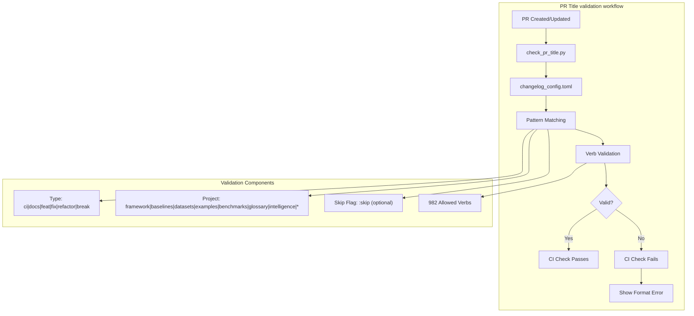
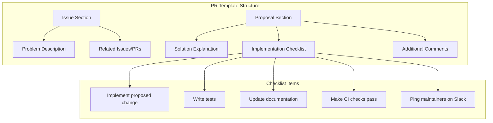
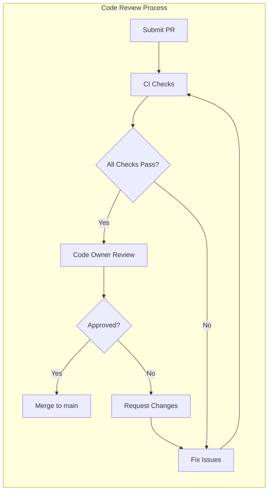

<!-- source: DeepWiki mcp.deepwiki.com · repo adap/flower · page 6.4 Contributing Guidelines · fetched 2026-10-21 -->

# Contributing Guidelines

<details>
<summary>Relevant source files</summary>

The following files were used as context for generating this wiki page:

- [.github/CODE_OF_CONDUCT.md](.github/CODE_OF_CONDUCT.md)
- [.github/PULL_REQUEST_TEMPLATE.md](.github/PULL_REQUEST_TEMPLATE.md)
- [.github/workflows/pr_check.yml](.github/workflows/pr_check.yml)
- [CONTRIBUTING.md](CONTRIBUTING.md)
- [dev/changelog_config.toml](dev/changelog_config.toml)
- [dev/check_pr_title.py](dev/check_pr_title.py)
- [framework/docs/source/ref-changelog.md](framework/docs/source/ref-changelog.md)

</details>


This document outlines the standardized contribution workflow for the Flower federated AI framework, covering pull request (PR) formatting requirements, validation processes, and code review procedures. This guide focuses on the technical aspects of submitting contributions that comply with project standards.

For development environment setup, see [Development Environment Setup](#6.1). For testing and CI/CD infrastructure details, see [Testing and CI/CD](#6.2).

## Pull Request Title Format

All PRs must follow a strict conventional commit format enforced by automated validation. The required format is:

```
<PR_TYPE>(<PR_PROJECT>): <PR_SUBJECT>
```

or for PRs that should not appear in the changelog:

```
<PR_TYPE>(<PR_PROJECT>:skip): <PR_SUBJECT>
```

### Title Format Specification

The PR title validation system uses configuration defined in [dev/changelog_config.toml:4-17]() with the following components:

| Component | Valid Values | Description |
|-----------|-------------|-------------|
| `PR_TYPE` | `ci`, `docs`, `feat`, `fix`, `refactor`, `break` | Type of change |
| `PR_PROJECT` | `framework`, `baselines`, `datasets`, `examples`, `benchmarks`, `glossary`, `intelligence`, `*` | Target project |
| `PR_SUBJECT` | Must start with capitalized imperative verb | Description starting with allowed verb |

The `*` project wildcard can only be used with the `:skip` flag to indicate changes across multiple projects that shouldn't appear in the changelog.

### Title Validation Process



**Title Validation Workflow Diagram**

The validation process is implemented in [dev/check_pr_title.py:22-76]() and triggered by the GitHub workflow [.github/workflows/pr_check.yml:24-25]().

Sources: [dev/changelog_config.toml:4-17](), [dev/check_pr_title.py:22-76](), [.github/workflows/pr_check.yml:24-25]()

### Verb Validation

PR subjects must start with one of 982 approved imperative verbs defined in [dev/changelog_config.toml:20-982](). Common examples include:

- `Add` - for new features
- `Fix` - for bug fixes  
- `Remove` - for deletions
- `Update` - for modifications
- `Refactor` - for code restructuring

The complete verb list validation occurs in [dev/check_pr_title.py:54-56]().

Sources: [dev/changelog_config.toml:20-982](), [dev/check_pr_title.py:54-56]()

## Pull Request Workflow

### PR Template Structure

All PRs use the template defined in [.github/PULL_REQUEST_TEMPLATE.md:1-56]() with mandatory sections:



**PR Template Structure Diagram**

Sources: [.github/PULL_REQUEST_TEMPLATE.md:1-56]()

### Required PR Components

Each PR must include:

1. **Issue Description**: Clear problem statement with examples
2. **Related Issues/PRs**: Links to related work using GitHub syntax
3. **Solution Explanation**: Detailed explanation of changes
4. **Implementation Checklist**: All items must be completed
5. **Documentation Updates**: Links to documentation guidelines
6. **CI Validation**: All automated checks must pass

The template enforces linking to contributor documentation at [.github/PULL_REQUEST_TEMPLATE.md:4]() and testing guidelines.

Sources: [.github/PULL_REQUEST_TEMPLATE.md:8-43]()

## Code Review Process

### Review Requirements

All contributions require code review as specified in [CONTRIBUTING.md:14-15](). The process enforces:

- **Universal Review**: All contributions, including from core members, require review
- **GitHub PR Process**: Standard GitHub pull request workflow
- **CI Gate**: All CI checks must pass before review
- **Code Owner Review**: Responsible code owners conduct reviews

### Review Workflow



**Code Review Workflow Diagram**

The review process integrates with the CI system through [.github/workflows/pr_check.yml:9-11]() concurrency controls that cancel in-progress runs for efficiency.

Sources: [CONTRIBUTING.md:14-15](), [.github/workflows/pr_check.yml:9-11]()

## CI/CD Integration

### Automated PR Validation

The PR check workflow [.github/workflows/pr_check.yml:1-26]() runs on:

- **Trigger Events**: `opened`, `synchronize`, `reopened`, `edited` PR events
- **Target Branch**: `main` branch only
- **Concurrency**: Cancels previous runs for the same PR
- **Validation**: Title format check using Python validation script

### Exemptions and Special Cases

The validation system includes exemptions for:

- **Dependabot PRs**: PRs starting with `build` are automatically exempted [dev/check_pr_title.py:49-50]()
- **Multi-project Changes**: Use `*` project with `:skip` flag [dev/check_pr_title.py:57-59]()
- **Changelog Exclusion**: Use `:skip` suffix to exclude from changelog

Sources: [.github/workflows/pr_check.yml:1-26](), [dev/check_pr_title.py:49-59]()

## Changelog Integration

### Automatic Changelog Generation

PR titles following the correct format are automatically processed for changelog generation. The changelog structure in [framework/docs/source/ref-changelog.md:1-13]() shows:

- **Version Sections**: Organized by release version
- **Contributor Attribution**: Automatic `git shortlog` contributor lists  
- **Change Categories**: Grouped by change type (`feat`, `fix`, etc.)
- **PR Links**: Automatic linking to GitHub PR numbers

### Contributor Recognition

The changelog automatically generates contributor acknowledgments using Git history, as seen in the format:
```
We would like to give our special thanks to all the contributors who made the new version of Flower possible (in `git shortlog` order):
```

This ensures all contributors are properly credited for their work.

Sources: [framework/docs/source/ref-changelog.md:7-11]()

## Legal and Conduct Requirements

### Licensing Requirements

All contributions must comply with Apache License 2.0 as specified in [CONTRIBUTING.md:7]():

- **Mandatory Licensing**: All contributions will be licensed under Apache License 2.0
- **Legal Notice**: Contributors acknowledge licensing terms
- **No Exceptions**: Universal application to all contribution types

### Code of Conduct

Contributors must adhere to the Contributor Covenant as referenced in [CONTRIBUTING.md:11]():

- **Universal Application**: All community members must follow the code
- **Detailed Guidelines**: Full details in `CODE_OF_CONDUCT.md`
- **Enforcement**: Project maintainers enforce conduct standards

Sources: [CONTRIBUTING.md:7-11]()

---

