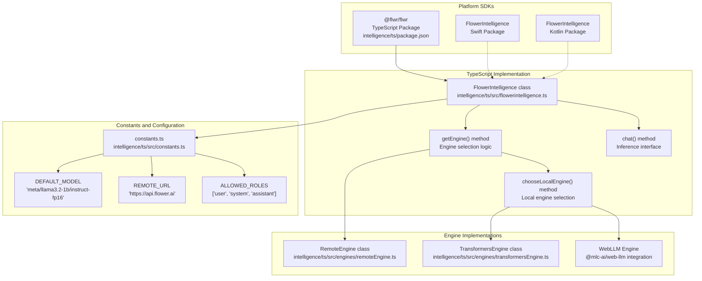
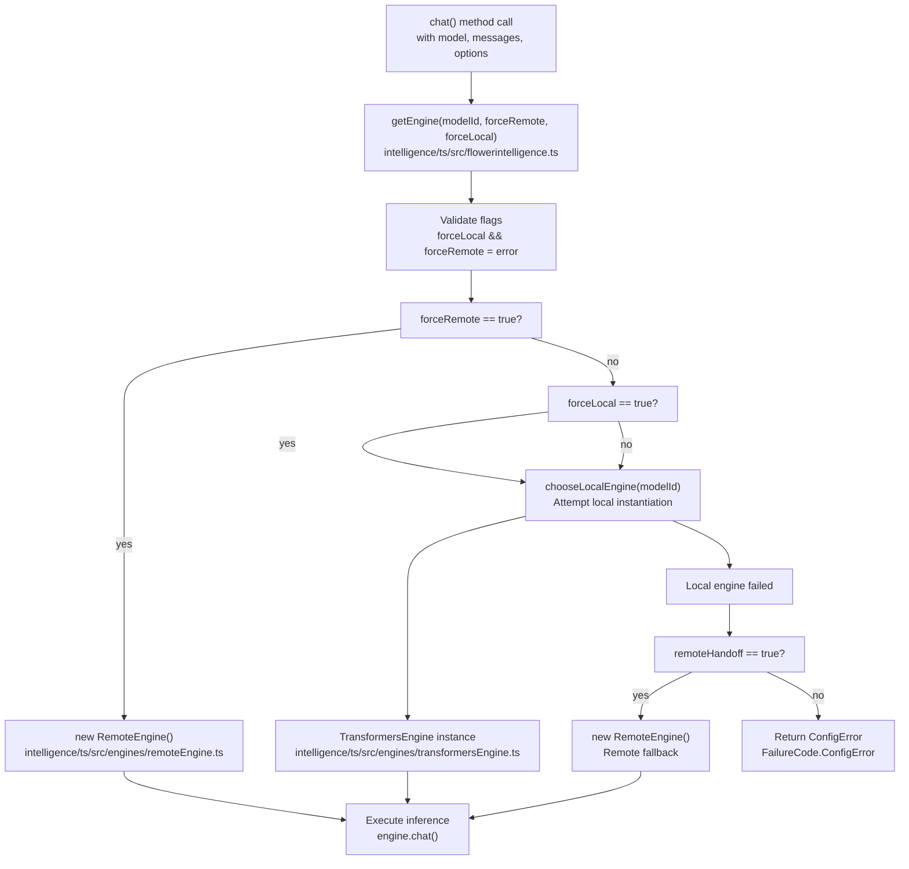

<!-- source: DeepWiki mcp.deepwiki.com · repo adap/flower · page 7 Flower Intelligence · fetched 2026-10-21 -->

# Flower Intelligence

<details>
<summary>Relevant source files</summary>

The following files were used as context for generating this wiki page:

- [intelligence/docs/source/conf.py](intelligence/docs/source/conf.py)
- [intelligence/ts/examples/browser-extension/package.json](intelligence/ts/examples/browser-extension/package.json)
- [intelligence/ts/examples/encrypted/package.json](intelligence/ts/examples/encrypted/package.json)
- [intelligence/ts/examples/hello-world-js/package.json](intelligence/ts/examples/hello-world-js/package.json)
- [intelligence/ts/examples/hello-world-ts/package.json](intelligence/ts/examples/hello-world-ts/package.json)
- [intelligence/ts/examples/nextjs-web-chats/package.json](intelligence/ts/examples/nextjs-web-chats/package.json)
- [intelligence/ts/examples/streaming/package.json](intelligence/ts/examples/streaming/package.json)
- [intelligence/ts/examples/web-chat/package.json](intelligence/ts/examples/web-chat/package.json)
- [intelligence/ts/package.json](intelligence/ts/package.json)
- [intelligence/ts/src/constants.ts](intelligence/ts/src/constants.ts)
- [intelligence/ts/src/flowerintelligence.test.ts](intelligence/ts/src/flowerintelligence.test.ts)

</details>


Flower Intelligence is a multi-platform AI SDK for on-device and remote inference. The system provides client libraries in TypeScript, Swift, and Kotlin that enable applications to execute language models locally or delegate to remote compute infrastructure. The SDK abstracts engine selection, model loading, and execution mode switching while providing optional end-to-end encryption for privacy-sensitive workloads.

The TypeScript SDK is documented in detail at [TypeScript SDK](#7.1). For information about engine selection and execution modes, see [Multi-Platform AI Execution](#7.2). For the broader Flower framework architecture, see [Core Architecture](#2).

## Architecture Overview

Flower Intelligence operates as a hybrid inference system that selects between local and remote execution based on model requirements and configuration. The system provides SDKs for TypeScript, Swift, and Kotlin platforms with consistent APIs.

### Multi-Platform SDK Architecture



Sources: [intelligence/ts/package.json:1-85](), [intelligence/ts/src/constants.ts:1-21](), [intelligence/ts/src/flowerintelligence.test.ts:27-98]()

### Package Structure and Dependencies

The TypeScript SDK is distributed as the `@flwr/flwr` package with dependencies on inference engines:

| Dependency | Version | Purpose |
|------------|---------|---------|
| `@huggingface/transformers` | ^3.4.0 | Local transformer model execution |
| `@mlc-ai/web-llm` | ^0.2.79 | Optimized local LLM execution |
| `get-random-values` | ^3.0.0 | Cryptographic randomness |

The package exports multiple module formats:
- ES module: `dist/flowerintelligence.es.js`
- CommonJS: `dist/flowerintelligence.cjs.js`
- Browser bundle: `dist/flowerintelligence.bundled.es.js`
- TypeScript declarations: `dist/index.d.ts`

Sources: [intelligence/ts/package.json:72-84](), [intelligence/ts/package.json:23-32]()

## Core Components

### FlowerIntelligence Class

The `FlowerIntelligence` class is the main SDK interface, located in [intelligence/ts/src/flowerintelligence.ts](). This class orchestrates engine selection and execution flow.

| Property | Type | Description |
|----------|------|-------------|
| `remoteHandoff` | boolean | Enables fallback to remote when local execution unavailable |
| `apiKey` | string | Authentication key for remote inference API |

| Method | Return Type | Description |
|--------|-------------|-------------|
| `chat()` | Promise<ChatResponse> | Executes inference with message array |
| `getEngine()` | Promise<Result<Engine>> | Selects appropriate engine for model |
| `chooseLocalEngine()` | Promise<Result<Engine>> | Attempts local engine instantiation |

The `chat()` method accepts a configuration object with these options:

| Option | Type | Default | Description |
|--------|------|---------|-------------|
| `model` | string | `DEFAULT_MODEL` | Model identifier |
| `messages` | Message[] | required | Conversation history |
| `maxCompletionTokens` | number | undefined | Token generation limit |
| `responseFormat` | ResponseFormat | undefined | Structured output schema |
| `forceLocal` | boolean | false | Force local execution only |
| `forceRemote` | boolean | false | Force remote execution only |
| `encrypt` | boolean | false | Enable end-to-end encryption |

Sources: [intelligence/ts/src/flowerintelligence.test.ts:35-39](), [intelligence/ts/src/flowerintelligence.test.ts:101-197]()

### Engine Selection Logic

The `getEngine()` method implements the engine selection algorithm. The method signature and behavior:

```
getEngine(modelId: string, forceRemote: boolean, forceLocal: boolean): Promise<Result<Engine>>
```

**Selection Algorithm:**

1. **Validation**: Check that `forceLocal` and `forceRemote` are not both true
2. **Force Remote Path**: If `forceRemote` is true, return `RemoteEngine` instance
3. **Force Local Path**: If `forceLocal` is true, call `chooseLocalEngine()`
4. **Automatic Selection**:
   - Attempt `chooseLocalEngine()` first
   - If local engine unavailable and `remoteHandoff` is enabled, return `RemoteEngine`
   - If local engine unavailable and `remoteHandoff` is disabled, return error

**Engine Selection Flow**



Sources: [intelligence/ts/src/flowerintelligence.test.ts:41-88](), [intelligence/ts/src/constants.ts:16-20]()

## Message Format and Response Types

### Message Structure

Messages are defined with a role and content. The `ALLOWED_ROLES` constant in [intelligence/ts/src/constants.ts:20]() defines valid roles:

```typescript
ALLOWED_ROLES = ['user', 'system', 'assistant']
```

| Role | Purpose | Usage Pattern |
|------|---------|---------------|
| `system` | Context setting | First message in conversation |
| `user` | User input | Queries and requests |
| `assistant` | Model output | Response content |

### Response Formats

The `responseFormat` option enables structured output. Test example from [intelligence/ts/src/flowerintelligence.test.ts:151-197]():

```typescript
responseFormat: {
  type: 'json_schema',
  json_schema: {
    name: 'car-description',
    schema: {
      properties: {
        brand: { title: 'Brand', type: 'string' },
        model: { title: 'Model', type: 'string' },
        car_type: { $ref: '#/$defs/CarType' }
      },
      required: ['brand', 'model', 'car_type']
    }
  }
}
```

This enforces that the model output conforms to the specified JSON schema.

### Token Limiting

The `maxCompletionTokens` option limits generation length. Test case at [intelligence/ts/src/flowerintelligence.test.ts:130-150]() demonstrates setting `maxCompletionTokens: 5` to generate abbreviated responses.

Sources: [intelligence/ts/src/constants.ts:20](), [intelligence/ts/src/flowerintelligence.test.ts:102-197]()

## Remote Execution Mode

### RemoteEngine Implementation

The `RemoteEngine` class (located in [intelligence/ts/src/engines/remoteEngine.ts]()) handles communication with the remote inference API. The remote URL is defined in [intelligence/ts/src/constants.ts:17]() as:

```typescript
REMOTE_URL = 'https://api.flower.ai'
```

### Authentication

The `apiKey` property on `FlowerIntelligence` is used for API authentication. Test setup at [intelligence/ts/src/flowerintelligence.test.ts:38]():

```typescript
fi.apiKey = process.env.FI_API_KEY ?? '';
```

### Encryption Mode

The `encrypt` option enables end-to-end encryption for confidential compute. Test case at [intelligence/ts/src/flowerintelligence.test.ts:115-129]() demonstrates encrypted requests:

```typescript
await fi.chat({
  messages: [...],
  forceRemote: true,
  encrypt: true
});
```

When `encrypt: true` is set, the request payload is encrypted on the client before transmission, and the response is decrypted client-side.

### Error Handling

The system uses a `Result<T>` type with `FailureCode` enumeration for error handling. Test cases check failure codes like `FailureCode.ConfigError` at [intelligence/ts/src/flowerintelligence.test.ts:67]().

Sources: [intelligence/ts/src/constants.ts:17](), [intelligence/ts/src/flowerintelligence.test.ts:38-129]()

## Local Execution Engines

### TransformersEngine

The `TransformersEngine` class (located in [intelligence/ts/src/engines/transformersEngine.ts]()) uses the Hugging Face Transformers.js library. This engine is instantiated by `chooseLocalEngine()` for models that can run locally.

Test case at [intelligence/ts/src/flowerintelligence.test.ts:50-60]() validates local engine selection:

```typescript
const getEngineRes = await fi['getEngine'](
  'huggingface/smollm2-360m/instruct-q4',
  false,
  false
);
expect(getEngineRes.value).toBeInstanceOf(TransformersEngine);
```

The model identifier `huggingface/smollm2-360m/instruct-q4` indicates a quantized (q4) model suitable for local execution.

### WebLLM Integration

The SDK depends on `@mlc-ai/web-llm` version ^0.2.79 ([intelligence/ts/package.json:74]()) for optimized local LLM execution using WebGPU acceleration.

### Browser Environment Configuration

The package configuration at [intelligence/ts/package.json:77-82]() disables Node.js-specific modules for browser compatibility:

```json
"browser": {
  "fs": false,
  "fs/promises": false,
  "path": false,
  "os": false
}
```

This configuration prevents bundlers from including Node.js polyfills in browser builds.

Sources: [intelligence/ts/package.json:72-84](), [intelligence/ts/src/flowerintelligence.test.ts:50-60]()

## Example Applications

The TypeScript SDK includes example applications in the [intelligence/ts/examples/]() directory demonstrating integration patterns:

| Example | Path | Dependencies | Purpose |
|---------|------|--------------|---------|
| Browser Extension | `browser-extension/` | `webextension-polyfill`, `@mozilla/readability` | Content analysis extension |
| Web Chat | `web-chat/` | `vite` | Browser-based chat interface |
| Next.js Chat | `nextjs-web-chats/` | `next`, `react-markdown` | Server-side rendered chat app |
| Hello World (TS) | `hello-world-ts/` | `typescript` | Basic TypeScript usage |
| Hello World (JS) | `hello-world-js/` | None | Basic JavaScript usage |
| Streaming | `streaming/` | `typescript` | Streaming response handling |
| Encrypted | `encrypted/` | `typescript` | End-to-end encrypted inference |

### Package Scripts

The SDK package.json at [intelligence/ts/package.json:34-51]() defines scripts for running examples:

```json
"demo": "cd examples/hello-world-ts && pnpm i && pnpm build && pnpm start && cd ../..",
"demo:js": "cd examples/hello-world-js && pnpm i && pnpm start && cd ../..",
"demo:stream": "cd examples/streaming && pnpm i && pnpm build && pnpm start && cd ../..",
"demo:ee": "cd examples/encrypted && pnpm i && pnpm build && pnpm start && cd ../.."
```

These scripts automate example execution for development and testing.

Sources: [intelligence/ts/package.json:34-51](), [intelligence/ts/examples/web-chat/package.json:1-18](), [intelligence/ts/examples/browser-extension/package.json:1-36](), [intelligence/ts/examples/nextjs-web-chats/package.json:1-31](), [intelligence/ts/examples/encrypted/package.json:1-19](), [intelligence/ts/examples/streaming/package.json:1-19]()

## Documentation and Development

The Flower Intelligence system includes comprehensive documentation infrastructure built with Sphinx and TypeDoc, supporting both API documentation and user guides.

### Documentation System

| Component | Technology | Purpose |
|-----------|------------|---------|
| **API Documentation** | TypeDoc | Automated TypeScript API docs |
| **User Documentation** | Sphinx + Furo theme | User guides and tutorials |
| **Jupyter Notebooks** | nbsphinx | Interactive examples |
| **Mermaid Diagrams** | sphinx extensions | System architecture diagrams |

The documentation is configured for multi-language support and includes Google Colab integration for interactive examples. The build system generates both HTML documentation and serves it locally for development purposes.

Sources: [intelligence/docs/source/conf.py:33-118](), [intelligence/ts/package.json:35-51]()

---

