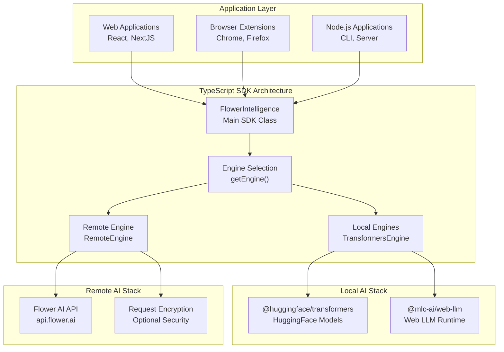
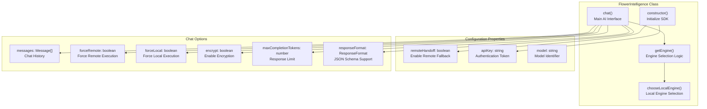
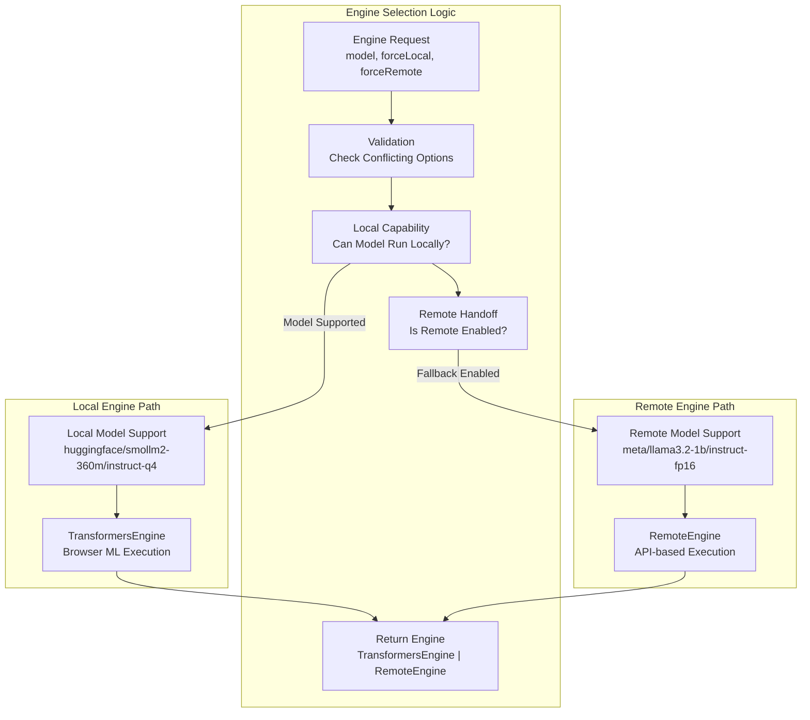
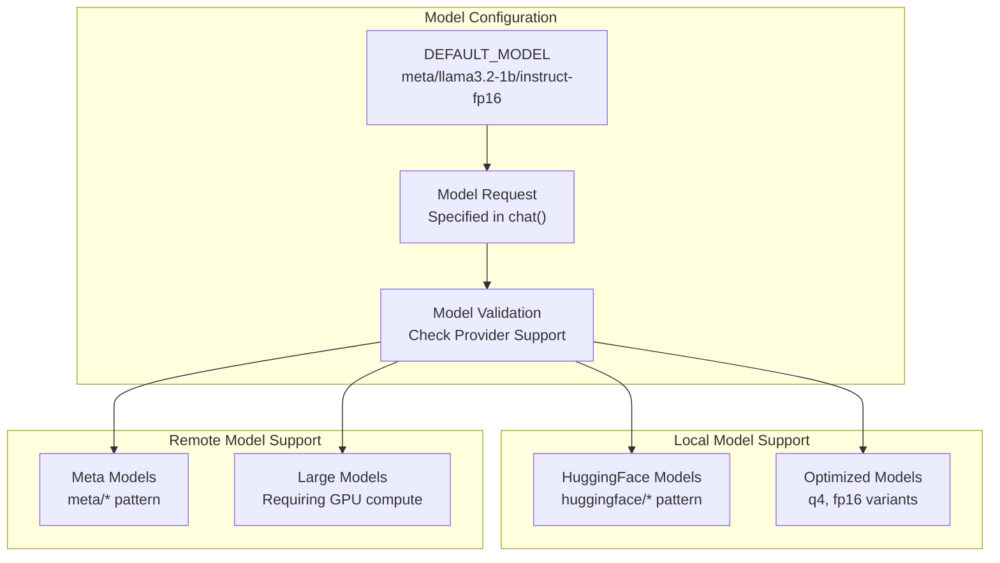
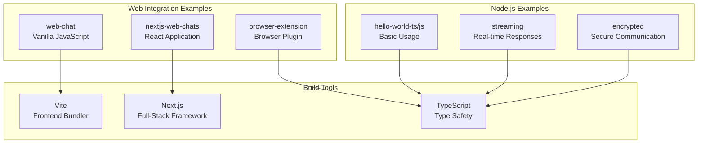
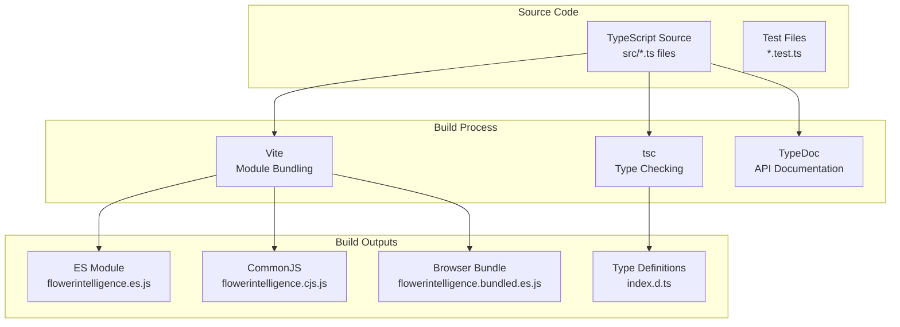

<!-- source: DeepWiki mcp.deepwiki.com · repo adap/flower · page 7.1 TypeScript SDK · fetched 2026-10-21 -->

# TypeScript SDK

<details>
<summary>Relevant source files</summary>

The following files were used as context for generating this wiki page:

- [intelligence/docs/source/conf.py](intelligence/docs/source/conf.py)
- [intelligence/ts/examples/browser-extension/package.json](intelligence/ts/examples/browser-extension/package.json)
- [intelligence/ts/examples/encrypted/package.json](intelligence/ts/examples/encrypted/package.json)
- [intelligence/ts/examples/hello-world-js/package.json](intelligence/ts/examples/hello-world-js/package.json)
- [intelligence/ts/examples/hello-world-ts/package.json](intelligence/ts/examples/hello-world-ts/package.json)
- [intelligence/ts/examples/nextjs-web-chats/package.json](intelligence/ts/examples/nextjs-web-chats/package.json)
- [intelligence/ts/examples/streaming/package.json](intelligence/ts/examples/streaming/package.json)
- [intelligence/ts/examples/web-chat/package.json](intelligence/ts/examples/web-chat/package.json)
- [intelligence/ts/package.json](intelligence/ts/package.json)
- [intelligence/ts/src/constants.ts](intelligence/ts/src/constants.ts)
- [intelligence/ts/src/flowerintelligence.test.ts](intelligence/ts/src/flowerintelligence.test.ts)

</details>


The TypeScript SDK (`@flwr/flwr`) provides client-side AI capabilities for building intelligent applications that can run AI models either locally in the browser/Node.js environment or through secure remote compute. This SDK is part of the broader Flower Intelligence ecosystem, enabling developers to integrate AI functionality into web applications, browser extensions, and Node.js applications.

For information about the broader Flower Intelligence architecture and remote compute capabilities, see [On-Device and Remote AI](#7.2).

## Overview

The TypeScript SDK consists of a core `FlowerIntelligence` class that abstracts away the complexity of model execution, automatically choosing between local and remote engines based on model requirements and configuration. The SDK supports multiple execution modes, response formats, and includes built-in encryption for sensitive workloads.



Sources: [intelligence/ts/package.json:1-85](), [intelligence/ts/src/flowerintelligence.test.ts:16-199]()

## Core Components

### FlowerIntelligence Class

The `FlowerIntelligence` class serves as the primary interface for all SDK functionality. It manages engine selection, configuration, and provides the main `chat()` method for AI interactions.



Sources: [intelligence/ts/src/flowerintelligence.test.ts:32-89](), [intelligence/ts/src/flowerintelligence.test.ts:100-198]()

### Engine Architecture

The SDK implements a dual-engine architecture supporting both local and remote AI execution:

| Engine Type | Class Name | Use Case | Dependencies |
|-------------|------------|----------|-------------|
| Local | `TransformersEngine` | Browser/Node.js execution | `@huggingface/transformers`, `@mlc-ai/web-llm` |
| Remote | `RemoteEngine` | Secure cloud execution | Flower AI API |



Sources: [intelligence/ts/src/flowerintelligence.test.ts:41-98](), [intelligence/ts/package.json:72-76]()

## Installation and Basic Usage

### Package Installation

The SDK is distributed as an npm package with multiple build targets:

```bash
npm install @flwr/flwr
```

### Package Configuration

The SDK provides multiple entry points for different environments:

| Environment | Entry Point | File |
|-------------|-------------|------|
| ES Modules | `import` | `flowerintelligence.es.js` |
| CommonJS | `require` | `flowerintelligence.cjs.js` |
| Browser Bundle | `browser` | `flowerintelligence.bundled.es.js` |
| TypeScript | `types` | `index.d.ts` |

Sources: [intelligence/ts/package.json:22-33]()

### Basic Chat Implementation

```typescript
import { FlowerIntelligence } from '@flwr/flwr';

const fi = new FlowerIntelligence();
fi.remoteHandoff = true;
fi.apiKey = 'your-api-key';

const response = await fi.chat({
  messages: [
    { role: 'system', content: 'You are a helpful assistant' },
    { role: 'user', content: 'Hello, how can AI help me today?' }
  ]
});
```

Sources: [intelligence/ts/src/flowerintelligence.test.ts:35-39](), [intelligence/ts/src/flowerintelligence.test.ts:102-114]()

## Configuration Options

### Model Selection

The SDK supports various model identifiers for different capabilities:

| Model Pattern | Example | Execution |
|---------------|---------|-----------|
| Local Small Models | `huggingface/smollm2-360m/instruct-q4` | Local only |
| Remote Large Models | `meta/llama3.2-1b/instruct-fp16` | Remote preferred |
| Default Model | Defined in `DEFAULT_MODEL` constant | Configurable |



Sources: [intelligence/ts/src/constants.ts:16-20](), [intelligence/ts/src/flowerintelligence.test.ts:50-60]()

### Response Format Control

The SDK supports structured output through JSON Schema validation:

```typescript
const responseFormat: ResponseFormat = {
  type: 'json_schema',
  json_schema: {
    name: 'car-description',
    schema: {
      properties: {
        brand: { title: 'Brand', type: 'string' },
        model: { title: 'Model', type: 'string' },
        car_type: { 
          enum: ['sedan', 'SUV', 'Truck', 'Coupe'],
          type: 'string' 
        }
      },
      required: ['brand', 'model', 'car_type'],
      type: 'object'
    }
  }
};
```

Sources: [intelligence/ts/src/flowerintelligence.test.ts:152-197]()

## Example Applications

The SDK includes comprehensive examples demonstrating various integration patterns:

### Web Applications

| Example | Framework | Purpose |
|---------|-----------|---------|
| `web-chat` | Vanilla JS + Vite | Basic web chat interface |
| `nextjs-web-chats` | Next.js + React | Production web application |
| `browser-extension` | WebExtension API | Browser extension integration |



Sources: [intelligence/ts/examples/web-chat/package.json:1-18](), [intelligence/ts/examples/nextjs-web-chats/package.json:1-31](), [intelligence/ts/examples/browser-extension/package.json:1-36]()

### Development Commands

The SDK provides a comprehensive development workflow:

| Command | Purpose | Example Usage |
|---------|---------|---------------|
| `pnpm demo` | Run TypeScript demo | Basic functionality test |
| `pnpm demo:js` | Run JavaScript demo | JavaScript compatibility |
| `pnpm demo:stream` | Run streaming demo | Real-time responses |
| `pnpm demo:ee` | Run encrypted demo | Secure communication |

Sources: [intelligence/ts/package.json:39-43]()

## Build and Distribution

### Build System

The SDK uses a multi-target build system supporting various JavaScript environments:



Sources: [intelligence/ts/package.json:34-52](), [intelligence/ts/package.json:22-33]()

### Quality Assurance

The SDK implements comprehensive quality controls:

| Tool | Purpose | Command |
|------|---------|---------|
| `eslint` | Code linting and style | `pnpm lint` |
| `prettier` | Code formatting | `pnpm format` |
| `vitest` | Unit testing | `pnpm test` |
| `typescript` | Type checking | `pnpm build:types` |

Sources: [intelligence/ts/package.json:44-51](), [intelligence/ts/package.json:53-71]()

## API Constants and Configuration

The SDK maintains several key constants for configuration and operation:

| Constant | Value | Purpose |
|----------|-------|---------|
| `DEFAULT_MODEL` | `meta/llama3.2-1b/instruct-fp16` | Default model selection |
| `REMOTE_URL` | `https://api.flower.ai` | Remote API endpoint |
| `VERSION` | `0.2.2` | SDK version identifier |
| `SDK` | `TS` | SDK type identifier |
| `ALLOWED_ROLES` | `['user', 'system', 'assistant']` | Valid message roles |

Sources: [intelligence/ts/src/constants.ts:16-20](), [intelligence/ts/package.json:21]()

---

