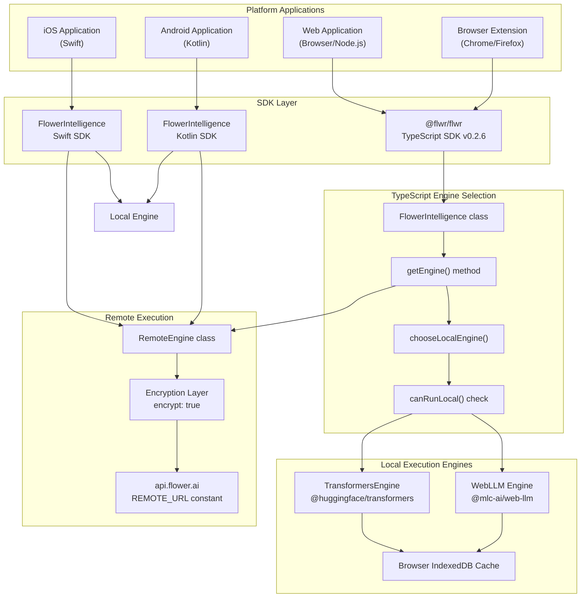
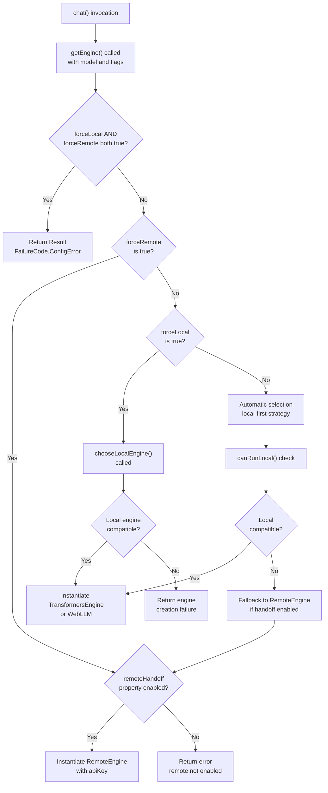
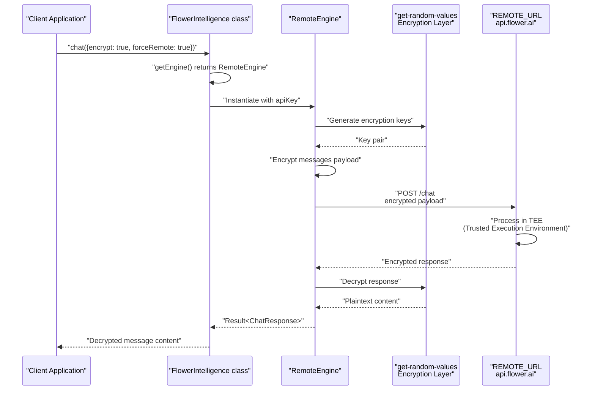

<!-- source: DeepWiki mcp.deepwiki.com · repo adap/flower · page 7.2 Multi-Platform AI Execution · fetched 2026-10-21 -->

# Multi-Platform AI Execution

<details>
<summary>Relevant source files</summary>

The following files were used as context for generating this wiki page:

- [intelligence/docs/source/conf.py](intelligence/docs/source/conf.py)
- [intelligence/ts/examples/browser-extension/package.json](intelligence/ts/examples/browser-extension/package.json)
- [intelligence/ts/examples/encrypted/package.json](intelligence/ts/examples/encrypted/package.json)
- [intelligence/ts/examples/hello-world-js/package.json](intelligence/ts/examples/hello-world-js/package.json)
- [intelligence/ts/examples/hello-world-ts/package.json](intelligence/ts/examples/hello-world-ts/package.json)
- [intelligence/ts/examples/nextjs-web-chats/package.json](intelligence/ts/examples/nextjs-web-chats/package.json)
- [intelligence/ts/examples/streaming/package.json](intelligence/ts/examples/streaming/package.json)
- [intelligence/ts/examples/web-chat/package.json](intelligence/ts/examples/web-chat/package.json)
- [intelligence/ts/package.json](intelligence/ts/package.json)
- [intelligence/ts/src/constants.ts](intelligence/ts/src/constants.ts)
- [intelligence/ts/src/flowerintelligence.test.ts](intelligence/ts/src/flowerintelligence.test.ts)

</details>


This document explains how Flower Intelligence enables AI inference across multiple platforms (web, iOS, Android) using intelligent engine selection between `TransformersEngine` for local execution and `RemoteEngine` for remote execution. The system implements a local-first execution strategy with automatic fallback to confidential remote compute when needed.

For information about the TypeScript SDK APIs and interfaces, see [TypeScript SDK](#7.1). For the overall Flower framework architecture, see [Core Architecture](#2).

## Overview and Platform Support

Flower Intelligence provides multi-platform AI execution capabilities through three SDK implementations:

| SDK | Version | Platforms | Package Name |
|-----|---------|-----------|--------------|
| TypeScript | 0.2.6 | Web (Browser/Node.js), Browser Extensions | `@flwr/flwr` |
| Swift | Latest | iOS | `FlowerIntelligence` |
| Kotlin | Latest | Android | `FlowerIntelligence` |

The TypeScript SDK serves as the primary implementation and is distributed via npm at [intelligence/ts/package.json:2](), with exports configured for both CommonJS and ES modules [intelligence/ts/package.json:26-32](). The Swift and Kotlin SDKs provide equivalent functionality for native mobile platforms, enabling consistent AI execution behavior across web and mobile applications.

### Execution Modes

The system supports three execution modes across all platforms:

1. **Local Execution**: Privacy-preserving on-device inference using `TransformersEngine` (web) or native engines (mobile)
2. **Remote Execution**: Scalable cloud inference via `RemoteEngine` connecting to `api.flower.ai`
3. **Encrypted Remote Compute**: Confidential compute with end-to-end encryption for sensitive workloads

The default behavior implements a **local-first strategy**: attempting local execution first, with automatic fallback to remote execution when models exceed device capabilities or are incompatible with local engines.

Sources: [intelligence/ts/package.json:2-32](), [intelligence/ts/src/constants.ts:17](), [intelligence/docs/source/conf.py:38]()

## Architecture and Engine Selection

The execution architecture centers around the `FlowerIntelligence` class [intelligence/ts/src/flowerintelligence.test.ts:33]() which orchestrates between `TransformersEngine` and `RemoteEngine` based on model requirements and configuration parameters.

### Multi-Platform Architecture



### Engine Dependencies

The TypeScript SDK declares engine dependencies in [intelligence/ts/package.json:72-76]():

| Dependency | Version | Purpose |
|------------|---------|---------|
| `@huggingface/transformers` | ^3.4.0 | `TransformersEngine` for lightweight models |
| `@mlc-ai/web-llm` | ^0.2.79 | `WebLLM` engine for quantized models |
| `get-random-values` | ^3.0.0 | Cryptographic randomness for encryption |

Sources: [intelligence/ts/package.json:72-76](), [intelligence/ts/src/flowerintelligence.test.ts:27-60](), [intelligence/ts/src/constants.ts:17]()

## Engine Selection Logic

The `getEngine()` method [intelligence/ts/src/flowerintelligence.test.ts:43]() implements intelligent routing between `TransformersEngine` and `RemoteEngine` by evaluating model compatibility, execution preferences (`forceLocal`, `forceRemote`), and the `remoteHandoff` configuration.

### Engine Selection Flow

**Diagram: Engine Selection Decision Tree**



### Test Coverage for Engine Selection

The test suite [intelligence/ts/src/flowerintelligence.test.ts:41-88]() validates the engine selection logic:

| Test Case | Model | Flags | Expected Result |
|-----------|-------|-------|----------------|
| Force remote | `meta/llama3.2-1b/instruct-fp16` | `forceRemote: true` | `RemoteEngine` instance |
| Local capable | `huggingface/smollm2-360m/instruct-q4` | None | `TransformersEngine` instance |
| Conflicting flags | Any | `forceLocal: true, forceRemote: true` | `FailureCode.ConfigError` |
| Remote disabled | Any | `forceRemote: true, remoteHandoff: false` | Error returned |

Sources: [intelligence/ts/src/flowerintelligence.test.ts:41-88](), [intelligence/ts/src/flowerintelligence.test.ts:90-98]()

### Model Compatibility and Default Model

The `DEFAULT_MODEL` constant [intelligence/ts/src/constants.ts:16]() is set to `'meta/llama3.2-1b/instruct-fp16'`, which serves as the fallback model when no model is explicitly specified.

**Model Compatibility Matrix**

The `canRunLocal()` method determines which models can execute on `TransformersEngine` versus requiring `RemoteEngine`:

| Model ID | Local Execution | Remote Execution | Engine Type | Notes |
|----------|----------------|------------------|-------------|-------|
| `huggingface/smollm2-360m/instruct-q4` | ✓ | ✓ | `TransformersEngine` | Quantized, small |
| `meta/llama3.2-1b/instruct-fp16` | ✗ | ✓ | `RemoteEngine` | Default model |
| Quantized models (`-q4`, `-q8`) | ✓ | ✓ | `TransformersEngine` | Efficient for web |
| Large models (>1B parameters) | ✗ | ✓ | `RemoteEngine` | Exceed browser limits |
| FP16 models | ✗ | ✓ | `RemoteEngine` | High memory usage |

Test validation: [intelligence/ts/src/flowerintelligence.test.ts:50-59]() verifies that `huggingface/smollm2-360m/instruct-q4` creates a `TransformersEngine` instance, while [intelligence/ts/src/flowerintelligence.test.ts:42-47]() confirms `meta/llama3.2-1b/instruct-fp16` requires `RemoteEngine`.

Sources: [intelligence/ts/src/flowerintelligence.test.ts:50-59](), [intelligence/ts/src/constants.ts:16](), [intelligence/ts/src/flowerintelligence.test.ts:42-47]()

## Encrypted Remote Compute

For sensitive workloads, Flower Intelligence supports end-to-end encryption through the `encrypt: true` configuration option. This feature encrypts both input prompts and model responses during transmission and processing, enabling confidential compute scenarios.

### Encrypted Execution Flow

**Diagram: Encrypted Remote Inference Sequence**



### Encryption Configuration

The encryption feature is validated by test [intelligence/ts/src/flowerintelligence.test.ts:115-129]():

```typescript
const data = await fi.chat({
  messages: [
    { role: 'system', content: 'You are a helpful assistant' },
    { role: 'user', content: 'Sensitive query content' }
  ],
  forceRemote: true,  // Must use RemoteEngine
  encrypt: true       // Enable end-to-end encryption
});
```

The encryption layer uses the `get-random-values` library [intelligence/ts/package.json:75]() to generate cryptographically secure random values for key generation. The `RemoteEngine` handles encryption transparently, requiring only the `encrypt` flag to be set.

**Encryption Requirements**

| Parameter | Required Value | Reason |
|-----------|---------------|--------|
| `forceRemote` | `true` | Encryption only supported for remote execution |
| `encrypt` | `true` | Enables end-to-end encryption layer |
| `apiKey` | Valid key | Required for authenticated remote access |
| `remoteHandoff` | `true` | Must enable remote execution capability |

Sources: [intelligence/ts/src/flowerintelligence.test.ts:115-129](), [intelligence/ts/package.json:75](), [intelligence/ts/src/constants.ts:17]()

## Configuration and API Surface

The `FlowerIntelligence` class accepts configuration through instance properties and method parameters to control execution behavior.

### FlowerIntelligence Instance Configuration

Configuration set on the `FlowerIntelligence` instance [intelligence/ts/src/flowerintelligence.test.ts:35-38]():

| Property | Type | Description | Test Reference |
|----------|------|-------------|----------------|
| `remoteHandoff` | `boolean` | Enable automatic fallback to `RemoteEngine` | Line 37 |
| `apiKey` | `string` | Authentication token for `api.flower.ai` | Line 38 |

### Chat Method Parameters

Parameters passed to the `chat()` method [intelligence/ts/src/flowerintelligence.test.ts:102-197]():

| Parameter | Type | Description | Default Value |
|-----------|------|-------------|---------------|
| `model` | `string` | Model identifier | `DEFAULT_MODEL` (`'meta/llama3.2-1b/instruct-fp16'`) |
| `messages` | `Message[]` | Conversation with roles from `ALLOWED_ROLES` | Required |
| `forceLocal` | `boolean` | Force `TransformersEngine` | `false` |
| `forceRemote` | `boolean` | Force `RemoteEngine` | `false` |
| `encrypt` | `boolean` | Enable end-to-end encryption | `false` |
| `maxCompletionTokens` | `number` | Token limit for response | Unlimited |
| `responseFormat` | `ResponseFormat` | JSON schema for structured output | Plain text |

### Message Role Validation

The `ALLOWED_ROLES` constant [intelligence/ts/src/constants.ts:20]() defines valid message roles:

```typescript
export const ALLOWED_ROLES = ['user', 'system', 'assistant'] as const;
```

Test coverage includes:
- Basic chat [intelligence/ts/src/flowerintelligence.test.ts:101-114]()
- Encrypted chat [intelligence/ts/src/flowerintelligence.test.ts:115-129]()
- Token limiting [intelligence/ts/src/flowerintelligence.test.ts:130-150]()
- Structured output [intelligence/ts/src/flowerintelligence.test.ts:151-197]()

Sources: [intelligence/ts/src/flowerintelligence.test.ts:35-38](), [intelligence/ts/src/flowerintelligence.test.ts:102-197](), [intelligence/ts/src/constants.ts:16-20]()

## Examples and Use Cases

The codebase includes several example implementations demonstrating different execution scenarios:

### Basic Usage Examples

| Example | Path | Purpose |
|---------|------|---------|
| Hello World (TypeScript) | `intelligence/ts/examples/hello-world-ts/` | Basic chat implementation |
| Hello World (JavaScript) | `intelligence/ts/examples/hello-world-js/` | Plain JS integration |
| Streaming | `intelligence/ts/examples/streaming/` | Real-time response streaming |
| Encrypted | `intelligence/ts/examples/encrypted/` | Confidential remote compute |

### Web Application Examples

| Example | Path | Purpose |
|---------|------|---------|
| Web Chat | `intelligence/ts/examples/web-chat/` | Browser-based chat interface |
| Next.js Web Chats | `intelligence/ts/examples/nextjs-web-chats/` | React/Next.js integration |
| Browser Extension | `intelligence/ts/examples/browser-extension/` | Chrome extension implementation |

All examples use the `@flwr/flwr` package and demonstrate different aspects of the on-device and remote AI execution capabilities.

Sources: [intelligence/ts/examples/hello-world-ts/package.json:12-13](), [intelligence/ts/examples/encrypted/package.json:12-13](), [intelligence/ts/examples/web-chat/package.json:11-12](), [intelligence/ts/examples/browser-extension/package.json:14-15]()

---

