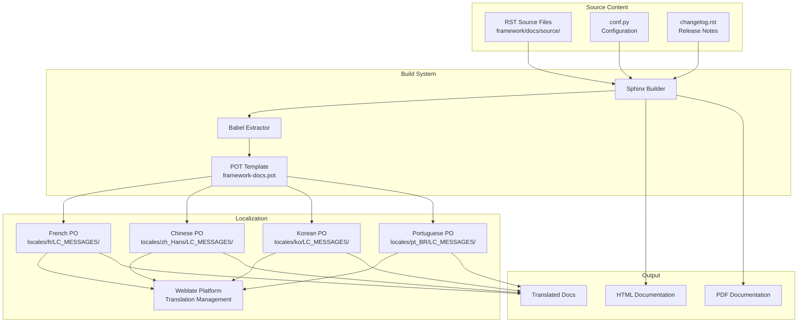
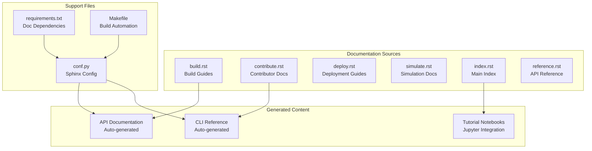
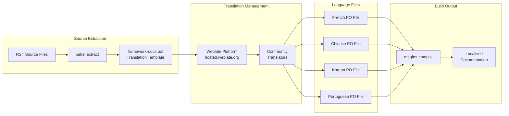
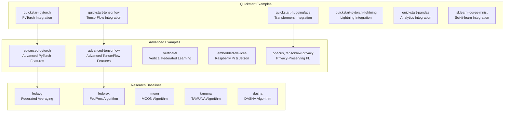
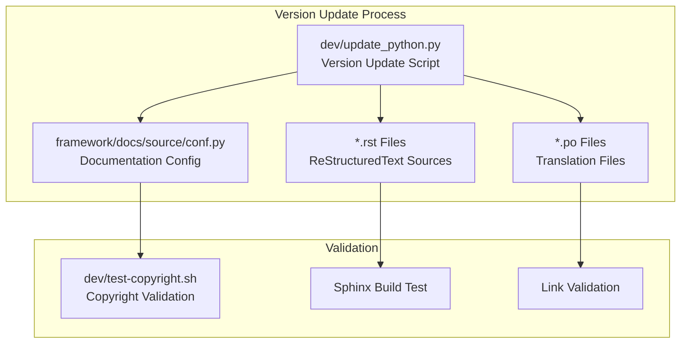
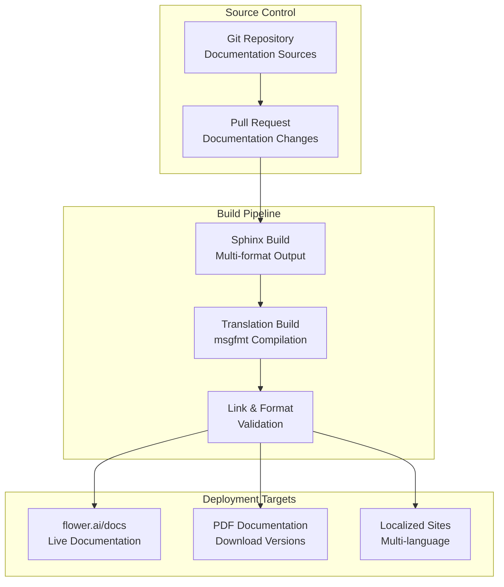

<!-- source: DeepWiki mcp.deepwiki.com · repo adap/flower · page 8 Documentation System · fetched 2026-10-21 -->

# Documentation System

Relevant source files

The following files were used as context for generating this wiki page:

- [.devcontainer/Dockerfile](.devcontainer/Dockerfile)
- [.github/actions/bootstrap/action.yml](.github/actions/bootstrap/action.yml)
- [.github/workflows/baselines.yml](.github/workflows/baselines.yml)
- [.github/workflows/deprecated_baselines.yml](.github/workflows/deprecated_baselines.yml)
- [baselines/docs/source/conf.py](baselines/docs/source/conf.py)
- [baselines/flwr_baselines/dev/bootstrap.sh](baselines/flwr_baselines/dev/bootstrap.sh)
- [baselines/flwr_baselines/dev/setup-defaults.sh](baselines/flwr_baselines/dev/setup-defaults.sh)
- [baselines/flwr_baselines/dev/venv-create.sh](baselines/flwr_baselines/dev/venv-create.sh)
- [baselines/flwr_baselines/dev/venv-delete.sh](baselines/flwr_baselines/dev/venv-delete.sh)
- [baselines/flwr_baselines/dev/venv-reset.sh](baselines/flwr_baselines/dev/venv-reset.sh)
- [baselines/flwr_baselines/flwr_baselines/publications/adaptive_federated_optimization/main.py](baselines/flwr_baselines/flwr_baselines/publications/adaptive_federated_optimization/main.py)
- [dev/bootstrap.sh](dev/bootstrap.sh)
- [dev/update-html-themes.py](dev/update-html-themes.py)
- [examples/docs/source/conf.py](examples/docs/source/conf.py)
- [framework/docs/locales/fr/LC_MESSAGES/framework-docs.po](framework/docs/locales/fr/LC_MESSAGES/framework-docs.po)
- [framework/docs/locales/ko/LC_MESSAGES/framework-docs.po](framework/docs/locales/ko/LC_MESSAGES/framework-docs.po)
- [framework/docs/locales/pt_BR/LC_MESSAGES/framework-docs.po](framework/docs/locales/pt_BR/LC_MESSAGES/framework-docs.po)
- [framework/docs/locales/zh_Hans/LC_MESSAGES/framework-docs.po](framework/docs/locales/zh_Hans/LC_MESSAGES/framework-docs.po)
- [framework/docs/source/conf.py](framework/docs/source/conf.py)

The Flower documentation system provides comprehensive, multilingual documentation for the federated learning framework. It consists of a Sphinx-based build system with integrated localization, extensive examples, and automated maintenance workflows.

For information about dataset management, see [FederatedDataset](#4.1). For deployment documentation, see [Docker Deployment](#5.1).

## Documentation Architecture

The documentation system is built on Sphinx with reStructuredText source files and supports multiple output formats including HTML and PDF. The system is designed to handle both framework documentation and community-contributed content.

**Sphinx Build System Architecture**

Sources: [framework/docs/locales/fr/LC_MESSAGES/framework-docs.po:1-50](), [CHANGELOG.md:1-6]()

## Core Documentation Components

The documentation system consists of several key components that work together to provide comprehensive coverage of the Flower framework.

| Component | Location | Purpose |
|-----------|----------|---------|
| Source Files | `framework/docs/source/` | ReStructuredText documentation source |
| Configuration | `framework/docs/source/conf.py` | Sphinx build configuration |
| Locales | `framework/docs/locales/*/LC_MESSAGES/` | Translation files |
| Templates | `framework/docs/source/_templates/` | Custom documentation templates |
| Static Assets | `framework/docs/source/_static/` | Images, CSS, JavaScript |

**Documentation Source Structure**

Sources: [framework/docs/locales/fr/LC_MESSAGES/framework-docs.po:18-45](), [framework/docs/locales/zh_Hans/LC_MESSAGES/framework-docs.po:22-105]()

## Translation Infrastructure

The documentation system implements GNU gettext-based internationalization with community translation support through Weblate. Translation strings are extracted from source files and managed through `.po` files for each supported language.

### Supported Languages

| Language | Code | PO File Location | Translator Count |
|----------|------|------------------|------------------|
| French | `fr` | `locales/fr/LC_MESSAGES/framework-docs.po` | Community |
| Chinese (Simplified) | `zh_Hans` | `locales/zh_Hans/LC_MESSAGES/framework-docs.po` | Community |
| Korean | `ko` | `locales/ko/LC_MESSAGES/framework-docs.po` | Community |
| Portuguese (Brazil) | `pt_BR` | `locales/pt_BR/LC_MESSAGES/framework-docs.po` | Community |

### Translation Workflow

**Translation Workflow Process**

Sources: [framework/docs/locales/fr/LC_MESSAGES/framework-docs.po:613-720](), [framework/docs/locales/zh_Hans/LC_MESSAGES/framework-docs.po:610-736](), [framework/docs/locales/ko/LC_MESSAGES/framework-docs.po:589-736]()

## Examples and Baselines Integration

The documentation system provides comprehensive coverage of examples and research baselines, making them discoverable and maintainable as part of the main documentation.

### Example Categories

**Examples and Baselines Organization**

Sources: [README.md:92-122](), [README.md:123-160]()

## Automated Maintenance

The documentation system includes automated maintenance workflows to ensure consistency and accuracy across releases.

### Version Management

The system automatically updates documentation versions during release cycles through automated scripts that maintain consistency across different file types.

**Automated Maintenance Workflow**

### Copyright Management

The documentation system enforces consistent copyright headers across all documentation configuration files using automated validation.

| Check Type | Script | Target Files | Pattern |
|------------|--------|--------------|---------|
| Copyright Header | `dev/test-copyright.sh` | `*/docs/source/conf.py` | `f"{datetime.date.today().year} Flower Labs GmbH"` |
| Version Consistency | `dev/update_python.py` | `**/*.rst`, `**/*.po` | Python version strings |
| Link Validation | CI/CD Pipeline | All documentation | External link health |

Sources: [dev/test-copyright.sh:1-16](), [dev/update_python.py:145-192](), [CHANGELOG.md:3-6]()

## Build and Deployment Pipeline

The documentation system is integrated with the overall Flower CI/CD pipeline, providing automated builds, validation, and deployment of documentation across multiple languages and formats.

**Documentation Build and Deployment Pipeline**

Sources: [framework/docs/locales/fr/LC_MESSAGES/framework-docs.po:4-16](), [framework/docs/locales/zh_Hans/LC_MESSAGES/framework-docs.po:8-20]()

---

