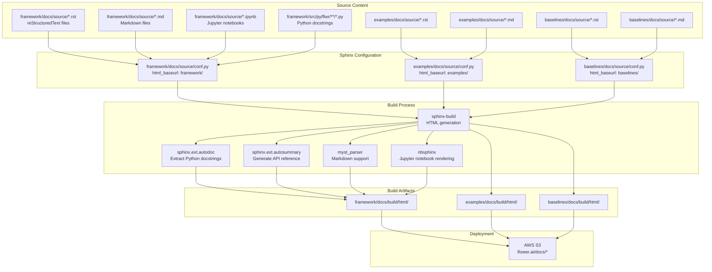
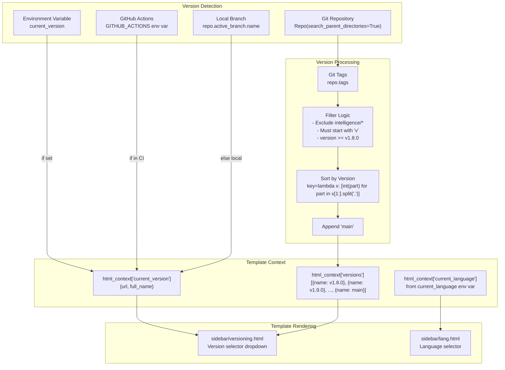
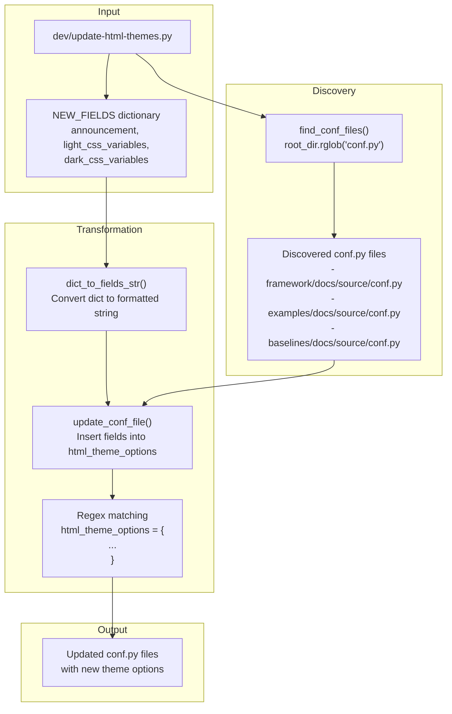

<!-- source: DeepWiki mcp.deepwiki.com · repo adap/flower · page 8.1 Documentation Build Process · fetched 2026-10-21 -->

# Documentation Build Process

<details>
<summary>Relevant source files</summary>

The following files were used as context for generating this wiki page:

- [.devcontainer/Dockerfile](.devcontainer/Dockerfile)
- [.github/actions/bootstrap/action.yml](.github/actions/bootstrap/action.yml)
- [.github/workflows/baselines.yml](.github/workflows/baselines.yml)
- [.github/workflows/deprecated_baselines.yml](.github/workflows/deprecated_baselines.yml)
- [README.md](README.md)
- [baselines/docs/source/conf.py](baselines/docs/source/conf.py)
- [baselines/flwr_baselines/dev/bootstrap.sh](baselines/flwr_baselines/dev/bootstrap.sh)
- [baselines/flwr_baselines/dev/setup-defaults.sh](baselines/flwr_baselines/dev/setup-defaults.sh)
- [baselines/flwr_baselines/dev/venv-create.sh](baselines/flwr_baselines/dev/venv-create.sh)
- [baselines/flwr_baselines/dev/venv-delete.sh](baselines/flwr_baselines/dev/venv-delete.sh)
- [baselines/flwr_baselines/dev/venv-reset.sh](baselines/flwr_baselines/dev/venv-reset.sh)
- [baselines/flwr_baselines/flwr_baselines/publications/adaptive_federated_optimization/main.py](baselines/flwr_baselines/flwr_baselines/publications/adaptive_federated_optimization/main.py)
- [dev/bootstrap.sh](dev/bootstrap.sh)
- [dev/update-html-themes.py](dev/update-html-themes.py)
- [examples/docs/source/conf.py](examples/docs/source/conf.py)
- [framework/docs/source/conf.py](framework/docs/source/conf.py)

</details>


## Purpose and Scope

This document explains how Flower's documentation is built, configured, and deployed. It covers the Sphinx-based build system, configuration files, versioning mechanism, and deployment pipeline that generates the documentation available at `flower.ai/docs`. 

For information about contributing documentation content, see the contributor documentation. For translation workflows, see [Localization and Translations](#8.2). For the organization of examples and baselines content, see [Examples and Baselines](#8.3).

## Documentation Structure

Flower maintains four separate documentation sets, each with its own Sphinx configuration and build process:

| Documentation Set | Base URL | Configuration File | Content |
|------------------|----------|-------------------|---------|
| Framework | `https://flower.ai/docs/framework/` | [framework/docs/source/conf.py]() | Core framework API reference, tutorials, how-to guides |
| Examples | `https://flower.ai/docs/examples/` | [examples/docs/source/conf.py]() | Quickstart examples and usage demonstrations |
| Baselines | `https://flower.ai/docs/baselines/` | [baselines/docs/source/conf.py]() | Research baseline implementations |
| Datasets | (integrated with framework) | (shared config) | `flwr-datasets` package documentation |

Each documentation set is independently built and deployed, allowing for modular updates and maintenance.

**Sources:** [framework/docs/source/conf.py:1-377](), [examples/docs/source/conf.py:1-146](), [baselines/docs/source/conf.py:1-150]()

## Documentation Architecture



**Sources:** [framework/docs/source/conf.py:1-377](), [examples/docs/source/conf.py:1-146](), [baselines/docs/source/conf.py:1-150]()

## Sphinx Configuration

### Core Configuration

All three documentation sets use Sphinx as the documentation generator with the Furo theme. The framework documentation has the most comprehensive configuration.

**Project metadata** is defined in each `conf.py`:

```python
project = "Flower"
copyright = f"{datetime.date.today().year} Flower Labs GmbH"
author = "The Flower Authors"
release = "1.24.0"
```

**Theme configuration** uses Furo with custom CSS:

- Theme: `html_theme = "furo"`
- Logo: `html_logo = "_static/flower-logo.png"`
- Favicon: `html_favicon = "_static/favicon.ico"`
- Custom CSS: `html_css_files = ["custom.css"]`
- Static files: `html_static_path = ["_static"]`

**Sources:** [framework/docs/source/conf.py:88-106](), [framework/docs/source/conf.py:289-336]()

### Sphinx Extensions

The framework documentation uses a comprehensive set of Sphinx extensions:

| Extension | Purpose |
|-----------|---------|
| `sphinx.ext.napoleon` | Parse NumPy and Google style docstrings |
| `sphinx.ext.autodoc` | Extract documentation from docstrings |
| `sphinx.ext.autosummary` | Generate summary tables from docstrings |
| `sphinx.ext.mathjax` | Render mathematical expressions |
| `sphinx.ext.viewcode` | Add links to source code |
| `sphinx.ext.graphviz` | Render Graphviz graphs |
| `sphinxarg.ext` | Document argparse-based CLIs |
| `myst_parser` | Parse Markdown files |
| `sphinx_copybutton` | Add copy buttons to code blocks |
| `sphinx_design` | Design elements (cards, tabs, etc.) |
| `sphinxcontrib.mermaid` | Render Mermaid diagrams |
| `sphinxcontrib.youtube` | Embed YouTube videos |
| `sphinx_reredirects` | Handle URL redirects |
| `nbsphinx` | Render Jupyter notebooks |
| `sphinx_click` | Document Click-based CLIs |
| `sphinx_substitution_extensions` | Variable substitution |
| `sphinxext.opengraph` | Generate Open Graph metadata |

**Sources:** [framework/docs/source/conf.py:112-130]()

### Autodoc Configuration

The framework documentation automatically excludes test files from API reference generation using a custom function:

```python
def find_test_modules(package_path):
    """Go through the python files and exclude every *_test.py file."""
    full_path_modules = []
    for root, dirs, files in os.walk(package_path):
        for file in files:
            if file.endswith("_test.py"):
                # Construct the module path relative to the package directory
                full_path = os.path.join(root, file)
                relative_path = os.path.relpath(full_path, package_path)
                # Convert file path to dotted module path
                module_path = os.path.splitext(relative_path)[0].replace(os.sep, ".")
                full_path_modules.append(module_path)
    # ... return modules
```

These test modules are then added to `autodoc_mock_imports` to prevent Sphinx from attempting to document them.

**Additional autodoc settings:**

- `autosummary_generate = True` - Automatically generate stub files for autosummary
- `autosummary_ignore_module_all = False` - Only document objects in `__all__`
- `add_module_names = False` - Simplify class/function names in documentation

**Sources:** [framework/docs/source/conf.py:132-174]()

### Versioning System



The versioning system enables users to switch between different documentation versions via a dropdown in the sidebar. The version list is built from Git tags at build time:

**Version detection logic:**

1. Check for `current_version` environment variable (used in CI/CD)
2. If in GitHub Actions, use `"main"`
3. Otherwise, use the active git branch name (local development)

**Version list generation:**

```python
versions = sorted(
    [
        tag.name
        for tag in repo.tags
        if not tag.name.startswith("intelligence/")
        and tag.name[0] == "v"
        and int(tag.name[1]) > 0
        and int(tag.name.split(".")[1]) >= 8
    ],
    key=lambda x: [int(part) for part in x[1:].split(".")],
)
versions.append("main")
```

This filters tags to:
- Exclude intelligence SDK tags
- Include only tags starting with "v"
- Include only versions >= v1.8.0
- Sort by semantic version
- Add "main" as the latest development version

**Sources:** [framework/docs/source/conf.py:33-80]()

### Translation Configuration

The framework documentation supports multiple languages through GNU gettext:

- `locale_dirs = ["../locales"]` - Location of translation files
- `gettext_compact = "framework-docs"` - Namespace for translations
- `html_context["current_language"]` - Current language code (from environment variable)

Translation files are `.po` files managed through Weblate (see [Localization and Translations](#8.2)).

**Sources:** [framework/docs/source/conf.py:82-86]()

## Page Redirect System

All three documentation sets maintain redirect mappings to handle renamed or moved pages. This prevents 404 errors when users follow old links.

**Redirect configuration example:**

```python
redirects = {
    # Renamed pages
    "installation": "how-to-install-flower.html",
    "quickstart_pytorch": "tutorial-quickstart-pytorch.html",
    
    # Restructured pages
    "tutorial/Flower-1-Intro-to-FL-PyTorch": "tutorial-series-get-started-with-flower-pytorch.html",
    
    # Deleted pages
    "people": "index.html",
}
```

The `sphinx_reredirects` extension processes this dictionary and generates HTML redirect pages that automatically forward users to the new locations.

**Sources:** [framework/docs/source/conf.py:186-282](), [examples/docs/source/conf.py:65-77](), [baselines/docs/source/conf.py:73-77]()

## Jupyter Notebook Support

Documentation sets can include Jupyter notebooks, which are rendered using `nbsphinx`:

**Configuration:**

- `nbsphinx_execute = "never"` - Never execute notebooks during build (use pre-executed outputs)
- Custom prologue/epilogue adds "Open in Colab" badges

**Colab integration example:**

```python
_open_in_colab_button = """
.. raw:: html

    <br/>
    <a href="https://colab.research.google.com/github/adap/flower/blob/main/framework/docs/source/{{ env.doc2path(env.docname, base=None) }}">
        
    </a>
"""
nbsphinx_prolog = _open_in_colab_button
nbsphinx_epilog = _open_in_colab_button
```

This adds clickable badges at the top and bottom of notebook pages, linking directly to Google Colab with the notebook pre-loaded.

**Sources:** [framework/docs/source/conf.py:350-363](), [examples/docs/source/conf.py:120-133]()

## Mermaid Diagram Configuration

Mermaid diagrams are rendered client-side in the browser rather than during the Sphinx build:

```python
# Don't load it automatically through the extension as we are loading it through the
# theme (see base.html) as the inclusion of require.js by the extension `nbsphinx`
# breaks the way mermaid is loaded. The solution is to load mermaid before the
# require.js script added by `nbsphinx`. We can only enforce this in the theme
# itself.
mermaid_version = ""
```

This configuration disables automatic Mermaid loading by the `sphinxcontrib.mermaid` extension. Instead, Mermaid is loaded directly in the Furo theme's base template to avoid conflicts with `nbsphinx`'s use of `require.js`.

**Sources:** [framework/docs/source/conf.py:365-371](), [examples/docs/source/conf.py:135-141]()

## MyST Parser Configuration

Markdown support is provided by `myst_parser` with the following settings:

```python
# Enable this option to link to headers (`#`, `##`, or `###`)
myst_heading_anchors = 3
myst_enable_extensions = ["colon_fence"]
```

This enables:
- Automatic anchor generation for headings up to level 3
- Colon fence syntax for directives (`:::` instead of `````)

**Sources:** [framework/docs/source/conf.py:373-376]()

## Copy Button Customization

The `sphinx_copybutton` extension adds copy buttons to code blocks with customization:

```python
# Omit prompt text when copying code blocks
copybutton_prompt_text = "$ "
# Copy all lines when line continuation character is detected
copybutton_line_continuation_character = "\\"
```

This ensures that when users click the copy button on shell commands, the `$` prompt is not included in the copied text, and multi-line commands are copied completely.

**Sources:** [framework/docs/source/conf.py:145-149]()

## Substitution Variables

The framework documentation defines reusable substitution variables using `rst_prolog`:

```python
rst_prolog = """
.. |stable_flwr_version| replace:: 1.24.0
.. |stable_flwr_superlink_docker_digest| replace:: 4b317d5b6030710b476f4dbfab2c3a33021ad40a0fcfa54d7edd45e0c51d889c
.. |ubuntu_version| replace:: 24.04
.. |setuptools_version| replace:: 80.9.0
.. |pip_version| replace:: 25.3
.. |python_version| replace:: 3.10
.. |python_full_version| replace:: 3.10.19
"""
```

These variables can be referenced throughout the documentation and are automatically substituted during the build. This ensures consistency and makes it easy to update version numbers across all documentation pages.

**Sources:** [framework/docs/source/conf.py:94-105]()

## Theme Customization Tool



The `dev/update-html-themes.py` script automates updates to `html_theme_options` across all documentation sets. This is particularly useful for adding announcements or CSS variable changes consistently.

**Usage pattern:**

1. Define new fields in the `NEW_FIELDS` dictionary
2. Run the script to automatically insert them into all `conf.py` files
3. Fields are added just before the closing brace of `html_theme_options`

**Example field insertion:**

```python
NEW_FIELDS: dict[str, Optional[Union[dict[str, str], str]]] = {
    "announcement": (
        "<a href='https://flower.ai/events/flower-ai-day-2025/'>"
        "<strong style='color: #f2b705;'>👉 Register now</strong></a> "
        "for Flower AI Day 2025!<br />"
        "September 25, 🇺🇸 San Francisco"
    ),
    "light_css_variables": {
        "color-announcement-background": "#292f36",
        "color-announcement-text": "#ffffff",
    },
}
```

**Sources:** [dev/update-html-themes.py:1-121]()

## Build Environment Setup

Documentation builds require a Python environment with Sphinx and all extensions installed. The standard bootstrap process handles this:

**Bootstrap script setup:**

```bash
# From dev/bootstrap.sh
python -m pip install -U pip==25.3
python -m pip install -U setuptools==80.9.0
python -m pip install -U poetry==2.1.3
python -m poetry install --all-extras
```

The `--all-extras` flag ensures all documentation dependencies are installed, including Sphinx and all required extensions.

**GitHub Actions integration:**

```yaml
# From .github/actions/bootstrap/action.yml
- name: Set up Python
  uses: actions/setup-python@v6
  with:
    python-version: 3.10.19
- name: Install build tools
  run: |
    python -m pip install -U pip==25.3
    python -m pip install -U setuptools==80.9.0
    python -m pip install -U poetry==2.1.3
    python -m poetry config virtualenvs.create false
```

**Sources:** [dev/bootstrap.sh:1-18](), [.github/actions/bootstrap/action.yml:1-56]()

## Build Process Workflow

The documentation build process follows this general workflow:

1. **Environment Setup**: Install Python, pip, setuptools, and poetry
2. **Dependency Installation**: Run `poetry install --all-extras` to install Sphinx and extensions
3. **Source Preparation**: Ensure all source files (`.rst`, `.md`, `.ipynb`, Python docstrings) are available
4. **Sphinx Build**: Execute `sphinx-build` with appropriate source and build directories
5. **Artifact Generation**: HTML files are generated in the `build/html/` directory
6. **Deployment**: Upload artifacts to S3 bucket for hosting at `flower.ai/docs`

**Build commands (typical):**

```bash
# Framework docs
cd framework/docs
sphinx-build -b html source build/html

# Examples docs
cd examples/docs
sphinx-build -b html source build/html

# Baselines docs
cd baselines/docs
sphinx-build -b html source build/html
```

## Deployment to S3

The generated documentation is deployed to AWS S3, which serves the content via CloudFront CDN. Each documentation set has its own path:

| Documentation Set | S3 Path | Public URL |
|------------------|---------|------------|
| Framework | `s3://bucket/framework/` | `https://flower.ai/docs/framework/` |
| Examples | `s3://bucket/examples/` | `https://flower.ai/docs/examples/` |
| Baselines | `s3://bucket/baselines/` | `https://flower.ai/docs/baselines/` |

The `html_baseurl` setting in each `conf.py` file matches the public URL structure to ensure proper linking and canonical URLs for SEO.

**Sources:** [framework/docs/source/conf.py:293](), [examples/docs/source/conf.py:89](), [baselines/docs/source/conf.py:88]()

## Development Container Support

The documentation can be built within a VS Code Dev Container for consistency across development environments:

**Dev Container Python environment:**

```dockerfile
# From .devcontainer/Dockerfile
RUN python -m pip install \
    pip==25.3 \
    setuptools==80.9.0 \
    poetry==2.1.3 \
    maturin==1.8.6
```

This ensures the same versions of build tools are used in both local development and CI/CD pipelines.

**Sources:** [.devcontainer/Dockerfile:31-35]()

## Baselines Documentation CI

The baselines documentation has a dedicated CI workflow that tests documentation builds on changes:

**Workflow trigger paths:**

```yaml
# From .github/workflows/deprecated_baselines.yml
on:
  push:
    branches: ['main']
    paths: ['baselines/flwr_baselines/**']
  pull_request:
    branches: ['main']
    paths: ['baselines/flwr_baselines/**']
```

This ensures documentation builds are tested whenever baseline code changes, catching documentation errors early.

**Sources:** [.github/workflows/deprecated_baselines.yml:1-37]()

---

