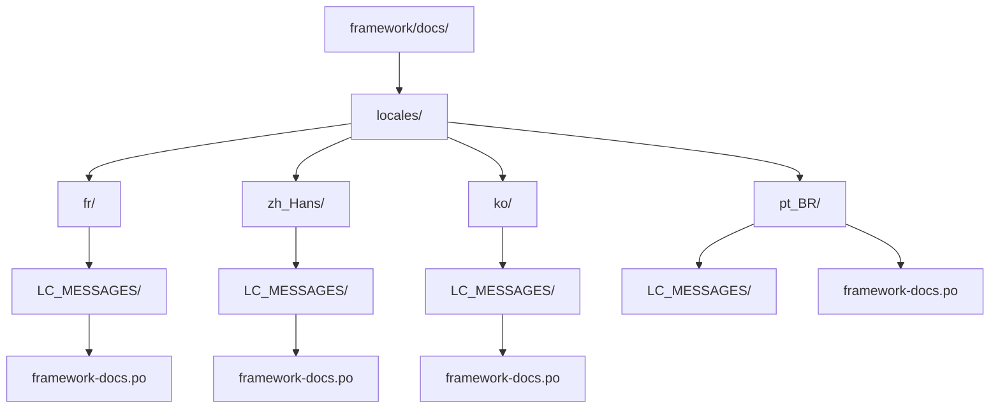
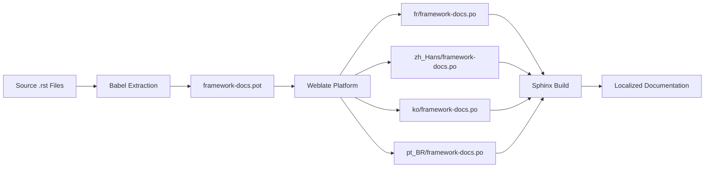
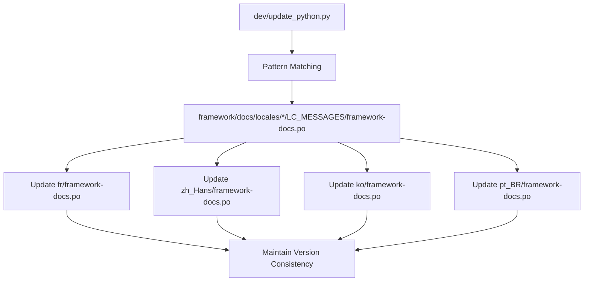
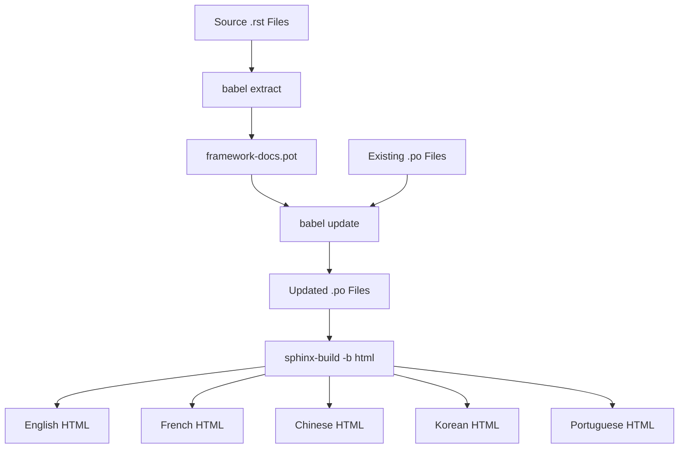

<!-- source: DeepWiki mcp.deepwiki.com · repo adap/flower · page 8.2 Localization and Translations · fetched 2026-10-21 -->

# Documentation Localization

<details>
<summary>Relevant source files</summary>

The following files were used as context for generating this wiki page:

- [framework/docs/locales/fr/LC_MESSAGES/framework-docs.po](framework/docs/locales/fr/LC_MESSAGES/framework-docs.po)
- [framework/docs/locales/ko/LC_MESSAGES/framework-docs.po](framework/docs/locales/ko/LC_MESSAGES/framework-docs.po)
- [framework/docs/locales/pt_BR/LC_MESSAGES/framework-docs.po](framework/docs/locales/pt_BR/LC_MESSAGES/framework-docs.po)
- [framework/docs/locales/zh_Hans/LC_MESSAGES/framework-docs.po](framework/docs/locales/zh_Hans/LC_MESSAGES/framework-docs.po)

</details>


This document covers the multi-language documentation system for the Flower framework, including the translation workflow, file organization, and maintenance processes. The localization system enables community contributors to translate documentation into multiple languages using gettext standards and Weblate as the translation management platform.

For information about the broader documentation build system, see [Documentation System](#8). For details on contributing to translations specifically, this page covers the technical architecture while contribution guidelines are covered in the main contributor documentation.

## System Overview

The Flower documentation localization system uses the standard gettext internationalization (i18n) framework with `.po` (Portable Object) files to manage translations across multiple languages. The system integrates with Weblate, a web-based translation platform, to enable community contributions and maintains automated processes for keeping translations synchronized with source documentation updates.

**Translation File Structure**



Sources: [framework/docs/locales/fr/LC_MESSAGES/framework-docs.po:1-17](), [framework/docs/locales/zh_Hans/LC_MESSAGES/framework-docs.po:1-20](), [framework/docs/locales/ko/LC_MESSAGES/framework-docs.po:1-20](), [framework/docs/locales/pt_BR/LC_MESSAGES/framework-docs.po:1-20]()

## File Organization and Structure

The localization files follow the standard gettext directory structure within the documentation tree:

| Path Pattern | Purpose |
|--------------|---------|
| `framework/docs/locales/{lang}/LC_MESSAGES/framework-docs.po` | Main translation file for each language |
| `framework/docs/source/` | Source documentation files |
| `framework/docs/source/conf.py` | Sphinx configuration with localization settings |

### Supported Languages

The framework currently supports the following languages:

| Language Code | Language Name | Status |
|---------------|---------------|---------|
| `fr` | French | Active |
| `zh_Hans` | Chinese (Simplified) | Active |
| `ko` | Korean | Active |
| `pt_BR` | Portuguese (Brazil) | Active |

Sources: [framework/docs/locales/fr/LC_MESSAGES/framework-docs.po:9](), [framework/docs/locales/zh_Hans/LC_MESSAGES/framework-docs.po:13](), [framework/docs/locales/ko/LC_MESSAGES/framework-docs.po:13](), [framework/docs/locales/pt_BR/LC_MESSAGES/framework-docs.po:13]()

### PO File Format

Each `.po` file contains standard gettext metadata and translation entries:

```
Project-Id-Version: Flower main
POT-Creation-Date: 2025-08-21 00:06+0000
Language-Team: {Language} <weblate-url>
Generated-By: Babel 2.17.0
```

Translation entries follow the format:
- `msgid`: Source English text
- `msgstr`: Translated text
- Source file references for context

Sources: [framework/docs/locales/fr/LC_MESSAGES/framework-docs.po:4-16](), [framework/docs/locales/zh_Hans/LC_MESSAGES/framework-docs.po:8-20]()

## Translation Workflow

The translation process integrates Weblate with the Flower documentation build system to enable collaborative translation while maintaining quality and consistency.

**Translation Management Architecture**



Sources: [framework/docs/locales/fr/LC_MESSAGES/framework-docs.po:16](), [dev/update_python.py:177-193]()

### Weblate Integration

The translation project is hosted on Weblate at `https://hosted.weblate.org/projects/flower-docs/framework/`. Key integration features:

- **Automated synchronization** between source documentation and translation files
- **Translation memory** to maintain consistency across similar strings
- **Quality checks** for translation completeness and formatting
- **Contributor management** with language team assignments

Each language has dedicated maintainers and translation teams registered in Weblate:
- French: `French <https://hosted.weblate.org/projects/flower-docs/framework/fr/>`
- Chinese (Simplified): `Chinese (Simplified) <https://hosted.weblate.org/projects/flower-docs/framework/zh_Hans/>`
- Korean: `Korean <https://hosted.weblate.org/projects/flower-docs/framework/ko/>`
- Portuguese (Brazil): `Portuguese (Brazil) <https://hosted.weblate.org/projects/flower-docs/framework/pt_BR/>`

Sources: [framework/docs/locales/fr/LC_MESSAGES/framework-docs.po:10-11](), [framework/docs/locales/zh_Hans/LC_MESSAGES/framework-docs.po:14-15]()

## Automated Maintenance

The localization system includes automated processes to keep translations synchronized with source code changes and version updates.

### Version Update Integration

The Python version update script includes localization file updates to maintain consistency across all languages when technical references change:

**Python Version Update Flow**



The update patterns specifically target Python version references in documentation links:
- Pattern: `r"(\`Python\s*" + re.escape(old_version) + r"\s*<https://docs.python.org/" + re.escape(old_version) + r"/>\`_)"`
- Replacement: Python version links updated to new version

Sources: [dev/update_python.py:177-193]()

### Content Categories

The localization system covers various documentation categories:

| Content Type | Example Messages |
|--------------|------------------|
| Navigation | `"How-to guides"`, `"Tutorials"`, `"References"` |
| Technical Terms | `"Build argument"`, `"Description"`, `"Required"` |
| Instructions | `"Problem-oriented how-to guides show step-by-step how to achieve a specific goal."` |
| Contributor Content | `"Contribute translations"`, `"Add new languages"` |

Sources: [framework/docs/locales/fr/LC_MESSAGES/framework-docs.po:29-42](), [framework/docs/locales/zh_Hans/LC_MESSAGES/framework-docs.po:35-44]()

## Technical Architecture

The localization system integrates with Sphinx documentation generation and uses Babel for message extraction and catalog management.

### Build Integration

**Message Extraction and Catalog Generation**



### Message ID Management

Translation strings are identified using several patterns:
- **File references**: `#: ../../source/build.rst:6` for source location tracking  
- **Context markers**: `#, fuzzy` for approximate translations needing review
- **Automatic comments**: Generated by Babel during extraction

The system handles various string types:
- Page titles and headings
- Navigation elements  
- Technical documentation content
- Error messages and status indicators
- Contributor guidance text

Sources: [framework/docs/locales/fr/LC_MESSAGES/framework-docs.po:18-27](), [framework/docs/locales/zh_Hans/LC_MESSAGES/framework-docs.po:22-31]()

### Quality Assurance

The localization system includes several quality control mechanisms:

- **Fuzzy marking** for translations that need review after source changes
- **Placeholder preservation** for technical terms and code references  
- **Link validation** for documentation cross-references
- **Format consistency** checking for RST markup

Translation status is tracked through completion percentages and contributor activity in Weblate, with automated notifications for updates requiring translator attention.

Sources: [framework/docs/locales/fr/LC_MESSAGES/framework-docs.po:25](), [framework/docs/locales/zh_Hans/LC_MESSAGES/framework-docs.po:29]()

---

