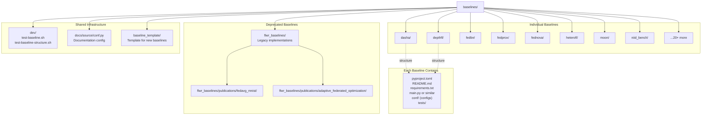
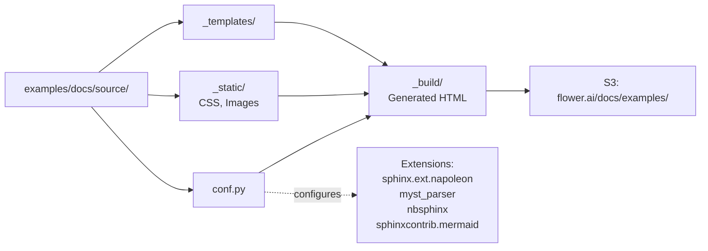
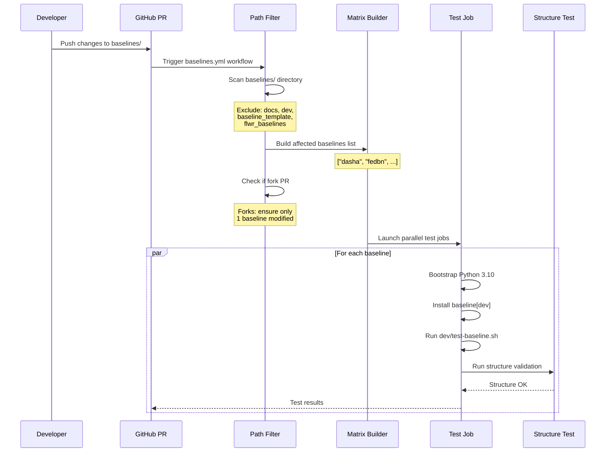
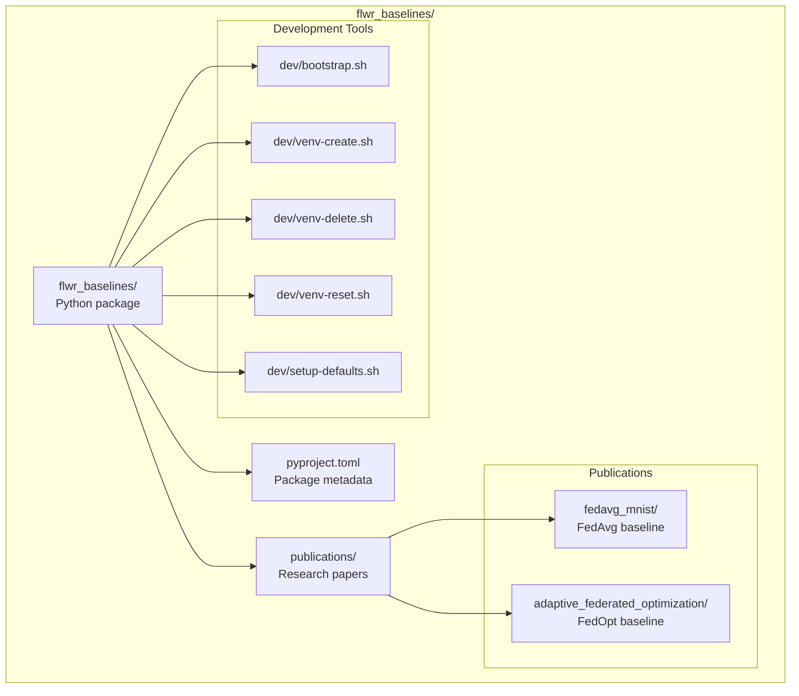
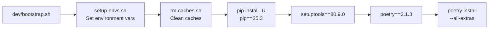
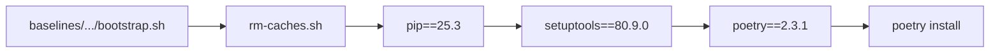
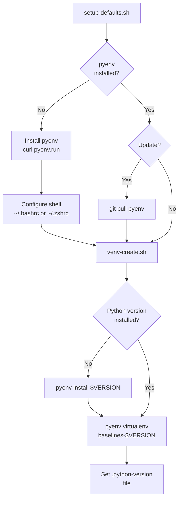
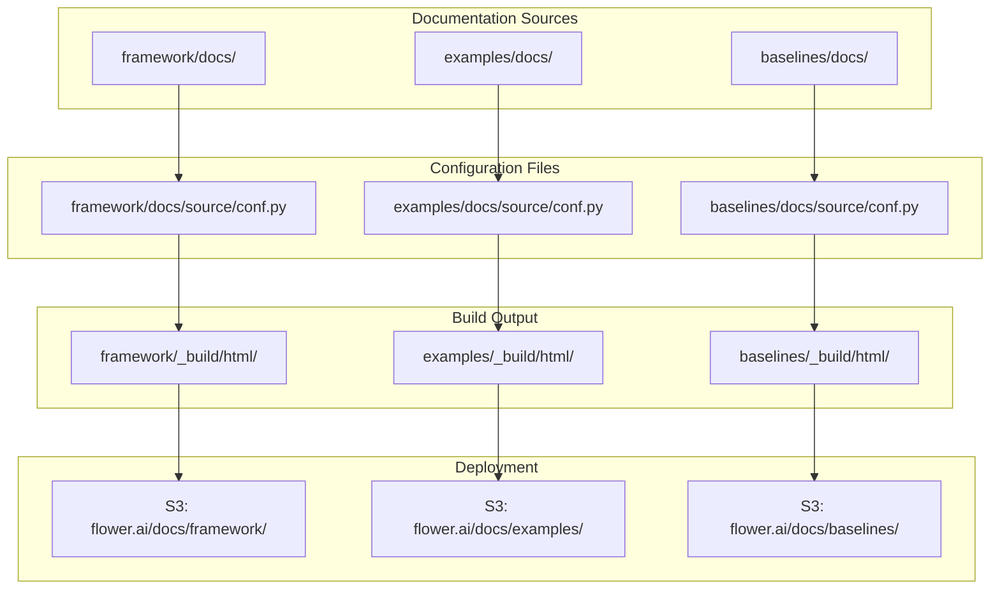

<!-- source: DeepWiki mcp.deepwiki.com · repo adap/flower · page 8.3 Examples and Baselines · fetched 2026-10-21 -->

# Examples and Baselines

<details>
<summary>Relevant source files</summary>

The following files were used as context for generating this wiki page:

- [.devcontainer/Dockerfile](.devcontainer/Dockerfile)
- [.github/actions/bootstrap/action.yml](.github/actions/bootstrap/action.yml)
- [.github/workflows/baselines.yml](.github/workflows/baselines.yml)
- [.github/workflows/deprecated_baselines.yml](.github/workflows/deprecated_baselines.yml)
- [README.md](README.md)
- [baselines/docs/source/conf.py](baselines/docs/source/conf.py)
- [baselines/flwr_baselines/dev/bootstrap.sh](baselines/flwr_baselines/dev/bootstrap.sh)
- [baselines/flwr_baselines/dev/setup-defaults.sh](baselines/flwr_baselines/dev/setup-defaults.sh)
- [baselines/flwr_baselines/dev/venv-create.sh](baselines/flwr_baselines/dev/venv-create.sh)
- [baselines/flwr_baselines/dev/venv-delete.sh](baselines/flwr_baselines/dev/venv-delete.sh)
- [baselines/flwr_baselines/dev/venv-reset.sh](baselines/flwr_baselines/dev/venv-reset.sh)
- [baselines/flwr_baselines/flwr_baselines/publications/adaptive_federated_optimization/main.py](baselines/flwr_baselines/flwr_baselines/publications/adaptive_federated_optimization/main.py)
- [dev/bootstrap.sh](dev/bootstrap.sh)
- [dev/update-html-themes.py](dev/update-html-themes.py)
- [examples/docs/source/conf.py](examples/docs/source/conf.py)
- [framework/docs/source/conf.py](framework/docs/source/conf.py)

</details>


This document describes the organization, testing, and documentation of **Examples** and **Baselines** in the Flower framework. Examples demonstrate how to use Flower with various machine learning frameworks, while Baselines reproduce experiments from federated learning research publications.

For information about the Flower CLI commands used to run these projects, see [Flower CLI Commands](#3.1). For details on the documentation build process, see [Documentation Build Process](#8.1).

## Purpose and Scope

**Examples** are code samples showing how to integrate Flower with popular ML frameworks (PyTorch, TensorFlow, Hugging Face, etc.). They range from simple quickstart tutorials to advanced use cases like privacy-preserving federated learning and vertical federated learning.

**Baselines** are community-contributed implementations of federated learning algorithms from research papers. Each baseline provides a reproducible environment to evaluate and build upon published work, including algorithms like FedAvg, FedProx, FedBN, DASHA, and many others.

Both collections serve as entry points for users learning Flower and as starting points for researchers developing new federated learning systems.

## Repository Structure

### Examples Directory Organization

```mermaid
graph TB
    Root[examples/]
    
    subgraph "Quickstart Examples"
        QS1[quickstart-pytorch/]
        QS2[quickstart-tensorflow/]
        QS3[quickstart-huggingface/]
        QS4[quickstart-jax/]
        QS5[quickstart-sklearn/]
        QS6[quickstart-mlx/]
        QSMore[...more frameworks]
    end
    
    subgraph "Advanced Examples"
        Adv1[advanced-pytorch/]
        Adv2[advanced-tensorflow/]
        Adv3[pytorch-from-centralized-to-federated/]
        Adv4[vertical-fl/]
        Adv5[opacus/<br/>Differential Privacy]
        Adv6[tensorflow-privacy/]
    end
    
    subgraph "Application Examples"
        App1[whisper-federated-finetuning/]
        App2[flowertune-llm/]
        App3[flowertune-vit/]
        App4[xgboost-comprehensive/]
        App5[federated-kaplan-meier-fitter/]
        App6[embedded-devices/<br/>Raspberry Pi & Jetson]
    end
    
    subgraph "Documentation"
        ExDocs[docs/source/conf.py]
        ExStatic[docs/source/_static/]
        ExTemplates[docs/source/_templates/]
    end
    
    Root --> QS1 & QS2 & QS3 & QS4 & QS5 & QS6
    Root --> Adv1 & Adv2 & Adv3 & Adv4 & Adv5 & Adv6
    Root --> App1 & App2 & App3 & App4 & App5 & App6
    Root --> ExDocs & ExStatic & ExTemplates
```



**Sources:** [README.md:113-149]()

### Baselines Directory Organization



**Sources:** [README.md:82-111](), [.github/workflows/baselines.yml:28-49]()

## Examples Organization

### Example Categories

Examples are organized by use case and complexity:

| Category | Purpose | Examples |
|----------|---------|----------|
| **Quickstart** | Basic integration with ML frameworks | `quickstart-pytorch`, `quickstart-tensorflow`, `quickstart-huggingface` |
| **Advanced** | Complex FL scenarios and optimizations | `advanced-pytorch`, `advanced-tensorflow` |
| **Framework Migration** | Centralized to federated transitions | `pytorch-from-centralized-to-federated` |
| **Privacy** | Differential privacy implementations | `opacus`, `tensorflow-privacy` |
| **Domain-Specific** | Application-focused examples | `whisper-federated-finetuning`, `flowertune-llm`, `flowertune-vit` |
| **Embedded** | Edge device deployments | `android`, `ios`, `embedded-devices` |
| **Infrastructure** | Deployment patterns | `flower-via-docker-compose` |

### Example Structure

Each example typically contains:
- `pyproject.toml` - Project dependencies and metadata
- `README.md` - Usage instructions and description
- `client.py` or `client_app.py` - Client-side FL logic
- `server.py` or `server_app.py` - Server-side FL logic
- `task.py` - Model and data handling (optional)
- `requirements.txt` - Legacy dependency format (optional)

**Sources:** [README.md:113-149]()

### Examples Documentation Configuration

The examples documentation is built using Sphinx with Furo theme:



Key configuration in [examples/docs/source/conf.py:1-146]():
- **Project**: `"Flower"` with version `"1.24.0"`
- **Theme**: `html_theme = "furo"`
- **Base URL**: `https://flower.ai/docs/examples/`
- **Extensions**: Support for Markdown (MyST), Jupyter notebooks (nbsphinx), and Mermaid diagrams
- **Redirects**: Legacy URL mapping to prevent 404 errors [examples/docs/source/conf.py:65-77]()

**Sources:** [examples/docs/source/conf.py:1-146]()

## Baselines Organization

### Baseline Structure Requirements

Each baseline in the `baselines/` directory must follow a standard structure tested by [baselines/dev/test-baseline-structure.sh]():

**Required Files:**
- `pyproject.toml` - Python project configuration
- `README.md` - Baseline description, setup, and usage
- Source code implementing the federated learning algorithm
- Configuration files (typically in `conf/` directory)

**Common Pattern:**
- `main.py` - Entry point for baseline execution
- `client.py` - Client-side training logic
- `server.py` - Server-side strategy implementation
- `dataset.py` - Data loading and partitioning
- `models.py` - Neural network architectures

### CI/CD Pipeline for Baselines



**Workflow Implementation:** [.github/workflows/baselines.yml:1-90]()

Key workflow features:
1. **Dynamic baseline detection** using `find` command [.github/workflows/baselines.yml:37-43]()
2. **Path-based filtering** with `dorny/paths-filter` to test only changed baselines [.github/workflows/baselines.yml:51-54]()
3. **Fork protection** ensures external contributors modify only one baseline at a time [.github/workflows/baselines.yml:56-62]()
4. **Matrix strategy** enables parallel testing across multiple baselines [.github/workflows/baselines.yml:68-70]()

**Sources:** [.github/workflows/baselines.yml:1-90]()

### Deprecated Baselines

The `baselines/flwr_baselines/` directory contains legacy baseline implementations that predate the current structure:



These baselines use a different structure with:
- Shared `flwr_baselines` package for common utilities
- Hydra configuration management [baselines/flwr_baselines/flwr_baselines/publications/adaptive_federated_optimization/main.py:14-24]()
- Custom virtual environment management scripts [baselines/flwr_baselines/dev/venv-create.sh:1-13]()

**Workflow:** [.github/workflows/deprecated_baselines.yml:1-37]()

**Sources:** [.github/workflows/deprecated_baselines.yml:1-37](), [baselines/flwr_baselines/dev/bootstrap.sh:1-15](), [baselines/flwr_baselines/flwr_baselines/publications/adaptive_federated_optimization/main.py:1-82]()

## Bootstrap and Development Environment

### Environment Setup Scripts

Both examples and baselines use standardized bootstrap scripts to ensure consistent development environments:

**Framework Bootstrap** ([dev/bootstrap.sh:1-18]()):


**Baselines Bootstrap** ([baselines/flwr_baselines/dev/bootstrap.sh:1-15]()):


### GitHub Actions Bootstrap Action

The CI pipeline uses a reusable bootstrap action [.github/actions/bootstrap/action.yml:1-56]():

| Input | Default | Description |
|-------|---------|-------------|
| `python-version` | `3.10.19` | Python version to install |
| `pip-version` | `25.3` | pip version |
| `setuptools-version` | `80.9.0` | setuptools version |
| `poetry-version` | `2.1.3` | Poetry version |
| `poetry-skip` | `false` | Skip Poetry installation |

**Usage in workflows:**
```yaml
- name: Bootstrap
  uses: ./.github/actions/bootstrap
  with:
    python-version: '3.10'
```

**Sources:** [dev/bootstrap.sh:1-18](), [.github/actions/bootstrap/action.yml:1-56](), [baselines/flwr_baselines/dev/bootstrap.sh:1-15]()

### Virtual Environment Management (Deprecated Baselines)

The deprecated baselines use pyenv-based virtual environment management:



**Scripts:**
- [baselines/flwr_baselines/dev/setup-defaults.sh:1-75]() - Initial setup with pyenv installation
- [baselines/flwr_baselines/dev/venv-create.sh:1-13]() - Create virtual environment
- [baselines/flwr_baselines/dev/venv-delete.sh:1-8]() - Delete virtual environment
- [baselines/flwr_baselines/dev/venv-reset.sh:1-15]() - Reset environment completely

**Sources:** [baselines/flwr_baselines/dev/setup-defaults.sh:1-75](), [baselines/flwr_baselines/dev/venv-create.sh:1-13]()

## Documentation Build System

### Multi-Project Documentation Architecture

Flower maintains separate Sphinx documentation builds for different components:



**Sources:** [framework/docs/source/conf.py:1-377](), [examples/docs/source/conf.py:1-146](), [baselines/docs/source/conf.py:1-150]()

### Shared Documentation Configuration

All three documentation builds share common characteristics:

| Configuration | Framework | Examples | Baselines |
|--------------|-----------|----------|-----------|
| **Theme** | `furo` | `furo` | `furo` |
| **Release** | `1.24.0` | `1.24.0` | `1.24.0` |
| **Base URL** | `flower.ai/docs/framework/` | `flower.ai/docs/examples/` | `flower.ai/docs/baselines/` |
| **MyST Support** | ✓ | ✓ | ✓ |
| **Mermaid Diagrams** | ✓ | ✓ | ✓ |
| **Notebook Rendering** | ✓ | ✓ | ✓ |

### Examples-Specific Documentation Features

[examples/docs/source/conf.py:1-146]() configures:
- **Title**: `"Flower Examples 1.24.0"` [examples/docs/source/conf.py:86]()
- **Redirects**: Maps deprecated example names to current ones [examples/docs/source/conf.py:65-77]()
- **Colab Integration**: Adds "Open in Colab" buttons to notebooks [examples/docs/source/conf.py:124-133]()
- **Extensions**: Includes `nbsphinx` for Jupyter notebook rendering [examples/docs/source/conf.py:52]()

### Baselines-Specific Documentation Features

[baselines/docs/source/conf.py:1-150]() configures:
- **Title**: `"Flower Baselines 1.24.0"` [baselines/docs/source/conf.py:85]()
- **Redirects**: Renamed baseline documentation pages [baselines/docs/source/conf.py:73-77]()
- **MyST Extensions**: Includes `dollarmath` for LaTeX math rendering [baselines/docs/source/conf.py:149]()

**Sources:** [examples/docs/source/conf.py:1-146](), [baselines/docs/source/conf.py:1-150]()

## Testing Infrastructure

### Baseline Testing Workflow

The testing process for baselines involves two stages:

1. **Functional Testing** via `dev/test-baseline.sh`
2. **Structure Validation** via `dev/test-baseline-structure.sh`

```mermaid
graph TB
    PR[Pull Request<br/>to baselines/] --> Trigger[Baselines CI Workflow]
    
    Trigger --> Detect[Detect Changed Baselines]
    Detect --> ForkCheck{Is Fork PR?}
    
    ForkCheck -->|Yes| SingleCheck{Only 1 baseline<br/>modified?}
    SingleCheck -->|No| Fail[Reject PR]
    SingleCheck -->|Yes| Matrix
    ForkCheck -->|No| Matrix[Build Test Matrix]
    
    Matrix --> Parallel[Launch Parallel Jobs]
    
    Parallel --> Job1[Baseline 1]
    Parallel --> Job2[Baseline 2]
    Parallel --> JobN[Baseline N]
    
    subgraph "Per-Baseline Testing"
        Job1 --> Bootstrap1[Bootstrap Python]
        Bootstrap1 --> Install1[pip install .[dev]]
        Install1 --> Test1[Run test-baseline.sh]
        Test1 --> Struct1[Run test-baseline-structure.sh]
        Struct1 --> Report1[Report Results]
    end
    
    Report1 --> Aggregate[Aggregate Results]
```

### Baseline Test Execution

**Workflow step** [.github/workflows/baselines.yml:79-89]():
```yaml
- name: Install dependencies
  working-directory: baselines/${{ matrix.baseline }}
  run: pip install ."[dev]"

- name: Testing ${{ matrix.baseline }}
  working-directory: baselines
  run: ./dev/test-baseline.sh ${{ matrix.baseline }}

- name: Test Structure of ${{ matrix.baseline }}
  working-directory: baselines
  run: ./dev/test-baseline-structure.sh ${{ matrix.baseline }}
```

**Sources:** [.github/workflows/baselines.yml:64-90]()

### Deprecated Baselines Testing

The deprecated baselines workflow [.github/workflows/deprecated_baselines.yml:1-37]() uses a simpler approach:
- Single job (not matrix-based)
- Tests entire `flwr_baselines` package
- Path-based triggering: only runs on changes to `baselines/flwr_baselines/**`
- Runs comprehensive lint and test suite: `./dev/test.sh`

**Sources:** [.github/workflows/deprecated_baselines.yml:1-37]()

## Contributing Examples and Baselines

### Example Contribution Process

To contribute a new example:

1. Create directory under `examples/` with descriptive name
2. Include standard files:
   - `pyproject.toml` with dependencies
   - `README.md` with setup and usage instructions
   - Implementation files (`client_app.py`, `server_app.py`, etc.)
3. Add documentation references in example README
4. Test locally with `flwr run` command
5. Submit pull request

### Baseline Contribution Process

To contribute a new baseline:

1. Use `baselines/baseline_template/` as starting point
2. Create directory under `baselines/` named after the paper/algorithm
3. Implement required structure:
   - `pyproject.toml` with `[project]` metadata and `[dev]` dependencies
   - `README.md` explaining algorithm, setup, and reproduction steps
   - Configuration files in `conf/` directory
   - Implementation following paper specifications
4. Ensure structure passes `dev/test-baseline-structure.sh`
5. Add tests that validate baseline functionality
6. Submit pull request (forks: modify only ONE baseline)

### Key Constraints

**Fork Contributions** - The workflow enforces [.github/workflows/baselines.yml:56-62]():
```yaml
- if: ${{ github.event.pull_request.head.repo.fork }}
  run: |
    CHANGES=$(echo "${{ toJson(steps.filter.outputs.changes) }}" | jq '. | length')
    if [ "$CHANGES" -gt 1 ]; then
      echo "::error ::The changes should only apply to a single baseline."
      exit 1
    fi
```

This prevents complex multi-baseline PRs from external contributors while allowing maintainers to modify multiple baselines.

**Sources:** [.github/workflows/baselines.yml:56-62](), [README.md:174-176]()

## Documentation Theme Updates

The repository includes a utility script for updating HTML theme options across all documentation configurations:

[dev/update-html-themes.py:1-121]() provides centralized theme management:
- Scans for all `conf.py` files recursively
- Injects new fields into `html_theme_options` dictionary
- Maintains consistent branding across framework, examples, and baselines docs

**Example usage for announcements:**
```python
NEW_FIELDS = {
    "announcement": (
        "<a href='https://flower.ai/events/...'>"
        "<strong>Register now</strong></a> for Event!"
    ),
    "light_css_variables": {
        "color-announcement-background": "#292f36",
    },
}
```

**Sources:** [dev/update-html-themes.py:1-121]()

## Summary

The Examples and Baselines collections serve distinct but complementary purposes:

**Examples** provide practical integration guides for various ML frameworks and use cases, helping users get started with Flower quickly. They are organized by complexity and framework, with comprehensive quickstart guides and advanced scenarios.

**Baselines** enable reproducible federated learning research by implementing published algorithms in a standardized structure. Each baseline is independently tested and documented, allowing researchers to evaluate new ideas against established benchmarks.

Both collections leverage the same development infrastructure (bootstrap scripts, CI/CD pipelines, and Sphinx documentation), while maintaining separate documentation sites for clarity. The CI pipeline ensures quality through automated testing, structure validation, and path-based filtering to minimize unnecessary test runs.