# Page: Overview

# Overview

<details>
<summary>Relevant source files</summary>

The following files were used as context for generating this wiki page:

- [.gitignore](.gitignore)
- [README.md](README.md)

</details>


## Purpose and Scope

This document provides an introduction to the Flower federated AI framework, summarizing its core purpose, design principles, and main architectural components. This overview serves as an entry point to understand how Flower enables distributed machine learning across multiple devices and organizations while maintaining data privacy.

For detailed architectural components and design patterns, see [Architecture](#2). For specific deployment strategies and release processes, see [Deployment](#5). For development environment setup and contribution guidelines, see [Development Guide](#6).

## What is Flower?

Flower (`flwr`) is a framework for building federated AI systems that enables machine learning across distributed datasets without centralizing the data. The framework allows multiple parties to collaboratively train models while keeping their data local and private.

Flower supports federated learning, federated analytics, and federated evaluation across a wide range of machine learning frameworks including PyTorch, TensorFlow, Hugging Face Transformers, scikit-learn, JAX, and many others.

**Sources:** [README.md:25-44]()

## Core Design Principles

Flower is built on four foundational principles that guide its architecture and implementation:

| Principle | Description | Implementation Impact |
|-----------|-------------|----------------------|
| **Customizable** | Federated learning systems vary wildly from use case to use case | Wide range of configuration options and pluggable components |
| **Extendable** | Built with AI research in mind from University of Oxford origins | Components can be extended and overridden for new research |
| **Framework-agnostic** | Different ML frameworks have different strengths | Works with any machine learning framework |
| **Understandable** | Written with maintainability in mind | Encourages community contribution and code readability |

**Sources:** [README.md:26-43]()

## System Architecture Overview

The Flower framework consists of three core runtime components that work together to orchestrate federated learning workflows. SuperLink acts as the central server, SuperNode manages client execution, and user applications (ServerApp and ClientApp) contain the federated learning logic packaged as FAB files.

**Diagram: High-Level Component Architecture**

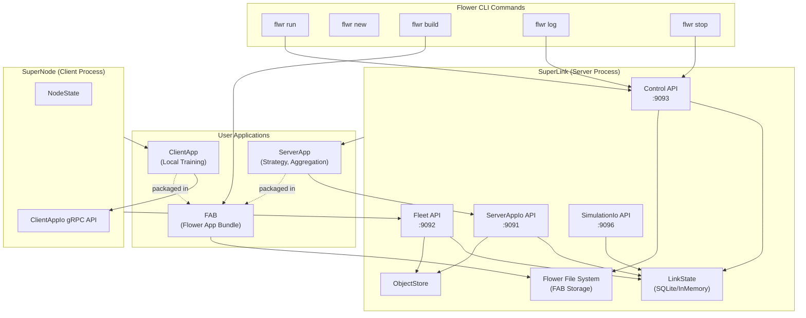

**Sources:** High-level architecture diagrams (Diagram 1), [README.md:25-44]()

## Key Framework Components

Flower's architecture is organized into several subsystems that work together to enable federated learning:

**Diagram: Federated Learning Execution Flow**

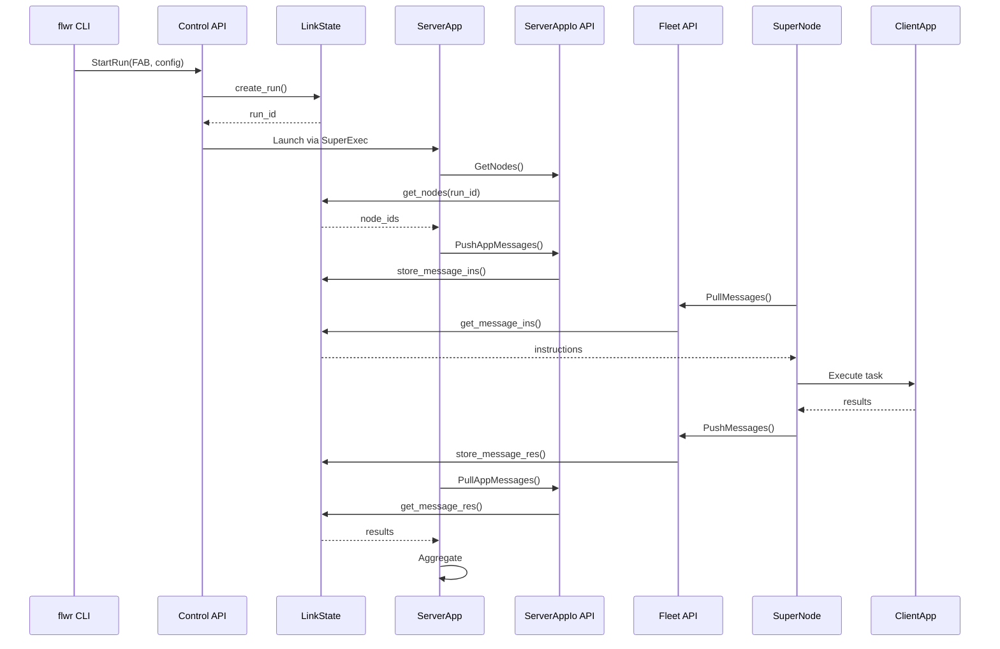

**Sources:** High-level architecture diagrams (Diagram 2)

### Core Runtime Components

| Component | Description | Key Responsibilities |
|-----------|-------------|---------------------|
| **SuperLink** | Central server process hosting multiple gRPC APIs | Orchestrates FL rounds, manages node registry, stores run state in `LinkState`, hosts Control API (`:9093`), Fleet API (`:9092`), ServerAppIo API (`:9091`), and SimulationIo API (`:9096`) |
| **SuperNode** | Client-side process manager | Connects to Fleet API, launches `ClientApp` in isolated subprocess/process, manages local `NodeState`, provides ClientAppIo gRPC API for app communication |
| **SuperExec** | ServerApp process launcher | Manages lifecycle of `ServerApp` processes with subprocess/process isolation on behalf of SuperLink |
| **LinkState** | Central state coordinator | Stores nodes, runs, and messages in SQLite or in-memory backend, provides single source of truth for distributed system state |
| **ObjectStore** | Large object storage | Stores model weights, datasets, and other large objects separately from message metadata using content-addressable storage (SHA256) |

**Sources:** High-level architecture diagrams (Diagram 1)

### Application Layer

| Component | Description | Code Location |
|-----------|-------------|---------------|
| **ServerApp** | Server-side federated learning logic | User-defined, contains strategy implementation and aggregation logic |
| **ClientApp** | Client-side federated learning logic | User-defined, contains local training implementation |
| **FAB** | Flower App Bundle | Packaged application bundle created by `flwr build`, stored in Flower File System (FFS) |

**Sources:** High-level architecture diagrams (Diagram 1), [README.md:25-44]()

### Communication APIs

**Diagram: API Endpoints and Their Roles**

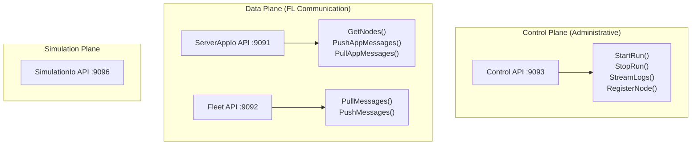

| API | Port | Purpose | Clients |
|-----|------|---------|---------|
| **Control API** | 9093 | Administrative operations, run management, node registration | `flwr` CLI commands |
| **ServerAppIo API** | 9091 | ServerApp communication, node discovery, message push/pull | `ServerApp` processes |
| **Fleet API** | 9092 | SuperNode communication, task distribution | `SuperNode` processes |
| **SimulationIo API** | 9096 | Simulation mode coordination | Simulation runtime |

**Sources:** High-level architecture diagrams (Diagram 1)

### Supporting Subsystems

| Subsystem | Description | Key Components |
|-----------|-------------|----------------|
| **flwr-datasets** | Federated dataset management | `FederatedDataset`, `IidPartitioner`, `DirichletPartitioner`, `NaturalIdPartitioner` |
| **Authentication** | Security layer for APIs | `CliAuthPlugin` (OIDC), `NodeAuthServerInterceptor` (Ed25519), `ControlAuthnPlugin`, `ControlAuthzPlugin` |
| **Flower Intelligence** | Multi-platform on-device AI SDK | `@flwr/flwr` (TypeScript), `FlowerIntelligence` (Swift/Kotlin) |

**Sources:** High-level architecture diagrams (Diagram 5, 6, 7), [README.md:36-39]()

## Framework Integrations

Flower's framework-agnostic design supports a comprehensive range of machine learning libraries and frameworks:

| Category | Supported Frameworks |
|----------|---------------------|
| **Deep Learning** | PyTorch, TensorFlow, PyTorch Lightning, JAX, TFLite |
| **Natural Language Processing** | Hugging Face Transformers |
| **Traditional ML** | scikit-learn, XGBoost, CatBoost |
| **Computer Vision** | MONAI, fastai |
| **Analytics** | Pandas, NumPy |
| **Specialized** | MLX (Apple Silicon), LeRobot (federated robotics) |

Each framework integration provides specialized utilities and examples to streamline development of federated applications within that ecosystem.

**Sources:** [README.md:36-39]()

## Development and Deployment Ecosystem

Flower includes a comprehensive ecosystem for development, testing, and deployment:

**Diagram: Development to Deployment Pipeline**

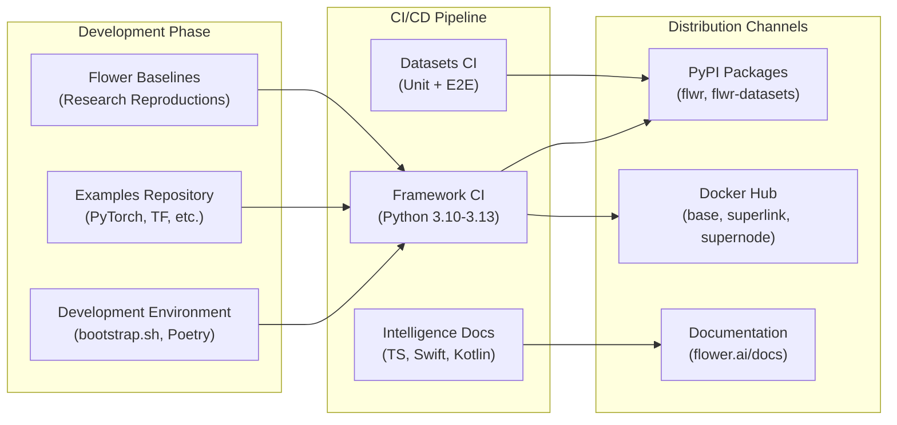

**Sources:** High-level architecture diagrams (Diagram 3)

### Development Resources

| Resource | Description | Examples |
|----------|-------------|----------|
| **Flower Baselines** | Community-contributed research paper reproductions | FedAvg, FedProx, MOON, DASHA, FedBN, HeteroFL |
| **Quickstart Examples** | Framework-specific tutorials | PyTorch, TensorFlow, Hugging Face, scikit-learn, JAX, MONAI |
| **Advanced Examples** | Production-ready implementations | Embedded devices, vertical FL, LLM fine-tuning, Docker Compose |

**Sources:** [README.md:82-150]()

### Distribution Artifacts

| Artifact Type | Name | Purpose |
|---------------|------|---------|
| **Python Packages** | `flwr`, `flwr-datasets`, `flwr-intelligence` | Core framework, dataset management, AI SDK |
| **Docker Images** | `flwr/base`, `flwr/superlink`, `flwr/supernode`, `flwr/superexec` | Container deployment (Ubuntu/Alpine, Python 3.10-3.13, amd64/arm64) |
| **Documentation** | Multi-language docs on S3 | Framework docs with French, Portuguese, Korean, Chinese translations via Weblate |

**Sources:** High-level architecture diagrams (Diagram 3, 4), [README.md:18-23]()

## Getting Started

To begin using Flower, developers typically:

1. Install the framework: `pip install flwr`
2. Choose a quickstart example matching their preferred ML framework
3. Run the 30-minute federated learning tutorial
4. Explore framework-specific examples and baselines
5. Join the Flower community on Slack for support and collaboration

For detailed installation instructions, see the [Installation Guide](https://flower.ai/docs/framework/how-to-install-flower.html). For CLI usage and runtime components, see [CLI and Runtime Components](#3). For dataset management capabilities, see [Dataset Management](#4).

**Sources:** [README.md:72-91](), [README.md:161-187]()

---

# Page: Core Architecture

# Core Architecture

<details>
<summary>Relevant source files</summary>

The following files were used as context for generating this wiki page:

- [framework/py/flwr/cli/auth_plugin/__init__.py](framework/py/flwr/cli/auth_plugin/__init__.py)
- [framework/py/flwr/cli/auth_plugin/auth_plugin.py](framework/py/flwr/cli/auth_plugin/auth_plugin.py)
- [framework/py/flwr/cli/auth_plugin/noop_auth_plugin.py](framework/py/flwr/cli/auth_plugin/noop_auth_plugin.py)
- [framework/py/flwr/cli/auth_plugin/oidc_cli_plugin.py](framework/py/flwr/cli/auth_plugin/oidc_cli_plugin.py)
- [framework/py/flwr/cli/build.py](framework/py/flwr/cli/build.py)
- [framework/py/flwr/cli/cli_account_auth_interceptor.py](framework/py/flwr/cli/cli_account_auth_interceptor.py)
- [framework/py/flwr/cli/log.py](framework/py/flwr/cli/log.py)
- [framework/py/flwr/cli/login/login.py](framework/py/flwr/cli/login/login.py)
- [framework/py/flwr/cli/new/new.py](framework/py/flwr/cli/new/new.py)
- [framework/py/flwr/cli/new/new_test.py](framework/py/flwr/cli/new/new_test.py)
- [framework/py/flwr/cli/new/templates/app/code/client.xgboost.py.tpl](framework/py/flwr/cli/new/templates/app/code/client.xgboost.py.tpl)
- [framework/py/flwr/cli/new/templates/app/code/server.xgboost.py.tpl](framework/py/flwr/cli/new/templates/app/code/server.xgboost.py.tpl)
- [framework/py/flwr/cli/new/templates/app/code/task.xgboost.py.tpl](framework/py/flwr/cli/new/templates/app/code/task.xgboost.py.tpl)
- [framework/py/flwr/cli/new/templates/app/pyproject.xgboost.toml.tpl](framework/py/flwr/cli/new/templates/app/pyproject.xgboost.toml.tpl)
- [framework/py/flwr/cli/run/run.py](framework/py/flwr/cli/run/run.py)
- [framework/py/flwr/cli/stop.py](framework/py/flwr/cli/stop.py)
- [framework/py/flwr/cli/utils.py](framework/py/flwr/cli/utils.py)
- [framework/py/flwr/common/constant.py](framework/py/flwr/common/constant.py)
- [framework/py/flwr/server/app.py](framework/py/flwr/server/app.py)
- [framework/py/flwr/server/grid/inmemory_grid_test.py](framework/py/flwr/server/grid/inmemory_grid_test.py)
- [framework/py/flwr/server/superlink/fleet/grpc_rere/fleet_servicer_test.py](framework/py/flwr/server/superlink/fleet/grpc_rere/fleet_servicer_test.py)
- [framework/py/flwr/server/superlink/fleet/grpc_rere/node_auth_server_interceptor_test.py](framework/py/flwr/server/superlink/fleet/grpc_rere/node_auth_server_interceptor_test.py)
- [framework/py/flwr/server/superlink/fleet/vce/vce_api.py](framework/py/flwr/server/superlink/fleet/vce/vce_api.py)
- [framework/py/flwr/server/superlink/fleet/vce/vce_api_test.py](framework/py/flwr/server/superlink/fleet/vce/vce_api_test.py)
- [framework/py/flwr/server/superlink/linkstate/in_memory_linkstate.py](framework/py/flwr/server/superlink/linkstate/in_memory_linkstate.py)
- [framework/py/flwr/server/superlink/linkstate/linkstate.py](framework/py/flwr/server/superlink/linkstate/linkstate.py)
- [framework/py/flwr/server/superlink/linkstate/linkstate_factory.py](framework/py/flwr/server/superlink/linkstate/linkstate_factory.py)
- [framework/py/flwr/server/superlink/linkstate/linkstate_test.py](framework/py/flwr/server/superlink/linkstate/linkstate_test.py)
- [framework/py/flwr/server/superlink/linkstate/sqlite_linkstate.py](framework/py/flwr/server/superlink/linkstate/sqlite_linkstate.py)
- [framework/py/flwr/server/superlink/serverappio/serverappio_servicer_test.py](framework/py/flwr/server/superlink/serverappio/serverappio_servicer_test.py)
- [framework/py/flwr/server/superlink/simulation/simulation_servicer_test.py](framework/py/flwr/server/superlink/simulation/simulation_servicer_test.py)
- [framework/py/flwr/simulation/run_simulation.py](framework/py/flwr/simulation/run_simulation.py)
- [framework/py/flwr/supercore/constant.py](framework/py/flwr/supercore/constant.py)
- [framework/py/flwr/superlink/auth_plugin/__init__.py](framework/py/flwr/superlink/auth_plugin/__init__.py)
- [framework/py/flwr/superlink/auth_plugin/auth_plugin.py](framework/py/flwr/superlink/auth_plugin/auth_plugin.py)
- [framework/py/flwr/superlink/auth_plugin/noop_auth_plugin.py](framework/py/flwr/superlink/auth_plugin/noop_auth_plugin.py)
- [framework/py/flwr/superlink/federation/__init__.py](framework/py/flwr/superlink/federation/__init__.py)
- [framework/py/flwr/superlink/servicer/control/control_grpc.py](framework/py/flwr/superlink/servicer/control/control_grpc.py)
- [framework/py/flwr/superlink/servicer/control/control_servicer_test.py](framework/py/flwr/superlink/servicer/control/control_servicer_test.py)

</details>


## Purpose and Scope

This document provides a comprehensive overview of Flower's core architectural components and how they interact to enable federated learning at scale. It covers the main runtime processes (SuperLink, SuperNode), state management abstractions (LinkState), communication protocols (gRPC APIs), and the message-based coordination system.

For detailed information about specific subsystems, see:
- SuperLink server implementation and APIs: [SuperLink Server Architecture](#2.1)
- SuperNode client implementation and lifecycle: [SuperNode Client Architecture](#2.2)
- State persistence and storage backends: [LinkState and State Management](#2.3)
- Network protocols and API specifications: [Communication Protocols](#2.4)
- Message queuing and object handling: [Message Flow and Object Storage](#2.5)
- Security mechanisms: [Authentication and Authorization](#2.6)

## High-Level System Architecture

Flower's architecture follows a client-server model with three primary runtime processes that communicate through well-defined gRPC APIs. The system is designed around asynchronous message passing, enabling loose coupling between server and client components.

### Main Runtime Processes

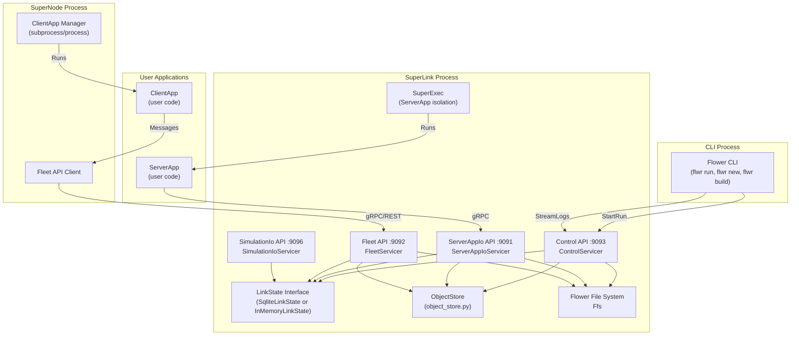

**Sources:** 
- [framework/py/flwr/common/constant.py:35-58]()
- [framework/py/flwr/server/app.py:161-466]()

### Component Responsibilities

| Component | Primary Responsibility | Key Classes/Files |
|-----------|----------------------|-------------------|
| **SuperLink** | Server-side orchestration, state coordination | `app.py`, `ControlServicer`, `FleetServicer`, `ServerAppIoServicer` |
| **SuperNode** | Client-side execution, message handling | Fleet client implementations, ClientApp isolation |
| **LinkState** | Persistent state storage (nodes, runs, messages) | `LinkState`, `SqliteLinkState`, `InMemoryLinkState` |
| **Control API** | Run management, node registration, log streaming | `ControlServicer` (port 9093) |
| **ServerAppIo API** | ServerApp communication channel | `ServerAppIoServicer` (port 9091) |
| **Fleet API** | SuperNode communication channel | `FleetServicer` (port 9092) |
| **ObjectStore** | Large object storage (model weights, datasets) | `ObjectStore`, `ObjectStoreFactory` |
| **Ffs** | FAB (Flower App Bundle) storage | `Ffs`, `FfsFactory` |

**Sources:**
- [framework/py/flwr/common/constant.py:35-58]()
- [framework/py/flwr/server/superlink/linkstate/linkstate.py:29-260]()

## Core Components

### LinkState: Central State Coordinator

`LinkState` is the abstract base class that defines Flower's state management interface. It serves as the single source of truth for all operational state, including node registrations, run metadata, and message queues.

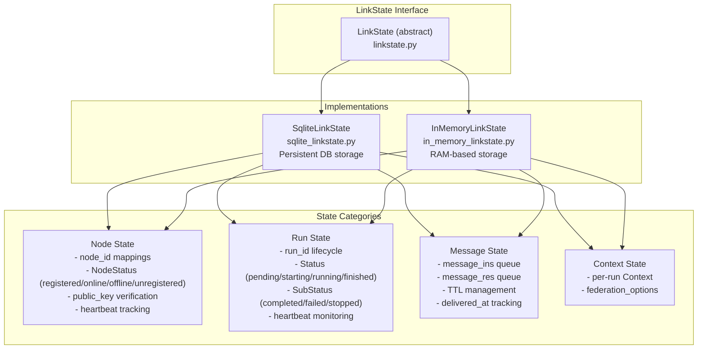

#### Key LinkState Methods

The `LinkState` interface defines critical operations organized by entity type:

**Node Management:**
- `create_node(owner_aid, owner_name, public_key, heartbeat_interval)` - Register a new node
- `delete_node(owner_aid, node_id)` - Unregister a node
- `activate_node(node_id, heartbeat_interval)` - Transition to ONLINE status
- `deactivate_node(node_id)` - Transition to OFFLINE status
- `get_nodes(run_id)` - Retrieve active nodes for a federation
- `get_node_info(node_ids, owner_aids, statuses)` - Query node metadata
- `acknowledge_node_heartbeat(node_id, heartbeat_interval)` - Update liveness

**Run Management:**
- `create_run(fab_id, fab_version, fab_hash, override_config, federation, federation_options, flwr_aid)` - Initialize a new run
- `get_run(run_id)` - Retrieve run metadata
- `get_run_status(run_ids)` - Get status for multiple runs
- `update_run_status(run_id, new_status)` - Transition run state
- `acknowledge_app_heartbeat(run_id, heartbeat_interval)` - Update run liveness

**Message Management:**
- `store_message_ins(message)` - Queue an instruction message
- `get_message_ins(node_id, limit)` - Pull messages for a node
- `store_message_res(message)` - Store a response message
- `get_message_res(message_ids)` - Retrieve responses by ID
- `delete_messages(message_ins_ids)` - Clean up message pairs

**Sources:**
- [framework/py/flwr/server/superlink/linkstate/linkstate.py:29-260]()
- [framework/py/flwr/server/superlink/linkstate/sqlite_linkstate.py:74-212]()
- [framework/py/flwr/server/superlink/linkstate/in_memory_linkstate.py:70-101]()

### Node Status Lifecycle

Nodes transition through well-defined states managed by LinkState:

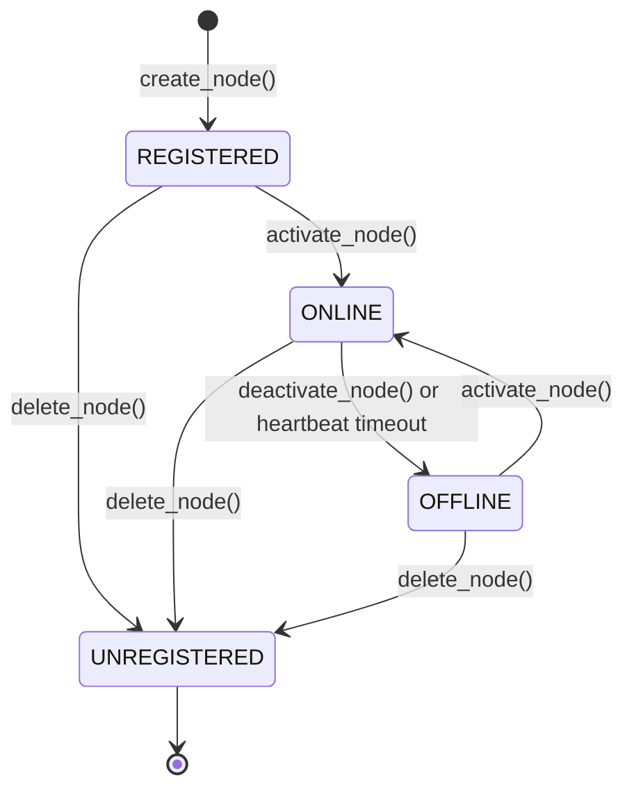

The status constants are defined in `NodeStatus`:
- `REGISTERED = "registered"` - Node created but not yet active
- `ONLINE = "online"` - Node actively participating
- `OFFLINE = "offline"` - Node registered but inactive (heartbeat expired)
- `UNREGISTERED = "unregistered"` - Node permanently removed

**Sources:**
- [framework/py/flwr/supercore/constant.py:38-48]()
- [framework/py/flwr/server/superlink/linkstate/sqlite_linkstate.py:696-749]()
- [framework/py/flwr/server/superlink/linkstate/in_memory_linkstate.py:432-471]()

### Run Status Lifecycle

Runs follow a linear progression with terminal sub-statuses:

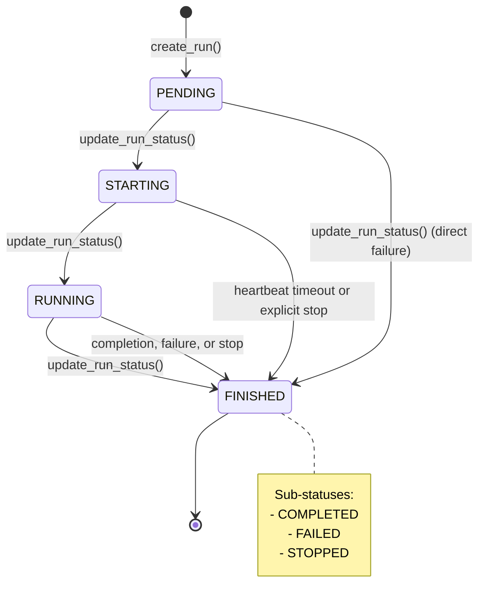

Status constants from the `Status` and `SubStatus` classes:
- Main statuses: `PENDING`, `STARTING`, `RUNNING`, `FINISHED`
- Sub-statuses: `COMPLETED`, `FAILED`, `STOPPED`

The system enforces valid state transitions in `update_run_status()` using the `is_valid_transition()` helper function.

**Sources:**
- [framework/py/flwr/common/constant.py:237-259]()
- [framework/py/flwr/server/superlink/linkstate/sqlite_linkstate.py:1016-1110]()
- [framework/py/flwr/server/superlink/linkstate/in_memory_linkstate.py:651-702]()

## gRPC API Services

SuperLink exposes four distinct gRPC services, each with a specific purpose in the federated learning workflow:

### API Service Summary

| API | Port | Primary Clients | Purpose |
|-----|------|----------------|---------|
| **Control API** | 9093 | Flower CLI | Run management, node registration, log streaming |
| **ServerAppIo API** | 9091 | SuperExec (ServerApp) | ServerApp ↔ SuperLink communication |
| **Fleet API** | 9092 | SuperNodes | Node ↔ SuperLink communication |
| **SimulationIo API** | 9096 | Simulation backend | Simulation mode coordination |

Default addresses are defined in constants:
- `CONTROL_API_DEFAULT_SERVER_ADDRESS = "0.0.0.0:9093"`
- `SERVERAPPIO_API_DEFAULT_SERVER_ADDRESS = "0.0.0.0:9091"`
- `FLEET_API_GRPC_RERE_DEFAULT_ADDRESS = "0.0.0.0:9092"`
- `SIMULATIONIO_API_DEFAULT_SERVER_ADDRESS = "0.0.0.0:9096"`

**Sources:**
- [framework/py/flwr/common/constant.py:35-58]()
- [framework/py/flwr/server/app.py:313-425]()

### Control API: Administrative Interface

The `ControlServicer` handles run lifecycle management and administrative operations:

**Key RPC Methods:**
- `StartRun(StartRunRequest)` - Create and initialize a new federated learning run
- `StopRun(StopRunRequest)` - Terminate a running execution
- `ListRuns(ListRunsRequest)` - Query run metadata and status
- `StreamLogs(StreamLogsRequest)` - Stream real-time logs from runs
- `RegisterNode(RegisterNodeRequest)` - Register a SuperNode via CLI
- `UnregisterNode(UnregisterNodeRequest)` - Remove a SuperNode
- `ListNodes(ListNodesRequest)` - Query registered nodes

The Control API requires authentication when account authentication is enabled. Requests are intercepted by `ControlAccountAuthInterceptor` which validates tokens before forwarding to the servicer.

**Sources:**
- [framework/py/flwr/superlink/servicer/control/control_servicer.py:1-300]() (implementation spans multiple methods)
- [framework/py/flwr/superlink/servicer/control/control_grpc.py:1-80]()

### ServerAppIo API: Server Application Communication

The `ServerAppIoServicer` provides the communication channel between ServerApp instances (running in SuperExec) and the SuperLink state:

**Key RPC Methods:**
- `GetNodes(GetNodesRequest)` - Retrieve available nodes for a run
- `PushMessages(PushAppMessagesRequest)` - Send instructions to nodes (message_ins)
- `PullMessages(PullAppMessagesRequest)` - Receive responses from nodes (message_res)
- `UpdateRunStatus(UpdateRunStatusRequest)` - Update run lifecycle state
- `PushAppOutputs(PushAppOutputsRequest)` - Store final run outputs (Context)
- `SendAppHeartbeat(SendAppHeartbeatRequest)` - Signal ServerApp liveness
- `PushObject(PushObjectRequest)` - Upload large objects
- `PullObject(PullObjectRequest)` - Download large objects

Status-based access control: Only runs with status `RUNNING` can push/pull messages. The servicer validates run status before processing requests.

**Sources:**
- [framework/py/flwr/server/superlink/serverappio/serverappio_servicer.py:1-400]() (implementation details)
- [framework/py/flwr/server/superlink/serverappio/serverappio_grpc.py:1-80]()

### Fleet API: Node Communication

The `FleetServicer` handles all communication with SuperNode clients:

**Key RPC Methods:**
- `RegisterNode(RegisterNodeFleetRequest)` - Register a new node (when auth disabled)
- `UnregisterNode(UnregisterNodeFleetRequest)` - Unregister a node (when auth disabled)
- `ActivateNode(ActivateNodeRequest)` - Mark node as online
- `DeactivateNode(DeactivateNodeRequest)` - Mark node as offline
- `PullMessages(PullMessagesRequest)` - Fetch instruction messages
- `PushMessages(PushMessagesRequest)` - Submit result messages
- `GetRun(GetRunRequest)` - Retrieve run metadata
- `GetFab(GetFabRequest)` - Download Flower App Bundle
- `SendNodeHeartbeat(SendNodeHeartbeatRequest)` - Signal node liveness
- `PushObject(PushObjectRequest)` - Upload large objects
- `PullObject(PullObjectRequest)` - Download large objects

When SuperNode authentication is enabled, all requests are intercepted by `NodeAuthServerInterceptor` which validates Ed25519 signatures.

**Sources:**
- [framework/py/flwr/server/superlink/fleet/grpc_rere/fleet_servicer.py:1-500]() (implementation details)
- [framework/py/flwr/server/superlink/fleet/grpc_rere/node_auth_server_interceptor.py:1-200]()

## Message-Based Coordination

Flower's federated learning workflow operates through asynchronous message passing between ServerApp and ClientApps. Messages are queued in LinkState and retrieved independently by each party.

### Message Types and Structure

The `Message` class represents both instructions (ins) and responses (res):

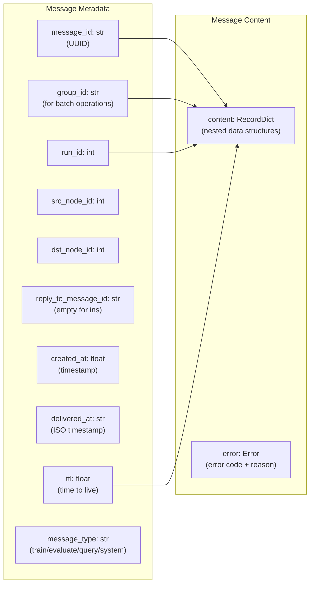

Message types are defined in the `MessageType` class:
- `TRAIN = "train"` - Training round instruction
- `EVALUATE = "evaluate"` - Evaluation request
- `QUERY = "query"` - General query
- `SYSTEM = "system"` - System-level message

**Sources:**
- [framework/py/flwr/common/constant.py:186-196]()
- [framework/py/flwr/common/message.py:1-300]() (Message class definition)

### Message Flow Sequence

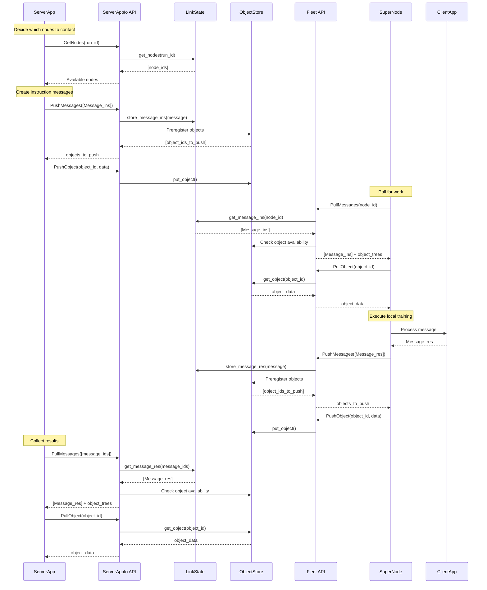

**Key observations:**
1. Messages are stored in LinkState with `delivered_at = ""` initially
2. When retrieved via `get_message_ins()`, LinkState marks them as delivered
3. Response messages use `reply_to_message_id` to link back to instructions
4. Large objects are separated from message metadata for efficiency
5. Object trees describe the nested structure of `RecordDict` contents

**Sources:**
- [framework/py/flwr/server/superlink/linkstate/sqlite_linkstate.py:225-278]() (store_message_ins)
- [framework/py/flwr/server/superlink/linkstate/sqlite_linkstate.py:326-387]() (get_message_ins)
- [framework/py/flwr/server/superlink/linkstate/sqlite_linkstate.py:389-460]() (store_message_res)
- [framework/py/flwr/server/superlink/linkstate/sqlite_linkstate.py:462-547]() (get_message_res)

### Message TTL and Cleanup

Messages have a time-to-live (TTL) mechanism to prevent stale data:

- Each message has `metadata.created_at` (timestamp) and `metadata.ttl` (duration in seconds)
- Message is valid until `created_at + ttl > current_time`
- `_check_stored_messages()` validates messages before retrieval
- Expired messages are automatically deleted
- Response TTL cannot exceed the remaining TTL of the instruction it replies to

The validation logic ensures:
```python
# From the implementation
max_allowed_ttl = (
    ins_metadata.created_at + ins_metadata.ttl - res_metadata.created_at
)
if res_metadata.ttl - max_allowed_ttl > MESSAGE_TTL_TOLERANCE:
    # Reject response
```

Where `MESSAGE_TTL_TOLERANCE = 1e-1` accounts for floating-point precision.

**Sources:**
- [framework/py/flwr/server/superlink/linkstate/sqlite_linkstate.py:280-324]() (_check_stored_messages)
- [framework/py/flwr/server/superlink/linkstate/sqlite_linkstate.py:420-439]() (TTL validation in store_message_res)
- [framework/py/flwr/common/constant.py:111]() (MESSAGE_TTL_TOLERANCE)

## Object Storage Architecture

Large data structures (model weights, datasets, gradients) are stored separately from message metadata to avoid bloating the message queue.

### ObjectStore Interface

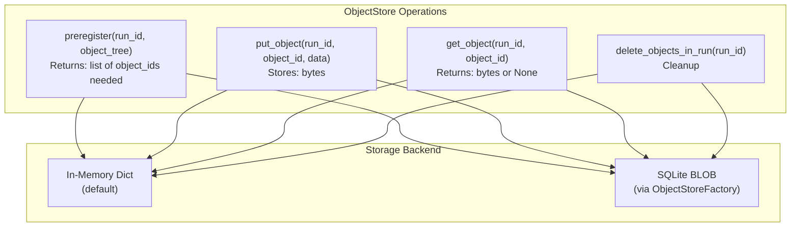

### Content-Addressable Storage

Objects are identified by SHA-256 hash of their content:

1. When a `Message` or `RecordDict` is created, `get_object_id()` computes its hash
2. Nested objects are traversed to build an object tree
3. `preregister()` is called with the tree to determine which objects need uploading
4. Only objects not already stored are returned in the response
5. Client pushes missing objects using `PushObject` RPC
6. Server verifies object_id matches content hash before storing

This approach provides:
- **Deduplication**: Identical objects are stored once
- **Integrity**: Content verification via hash
- **Referential transparency**: Object IDs are deterministic

**Sources:**
- [framework/py/flwr/supercore/object_store/object_store.py:1-150]() (ObjectStore interface)
- [framework/py/flwr/common/inflatable.py:1-300]() (object_id computation and tree building)

### Object Tree Structure

The `ObjectTree` protobuf message describes nested object hierarchies:

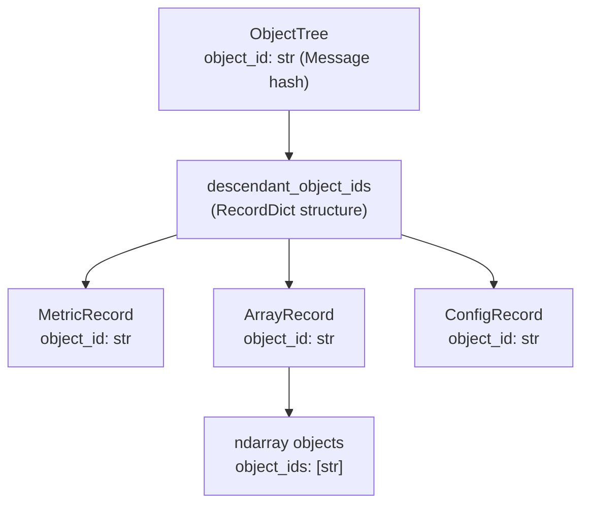

The tree is traversed during push/pull operations to ensure all required objects are available before message delivery.

**Sources:**
- [framework/py/flwr/common/inflatable.py:200-300]() (get_object_tree, iterate_object_tree)
- [framework/py/flwr/proto/message.proto:1-50]() (ObjectTree definition)

## Heartbeat Mechanism

Both nodes and runs require periodic heartbeat signals to indicate liveness. Failure to send heartbeats results in automatic status transitions.

### Node Heartbeat

Nodes send heartbeats via `SendNodeHeartbeat` RPC:

```python
# From constants
HEARTBEAT_DEFAULT_INTERVAL = 30  # seconds
HEARTBEAT_PATIENCE = 2  # number of missed heartbeats tolerated
```

When a heartbeat is received:
1. `acknowledge_node_heartbeat(node_id, heartbeat_interval)` is called
2. `online_until = current_time + HEARTBEAT_PATIENCE * heartbeat_interval`
3. Node status transitions to `ONLINE` if not already
4. `last_activated_at` timestamp is updated

Background check in `_check_and_tag_offline_nodes()`:
- Periodically queries nodes where `online_until <= current_time`
- Transitions them to `OFFLINE` status
- Updates `last_deactivated_at` timestamp

**Sources:**
- [framework/py/flwr/common/constant.py:61-68]() (heartbeat constants)
- [framework/py/flwr/server/superlink/linkstate/sqlite_linkstate.py:779-797]() (_check_and_tag_offline_nodes)
- [framework/py/flwr/server/superlink/linkstate/in_memory_linkstate.py:725-752]() (acknowledge_node_heartbeat)

### Run Heartbeat

ServerApps send heartbeats via `SendAppHeartbeat` RPC:

```python
# Runs are marked as failed when heartbeat stops
RUN_FAILURE_DETAILS_NO_HEARTBEAT = "No heartbeat received from the run."
```

When a run heartbeat is received:
1. `acknowledge_app_heartbeat(run_id, heartbeat_interval)` is called
2. `active_until = current_time + heartbeat_interval` (no patience multiplier for runs)
3. Run continues in `STARTING` or `RUNNING` status

Background check in `_check_and_tag_inactive_run()`:
- Queries runs where `active_until < current_time`
- Transitions them to `FINISHED` with `sub_status = FAILED`
- Sets `details = RUN_FAILURE_DETAILS_NO_HEARTBEAT`

This mechanism ensures that crashed ServerApps don't leave runs in perpetual `RUNNING` state.

**Sources:**
- [framework/py/flwr/common/constant.py:69]() (failure message constant)
- [framework/py/flwr/server/superlink/linkstate/sqlite_linkstate.py:939-959]() (_check_and_tag_inactive_run)
- [framework/py/flwr/server/superlink/linkstate/in_memory_linkstate.py:754-799]() (acknowledge_app_heartbeat)

## Federation Management

The `FederationManager` interface provides multi-tenancy by controlling which nodes can participate in which runs.

### FederationManager Interface

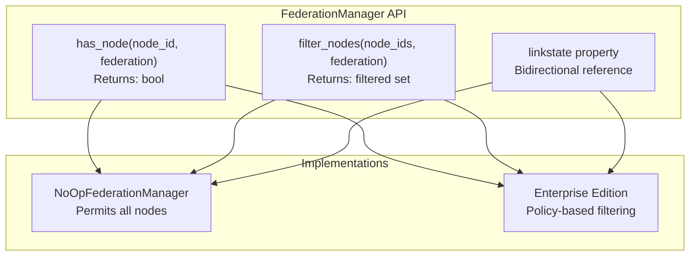

### Integration with LinkState

The FederationManager is injected into LinkState during initialization:

```python
# From LinkStateFactory
def __init__(self, database_path: str, federation_manager: FederationManager):
    super().__init__(database_path)
    federation_manager.linkstate = self  # Bidirectional reference
    self._federation_manager = federation_manager
```

When operations involve node membership checks:
1. `store_message_ins()` calls `federation_manager.has_node()` to validate destination
2. `get_nodes(run_id)` calls `federation_manager.filter_nodes()` to apply policies
3. `_check_stored_messages()` validates that both src and dst nodes remain in federation

The default `NoOpFederationManager` allows all nodes, effectively disabling multi-tenancy:

```python
def has_node(self, node_id: int, federation: str) -> bool:
    return True

def filter_nodes(self, node_ids: set[int], federation: str) -> set[int]:
    return node_ids
```

**Sources:**
- [framework/py/flwr/superlink/federation/federation_manager.py:1-50]() (interface definition)
- [framework/py/flwr/superlink/federation/noop_federation_manager.py:1-40]() (default implementation)
- [framework/py/flwr/server/superlink/linkstate/sqlite_linkstate.py:196-201]() (federation_manager property)
- [framework/py/flwr/server/superlink/linkstate/sqlite_linkstate.py:751-777]() (get_nodes with filtering)

## Process Isolation

User code (ServerApp and ClientApp) runs in isolated processes to prevent crashes from affecting the core infrastructure.

### Isolation Modes

Two isolation modes are supported, configured via command-line argument:

```python
# From constants
ISOLATION_MODE_SUBPROCESS = "subprocess"  # Default for SuperLink
ISOLATION_MODE_PROCESS = "process"         # Alternative
```

When `--isolation=subprocess`:
- SuperLink automatically launches `flower-superexec` as a subprocess
- SuperExec connects to ServerAppIo API (port 9091) or SimulationIo API (port 9096)
- ServerApp runs as a child process of SuperExec
- Crash recovery: SuperExec can restart ServerApp without affecting SuperLink

When `--isolation=process`:
- User manually starts SuperExec process
- Provides flexibility for distributed deployments

**Sources:**
- [framework/py/flwr/common/constant.py:114-115]() (isolation mode constants)
- [framework/py/flwr/server/app.py:428-445]() (subprocess launching logic)

### SuperExec Architecture

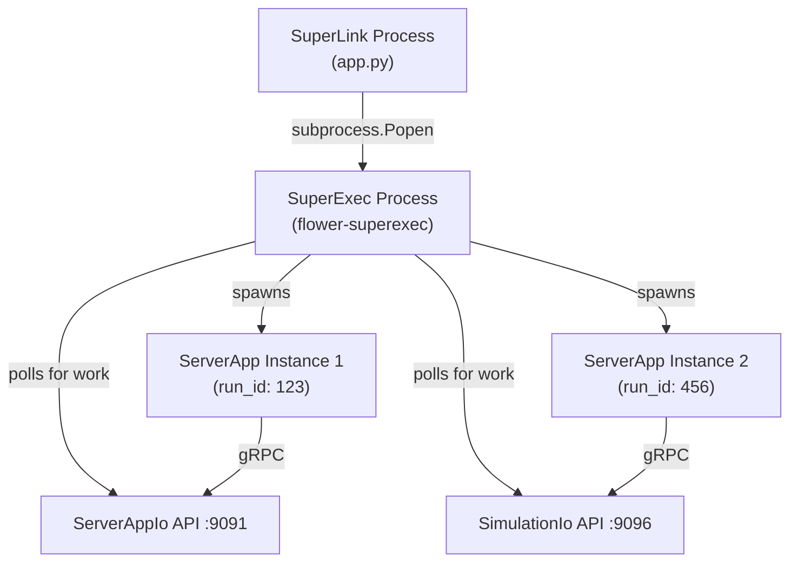

SuperExec responsibilities:
1. Poll `ListAppsToLaunch` RPC to discover pending runs
2. Load FAB from Flower File System
3. Launch ServerApp with appropriate isolation
4. Monitor ServerApp process and handle crashes
5. Clean up resources when run completes

**Sources:**
- [framework/py/flwr/server/app.py:428-445]() (SuperExec subprocess logic)
- [framework/py/flwr/cli/run/run.py:1-250]() (CLI run command triggering execution)

## Summary

Flower's core architecture is built around several key principles:

1. **Separation of Concerns**: Distinct APIs (Control, ServerAppIo, Fleet, SimulationIo) handle different aspects of the federated learning workflow
2. **Asynchronous Messaging**: Message queues in LinkState decouple ServerApp from ClientApps, enabling scalability
3. **State Abstraction**: LinkState interface allows switching between SQLite and in-memory backends
4. **Content-Addressable Storage**: Object hashing enables deduplication and integrity verification
5. **Process Isolation**: User code runs in separate processes with crash recovery
6. **Federation Support**: FederationManager enables multi-tenancy and access control
7. **Liveness Monitoring**: Heartbeat mechanism ensures timely failure detection

These components work together to provide a robust, scalable platform for federated learning at scale.

**Sources:**
- [framework/py/flwr/server/app.py:161-466]() (SuperLink initialization)
- [framework/py/flwr/server/superlink/linkstate/linkstate.py:29-260]() (LinkState interface)
- [framework/py/flwr/common/constant.py:1-325]() (system-wide constants)

---

# Page: SuperLink Server Architecture

# SuperLink Server Architecture

<details>
<summary>Relevant source files</summary>

The following files were used as context for generating this wiki page:

- [framework/proto/flwr/proto/control.proto](framework/proto/flwr/proto/control.proto)
- [framework/proto/flwr/proto/federation.proto](framework/proto/flwr/proto/federation.proto)
- [framework/py/flwr/cli/auth_plugin/__init__.py](framework/py/flwr/cli/auth_plugin/__init__.py)
- [framework/py/flwr/cli/auth_plugin/auth_plugin.py](framework/py/flwr/cli/auth_plugin/auth_plugin.py)
- [framework/py/flwr/cli/auth_plugin/noop_auth_plugin.py](framework/py/flwr/cli/auth_plugin/noop_auth_plugin.py)
- [framework/py/flwr/cli/auth_plugin/oidc_cli_plugin.py](framework/py/flwr/cli/auth_plugin/oidc_cli_plugin.py)
- [framework/py/flwr/cli/build.py](framework/py/flwr/cli/build.py)
- [framework/py/flwr/cli/cli_account_auth_interceptor.py](framework/py/flwr/cli/cli_account_auth_interceptor.py)
- [framework/py/flwr/cli/log.py](framework/py/flwr/cli/log.py)
- [framework/py/flwr/cli/login/login.py](framework/py/flwr/cli/login/login.py)
- [framework/py/flwr/cli/new/new.py](framework/py/flwr/cli/new/new.py)
- [framework/py/flwr/cli/new/new_test.py](framework/py/flwr/cli/new/new_test.py)
- [framework/py/flwr/cli/new/templates/app/code/client.xgboost.py.tpl](framework/py/flwr/cli/new/templates/app/code/client.xgboost.py.tpl)
- [framework/py/flwr/cli/new/templates/app/code/server.xgboost.py.tpl](framework/py/flwr/cli/new/templates/app/code/server.xgboost.py.tpl)
- [framework/py/flwr/cli/new/templates/app/code/task.xgboost.py.tpl](framework/py/flwr/cli/new/templates/app/code/task.xgboost.py.tpl)
- [framework/py/flwr/cli/new/templates/app/pyproject.xgboost.toml.tpl](framework/py/flwr/cli/new/templates/app/pyproject.xgboost.toml.tpl)
- [framework/py/flwr/cli/run/run.py](framework/py/flwr/cli/run/run.py)
- [framework/py/flwr/cli/stop.py](framework/py/flwr/cli/stop.py)
- [framework/py/flwr/cli/utils.py](framework/py/flwr/cli/utils.py)
- [framework/py/flwr/common/constant.py](framework/py/flwr/common/constant.py)
- [framework/py/flwr/proto/control_pb2.py](framework/py/flwr/proto/control_pb2.py)
- [framework/py/flwr/proto/control_pb2.pyi](framework/py/flwr/proto/control_pb2.pyi)
- [framework/py/flwr/proto/control_pb2_grpc.py](framework/py/flwr/proto/control_pb2_grpc.py)
- [framework/py/flwr/proto/control_pb2_grpc.pyi](framework/py/flwr/proto/control_pb2_grpc.pyi)
- [framework/py/flwr/proto/federation_pb2.py](framework/py/flwr/proto/federation_pb2.py)
- [framework/py/flwr/proto/federation_pb2.pyi](framework/py/flwr/proto/federation_pb2.pyi)
- [framework/py/flwr/proto/federation_pb2_grpc.py](framework/py/flwr/proto/federation_pb2_grpc.py)
- [framework/py/flwr/proto/federation_pb2_grpc.pyi](framework/py/flwr/proto/federation_pb2_grpc.pyi)
- [framework/py/flwr/server/app.py](framework/py/flwr/server/app.py)
- [framework/py/flwr/server/grid/inmemory_grid_test.py](framework/py/flwr/server/grid/inmemory_grid_test.py)
- [framework/py/flwr/server/superlink/fleet/grpc_rere/fleet_servicer_test.py](framework/py/flwr/server/superlink/fleet/grpc_rere/fleet_servicer_test.py)
- [framework/py/flwr/server/superlink/fleet/grpc_rere/node_auth_server_interceptor_test.py](framework/py/flwr/server/superlink/fleet/grpc_rere/node_auth_server_interceptor_test.py)
- [framework/py/flwr/server/superlink/fleet/vce/vce_api.py](framework/py/flwr/server/superlink/fleet/vce/vce_api.py)
- [framework/py/flwr/server/superlink/fleet/vce/vce_api_test.py](framework/py/flwr/server/superlink/fleet/vce/vce_api_test.py)
- [framework/py/flwr/server/superlink/linkstate/in_memory_linkstate.py](framework/py/flwr/server/superlink/linkstate/in_memory_linkstate.py)
- [framework/py/flwr/server/superlink/linkstate/linkstate.py](framework/py/flwr/server/superlink/linkstate/linkstate.py)
- [framework/py/flwr/server/superlink/linkstate/linkstate_factory.py](framework/py/flwr/server/superlink/linkstate/linkstate_factory.py)
- [framework/py/flwr/server/superlink/linkstate/linkstate_test.py](framework/py/flwr/server/superlink/linkstate/linkstate_test.py)
- [framework/py/flwr/server/superlink/linkstate/sqlite_linkstate.py](framework/py/flwr/server/superlink/linkstate/sqlite_linkstate.py)
- [framework/py/flwr/server/superlink/serverappio/serverappio_servicer_test.py](framework/py/flwr/server/superlink/serverappio/serverappio_servicer_test.py)
- [framework/py/flwr/server/superlink/simulation/simulation_servicer_test.py](framework/py/flwr/server/superlink/simulation/simulation_servicer_test.py)
- [framework/py/flwr/simulation/run_simulation.py](framework/py/flwr/simulation/run_simulation.py)
- [framework/py/flwr/supercore/constant.py](framework/py/flwr/supercore/constant.py)
- [framework/py/flwr/superlink/auth_plugin/__init__.py](framework/py/flwr/superlink/auth_plugin/__init__.py)
- [framework/py/flwr/superlink/auth_plugin/auth_plugin.py](framework/py/flwr/superlink/auth_plugin/auth_plugin.py)
- [framework/py/flwr/superlink/auth_plugin/noop_auth_plugin.py](framework/py/flwr/superlink/auth_plugin/noop_auth_plugin.py)
- [framework/py/flwr/superlink/federation/__init__.py](framework/py/flwr/superlink/federation/__init__.py)
- [framework/py/flwr/superlink/servicer/control/control_grpc.py](framework/py/flwr/superlink/servicer/control/control_grpc.py)
- [framework/py/flwr/superlink/servicer/control/control_servicer.py](framework/py/flwr/superlink/servicer/control/control_servicer.py)
- [framework/py/flwr/superlink/servicer/control/control_servicer_test.py](framework/py/flwr/superlink/servicer/control/control_servicer_test.py)

</details>


This document details the SuperLink server component, which serves as the central orchestration service in the Flower framework. SuperLink manages federated learning runs, coordinates communication between server and client applications, and provides APIs for administrative control.

For information about the client-side SuperNode component, see [SuperNode Client Architecture](#2.2). For details about state management, see [LinkState and State Management](#2.3). For communication protocol details, see [Communication Protocols](#2.4).

## SuperLink Overview

SuperLink is the server-side runtime that hosts multiple gRPC API services for different concerns: administrative control, server application communication, fleet management, and simulation. It integrates with LinkState for persistent state, ObjectStore for large objects, and Ffs for FAB file storage.

### SuperLink Process Architecture

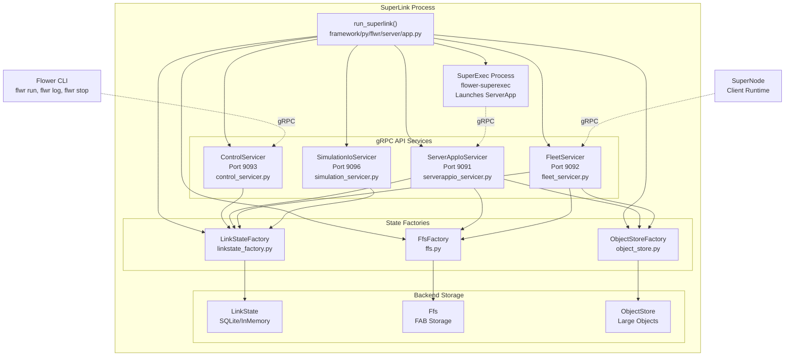

**Sources:** [framework/py/flwr/server/app.py:161-427](), [framework/py/flwr/common/constant.py:36-58]()

The `run_superlink()` function in `framework/py/flwr/server/app.py` initializes all components:

1. **Parses arguments** - database path, port addresses, certificates, authentication config
2. **Creates factory instances** - `LinkStateFactory`, `FfsFactory`, `ObjectStoreFactory`
3. **Starts gRPC servers** - one for each API service (Control, ServerAppIo, Fleet, SimulationIo)
4. **Launches SuperExec** - if isolation mode is subprocess, spawns `flower-superexec` process

Port assignments are defined in [framework/py/flwr/common/constant.py:36-58]():
- Control API: port `9093` (`CONTROL_API_PORT`)
- ServerAppIo API: port `9091` (`SERVERAPPIO_PORT`)
- Fleet API: port `9092` (`FLEETAPI_GRPC_RERE_PORT`)
- SimulationIo API: port `9096` (`SIMULATIONIO_PORT`)

**Sources:** [framework/py/flwr/server/app.py:161-427](), [framework/py/flwr/common/constant.py:36-58]()

## Control API

The `ControlServicer` class implements the Control API, which provides administrative commands for managing runs, nodes, and authentication. The CLI (`flwr` commands) communicates with this API.

### Control API Methods

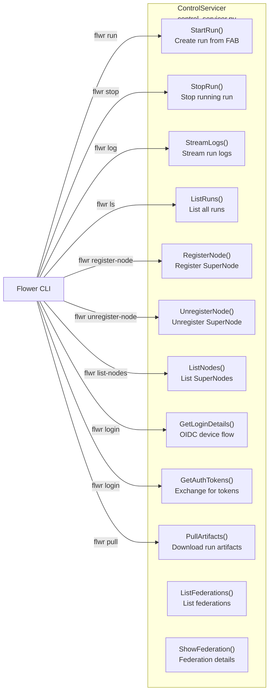

**Sources:** [framework/py/flwr/superlink/servicer/control/control_servicer.py:88-561]()

The Control API is initialized by `run_control_api_grpc()` in [framework/py/flwr/superlink/servicer/control/control_grpc.py:37-90](). Key responsibilities:

| Method | Purpose | Key Operations |
|--------|---------|---------------|
| `StartRun` | Create new run | Validates FAB, creates run in LinkState, initializes context |
| `StopRun` | Stop active run | Updates run status to STOPPED, deletes messages, cleans up objects |
| `StreamLogs` | Stream run logs | Yields log entries from LinkState until run finishes |
| `ListRuns` | List runs | Returns run metadata for user's account or specific run_id |
| `RegisterNode` | Register SuperNode | Creates node in LinkState with public key (requires NIST EC curve) |
| `UnregisterNode` | Unregister SuperNode | Marks node as unregistered in LinkState |
| `ListNodes` | List SuperNodes | Returns node info filtered by owner account |
| `GetLoginDetails` | Start OIDC login | Delegates to `ControlAuthnPlugin.get_login_details()` |
| `GetAuthTokens` | Complete OIDC login | Exchanges device code for access/refresh tokens |
| `PullArtifacts` | Download artifacts | Returns download URL from `ArtifactProvider` (if configured) |
| `ListFederations` | List federations | Returns federations user is member of |
| `ShowFederation` | Federation details | Returns members, nodes, and runs for a federation |

**Sources:** [framework/py/flwr/superlink/servicer/control/control_servicer.py:107-561]()

### Authentication and Authorization

The Control API supports pluggable authentication/authorization through `ControlAuthnPlugin` and `ControlAuthzPlugin` interfaces. Account information is managed through interceptors:

- **Authentication**: `ControlAccountAuthInterceptor` validates tokens and extracts account info
- **Authorization**: Checks permissions before executing commands
- **Event Logging**: `EventLogPlugin` can audit administrative actions

**Sources:** [framework/py/flwr/superlink/servicer/control/control_servicer.py:91-105](), [framework/py/flwr/server/app.py:227-244]()

## ServerAppIo API

The `ServerAppIoServicer` class implements the ServerAppIo API for communication between SuperLink and ServerApp processes. This API enables the ServerApp (running via SuperExec) to coordinate with SuperLink.

### ServerAppIo API Methods

```mermaid
graph TB
    subgraph ServerAppIoServicer["ServerAppIoServicer<br/>serverappio_servicer.py"]
        ListAppsToLaunch["ListAppsToLaunch()<br/>Get pending runs"]
        RequestToken["RequestToken()<br/>Authenticate run"]
        
        GetNodes["GetNodes()<br/>Get available nodes"]
        PushMessages["PushMessages()<br/>Send instructions"]
        PullMessages["PullMessages()<br/>Get replies"]
        
        PullAppInputs["PullAppInputs()<br/>Get context"]
        PushAppOutputs["PushAppOutputs()<br/>Save context"]
        
        UpdateRunStatus["UpdateRunStatus()<br/>Update run state"]
        SendAppHeartbeat["SendAppHeartbeat()<br/>Run liveness"]
        
        PushObject["PushObject()<br/>Store object"]
        PullObject["PullObject()<br/>Load object"]
        ConfirmMessageReceived["ConfirmMessageReceived()<br/>ACK message"]
    end
    
    ServerApp["ServerApp Process<br/>via SuperExec"]
    LinkState["LinkState"]
    ObjectStore["ObjectStore"]
    
    ServerApp -->|"1. Get run"| ListAppsToLaunch
    ServerApp -->|"2. Auth"| RequestToken
    ServerApp -->|"3. Get nodes"| GetNodes
    ServerApp -->|"4. Send tasks"| PushMessages
    ServerApp -->|"5. Get results"| PullMessages
    ServerApp -->|"Update status"| UpdateRunStatus
    ServerApp -->|"Heartbeat"| SendAppHeartbeat
    
    GetNodes --> LinkState
    PushMessages --> LinkState
    PullMessages --> LinkState
    UpdateRunStatus --> LinkState
    
    PushObject --> ObjectStore
    PullObject --> ObjectStore
```

**Sources:** [framework/py/flwr/server/superlink/serverappio/serverappio_servicer.py:80-571]()

### ServerAppIo Method Details

| Method | Purpose | Run Status Requirement |
|--------|---------|----------------------|
| `ListAppsToLaunch` | Get pending run IDs | Any (scans for PENDING) |
| `RequestToken` | Generate auth token for run | Any |
| `GetNodes` | Get online node IDs for run | RUNNING |
| `PushMessages` | Store instruction messages | RUNNING |
| `PullMessages` | Retrieve reply messages | RUNNING |
| `PullAppInputs` | Get run context (input) | RUNNING |
| `PushAppOutputs` | Save run context (output) | RUNNING or FINISHED |
| `UpdateRunStatus` | Transition run status | Any (validates transition) |
| `SendAppHeartbeat` | Acknowledge run liveness | STARTING or RUNNING |
| `PushObject`/`PullObject` | Transfer serialized objects | RUNNING or FINISHED |
| `ConfirmMessageReceived` | Mark message as received | Any |

**Sources:** [framework/py/flwr/server/superlink/serverappio/serverappio_servicer.py:97-571]()

The ServerAppIo API enforces run status constraints - most operations require the run to be in `RUNNING` state. Status transitions follow the pattern: `PENDING → STARTING → RUNNING → FINISHED`.

**Sources:** [framework/py/flwr/server/superlink/serverappio/serverappio_servicer.py:169-243]()

## Fleet API

The `FleetServicer` class implements the Fleet API for communication between SuperLink and SuperNode clients. This is the primary interface for node registration, message exchange, and object transfer.

### Fleet API Methods

```mermaid
graph TB
    subgraph FleetServicer["FleetServicer<br/>fleet_servicer.py"]
        RegisterNode["RegisterNode()<br/>Register node"]
        ActivateNode["ActivateNode()<br/>Transition to online"]
        DeactivateNode["DeactivateNode()<br/>Transition to offline"]
        UnregisterNode["UnregisterNode()<br/>Unregister node"]
        
        PullMessages["PullMessages()<br/>Get instructions"]
        PushMessages["PushMessages()<br/>Send results"]
        
        GetRun["GetRun()<br/>Get run metadata"]
        GetFab["GetFab()<br/>Get FAB content"]
        
        SendNodeHeartbeat["SendNodeHeartbeat()<br/>Node liveness"]
        
        PushObject["PushObject()<br/>Store object"]
        PullObject["PullObject()<br/>Load object"]
        ConfirmMessageReceived["ConfirmMessageReceived()<br/>ACK message"]
    end
    
    SuperNode["SuperNode Client"]
    LinkState["LinkState"]
    Ffs["Ffs"]
    ObjectStore["ObjectStore"]
    
    SuperNode -->|"1. Register"| RegisterNode
    SuperNode -->|"2. Activate"| ActivateNode
    SuperNode -->|"3. Pull tasks"| PullMessages
    SuperNode -->|"4. Push results"| PushMessages
    SuperNode -->|"Get config"| GetRun
    SuperNode -->|"Get code"| GetFab
    SuperNode -->|"Heartbeat"| SendNodeHeartbeat
    SuperNode -->|"5. Deactivate"| DeactivateNode
    
    RegisterNode --> LinkState
    ActivateNode --> LinkState
    PullMessages --> LinkState
    PushMessages --> LinkState
    GetRun --> LinkState
    GetFab --> Ffs
    
    PushObject --> ObjectStore
    PullObject --> ObjectStore
```

**Sources:** [framework/py/flwr/server/superlink/fleet/grpc_rere/fleet_servicer.py:58-456]()

### Fleet API Method Details

The Fleet API handles the complete SuperNode lifecycle:

**Node Lifecycle Methods:**
- `RegisterNode()` - Creates node entry in LinkState (disabled when node auth enabled)
- `ActivateNode()` - Transitions node from REGISTERED/OFFLINE to ONLINE status
- `DeactivateNode()` - Transitions node from ONLINE to OFFLINE status
- `UnregisterNode()` - Marks node as UNREGISTERED (disabled when node auth enabled)
- `SendNodeHeartbeat()` - Refreshes node's `online_until` timestamp

**Message Exchange Methods:**
- `PullMessages()` - Retrieves instruction messages for node, returns object tree references
- `PushMessages()` - Stores reply messages from node, validates run status
- `ConfirmMessageReceived()` - Acknowledges message processing, triggers cleanup

**Configuration Methods:**
- `GetRun()` - Returns `Run` protobuf with fab_id, fab_version, override_config
- `GetFab()` - Returns FAB content from Ffs storage

**Object Transfer Methods:**
- `PushObject()` - Stores serialized object in ObjectStore
- `PullObject()` - Retrieves serialized object from ObjectStore

**Sources:** [framework/py/flwr/server/superlink/fleet/grpc_rere/fleet_servicer.py:58-456]()

### Node Authentication

The Fleet API supports optional node authentication via `NodeAuthServerInterceptor`. When enabled (`--enable-supernode-auth` flag), the interceptor:

1. Validates Ed25519 signature in gRPC metadata headers
2. Verifies timestamp is within tolerance window
3. Maps public key to node_id via LinkState
4. Blocks RegisterNode/UnregisterNode operations (nodes must be pre-registered via CLI)

**Sources:** [framework/py/flwr/server/superlink/fleet/grpc_rere/node_auth_server_interceptor.py:43-204]()

## SimulationIo API

The `SimulationIoServicer` class implements the SimulationIo API for simulation mode, where ClientApps run within the SuperLink process using the VCE (Virtual Client Engine).

### SimulationIo vs Normal Mode

In normal deployment:
- SuperNodes run on separate machines
- ClientApps execute in isolated SuperNode processes
- Communication via Fleet API (gRPC over network)

In simulation mode:
- ClientApps run within SuperLink process
- Virtual nodes managed by VCE (Virtual Client Engine)
- Communication via SimulationIo API (in-process)

### SimulationIo API Methods

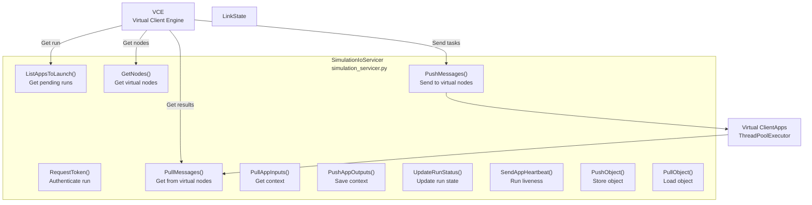

**Sources:** [framework/py/flwr/server/superlink/simulation/simulationio_servicer.py:73-523](), [framework/py/flwr/server/superlink/fleet/vce/vce_api.py:1-456]()

The SimulationIo API is nearly identical to ServerAppIo API but integrates with VCE for in-process virtual node management. The `num-supernodes` federation option controls the number of virtual ClientApps.

**Sources:** [framework/py/flwr/server/superlink/simulation/simulationio_servicer.py:73-523]()

## SuperExec Process Management

SuperExec is the process launcher component that manages ServerApp execution. It runs as a separate process (`flower-superexec`) when isolation mode is subprocess.

### SuperExec Architecture

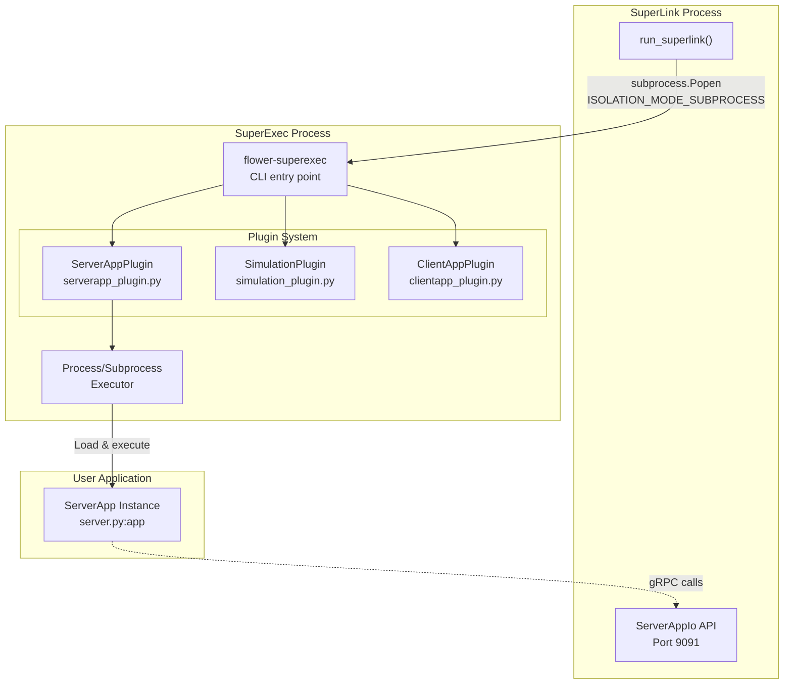

**Sources:** [framework/py/flwr/server/app.py:428-476](), [framework/py/flwr/supercore/cli/flower_superexec.py:37-103]()

### SuperExec Plugins

SuperExec uses a plugin architecture defined in [framework/py/flwr/superexec/exec_plugin.py:32-103](). Three plugin types are supported:

| Plugin Type | Purpose | Entry Point |
|------------|---------|-------------|
| `ExecPluginType.SERVER_APP` | Execute ServerApp | `run_serverapp()` |
| `ExecPluginType.SIMULATION` | Execute simulation | `run_simulation()` |
| `ExecPluginType.CLIENT_APP` | Execute ClientApp | `run_clientapp()` (for SuperNode-side) |

**Sources:** [framework/py/flwr/common/constant.py:304-319](), [framework/py/flwr/superexec/exec_plugin.py:32-103]()

### ServerApp Execution Flow

1. **SuperLink launches SuperExec**: [framework/py/flwr/server/app.py:434-476]()
   - Builds command: `["flower-superexec", "--insecure", "--appio-api-address", "127.0.0.1:9091", ...]`
   - Spawns subprocess via `subprocess.Popen()`

2. **SuperExec initializes**: [framework/py/flwr/supercore/cli/flower_superexec.py:37-103]()
   - Parses CLI arguments (plugin type, API address, isolation mode)
   - Loads appropriate plugin (e.g., `ServerAppPlugin`)

3. **Plugin execution**: [framework/py/flwr/superexec/exec_plugin.py:105-275]()
   - Polls ServerAppIo API via `ListAppsToLaunch()` for pending runs
   - Loads FAB from Ffs
   - Executes ServerApp in isolated process/subprocess
   - ServerApp communicates back to ServerAppIo API

4. **Lifecycle management**:
   - Token-based authentication for each run
   - Heartbeat mechanism to track liveness
   - Status transitions managed through `UpdateRunStatus()`

**Sources:** [framework/py/flwr/superexec/exec_plugin.py:105-275](), [framework/py/flwr/server/app.py:428-476]()

## State and Storage Integration

SuperLink integrates three storage systems through factory patterns:

### LinkState Factory

The `LinkStateFactory` creates `LinkState` instances for persistent state management:

```python
# framework/py/flwr/server/superlink/linkstate/linkstate_factory.py
class LinkStateFactory:
    def __init__(self, database_path: str, federation_manager: FederationManager):
        if database_path == ":flwr-in-memory:":
            self.state = InMemoryLinkState(federation_manager)
        else:
            self.state = SqliteLinkState(database_path, federation_manager)
```

LinkState stores:
- **Runs**: run_id, fab_hash, status, timestamps
- **Nodes**: node_id, public_key, status, heartbeat info
- **Messages**: message_ins (instructions), message_res (replies)
- **Contexts**: ServerApp state (run_config, node_config)
- **Logs**: Run execution logs with timestamps
- **Tokens**: Run authentication tokens

**Sources:** [framework/py/flwr/server/superlink/linkstate/linkstate_factory.py:33-60](), [framework/py/flwr/server/superlink/linkstate/linkstate.py:29-256]()

### Ffs Factory

The `FfsFactory` creates Ffs (Flower File System) instances for FAB storage:

```python
# framework/py/flwr/supercore/ffs/ffs_factory.py
class FfsFactory:
    def __init__(self, storage_dir: str):
        self.ffs = Ffs(storage_dir)
```

Ffs provides content-addressable storage:
- FAB files stored by SHA256 hash
- Deduplication through hash-based storage
- Metadata extraction from FAB content

**Sources:** [framework/py/flwr/supercore/ffs/ffs_factory.py:23-39]()

### ObjectStore Factory

The `ObjectStoreFactory` creates ObjectStore instances for large serialized objects:

```python
# framework/py/flwr/supercore/object_store/object_store_factory.py
class ObjectStoreFactory:
    def __init__(self, database_path: str = ":flwr-in-memory:"):
        if database_path == ":flwr-in-memory:":
            self.store = InMemoryObjectStore()
        else:
            self.store = SqliteObjectStore(database_path)
```

ObjectStore manages:
- Serialized RecordDict, RecordSet, ParametersRecord objects
- Content-addressable storage by object_id (SHA256 hash)
- Garbage collection of unreferenced objects

**Sources:** [framework/py/flwr/supercore/object_store/object_store_factory.py:24-46]()

### Factory Usage Pattern

All three factories follow the same pattern:

1. **Initialization**: Created once at SuperLink startup with configuration
2. **State method**: Returns singleton instance via `.state()`, `.ffs()`, or `.store()`
3. **Dependency injection**: Passed to servicer constructors
4. **Thread-safe**: Servicers share same backend instance

**Sources:** [framework/py/flwr/server/app.py:304-326]()

## SuperNode Components

SuperNode manages client-side execution, handling ClientApp processes and coordinating with SuperLink through various transport protocols.

```mermaid
graph TB
    subgraph "SuperNode Main Process"
        StartClientInternal["start_client_internal<br/>Main Entry Point"]
        
        subgraph "Connection Management"
            InitConnection["_init_connection<br/>Transport Setup"]
            GrpcRereConn["grpc_request_response<br/>gRPC Transport"]
            RestConn["http_request_response<br/>REST Transport"]
            GrpcAdapterConn["grpc_adapter<br/>Adapter Transport"]
        end
        
        subgraph "Message Processing"
            PullAndStore["_pull_and_store_message<br/>Receive Handler"]
            PushMessages["_push_messages<br/>Send Handler"]
        end
    end
    
    subgraph "ClientAppIo API Server"
        ClientAppIoServicer["ClientAppIoServicer<br/>clientappio_servicer"]
        RunClientAppIoAPI["run_clientappio_api_grpc<br/>gRPC Server"]
    end
    
    subgraph "Client Process Management"
        SuperExecProcess["SuperExec Process<br/>flower-superexec"]
        ClientAppProcess["ClientApp Process<br/>Subprocess/Process"]
        
        subgraph "Isolation Modes"
            SubprocessMode["ISOLATION_MODE_SUBPROCESS"]
            ProcessMode["ISOLATION_MODE_PROCESS"]  
        end
    end
    
    subgraph "Local Storage"
        NodeStateFactory["NodeStateFactory<br/>Local State"]
        NodeFfsFactory["FfsFactory<br/>Local FAB Storage"]
        NodeObjectStore["ObjectStoreFactory<br/>Message Cache"]
    end
    
    StartClientInternal --> InitConnection
    InitConnection --> GrpcRereConn
    InitConnection --> RestConn
    InitConnection --> GrpcAdapterConn
    
    StartClientInternal --> PullAndStore
    StartClientInternal --> PushMessages
    StartClientInternal --> RunClientAppIoAPI
    
    RunClientAppIoAPI --> ClientAppIoServicer
    
    StartClientInternal --> SuperExecProcess
    SuperExecProcess --> ClientAppProcess
    
    ClientAppProcess --> SubprocessMode
    ClientAppProcess --> ProcessMode
    
    ClientAppIoServicer --> NodeStateFactory
    ClientAppIoServicer --> NodeFfsFactory
    ClientAppIoServicer --> NodeObjectStore
```

### SuperNode Main Loop

The SuperNode's main execution loop is implemented in `start_client_internal()`. This function establishes connections to SuperLink and continuously processes messages between the central orchestrator and local ClientApp processes.

The main loop performs these key operations:
1. **Connection Setup**: Establishes transport connection (gRPC, REST, or gRPC-adapter) to SuperLink's Fleet API
2. **Node Registration**: Registers the SuperNode with SuperLink via `create_node()`
3. **Message Processing**: Continuously pulls messages from SuperLink, stores them locally, and pushes replies back

**Sources:** [framework/py/flwr/supernode/start_client_internal.py:73-230](), [framework/py/flwr/supernode/start_client_internal.py:232-332]()

### ClientApp Execution Management

SuperNode manages ClientApp processes through different isolation modes:

| Isolation Mode | Description | Process Management |
|---|---|---|
| `ISOLATION_MODE_SUBPROCESS` | ClientApp runs in subprocess started by SuperNode | Managed via `flower-superexec` launcher |
| `ISOLATION_MODE_PROCESS` | ClientApp runs in separate isolated process | Direct process isolation |

The SuperExec component (`flower-superexec`) acts as a process launcher that starts and manages ClientApp instances. It communicates with SuperNode's ClientAppIo API to coordinate message flow.

**Sources:** [framework/py/flwr/supernode/start_client_internal.py:167-173](), [framework/py/flwr/supercore/cli/flower_superexec.py:37-61](), [framework/py/flwr/common/constant.py:99-101]()

### ClientAppIo API Server

The `ClientAppIoServicer` provides a gRPC API server that enables communication between SuperNode and ClientApp processes. This API runs on port 9094 and handles:

- Message exchange between SuperNode and ClientApp processes
- FAB (Flower Application Bundle) distribution to ClientApps
- Object serialization and transfer
- Run context and configuration management

The API server is started via `run_clientappio_api_grpc()` and uses the same factory pattern as SuperLink for managing local state, file storage, and object storage.

**Sources:** [framework/py/flwr/supernode/start_client_internal.py:512-537](), [framework/py/flwr/supernode/servicer/clientappio.py]()

## Communication Flow

The communication between SuperLink and SuperNode follows a well-defined protocol for message exchange and object transfer:

```mermaid
sequenceDiagram
    participant SN as SuperNode
    participant SL as SuperLink
    participant CA as ClientApp
    
    Note over SN,SL: Connection Setup
    SN->>SL: CreateNode(heartbeat_interval)
    SL->>SN: CreateNodeResponse(node_id)
    
    Note over SN,SL: Message Pull Cycle
    SN->>SL: PullMessages(node)
    SL->>SN: PullMessagesResponse(messages, object_trees)
    SN->>SL: PullObject(run_id, object_id)
    SL->>SN: PullObjectResponse(object_content)
    
    Note over SN,CA: Local Processing
    SN->>CA: Forward message via ClientAppIo API
    CA->>SN: Reply message via ClientAppIo API
    
    Note over SN,SL: Message Push Cycle  
    SN->>SL: PushMessages(node, reply_messages, object_trees)
    SL->>SN: PushMessagesResponse(objects_to_push)
    SN->>SL: PushObject(run_id, object_id, content)
    SL->>SN: PushObjectResponse(stored)
    
    SN->>SL: ConfirmMessageReceived(run_id, message_id)
    SL->>SN: ConfirmMessageReceivedResponse()
```

**Sources:** [framework/py/flwr/client/grpc_rere_client/connection.py:232-331](), [framework/py/flwr/supernode/start_client_internal.py:335-420]()

This architecture enables scalable federated learning by decoupling client management from central orchestration, while maintaining efficient communication through optimized message passing and object serialization protocols.

---

# Page: SuperNode Client Architecture

# SuperNode Client Architecture

<details>
<summary>Relevant source files</summary>

The following files were used as context for generating this wiki page:

- [framework/docs/source/ref-exit-codes/303.rst](framework/docs/source/ref-exit-codes/303.rst)
- [framework/docs/source/ref-exit-codes/304.rst](framework/docs/source/ref-exit-codes/304.rst)
- [framework/docs/source/ref-exit-codes/500.rst](framework/docs/source/ref-exit-codes/500.rst)
- [framework/py/flwr/cli/auth_plugin/__init__.py](framework/py/flwr/cli/auth_plugin/__init__.py)
- [framework/py/flwr/cli/auth_plugin/auth_plugin.py](framework/py/flwr/cli/auth_plugin/auth_plugin.py)
- [framework/py/flwr/cli/auth_plugin/noop_auth_plugin.py](framework/py/flwr/cli/auth_plugin/noop_auth_plugin.py)
- [framework/py/flwr/cli/auth_plugin/oidc_cli_plugin.py](framework/py/flwr/cli/auth_plugin/oidc_cli_plugin.py)
- [framework/py/flwr/cli/build.py](framework/py/flwr/cli/build.py)
- [framework/py/flwr/cli/cli_account_auth_interceptor.py](framework/py/flwr/cli/cli_account_auth_interceptor.py)
- [framework/py/flwr/cli/log.py](framework/py/flwr/cli/log.py)
- [framework/py/flwr/cli/login/login.py](framework/py/flwr/cli/login/login.py)
- [framework/py/flwr/cli/new/new.py](framework/py/flwr/cli/new/new.py)
- [framework/py/flwr/cli/new/new_test.py](framework/py/flwr/cli/new/new_test.py)
- [framework/py/flwr/cli/new/templates/app/code/client.xgboost.py.tpl](framework/py/flwr/cli/new/templates/app/code/client.xgboost.py.tpl)
- [framework/py/flwr/cli/new/templates/app/code/server.xgboost.py.tpl](framework/py/flwr/cli/new/templates/app/code/server.xgboost.py.tpl)
- [framework/py/flwr/cli/new/templates/app/code/task.xgboost.py.tpl](framework/py/flwr/cli/new/templates/app/code/task.xgboost.py.tpl)
- [framework/py/flwr/cli/new/templates/app/pyproject.xgboost.toml.tpl](framework/py/flwr/cli/new/templates/app/pyproject.xgboost.toml.tpl)
- [framework/py/flwr/cli/run/run.py](framework/py/flwr/cli/run/run.py)
- [framework/py/flwr/cli/stop.py](framework/py/flwr/cli/stop.py)
- [framework/py/flwr/cli/utils.py](framework/py/flwr/cli/utils.py)
- [framework/py/flwr/client/grpc_adapter_client/connection.py](framework/py/flwr/client/grpc_adapter_client/connection.py)
- [framework/py/flwr/client/grpc_rere_client/connection.py](framework/py/flwr/client/grpc_rere_client/connection.py)
- [framework/py/flwr/client/grpc_rere_client/node_auth_client_interceptor_test.py](framework/py/flwr/client/grpc_rere_client/node_auth_client_interceptor_test.py)
- [framework/py/flwr/client/rest_client/connection.py](framework/py/flwr/client/rest_client/connection.py)
- [framework/py/flwr/common/constant.py](framework/py/flwr/common/constant.py)
- [framework/py/flwr/common/exit/exit_code.py](framework/py/flwr/common/exit/exit_code.py)
- [framework/py/flwr/compat/client/grpc_client/connection.py](framework/py/flwr/compat/client/grpc_client/connection.py)
- [framework/py/flwr/server/app.py](framework/py/flwr/server/app.py)
- [framework/py/flwr/server/superlink/fleet/grpc_rere/node_auth_server_interceptor.py](framework/py/flwr/server/superlink/fleet/grpc_rere/node_auth_server_interceptor.py)
- [framework/py/flwr/supercore/constant.py](framework/py/flwr/supercore/constant.py)
- [framework/py/flwr/supercore/primitives/asymmetric.py](framework/py/flwr/supercore/primitives/asymmetric.py)
- [framework/py/flwr/supercore/primitives/asymmetric_ed25519.py](framework/py/flwr/supercore/primitives/asymmetric_ed25519.py)
- [framework/py/flwr/supercore/primitives/asymmetric_ed25519_test.py](framework/py/flwr/supercore/primitives/asymmetric_ed25519_test.py)
- [framework/py/flwr/superlink/auth_plugin/__init__.py](framework/py/flwr/superlink/auth_plugin/__init__.py)
- [framework/py/flwr/superlink/auth_plugin/auth_plugin.py](framework/py/flwr/superlink/auth_plugin/auth_plugin.py)
- [framework/py/flwr/superlink/auth_plugin/noop_auth_plugin.py](framework/py/flwr/superlink/auth_plugin/noop_auth_plugin.py)
- [framework/py/flwr/superlink/federation/__init__.py](framework/py/flwr/superlink/federation/__init__.py)
- [framework/py/flwr/superlink/servicer/control/control_grpc.py](framework/py/flwr/superlink/servicer/control/control_grpc.py)
- [framework/py/flwr/supernode/cli/flower_supernode.py](framework/py/flwr/supernode/cli/flower_supernode.py)
- [framework/py/flwr/supernode/start_client_internal.py](framework/py/flwr/supernode/start_client_internal.py)
- [framework/py/flwr/supernode/start_client_internal_test.py](framework/py/flwr/supernode/start_client_internal_test.py)

</details>


This document describes the SuperNode client architecture in the Flower framework. SuperNode is the client-side runtime that manages `ClientApp` execution, handles communication with the SuperLink server, and coordinates local state and object storage.

For information about the SuperLink server architecture, see page 2.1. For details about communication protocols, see page 2.4.

## Architecture Overview

SuperNode is a client-side process that connects to SuperLink's Fleet API, executes `ClientApp` instances in isolated processes, and manages the message flow between local applications and the central server.

**SuperNode High-Level Architecture**

```mermaid
graph TB
    subgraph SuperLinkServer["SuperLink Server"]
        FleetAPI["Fleet API<br/>:9092"]
    end
    
    subgraph SuperNodeProcess["SuperNode Process"]
        StartInternal["start_client_internal()<br/>Main Loop"]
        
        subgraph ConnectionLayer["Connection Layer"]
            InitConn["_init_connection()"]
            GrpcConn["grpc_request_response()"]
            RestConn["http_request_response()"]
        end
        
        subgraph MessageHandlers["Message Handlers"]
            PullStore["_pull_and_store_message()"]
            PushMsg["_push_messages()"]
        end
        
        subgraph LocalAPIs["Local APIs"]
            ClientAppIoServer["ClientAppIoServicer<br/>:9094"]
        end
        
        subgraph LocalStorage["Local Storage"]
            NodeState["NodeState"]
            NodeFfs["Ffs"]
            NodeObjStore["ObjectStore"]
        end
    end
    
    subgraph ProcessIsolation["Process Isolation"]
        SuperExec["flower-superexec<br/>subprocess"]
        ClientApp["ClientApp<br/>User Code"]
    end
    
    FleetAPI <-->|"Fleet Protocol"| InitConn
    InitConn --> GrpcConn
    InitConn --> RestConn
    
    StartInternal --> InitConn
    StartInternal --> PullStore
    StartInternal --> PushMsg
    StartInternal --> ClientAppIoServer
    
    PullStore --> NodeState
    PullStore --> NodeObjStore
    PushMsg --> NodeState
    PushMsg --> NodeObjStore
    
    ClientAppIoServer --> NodeState
    ClientAppIoServer --> NodeFfs
    ClientAppIoServer --> NodeObjStore
    
    StartInternal -->|"Launches in<br/>subprocess mode"| SuperExec
    SuperExec --> ClientApp
    ClientApp <-->|"gRPC"| ClientAppIoServer
```

**Sources:** [framework/py/flwr/supernode/start_client_internal.py:90-273](), [framework/py/flwr/common/constant.py:36-47](), [framework/py/flwr/client/grpc_rere_client/connection.py:72-385]()

## SuperNode Entry Point

The SuperNode is launched via the `flower-supernode` CLI command, which invokes `start_client_internal()` as the main entry point.

**SuperNode CLI Entry Point**

```mermaid
graph LR
    CLI["flower-supernode CLI<br/>flower_supernode.py"]
    Parse["_parse_args_run_supernode()"]
    Auth["_try_setup_client_authentication()"]
    Trusted["_try_obtain_trusted_entities()"]
    StartInternal["start_client_internal()"]
    
    CLI --> Parse
    Parse --> Auth
    Parse --> Trusted
    CLI --> StartInternal
```

The CLI parses command-line arguments including:
- `--superlink`: SuperLink Fleet API address (default: `0.0.0.0:9092`)
- `--isolation`: Isolation mode (`subprocess` or `process`, default: `subprocess`)
- `--transport`: Transport protocol (`grpc-rere`, `rest`, or `grpc-adapter`)
- `--auth-supernode-private-key`: Optional path to private key for node authentication
- `--trusted-entities`: Optional path to YAML file defining trusted FAB signers
- `--node-config`: Node configuration as key-value pairs
- `--clientappio-api-address`: ClientAppIo API address (default: `0.0.0.0:9094`)

**Sources:** [framework/py/flwr/supernode/cli/flower_supernode.py:46-93](), [framework/py/flwr/supernode/cli/flower_supernode.py:96-226](), [framework/py/flwr/common/constant.py:36-47]()

## SuperNode Components

SuperNode consists of several key components that work together to manage client-side execution and communication with SuperLink.

**SuperNode Component Architecture**

```mermaid
graph TB
    subgraph MainLoop["Main Loop: start_client_internal()"]
        Init["Initialization"]
        LoopStart["Loop Start"]
        PullStore["_pull_and_store_message()"]
        Push["_push_messages()"]
        LoopEnd["Loop End"]
    end
    
    subgraph StateManagement["State Management"]
        NSFactory["NodeStateFactory"]
        NS["NodeState"]
        GetRun["get_run(run_id)"]
        StoreMsg["store_message(msg)"]
        GetMsg["get_messages(is_reply)"]
        DelMsg["delete_messages(msg_ids)"]
    end
    
    subgraph Storage["Storage Components"]
        FfsF["FfsFactory"]
        Ffs["Ffs"]
        ObjStoreF["ObjectStoreFactory"]
        ObjStore["ObjectStore"]
    end
    
    subgraph APIServer["ClientAppIo API Server"]
        RunAPI["run_clientappio_api_grpc()"]
        Servicer["ClientAppIoServicer"]
    end
    
    Init --> LoopStart
    LoopStart --> PullStore
    PullStore --> Push
    Push --> LoopEnd
    LoopEnd --> LoopStart
    
    Init --> NSFactory
    Init --> FfsF
    Init --> ObjStoreF
    Init --> RunAPI
    
    NSFactory --> NS
    FfsF --> Ffs
    ObjStoreF --> ObjStore
    RunAPI --> Servicer
    
    PullStore --> NS
    PullStore --> ObjStore
    Push --> NS
    Push --> ObjStore
    
    NS --> GetRun
    NS --> StoreMsg
    NS --> GetMsg
    NS --> DelMsg
```

**Sources:** [framework/py/flwr/supernode/start_client_internal.py:90-273](), [framework/py/flwr/supernode/nodestate/__init__.py]()

### NodeState Management

The `NodeState` class manages local state for the SuperNode, including:
- Current run information and context
- Message queue for incoming and outgoing messages
- Node ID registration

Key methods:

| Method | Purpose |
|--------|---------|
| `set_node_id(node_id)` | Store the node ID assigned by SuperLink |
| `get_node_id()` | Retrieve the current node ID |
| `store_run(run_info)` | Cache run metadata locally |
| `get_run(run_id)` | Retrieve cached run metadata |
| `store_context(context)` | Store run context including config |
| `store_message(message)` | Add message to local queue |
| `get_messages(is_reply)` | Retrieve messages (request or reply) |
| `delete_messages(message_ids)` | Remove processed messages |

**Sources:** [framework/py/flwr/supernode/start_client_internal.py:208-242](), [framework/py/flwr/supernode/nodestate/__init__.py]()

### SuperNode Main Loop

The `start_client_internal()` function implements the main execution loop:

```python
def start_client_internal(
    *,
    server_address: str,
    node_config: UserConfig,
    root_certificates: bytes | str | None = None,
    insecure: bool | None = None,
    transport: str,
    authentication_keys: tuple | None = None,
    max_retries: int | None = None,
    max_wait_time: float | None = None,
    flwr_path: Path | None = None,
    isolation: str = ISOLATION_MODE_SUBPROCESS,
    clientappio_api_address: str = CLIENTAPPIO_API_DEFAULT_SERVER_ADDRESS,
    health_server_address: str | None = None,
    trusted_entities: dict[str, str] | None = None,
) -> None
```

The main loop:
1. **Initialize factories**: Create `NodeStateFactory`, `FfsFactory`, and `ObjectStoreFactory`
2. **Launch ClientAppIo API server**: Start gRPC server on port 9094
3. **Launch SuperExec** (if isolation mode is subprocess): Start `flower-superexec` process
4. **Establish connection**: Create transport connection to SuperLink's Fleet API
5. **Register/Activate node**: Register with SuperLink and obtain node ID
6. **Message loop**:
   - Pull message from SuperLink via `receive()`
   - Store message and objects via `_pull_and_store_message()`
   - Wait for ClientApp to produce reply
   - Push reply via `_push_messages()`
   - Repeat

**Sources:** [framework/py/flwr/supernode/start_client_internal.py:90-273](), [framework/py/flwr/supernode/start_client_internal.py:179-219]()

### ClientApp Execution and Isolation Modes

SuperNode supports two isolation modes for executing `ClientApp` user code:

| Isolation Mode | Process Model | Lifecycle Management |
|----------------|---------------|---------------------|
| `ISOLATION_MODE_SUBPROCESS` (default) | ClientApp runs in subprocess launched by SuperNode | SuperNode starts `flower-superexec`, which then starts ClientApp |
| `ISOLATION_MODE_PROCESS` | ClientApp runs in independent process | External process connects to SuperNode's ClientAppIo API |

**Subprocess Isolation Mode Flow**

```mermaid
sequenceDiagram
    participant SN as SuperNode
    participant SE as flower-superexec
    participant CA as ClientApp
    
    Note over SN: isolation=subprocess
    SN->>SN: Launch ClientAppIo API<br/>on :9094
    SN->>SE: subprocess.Popen(["flower-superexec",<br/>"--appio-api-address", "127.0.0.1:9094"])
    SE->>CA: Launch ClientApp process
    CA->>SN: Connect to ClientAppIo API
    
    Note over SN,CA: Message Processing
    SN->>CA: Forward message via ClientAppIo
    CA->>SN: Return reply via ClientAppIo
```

When using `ISOLATION_MODE_SUBPROCESS`, SuperNode launches `flower-superexec` with these arguments:
- `--insecure`: Skip TLS for local communication
- `--appio-api-address`: Address of ClientAppIo API (e.g., `127.0.0.1:9094`)
- `--plugin-type`: Set to `clientapp`
- `--parent-pid`: SuperNode's PID for lifecycle management

**Sources:** [framework/py/flwr/supernode/start_client_internal.py:213-219](), [framework/py/flwr/common/constant.py:114-115]()

### ClientAppIo API Server

The `ClientAppIoServicer` provides a gRPC API for communication between SuperNode and ClientApp processes. This server runs on port 9094 (configurable via `--clientappio-api-address`).

**ClientAppIo API Methods**

```mermaid
graph LR
    subgraph ClientAppProcess["ClientApp Process"]
        UserCode["User Code<br/>client_app.py"]
    end
    
    subgraph ClientAppIoAPI["ClientAppIo API :9094"]
        GetRun["GetRun(run_id)"]
        GetFab["GetFab(hash)"]
        PullMsg["PullMessage(run_id)"]
        PushMsg["PushMessage(msg)"]
        PullObj["PullObject(obj_id)"]
        PushObj["PushObject(obj_id, content)"]
    end
    
    subgraph SuperNodeStorage["SuperNode Storage"]
        State["NodeState"]
        FfsLocal["Ffs"]
        ObjStoreLocal["ObjectStore"]
    end
    
    UserCode --> GetRun
    UserCode --> GetFab
    UserCode --> PullMsg
    UserCode --> PushMsg
    UserCode --> PullObj
    UserCode --> PushObj
    
    GetRun --> State
    GetFab --> FfsLocal
    PullMsg --> State
    PushMsg --> State
    PullObj --> ObjStoreLocal
    PushObj --> ObjStoreLocal
```

The server is created via `run_clientappio_api_grpc()`:

```python
def run_clientappio_api_grpc(
    address: str,
    state_factory: NodeStateFactory,
    ffs_factory: FfsFactory,
    objectstore_factory: ObjectStoreFactory,
    certificates: tuple[bytes, bytes, bytes] | None,
) -> grpc.Server
```

**Sources:** [framework/py/flwr/supernode/start_client_internal.py:597-623](), [framework/py/flwr/supernode/servicer/clientappio.py]()

## Communication Flow

The communication between SuperLink and SuperNode follows a well-defined protocol for message exchange and object transfer:

```mermaid
sequenceDiagram
    participant SN as SuperNode
    participant SL as SuperLink
    participant CA as ClientApp
    
    Note over SN,SL: Connection Setup
    SN->>SL: CreateNode(heartbeat_interval)
    SL->>SN: CreateNodeResponse(node_id)
    
    Note over SN,SL: Message Pull Cycle
    SN->>SL: PullMessages(node)
    SL->>SN: PullMessagesResponse(messages, object_trees)
    SN->>SL: PullObject(run_id, object_id)
    SL->>SN: PullObjectResponse(object_content)
    
    Note over SN,CA: Local Processing
    SN->>CA: Forward message via ClientAppIo API
    CA->>SN: Reply message via ClientAppIo API
    
    Note over SN,SL: Message Push Cycle  
    SN->>SL: PushMessages(node, reply_messages, object_trees)
    SL->>SN: PushMessagesResponse(objects_to_push)
    SN->>SL: PushObject(run_id, object_id, content)
    SL->>SN: PushObjectResponse(stored)
    
    SN->>SL: ConfirmMessageReceived(run_id, message_id)
    SL->>SN: ConfirmMessageReceivedResponse()
```

**Sources:** [framework/py/flwr/client/grpc_rere_client/connection.py:232-331](), [framework/py/flwr/supernode/start_client_internal.py:335-420]()

This architecture enables scalable federated learning by decoupling client management from central orchestration, while maintaining efficient communication through optimized message passing and object serialization protocols.

---

# Page: LinkState and State Management

# LinkState and State Management

<details>
<summary>Relevant source files</summary>

The following files were used as context for generating this wiki page:

- [framework/py/flwr/server/grid/inmemory_grid_test.py](framework/py/flwr/server/grid/inmemory_grid_test.py)
- [framework/py/flwr/server/superlink/fleet/grpc_rere/fleet_servicer_test.py](framework/py/flwr/server/superlink/fleet/grpc_rere/fleet_servicer_test.py)
- [framework/py/flwr/server/superlink/fleet/grpc_rere/node_auth_server_interceptor_test.py](framework/py/flwr/server/superlink/fleet/grpc_rere/node_auth_server_interceptor_test.py)
- [framework/py/flwr/server/superlink/fleet/vce/vce_api.py](framework/py/flwr/server/superlink/fleet/vce/vce_api.py)
- [framework/py/flwr/server/superlink/fleet/vce/vce_api_test.py](framework/py/flwr/server/superlink/fleet/vce/vce_api_test.py)
- [framework/py/flwr/server/superlink/linkstate/in_memory_linkstate.py](framework/py/flwr/server/superlink/linkstate/in_memory_linkstate.py)
- [framework/py/flwr/server/superlink/linkstate/linkstate.py](framework/py/flwr/server/superlink/linkstate/linkstate.py)
- [framework/py/flwr/server/superlink/linkstate/linkstate_factory.py](framework/py/flwr/server/superlink/linkstate/linkstate_factory.py)
- [framework/py/flwr/server/superlink/linkstate/linkstate_test.py](framework/py/flwr/server/superlink/linkstate/linkstate_test.py)
- [framework/py/flwr/server/superlink/linkstate/sqlite_linkstate.py](framework/py/flwr/server/superlink/linkstate/sqlite_linkstate.py)
- [framework/py/flwr/server/superlink/serverappio/serverappio_servicer_test.py](framework/py/flwr/server/superlink/serverappio/serverappio_servicer_test.py)
- [framework/py/flwr/server/superlink/simulation/simulation_servicer_test.py](framework/py/flwr/server/superlink/simulation/simulation_servicer_test.py)
- [framework/py/flwr/simulation/run_simulation.py](framework/py/flwr/simulation/run_simulation.py)
- [framework/py/flwr/superlink/servicer/control/control_servicer_test.py](framework/py/flwr/superlink/servicer/control/control_servicer_test.py)

</details>


## Purpose and Scope

LinkState is the central state management abstraction in Flower's SuperLink server component. It provides a unified interface for managing all persistent and transient state required for federated learning operations, including nodes, runs, messages, contexts, and logs.

This document covers:
- The LinkState abstraction and its implementations (SQLite and in-memory)
- Data models for nodes, runs, and messages
- Core operations for state management
- State transitions and lifecycle management
- Integration with other SuperLink components

For information about how LinkState integrates with communication protocols, see [Communication Protocols](#2.4). For details on message flow and object storage separate from LinkState, see [Message Flow and Object Storage](#2.5).

**Sources:** [framework/py/flwr/server/superlink/linkstate/linkstate.py:1-30]()

## LinkState Architecture Overview

```mermaid
graph TB
    subgraph "LinkState Interface"
        LinkState["LinkState<br/>(Abstract Base Class)"]
        CoreState["CoreState<br/>(inherited)"]
    end
    
    subgraph "Implementations"
        SqliteLinkState["SqliteLinkState<br/>framework/py/flwr/server/superlink/linkstate/sqlite_linkstate.py"]
        InMemoryLinkState["InMemoryLinkState<br/>framework/py/flwr/server/superlink/linkstate/in_memory_linkstate.py"]
    end
    
    subgraph "Factory"
        LinkStateFactory["LinkStateFactory<br/>framework/py/flwr/server/superlink/linkstate/linkstate_factory.py"]
    end
    
    subgraph "Integration"
        FederationManager["FederationManager<br/>Node filtering by federation"]
        ControlAPI["Control API<br/>Run management"]
        ServerAppIO["ServerAppIo API<br/>ServerApp communication"]
        FleetAPI["Fleet API<br/>Node communication"]
        SimulationIO["SimulationIo API<br/>Simulation mode"]
    end
    
    CoreState --> LinkState
    LinkState --> SqliteLinkState
    LinkState --> InMemoryLinkState
    LinkStateFactory -->|creates| SqliteLinkState
    LinkStateFactory -->|creates| InMemoryLinkState
    
    SqliteLinkState -.->|uses| FederationManager
    InMemoryLinkState -.->|uses| FederationManager
    
    ControlAPI -->|reads/writes| LinkState
    ServerAppIO -->|reads/writes| LinkState
    FleetAPI -->|reads/writes| LinkState
    SimulationIO -->|reads/writes| LinkState
```

**Description:** LinkState is an abstract interface that extends CoreState. It has two concrete implementations: SqliteLinkState for persistent storage and InMemoryLinkState for transient in-memory storage. LinkStateFactory provides a factory pattern for instantiation. All SuperLink APIs interact with state through the LinkState interface.

**Sources:** [framework/py/flwr/server/superlink/linkstate/linkstate.py:29-30](), [framework/py/flwr/server/superlink/linkstate/sqlite_linkstate.py:193-202](), [framework/py/flwr/server/superlink/linkstate/in_memory_linkstate.py:70-105](), [framework/py/flwr/server/superlink/linkstate/linkstate_factory.py:29-65]()

## Data Model

### Node Data Model

```mermaid
erDiagram
    NODE {
        int node_id PK "Unique node identifier (uint64)"
        string owner_aid "Account ID of node owner"
        string owner_name "Account name of node owner"
        string status "REGISTERED | ONLINE | OFFLINE | UNREGISTERED"
        string registered_at "ISO timestamp"
        string last_activated_at "ISO timestamp (nullable)"
        string last_deactivated_at "ISO timestamp (nullable)"
        string unregistered_at "ISO timestamp (nullable)"
        float online_until "POSIX timestamp (nullable)"
        float heartbeat_interval "Seconds"
        bytes public_key "Ed25519 public key (unique)"
    }
    
    PUBLIC_KEY {
        bytes public_key PK "Indexed for uniqueness check"
    }
    
    NODE ||--o| PUBLIC_KEY : "references"
```

**Description:** Nodes represent SuperNodes in the federation. Each node has a unique `node_id` (generated as random uint64) and `public_key` (Ed25519 for authentication). The `status` field tracks node lifecycle, `online_until` is used for heartbeat-based liveness detection, and `owner_aid` enables multi-tenancy.

**Sources:** [framework/py/flwr/server/superlink/linkstate/sqlite_linkstate.py:74-103](), [framework/py/flwr/server/superlink/linkstate/in_memory_linkstate.py:75-97]()

### Run Data Model

```mermaid
erDiagram
    RUN {
        int run_id PK "Unique run identifier (uint64)"
        float active_until "Heartbeat deadline (POSIX timestamp)"
        float heartbeat_interval "Seconds"
        string fab_id "FAB identifier (publisher/app-name)"
        string fab_version "FAB version string"
        string fab_hash "SHA256 hash of FAB"
        string override_config "JSON-encoded UserConfig"
        string pending_at "ISO timestamp"
        string starting_at "ISO timestamp"
        string running_at "ISO timestamp"
        string finished_at "ISO timestamp"
        string sub_status "COMPLETED | FAILED | STOPPED"
        string details "Status details/error message"
        string federation "Federation name"
        bytes federation_options "Serialized ConfigRecord"
        string flwr_aid "Account ID of run creator"
    }
    
    CONTEXT {
        int run_id PK,FK
        bytes context "Serialized Context object"
    }
    
    TOKEN_STORE {
        int run_id PK,FK
        string token "Random token (32 bytes)"
    }
    
    LOGS {
        float timestamp PK
        int run_id PK,FK
        int node_id PK
        string log "Log message"
    }
    
    RUN ||--o| CONTEXT : "has"
    RUN ||--o| TOKEN_STORE : "has"
    RUN ||--o{ LOGS : "generates"
```

**Description:** Runs represent federated learning executions. The status is derived from timestamp fields (`pending_at`, `starting_at`, `running_at`, `finished_at`) plus `sub_status` and `details`. Heartbeats track run liveness. Each run can have associated context, a security token for simulation mode, and logs.

**Sources:** [framework/py/flwr/server/superlink/linkstate/sqlite_linkstate.py:108-190](), [framework/py/flwr/server/superlink/linkstate/in_memory_linkstate.py:58-95]()

### Message Data Model

```mermaid
erDiagram
    MESSAGE_INS {
        string message_id PK "UUID"
        string group_id "Message group identifier"
        int run_id FK "Associated run"
        int src_node_id "Source (SUPERLINK_NODE_ID)"
        int dst_node_id "Destination node"
        string reply_to_message_id "Empty for instruction messages"
        float created_at "POSIX timestamp"
        string delivered_at "ISO timestamp (empty until delivered)"
        float ttl "Time-to-live in seconds"
        string message_type "Message type identifier"
        bytes content "Serialized RecordDict (nullable)"
        bytes error "Serialized Error (nullable)"
    }
    
    MESSAGE_RES {
        string message_id PK "UUID"
        string group_id "Message group identifier"
        int run_id FK "Associated run"
        int src_node_id "Source node"
        int dst_node_id "Destination (SUPERLINK_NODE_ID)"
        string reply_to_message_id FK "References MESSAGE_INS.message_id"
        float created_at "POSIX timestamp"
        string delivered_at "ISO timestamp (empty until delivered)"
        float ttl "Time-to-live in seconds"
        string message_type "Message type identifier"
        bytes content "Serialized RecordDict (nullable)"
        bytes error "Serialized Error (nullable)"
    }
    
    RUN ||--o{ MESSAGE_INS : "contains"
    RUN ||--o{ MESSAGE_RES : "contains"
    MESSAGE_INS ||--o| MESSAGE_RES : "replied by"
```

**Description:** Messages are the core communication mechanism. `MESSAGE_INS` are instructions from SuperLink to nodes. `MESSAGE_RES` are replies from nodes back to SuperLink. The `reply_to_message_id` field links replies to their original instructions. The `delivered_at` field tracks delivery status, and `ttl` enables automatic expiration.

**Sources:** [framework/py/flwr/server/superlink/linkstate/sqlite_linkstate.py:148-183](), [framework/py/flwr/server/superlink/linkstate/in_memory_linkstate.py:84-86]()

## Node Management Operations

### Node Lifecycle and Status Transitions

```mermaid
stateDiagram-v2
    [*] --> REGISTERED: create_node()
    REGISTERED --> ONLINE: activate_node()<br/>or acknowledge_node_heartbeat()
    ONLINE --> OFFLINE: deactivate_node()<br/>or heartbeat timeout
    OFFLINE --> ONLINE: activate_node()<br/>or acknowledge_node_heartbeat()
    REGISTERED --> UNREGISTERED: delete_node()
    ONLINE --> UNREGISTERED: delete_node()
    OFFLINE --> UNREGISTERED: delete_node()
    UNREGISTERED --> [*]
    
    note right of ONLINE
        online_until = now() + HEARTBEAT_PATIENCE * heartbeat_interval
    end note
    
    note right of OFFLINE
        online_until <= now()
    end note
```

**Description:** Nodes progress through four statuses. `REGISTERED` is the initial state after `create_node()`. `ONLINE` indicates the node is actively participating (based on heartbeats). `OFFLINE` means heartbeat timeout occurred. `UNREGISTERED` is the terminal state after `delete_node()`. The `_check_and_tag_offline_nodes()` method automatically transitions nodes from `ONLINE` to `OFFLINE` when `online_until` expires.

**Sources:** [framework/py/flwr/server/superlink/linkstate/sqlite_linkstate.py:615-750](), [framework/py/flwr/server/superlink/linkstate/in_memory_linkstate.py:375-471]()

### Core Node Operations

| Operation | Method | Description |
|-----------|--------|-------------|
| Create | `create_node(owner_aid, owner_name, public_key, heartbeat_interval)` | Registers a new node with a random `node_id` and the provided `public_key`. Raises `ValueError` if the public key is already in use. |
| Delete | `delete_node(owner_aid, node_id)` | Marks a node as `UNREGISTERED`. Validates `owner_aid` matches to prevent unauthorized deletion. |
| Activate | `activate_node(node_id, heartbeat_interval)` | Transitions node from `REGISTERED` or `OFFLINE` to `ONLINE`. Sets `online_until = now() + HEARTBEAT_PATIENCE * heartbeat_interval`. Returns `False` if already online or unregistered. |
| Deactivate | `deactivate_node(node_id)` | Transitions node from `ONLINE` to `OFFLINE`. Sets `online_until = now()`. Returns `False` if not online. |
| Heartbeat | `acknowledge_node_heartbeat(node_id, heartbeat_interval)` | Refreshes `online_until` and transitions to `ONLINE` if not already. This is the primary liveness mechanism. |
| Query | `get_nodes(run_id)` | Returns all `ONLINE` nodes filtered by the run's federation using `FederationManager.filter_nodes()`. |
| Query | `get_node_info(node_ids, owner_aids, statuses)` | Flexible query with AND logic across filters and OR logic within each filter. Automatically checks for offline nodes before returning. |
| Lookup | `get_node_id_by_public_key(public_key)` | Returns `node_id` for a given public key, or `None` if not found or unregistered. |
| Lookup | `get_node_public_key(node_id)` | Returns the public key for a node. Raises `ValueError` if not found or unregistered. |

**Sources:** [framework/py/flwr/server/superlink/linkstate/linkstate.py:137-267](), [framework/py/flwr/server/superlink/linkstate/sqlite_linkstate.py:615-870](), [framework/py/flwr/server/superlink/linkstate/in_memory_linkstate.py:375-547]()

## Run Management Operations

### Run Status Transitions

```mermaid
stateDiagram-v2
    [*] --> PENDING: create_run()
    PENDING --> STARTING: update_run_status(STARTING)
    STARTING --> RUNNING: update_run_status(RUNNING)
    RUNNING --> FINISHED: update_run_status(FINISHED)
    
    PENDING --> FINISHED: update_run_status(FINISHED, STOPPED)
    STARTING --> FINISHED: Heartbeat timeout<br/>or update_run_status(FINISHED)
    RUNNING --> FINISHED: Heartbeat timeout<br/>or update_run_status(FINISHED)
    
    FINISHED --> [*]
    
    note right of STARTING
        active_until = now() + HEARTBEAT_PATIENCE * heartbeat_interval
        heartbeat_interval initialized to HEARTBEAT_INTERVAL_INF
    end note
    
    note right of RUNNING
        active_until refreshed by acknowledge_app_heartbeat()
    end note
    
    note right of FINISHED
        sub_status: COMPLETED | FAILED | STOPPED
        details: reason/error message
    end note
```

**Description:** Runs follow a strict lifecycle: `PENDING` → `STARTING` → `RUNNING` → `FINISHED`. Direct transitions to `FINISHED` are allowed from any state with appropriate sub-status. Heartbeat timeouts automatically transition `STARTING` or `RUNNING` runs to `FINISHED` with `sub_status=FAILED` and `details=RUN_FAILURE_DETAILS_NO_HEARTBEAT`. The `_check_and_tag_inactive_run()` method enforces this.

**Sources:** [framework/py/flwr/server/superlink/linkstate/sqlite_linkstate.py:939-1069](), [framework/py/flwr/server/superlink/linkstate/in_memory_linkstate.py:608-702](), [framework/py/flwr/server/superlink/linkstate/utils.py:1-100]()

### Core Run Operations

| Operation | Method | Description |
|-----------|--------|-------------|
| Create | `create_run(fab_id, fab_version, fab_hash, override_config, federation, federation_options, flwr_aid)` | Creates a new run with a random `run_id`. Initial status is `PENDING`. Returns the generated `run_id` or 0 on failure. |
| Query | `get_run(run_id)` | Returns `Run` object with all metadata. Checks for heartbeat timeout before returning. Returns `None` if not found. |
| Query | `get_run_ids(flwr_aid)` | Returns all run IDs if `flwr_aid` is `None`, otherwise returns only runs owned by that account. |
| Query | `get_run_status(run_ids)` | Returns a dict mapping `run_id` to `RunStatus`. Checks for heartbeat timeouts before returning. Only valid run IDs are included. |
| Query | `get_pending_run_id()` | Returns the `run_id` of one run in `PENDING` status, or `None` if none exist. Used by SuperExec to find runs to start. |
| Update | `update_run_status(run_id, new_status)` | Transitions run status. Validates transition is legal using `is_valid_transition()` and `has_valid_sub_status()`. Updates timestamp fields (`starting_at`, `running_at`, `finished_at`). Initializes heartbeat on transition to `STARTING`/`RUNNING`. Returns `False` on validation failure. |
| Heartbeat | `acknowledge_app_heartbeat(run_id, heartbeat_interval)` | Refreshes `active_until = now() + HEARTBEAT_PATIENCE * heartbeat_interval`. Only valid for `STARTING` or `RUNNING` status. |
| Context | `get_serverapp_context(run_id)` | Retrieves the `Context` object for a run. Used by ServerApp to access state. |
| Context | `set_serverapp_context(run_id, context)` | Stores the `Context` object for a run. |
| Options | `get_federation_options(run_id)` | Returns the `ConfigRecord` with federation-specific options (e.g., `num-supernodes` for simulation). |
| Token | `create_token(run_id)` | Generates a random 32-byte token for simulation mode authentication. Returns `None` if run doesn't exist. |
| Token | `get_token(run_id)` | Retrieves the token for a run. Returns `None` if not found. |
| Token | `get_run_id_by_token(token)` | Returns the `run_id` associated with a token, or `None` if invalid. |
| Token | `delete_token(run_id)` | Removes the token for a run. |

**Sources:** [framework/py/flwr/server/superlink/linkstate/linkstate.py:269-425](), [framework/py/flwr/server/superlink/linkstate/sqlite_linkstate.py:872-1231](), [framework/py/flwr/server/superlink/linkstate/in_memory_linkstate.py:550-846]()

## Message Management Operations

### Message Lifecycle

```mermaid
sequenceDiagram
    participant SA as ServerApp
    participant SI as ServerAppIo API
    participant LS as LinkState
    participant FL as Fleet API
    participant SN as SuperNode
    
    Note over SA,SN: Instruction Phase
    SA->>SI: Push instruction message
    SI->>LS: store_message_ins(message)
    Note over LS: Validates:<br/>- run_id exists<br/>- src_node_id == SUPERLINK_NODE_ID<br/>- dst_node_id is valid and in federation<br/>- dst_node_id status is ONLINE or OFFLINE
    LS-->>SI: message_id
    
    Note over SN,FL: Polling Phase
    SN->>FL: PullMessages()
    FL->>LS: get_message_ins(node_id, limit)
    Note over LS: Checks message expiration<br/>Verifies federation membership<br/>Marks as delivered
    LS-->>FL: [messages]
    FL-->>SN: [messages]
    
    Note over SN,FL: Reply Phase
    SN->>FL: PushMessages(reply)
    FL->>LS: store_message_res(message)
    Note over LS: Validates:<br/>- reply_to_message_id exists<br/>- src_node_id matches original dst_node_id<br/>- ttl does not exceed original message ttl
    LS-->>FL: message_id
    
    Note over SA,SI: Retrieval Phase
    SA->>SI: Pull reply messages
    SI->>LS: get_message_res(message_ids)
    Note over LS: Verifies message_ids<br/>Checks node availability<br/>Returns replies or errors<br/>Marks as delivered
    LS-->>SI: [reply_messages]
    SI-->>SA: [reply_messages]
    
    Note over SA,SI: Cleanup Phase
    SA->>SI: Confirm received
    SI->>LS: delete_messages(message_ids)
    LS->>LS: Delete instruction and reply messages
```

**Description:** Messages follow a strict lifecycle: (1) ServerApp pushes instruction messages via ServerAppIo API, (2) SuperNodes poll for messages via Fleet API, (3) SuperNodes push reply messages back via Fleet API, (4) ServerApp retrieves replies via ServerAppIo API, (5) Messages are deleted after confirmation. The `delivered_at` field tracks whether messages have been delivered, and TTL ensures messages expire appropriately.

**Sources:** [framework/py/flwr/server/superlink/linkstate/sqlite_linkstate.py:225-595](), [framework/py/flwr/server/superlink/linkstate/in_memory_linkstate.py:107-373]()

### Core Message Operations

| Operation | Method | Description |
|-----------|--------|-------------|
| Store Ins | `store_message_ins(message)` | Stores an instruction message from SuperLink to a node. Validates: `run_id` exists, `src_node_id == SUPERLINK_NODE_ID`, `dst_node_id` is valid and in the run's federation. Returns `message_id` or `None` on failure. |
| Get Ins | `get_message_ins(node_id, limit)` | Retrieves undelivered instruction messages for a node. Checks expiration using `_check_stored_messages()`. Marks retrieved messages as delivered. Returns at most `limit` messages (all if `None`). |
| Store Res | `store_message_res(message)` | Stores a reply message from a node to SuperLink. Validates: `reply_to_message_id` exists and is valid, `src_node_id` matches original `dst_node_id`, `ttl` does not exceed original message's expiration time (with `MESSAGE_TTL_TOLERANCE`). Returns `message_id` or `None` on failure. |
| Get Res | `get_message_res(message_ids)` | Retrieves reply messages for given instruction message IDs. Returns: (1) Error messages for invalid/expired instruction messages, (2) Error messages for nodes that went offline, (3) Reply messages if available, (4) Nothing if instruction is valid but no reply yet. Uses helper functions: `verify_message_ids()`, `check_node_availability_for_in_message()`, `verify_found_message_replies()`. Marks replies as delivered. |
| Delete | `delete_messages(message_ins_ids)` | Deletes instruction messages and their associated replies. Used after ServerApp confirms receipt. |
| Count | `num_message_ins()` | Returns count of instruction messages (including delivered but not yet deleted). |
| Count | `num_message_res()` | Returns count of reply messages (including delivered but not yet deleted). |
| Query | `get_message_ids_from_run_id(run_id)` | Returns all instruction message IDs for a given run. Used during cleanup. |
| Validation | `_check_stored_messages(message_ids)` | Internal method that checks for expired messages and messages from nodes removed from federation. Deletes invalid messages automatically. |

**Sources:** [framework/py/flwr/server/superlink/linkstate/linkstate.py:38-136](), [framework/py/flwr/server/superlink/linkstate/sqlite_linkstate.py:225-614](), [framework/py/flwr/server/superlink/linkstate/in_memory_linkstate.py:107-373]()

## Implementation Details

### SQLite Implementation

```mermaid
graph TB
    subgraph "SqliteLinkState Class"
        SqliteLinkState["SqliteLinkState<br/>framework/py/flwr/server/superlink/linkstate/sqlite_linkstate.py:193-1602"]
        SqliteMixin["SqliteMixin<br/>Provides query() method"]
    end
    
    subgraph "Database Schema"
        NodeTable["node table<br/>lines 74-87"]
        RunTable["run table<br/>lines 108-127"]
        MessageInsTable["message_ins table<br/>lines 148-164"]
        MessageResTable["message_res table<br/>lines 167-183"]
        ContextTable["context table<br/>lines 140-146"]
        LogsTable["logs table<br/>lines 129-138"]
        TokenTable["token_store table<br/>lines 185-190"]
        PublicKeyTable["public_key table<br/>lines 90-94"]
    end
    
    subgraph "Helper Functions"
        MessageToDict["message_to_dict()<br/>lines 1485-1519"]
        DictToMessage["dict_to_message()<br/>lines 1522-1561"]
        Int64Uint64["uint64_to_int64()<br/>int64_to_uint64()<br/>SQLite compatibility"]
    end
    
    SqliteLinkState --|inherits| SqliteMixin
    SqliteLinkState -.->|creates| NodeTable
    SqliteLinkState -.->|creates| RunTable
    SqliteLinkState -.->|creates| MessageInsTable
    SqliteLinkState -.->|creates| MessageResTable
    SqliteLinkState -.->|creates| ContextTable
    SqliteLinkState -.->|creates| LogsTable
    SqliteLinkState -.->|creates| TokenTable
    SqliteLinkState -.->|creates| PublicKeyTable
    
    SqliteLinkState -.->|uses| MessageToDict
    SqliteLinkState -.->|uses| DictToMessage
    SqliteLinkState -.->|uses| Int64Uint64
```

**Description:** SqliteLinkState persists all state to SQLite. It inherits from `SqliteMixin` which provides the `query()` method for executing SQL. The implementation handles uint64 to sint64 conversion for SQLite compatibility (since SQLite only supports signed 64-bit integers). The `initialize()` method creates all tables and indexes. The implementation uses parameterized queries to prevent SQL injection and foreign key constraints to maintain referential integrity.

**Key characteristics:**
- **Thread-safe:** Uses SQLite's connection-level locking
- **ACID guarantees:** Transactions ensure consistency
- **Indexing:** Indexes on `online_until`, `owner_aid`, and `status` for efficient queries
- **Automatic cleanup:** `_check_and_tag_offline_nodes()` and `_check_and_tag_inactive_run()` maintain consistency
- **Federation filtering:** Integrates with `FederationManager` to filter nodes by federation

**Sources:** [framework/py/flwr/server/superlink/linkstate/sqlite_linkstate.py:193-1602](), [framework/py/flwr/supercore/sqlite_mixin.py:1-100]()

### In-Memory Implementation

```mermaid
graph TB
    subgraph "InMemoryLinkState Class"
        InMemoryLinkState["InMemoryLinkState<br/>framework/py/flwr/server/superlink/linkstate/in_memory_linkstate.py:70-848"]
        
        NodesDict["self.nodes: dict[int, NodeInfo]<br/>lines 76"]
        NodePKDict["self.node_public_key_to_node_id: dict[bytes, int]<br/>lines 77"]
        OwnerDict["self.owner_to_node_ids: dict[str, set[int]]<br/>lines 78"]
        
        RunIdsDict["self.run_ids: dict[int, RunRecord]<br/>lines 81"]
        ContextsDict["self.contexts: dict[int, Context]<br/>lines 82"]
        FedOptionsDict["self.federation_options: dict[int, ConfigRecord]<br/>lines 83"]
        
        MessageInsStore["self.message_ins_store: dict[str, Message]<br/>lines 84"]
        MessageResStore["self.message_res_store: dict[str, Message]<br/>lines 85"]
        MessageMapping["self.message_ins_id_to_message_res_id: dict[str, str]<br/>lines 86"]
        
        TokenStore["self.token_store: dict[int, str]<br/>lines 89"]
        TokenToRunId["self.token_to_run_id: dict[str, int]<br/>lines 90"]
        
        FlwrAidIndex["self.flwr_aid_to_run_ids: dict[str, set[int]]<br/>lines 94"]
        
        Lock["self.lock: threading.RLock<br/>lines 98"]
    end
    
    InMemoryLinkState -.->|uses| NodesDict
    InMemoryLinkState -.->|uses| NodePKDict
    InMemoryLinkState -.->|uses| OwnerDict
    InMemoryLinkState -.->|uses| RunIdsDict
    InMemoryLinkState -.->|uses| ContextsDict
    InMemoryLinkState -.->|uses| FedOptionsDict
    InMemoryLinkState -.->|uses| MessageInsStore
    InMemoryLinkState -.->|uses| MessageResStore
    InMemoryLinkState -.->|uses| MessageMapping
    InMemoryLinkState -.->|uses| TokenStore
    InMemoryLinkState -.->|uses| TokenToRunId
    InMemoryLinkState -.->|uses| FlwrAidIndex
    InMemoryLinkState -.->|protects with| Lock
```

**Description:** InMemoryLinkState stores all state in Python dictionaries and objects. It uses a reentrant lock (`threading.RLock`) to ensure thread safety. The implementation maintains several index structures for efficient lookups (e.g., `node_public_key_to_node_id`, `flwr_aid_to_run_ids`). Unlike SQLite, there are no foreign key constraints—consistency is maintained through application logic.

**Key characteristics:**
- **Fast:** No disk I/O, all operations in memory
- **Transient:** State is lost when process terminates
- **Thread-safe:** All operations protected by `self.lock`
- **No schema migration:** Changes to data structures require code updates
- **Used for:** Testing, simulation mode, temporary deployments

**Sources:** [framework/py/flwr/server/superlink/linkstate/in_memory_linkstate.py:70-848]()

### LinkStateFactory

```mermaid
graph LR
    Client["API Client<br/>(Control/Fleet/ServerAppIo)"]
    Factory["LinkStateFactory<br/>framework/py/flwr/server/superlink/linkstate/linkstate_factory.py:29-65"]
    
    SQLite["SqliteLinkState<br/>(database != ':flwr-in-memory-state:')"]
    InMemory["InMemoryLinkState<br/>(database == ':flwr-in-memory-state:')"]
    
    Client -->|state_factory.state()| Factory
    Factory -->|creates once, returns cached| InMemory
    Factory -->|creates new each call| SQLite
    
    note1["Singleton pattern<br/>for InMemory"]
    note2["New instance<br/>for each call"]
    
    InMemory -.-> note1
    SQLite -.-> note2
```

**Description:** `LinkStateFactory` provides a factory method `state()` that returns the appropriate LinkState implementation based on the `database` parameter. If `database == FLWR_IN_MEMORY_DB_NAME` (`:flwr-in-memory-state:`), it returns a singleton InMemoryLinkState instance. Otherwise, it creates a new SqliteLinkState instance for each call and initializes the database schema. The factory also receives a `FederationManager` instance which is injected into the LinkState implementations.

**Sources:** [framework/py/flwr/server/superlink/linkstate/linkstate_factory.py:29-65]()

## Integration with SuperLink Components

```mermaid
graph TB
    subgraph "gRPC API Services"
        ControlAPI["Control API<br/>StartRun, StopRun, StreamLogs"]
        ServerAppIO["ServerAppIo API<br/>GetNodes, PushMessages, PullMessages"]
        FleetAPI["Fleet API<br/>RegisterNode, PullMessages, PushMessages"]
        SimulationIO["SimulationIo API<br/>UpdateRunStatus, PushOutputs"]
    end
    
    LinkState["LinkState<br/>(SqliteLinkState or InMemoryLinkState)"]
    
    FederationMgr["FederationManager<br/>filter_nodes(node_ids, federation)<br/>has_node(node_id, federation)"]
    
    ControlAPI -->|create_run<br/>get_run<br/>update_run_status<br/>get_run_status<br/>create_node<br/>delete_node<br/>get_node_info<br/>append_log<br/>stream_logs| LinkState
    
    ServerAppIO -->|get_nodes<br/>store_message_ins<br/>get_message_res<br/>delete_messages<br/>get_serverapp_context<br/>set_serverapp_context<br/>acknowledge_app_heartbeat| LinkState
    
    FleetAPI -->|create_node<br/>delete_node<br/>activate_node<br/>deactivate_node<br/>get_message_ins<br/>store_message_res<br/>acknowledge_node_heartbeat<br/>get_node_id_by_public_key<br/>get_node_public_key| LinkState
    
    SimulationIO -->|update_run_status<br/>set_serverapp_context<br/>create_token<br/>get_run_id_by_token<br/>delete_token| LinkState
    
    LinkState -.->|used by| FederationMgr
    
    note1["get_nodes() filters by federation"]
    note2["store_message_ins() validates federation membership"]
    note3["All APIs check run_id belongs to flwr_aid"]
```

**Description:** All SuperLink APIs interact with LinkState through the abstract interface. Control API manages runs and nodes from the CLI. ServerAppIo API handles ServerApp communication (pushing instructions, pulling results). Fleet API handles SuperNode communication (pulling instructions, pushing results). SimulationIo API provides a subset for simulation mode. The FederationManager is used to filter nodes by federation, ensuring multi-tenancy isolation.

**Sources:** [framework/py/flwr/superlink/servicer/control/control_servicer.py:1-600](), [framework/py/flwr/server/superlink/serverappio/serverappio_servicer.py:1-600](), [framework/py/flwr/server/superlink/fleet/grpc_rere/fleet_servicer.py:1-600](), [framework/py/flwr/server/superlink/simulation/simulationio_servicer.py:1-300]()

## Message Validation and Error Handling

### Message Validation Rules

The following validation rules are enforced when storing messages:

**Instruction Messages (`store_message_ins`):**
1. `message.metadata.run_id` must exist in the `run` table
2. `message.metadata.src_node_id` must equal `SUPERLINK_NODE_ID` (0)
3. `message.metadata.dst_node_id` must be a valid node ID
4. Destination node status must be `ONLINE` or `OFFLINE` (not `REGISTERED` or `UNREGISTERED`)
5. Destination node must be in the run's federation (verified via `FederationManager.has_node()`)
6. Message must pass `validate_message()` checks (TTL > 0, required fields set, etc.)

**Reply Messages (`store_message_res`):**
1. `message.metadata.reply_to_message_id` must reference an existing, valid instruction message
2. Referenced instruction message must not be expired (based on `created_at + ttl`)
3. `message.metadata.src_node_id` must match the `dst_node_id` of the instruction message
4. `message.metadata.ttl` must not exceed the expiration time of the instruction message (within `MESSAGE_TTL_TOLERANCE`)
5. `message.metadata.run_id` must match the instruction message's `run_id`
6. Message must pass `validate_message()` checks

**Sources:** [framework/py/flwr/server/superlink/linkstate/sqlite_linkstate.py:225-460](), [framework/py/flwr/server/superlink/linkstate/in_memory_linkstate.py:107-274](), [framework/py/flwr/server/utils/validator.py:1-200]()

### Automatic Message Cleanup

```mermaid
graph TB
    CheckMessages["_check_stored_messages(message_ids)<br/>Called by get_message_ins() and get_message_res()"]
    
    CheckExpired["Check if message expired<br/>(created_at + ttl) <= now()"]
    CheckFederation["Check if src/dst nodes still in federation<br/>FederationManager.filter_nodes()"]
    
    DeleteInvalid["delete_messages(invalid_message_ids)<br/>Removes instruction and reply"]
    
    CheckMessages --> CheckExpired
    CheckMessages --> CheckFederation
    CheckExpired -->|expired| DeleteInvalid
    CheckFederation -->|not in federation| DeleteInvalid
```

**Description:** The `_check_stored_messages()` method is called automatically during `get_message_ins()` and `get_message_res()` operations. It validates that messages have not expired and that source/destination nodes are still in the federation. Invalid messages are automatically deleted to maintain consistency. This prevents accumulation of stale messages and ensures federation boundaries are enforced even if node membership changes after message storage.

**Sources:** [framework/py/flwr/server/superlink/linkstate/sqlite_linkstate.py:280-324](), [framework/py/flwr/server/superlink/linkstate/in_memory_linkstate.py:151-178]()

## Logging System

LinkState provides a centralized logging system for run execution:

| Operation | Method | Description |
|-----------|--------|-------------|
| Append | `append_log(run_id, node_id, log_message)` | Appends a log entry with current timestamp. `node_id` can be 0 for SuperLink logs or a node ID for SuperNode logs. |
| Retrieve | `get_serverapp_log(run_id, after_timestamp)` | Returns `(log_message, timestamp)` for the next log after `after_timestamp`, or `(None, 0.0)` if no logs available. Used by `StreamLogs` RPC. |

The logs are stored in the `logs` table (SQLite) or `RunRecord.logs` list (in-memory) with composite primary key `(timestamp, run_id, node_id)`. This enables efficient time-ordered retrieval for log streaming.

**Sources:** [framework/py/flwr/server/superlink/linkstate/sqlite_linkstate.py:1189-1231](), [framework/py/flwr/server/superlink/linkstate/in_memory_linkstate.py:800-846]()

## Thread Safety and Concurrency

### SqliteLinkState Concurrency

- **Connection-level locking:** SQLite provides automatic locking at the database level
- **Transaction isolation:** Uses `with self.conn:` context manager for automatic commit/rollback
- **No explicit locks needed:** SQLite's built-in concurrency control is sufficient for typical workloads
- **Limitation:** Write operations block each other, reducing write throughput under high concurrency

### InMemoryLinkState Concurrency

- **Reentrant lock:** `threading.RLock` protects all data structures
- **Lock granularity:** Most methods acquire `self.lock` or `record.lock` (for per-run operations)
- **Deadlock prevention:** Uses `RLock` to allow reentrant calls
- **Higher throughput:** Can handle more concurrent operations than SQLite in single-process deployments

**Sources:** [framework/py/flwr/server/superlink/linkstate/sqlite_linkstate.py:193-202](), [framework/py/flwr/server/superlink/linkstate/in_memory_linkstate.py:98]()

---

# Page: Communication Protocols

# Communication Protocols

<details>
<summary>Relevant source files</summary>

The following files were used as context for generating this wiki page:

- [framework/proto/flwr/proto/control.proto](framework/proto/flwr/proto/control.proto)
- [framework/proto/flwr/proto/federation.proto](framework/proto/flwr/proto/federation.proto)
- [framework/proto/flwr/proto/fleet.proto](framework/proto/flwr/proto/fleet.proto)
- [framework/py/flwr/client/grpc_rere_client/grpc_adapter.py](framework/py/flwr/client/grpc_rere_client/grpc_adapter.py)
- [framework/py/flwr/proto/control_pb2.py](framework/py/flwr/proto/control_pb2.py)
- [framework/py/flwr/proto/control_pb2.pyi](framework/py/flwr/proto/control_pb2.pyi)
- [framework/py/flwr/proto/control_pb2_grpc.py](framework/py/flwr/proto/control_pb2_grpc.py)
- [framework/py/flwr/proto/control_pb2_grpc.pyi](framework/py/flwr/proto/control_pb2_grpc.pyi)
- [framework/py/flwr/proto/federation_pb2.py](framework/py/flwr/proto/federation_pb2.py)
- [framework/py/flwr/proto/federation_pb2.pyi](framework/py/flwr/proto/federation_pb2.pyi)
- [framework/py/flwr/proto/federation_pb2_grpc.py](framework/py/flwr/proto/federation_pb2_grpc.py)
- [framework/py/flwr/proto/federation_pb2_grpc.pyi](framework/py/flwr/proto/federation_pb2_grpc.pyi)
- [framework/py/flwr/proto/fleet_pb2.py](framework/py/flwr/proto/fleet_pb2.py)
- [framework/py/flwr/proto/fleet_pb2.pyi](framework/py/flwr/proto/fleet_pb2.pyi)
- [framework/py/flwr/proto/fleet_pb2_grpc.py](framework/py/flwr/proto/fleet_pb2_grpc.py)
- [framework/py/flwr/proto/fleet_pb2_grpc.pyi](framework/py/flwr/proto/fleet_pb2_grpc.pyi)
- [framework/py/flwr/server/superlink/fleet/grpc_adapter/grpc_adapter_servicer.py](framework/py/flwr/server/superlink/fleet/grpc_adapter/grpc_adapter_servicer.py)
- [framework/py/flwr/server/superlink/fleet/grpc_rere/fleet_servicer.py](framework/py/flwr/server/superlink/fleet/grpc_rere/fleet_servicer.py)
- [framework/py/flwr/server/superlink/fleet/message_handler/message_handler.py](framework/py/flwr/server/superlink/fleet/message_handler/message_handler.py)
- [framework/py/flwr/server/superlink/fleet/rest_rere/rest_api.py](framework/py/flwr/server/superlink/fleet/rest_rere/rest_api.py)
- [framework/py/flwr/superlink/servicer/control/control_servicer.py](framework/py/flwr/superlink/servicer/control/control_servicer.py)

</details>


## Purpose and Scope

This document describes the communication protocols used in Flower for inter-component communication. It covers the three primary gRPC APIs exposed by the SuperLink server component:

1. **Control API** - Administrative operations (run management, node registration, authentication)
2. **Fleet API** - Node-to-server communication (message exchange, heartbeats, object transfer)
3. **ServerAppIo API** - ServerApp-to-SuperLink communication (documented in [2.1](#2.1))

For details on message queuing and object storage mechanisms, see [2.5](#2.5). For authentication and authorization flows, see [2.6](#2.6).

---

## Architecture Overview

The SuperLink server exposes multiple gRPC/REST APIs on different ports for distinct concerns:

```mermaid
graph TB
    subgraph "External Clients"
        CLI["Flower CLI"]
        WebUI["Web UI / Dashboard"]
    end
    
    subgraph "SuperNode Runtime"
        SN["SuperNode Process"]
        ClientApp["ClientApp"]
    end
    
    subgraph "SuperLink - Port Assignments"
        ControlAPI["Control API<br/>:9093 gRPC"]
        FleetAPI["Fleet API<br/>:9092 gRPC/REST"]
        ServerAppIO["ServerAppIo API<br/>:9091 gRPC"]
        SimIO["SimulationIo API<br/>:9096 gRPC"]
    end
    
    subgraph "SuperLink Backend"
        LinkState["LinkState"]
        ObjectStore["ObjectStore"]
        FFS["Flower File System"]
    end
    
    CLI -->|StartRun, ListRuns<br/>RegisterNode, StreamLogs| ControlAPI
    WebUI -->|ListRuns, ShowFederation| ControlAPI
    
    SN -->|PullMessages, PushMessages<br/>SendNodeHeartbeat| FleetAPI
    SN -->|GetRun, GetFab| FleetAPI
    
    ClientApp -->|via SuperNode| FleetAPI
    
    ControlAPI --> LinkState
    ControlAPI --> ObjectStore
    ControlAPI --> FFS
    
    FleetAPI --> LinkState
    FleetAPI --> ObjectStore
    
    ServerAppIO --> LinkState
    ServerAppIO --> ObjectStore
```

**Communication Protocol Overview**

Sources: [framework/proto/flwr/proto/control.proto](), [framework/proto/flwr/proto/fleet.proto](), [framework/py/flwr/superlink/servicer/control/control_servicer.py:88-611]()

---

## Control API

### Purpose

The Control API provides administrative operations for managing federated learning runs, nodes, and authentication. It is primarily used by the Flower CLI and web dashboards.

**Port**: 9093 (default)  
**Protocol**: gRPC  
**Servicer**: `ControlServicer`

### Protocol Definition

The Control API service is defined in [framework/proto/flwr/proto/control.proto:27-65](). Key characteristics:

- Uses unary RPC calls (request-response pattern)
- Supports streaming for log output (`StreamLogs`)
- All operations require authentication when account auth is enabled

### Endpoints

| Endpoint | Request Type | Response Type | Purpose |
|----------|-------------|---------------|---------|
| `StartRun` | `StartRunRequest` | `StartRunResponse` | Create and start a new federated learning run |
| `StopRun` | `StopRunRequest` | `StopRunResponse` | Stop an active run |
| `StreamLogs` | `StreamLogsRequest` | `StreamLogsResponse` (stream) | Stream logs from a running ServerApp |
| `ListRuns` | `ListRunsRequest` | `ListRunsResponse` | List runs for authenticated account |
| `GetLoginDetails` | `GetLoginDetailsRequest` | `GetLoginDetailsResponse` | Initiate OIDC device flow login |
| `GetAuthTokens` | `GetAuthTokensRequest` | `GetAuthTokensResponse` | Exchange device code for tokens |
| `PullArtifacts` | `PullArtifactsRequest` | `PullArtifactsResponse` | Get download URL for run artifacts |
| `RegisterNode` | `RegisterNodeRequest` | `RegisterNodeResponse` | Register a new SuperNode (via CLI) |
| `UnregisterNode` | `UnregisterNodeRequest` | `UnregisterNodeResponse` | Unregister a SuperNode |
| `ListNodes` | `ListNodesRequest` | `ListNodesResponse` | List all SuperNodes for account |
| `ListFederations` | `ListFederationsRequest` | `ListFederationsResponse` | List federations for account |
| `ShowFederation` | `ShowFederationRequest` | `ShowFederationResponse` | Show details of a specific federation |

Sources: [framework/proto/flwr/proto/control.proto:27-65](), [framework/py/flwr/proto/control_pb2.pyi:34-468]()

### Implementation

The `ControlServicer` class implements all Control API operations:

```mermaid
graph TB
    ControlServicer["ControlServicer"]
    LinkStateFactory["LinkStateFactory"]
    FfsFactory["FfsFactory"]
    ObjectStoreFactory["ObjectStoreFactory"]
    ControlAuthnPlugin["ControlAuthnPlugin"]
    ArtifactProvider["ArtifactProvider"]
    
    ControlServicer -->|"state()"| LinkStateFactory
    ControlServicer -->|"ffs()"| FfsFactory
    ControlServicer -->|"store()"| ObjectStoreFactory
    ControlServicer -->|"get_login_details()<br/>get_auth_tokens()"| ControlAuthnPlugin
    ControlServicer -->|"get_url()"| ArtifactProvider
    
    ControlServicer -->|"StartRun"| StartRunOp["create_run()<br/>set_serverapp_context()"]
    ControlServicer -->|"StreamLogs"| StreamLogsOp["get_serverapp_log()<br/>get_run_status()"]
    ControlServicer -->|"ListRuns"| ListRunsOp["get_run_ids()<br/>get_run()"]
    ControlServicer -->|"RegisterNode"| RegisterNodeOp["create_node()"]
```

**ControlServicer Dependencies and Operations**

Key implementation details:

1. **Factory Pattern**: Uses factory objects to obtain state, storage, and authentication instances [framework/py/flwr/superlink/servicer/control/control_servicer.py:91-105]()

2. **Authentication Integration**: All operations extract `flwr_aid` (account ID) from the authenticated context [framework/py/flwr/superlink/servicer/control/control_servicer.py:123-124]()

3. **Run Creation Flow** [framework/py/flwr/superlink/servicer/control/control_servicer.py:107-202]():
   - Validates FAB size and federation membership
   - Stores FAB content in FFS
   - Creates run in LinkState
   - Initializes ServerApp context with node config

4. **Log Streaming** [framework/py/flwr/superlink/servicer/control/control_servicer.py:204-246]():
   - Polls LinkState for new log entries
   - Streams until run reaches `FINISHED` status
   - Cleans up ObjectStore after completion

Sources: [framework/py/flwr/superlink/servicer/control/control_servicer.py:88-611]()

### Request/Response Examples

#### StartRunRequest

```protobuf
message StartRunRequest {
  Fab fab = 1;
  map<string, Scalar> override_config = 2;
  ConfigRecord federation_options = 3;
  string app_id = 4;
  string federation = 5;
}
```

Key fields:
- `fab`: Flower App Bundle containing application code
- `override_config`: User-provided configuration overrides
- `federation_options`: Options like `num-supernodes` for simulation
- `federation`: Target federation name

Sources: [framework/proto/flwr/proto/control.proto:67-73]()

#### StreamLogsResponse

```protobuf
message StreamLogsResponse {
  string log_output = 1;
  double latest_timestamp = 2;
}
```

The server streams log chunks with timestamps. The client uses `after_timestamp` to request only new logs [framework/py/flwr/superlink/servicer/control/control_servicer.py:223-233]().

Sources: [framework/proto/flwr/proto/control.proto:79-82]()

---

## Fleet API

### Purpose

The Fleet API handles all communication between SuperNode clients and the SuperLink server. This includes message exchange, heartbeat monitoring, object transfer, and node lifecycle management.

**Port**: 9092 (default)  
**Protocol**: gRPC or REST  
**Servicer**: `FleetServicer`

### Protocol Definition

The Fleet API service is defined in [framework/proto/flwr/proto/fleet.proto:26-68](). It supports both gRPC and REST transports.

### Endpoints

| Endpoint | Request Type | Response Type | Purpose |
|----------|-------------|---------------|---------|
| `RegisterNode` | `RegisterNodeFleetRequest` | `RegisterNodeFleetResponse` | Register node (when auth disabled) |
| `ActivateNode` | `ActivateNodeRequest` | `ActivateNodeResponse` | Activate registered node |
| `DeactivateNode` | `DeactivateNodeRequest` | `DeactivateNodeResponse` | Deactivate node |
| `UnregisterNode` | `UnregisterNodeFleetRequest` | `UnregisterNodeFleetResponse` | Unregister node (when auth disabled) |
| `SendNodeHeartbeat` | `SendNodeHeartbeatRequest` | `SendNodeHeartbeatResponse` | Send periodic heartbeat |
| `PullMessages` | `PullMessagesRequest` | `PullMessagesResponse` | Pull instructions from server |
| `PushMessages` | `PushMessagesRequest` | `PushMessagesResponse` | Push results to server |
| `GetRun` | `GetRunRequest` | `GetRunResponse` | Get run information |
| `GetFab` | `GetFabRequest` | `GetFabResponse` | Download FAB for run |
| `PushObject` | `PushObjectRequest` | `PushObjectResponse` | Push large object to store |
| `PullObject` | `PullObjectRequest` | `PullObjectResponse` | Pull large object from store |
| `ConfirmMessageReceived` | `ConfirmMessageReceivedRequest` | `ConfirmMessageReceivedResponse` | Confirm message receipt |

Sources: [framework/proto/flwr/proto/fleet.proto:26-68](), [framework/py/flwr/proto/fleet_pb2.pyi:38-293]()

### Implementation

The Fleet API has two implementations: gRPC and REST.

#### gRPC Implementation

```mermaid
graph TB
    FleetServicer["FleetServicer<br/>(grpc_rere/fleet_servicer.py)"]
    MessageHandler["message_handler module<br/>(message_handler.py)"]
    
    LinkStateFactory["LinkStateFactory"]
    ObjectStoreFactory["ObjectStoreFactory"]
    FfsFactory["FfsFactory"]
    
    FleetServicer -->|"state()"| LinkStateFactory
    FleetServicer -->|"store()"| ObjectStoreFactory
    FleetServicer -->|"ffs()"| FfsFactory
    
    FleetServicer -->|"delegates to"| MessageHandler
    
    MessageHandler -->|"pull_messages()"| PullMsg["get_message_ins()<br/>get_object_tree()"]
    MessageHandler -->|"push_messages()"| PushMsg["store_message_res()<br/>store_mapping_and_register_objects()"]
    MessageHandler -->|"activate_node()"| ActivateOp["activate_node()<br/>validate heartbeat"]
    MessageHandler -->|"send_node_heartbeat()"| HeartbeatOp["acknowledge_node_heartbeat()"]
```

**FleetServicer Architecture**

The `FleetServicer` class delegates most logic to the `message_handler` module [framework/py/flwr/server/superlink/fleet/grpc_rere/fleet_servicer.py:64-341](). This separation allows code reuse between gRPC and REST implementations.

Sources: [framework/py/flwr/server/superlink/fleet/grpc_rere/fleet_servicer.py:64-341](), [framework/py/flwr/server/superlink/fleet/message_handler/message_handler.py:1-337]()

#### REST Implementation

The REST API provides an alternative transport for the Fleet API:

```mermaid
graph TB
    StarletteApp["Starlette Application<br/>(rest_api.py)"]
    
    RESTEndpoints["REST Endpoints<br/>/api/v0/fleet/*"]
    
    MessageHandler["message_handler module"]
    
    StarletteApp -->|"POST /api/v0/fleet/register-node"| RegisterEndpoint
    StarletteApp -->|"POST /api/v0/fleet/pull-messages"| PullEndpoint
    StarletteApp -->|"POST /api/v0/fleet/push-messages"| PushEndpoint
    
    RegisterEndpoint -->|"deserialize protobuf"| MessageHandler
    PullEndpoint -->|"deserialize protobuf"| MessageHandler
    PushEndpoint -->|"deserialize protobuf"| MessageHandler
    
    MessageHandler -->|"serialize protobuf"| Response["HTTP 200<br/>Content-Type: application/protobuf"]
```

**REST API Request Flow**

Key characteristics:
- Endpoints follow pattern `/api/v0/fleet/{method-name}` [framework/py/flwr/server/superlink/fleet/rest_rere/rest_api.py:102]()
- Request/response bodies are protobuf-encoded
- Headers must include `Content-Type: application/protobuf` and `Accept: application/protobuf` [framework/py/flwr/server/superlink/fleet/rest_rere/rest_api.py:259-268]()
- Uses same message handlers as gRPC implementation

Sources: [framework/py/flwr/server/superlink/fleet/rest_rere/rest_api.py:79-269]()

### Message Exchange Flow

The core of federated learning communication happens through `PullMessages` and `PushMessages`:

```mermaid
sequenceDiagram
    participant SN as SuperNode
    participant Fleet as Fleet API
    participant LS as LinkState
    participant OS as ObjectStore
    
    Note over SN,OS: Message Pull Phase
    SN->>Fleet: PullMessagesRequest(node_id)
    Fleet->>LS: get_message_ins(node_id, limit=1)
    LS-->>Fleet: [Message]
    
    loop For each Message
        Fleet->>OS: get_object_tree(message_id)
        OS-->>Fleet: ObjectTree
    end
    
    Fleet-->>SN: PullMessagesResponse(messages_list, message_object_trees)
    
    Note over SN,OS: Local Execution
    SN->>SN: Execute ClientApp task
    
    Note over SN,OS: Message Push Phase
    SN->>Fleet: PushMessagesRequest(messages_list, message_object_trees)
    Fleet->>Fleet: check_abort(run_id, status)
    Fleet->>LS: store_message_res(message)
    Fleet->>OS: store_mapping_and_register_objects()
    Fleet-->>SN: PushMessagesResponse(results, objects_to_push)
    
    Note over SN,OS: Object Push Phase
    loop For each object_id in objects_to_push
        SN->>Fleet: PushObjectRequest(object_id, object_content)
        Fleet->>OS: put(object_id, object_content)
        Fleet-->>SN: PushObjectResponse(stored=true)
    end
    
    SN->>Fleet: ConfirmMessageReceivedRequest(message_object_id)
    Fleet->>OS: delete(message_object_id)
    Fleet-->>SN: ConfirmMessageReceivedResponse()
```

**Fleet API Message Exchange Protocol**

Key aspects:

1. **Message Limiting**: `PullMessages` returns at most 1 message per call [framework/py/flwr/server/superlink/fleet/message_handler/message_handler.py:142]()

2. **Object Trees**: Messages include object dependency trees for efficient transfer [framework/py/flwr/server/superlink/fleet/message_handler/message_handler.py:146-161]()

3. **Two-Phase Object Transfer**: Large objects are sent separately after message push to optimize network usage [framework/py/flwr/server/superlink/fleet/message_handler/message_handler.py:187-194]()

4. **Run Status Validation**: All operations check run status and abort if run is not in `RUNNING` state [framework/py/flwr/server/superlink/fleet/message_handler/message_handler.py:174-181]()

Sources: [framework/py/flwr/server/superlink/fleet/message_handler/message_handler.py:131-337]()

### Node Lifecycle Management

SuperNodes go through a registration and activation lifecycle:

```mermaid
stateDiagram-v2
    [*] --> Unregistered
    
    Unregistered --> Registered: RegisterNode<br/>(Fleet API or CLI)
    
    Registered --> Active: ActivateNode<br/>(public_key, heartbeat_interval)
    
    Active --> Active: SendNodeHeartbeat<br/>(every heartbeat_interval)
    
    Active --> Inactive: DeactivateNode<br/>(manual or timeout)
    
    Inactive --> Active: ActivateNode
    
    Active --> Unregistered: UnregisterNode
    Inactive --> Unregistered: UnregisterNode
    
    Unregistered --> [*]
```

**SuperNode Lifecycle States**

Registration behavior differs based on authentication mode:

- **Auth Disabled**: Nodes can self-register via Fleet API [framework/py/flwr/server/superlink/fleet/grpc_rere/fleet_servicer.py:80-113]()
- **Auth Enabled**: Nodes must be pre-registered via Control API (CLI) [framework/py/flwr/server/superlink/fleet/grpc_rere/fleet_servicer.py:85-91]()

Heartbeat validation ensures nodes stay active [framework/py/flwr/server/superlink/fleet/message_handler/message_handler.py:314-320]():
- Heartbeat interval must be between `HEARTBEAT_MIN_INTERVAL` and `HEARTBEAT_MAX_INTERVAL`
- Default interval: 60 seconds

Sources: [framework/py/flwr/server/superlink/fleet/grpc_rere/fleet_servicer.py:80-202](), [framework/py/flwr/server/superlink/fleet/message_handler/message_handler.py:75-128]()

---

## GrpcAdapter - Unified Communication Interface

The `GrpcAdapter` provides a unified interface for SuperNode clients to communicate with the Fleet API, abstracting the underlying gRPC transport.

### Architecture

```mermaid
graph TB
    ClientCode["Client Code<br/>(SuperNode)"]
    GrpcAdapter["GrpcAdapter<br/>(grpc_adapter.py)"]
    GrpcAdapterStub["GrpcAdapterStub<br/>(generated from proto)"]
    Channel["grpc.Channel"]
    
    GrpcAdapterServicer["GrpcAdapterServicer<br/>(server-side)"]
    FleetServicer["FleetServicer<br/>(actual implementation)"]
    
    ClientCode -->|"PullMessages(request)"| GrpcAdapter
    ClientCode -->|"PushMessages(request)"| GrpcAdapter
    ClientCode -->|"GetRun(request)"| GrpcAdapter
    
    GrpcAdapter -->|"wraps in MessageContainer"| GrpcAdapterStub
    GrpcAdapterStub -->|"gRPC call"| Channel
    
    Channel -.->|network| GrpcAdapterServicer
    
    GrpcAdapterServicer -->|"unwraps MessageContainer<br/>delegates to"| FleetServicer
```

**GrpcAdapter Communication Flow**

### Key Features

1. **Message Container Protocol**: All Fleet API messages are wrapped in a `MessageContainer` [framework/py/flwr/client/grpc_rere_client/grpc_adapter.py:86-96]():
   ```python
   container_req = MessageContainer(
       metadata={
           "flower-package-name": package_name,
           "flower-package-version": package_version,
           "message-module": req_cls.__module__,
           "message-qualname": req_cls.__qualname__,
       },
       grpc_message_name=req_cls.__qualname__,
       grpc_message_content=request.SerializeToString(),
   )
   ```

2. **Version Tracking**: Metadata includes Flower version information for compatibility checking [framework/py/flwr/client/grpc_rere_client/grpc_adapter.py:88-92]()

3. **Control Messages**: The server can send control signals via response metadata, such as shutdown signals [framework/py/flwr/client/grpc_rere_client/grpc_adapter.py:104-115]()

4. **Type Safety**: The adapter validates response types match expected types [framework/py/flwr/client/grpc_rere_client/grpc_adapter.py:118-122]()

Sources: [framework/py/flwr/client/grpc_rere_client/grpc_adapter.py:71-200](), [framework/py/flwr/server/superlink/fleet/grpc_adapter/grpc_adapter_servicer.py:80-124]()

### Server-Side Routing

The `GrpcAdapterServicer` routes messages to appropriate Fleet API handlers:

```mermaid
graph TB
    SendReceive["GrpcAdapterServicer.SendReceive()"]
    
    SendReceive -->|"grpc_message_name ==<br/>RegisterNodeFleetRequest"| RegisterHandler["_handle(request, RegisterNode)"]
    SendReceive -->|"grpc_message_name ==<br/>PullMessagesRequest"| PullHandler["_handle(request, PullMessages)"]
    SendReceive -->|"grpc_message_name ==<br/>PushMessagesRequest"| PushHandler["_handle(request, PushMessages)"]
    SendReceive -->|"grpc_message_name ==<br/>GetRunRequest"| GetRunHandler["_handle(request, GetRun)"]
    
    RegisterHandler --> FleetAPI["FleetServicer methods"]
    PullHandler --> FleetAPI
    PushHandler --> FleetAPI
    GetRunHandler --> FleetAPI
```

**Message Routing in GrpcAdapterServicer**

The servicer extracts `grpc_message_name` and routes to the appropriate handler [framework/py/flwr/server/superlink/fleet/grpc_adapter/grpc_adapter_servicer.py:83-123]().

Sources: [framework/py/flwr/server/superlink/fleet/grpc_adapter/grpc_adapter_servicer.py:80-124]()

---

## Protocol Specifications

### Control API Complete Specification

| RPC Method | Pattern | Authentication | Authorization |
|------------|---------|----------------|---------------|
| `StartRun` | Unary | Required | Account must be federation member |
| `StopRun` | Unary | Required | Account must own run |
| `StreamLogs` | Server Streaming | Required | Account must own run |
| `ListRuns` | Unary | Required | Returns only account's runs |
| `GetLoginDetails` | Unary | None | None |
| `GetAuthTokens` | Unary | None | None |
| `PullArtifacts` | Unary | Required | Account must own run |
| `RegisterNode` | Unary | Required | Account validated |
| `UnregisterNode` | Unary | Required | Account must own node |
| `ListNodes` | Unary | Required | Returns only account's nodes |
| `ListFederations` | Unary | Required | Returns account's federations |
| `ShowFederation` | Unary | Required | Account must be federation member |

Sources: [framework/proto/flwr/proto/control.proto:27-65](), [framework/py/flwr/superlink/servicer/control/control_servicer.py:88-561]()

### Fleet API Complete Specification

| RPC Method | Pattern | Run Status Check | Federation Check |
|------------|---------|------------------|------------------|
| `RegisterNode` | Unary | No | No |
| `ActivateNode` | Unary | No | No |
| `DeactivateNode` | Unary | No | No |
| `UnregisterNode` | Unary | No | No |
| `SendNodeHeartbeat` | Unary | No | No |
| `PullMessages` | Unary | No | No |
| `PushMessages` | Unary | Yes (RUNNING) | No |
| `GetRun` | Unary | Yes (RUNNING) | Yes |
| `GetFab` | Unary | Yes (RUNNING) | Yes |
| `PushObject` | Unary | Yes (RUNNING) | No |
| `PullObject` | Unary | Yes (RUNNING) | No |
| `ConfirmMessageReceived` | Unary | Yes (RUNNING) | No |

Notes:
- "Run Status Check" indicates operations that abort if run is not in RUNNING state
- "Federation Check" indicates operations that verify node is part of federation
- All authenticated operations validate node identity via Ed25519 signature

Sources: [framework/proto/flwr/proto/fleet.proto:26-68](), [framework/py/flwr/server/superlink/fleet/message_handler/message_handler.py:131-337]()

### Message Types Reference

#### Common Message Components

```protobuf
// Node identification
message Node {
  uint64 node_id = 1;
  bool anonymous = 2;
}

// Reconnect instruction
message Reconnect {
  uint64 reconnect = 1;  // Seconds to wait before reconnecting
}

// Object tree for efficient transfer
message ObjectTree {
  string object_id = 1;
  repeated string descendants = 2;
}
```

Sources: [framework/proto/flwr/proto/fleet.proto:90-112](), [framework/proto/flwr/proto/node.proto]()

#### PullMessages Request/Response

```protobuf
message PullMessagesRequest {
  Node node = 1;
  repeated string message_ids = 2;  // Optional: specific messages to pull
}

message PullMessagesResponse {
  Reconnect reconnect = 1;
  repeated Message messages_list = 2;
  repeated ObjectTree message_object_trees = 3;
}
```

The response includes both message metadata and object dependency trees for efficient transfer [framework/proto/flwr/proto/fleet.proto:89-98]().

#### PushMessages Request/Response

```protobuf
message PushMessagesRequest {
  Node node = 1;
  repeated Message messages_list = 2;
  repeated ObjectTree message_object_trees = 3;
}

message PushMessagesResponse {
  Reconnect reconnect = 1;
  map<string, uint32> results = 2;  // message_id -> status code
  repeated string objects_to_push = 3;  // Object IDs to push separately
}
```

The response indicates which large objects need to be pushed separately [framework/proto/flwr/proto/fleet.proto:100-110]().

Sources: [framework/proto/flwr/proto/fleet.proto:89-110]()

---

## Error Handling and Status Codes

### gRPC Status Codes

The APIs use standard gRPC status codes:

| Status Code | Usage |
|-------------|-------|
| `OK` | Successful operation |
| `INVALID_ARGUMENT` | Invalid heartbeat interval or malformed request |
| `NOT_FOUND` | Run ID, node ID, or object not found |
| `PERMISSION_DENIED` | Authentication failed or unauthorized access |
| `FAILED_PRECONDITION` | Public key invalid/in use, run in wrong state, or operation not allowed |
| `UNIMPLEMENTED` | Feature disabled (e.g., auth when not configured) |

### Custom Error Messages

The framework defines error message constants:

- `RUN_ID_NOT_FOUND_MESSAGE` - Run does not exist
- `NODE_NOT_FOUND_MESSAGE` - Node does not exist
- `PUBLIC_KEY_ALREADY_IN_USE_MESSAGE` - Public key registered to another node
- `PUBLIC_KEY_NOT_VALID` - Public key format invalid
- `NO_ACCOUNT_AUTH_MESSAGE` - Operation requires authentication but none configured
- `PULL_UNFINISHED_RUN_MESSAGE` - Cannot pull artifacts until run completes

Sources: [framework/py/flwr/common/constant.py](), [framework/py/flwr/superlink/servicer/control/control_servicer.py:28-41]()

### Run Status Validation

Many Fleet API operations validate run status before proceeding:

```python
def check_abort(
    run_id: int,
    abort_statuses: list[Status],
    state: LinkState,
    store: ObjectStore,
) -> str | None:
    """Return abort message if run is in forbidden status."""
    run_status = state.get_run_status({run_id})[run_id]
    if run_status.status in abort_statuses:
        return f"Run {run_id} has status {run_status.status}"
    return None
```

Operations abort if run is in `PENDING`, `STARTING`, or `FINISHED` state [framework/py/flwr/server/superlink/fleet/message_handler/message_handler.py:174-181]().

Sources: [framework/py/flwr/server/superlink/linkstate/linkstate.py](), [framework/py/flwr/server/superlink/fleet/message_handler/message_handler.py:164-196]()

---

# Page: Message Flow and Object Storage

# Message Flow and Object Storage

<details>
<summary>Relevant source files</summary>

The following files were used as context for generating this wiki page:

- [framework/proto/flwr/proto/fleet.proto](framework/proto/flwr/proto/fleet.proto)
- [framework/py/flwr/client/grpc_rere_client/grpc_adapter.py](framework/py/flwr/client/grpc_rere_client/grpc_adapter.py)
- [framework/py/flwr/proto/fleet_pb2.py](framework/py/flwr/proto/fleet_pb2.py)
- [framework/py/flwr/proto/fleet_pb2.pyi](framework/py/flwr/proto/fleet_pb2.pyi)
- [framework/py/flwr/proto/fleet_pb2_grpc.py](framework/py/flwr/proto/fleet_pb2_grpc.py)
- [framework/py/flwr/proto/fleet_pb2_grpc.pyi](framework/py/flwr/proto/fleet_pb2_grpc.pyi)
- [framework/py/flwr/server/grid/inmemory_grid_test.py](framework/py/flwr/server/grid/inmemory_grid_test.py)
- [framework/py/flwr/server/superlink/fleet/grpc_adapter/grpc_adapter_servicer.py](framework/py/flwr/server/superlink/fleet/grpc_adapter/grpc_adapter_servicer.py)
- [framework/py/flwr/server/superlink/fleet/grpc_rere/fleet_servicer.py](framework/py/flwr/server/superlink/fleet/grpc_rere/fleet_servicer.py)
- [framework/py/flwr/server/superlink/fleet/grpc_rere/fleet_servicer_test.py](framework/py/flwr/server/superlink/fleet/grpc_rere/fleet_servicer_test.py)
- [framework/py/flwr/server/superlink/fleet/grpc_rere/node_auth_server_interceptor_test.py](framework/py/flwr/server/superlink/fleet/grpc_rere/node_auth_server_interceptor_test.py)
- [framework/py/flwr/server/superlink/fleet/message_handler/message_handler.py](framework/py/flwr/server/superlink/fleet/message_handler/message_handler.py)
- [framework/py/flwr/server/superlink/fleet/rest_rere/rest_api.py](framework/py/flwr/server/superlink/fleet/rest_rere/rest_api.py)
- [framework/py/flwr/server/superlink/fleet/vce/vce_api.py](framework/py/flwr/server/superlink/fleet/vce/vce_api.py)
- [framework/py/flwr/server/superlink/fleet/vce/vce_api_test.py](framework/py/flwr/server/superlink/fleet/vce/vce_api_test.py)
- [framework/py/flwr/server/superlink/linkstate/in_memory_linkstate.py](framework/py/flwr/server/superlink/linkstate/in_memory_linkstate.py)
- [framework/py/flwr/server/superlink/linkstate/linkstate.py](framework/py/flwr/server/superlink/linkstate/linkstate.py)
- [framework/py/flwr/server/superlink/linkstate/linkstate_factory.py](framework/py/flwr/server/superlink/linkstate/linkstate_factory.py)
- [framework/py/flwr/server/superlink/linkstate/linkstate_test.py](framework/py/flwr/server/superlink/linkstate/linkstate_test.py)
- [framework/py/flwr/server/superlink/linkstate/sqlite_linkstate.py](framework/py/flwr/server/superlink/linkstate/sqlite_linkstate.py)
- [framework/py/flwr/server/superlink/serverappio/serverappio_servicer_test.py](framework/py/flwr/server/superlink/serverappio/serverappio_servicer_test.py)
- [framework/py/flwr/server/superlink/simulation/simulation_servicer_test.py](framework/py/flwr/server/superlink/simulation/simulation_servicer_test.py)
- [framework/py/flwr/simulation/run_simulation.py](framework/py/flwr/simulation/run_simulation.py)
- [framework/py/flwr/superlink/servicer/control/control_servicer_test.py](framework/py/flwr/superlink/servicer/control/control_servicer_test.py)

</details>


## Purpose and Scope

This page documents the message queuing system and object storage architecture in Flower's SuperLink. It covers how instruction and reply messages flow between ServerApp and SuperNodes through LinkState, how large objects are separated from message metadata for efficient storage and retrieval, and the content-addressable object model using SHA256 hashing.

For information about the LinkState abstraction and its implementations, see [LinkState and State Management](#2.3). For details about the gRPC/REST APIs that transport these messages, see [Communication Protocols](#2.4).

## Message Architecture

### Message Metadata Separation

Flower separates message metadata from message content to enable efficient handling of large objects. The `Message` class contains:
- **Metadata**: Small, queryable fields stored directly in LinkState
- **Content/Error**: Large payloads stored in ObjectStore with content-addressable IDs

#### Key Metadata Fields

| Field | Type | Purpose |
|-------|------|---------|
| `message_id` | string (UUID) | Unique identifier for the message |
| `group_id` | string | Groups related messages together |
| `run_id` | int (uint64) | Associates message with a specific run |
| `src_node_id` | int (uint64) | Source node (0 for SuperLink) |
| `dst_node_id` | int (uint64) | Destination node |
| `reply_to_message_id` | string | Links reply to original message |
| `created_at` | float (timestamp) | Message creation time |
| `delivered_at` | string (ISO datetime) | When message was delivered (empty if not delivered) |
| `ttl` | float (seconds) | Time-to-live for the message |
| `message_type` | string | Type identifier for the message |

Sources: [framework/py/flwr/server/superlink/linkstate/sqlite_linkstate.py:148-183]()

### Time-To-Live (TTL) Management

Messages have a TTL that determines their validity period. The system automatically expires messages when `created_at + ttl ≤ current_time`. Reply messages must have TTL that doesn't exceed the original message's expiration time:

```
ins_metadata.created_at + ins_metadata.ttl ≥ res_metadata.created_at + res_metadata.ttl
```

A tolerance (`MESSAGE_TTL_TOLERANCE`) accounts for floating-point precision issues.

Sources: [framework/py/flwr/server/superlink/linkstate/sqlite_linkstate.py:420-439](), [framework/py/flwr/server/superlink/linkstate/in_memory_linkstate.py:241-261]()

## Message Lifecycle

```mermaid
stateDiagram-v2
    [*] --> Created: ServerApp creates instruction
    Created --> Stored: store_message_ins()
    Stored --> Queued: In LinkState message_ins table
    Queued --> Delivered: get_message_ins() marks delivered_at
    Delivered --> Processing: SuperNode processes
    Processing --> ReplyCreated: SuperNode creates reply
    ReplyCreated --> ReplyStored: store_message_res()
    ReplyStored --> ReplyQueued: In LinkState message_res table
    ReplyQueued --> ReplyDelivered: get_message_res() marks delivered_at
    ReplyDelivered --> Cleanup: ServerApp receives reply
    Cleanup --> [*]: delete_messages()
    
    Queued --> Expired: TTL exceeded
    ReplyQueued --> Expired: TTL exceeded
    Expired --> [*]: Automatic cleanup
```

**Diagram: Message State Transitions**

Sources: [framework/py/flwr/server/superlink/linkstate/sqlite_linkstate.py:225-279](), [framework/py/flwr/server/superlink/linkstate/sqlite_linkstate.py:389-461]()

### Instruction Message Flow (ServerApp → SuperNode)

#### 1. Message Creation and Storage

The ServerApp creates instruction messages and pushes them via the ServerAppIo API:

```mermaid
sequenceDiagram
    participant ServerApp
    participant ServerAppIo
    participant LinkState
    participant ObjectStore
    
    ServerApp->>ServerAppIo: PushAppMessages(messages, object_trees)
    ServerAppIo->>ServerAppIo: Validate run_id status (RUNNING)
    ServerAppIo->>ObjectStore: preregister(run_id, object_tree)
    ObjectStore-->>ServerAppIo: objects_to_push[]
    ServerAppIo->>LinkState: store_message_ins(message)
    LinkState->>LinkState: Validate src_node_id==SUPERLINK_NODE_ID
    LinkState->>LinkState: Validate dst_node_id exists and is ONLINE/OFFLINE
    LinkState->>LinkState: Check node in federation
    LinkState-->>ServerAppIo: message_id
    ServerAppIo-->>ServerApp: PushAppMessagesResponse(objects_to_push)
    
    loop For each object in objects_to_push
        ServerApp->>ServerAppIo: PushObject(object_id, content)
        ServerAppIo->>ObjectStore: put(object_id, content)
        ObjectStore-->>ServerAppIo: stored=true
        ServerAppIo-->>ServerApp: PushObjectResponse(stored)
    end
```

**Diagram: Instruction Message Push Flow**

Sources: [framework/py/flwr/server/superlink/serverappio/serverappio_servicer.py:165-231](), [framework/py/flwr/server/superlink/linkstate/sqlite_linkstate.py:225-279]()

#### 2. Message Retrieval by SuperNode

SuperNodes pull instruction messages via the Fleet API:

```mermaid
sequenceDiagram
    participant SuperNode
    participant Fleet
    participant LinkState
    participant ObjectStore
    
    SuperNode->>Fleet: PullMessages(node_id)
    Fleet->>LinkState: get_message_ins(node_id, limit=1)
    LinkState->>LinkState: Check message expiration (created_at + ttl)
    LinkState->>LinkState: Check federation membership
    LinkState->>LinkState: Filter dst_node_id == node_id AND delivered_at == ""
    LinkState->>LinkState: Mark delivered_at = now()
    LinkState-->>Fleet: [messages]
    
    loop For each message
        Fleet->>ObjectStore: get_object_tree(message_id)
        ObjectStore-->>Fleet: object_tree
    end
    
    Fleet-->>SuperNode: PullMessagesResponse(messages, object_trees)
    
    loop For each object in object_trees
        SuperNode->>Fleet: PullObject(object_id)
        Fleet->>ObjectStore: get(object_id)
        ObjectStore-->>Fleet: object_content
        Fleet-->>SuperNode: PullObjectResponse(content)
    end
```

**Diagram: Instruction Message Pull Flow**

Sources: [framework/py/flwr/server/superlink/fleet/message_handler/message_handler.py:131-161](), [framework/py/flwr/server/superlink/linkstate/sqlite_linkstate.py:326-387]()

### Reply Message Flow (SuperNode → ServerApp)

#### 1. Reply Message Storage

After processing, SuperNodes push reply messages:

```mermaid
sequenceDiagram
    participant SuperNode
    participant Fleet
    participant LinkState
    participant ObjectStore
    
    SuperNode->>Fleet: PushMessages(reply_message, object_trees)
    Fleet->>Fleet: Validate run_id status (RUNNING)
    Fleet->>ObjectStore: preregister(run_id, object_tree)
    ObjectStore-->>Fleet: objects_to_push[]
    Fleet->>LinkState: store_message_res(message)
    LinkState->>LinkState: Validate reply_to_message_id exists
    LinkState->>LinkState: Check ins.dst_node_id == res.src_node_id
    LinkState->>LinkState: Verify TTL constraint
    LinkState->>LinkState: Store in message_res table
    LinkState-->>Fleet: message_id
    Fleet-->>SuperNode: PushMessagesResponse(objects_to_push)
    
    loop For each object in objects_to_push
        SuperNode->>Fleet: PushObject(object_id, content)
        Fleet->>ObjectStore: put(object_id, content)
        ObjectStore-->>Fleet: stored=true
        Fleet-->>SuperNode: PushObjectResponse(stored)
    end
```

**Diagram: Reply Message Push Flow**

Sources: [framework/py/flwr/server/superlink/fleet/message_handler/message_handler.py:164-195](), [framework/py/flwr/server/superlink/linkstate/sqlite_linkstate.py:389-461]()

#### 2. Reply Message Retrieval and Cleanup

ServerApp retrieves replies and cleans up both instruction and reply messages:

```mermaid
sequenceDiagram
    participant ServerApp
    participant ServerAppIo
    participant LinkState
    participant ObjectStore
    
    ServerApp->>ServerAppIo: PullAppMessages(message_ids)
    ServerAppIo->>LinkState: get_message_res(message_ids)
    LinkState->>LinkState: Verify message_ids exist and valid
    LinkState->>LinkState: Check node availability (online_until)
    LinkState->>LinkState: Find reply messages where delivered_at == ""
    LinkState->>LinkState: Verify reply TTL constraints
    LinkState->>LinkState: Mark replies delivered_at = now()
    LinkState-->>ServerAppIo: [reply_messages or errors]
    
    loop For each reply message
        ServerAppIo->>ObjectStore: get_object_tree(reply_message_id)
        ObjectStore-->>ServerAppIo: object_tree
    end
    
    ServerAppIo-->>ServerApp: PullAppMessagesResponse(replies, object_trees)
    
    loop For each object in object_trees
        ServerApp->>ServerAppIo: PullObject(object_id)
        ServerAppIo->>ObjectStore: get(object_id)
        ObjectStore-->>ServerApp: object_content
    end
    
    ServerApp->>ServerAppIo: ConfirmMessageReceived(message_object_id)
    ServerAppIo->>ObjectStore: delete(message_object_id)
    ServerAppIo->>LinkState: delete_messages(message_ins_ids)
    LinkState->>LinkState: DELETE FROM message_ins WHERE message_id IN (...)
    LinkState->>LinkState: DELETE FROM message_res WHERE reply_to_message_id IN (...)
```

**Diagram: Reply Message Pull and Cleanup Flow**

Sources: [framework/py/flwr/server/superlink/serverappio/serverappio_servicer.py:235-335](), [framework/py/flwr/server/superlink/linkstate/sqlite_linkstate.py:462-547](), [framework/py/flwr/server/superlink/linkstate/sqlite_linkstate.py:570-594]()

## Object Storage Architecture

### Content-Addressable Model

The `ObjectStore` implements a content-addressable storage system where each object's ID is derived from its content using SHA256 hashing. This ensures:
- **Deduplication**: Identical content always produces the same object_id
- **Integrity**: Content cannot be tampered with without changing the object_id
- **Immutability**: Objects are write-once, read-many

```mermaid
graph TB
    Message["Message Object"]
    ObjectID["object_id (SHA256 hash)"]
    ObjectStore["ObjectStore"]
    Content["Serialized Content (bytes)"]
    
    Message -->|"get_object_id()"| ObjectID
    Content -->|"hashlib.sha256()"| ObjectID
    ObjectID -->|"put(object_id, content)"| ObjectStore
    ObjectStore -->|"get(object_id)"| Content
    
    subgraph "Storage Mapping"
        ObjectStore -.->|"run_id → object_id"| RunMapping["run_to_object_ids"]
        ObjectStore -.->|"object_id → content"| ObjMapping["object_id_to_content"]
        ObjectStore -.->|"object_id → descendants"| DescMapping["object_to_descendants"]
    end
```

**Diagram: Content-Addressable Object Model**

Sources: [framework/py/flwr/supercore/object_store/in_memory_object_store.py](), [framework/py/flwr/common/inflatable.py]()

### Object Trees

Complex objects containing nested structures (e.g., a Message containing RecordDict containing arrays) are represented as object trees. Each node in the tree has:
- `object_id`: SHA256 hash of the serialized content
- `object_type`: Type identifier (e.g., "Message", "RecordDict", "Array")
- `descendants`: Map of field names to descendant object IDs

```mermaid
graph TD
    Root["ObjectTree: Message<br/>object_id: abc123..."]
    Content["ObjectTree: RecordDict<br/>object_id: def456..."]
    Metrics["ObjectTree: ParametersRecord<br/>object_id: ghi789..."]
    Configs["ObjectTree: ConfigRecord<br/>object_id: jkl012..."]
    
    Root -->|"content"| Content
    Content -->|"parameters"| Metrics
    Content -->|"configs"| Configs
    
    style Root fill:#f9f9f9
    style Content fill:#f9f9f9
    style Metrics fill:#f9f9f9
    style Configs fill:#f9f9f9
```

**Diagram: Example Object Tree Structure**

Sources: [framework/py/flwr/common/inflatable.py:189-230](), [framework/py/flwr/proto/message.proto]()

### Preregistration and Object Pushing

To optimize network traffic, the system uses a preregistration mechanism:

1. **Preregister**: Client sends object tree structure without content
2. **ObjectStore checks**: Identifies which objects are missing
3. **Client pushes**: Only sends content for missing objects
4. **Confirm receipt**: Client confirms successful delivery

```mermaid
sequenceDiagram
    participant Client
    participant API
    participant ObjectStore
    
    Client->>API: Push Request with object_trees
    API->>ObjectStore: preregister(run_id, object_tree)
    
    ObjectStore->>ObjectStore: iterate_object_tree(tree)
    ObjectStore->>ObjectStore: For each object_id, check if exists
    ObjectStore->>ObjectStore: Add missing object_ids to result
    ObjectStore->>ObjectStore: Store run_id → object_id mappings
    ObjectStore->>ObjectStore: Store object_id → descendants mappings
    
    ObjectStore-->>API: objects_to_push[missing_ids]
    API-->>Client: Response with objects_to_push
    
    loop For each missing object_id
        Client->>API: PushObject(object_id, content)
        API->>ObjectStore: put(object_id, content)
        ObjectStore->>ObjectStore: Validate content hash == object_id
        ObjectStore->>ObjectStore: Store in object_id_to_content
        ObjectStore-->>API: stored=true
    end
```

**Diagram: Object Preregistration and Pushing**

Sources: [framework/py/flwr/supercore/object_store/in_memory_object_store.py:76-120](), [framework/py/flwr/supercore/object_store/utils.py:25-78]()

## LinkState Storage Implementation

### SQLite Schema

The SQLite implementation stores messages in two tables:

#### message_ins Table

```sql
CREATE TABLE message_ins(
    message_id              TEXT UNIQUE,
    group_id                TEXT,
    run_id                  INTEGER,
    src_node_id             INTEGER,
    dst_node_id             INTEGER,
    reply_to_message_id     TEXT,
    created_at              REAL,
    delivered_at            TEXT,
    ttl                     REAL,
    message_type            TEXT,
    content                 BLOB NULL,
    error                   BLOB NULL,
    FOREIGN KEY(run_id) REFERENCES run(run_id)
);
```

#### message_res Table

```sql
CREATE TABLE message_res(
    message_id              TEXT UNIQUE,
    group_id                TEXT,
    run_id                  INTEGER,
    src_node_id             INTEGER,
    dst_node_id             INTEGER,
    reply_to_message_id     TEXT,
    created_at              REAL,
    delivered_at            TEXT,
    ttl                     REAL,
    message_type            TEXT,
    content                 BLOB NULL,
    error                   BLOB NULL,
    FOREIGN KEY(run_id) REFERENCES run(run_id)
);
```

**Note**: The `content` and `error` fields store protobuf-serialized data (`ProtoRecordDict` or `ProtoError`), but large objects are stored separately in ObjectStore.

Sources: [framework/py/flwr/server/superlink/linkstate/sqlite_linkstate.py:148-183]()

### In-Memory Storage

The in-memory implementation uses Python dictionaries:

```python
class InMemoryLinkState:
    message_ins_store: dict[str, Message] = {}
    message_res_store: dict[str, Message] = {}
    message_ins_id_to_message_res_id: dict[str, str] = {}
```

This provides the same interface as SQLite but with faster access for simulation scenarios.

Sources: [framework/py/flwr/server/superlink/linkstate/in_memory_linkstate.py:70-100]()

## Message Validation and Constraints

### Instruction Message Validation

When storing instruction messages, the system validates:

1. **Run Existence**: `run_id` must reference a valid run in the database
2. **Source Node**: `src_node_id` must be `SUPERLINK_NODE_ID` (0)
3. **Destination Node**: `dst_node_id` must exist and be in ONLINE or OFFLINE status
4. **Federation Membership**: Both source and destination nodes must belong to the same federation
5. **Message Format**: Message must conform to the expected protobuf schema

```mermaid
graph TD
    Start["store_message_ins()"]
    ValidateMsg["Validate message format"]
    CheckRun["Check run_id exists"]
    CheckSrc["Verify src_node_id == SUPERLINK_NODE_ID"]
    CheckDst["Verify dst_node_id exists<br/>Status: ONLINE or OFFLINE"]
    CheckFed["Verify node in federation"]
    Store["INSERT INTO message_ins"]
    ReturnID["Return message_id"]
    Fail["Return None"]
    
    Start --> ValidateMsg
    ValidateMsg -->|Invalid| Fail
    ValidateMsg -->|Valid| CheckRun
    CheckRun -->|Not Found| Fail
    CheckRun -->|Found| CheckSrc
    CheckSrc -->|Invalid| Fail
    CheckSrc -->|Valid| CheckDst
    CheckDst -->|Invalid| Fail
    CheckDst -->|Valid| CheckFed
    CheckFed -->|Not in Federation| Fail
    CheckFed -->|In Federation| Store
    Store --> ReturnID
```

**Diagram: Instruction Message Validation Flow**

Sources: [framework/py/flwr/server/superlink/linkstate/sqlite_linkstate.py:225-279]()

### Reply Message Validation

When storing reply messages, additional validations occur:

1. **Original Message Exists**: `reply_to_message_id` must reference a valid instruction message
2. **Node Matching**: `ins.dst_node_id` must equal `res.src_node_id`
3. **TTL Constraint**: Reply TTL cannot exceed original message's remaining time
4. **Message Format**: Reply must conform to expected schema

```python
# TTL validation constraint
max_allowed_ttl = (
    msg_ins["created_at"] + msg_ins["ttl"] - res_metadata.created_at
)
if res_metadata.ttl - max_allowed_ttl > MESSAGE_TTL_TOLERANCE:
    # Reject message
```

Sources: [framework/py/flwr/server/superlink/linkstate/sqlite_linkstate.py:389-461]()

## Message Cleanup and Expiration

### Automatic Expiration

Messages are automatically cleaned up when:
1. **TTL Exceeded**: `created_at + ttl ≤ current_time`
2. **Node Removed from Federation**: Source or destination node is no longer in the federation
3. **Explicit Deletion**: After successful delivery confirmation

The `_check_stored_messages()` method validates message integrity before retrieval:

```mermaid
graph TD
    Check["_check_stored_messages(message_ids)"]
    Loop["For each message_id"]
    Exists["Message exists?"]
    CheckTTL["created_at + ttl > current_time?"]
    CheckFed["Both nodes in federation?"]
    Delete["Add to invalid_msg_ids"]
    Next["Continue"]
    Cleanup["delete_messages(invalid_msg_ids)"]
    
    Check --> Loop
    Loop --> Exists
    Exists -->|No| Next
    Exists -->|Yes| CheckTTL
    CheckTTL -->|Expired| Delete
    CheckTTL -->|Valid| CheckFed
    CheckFed -->|Not in Federation| Delete
    CheckFed -->|Valid| Next
    Next --> Loop
    Loop -->|Done| Cleanup
```

**Diagram: Message Validation and Cleanup**

Sources: [framework/py/flwr/server/superlink/linkstate/sqlite_linkstate.py:280-324](), [framework/py/flwr/server/superlink/linkstate/in_memory_linkstate.py:151-178]()

### Cascading Deletion

When instruction messages are deleted, their corresponding reply messages are also deleted:

```sql
-- Delete instruction message
DELETE FROM message_ins WHERE message_id IN (?);

-- Delete corresponding reply messages
DELETE FROM message_res WHERE reply_to_message_id IN (?);
```

This ensures no orphaned reply messages remain in the system.

Sources: [framework/py/flwr/server/superlink/linkstate/sqlite_linkstate.py:570-594]()

## Message Delivery Semantics

### At-Most-Once Delivery

The system implements at-most-once delivery semantics:

1. **Initial State**: Message has `delivered_at = ""`
2. **First Retrieval**: System marks `delivered_at = now().isoformat()`
3. **Subsequent Attempts**: Message filtered out (delivered_at != "")

```sql
SELECT message_id FROM message_ins
WHERE dst_node_id == :node_id
  AND delivered_at = ""  -- Only undelivered messages
  AND (created_at + ttl) > CAST(strftime('%s', 'now') AS REAL)
```

This prevents duplicate message delivery to SuperNodes.

Sources: [framework/py/flwr/server/superlink/linkstate/sqlite_linkstate.py:341-377]()

### Error Messages

When message retrieval fails, the system creates synthetic error messages:

| Error Condition | Error Code | Description |
|----------------|------------|-------------|
| Message ID not found | Generic error | Original instruction message not found or expired |
| Reply message expired | Generic error | Reply message existed but TTL exceeded |
| Node offline | Generic error | Destination node offline_until < current_time |

These error messages allow ServerApp to handle failures gracefully without blocking.

Sources: [framework/py/flwr/server/superlink/linkstate/utils.py]()

## Integration with Federation Manager

Messages are filtered by federation membership to enforce isolation between different federations:

```python
# Filter nodes by federation
federation = self.run_ids[message.metadata.run_id].run.federation
filtered = self.federation_manager.filter_nodes(
    {src_node_id, dst_node_id}, federation
)
if len(filtered) != 2:  # Not both nodes in federation
    invalid_msg_ids.add(msg_id)
```

This ensures that messages only flow between nodes in the same logical federation, enabling multi-tenancy and security isolation.

Sources: [framework/py/flwr/server/superlink/linkstate/sqlite_linkstate.py:302-324](), [framework/py/flwr/server/superlink/linkstate/in_memory_linkstate.py:166-178]()

---

# Page: Authentication and Authorization

# Authentication and Authorization

<details>
<summary>Relevant source files</summary>

The following files were used as context for generating this wiki page:

- [framework/docs/source/ref-exit-codes/303.rst](framework/docs/source/ref-exit-codes/303.rst)
- [framework/docs/source/ref-exit-codes/304.rst](framework/docs/source/ref-exit-codes/304.rst)
- [framework/docs/source/ref-exit-codes/500.rst](framework/docs/source/ref-exit-codes/500.rst)
- [framework/py/flwr/cli/auth_plugin/__init__.py](framework/py/flwr/cli/auth_plugin/__init__.py)
- [framework/py/flwr/cli/auth_plugin/auth_plugin.py](framework/py/flwr/cli/auth_plugin/auth_plugin.py)
- [framework/py/flwr/cli/auth_plugin/noop_auth_plugin.py](framework/py/flwr/cli/auth_plugin/noop_auth_plugin.py)
- [framework/py/flwr/cli/auth_plugin/oidc_cli_plugin.py](framework/py/flwr/cli/auth_plugin/oidc_cli_plugin.py)
- [framework/py/flwr/cli/build.py](framework/py/flwr/cli/build.py)
- [framework/py/flwr/cli/cli_account_auth_interceptor.py](framework/py/flwr/cli/cli_account_auth_interceptor.py)
- [framework/py/flwr/cli/log.py](framework/py/flwr/cli/log.py)
- [framework/py/flwr/cli/login/login.py](framework/py/flwr/cli/login/login.py)
- [framework/py/flwr/cli/new/new.py](framework/py/flwr/cli/new/new.py)
- [framework/py/flwr/cli/new/new_test.py](framework/py/flwr/cli/new/new_test.py)
- [framework/py/flwr/cli/new/templates/app/code/client.xgboost.py.tpl](framework/py/flwr/cli/new/templates/app/code/client.xgboost.py.tpl)
- [framework/py/flwr/cli/new/templates/app/code/server.xgboost.py.tpl](framework/py/flwr/cli/new/templates/app/code/server.xgboost.py.tpl)
- [framework/py/flwr/cli/new/templates/app/code/task.xgboost.py.tpl](framework/py/flwr/cli/new/templates/app/code/task.xgboost.py.tpl)
- [framework/py/flwr/cli/new/templates/app/pyproject.xgboost.toml.tpl](framework/py/flwr/cli/new/templates/app/pyproject.xgboost.toml.tpl)
- [framework/py/flwr/cli/run/run.py](framework/py/flwr/cli/run/run.py)
- [framework/py/flwr/cli/stop.py](framework/py/flwr/cli/stop.py)
- [framework/py/flwr/cli/utils.py](framework/py/flwr/cli/utils.py)
- [framework/py/flwr/client/grpc_adapter_client/connection.py](framework/py/flwr/client/grpc_adapter_client/connection.py)
- [framework/py/flwr/client/grpc_rere_client/connection.py](framework/py/flwr/client/grpc_rere_client/connection.py)
- [framework/py/flwr/client/grpc_rere_client/node_auth_client_interceptor_test.py](framework/py/flwr/client/grpc_rere_client/node_auth_client_interceptor_test.py)
- [framework/py/flwr/client/rest_client/connection.py](framework/py/flwr/client/rest_client/connection.py)
- [framework/py/flwr/common/constant.py](framework/py/flwr/common/constant.py)
- [framework/py/flwr/common/exit/exit_code.py](framework/py/flwr/common/exit/exit_code.py)
- [framework/py/flwr/compat/client/grpc_client/connection.py](framework/py/flwr/compat/client/grpc_client/connection.py)
- [framework/py/flwr/server/app.py](framework/py/flwr/server/app.py)
- [framework/py/flwr/server/superlink/fleet/grpc_rere/node_auth_server_interceptor.py](framework/py/flwr/server/superlink/fleet/grpc_rere/node_auth_server_interceptor.py)
- [framework/py/flwr/supercore/constant.py](framework/py/flwr/supercore/constant.py)
- [framework/py/flwr/supercore/primitives/asymmetric.py](framework/py/flwr/supercore/primitives/asymmetric.py)
- [framework/py/flwr/supercore/primitives/asymmetric_ed25519.py](framework/py/flwr/supercore/primitives/asymmetric_ed25519.py)
- [framework/py/flwr/supercore/primitives/asymmetric_ed25519_test.py](framework/py/flwr/supercore/primitives/asymmetric_ed25519_test.py)
- [framework/py/flwr/superlink/auth_plugin/__init__.py](framework/py/flwr/superlink/auth_plugin/__init__.py)
- [framework/py/flwr/superlink/auth_plugin/auth_plugin.py](framework/py/flwr/superlink/auth_plugin/auth_plugin.py)
- [framework/py/flwr/superlink/auth_plugin/noop_auth_plugin.py](framework/py/flwr/superlink/auth_plugin/noop_auth_plugin.py)
- [framework/py/flwr/superlink/federation/__init__.py](framework/py/flwr/superlink/federation/__init__.py)
- [framework/py/flwr/superlink/servicer/control/control_grpc.py](framework/py/flwr/superlink/servicer/control/control_grpc.py)
- [framework/py/flwr/supernode/cli/flower_supernode.py](framework/py/flwr/supernode/cli/flower_supernode.py)
- [framework/py/flwr/supernode/start_client_internal.py](framework/py/flwr/supernode/start_client_internal.py)
- [framework/py/flwr/supernode/start_client_internal_test.py](framework/py/flwr/supernode/start_client_internal_test.py)

</details>


This document describes the authentication and authorization mechanisms in Flower. The system implements two parallel security models: **account authentication** for administrative operations via the Control API, and **node authentication** for SuperNode identity verification via the Fleet API.

For information about TLS/SSL certificate setup, see the development documentation. For FAB verification mechanics, this document covers the trusted entities system used to verify FAB signatures.

## Overview

Flower implements a dual authentication architecture:

1. **Account Authentication**: OIDC-based authentication for CLI users accessing the Control API (`flwr run`, `flwr login`, `flwr log`, etc.)
2. **Node Authentication**: Ed25519 cryptographic key-based authentication for SuperNodes connecting to the Fleet API

These systems operate independently and serve different purposes in the federated learning workflow.

```mermaid
graph TB
    subgraph "Account Authentication Flow"
        CLI[CLI User]
        CliPlugin[CliAuthPlugin]
        CliInterceptor[CliAccountAuthInterceptor]
        ControlAPI[Control API]
        ControlInterceptor[ControlAccountAuthInterceptor]
        ControlPlugin[ControlAuthnPlugin]
        
        CLI -->|"flwr login"| CliPlugin
        CliPlugin -->|Store tokens| Credentials["~/.flwr/.credentials/<federation>.json"]
        CLI -->|"flwr run/log/stop"| CliInterceptor
        CliInterceptor -->|Load tokens| Credentials
        CliInterceptor -->|Inject in metadata| ControlAPI
        ControlAPI --> ControlInterceptor
        ControlInterceptor --> ControlPlugin
        ControlPlugin -->|Validate tokens| OIDC[OIDC Provider]
    end
    
    subgraph "Node Authentication Flow"
        SuperNode[SuperNode]
        KeyPair["Ed25519 Key Pair<br/>(Private + Public)"]
        NodeClientInt[NodeAuthClientInterceptor]
        FleetAPI[Fleet API]
        NodeServerInt[NodeAuthServerInterceptor]
        LinkState[LinkState]
        
        SuperNode -->|Generate/Load| KeyPair
        SuperNode --> NodeClientInt
        NodeClientInt -->|Sign timestamp| KeyPair
        NodeClientInt -->|"Metadata: public_key, signature, timestamp"| FleetAPI
        FleetAPI --> NodeServerInt
        NodeServerInt -->|Verify signature| LinkState
        LinkState -->|"node_id → public_key mapping"| NodeServerInt
    end
```

**Dual Authentication Model**

Sources: [framework/py/flwr/common/constant.py:126-141](), [framework/py/flwr/common/constant.py:273-291](), [framework/py/flwr/server/app.py:227-243]()

---

## Account Authentication

Account authentication secures administrative operations performed through the CLI. It uses OIDC (OpenID Connect) device flow to authenticate users without requiring client secrets.

### Authentication Flow

```mermaid
sequenceDiagram
    participant User
    participant CLI as flwr CLI
    participant CliPlugin as CliAuthPlugin
    participant Credentials as ~/.flwr/.credentials
    participant ControlAPI as Control API
    participant ControlPlugin as ControlAuthnPlugin
    participant OIDC as OIDC Provider

    Note over User,OIDC: Login Phase (flwr login)
    User->>CLI: flwr login
    CLI->>ControlAPI: GetLoginDetails()
    ControlAPI-->>CLI: authn_type, device_code, verification_uri
    CLI->>CliPlugin: login(details)
    CliPlugin->>User: Display verification URL
    User->>OIDC: Complete device flow
    loop Poll for tokens
        CliPlugin->>ControlAPI: GetAuthTokens(device_code)
        ControlAPI->>OIDC: Check authorization
        OIDC-->>ControlAPI: tokens (if authorized)
    end
    ControlAPI-->>CliPlugin: access_token, refresh_token
    CliPlugin->>Credentials: store_tokens()
    
    Note over User,OIDC: Authenticated Request Phase (flwr run/log/stop)
    User->>CLI: flwr run/log/stop
    CLI->>CliPlugin: load_tokens()
    CliPlugin->>Credentials: Read tokens
    Credentials-->>CliPlugin: access_token, refresh_token
    CLI->>ControlAPI: Request with tokens in metadata
    ControlAPI->>ControlPlugin: validate_tokens()
    ControlPlugin->>OIDC: Validate access_token
    alt Token expired
        ControlPlugin->>OIDC: Refresh token
        OIDC-->>ControlPlugin: New access_token
    end
    ControlPlugin-->>ControlAPI: flwr_aid, account_name
    ControlAPI-->>CLI: Response
```

**Account Authentication Sequence**

Sources: [framework/py/flwr/cli/login/login.py:47-135](), [framework/py/flwr/cli/auth_plugin/oidc_cli_plugin.py:42-96]()

### CLI-Side Components

#### CliAuthPlugin

The abstract base class for CLI authentication plugins defines the interface for handling authentication tokens:

- **`login(login_details, control_stub)`**: Performs the authentication flow and returns credentials
- **`store_tokens(credentials)`**: Persists tokens to the credentials file
- **`load_tokens()`**: Loads tokens from the credentials file
- **`refresh_tokens(control_stub)`**: Refreshes expired access tokens

Implementations:
- `OidcCliPlugin` [framework/py/flwr/cli/auth_plugin/oidc_cli_plugin.py:42-135](): OIDC device flow implementation
- `NoOpCliAuthPlugin` [framework/py/flwr/cli/auth_plugin/noop_auth_plugin.py:19-76](): No-op implementation for federations without authentication

Sources: [framework/py/flwr/cli/auth_plugin/auth_plugin.py:33-100]()

#### CliAccountAuthInterceptor

A gRPC client interceptor that automatically injects authentication tokens into request metadata:

```python
# Pseudocode representation
class CliAccountAuthInterceptor:
    def intercept_unary_unary(self, continuation, client_call_details, request):
        # Load tokens from plugin
        self.auth_plugin.load_tokens()
        
        # Add tokens to metadata
        metadata = [
            ("flwr-oidc-access-token", access_token),
            ("flwr-oidc-refresh-token", refresh_token)
        ]
        
        # Make request with tokens
        return continuation(client_call_details, request)
```

The interceptor handles token refresh transparently when requests fail with `UNAUTHENTICATED` status.

Sources: [framework/py/flwr/cli/cli_account_auth_interceptor.py:22-115]()

#### Credentials Storage

Tokens are stored in `~/.flwr/.credentials/<federation>.json`:

```json
{
  "authn-type": "oidc",
  "flwr-oidc-access-token": "eyJhbGc...",
  "flwr-oidc-refresh-token": "eyJhbGc..."
}
```

The credentials directory is automatically added to `.gitignore` to prevent accidental commits.

Sources: [framework/py/flwr/cli/utils.py:174-223](), [framework/py/flwr/common/constant.py:127-131]()

### Server-Side Components

#### ControlAuthnPlugin

The abstract base class for server-side authentication plugins:

- **`validate_tokens(access_token, refresh_token)`**: Validates tokens and returns account identifiers
- **`refresh_token(refresh_token)`**: Obtains a new access token from a refresh token

Implementations:
- OIDC plugin (in EE): Validates tokens against OIDC provider
- `NoOpControlAuthnPlugin` [framework/py/flwr/superlink/auth_plugin/noop_auth_plugin.py:22-64](): Returns dummy credentials

Sources: [framework/py/flwr/superlink/auth_plugin/auth_plugin.py:18-94]()

#### ControlAccountAuthInterceptor

A gRPC server interceptor that validates incoming authentication tokens:

```python
# Pseudocode representation
class ControlAccountAuthInterceptor:
    def intercept_service(self, continuation, handler_call_details):
        # Extract tokens from metadata
        metadata = handler_call_details.invocation_metadata
        access_token = get_header(metadata, "flwr-oidc-access-token")
        refresh_token = get_header(metadata, "flwr-oidc-refresh-token")
        
        # Validate tokens
        flwr_aid, account_name = authn_plugin.validate_tokens(
            access_token, refresh_token
        )
        
        # Store in context for authorization checks
        context.flwr_aid = flwr_aid
        context.account_name = account_name
        
        return continuation(handler_call_details)
```

If validation fails, the interceptor aborts the request with `UNAUTHENTICATED` status.

Sources: [framework/py/flwr/superlink/servicer/control/control_account_auth_interceptor.py:1-200]() (file not fully shown but referenced)

### Configuration

Account authentication is configured in `pyproject.toml`:

```toml
[tool.flwr.federations.my-federation]
address = "127.0.0.1:9093"
enable-account-auth = true
```

On the SuperLink side, authentication is configured via YAML:

```yaml
authentication:
  authn_type: "oidc"
  # OIDC-specific configuration
  issuer_url: "https://identity.example.com"
  client_id: "flower-cli"
```

The SuperLink loads this configuration via the `--account-auth-config` flag:

```bash
flower-superlink --account-auth-config auth-config.yaml
```

Sources: [framework/py/flwr/server/app.py:479-536](), [framework/py/flwr/cli/utils.py:225-237]()

---

## Node Authentication

Node authentication ensures that only authorized SuperNodes can connect to the Fleet API. It uses Ed25519 cryptographic signatures to verify node identity without requiring a central certificate authority.

### Key Generation and Registration

SuperNodes can either:
1. **Auto-register**: Generate ephemeral key pairs automatically (self-registered nodes)
2. **Pre-register**: Use pre-generated key pairs provided by administrators

```mermaid
graph TB
    subgraph "Auto-Registration (Default)"
        SN1[SuperNode Start]
        Gen1["generate_key_pairs()"]
        Reg1["RegisterNode(public_key)"]
        Act1["ActivateNode(public_key)"]
        Store1["LinkState stores<br/>node_id → public_key"]
        
        SN1 --> Gen1
        Gen1 --> Reg1
        Reg1 --> Store1
        Store1 --> Act1
    end
    
    subgraph "Pre-Registration (Manual)"
        Admin[Administrator]
        KeyGen["Generate Ed25519 keys<br/>(--auth-supernode-private-key)"]
        CLI["flwr supernode create<br/>--public-key pk.pem"]
        LinkState2["LinkState stores<br/>node_id → public_key"]
        SN2["SuperNode Start<br/>--auth-supernode-private-key sk.pem"]
        Act2["ActivateNode(public_key)"]
        
        Admin --> KeyGen
        KeyGen --> CLI
        CLI --> LinkState2
        KeyGen --> SN2
        LinkState2 --> Act2
        SN2 --> Act2
    end
```

**Node Registration Models**

Sources: [framework/py/flwr/client/grpc_rere_client/connection.py:142-151](), [framework/py/flwr/supernode/cli/flower_supernode.py:228-254]()

### Authentication Mechanism

Node authentication uses a challenge-response pattern based on timestamp signing:

1. SuperNode signs current timestamp with its private key
2. SuperNode includes signature, public key, and timestamp in gRPC metadata
3. SuperLink verifies signature using stored public key
4. SuperLink validates timestamp is within acceptable range

```mermaid
sequenceDiagram
    participant SN as SuperNode
    participant Interceptor as NodeAuthClientInterceptor
    participant Fleet as Fleet API
    participant ServerInt as NodeAuthServerInterceptor
    participant LinkState

    Note over SN,LinkState: Each gRPC Request
    SN->>Interceptor: Make request
    Interceptor->>Interceptor: timestamp = now()
    Interceptor->>Interceptor: message = create_message_to_sign(timestamp)
    Interceptor->>Interceptor: signature = private_key.sign(message)
    Interceptor->>Fleet: Request with metadata:<br/>- flwr-public-key-bin: public_key<br/>- flwr-signature-bin: signature<br/>- flwr-timestamp: timestamp
    Fleet->>ServerInt: Validate request
    ServerInt->>ServerInt: Extract metadata
    ServerInt->>LinkState: Get node_id by public_key
    alt Public key not registered
        ServerInt-->>Fleet: UNAUTHENTICATED
        Fleet-->>SN: Error
    end
    ServerInt->>ServerInt: message = create_message_to_sign(timestamp)
    ServerInt->>ServerInt: verify_signature(public_key, message, signature)
    alt Signature invalid
        ServerInt-->>Fleet: UNAUTHENTICATED
        Fleet-->>SN: Error
    end
    ServerInt->>ServerInt: Check timestamp freshness
    alt Timestamp out of range
        ServerInt-->>Fleet: UNAUTHENTICATED
        Fleet-->>SN: Error
    end
    ServerInt->>Fleet: Allow request
    Fleet-->>SN: Response
```

**Node Authentication Request Flow**

Sources: [framework/py/flwr/client/grpc_rere_client/node_auth_client_interceptor.py:1-100]() (referenced), [framework/py/flwr/server/superlink/fleet/grpc_rere/node_auth_server_interceptor.py:44-150]()

### NodeAuthClientInterceptor

The client-side interceptor injects authentication metadata into every request:

| Metadata Header | Description | Format |
|----------------|-------------|--------|
| `flwr-public-key-bin` | Node's Ed25519 public key | Binary DER format |
| `flwr-signature-bin` | Signature of timestamp | 64 bytes |
| `flwr-timestamp` | Current timestamp | ISO 8601 string |

The signature is created over a message that combines:
1. The timestamp bytes (ISO 8601 format)
2. A delimiter
3. The public key bytes

Sources: [framework/py/flwr/common/constant.py:137-141](), [framework/py/flwr/supercore/primitives/asymmetric_ed25519.py:137-160]()

### NodeAuthServerInterceptor

The server-side interceptor verifies authentication for each request:

```python
# Pseudocode representation
class NodeAuthServerInterceptor:
    def intercept_service(self, continuation, handler_call_details):
        metadata = handler_call_details.invocation_metadata
        
        # Extract authentication data
        public_key_bytes = get_header(metadata, "flwr-public-key-bin")
        signature = get_header(metadata, "flwr-signature-bin")
        timestamp_str = get_header(metadata, "flwr-timestamp")
        
        # Convert public key
        public_key = bytes_to_public_key(public_key_bytes)
        
        # Lookup node in LinkState
        state = state_factory.state()
        node_id = state.get_node_id_from_public_key(public_key_bytes)
        if node_id is None:
            abort(UNAUTHENTICATED, "Public key not registered")
        
        # Verify timestamp freshness
        timestamp = parse_iso8601(timestamp_str)
        now = current_time()
        diff = now - timestamp
        if not (MIN_TIMESTAMP_DIFF <= diff <= MAX_TIMESTAMP_DIFF):
            abort(UNAUTHENTICATED, "Timestamp out of range")
        
        # Verify signature
        message = create_message_to_sign(timestamp_str, public_key_bytes)
        if not verify_signature(public_key, message, signature):
            abort(UNAUTHENTICATED, "Invalid signature")
        
        return continuation(handler_call_details)
```

**Timestamp Validation Parameters**:
- `MIN_TIMESTAMP_DIFF = -5` seconds (allows for clock skew)
- `MAX_TIMESTAMP_DIFF = 305` seconds (300s tolerance + 5s clock skew)

Sources: [framework/py/flwr/server/superlink/fleet/grpc_rere/node_auth_server_interceptor.py:40-150](), [framework/py/flwr/common/constant.py:140-142]()

### Exempted Methods

Certain Fleet API methods are exempted from authentication to allow initial registration:

- `RegisterNode`: Allows new nodes to register their public keys
- `UnregisterNode`: Allows nodes to remove themselves

All other methods (`ActivateNode`, `DeactivateNode`, `PullMessages`, `PushMessages`, etc.) require authentication.

Sources: [framework/py/flwr/server/superlink/fleet/grpc_rere/node_auth_server_interceptor.py:80-115]()

### Configuration

Enable SuperNode authentication on the SuperLink:

```bash
flower-superlink --enable-supernode-auth
```

Requirements:
- TLS must be enabled (not `--insecure`)
- Fleet API type must be `grpc-rere`
- Cannot be used with simulation mode

On the SuperNode side:

```bash
# Auto-registration (ephemeral keys)
flower-supernode --superlink 127.0.0.1:9092

# Pre-registration (persistent keys)
flower-supernode \
  --superlink 127.0.0.1:9092 \
  --auth-supernode-private-key /path/to/private-key.pem
```

Sources: [framework/py/flwr/server/app.py:252-286](), [framework/py/flwr/supernode/cli/flower_supernode.py:209-254]()

---

## Authorization

Authorization determines what authenticated entities can do. Flower implements authorization through plugins that check permissions after authentication succeeds.

### Account Authorization

The `ControlAuthzPlugin` interface defines authorization checks for Control API operations:

```python
# Pseudocode representation
class ControlAuthzPlugin(ABC):
    @abstractmethod
    def check_start_run(self, flwr_aid: str, federation: str) -> bool:
        """Check if account can start runs in federation."""
        
    @abstractmethod
    def check_stop_run(self, flwr_aid: str, run_id: int) -> bool:
        """Check if account can stop specific run."""
        
    @abstractmethod
    def check_get_logs(self, flwr_aid: str, run_id: int) -> bool:
        """Check if account can view run logs."""
```

The `ControlAccountAuthInterceptor` invokes these checks after authentication:

```python
# Pseudocode representation
def intercept_service(self, continuation, handler_call_details):
    # ... authentication ...
    
    # Authorization check
    method = handler_call_details.method
    if method == "/flwr.proto.Control/StartRun":
        if not authz_plugin.check_start_run(flwr_aid, federation):
            abort(PERMISSION_DENIED, "Not authorized to start runs")
    
    return continuation(handler_call_details)
```

The default `NoOpControlAuthzPlugin` allows all operations.

Sources: [framework/py/flwr/superlink/auth_plugin/auth_plugin.py:97-180](), [framework/py/flwr/superlink/auth_plugin/noop_auth_plugin.py:67-100]()

### Node Authorization

Node authorization is binary: if a node's public key is registered in LinkState and its signature is valid, it can perform all Fleet API operations. There are no fine-grained permissions for nodes.

However, nodes are isolated by:
1. **Run ID**: Nodes can only access messages for runs they're participating in
2. **Node ID**: Messages are addressed to specific nodes

Sources: [framework/py/flwr/server/superlink/fleet/grpc_rere/fleet_servicer.py:1-500]() (referenced)

---

## FAB Verification with Trusted Entities

SuperNodes can verify Flower App Bundles (FABs) before execution using a trusted entities list. This ensures only apps signed by trusted publishers can run.

### Verification Process

```mermaid
graph TB
    SuperNode[SuperNode]
    TrustedEntities["Trusted Entities YAML<br/>fpk_UUID → ssh-ed25519 key"]
    FAB["FAB with verifications:<br/>{fpk_UUID: {signature, signed_at}}"]
    Verify[_verify_fab]
    
    SuperNode -->|Load| TrustedEntities
    SuperNode -->|Receive| FAB
    SuperNode --> Verify
    TrustedEntities --> Verify
    FAB --> Verify
    
    Verify -->|1. Extract verifications| FabSig["FAB signature data"]
    Verify -->|2. Check trusted entity| Match{Entity<br/>trusted?}
    Match -->|No| Reject[Reject FAB]
    Match -->|Yes| LoadKey["Load Ed25519 public key"]
    LoadKey -->|3. Create message| Message["SHA256(fab_content) + signed_at"]
    Message -->|4. Verify| VerifySig["verify_signature(public_key, message, signature)"]
    VerifySig -->|Invalid| Reject
    VerifySig -->|Valid| Accept[Accept FAB]
```

**FAB Verification Flow**

Sources: [framework/py/flwr/supernode/start_client_internal.py:625-654]()

### Trusted Entities Configuration

Trusted entities are specified in a YAML file:

```yaml
fpk_a1b2c3d4-5678-90ab-cdef-1234567890ab: "ssh-ed25519 AAAAC3NzaC1lZDI1NTE5AAAAIAbc... publisher1@example.com"
fpk_e5f6g7h8-1234-56cd-ef78-9012345678cd: "ssh-ed25519 AAAAC3NzaC1lZDI1NTE5AAAAIBxyz... publisher2@example.com"
```

Requirements:
- Public key IDs must follow format `fpk_<UUID>`
- Public keys must be Ed25519 in SSH format
- Only `ssh-ed25519` key type is supported

SuperNode configuration:

```bash
flower-supernode \
  --superlink 127.0.0.1:9092 \
  --trusted-entities /path/to/trusted-entities.yaml
```

If a FAB cannot be verified:
1. SuperNode logs an error
2. SuperNode sends an error message back to SuperLink
3. The task is not executed

Sources: [framework/py/flwr/supernode/cli/flower_supernode.py:257-293](), [framework/py/flwr/supernode/start_client_internal.py:347-368]()

### FAB Verification Data Structure

FABs contain verification metadata in their `verifications` dictionary:

```python
{
    "valid_license": "true",  # License validity flag
    "fpk_UUID1": '{"signature": "base64url...", "signed_at": "2024-01-01T00:00:00Z"}',
    "fpk_UUID2": '{"signature": "base64url...", "signed_at": "2024-01-01T00:00:00Z"}'
}
```

Each trusted entity's entry contains:
- `signature`: Base64url-encoded Ed25519 signature
- `signed_at`: ISO 8601 timestamp of signing

The signature is created over:
```
SHA256(fab_content) + signed_at_bytes
```

Sources: [framework/py/flwr/supernode/start_client_internal.py:632-652](), [framework/py/flwr/supercore/primitives/asymmetric_ed25519.py:137-160]()

---

## Authentication Plugin Architecture

Both account and node authentication use plugin architectures for extensibility.

### Plugin Loading

```mermaid
graph TB
    SuperLink[SuperLink Startup]
    Config["auth-config.yaml"]
    
    SuperLink --> LoadPlugins[_load_control_auth_plugins]
    LoadPlugins --> ReadYAML[Read YAML config]
    Config --> ReadYAML
    
    ReadYAML --> AuthnType{authn_type?}
    AuthnType -->|"noop"| NoOpAuthn[NoOpControlAuthnPlugin]
    AuthnType -->|"oidc"| OidcAuthn[OidcControlAuthnPlugin]
    
    ReadYAML --> AuthzType{authz_type?}
    AuthzType -->|"noop"| NoOpAuthz[NoOpControlAuthzPlugin]
    
    NoOpAuthn --> CreateServer[Create Control API Server]
    OidcAuthn --> CreateServer
    NoOpAuthz --> CreateServer
    CreateServer --> Interceptor[ControlAccountAuthInterceptor]
```

**Plugin Loading on SuperLink**

The SuperLink uses a factory pattern to instantiate plugins:

```python
# From server/app.py
def get_control_authn_plugins() -> dict[str, type[ControlAuthnPlugin]]:
    ee_dict = get_control_authn_ee_plugins()  # EE plugins
    return ee_dict | {AuthnType.NOOP: NoOpControlAuthnPlugin}

def _load_control_auth_plugins(config_path, verify_tls_cert):
    # Load YAML config
    with Path(config_path).open("r") as file:
        config = yaml.safe_load(file)
    
    # Get authentication plugin
    authn_type = config["authentication"]["authn_type"]
    plugins = get_control_authn_plugins()
    authn_plugin = plugins[authn_type](config_path, verify_tls_cert)
    
    # Get authorization plugin  
    authz_type = config["authorization"]["authz_type"]
    plugins = get_control_authz_plugins()
    authz_plugin = plugins[authz_type](config_path, verify_tls_cert)
    
    return authn_plugin, authz_plugin
```

Sources: [framework/py/flwr/server/app.py:140-150](), [framework/py/flwr/server/app.py:479-536]()

### CLI Plugin Loading

The CLI loads authentication plugins based on stored credentials or SuperLink response:

```python
# From cli/utils.py and cli/auth_plugin/__init__.py
def load_cli_auth_plugin(root_dir, federation, federation_config, authn_type=None):
    config_path = get_account_auth_config_path(root_dir, federation)
    
    # Determine auth type
    if authn_type is None:
        authn_type = AuthnType.NOOP
        if account_auth_enabled(federation_config):
            authn_type = retrieve_authn_type(config_path)
    
    # Get plugin class
    auth_plugin_class = get_cli_plugin_class(authn_type)
    return auth_plugin_class(config_path)

def get_cli_plugin_class(authn_type):
    if authn_type == AuthnType.NOOP:
        return NoOpCliAuthPlugin
    if authn_type == AuthnType.OIDC:
        return OidcCliPlugin
    raise ValueError(f"Unsupported authentication type: {authn_type}")
```

Sources: [framework/py/flwr/cli/utils.py:250-275](), [framework/py/flwr/cli/auth_plugin/__init__.py:25-32]()

---

## Security Considerations

### Token Security
- Access tokens are short-lived (typically 5-15 minutes)
- Refresh tokens enable obtaining new access tokens without re-authentication
- Tokens are stored in `~/.flwr/.credentials/` with file system permissions
- Credentials directory is automatically gitignored

### Key Security
- Ed25519 provides 128-bit security level
- Private keys never leave the SuperNode
- Public keys are transmitted with each request (no pre-shared secrets)
- Timestamp-based replay protection (5-minute window)

### Transport Security
- Account authentication requires TLS (enforced by CLI)
- Node authentication requires TLS when enabled
- All authentication metadata is transmitted over gRPC with TLS encryption

### Attack Mitigation
- **Replay attacks**: Timestamp validation with narrow time window
- **Man-in-the-middle**: TLS encryption requirement
- **Key reuse**: Each node can have unique key pair
- **Token theft**: Short-lived access tokens, refresh token rotation

Sources: [framework/py/flwr/common/constant.py:140-142](), [framework/py/flwr/cli/login/login.py:88-96]()

---

## Error Handling

### Common Error Codes

| gRPC Status Code | Scenario | Resolution |
|-----------------|----------|------------|
| `UNAUTHENTICATED` | Invalid/expired tokens | Run `flwr login` to re-authenticate |
| `UNAUTHENTICATED` | Invalid node signature | Check private key and clock synchronization |
| `PERMISSION_DENIED` | Insufficient permissions | Check authorization configuration |
| `UNIMPLEMENTED` | Auth not enabled on SuperLink | Enable authentication in SuperLink config |
| `FAILED_PRECONDITION` | Public key already registered | Use different key or unregister old node |

### Exit Codes

| Exit Code | Name | Description |
|-----------|------|-------------|
| 303 | `SUPERNODE_STARTED_WITHOUT_TLS_BUT_NODE_AUTH_ENABLED` | Node auth requires TLS |
| 304 | `SUPERNODE_INVALID_TRUSTED_ENTITIES` | Invalid trusted entities YAML file |
| 500 | `FLWRCLI_NODE_AUTH_PUBLIC_KEY_INVALID` | Invalid public key in `flwr supernode create` |

Sources: [framework/py/flwr/common/exit/exit_code.py:42-54](), [framework/py/flwr/cli/utils.py:301-410]()

---

## Configuration Reference

### Account Authentication (pyproject.toml)

```toml
[tool.flwr.federations.my-federation]
address = "127.0.0.1:9093"
enable-account-auth = true  # Enable account authentication
insecure = false            # Must be false for auth
root-certificates = "certificates/ca.crt"  # TLS certificates
```

### Account Authentication (SuperLink YAML)

```yaml
authentication:
  authn_type: "oidc"  # or "noop"
  issuer_url: "https://identity.example.com"
  client_id: "flower-cli"
  # Additional OIDC configuration...

authorization:
  authz_type: "noop"  # Future: role-based authorization
```

### Node Authentication (SuperLink)

```bash
flower-superlink \
  --enable-supernode-auth \
  --ssl-certfile server.crt \
  --ssl-keyfile server.key \
  --ssl-ca-certfile ca.crt
```

### Node Authentication (SuperNode)

```bash
# With pre-generated keys
flower-supernode \
  --superlink 127.0.0.1:9092 \
  --root-certificates ca.crt \
  --auth-supernode-private-key private-key.pem

# With trusted entities verification
flower-supernode \
  --superlink 127.0.0.1:9092 \
  --root-certificates ca.crt \
  --trusted-entities trusted-entities.yaml
```

Sources: [framework/py/flwr/server/app.py:691-765](), [framework/py/flwr/supernode/cli/flower_supernode.py:96-226]()

---

# Page: Command-Line Interface

# Command-Line Interface

<details>
<summary>Relevant source files</summary>

The following files were used as context for generating this wiki page:

- [framework/py/flwr/cli/auth_plugin/__init__.py](framework/py/flwr/cli/auth_plugin/__init__.py)
- [framework/py/flwr/cli/auth_plugin/auth_plugin.py](framework/py/flwr/cli/auth_plugin/auth_plugin.py)
- [framework/py/flwr/cli/auth_plugin/noop_auth_plugin.py](framework/py/flwr/cli/auth_plugin/noop_auth_plugin.py)
- [framework/py/flwr/cli/auth_plugin/oidc_cli_plugin.py](framework/py/flwr/cli/auth_plugin/oidc_cli_plugin.py)
- [framework/py/flwr/cli/build.py](framework/py/flwr/cli/build.py)
- [framework/py/flwr/cli/cli_account_auth_interceptor.py](framework/py/flwr/cli/cli_account_auth_interceptor.py)
- [framework/py/flwr/cli/log.py](framework/py/flwr/cli/log.py)
- [framework/py/flwr/cli/login/login.py](framework/py/flwr/cli/login/login.py)
- [framework/py/flwr/cli/new/new.py](framework/py/flwr/cli/new/new.py)
- [framework/py/flwr/cli/new/new_test.py](framework/py/flwr/cli/new/new_test.py)
- [framework/py/flwr/cli/new/templates/app/code/client.xgboost.py.tpl](framework/py/flwr/cli/new/templates/app/code/client.xgboost.py.tpl)
- [framework/py/flwr/cli/new/templates/app/code/server.xgboost.py.tpl](framework/py/flwr/cli/new/templates/app/code/server.xgboost.py.tpl)
- [framework/py/flwr/cli/new/templates/app/code/task.xgboost.py.tpl](framework/py/flwr/cli/new/templates/app/code/task.xgboost.py.tpl)
- [framework/py/flwr/cli/new/templates/app/pyproject.xgboost.toml.tpl](framework/py/flwr/cli/new/templates/app/pyproject.xgboost.toml.tpl)
- [framework/py/flwr/cli/run/run.py](framework/py/flwr/cli/run/run.py)
- [framework/py/flwr/cli/stop.py](framework/py/flwr/cli/stop.py)
- [framework/py/flwr/cli/utils.py](framework/py/flwr/cli/utils.py)
- [framework/py/flwr/common/constant.py](framework/py/flwr/common/constant.py)
- [framework/py/flwr/server/app.py](framework/py/flwr/server/app.py)
- [framework/py/flwr/supercore/constant.py](framework/py/flwr/supercore/constant.py)
- [framework/py/flwr/superlink/auth_plugin/__init__.py](framework/py/flwr/superlink/auth_plugin/__init__.py)
- [framework/py/flwr/superlink/auth_plugin/auth_plugin.py](framework/py/flwr/superlink/auth_plugin/auth_plugin.py)
- [framework/py/flwr/superlink/auth_plugin/noop_auth_plugin.py](framework/py/flwr/superlink/auth_plugin/noop_auth_plugin.py)
- [framework/py/flwr/superlink/federation/__init__.py](framework/py/flwr/superlink/federation/__init__.py)
- [framework/py/flwr/superlink/servicer/control/control_grpc.py](framework/py/flwr/superlink/servicer/control/control_grpc.py)

</details>


This document covers the Flower command-line interface (CLI) commands that enable users to create, build, run, and manage Flower applications. The CLI provides commands for application lifecycle management, authentication, and monitoring.

For information about the underlying runtime architecture and communication protocols, see page 2 (Core Architecture). For details about SuperLink and SuperNode components, see pages 2.1 and 2.2.

## Overview

The Flower CLI provides a unified interface for managing the complete lifecycle of federated learning applications. The main `flwr` command serves as the entry point for all user-facing operations.

### Main CLI Command Structure

**Diagram: Flower CLI Command Structure**

```mermaid
graph TB
    flwr["flwr command"]
    
    subgraph "Application Lifecycle"
        new["flwr new"]
        build["flwr build"]
        run["flwr run"]
    end
    
    subgraph "Run Management"
        log["flwr log"]
        stop["flwr stop"]
        ls["flwr ls"]
    end
    
    subgraph "Authentication"
        login["flwr login"]
    end
    
    subgraph "Advanced"
        install["flwr install"]
        pull["flwr pull"]
    end
    
    flwr --> new
    flwr --> build
    flwr --> run
    flwr --> log
    flwr --> stop
    flwr --> ls
    flwr --> login
    flwr --> install
    flwr --> pull
```

Sources: [framework/py/flwr/cli/run/run.py:1-15](), [framework/py/flwr/cli/new/new.py:1-15](), [framework/py/flwr/cli/build.py:1-15](), [framework/py/flwr/cli/login/login.py:1-15](), [framework/py/flwr/cli/log.py:1-15](), [framework/py/flwr/cli/stop.py:1-15]()

### CLI Command Categories

| Command | Purpose | Primary Use Case |
|---------|---------|------------------|
| `flwr new` | Create new Flower application from template | Starting a new project |
| `flwr build` | Build Flower App Bundle (FAB) | Packaging application for deployment |
| `flwr run` | Execute Flower application | Running federated learning workload |
| `flwr login` | Authenticate to SuperLink | Accessing protected federations |
| `flwr log` | Stream or display run logs | Monitoring execution |
| `flwr stop` | Terminate running application | Stopping active runs |
| `flwr ls` | List runs and nodes | Status checking |
| `flwr install` | Install FAB to SuperLink | Deployment |
| `flwr pull` | Download run artifacts | Retrieving results |

Sources: [framework/py/flwr/cli/run/run.py:58-98](), [framework/py/flwr/cli/new/new.py:266-283](), [framework/py/flwr/cli/build.py:63-76](), [framework/py/flwr/cli/login/login.py:47-63]()

## Core CLI Commands

### flwr new

Creates a new Flower application from built-in templates or downloads remote applications from the Flower Hub.

**Command Signature:**
```
flwr new [APP_NAME] [--framework FRAMEWORK] [--username USERNAME]
```

**Diagram: flwr new Execution Flow**

```mermaid
graph TB
    cmd["flwr new"]
    
    subgraph "App Type Detection"
        check_remote["Check if APP_NAME starts with '@'"]
        local_flow["Local Template Flow"]
        remote_flow["Remote App Download Flow"]
    end
    
    subgraph "Local Template Creation"
        validate_name["is_valid_project_name()"]
        prompt_framework["prompt_options() for framework"]
        render_files["render_and_create() files"]
        success_prompt["print_success_prompt()"]
    end
    
    subgraph "Remote App Download"
        validate_app_id["Validate APP_ID_PATTERN"]
        request_download["request_download_link()"]
        download_zip["_download_zip_to_memory()"]
        extract_zip["_safe_extract_zip()"]
    end
    
    cmd --> check_remote
    check_remote -->|local| local_flow
    check_remote -->|remote @account/app| remote_flow
    
    local_flow --> validate_name
    validate_name --> prompt_framework
    prompt_framework --> render_files
    render_files --> success_prompt
    
    remote_flow --> validate_app_id
    validate_app_id --> request_download
    request_download --> download_zip
    download_zip --> extract_zip
    extract_zip --> success_prompt
```

Sources: [framework/py/flwr/cli/new/new.py:266-292](), [framework/py/flwr/cli/new/new.py:198-262]()

**Supported Frameworks:**

The `new` command supports templates for multiple ML frameworks, defined in `MlFramework` enum:
- PyTorch
- TensorFlow
- scikit-learn
- HuggingFace
- JAX
- MLX
- NumPy
- XGBoost
- FlowerTune (for LLM fine-tuning)
- Flower Baseline

Sources: [framework/py/flwr/cli/new/new.py:44-57]()

**Remote App Format:**

Remote apps use the format `@account_name/app_name` or `@account_name/app_name==x.y.z` for version-specific downloads. The pattern is validated using `APP_ID_PATTERN = r"^@(?P<account>[^/]+)/(?P<app>[^/]+)$"`.

Sources: [framework/py/flwr/supercore/constant.py:27-28](), [framework/py/flwr/cli/new/new.py:198-219]()

### flwr build

Builds a Flower App Bundle (FAB) from a Flower application directory. A FAB is a ZIP archive containing the application code, dependencies, and metadata.

**Command Signature:**
```
flwr build [--app PATH]
```

**Diagram: flwr build Process**

```mermaid
graph TB
    cmd["flwr build"]
    
    subgraph "Validation"
        load_config["load_and_validate()"]
        check_project_name["is_valid_project_name()"]
    end
    
    subgraph "File Collection"
        collect_files["app.rglob('*')"]
        apply_gitignore["get_fab_exclude_pathspec()"]
        apply_include["get_fab_include_pathspec()"]
        filter_files["Filter with pathspec"]
    end
    
    subgraph "FAB Generation"
        create_zip["zipfile.ZipFile()"]
        add_pyproject["Add modified pyproject.toml"]
        add_files["Add filtered files"]
        generate_manifest["Generate CONTENT manifest"]
        calculate_hash["hashlib.sha256()"]
    end
    
    subgraph "Output"
        write_fab["Write FAB file"]
        filename_format["publisher.name.version.hash.fab"]
    end
    
    cmd --> load_config
    load_config --> check_project_name
    check_project_name --> collect_files
    
    collect_files --> apply_gitignore
    apply_gitignore --> apply_include
    apply_include --> filter_files
    
    filter_files --> create_zip
    create_zip --> add_pyproject
    add_pyproject --> add_files
    add_files --> generate_manifest
    generate_manifest --> calculate_hash
    
    calculate_hash --> write_fab
    write_fab --> filename_format
```

Sources: [framework/py/flwr/cli/build.py:63-132](), [framework/py/flwr/cli/build.py:134-268]()

**File Filtering:**

The build process uses gitignore-style patterns for inclusion and exclusion:

**Include Patterns (FAB_INCLUDE_PATTERNS):**
- `**/*.py` - Python files
- `**/*.toml` - TOML configuration files
- `**/*.md` - Markdown documentation

**Exclude Patterns (FAB_EXCLUDE_PATTERNS):**
- `**/__pycache__/**` - Python cache directories
- `pyproject.toml` - Original config file (modified version is added)
- Additional patterns from `.gitignore` if present

Sources: [framework/py/flwr/common/constant.py:83-93](), [framework/py/flwr/cli/build.py:270-289]()

**FAB Metadata:**

Each FAB includes a `CONTENT` manifest file at `.info/CONTENT` containing:
- File path
- SHA256 hash
- File size in bits

Sources: [framework/py/flwr/cli/build.py:234-255]()

### flwr run

Executes a Flower application either locally via simulation or remotely via SuperLink.

**Command Signature:**
```
flwr run [APP] [FEDERATION] [--run-config KEY=VALUE ...] [--federation-config KEY=VALUE ...] [--stream] [--format FORMAT]
```

**Diagram: flwr run Execution Modes**

```mermaid
graph TB
    cmd["flwr run"]
    
    subgraph "App Source Detection"
        check_remote_app["Check if APP starts with '@'"]
        local_app["Local App"]
        remote_app["Remote App (@account/app)"]
    end
    
    subgraph "Execution Mode Detection"
        check_address["Check federation_config['address']"]
        control_api_mode["Control API Mode"]
        simulation_mode["Simulation Mode"]
    end
    
    subgraph "Control API Execution"
        build_fab["build_fab_from_disk()"]
        init_channel["init_channel()"]
        start_run_req["StartRunRequest()"]
        control_stub["ControlStub.StartRun()"]
        stream_logs["start_stream() if --stream"]
    end
    
    subgraph "Simulation Execution"
        get_num_supernodes["federation_config['options']['num-supernodes']"]
        run_flower_sim["subprocess.run(['flower-simulation'])"]
    end
    
    cmd --> check_remote_app
    check_remote_app --> local_app
    check_remote_app --> remote_app
    
    local_app --> check_address
    remote_app --> check_address
    
    check_address -->|address present| control_api_mode
    check_address -->|no address| simulation_mode
    
    control_api_mode --> init_channel
    local_app --> build_fab
    build_fab --> init_channel
    init_channel --> start_run_req
    start_run_req --> control_stub
    control_stub --> stream_logs
    
    simulation_mode --> get_num_supernodes
    get_num_supernodes --> run_flower_sim
```

Sources: [framework/py/flwr/cli/run/run.py:58-159](), [framework/py/flwr/cli/run/run.py:161-246](), [framework/py/flwr/cli/run/run.py:248-293]()

**Run Configuration:**

The `--run-config` flag accepts key-value pairs that override values in `pyproject.toml`:

```bash
flwr run . --run-config num-server-rounds=5 local-epochs=3
```

Configuration is parsed by `parse_config_args()` and converted to `ConfigRecord` via `user_config_to_configrecord()`.

Sources: [framework/py/flwr/cli/run/run.py:67-74](), [framework/py/flwr/cli/run/run.py:193-200]()

**Output Formats:**

The `--format` flag supports two output modes defined by `CliOutputFormat`:
- `default` - Human-readable output with colors
- `json` - Machine-parseable JSON output

Sources: [framework/py/flwr/common/constant.py:262-270](), [framework/py/flwr/cli/run/run.py:90-97]()

### flwr login

Authenticates the user to a SuperLink federation using account-based authentication.

**Command Signature:**
```
flwr login [APP] [FEDERATION] [--federation-config KEY=VALUE ...]
```

**Diagram: flwr login Authentication Flow**

```mermaid
graph TB
    cmd["flwr login"]
    
    subgraph "Validation"
        load_config["load_and_validate()"]
        check_auth_enabled["account_auth_enabled()"]
        check_tls["get_insecure_flag()"]
    end
    
    subgraph "Authentication Exchange"
        init_channel["init_channel() with NoOpCliAuthPlugin"]
        get_login_details["ControlStub.GetLoginDetails()"]
        load_auth_plugin["load_cli_auth_plugin()"]
        auth_login["auth_plugin.login()"]
    end
    
    subgraph "Plugin Execution"
        display_uri["Display verification_uri_complete"]
        poll_tokens["Poll GetAuthTokens()"]
        receive_tokens["Receive access_token and refresh_token"]
    end
    
    subgraph "Token Storage"
        store_tokens["auth_plugin.store_tokens()"]
        save_json["Save to ~/.flwr/.credentials/federation.json"]
    end
    
    cmd --> load_config
    load_config --> check_auth_enabled
    check_auth_enabled --> check_tls
    check_tls --> init_channel
    
    init_channel --> get_login_details
    get_login_details --> load_auth_plugin
    load_auth_plugin --> auth_login
    
    auth_login --> display_uri
    display_uri --> poll_tokens
    poll_tokens --> receive_tokens
    
    receive_tokens --> store_tokens
    store_tokens --> save_json
```

Sources: [framework/py/flwr/cli/login/login.py:47-135](), [framework/py/flwr/cli/auth_plugin/oidc_cli_plugin.py:42-126]()

**Authentication Plugins:**

The login system uses pluggable authentication backends via `CliAuthPlugin`:
- `NoOpCliAuthPlugin` - No authentication (default)
- `OidcCliPlugin` - OpenID Connect device flow

The plugin type is determined by the `authn_type` field in `GetLoginDetailsResponse`.

Sources: [framework/py/flwr/cli/auth_plugin/__init__.py:25-31](), [framework/py/flwr/cli/login/login.py:106-107]()

**Credential Storage:**

Credentials are stored at `~/.flwr/.credentials/<federation>.json` with the following structure:

```json
{
  "authn-type": "oidc",
  "flwr-oidc-access-token": "...",
  "flwr-oidc-refresh-token": "..."
}
```

The credentials directory is automatically added to `.gitignore`.

Sources: [framework/py/flwr/cli/utils.py:174-222](), [framework/py/flwr/common/constant.py:127-131]()

### flwr log

Displays or streams logs from a running or completed Flower application.

**Command Signature:**
```
flwr log RUN_ID [APP] [FEDERATION] [--federation-config KEY=VALUE ...] [--stream/--show]
```

**Diagram: flwr log Streaming Architecture**

```mermaid
graph TB
    cmd["flwr log RUN_ID"]
    
    subgraph "Stream Mode Selection"
        check_stream["--stream flag"]
        stream_mode["Continuous Streaming"]
        show_mode["One-time Display"]
    end
    
    subgraph "Streaming Loop"
        init_channel["init_channel()"]
        stream_logs["stream_logs()"]
        stream_req["StreamLogsRequest()"]
        grpc_stream["ControlStub.StreamLogs()"]
        print_output["Print log output"]
        refresh_conn["Refresh connection every 60s"]
    end
    
    subgraph "Connection Management"
        refresh_period["CONN_REFRESH_PERIOD = 60"]
        reconnect_interval["CONN_RECONNECT_INTERVAL = 0.5"]
        track_timestamp["Track after_timestamp"]
    end
    
    subgraph "Error Handling"
        deadline_exceeded["Handle DEADLINE_EXCEEDED"]
        not_found["Handle NOT_FOUND (invalid run_id)"]
        keyboard_interrupt["Handle KeyboardInterrupt"]
    end
    
    cmd --> check_stream
    check_stream -->|--stream| stream_mode
    check_stream -->|--show| show_mode
    
    stream_mode --> init_channel
    init_channel --> stream_logs
    stream_logs --> stream_req
    stream_req --> grpc_stream
    grpc_stream --> print_output
    print_output --> refresh_conn
    refresh_conn --> track_timestamp
    track_timestamp --> stream_logs
    
    refresh_conn --> refresh_period
    refresh_conn --> reconnect_interval
    
    grpc_stream --> deadline_exceeded
    grpc_stream --> not_found
    stream_logs --> keyboard_interrupt
```

Sources: [framework/py/flwr/cli/log.py:136-197](), [framework/py/flwr/cli/log.py:45-69](), [framework/py/flwr/cli/log.py:71-110]()

**Log Streaming Configuration:**

The log streaming uses two key timing constants:
- `CONN_REFRESH_PERIOD = 60` - How long to maintain a single stream connection (seconds)
- `CONN_RECONNECT_INTERVAL = 0.5` - Delay between reconnection attempts (seconds)

Sources: [framework/py/flwr/common/constant.py:118-119](), [framework/py/flwr/cli/run/run.py:54]()

**Timestamp Tracking:**

The `stream_logs()` function tracks `after_timestamp` to avoid retrieving duplicate logs when reconnecting. The latest timestamp from each response batch is used as the starting point for the next connection.

Sources: [framework/py/flwr/cli/log.py:71-110]()

### flwr stop

Terminates a running Flower application.

**Command Signature:**
```
flwr stop RUN_ID [APP] [FEDERATION] [--federation-config KEY=VALUE ...] [--format FORMAT]
```

**Diagram: flwr stop Execution Flow**

```mermaid
graph TB
    cmd["flwr stop RUN_ID"]
    
    subgraph "Configuration Loading"
        load_config["load_and_validate()"]
        validate_federation["validate_federation_in_project_config()"]
        check_address["exit_if_no_address()"]
    end
    
    subgraph "Authentication"
        load_auth_plugin["load_cli_auth_plugin()"]
        init_channel["init_channel()"]
    end
    
    subgraph "Stop Request"
        create_stub["ControlStub()"]
        stop_req["StopRunRequest(run_id)"]
        grpc_call["stub.StopRun()"]
        stop_response["StopRunResponse"]
    end
    
    subgraph "Output"
        check_success["response.success"]
        success_msg["✅ Run successfully stopped"]
        failure_msg["❌ Run couldn't be stopped"]
        json_output["JSON output if --format json"]
    end
    
    cmd --> load_config
    load_config --> validate_federation
    validate_federation --> check_address
    check_address --> load_auth_plugin
    
    load_auth_plugin --> init_channel
    init_channel --> create_stub
    create_stub --> stop_req
    stop_req --> grpc_call
    grpc_call --> stop_response
    
    stop_response --> check_success
    check_success -->|true| success_msg
    check_success -->|false| failure_msg
    check_success --> json_output
```

Sources: [framework/py/flwr/cli/stop.py:44-143](), [framework/py/flwr/cli/stop.py:126-143]()

**Response Handling:**

The `StopRunResponse` contains a single boolean field `success` indicating whether the stop operation was successful. The CLI displays appropriate messages and returns exit codes based on this field.

Sources: [framework/py/flwr/cli/stop.py:126-143]()

## Run Management

### Run Lifecycle States

Flower runs progress through a defined set of states managed by the SuperLink's LinkState component.

**Diagram: Run State Transitions**

```mermaid
graph LR
    PENDING["PENDING"]
    STARTING["STARTING"]
    RUNNING["RUNNING"]
    FINISHED["FINISHED"]
    
    PENDING -->|"SuperExec launches ServerApp"| STARTING
    STARTING -->|"ServerApp begins execution"| RUNNING
    RUNNING -->|"Normal completion"| FINISHED
    RUNNING -->|"Error or stop request"| FINISHED
    
    subgraph "Sub-statuses for FINISHED"
        COMPLETED["COMPLETED"]
        FAILED["FAILED"]
        STOPPED["STOPPED"]
    end
    
    FINISHED -->|"Success"| COMPLETED
    FINISHED -->|"Exception"| FAILED
    FINISHED -->|"flwr stop"| STOPPED
```

Sources: [framework/py/flwr/common/constant.py:237-259]()

**Status Constants:**

The `Status` class defines run states:
- `PENDING = "pending"` - Run created but not yet started
- `STARTING = "starting"` - ServerApp process being launched
- `RUNNING = "running"` - ServerApp actively executing
- `FINISHED = "finished"` - Run completed (see sub-status)

**Sub-status Constants:**

The `SubStatus` class defines completion outcomes:
- `COMPLETED = "completed"` - Normal successful completion
- `FAILED = "failed"` - Exception or error occurred
- `STOPPED = "stopped"` - Manually terminated via `flwr stop`

Sources: [framework/py/flwr/common/constant.py:237-259]()

### Run Identification

Runs are identified by unique 64-bit integers generated from random bytes:

- `RUN_ID_NUM_BYTES = 8` - Number of bytes for run ID generation

Sources: [framework/py/flwr/common/constant.py:72]()

### Run Heartbeats

The system monitors run health through periodic heartbeats with configurable intervals:

**Heartbeat Configuration Constants:**

| Constant | Default Value | Purpose |
|----------|---------------|---------|
| `HEARTBEAT_DEFAULT_INTERVAL` | 30 seconds | Standard heartbeat interval |
| `HEARTBEAT_CALL_TIMEOUT` | 5 seconds | Timeout for heartbeat RPC |
| `HEARTBEAT_MIN_INTERVAL` | 10 seconds | Minimum allowed interval |
| `HEARTBEAT_MAX_INTERVAL` | 1800 seconds | Maximum allowed interval (30 min) |
| `HEARTBEAT_PATIENCE` | 2 | Number of missed heartbeats before failure |

**Heartbeat Jitter:**

To prevent thundering herd, the actual interval is randomized:
- `HEARTBEAT_BASE_MULTIPLIER = 0.8` - Scale factor applied to base interval
- `HEARTBEAT_RANDOM_RANGE = (-0.1, 0.1)` - Random adjustment range

Sources: [framework/py/flwr/common/constant.py:60-69]()

**Failure Detection:**

If a run fails to send heartbeats, it is marked as failed with:
- `RUN_FAILURE_DETAILS_NO_HEARTBEAT = "No heartbeat received from the run."`

Sources: [framework/py/flwr/common/constant.py:69]()

## FAB (Flower App Bundle) Lifecycle

### FAB Creation

A FAB is created by the `flwr build` command and contains the packaged application.

**Diagram: FAB File Structure**

```mermaid
graph TB
    fab["FAB Archive (ZIP)"]
    
    subgraph "Root Level"
        pyproject["pyproject.toml (modified)"]
        app_files["Application Files"]
        gitignore[".gitignore (excluded)"]
    end
    
    subgraph "Application Files (filtered)"
        py_files["**/*.py"]
        toml_files["**/*.toml"]
        md_files["**/*.md"]
    end
    
    subgraph ".info Directory"
        content_manifest[".info/CONTENT"]
    end
    
    subgraph "CONTENT Manifest Format"
        file_path["path/to/file.py"]
        sha256_hash["SHA256 hash"]
        file_size["Size in bits"]
    end
    
    fab --> pyproject
    fab --> app_files
    fab --> content_manifest
    
    app_files --> py_files
    app_files --> toml_files
    app_files --> md_files
    
    content_manifest --> file_path
    content_manifest --> sha256_hash
    content_manifest --> file_size
```

Sources: [framework/py/flwr/cli/build.py:234-268]()

### FAB Constraints

**Size Limit:**

FABs have a maximum size limit to ensure efficient distribution:
- `FAB_MAX_SIZE = 10 * 1024 * 1024` (10 MB)

Sources: [framework/py/flwr/common/constant.py:80]()

**Timestamp Normalization:**

All files in the FAB are assigned a fixed timestamp for deterministic builds:
- `FAB_DATE = (2024, 10, 1, 0, 0, 0)` - October 1, 2024 00:00:00

This ensures that building the same source code multiple times produces identical FAB files (excluding the hash).

Sources: [framework/py/flwr/common/constant.py:78](), [framework/py/flwr/cli/build.py:43-50]()

### FAB Naming Convention

FAB files follow a standardized naming pattern for identification:

**Format:**
```
<publisher>.<name>.<version>.<hash>.fab
```

**Components:**
- `publisher` - From `tool.flwr.app.publisher` in pyproject.toml
- `name` - From `project.name` in pyproject.toml
- `version` - From `project.version` with dots replaced by dashes
- `hash` - First 8 characters of SHA256 hash

**Hash Truncation:**
- `FAB_HASH_TRUNCATION = 8` - Number of hash characters in filename

Sources: [framework/py/flwr/cli/build.py:53-59](), [framework/py/flwr/common/constant.py:79]()

**Example:**
```
flwrlabs.quickstart-pytorch.1-0-0.a3b4c5d6.fab
```

### FAB Configuration Modification

The build process modifies `pyproject.toml` before including it in the FAB:

**Removed Fields:**
- `tool.flwr.federations` - Federation configurations are deployment-specific and excluded from the portable FAB

Sources: [framework/py/flwr/cli/build.py:208-214]()

### FAB Verification

FABs can be verified using the content manifest and hash:

1. **File Integrity:** Each file's SHA256 hash in the CONTENT manifest can be verified against the actual file
2. **FAB Integrity:** The overall FAB hash (used in filename) is the SHA256 of the entire FAB content
3. **Size Validation:** FAB size is checked against `FAB_MAX_SIZE` during build

Sources: [framework/py/flwr/cli/build.py:234-268]()

### FAB Deployment

Once built, FABs can be deployed through multiple mechanisms:

**Local Simulation:**
When `flwr run` is executed without a SuperLink address, the FAB is used directly for local simulation without network transmission.

**Remote Deployment via Control API:**
When `flwr run` targets a SuperLink (with `address` in federation config):
1. FAB is built via `build_fab_from_disk()`
2. FAB bytes are included in `StartRunRequest.fab` field
3. SuperLink receives and stores FAB in FFS (Flower File System)
4. Run ID is returned to client

Sources: [framework/py/flwr/cli/run/run.py:178-205]()

**FAB Protocol Buffers Representation:**

The `Fab` named tuple contains:
- `hash_str: str` - SHA256 hash of FAB content
- `content: bytes` - Raw FAB bytes
- `metadata: dict[str, str]` - Additional metadata

This is serialized to protobuf via `fab_to_proto()` for transmission.

Sources: [framework/py/flwr/cli/run/run.py:180-189]()

## Error Handling

The CLI implements consistent error handling across commands using utility functions.

### gRPC Error Handler

**Diagram: CLI gRPC Error Handling Flow**

```mermaid
graph TB
    grpc_call["gRPC Call"]
    
    subgraph "flwr_cli_grpc_exc_handler Context"
        try_call["Execute RPC"]
        catch_error["Catch grpc.RpcError"]
    end
    
    subgraph "Status Code Handling"
        unauthenticated["UNAUTHENTICATED → Run flwr login"]
        unimplemented["UNIMPLEMENTED → Check details"]
        permission_denied["PERMISSION_DENIED → Display details"]
        unavailable["UNAVAILABLE → Check network/address"]
        not_found["NOT_FOUND → Check run_id/node_id"]
        failed_precondition["FAILED_PRECONDITION → Check state"]
    end
    
    subgraph "Specific Error Messages"
        no_auth_msg["NO_ACCOUNT_AUTH_MESSAGE"]
        no_artifact_msg["NO_ARTIFACT_PROVIDER_MESSAGE"]
        run_not_found["RUN_ID_NOT_FOUND_MESSAGE"]
        node_not_found["NODE_NOT_FOUND_MESSAGE"]
        pull_unfinished["PULL_UNFINISHED_RUN_MESSAGE"]
        pubkey_in_use["PUBLIC_KEY_ALREADY_IN_USE_MESSAGE"]
    end
    
    grpc_call --> try_call
    try_call --> catch_error
    
    catch_error --> unauthenticated
    catch_error --> unimplemented
    catch_error --> permission_denied
    catch_error --> unavailable
    catch_error --> not_found
    catch_error --> failed_precondition
    
    unimplemented --> no_auth_msg
    unimplemented --> no_artifact_msg
    not_found --> run_not_found
    not_found --> node_not_found
    failed_precondition --> pull_unfinished
    failed_precondition --> pubkey_in_use
```

Sources: [framework/py/flwr/cli/utils.py:300-409]()

**Error Message Constants:**

The system defines specific error messages for common failure scenarios:

```python
RUN_ID_NOT_FOUND_MESSAGE = "Run ID not found"
NO_ACCOUNT_AUTH_MESSAGE = "ControlServicer initialized without account authentication"
NO_ARTIFACT_PROVIDER_MESSAGE = "ControlServicer initialized without artifact provider"
PULL_UNFINISHED_RUN_MESSAGE = "Cannot pull artifacts for an unfinished run"
PUBLIC_KEY_ALREADY_IN_USE_MESSAGE = "Public key already in use"
PUBLIC_KEY_NOT_VALID = "The provided public key is not valid"
NODE_NOT_FOUND_MESSAGE = "Node ID not found for account"
```

Sources: [framework/py/flwr/common/constant.py:176-183]()

### Output Format Handling

CLI commands support both human-readable and JSON output formats for integration with automation tools:

**Format Suppression Pattern:**

```python
suppress_output = output_format == CliOutputFormat.JSON
if suppress_output:
    redirect_output(captured_output)
# ... execute command ...
if suppress_output:
    restore_output()
    Console().print_json(json.dumps(payload))
```

This pattern is used in `flwr run` and `flwr stop` commands.

Sources: [framework/py/flwr/cli/run/run.py:100-158](), [framework/py/flwr/cli/stop.py:74-123]()

## Configuration Management

### Project Configuration

Flower applications are configured via `pyproject.toml` (aliased as `FAB_CONFIG_FILE`):

```toml
[project]
name = "my-app"
version = "1.0.0"

[tool.flwr.app]
publisher = "username"

[tool.flwr.app.components]
serverapp = "my_app.server_app:app"
clientapp = "my_app.client_app:app"

[tool.flwr.app.config]
num-server-rounds = 3
local-epochs = 2

[tool.flwr.federations]
default = "local-simulation"

[tool.flwr.federations.local-simulation]
options.num-supernodes = 10

[tool.flwr.federations.remote-federation]
address = "127.0.0.1:9093"
insecure = false
root-certificates = "certificates/ca.crt"
```

Sources: [framework/py/flwr/cli/new/templates/app/pyproject.xgboost.toml.tpl:1-62]()

### Federation Configuration

Federation settings control how applications connect to SuperLink or run in simulation:

**Required Fields:**
- `address` - SuperLink Control API address (for remote execution)
- `options.num-supernodes` - Number of virtual clients (for simulation)

**Optional Fields:**
- `insecure` - Disable TLS (default: false)
- `root-certificates` - Path to CA certificate for TLS
- `enable-account-auth` - Enable authentication (default: false)
- `options` - Additional federation-specific configuration

Sources: [framework/py/flwr/cli/run/run.py:248-268]()

### Command-Line Overrides

Both run config and federation config can be overridden via CLI flags:

**Run Config Override:**
```bash
flwr run . --run-config num-server-rounds=5 local-epochs=3
```

**Federation Config Override:**
```bash
flwr run . my-federation --federation-config address=10.0.0.1:9093 insecure=true
```

These overrides are processed by `parse_config_args()` which converts them to nested dictionaries.

Sources: [framework/py/flwr/cli/run/run.py:67-80]()

## SuperExec Plugin Architecture

The `flower-superexec` command implements a plugin-based architecture for managing different types of application processes. The SuperExec system uses specialized plugins to handle execution of ClientApp, ServerApp, and simulation processes.

### SuperExec Plugin System

```mermaid
graph TB
    subgraph "flower-superexec Command"
        superexec_cli["flower_superexec()"]
        parse_args["_parse_args()"]
        plugin_factory["_get_plugin_and_stub_class()"]
    end
    
    subgraph "Plugin Types"
        clientapp_plugin["ClientAppExecPlugin"]
        serverapp_plugin["ServerAppExecPlugin"]
        simulation_plugin["SimulationExecPlugin"]
    end
    
    subgraph "Base Classes"
        exec_plugin["ExecPlugin"]
        base_exec_plugin["BaseExecPlugin"]
    end
    
    subgraph "Stub Classes"
        clientappio_stub["ClientAppIoStub"]
        serverappio_stub["ServerAppIoStub"]
        simulationio_stub["SimulationIoStub"]
    end
    
    subgraph "Runtime Commands"
        flwr_clientapp_cmd["flwr-clientapp"]
        flwr_serverapp_cmd["flwr-serverapp"]
        flwr_simulation_cmd["flwr-simulation"]
    end
    
    superexec_cli --> parse_args
    superexec_cli --> plugin_factory
    
    plugin_factory --> clientapp_plugin
    plugin_factory --> serverapp_plugin
    plugin_factory --> simulation_plugin
    
    clientapp_plugin --> base_exec_plugin
    serverapp_plugin --> base_exec_plugin
    simulation_plugin --> base_exec_plugin
    
    base_exec_plugin --> exec_plugin
    
    clientapp_plugin --> clientappio_stub
    serverapp_plugin --> serverappio_stub
    simulation_plugin --> simulationio_stub
    
    clientapp_plugin --> flwr_clientapp_cmd
    serverapp_plugin --> flwr_serverapp_cmd
    simulation_plugin --> flwr_simulation_cmd
```

Sources: [framework/py/flwr/supercore/cli/flower_superexec.py:37-116](), [framework/py/flwr/supercore/superexec/plugin/__init__.py:18-28]()

### Plugin Type Constants

The system uses predefined constants to identify plugin types:

```mermaid
graph LR
    subgraph "ExecPluginType Constants"
        CLIENT_APP["CLIENT_APP = 'clientapp'"]
        SERVER_APP["SERVER_APP = 'serverapp'"]
        SIMULATION["SIMULATION = 'simulation'"]
    end
    
    subgraph "Plugin Classes"
        ClientAppExecPlugin["ClientAppExecPlugin"]
        ServerAppExecPlugin["ServerAppExecPlugin"]
        SimulationExecPlugin["SimulationExecPlugin"]
    end
    
    CLIENT_APP --> ClientAppExecPlugin
    SERVER_APP --> ServerAppExecPlugin
    SIMULATION --> SimulationExecPlugin
```

Sources: [framework/py/flwr/common/constant.py:264-280]()

## Client App Execution Models

The Flower framework supports multiple isolation modes for executing client applications, allowing different deployment strategies based on security and resource requirements.

### Isolation Modes

```mermaid
graph TB
    subgraph "SuperNode Configuration"
        supernode["flower-supernode"]
        isolation_arg["--isolation"]
    end
    
    subgraph "Isolation Mode Constants"
        subprocess_mode["ISOLATION_MODE_SUBPROCESS = 'subprocess'"]
        process_mode["ISOLATION_MODE_PROCESS = 'process'"]
    end
    
    subgraph "Execution Models"
        subprocess_exec["Subprocess Execution"]
        process_exec["Process Execution"]
    end
    
    subgraph "Client App Processes"
        embedded_client["In-Process ClientApp"]
        external_client["External flwr-clientapp"]
    end
    
    subgraph "Communication APIs"
        clientappio_api["ClientAppIo API:9094"]
    end
    
    supernode --> isolation_arg
    isolation_arg --> subprocess_mode
    isolation_arg --> process_mode
    
    subprocess_mode --> subprocess_exec
    process_mode --> process_exec
    
    subprocess_exec --> embedded_client
    process_exec --> external_client
    
    external_client --> clientappio_api
```

Sources: [framework/py/flwr/common/constant.py:100-101](), [framework/py/flwr/supernode/cli/flower_supernode.py:102-114]()

### ClientApp Execution Flow

| Isolation Mode | Process Management | Communication | Use Case |
|----------------|-------------------|---------------|----------|
| `subprocess` | SuperNode manages subprocess | Direct function calls | Simple deployments, shared dependencies |
| `process` | External process management | gRPC ClientAppIo API | Containerized deployments, isolated dependencies |

Sources: [framework/py/flwr/supernode/cli/flower_supernode.py:110-113]()

## Runtime API Architecture

The runtime components communicate through well-defined APIs with specific port assignments and protocols.

### API Port Mapping

```mermaid
graph TB
    subgraph "SuperLink APIs"
        serverappio["ServerAppIo API"]
        fleetapi["Fleet API"] 
        controlapi["Control API"]
    end
    
    subgraph "SuperNode APIs"
        clientappio["ClientAppIo API"]
    end
    
    subgraph "Port Constants"
        port_9091["SERVERAPPIO_PORT = '9091'"]
        port_9092["FLEETAPI_GRPC_RERE_PORT = '9092'"]
        port_9093["CONTROL_API_PORT = '9093'"]
        port_9094["CLIENTAPPIO_PORT = '9094'"]
    end
    
    subgraph "Default Addresses"
        serverapp_addr["SERVERAPPIO_API_DEFAULT_SERVER_ADDRESS"]
        fleet_addr["FLEET_API_GRPC_RERE_DEFAULT_ADDRESS"]
        control_addr["CONTROL_API_DEFAULT_SERVER_ADDRESS"]
        clientapp_addr["CLIENTAPPIO_API_DEFAULT_SERVER_ADDRESS"]
    end
    
    serverappio --> port_9091
    fleetapi --> port_9092
    controlapi --> port_9093
    clientappio --> port_9094
    
    port_9091 --> serverapp_addr
    port_9092 --> fleet_addr
    port_9093 --> control_addr
    port_9094 --> clientapp_addr
```

Sources: [framework/py/flwr/common/constant.py:34-56]()

### Transport Layer Configuration

The system supports multiple transport protocols for communication between components:

```mermaid
graph TB
    subgraph "Transport Types"
        grpc_bidi["TRANSPORT_TYPE_GRPC_BIDI = 'grpc-bidi'"]
        grpc_rere["TRANSPORT_TYPE_GRPC_RERE = 'grpc-rere'"]
        grpc_adapter["TRANSPORT_TYPE_GRPC_ADAPTER = 'grpc-adapter'"]
        rest_transport["TRANSPORT_TYPE_REST = 'rest'"]
        vce_transport["TRANSPORT_TYPE_VCE = 'vce'"]
    end
    
    subgraph "SuperNode Transport Args"
        grpc_rere_flag["--grpc-rere"]
        grpc_adapter_flag["--grpc-adapter"] 
        rest_flag["--rest"]
    end
    
    subgraph "Default Configuration"
        default_transport["Default: TRANSPORT_TYPE_GRPC_RERE"]
    end
    
    grpc_rere --> grpc_rere_flag
    grpc_adapter --> grpc_adapter_flag
    rest_transport --> rest_flag
    
    grpc_rere --> default_transport
```

Sources: [framework/py/flwr/common/constant.py:20-30](), [framework/py/flwr/supernode/cli/flower_supernode.py:134-154]()

## Process Lifecycle Management

The SuperExec system manages application process lifecycles through a token-based execution model with parent process monitoring.

### Process Launch Mechanism

```mermaid
graph TB
    subgraph "BaseExecPlugin.launch_app()"
        launch_method["launch_app(token, run_id)"]
        build_command["Build Command Args"]
        subprocess_popen["subprocess.Popen(cmds)"]
    end
    
    subgraph "Command Arguments"
        insecure_flag["--insecure"]
        appio_address["appio_api_address_arg"]
        token_arg["--token"]
        parent_pid["--parent-pid"]
        flwr_dir_arg["--flwr-dir"]
    end
    
    subgraph "Plugin Commands"
        clientapp_cmd["command = 'flwr-clientapp'"]
        serverapp_cmd["command = 'flwr-serverapp'"]
        simulation_cmd["command = 'flwr-simulation'"]
    end
    
    subgraph "Process Management"
        os_getpid["os.getpid()"]
        parent_monitoring["Parent Process Monitoring"]
    end
    
    launch_method --> build_command
    build_command --> subprocess_popen
    
    build_command --> insecure_flag
    build_command --> appio_address
    build_command --> token_arg
    build_command --> parent_pid
    build_command --> flwr_dir_arg
    
    clientapp_cmd --> build_command
    serverapp_cmd --> build_command
    simulation_cmd --> build_command
    
    parent_pid --> os_getpid
    os_getpid --> parent_monitoring
```

Sources: [framework/py/flwr/supercore/superexec/plugin/base_exec_plugin.py:42-53](), [framework/py/flwr/supercore/superexec/plugin/clientapp_exec_plugin.py:27-28]()

### Token-Based Security

The runtime uses 128-character tokens for secure communication between processes:

- `FLWR_APP_TOKEN_LENGTH = 128` - Standard token length for app authentication

Sources: [framework/py/flwr/common/constant.py:144]()

## Configuration and Environment

Runtime components support various configuration mechanisms including environment variables, command-line arguments, and configuration files.

### Directory Structure

| Constant | Default Value | Purpose |
|----------|---------------|---------|
| `FLWR_DIR` | `.flwr` | Default Flower directory |
| `FLWR_HOME` | Environment variable | Override default directory |
| `APP_DIR` | `apps` | Application directory |

Sources: [framework/py/flwr/common/constant.py:72-79]()

### Logging Configuration

The system supports configurable logging levels through the `FLWR_LOG_LEVEL` environment variable, with support for standard Python logging levels including `DEBUG`, `INFO`, `WARN`, and `ERROR`.

Sources: [framework/docs/source/how-to-configure-logging.rst:8-36]()

---

# Page: Flower CLI Commands

# Flower CLI Commands

<details>
<summary>Relevant source files</summary>

The following files were used as context for generating this wiki page:

- [framework/py/flwr/cli/auth_plugin/__init__.py](framework/py/flwr/cli/auth_plugin/__init__.py)
- [framework/py/flwr/cli/auth_plugin/auth_plugin.py](framework/py/flwr/cli/auth_plugin/auth_plugin.py)
- [framework/py/flwr/cli/auth_plugin/noop_auth_plugin.py](framework/py/flwr/cli/auth_plugin/noop_auth_plugin.py)
- [framework/py/flwr/cli/auth_plugin/oidc_cli_plugin.py](framework/py/flwr/cli/auth_plugin/oidc_cli_plugin.py)
- [framework/py/flwr/cli/build.py](framework/py/flwr/cli/build.py)
- [framework/py/flwr/cli/cli_account_auth_interceptor.py](framework/py/flwr/cli/cli_account_auth_interceptor.py)
- [framework/py/flwr/cli/log.py](framework/py/flwr/cli/log.py)
- [framework/py/flwr/cli/login/login.py](framework/py/flwr/cli/login/login.py)
- [framework/py/flwr/cli/new/new.py](framework/py/flwr/cli/new/new.py)
- [framework/py/flwr/cli/new/new_test.py](framework/py/flwr/cli/new/new_test.py)
- [framework/py/flwr/cli/new/templates/app/code/client.xgboost.py.tpl](framework/py/flwr/cli/new/templates/app/code/client.xgboost.py.tpl)
- [framework/py/flwr/cli/new/templates/app/code/server.xgboost.py.tpl](framework/py/flwr/cli/new/templates/app/code/server.xgboost.py.tpl)
- [framework/py/flwr/cli/new/templates/app/code/task.xgboost.py.tpl](framework/py/flwr/cli/new/templates/app/code/task.xgboost.py.tpl)
- [framework/py/flwr/cli/new/templates/app/pyproject.xgboost.toml.tpl](framework/py/flwr/cli/new/templates/app/pyproject.xgboost.toml.tpl)
- [framework/py/flwr/cli/run/run.py](framework/py/flwr/cli/run/run.py)
- [framework/py/flwr/cli/stop.py](framework/py/flwr/cli/stop.py)
- [framework/py/flwr/cli/utils.py](framework/py/flwr/cli/utils.py)
- [framework/py/flwr/common/constant.py](framework/py/flwr/common/constant.py)
- [framework/py/flwr/server/app.py](framework/py/flwr/server/app.py)
- [framework/py/flwr/supercore/constant.py](framework/py/flwr/supercore/constant.py)
- [framework/py/flwr/superlink/auth_plugin/__init__.py](framework/py/flwr/superlink/auth_plugin/__init__.py)
- [framework/py/flwr/superlink/auth_plugin/auth_plugin.py](framework/py/flwr/superlink/auth_plugin/auth_plugin.py)
- [framework/py/flwr/superlink/auth_plugin/noop_auth_plugin.py](framework/py/flwr/superlink/auth_plugin/noop_auth_plugin.py)
- [framework/py/flwr/superlink/federation/__init__.py](framework/py/flwr/superlink/federation/__init__.py)
- [framework/py/flwr/superlink/servicer/control/control_grpc.py](framework/py/flwr/superlink/servicer/control/control_grpc.py)

</details>


The Flower CLI provides commands for creating, building, deploying, and managing federated AI applications. This page documents the core user-facing commands: `flwr run`, `flwr new`, `flwr build`, `flwr login`, `flwr log`, and `flwr stop`.

For information about the underlying run lifecycle and state management, see [Run Management (3.2)](#3.2). For details about FAB creation and deployment, see [FAB Lifecycle (3.3)](#3.3).

## Command Overview

The `flwr` CLI provides six primary commands for application development and deployment:

**CLI Command Structure**
```mermaid
graph TB
    flwr["flwr CLI"]
    
    subgraph "Development Commands"
        new["flwr new<br/>Create new Flower App"]
        build["flwr build<br/>Build FAB bundle"]
    end
    
    subgraph "Deployment Commands"
        login["flwr login<br/>Authenticate with SuperLink"]
        run["flwr run<br/>Execute Flower App"]
        log["flwr log<br/>Stream run logs"]
        stop["flwr stop<br/>Stop running app"]
    end
    
    flwr --> new
    flwr --> build
    flwr --> login
    flwr --> run
    flwr --> log
    flwr --> stop
```

| Command | Purpose | Primary File |
|---------|---------|--------------|
| `flwr new` | Create new Flower App from templates or download from platform | [framework/py/flwr/cli/new/new.py]() |
| `flwr build` | Build Flower App Bundle (FAB) from source | [framework/py/flwr/cli/build.py]() |
| `flwr login` | Authenticate with SuperLink using OIDC | [framework/py/flwr/cli/login/login.py]() |
| `flwr run` | Execute Flower App locally or remotely | [framework/py/flwr/cli/run/run.py]() |
| `flwr log` | Stream or print logs from a run | [framework/py/flwr/cli/log.py]() |
| `flwr stop` | Stop a running Flower App | [framework/py/flwr/cli/stop.py]() |

Sources: [framework/py/flwr/cli/new/new.py:266-465](), [framework/py/flwr/cli/build.py:63-132](), [framework/py/flwr/cli/login/login.py:47-135](), [framework/py/flwr/cli/run/run.py:58-159](), [framework/py/flwr/cli/log.py:136-197](), [framework/py/flwr/cli/stop.py:44-143]()

## flwr new

The `flwr new` command creates a new Flower App from built-in templates or downloads an existing app from the Flower platform.

### Local Template Creation

When creating a local app, `flwr new` generates a complete project structure with framework-specific templates:

**Template Generation Flow**
```mermaid
graph TB
    new_cmd["flwr new app-name"]
    
    subgraph "Template Selection"
        prompt["prompt_options()"]
        frameworks["MlFramework enum<br/>PyTorch, TensorFlow, sklearn, etc."]
    end
    
    subgraph "File Generation"
        render["render_template()"]
        create["create_file()"]
        pyproject["pyproject.toml"]
        readme["README.md"]
        client["client_app.py"]
        server["server_app.py"]
    end
    
    subgraph "Output"
        project_dir["app-name/<br/>├── pyproject.toml<br/>├── README.md<br/>├── .gitignore<br/>└── app_name/<br/>    ├── __init__.py<br/>    ├── client_app.py<br/>    └── server_app.py"]
    end
    
    new_cmd --> prompt --> frameworks
    frameworks --> render --> create
    create --> pyproject
    create --> readme
    create --> client
    create --> server
    pyproject --> project_dir
    readme --> project_dir
    client --> project_dir
    server --> project_dir
```

**Available ML Frameworks**

| Framework | Template Value | Additional Files |
|-----------|----------------|------------------|
| PyTorch | `pytorch` | `task.py` |
| TensorFlow | `tensorflow` | `task.py` |
| sklearn | `sklearn` | `task.py` |
| HuggingFace | `huggingface` | `task.py` |
| JAX | `jax` | `task.py` |
| MLX | `mlx` | `task.py` |
| NumPy | `numpy` | `task.py` |
| XGBoost | `xgboost` | `task.py` |
| FlowerTune | `flowertune` | `models.py`, `dataset.py`, `strategy.py` |
| Flower Baseline | `baseline` | `model.py`, `dataset.py`, `strategy.py`, `utils.py`, `LICENSE` |

Sources: [framework/py/flwr/cli/new/new.py:44-58](), [framework/py/flwr/cli/new/new.py:421-456]()

### Remote App Download

The `flwr new` command can download apps from the Flower platform using the format `@account_name/app_name`:

**Remote App Download Flow**
```mermaid
graph TB
    new_remote["flwr new @account/app"]
    
    subgraph "App ID Parsing"
        parse["re.match(APP_ID_PATTERN)"]
        validate_version["APP_VERSION_PATTERN"]
        app_id["@account/app"]
        app_version["x.y.z (optional)"]
    end
    
    subgraph "Platform API Request"
        request_link["request_download_link()"]
        api_url["PLATFORM_API_URL/hub/fetch-zip"]
        presigned["Presigned S3 URL"]
    end
    
    subgraph "Download and Extract"
        download["_download_zip_to_memory()"]
        safe_extract["_safe_extract_zip()"]
        project_dir["app/<br/>Downloaded files"]
    end
    
    new_remote --> parse --> app_id
    parse --> app_version
    app_id --> request_link --> api_url --> presigned
    presigned --> download --> safe_extract --> project_dir
```

**Remote App ID Format**
- Pattern: `@account_name/app_name[==x.y.z]`
- Version is optional; defaults to latest
- Example: `@flwrlabs/quickstart-pytorch==1.0.0`

Sources: [framework/py/flwr/cli/new/new.py:198-263](), [framework/py/flwr/cli/utils.py:412-441](), [framework/py/flwr/supercore/constant.py:27-29]()

## flwr build

The `flwr build` command creates a Flower App Bundle (FAB) from a Flower App directory. A FAB is a deterministic, reproducible zip archive containing the app's source code and metadata.

**FAB Build Process**
```mermaid
graph TB
    build_cmd["flwr build --app ./my-app"]
    
    subgraph "Validation"
        load_config["load_and_validate()"]
        validate_name["is_valid_project_name()"]
        pyproject["pyproject.toml"]
    end
    
    subgraph "File Collection"
        collect["Collect all files recursively"]
        include_spec["get_fab_include_pathspec()<br/>FAB_INCLUDE_PATTERNS"]
        exclude_spec["get_fab_exclude_pathspec()<br/>FAB_EXCLUDE_PATTERNS + .gitignore"]
        filter["Filter files by patterns"]
    end
    
    subgraph "FAB Creation"
        zip_create["Create ZIP in memory"]
        manifest["Generate CONTENT manifest<br/>SHA256 + file size"]
        hash_fab["Calculate FAB SHA256"]
        filename["publisher.name.version.hash.fab"]
    end
    
    build_cmd --> load_config --> pyproject
    build_cmd --> validate_name
    pyproject --> collect --> include_spec
    collect --> exclude_spec --> filter
    filter --> zip_create --> manifest
    manifest --> hash_fab --> filename
```

**FAB File Structure**

A FAB contains:
- Filtered source files matching `FAB_INCLUDE_PATTERNS` (e.g., `**/*.py`, `**/*.toml`, `**/*.md`)
- Modified `pyproject.toml` (without `federations` section)
- `.info/CONTENT` manifest with file hashes and sizes

**File Filtering Rules**

| Pattern Type | Constant | Examples |
|--------------|----------|----------|
| Include | `FAB_INCLUDE_PATTERNS` | `**/*.py`, `**/*.toml`, `**/*.md` |
| Exclude | `FAB_EXCLUDE_PATTERNS` | `**/__pycache__/**`, `pyproject.toml` (original) |
| User-defined | `.gitignore` | Custom patterns from app's `.gitignore` file |

**FAB Constraints**
- Maximum size: `FAB_MAX_SIZE` = 10 MB
- Fixed date for deterministic builds: `FAB_DATE` = (2024, 10, 1, 0, 0, 0)
- Hash truncation: First 8 characters of SHA256 for filename

Sources: [framework/py/flwr/cli/build.py:63-132](), [framework/py/flwr/cli/build.py:134-268](), [framework/py/flwr/common/constant.py:75-93]()

## flwr login

The `flwr login` command authenticates the user with a SuperLink using OpenID Connect (OIDC) device flow.

**Authentication Flow**
```mermaid
graph TB
    login_cmd["flwr login"]
    
    subgraph "Configuration Loading"
        load_config["load_and_validate()"]
        validate_auth["account_auth_enabled()"]
        federation_config["pyproject.toml<br/>[tool.flwr.federations]"]
    end
    
    subgraph "Device Flow Initiation"
        init_channel["init_channel()<br/>NoOpCliAuthPlugin"]
        get_details["GetLoginDetails RPC"]
        details["AccountAuthLoginDetails<br/>device_code, verification_uri"]
    end
    
    subgraph "Plugin Loading"
        load_plugin["load_cli_auth_plugin()"]
        authn_type["authn_type from response"]
        oidc_plugin["OidcCliPlugin"]
    end
    
    subgraph "Token Retrieval"
        user_auth["User visits verification URI"]
        poll["Periodic GetAuthTokens RPC"]
        tokens["access_token + refresh_token"]
        store["store_tokens()<br/>~/.flwr/.credentials/federation.json"]
    end
    
    login_cmd --> load_config --> federation_config
    load_config --> validate_auth
    validate_auth --> init_channel --> get_details --> details
    details --> load_plugin --> authn_type --> oidc_plugin
    oidc_plugin --> user_auth --> poll --> tokens --> store
```

**Credentials Storage**

Credentials are stored in JSON format at `~/.flwr/.credentials/<federation>.json`:

```json
{
  "authn-type": "oidc",
  "flwr-oidc-access-token": "<access_token>",
  "flwr-oidc-refresh-token": "<refresh_token>"
}
```

**OIDC Device Flow Implementation**

The device flow is implemented in `OidcCliPlugin`:
1. Display verification URI to user
2. Poll `GetAuthTokens` RPC with `device_code`
3. Wait for user to complete authentication
4. Receive and store access and refresh tokens

**Key Constants**
- `ACCESS_TOKEN_KEY` = `"flwr-oidc-access-token"`
- `REFRESH_TOKEN_KEY` = `"flwr-oidc-refresh-token"`
- `AUTHN_TYPE_JSON_KEY` = `"authn-type"`

Sources: [framework/py/flwr/cli/login/login.py:47-135](), [framework/py/flwr/cli/auth_plugin/oidc_cli_plugin.py:42-142](), [framework/py/flwr/common/constant.py:126-132]()

## flwr run

The `flwr run` command executes a Flower App either locally in simulation mode or remotely on a deployed SuperLink.

**Run Command Decision Flow**
```mermaid
graph TB
    run_cmd["flwr run [app] [federation]"]
    
    subgraph "App Type Detection"
        check_remote["app.startswith('@')"]
        remote["Remote App<br/>@account/app"]
        local["Local App<br/>./my-app"]
    end
    
    subgraph "Configuration"
        load_config["load_and_validate()"]
        validate_fed["validate_federation_in_project_config()"]
        has_address["'address' in federation_config"]
    end
    
    subgraph "Execution Path"
        remote_exec["_run_with_control_api()"]
        local_exec["_run_without_control_api()"]
    end
    
    run_cmd --> check_remote
    check_remote --> remote
    check_remote --> local
    remote --> load_config
    local --> load_config
    load_config --> validate_fed --> has_address
    has_address -->|Yes| remote_exec
    has_address -->|No| local_exec
```

### Remote Deployment with Control API

When `address` is configured, `flwr run` uses the Control API to deploy the app:

**Remote Run Flow**
```mermaid
graph TB
    run_remote["_run_with_control_api()"]
    
    subgraph "Authentication"
        load_auth["load_cli_auth_plugin()"]
        init_chan["init_channel()"]
        interceptor["CliAccountAuthInterceptor"]
    end
    
    subgraph "FAB Preparation"
        check_remote["is_remote_app"]
        build_fab["build_fab_from_disk()<br/>For local apps"]
        skip_fab["Use empty FAB<br/>For remote apps"]
    end
    
    subgraph "Control API Call"
        create_req["StartRunRequest<br/>fab, override_config, federation, app_id"]
        start_run["StartRun RPC"]
        response["StartRunResponse<br/>run_id"]
    end
    
    subgraph "Log Streaming"
        stream_opt["--stream flag"]
        start_stream["start_stream()"]
    end
    
    run_remote --> load_auth --> init_chan --> interceptor
    run_remote --> check_remote
    check_remote -->|Local| build_fab
    check_remote -->|Remote| skip_fab
    build_fab --> create_req
    skip_fab --> create_req
    create_req --> start_run --> response
    response --> stream_opt --> start_stream
```

**StartRunRequest Fields**
- `fab`: Serialized FAB (empty for remote apps)
- `override_config`: Run configuration overrides from `--run-config`
- `federation`: Federation name from config
- `federation_options`: Federation-specific options
- `app_id`: Remote app identifier (e.g., `@flwrlabs/quickstart-pytorch`)

Sources: [framework/py/flwr/cli/run/run.py:161-246](), [framework/py/flwr/cli/utils.py:277-298]()

### Local Simulation

When no `address` is configured, `flwr run` launches a local simulation:

**Local Simulation Flow**
```mermaid
graph TB
    run_local["_run_without_control_api()"]
    
    subgraph "Configuration Extraction"
        num_nodes["options.num-supernodes"]
        verbose["options.verbose"]
        backend["options.backend"]
    end
    
    subgraph "Command Construction"
        cmd["flower-simulation"]
        args["--app, --num-supernodes, --backend-config, --verbose, --run-config"]
    end
    
    subgraph "Execution"
        subprocess["subprocess.run()"]
    end
    
    run_local --> num_nodes
    run_local --> verbose
    run_local --> backend
    num_nodes --> cmd
    verbose --> args
    backend --> args
    args --> subprocess
```

**Required Configuration for Local Simulation**

The `pyproject.toml` must specify `num-supernodes`:

```toml
[tool.flwr.federations.local-simulation]
options.num-supernodes = 10
options.verbose = true
options.backend = {}
```

Sources: [framework/py/flwr/cli/run/run.py:248-294]()

## flwr log

The `flwr log` command streams or prints logs from a running Flower App.

**Log Streaming Architecture**
```mermaid
graph TB
    log_cmd["flwr log <run_id>"]
    
    subgraph "Configuration"
        load_config["load_and_validate()"]
        validate_fed["validate_federation_in_project_config()"]
        auth["load_cli_auth_plugin()"]
    end
    
    subgraph "Connection"
        init_chan["init_channel()"]
        stub["ControlStub"]
    end
    
    subgraph "Stream Mode"
        stream_flag["--stream flag"]
        start_stream["start_stream()"]
        refresh["CONN_REFRESH_PERIOD = 60s"]
        reconnect["CONN_RECONNECT_INTERVAL = 0.5s"]
    end
    
    subgraph "Show Mode"
        print_logs["print_logs()"]
        timeout["timeout = 5s"]
    end
    
    log_cmd --> load_config --> validate_fed
    validate_fed --> auth --> init_chan --> stub
    stub --> stream_flag
    stream_flag -->|True| start_stream --> refresh --> reconnect
    stream_flag -->|False| print_logs --> timeout
```

**Log Streaming Implementation**

The `start_stream()` function implements continuous log streaming with periodic connection refresh:

1. Initial timestamp: `after_timestamp = 0.0`
2. Call `stream_logs()` with `StreamLogsRequest(run_id, after_timestamp)`
3. Print each log entry as it arrives
4. Track latest timestamp from response
5. Reconnect after `CONN_REFRESH_PERIOD` (60 seconds)
6. Continue streaming from last timestamp

**StreamLogsRequest Fields**
- `run_id`: The run ID to stream logs for
- `after_timestamp`: Only return logs after this timestamp

**Connection Management Constants**
- `CONN_REFRESH_PERIOD` = 60 seconds (defined in [framework/py/flwr/common/constant.py:118]())
- `CONN_RECONNECT_INTERVAL` = 0.5 seconds
- `LOG_STREAM_INTERVAL` = 0.5 seconds (server-side interval)

Sources: [framework/py/flwr/cli/log.py:45-111](), [framework/py/flwr/cli/log.py:136-197](), [framework/py/flwr/common/constant.py:117-121]()

## flwr stop

The `flwr stop` command stops a running Flower App by sending a `StopRun` request to the Control API.

**Stop Command Flow**
```mermaid
graph TB
    stop_cmd["flwr stop <run_id>"]
    
    subgraph "Configuration"
        load_config["load_and_validate()"]
        validate_fed["validate_federation_in_project_config()"]
        exit_check["exit_if_no_address()"]
    end
    
    subgraph "Authentication"
        load_auth["load_cli_auth_plugin()"]
        init_chan["init_channel()"]
        stub["ControlStub"]
    end
    
    subgraph "Stop Request"
        create_req["StopRunRequest(run_id)"]
        stop_run["StopRun RPC"]
        response["StopRunResponse(success)"]
    end
    
    subgraph "Output"
        format_check["output_format"]
        default_out["Console output"]
        json_out["JSON output"]
    end
    
    stop_cmd --> load_config --> validate_fed --> exit_check
    exit_check --> load_auth --> init_chan --> stub
    stub --> create_req --> stop_run --> response
    response --> format_check
    format_check --> default_out
    format_check --> json_out
```

**StopRunResponse Handling**

The response contains a `success` boolean indicating whether the run was stopped:

```python
response: StopRunResponse = stub.StopRun(request=StopRunRequest(run_id=run_id))
if response.success:
    # Run stopped successfully
else:
    # Run couldn't be stopped
```

**JSON Output Format**

When `--format json` is specified, the output is:

```json
{
  "success": true,
  "run-id": 12345
}
```

Sources: [framework/py/flwr/cli/stop.py:44-143](), [framework/py/flwr/cli/stop.py:126-143]()

## Common Patterns

### Configuration Loading

All CLI commands use a consistent configuration loading pattern:

**Configuration Loading Flow**
```mermaid
graph TB
    cmd["CLI Command"]
    
    subgraph "Config Loading"
        load["load_and_validate()"]
        pyproject["pyproject.toml"]
        validate["Validate schema"]
        process["process_loaded_project_config()"]
    end
    
    subgraph "Federation Selection"
        validate_fed["validate_federation_in_project_config()"]
        fed_arg["--federation argument"]
        fed_config["Federation config"]
        overrides["--federation-config overrides"]
    end
    
    subgraph "Result"
        config["Merged configuration"]
    end
    
    cmd --> load --> pyproject --> validate --> process
    process --> validate_fed --> fed_arg
    validate_fed --> overrides
    fed_arg --> fed_config --> config
    overrides --> config
```

**Configuration File Structure**

The `pyproject.toml` file defines federations:

```toml
[tool.flwr.federations]
default = "local-simulation"

[tool.flwr.federations.local-simulation]
options.num-supernodes = 10

[tool.flwr.federations.remote-deployment]
address = "superlink.example.com:9093"
insecure = false
root-certificates = "./certificates/ca.crt"
enable-account-auth = true
```

Sources: [framework/py/flwr/cli/config_utils.py:1-100](), [framework/py/flwr/cli/run/run.py:121-128]()

### Authentication Plugin Architecture

CLI commands use a plugin architecture for authentication:

**Authentication Plugin System**
```mermaid
graph TB
    subgraph "Plugin Selection"
        load_plugin["load_cli_auth_plugin()"]
        authn_type["authn_type"]
        get_class["get_cli_plugin_class()"]
    end
    
    subgraph "Plugin Types"
        noop["NoOpCliAuthPlugin"]
        oidc["OidcCliPlugin"]
    end
    
    subgraph "Plugin Interface"
        login["login()"]
        store["store_tokens()"]
        load["load_tokens()"]
        write_meta["write_tokens_to_metadata()"]
        read_meta["read_tokens_from_metadata()"]
    end
    
    load_plugin --> authn_type --> get_class
    get_class --> noop
    get_class --> oidc
    noop --> login
    oidc --> login
    login --> store
    store --> load
    load --> write_meta
    write_meta --> read_meta
```

**CliAuthPlugin Interface**

All auth plugins implement the `CliAuthPlugin` abstract base class:
- `login()`: Authenticate and retrieve credentials
- `store_tokens()`: Save credentials to disk
- `load_tokens()`: Load credentials from disk
- `write_tokens_to_metadata()`: Add tokens to gRPC metadata
- `read_tokens_from_metadata()`: Extract tokens from gRPC metadata

**Plugin Implementations**

| Plugin | AuthnType | Purpose |
|--------|-----------|---------|
| `NoOpCliAuthPlugin` | `AuthnType.NOOP` | No authentication |
| `OidcCliPlugin` | `AuthnType.OIDC` | OIDC device flow authentication |

Sources: [framework/py/flwr/cli/auth_plugin/__init__.py:25-32](), [framework/py/flwr/cli/auth_plugin/auth_plugin.py:33-95](), [framework/py/flwr/cli/auth_plugin/oidc_cli_plugin.py:42-142](), [framework/py/flwr/cli/auth_plugin/noop_auth_plugin.py:27-58]()

### gRPC Channel Initialization

All commands that communicate with the Control API use `init_channel()`:

**Channel Initialization Flow**
```mermaid
graph TB
    init["init_channel()"]
    
    subgraph "Certificate Validation"
        validate_cert["validate_certificate_in_federation_config()"]
        insecure["insecure flag"]
        root_certs["root-certificates"]
    end
    
    subgraph "Token Loading"
        load_tokens["auth_plugin.load_tokens()"]
    end
    
    subgraph "Channel Creation"
        create["create_channel()"]
        address["federation_config['address']"]
        interceptor["CliAccountAuthInterceptor"]
    end
    
    subgraph "Result"
        channel["grpc.Channel"]
    end
    
    init --> validate_cert --> insecure
    validate_cert --> root_certs
    init --> load_tokens
    insecure --> create
    root_certs --> create
    load_tokens --> create
    create --> address
    create --> interceptor --> channel
```

**CliAccountAuthInterceptor**

The `CliAccountAuthInterceptor` intercepts gRPC calls to:
1. Add authentication tokens to request metadata using `write_tokens_to_metadata()`
2. Extract refreshed tokens from response metadata using `read_tokens_from_metadata()`
3. Store refreshed tokens using `store_tokens()`

This enables transparent token refresh without user intervention.

Sources: [framework/py/flwr/cli/utils.py:277-298](), [framework/py/flwr/cli/cli_account_auth_interceptor.py:33-90]()

## Configuration and Environment

CLI commands integrate with environment variables and configuration systems for flexible deployment scenarios.

### Environment Variable Integration

Key environment variables that affect CLI behavior:

| Variable | Purpose | Default |
|----------|---------|---------|
| `FLWR_LOG_LEVEL` | Logging verbosity | `INFO` |
| `FLWR_HOME` | Flower home directory override | `~/.flwr/` |
| `FLWR_TELEMETRY_ENABLED` | Enable telemetry collection | `1` |

### Directory Structure

CLI commands use consistent directory resolution for Flower applications:

**Directory Resolution Logic**
```mermaid
graph TB
    subgraph "Directory Resolution"
        flwr_dir_arg["--flwr-dir argument"]
        flwr_home_env["FLWR_HOME environment"]
        xdg_data_home["XDG_DATA_HOME/.flwr/"]
        home_flwr["HOME/.flwr/"]
    end
    
    subgraph "Resolution Order"
        priority1["1. --flwr-dir (if provided)"]
        priority2["2. $FLWR_HOME (if set)"] 
        priority3["3. $XDG_DATA_HOME/.flwr/ (if set)"]
        priority4["4. $HOME/.flwr/ (default)"]
    end
    
    flwr_dir_arg --> priority1
    flwr_home_env --> priority2
    xdg_data_home --> priority3
    home_flwr --> priority4
```

Sources: [framework/py/flwr/supernode/cli/flower_supernode.py:92-100](), [framework/py/flwr/common/constant.py:78-79](), [framework/docs/source/how-to-configure-logging.rst:8-36]()

## Error Handling and Exit Codes

CLI commands use standardized exit codes for consistent error reporting and automation support.

### Common Exit Codes

| Exit Code | Constant | Description |
|-----------|----------|-------------|
| 600 | `COMMON_ADDRESS_INVALID` | Invalid address format |
| 601 | `COMMON_MISSING_EXTRA_REST` | Missing REST dependencies |
| 602 | `COMMON_TLS_NOT_SUPPORTED` | TLS not supported for command |

**TLS Support by Command**
```mermaid
graph TB
    subgraph "TLS Supported Commands"
        flower_superlink["flower-superlink"]
        flower_supernode["flower-supernode"]
        flwr_cli["flwr"]
    end
    
    subgraph "TLS Not Supported Commands"  
        flower_superexec["flower-superexec"]
        flwr_serverapp["flwr-serverapp"]
        flwr_clientapp["flwr-clientapp"]
        flwr_simulation["flwr-simulation"]
    end
    
    subgraph "Error Handling"
        exit_602["ExitCode.COMMON_TLS_NOT_SUPPORTED"]
        insecure_flag["--insecure required"]
    end
    
    flower_superexec --> exit_602 --> insecure_flag
    flwr_serverapp --> exit_602
    flwr_clientapp --> exit_602  
    flwr_simulation --> exit_602
```

Sources: [framework/py/flwr/supercore/cli/flower_superexec.py:40-44](), [framework/docs/source/ref-exit-codes/602.rst:1-16](), [framework/docs/source/ref-exit-codes/600.rst:1-16]()

---

# Page: Run Management

# Run Management

<details>
<summary>Relevant source files</summary>

The following files were used as context for generating this wiki page:

- [framework/py/flwr/cli/auth_plugin/__init__.py](framework/py/flwr/cli/auth_plugin/__init__.py)
- [framework/py/flwr/cli/auth_plugin/auth_plugin.py](framework/py/flwr/cli/auth_plugin/auth_plugin.py)
- [framework/py/flwr/cli/auth_plugin/noop_auth_plugin.py](framework/py/flwr/cli/auth_plugin/noop_auth_plugin.py)
- [framework/py/flwr/cli/auth_plugin/oidc_cli_plugin.py](framework/py/flwr/cli/auth_plugin/oidc_cli_plugin.py)
- [framework/py/flwr/cli/build.py](framework/py/flwr/cli/build.py)
- [framework/py/flwr/cli/cli_account_auth_interceptor.py](framework/py/flwr/cli/cli_account_auth_interceptor.py)
- [framework/py/flwr/cli/log.py](framework/py/flwr/cli/log.py)
- [framework/py/flwr/cli/login/login.py](framework/py/flwr/cli/login/login.py)
- [framework/py/flwr/cli/new/new.py](framework/py/flwr/cli/new/new.py)
- [framework/py/flwr/cli/new/new_test.py](framework/py/flwr/cli/new/new_test.py)
- [framework/py/flwr/cli/new/templates/app/code/client.xgboost.py.tpl](framework/py/flwr/cli/new/templates/app/code/client.xgboost.py.tpl)
- [framework/py/flwr/cli/new/templates/app/code/server.xgboost.py.tpl](framework/py/flwr/cli/new/templates/app/code/server.xgboost.py.tpl)
- [framework/py/flwr/cli/new/templates/app/code/task.xgboost.py.tpl](framework/py/flwr/cli/new/templates/app/code/task.xgboost.py.tpl)
- [framework/py/flwr/cli/new/templates/app/pyproject.xgboost.toml.tpl](framework/py/flwr/cli/new/templates/app/pyproject.xgboost.toml.tpl)
- [framework/py/flwr/cli/run/run.py](framework/py/flwr/cli/run/run.py)
- [framework/py/flwr/cli/stop.py](framework/py/flwr/cli/stop.py)
- [framework/py/flwr/cli/utils.py](framework/py/flwr/cli/utils.py)
- [framework/py/flwr/common/constant.py](framework/py/flwr/common/constant.py)
- [framework/py/flwr/server/app.py](framework/py/flwr/server/app.py)
- [framework/py/flwr/server/grid/inmemory_grid_test.py](framework/py/flwr/server/grid/inmemory_grid_test.py)
- [framework/py/flwr/server/superlink/fleet/grpc_rere/fleet_servicer_test.py](framework/py/flwr/server/superlink/fleet/grpc_rere/fleet_servicer_test.py)
- [framework/py/flwr/server/superlink/fleet/grpc_rere/node_auth_server_interceptor_test.py](framework/py/flwr/server/superlink/fleet/grpc_rere/node_auth_server_interceptor_test.py)
- [framework/py/flwr/server/superlink/fleet/vce/vce_api.py](framework/py/flwr/server/superlink/fleet/vce/vce_api.py)
- [framework/py/flwr/server/superlink/fleet/vce/vce_api_test.py](framework/py/flwr/server/superlink/fleet/vce/vce_api_test.py)
- [framework/py/flwr/server/superlink/linkstate/in_memory_linkstate.py](framework/py/flwr/server/superlink/linkstate/in_memory_linkstate.py)
- [framework/py/flwr/server/superlink/linkstate/linkstate.py](framework/py/flwr/server/superlink/linkstate/linkstate.py)
- [framework/py/flwr/server/superlink/linkstate/linkstate_factory.py](framework/py/flwr/server/superlink/linkstate/linkstate_factory.py)
- [framework/py/flwr/server/superlink/linkstate/linkstate_test.py](framework/py/flwr/server/superlink/linkstate/linkstate_test.py)
- [framework/py/flwr/server/superlink/linkstate/sqlite_linkstate.py](framework/py/flwr/server/superlink/linkstate/sqlite_linkstate.py)
- [framework/py/flwr/server/superlink/serverappio/serverappio_servicer_test.py](framework/py/flwr/server/superlink/serverappio/serverappio_servicer_test.py)
- [framework/py/flwr/server/superlink/simulation/simulation_servicer_test.py](framework/py/flwr/server/superlink/simulation/simulation_servicer_test.py)
- [framework/py/flwr/simulation/run_simulation.py](framework/py/flwr/simulation/run_simulation.py)
- [framework/py/flwr/supercore/constant.py](framework/py/flwr/supercore/constant.py)
- [framework/py/flwr/superlink/auth_plugin/__init__.py](framework/py/flwr/superlink/auth_plugin/__init__.py)
- [framework/py/flwr/superlink/auth_plugin/auth_plugin.py](framework/py/flwr/superlink/auth_plugin/auth_plugin.py)
- [framework/py/flwr/superlink/auth_plugin/noop_auth_plugin.py](framework/py/flwr/superlink/auth_plugin/noop_auth_plugin.py)
- [framework/py/flwr/superlink/federation/__init__.py](framework/py/flwr/superlink/federation/__init__.py)
- [framework/py/flwr/superlink/servicer/control/control_grpc.py](framework/py/flwr/superlink/servicer/control/control_grpc.py)
- [framework/py/flwr/superlink/servicer/control/control_servicer_test.py](framework/py/flwr/superlink/servicer/control/control_servicer_test.py)

</details>


## Purpose and Scope

This document explains the lifecycle management of federated learning runs in Flower, including run creation, status transitions, heartbeat monitoring, and log streaming. A **run** represents a single execution of a Flower application (ServerApp and ClientApps) with specific configuration parameters.

For information about starting runs via the CLI, see [Flower CLI Commands](#3.1). For details about the FAB packaging used with runs, see [FAB Lifecycle](#3.3). For the underlying state storage mechanisms, see [LinkState and State Management](#2.3).

---

## Run Lifecycle Overview

A run progresses through a strict sequence of status states from creation to completion. The SuperLink's LinkState component manages run lifecycle, enforcing valid status transitions and monitoring run health through heartbeats.

### Run Status State Machine

```mermaid
stateDiagram-v2
    [*] --> PENDING: create_run()
    PENDING --> STARTING: update_run_status()
    STARTING --> RUNNING: update_run_status()
    RUNNING --> FINISHED: update_run_status()
    PENDING --> FINISHED: update_run_status()<br/>(with substatus)
    STARTING --> FINISHED: Heartbeat timeout
    RUNNING --> FINISHED: Heartbeat timeout
    
    state FINISHED {
        [*] --> COMPLETED
        [*] --> FAILED
        [*] --> STOPPED
    }
```

**Sources:** [framework/py/flwr/common/constant.py:237-259](), [framework/py/flwr/server/superlink/linkstate/utils.py:173-221]()

### Run Data Model

A run is represented by the `Run` dataclass containing:

| Field | Type | Description |
|-------|------|-------------|
| `run_id` | `int` | Unique 64-bit identifier (8 random bytes) |
| `fab_id` | `str` | Flower App Bundle identifier |
| `fab_version` | `str` | FAB version string |
| `fab_hash` | `str` | SHA-256 hash of FAB contents |
| `override_config` | `UserConfig` | Configuration overrides for this run |
| `pending_at` | `str` | ISO timestamp when run was created |
| `starting_at` | `str` | ISO timestamp when run entered STARTING |
| `running_at` | `str` | ISO timestamp when run entered RUNNING |
| `finished_at` | `str` | ISO timestamp when run entered FINISHED |
| `status` | `RunStatus` | Current status (status, sub_status, details) |
| `flwr_aid` | `str` | Account ID that owns this run |
| `federation` | `str` | Federation this run belongs to |

**Sources:** [framework/py/flwr/common/typing.py](), [framework/py/flwr/server/superlink/linkstate/sqlite_linkstate.py:108-127]()

---

## Run Status States

### Primary Status Values

The `Status` class defines four primary states:

| Status | Description | Persisted Timestamp |
|--------|-------------|---------------------|
| `PENDING` | Run created but not yet started by SuperExec | `pending_at` |
| `STARTING` | ServerApp process is launching | `starting_at` |
| `RUNNING` | ServerApp is actively executing federated learning | `running_at` |
| `FINISHED` | Run has completed or terminated | `finished_at` |

**Sources:** [framework/py/flwr/common/constant.py:237-247]()

### Sub-Status Values

When a run reaches `FINISHED` status, it must have one of three sub-statuses:

| Sub-Status | Description |
|------------|-------------|
| `COMPLETED` | Run finished successfully |
| `FAILED` | Run terminated due to an error |
| `STOPPED` | Run was manually stopped via StopRun API |

**Sources:** [framework/py/flwr/common/constant.py:250-259]()

### Valid Status Transitions

Status transitions are enforced by the `is_valid_transition()` function, which validates the transition based on current and new status:

```mermaid
graph TB
    subgraph "Valid Transitions"
        P["PENDING"] -->|"To STARTING"| S1["STARTING"]
        P -->|"To FINISHED<br/>(FAILED or STOPPED)"| F1["FINISHED"]
        
        S1 -->|"To RUNNING"| R1["RUNNING"]
        S1 -->|"To FINISHED<br/>(FAILED or STOPPED)"| F2["FINISHED"]
        
        R1 -->|"To FINISHED<br/>(any substatus)"| F3["FINISHED"]
    end
    
    subgraph "Invalid Transitions"
        P2["PENDING"] -.->|"❌ To RUNNING"| X1["Invalid"]
        P2 -.->|"❌ To FINISHED<br/>(COMPLETED)"| X2["Invalid"]
        S2["STARTING"] -.->|"❌ To PENDING"| X3["Invalid"]
        F4["FINISHED"] -.->|"❌ To any"| X4["Invalid"]
    end
```

**Key Validation Rules:**

1. **From PENDING:** Can transition to STARTING or FINISHED (but only with FAILED or STOPPED sub-status)
2. **From STARTING:** Can transition to RUNNING or FINISHED (any sub-status)
3. **From RUNNING:** Can only transition to FINISHED (any sub-status)
4. **From FINISHED:** Cannot transition to any other state
5. **COMPLETED sub-status:** Only valid when transitioning from RUNNING to FINISHED

**Sources:** [framework/py/flwr/server/superlink/linkstate/utils.py:173-221](), [framework/py/flwr/server/superlink/linkstate/linkstate_test.py:250-316]()

---

## Creating and Starting Runs

### Run Creation Flow

```mermaid
sequenceDiagram
    participant CLI as flwr CLI
    participant Control as ControlServicer
    participant LinkState
    participant SuperExec
    
    CLI->>Control: StartRun(fab, config, federation)
    Control->>Control: Validate FAB hash
    Control->>Control: Extract FAB metadata
    Control->>LinkState: create_run(...)
    Note over LinkState: Generate random run_id<br/>Set status=PENDING<br/>Store timestamps
    LinkState-->>Control: run_id
    
    Control->>SuperExec: Launch ServerApp<br/>with run_id
    Note over SuperExec: Set run_id in environment<br/>Execute in isolated process
    
    Control-->>CLI: StartRunResponse(run_id)
```

### Creating a Run (LinkState)

The `create_run()` method initializes a new run in PENDING status:

**Method Signature:**
```python
def create_run(
    self,
    fab_id: str | None,
    fab_version: str | None,
    fab_hash: str | None,
    override_config: UserConfig,
    federation: str,
    federation_options: ConfigRecord,
    flwr_aid: str | None,
) -> int
```

**Implementation Details:**

1. **Run ID Generation:** Generates a random 64-bit integer using 8 random bytes via `generate_rand_int_from_bytes(RUN_ID_NUM_BYTES)` [framework/py/flwr/server/superlink/linkstate/utils.py:133-153]()

2. **Initial State:** Sets status to `Status.PENDING` with empty sub-status and `pending_at` timestamp

3. **Heartbeat Initialization:** Sets `active_until=0` and `heartbeat_interval=0` (initialized later when run starts)

4. **Return Value:** Returns the generated `run_id` on success, `0` on failure

**Sources:** [framework/py/flwr/server/superlink/linkstate/sqlite_linkstate.py:872-923](), [framework/py/flwr/server/superlink/linkstate/in_memory_linkstate.py:550-595]()

### Starting a Run (Control API)

The `StartRun` gRPC method in ControlServicer initiates run execution:

**Request Processing:**

1. **FAB Validation:** Verifies FAB hash matches content
2. **Metadata Extraction:** Extracts `fab_id` and `fab_version` from FAB
3. **Configuration Merge:** Combines FAB config with override config
4. **Run Creation:** Calls `linkstate.create_run()` with all parameters
5. **SuperExec Launch:** Triggers ServerApp execution (if not simulation mode)
6. **Response:** Returns `StartRunResponse` with `run_id`

**Sources:** [framework/py/flwr/superlink/servicer/control/control_servicer.py:194-311](), [framework/py/flwr/cli/run/run.py:162-234]()

---

## Status Transitions and Updates

### Updating Run Status

The `update_run_status()` method enforces valid transitions and updates timestamps:

**Method Signature:**
```python
def update_run_status(self, run_id: int, new_status: RunStatus) -> bool
```

**Transition Logic:**

```mermaid
graph TB
    Start["update_run_status(run_id, new_status)"] --> CheckInactive["_check_and_tag_inactive_run({run_id})"]
    CheckInactive --> GetCurrent["Get current status from LinkState"]
    GetCurrent --> ValidateTransition["is_valid_transition(current, new)"]
    
    ValidateTransition -->|Invalid| LogError["log(ERROR, 'Invalid transition')"]
    LogError --> ReturnFalse["return False"]
    
    ValidateTransition -->|Valid| ValidateSubStatus["has_valid_sub_status(new_status)"]
    ValidateSubStatus -->|Invalid| LogError
    
    ValidateSubStatus -->|Valid| CheckNewStatus{"new_status.status?"}
    
    CheckNewStatus -->|STARTING| InitHeartbeat1["heartbeat_interval = HEARTBEAT_INTERVAL_INF<br/>active_until = now() + interval"]
    CheckNewStatus -->|RUNNING| InitHeartbeat2["heartbeat_interval = HEARTBEAT_INTERVAL_INF<br/>active_until = now() + interval"]
    CheckNewStatus -->|Other| UpdateTimestamp["Update appropriate timestamp"]
    
    InitHeartbeat1 --> UpdateTimestamp
    InitHeartbeat2 --> UpdateTimestamp
    
    UpdateTimestamp --> UpdateStatus["Update run.status = new_status"]
    UpdateStatus --> ReturnTrue["return True"]
```

**Timestamp Updates:**

- **STARTING:** Sets `starting_at` to current time
- **RUNNING:** Sets `running_at` to current time
- **FINISHED:** Sets `finished_at` to current time

**Sources:** [framework/py/flwr/server/superlink/linkstate/sqlite_linkstate.py:1143-1224](), [framework/py/flwr/server/superlink/linkstate/in_memory_linkstate.py:651-702]()

### Querying Run Status

Multiple methods retrieve run information:

| Method | Purpose | Return Type |
|--------|---------|-------------|
| `get_run(run_id)` | Get complete run information | `Run \| None` |
| `get_run_status(run_ids)` | Get status for multiple runs | `dict[int, RunStatus]` |
| `get_run_ids(flwr_aid)` | List all run IDs (optionally filtered by account) | `set[int]` |
| `get_pending_run_id()` | Get next pending run to start | `int \| None` |

**Run Status Checking:** All query methods invoke `_check_and_tag_inactive_run()` first to mark timed-out runs as failed before returning results.

**Sources:** [framework/py/flwr/server/superlink/linkstate/sqlite_linkstate.py:961-1006](), [framework/py/flwr/server/superlink/linkstate/in_memory_linkstate.py:628-649]()

---

## Run Monitoring and Heartbeats

### Heartbeat Mechanism

Runs in STARTING or RUNNING status must send periodic heartbeats to prove they are still active. If heartbeats stop, the run is automatically marked as FAILED.

### Heartbeat Data Model

Each run record maintains heartbeat state:

| Field | Type | Description |
|-------|------|-------------|
| `heartbeat_interval` | `float` | Expected interval between heartbeats (seconds) |
| `active_until` | `float` | Timestamp when run expires if no heartbeat received |

**Default Values:**
- Initial: `heartbeat_interval=0`, `active_until=0` (run not started)
- Started: `heartbeat_interval=HEARTBEAT_INTERVAL_INF`, `active_until` set to far future

**Constants:**
- `HEARTBEAT_INTERVAL_INF = 1e300` (effectively infinite for runs that don't implement heartbeats)
- `HEARTBEAT_PATIENCE = 2` (multiplier for timeout tolerance)

**Sources:** [framework/py/flwr/common/constant.py:60-69]()

### Acknowledging Heartbeats

The `acknowledge_app_heartbeat()` method updates the run's active status:

**Method Signature:**
```python
def acknowledge_app_heartbeat(self, run_id: int, heartbeat_interval: float) -> bool
```

**Heartbeat Processing:**

```mermaid
graph TB
    HB["acknowledge_app_heartbeat(run_id, interval)"] --> GetRun["Get run record"]
    GetRun --> CheckStatus{"run.status in<br/>(STARTING, RUNNING)?"}
    
    CheckStatus -->|No| ReturnFalse["return False"]
    CheckStatus -->|Yes| UpdateInterval["heartbeat_interval = interval"]
    
    UpdateInterval --> CalcExpiry["active_until = now() +<br/>HEARTBEAT_PATIENCE * interval"]
    CalcExpiry --> UpdateRun["Update run record"]
    UpdateRun --> ReturnTrue["return True"]
```

**Heartbeat Expiry Calculation:**
```
active_until = current_timestamp + (HEARTBEAT_PATIENCE × heartbeat_interval)
```

With `HEARTBEAT_PATIENCE=2`, the run has 2× the heartbeat interval before timing out (allows missing one heartbeat).

**Sources:** [framework/py/flwr/server/superlink/linkstate/sqlite_linkstate.py:1226-1255](), [framework/py/flwr/server/superlink/linkstate/in_memory_linkstate.py:754-773]()

### Detecting Failed Runs

The `_check_and_tag_inactive_run()` method automatically marks timed-out runs as failed:

**Failure Detection Logic:**

```mermaid
graph TB
    Check["_check_and_tag_inactive_run(run_ids)"] --> Loop["For each run_id"]
    Loop --> GetRun["Get run record"]
    GetRun --> CheckStarted{"starting_at != ''<br/>AND finished_at == ''"}
    
    CheckStarted -->|No| Skip["Skip (not active)"]
    CheckStarted -->|Yes| CheckExpiry{"active_until <<br/>current_time?"}
    
    CheckExpiry -->|No| Skip
    CheckExpiry -->|Yes| MarkFailed["Set status = FINISHED<br/>sub_status = FAILED<br/>details = NO_HEARTBEAT"]
    
    MarkFailed --> SetTimestamp["finished_at = now()"]
    SetTimestamp --> Loop
```

**Failure Details:**
- `sub_status`: `SubStatus.FAILED`
- `details`: `"No heartbeat received from the run."` (`RUN_FAILURE_DETAILS_NO_HEARTBEAT`)

**When Invoked:** This method is called at the start of:
- `get_run()`
- `get_run_status()`
- `update_run_status()`

**Sources:** [framework/py/flwr/server/superlink/linkstate/sqlite_linkstate.py:939-959](), [framework/py/flwr/server/superlink/linkstate/in_memory_linkstate.py:608-627](), [framework/py/flwr/common/constant.py:69]()

---

## Log Streaming

### Log Collection and Streaming

Run logs are collected in LinkState and streamed to clients via the Control API's `StreamLogs` method.

### Log Storage Schema

Logs are stored in the `logs` table with the following structure:

| Column | Type | Description |
|--------|------|-------------|
| `timestamp` | `REAL` | UNIX timestamp of log entry |
| `run_id` | `INTEGER` | Run that generated this log |
| `node_id` | `INTEGER` | Node that generated this log (1 for SuperLink) |
| `log` | `TEXT` | Log message content |

**Primary Key:** Composite key `(timestamp, run_id, node_id)` ensures uniqueness

**Sources:** [framework/py/flwr/server/superlink/linkstate/sqlite_linkstate.py:129-138]()

### Log Streaming Flow

```mermaid
sequenceDiagram
    participant CLI as flwr log
    participant Control as ControlServicer.StreamLogs
    participant LinkState
    participant LogBuffer as Log Buffer
    
    CLI->>Control: StreamLogs(run_id, after_timestamp)
    
    loop Every LOG_STREAM_INTERVAL (0.5s)
        Control->>LinkState: get_logs(run_id, after_timestamp)
        LinkState-->>Control: logs[]
        
        loop For each log
            Control->>Control: Yield StreamLogsResponse(log)
            Control-->>CLI: log entry
        end
        
        Control->>Control: Update after_timestamp
        Control->>LinkState: get_run_status({run_id})
        LinkState-->>Control: status
        
        alt Run FINISHED
            Control->>Control: Break loop
        end
        
        Control->>Control: sleep(LOG_STREAM_INTERVAL)
    end
```

**Streaming Parameters:**
- `LOG_STREAM_INTERVAL = 0.5` seconds between queries
- `after_timestamp`: Client tracks last seen timestamp to avoid duplicates

**Termination:** Stream ends when run status becomes `FINISHED`

**Sources:** [framework/py/flwr/superlink/servicer/control/control_servicer.py:508-602](), [framework/py/flwr/cli/log.py:58-169](), [framework/py/flwr/common/constant.py:118-121]()

---

## Stopping Runs

### Manual Stop via Control API

The `StopRun` method allows manual termination of a run:

**Stop Run Flow:**

```mermaid
graph TB
    Stop["StopRun(run_id)"] --> GetRun["linkstate.get_run(run_id)"]
    GetRun --> CheckExists{"run exists?"}
    
    CheckExists -->|No| ReturnError["return StopRunResponse(success=false)"]
    CheckExists -->|Yes| CheckAuth{"flwr_aid matches<br/>run.flwr_aid?"}
    
    CheckAuth -->|No| ReturnError
    CheckAuth -->|Yes| UpdateStatus["update_run_status(run_id,<br/>FINISHED/STOPPED)"]
    
    UpdateStatus --> CheckSuccess{"update<br/>successful?"}
    CheckSuccess -->|No| ReturnError
    CheckSuccess -->|Yes| DeleteMessages["Delete all messages<br/>for run_id"]
    
    DeleteMessages --> DeleteObjects["objectstore.delete_objects_in_run(run_id)"]
    DeleteObjects --> ReturnSuccess["return StopRunResponse(success=true)"]
```

**Stop Run Effects:**

1. **Status Update:** Sets status to `FINISHED` with sub-status `STOPPED`
2. **Message Cleanup:** Deletes all pending messages for the run
3. **Object Cleanup:** Removes all objects in ObjectStore associated with the run
4. **Timestamp:** Sets `finished_at` to current time

**Authorization:** Only the account that created the run can stop it (verified by matching `flwr_aid`)

**Sources:** [framework/py/flwr/superlink/servicer/control/control_servicer.py:429-490]()

### Automatic Failure Detection

Runs automatically fail when:

1. **Heartbeat Timeout:** No heartbeat received within `HEARTBEAT_PATIENCE × heartbeat_interval`
2. **Detection:** Triggered by any run query operation calling `_check_and_tag_inactive_run()`

**Failure vs. Stop Comparison:**

| Aspect | Manual Stop | Automatic Failure |
|--------|-------------|-------------------|
| Trigger | `StopRun` API call | Heartbeat timeout |
| Sub-status | `STOPPED` | `FAILED` |
| Details | Empty string | `"No heartbeat received from the run."` |
| Message cleanup | Yes (immediate) | No (remains until deleted) |
| Authorization | Required (owner only) | Automatic (no auth check) |

**Sources:** [framework/py/flwr/server/superlink/linkstate/sqlite_linkstate.py:939-959](), [framework/py/flwr/superlink/servicer/control/control_servicer.py:429-490]()

---

## Run Querying and Filtering

### Listing Runs

The `ListRuns` Control API method retrieves run information with optional filtering:

**Method Signature:**
```protobuf
message ListRunsRequest {
    optional uint64 run_id = 1;
}

message ListRunsResponse {
    map<uint64, Run> run_dict = 1;
    string now = 2;  // Current server timestamp
}
```

**Filtering Behavior:**

1. **No run_id specified:** Returns all runs for the authenticated account (filtered by `flwr_aid`)
2. **With run_id:** Returns only that specific run (if owned by account)

**Implementation Flow:**

```mermaid
graph TB
    List["ListRuns(request)"] --> GetAccount["Get authenticated account (flwr_aid)"]
    GetAccount --> CheckRunId{"request.run_id<br/>specified?"}
    
    CheckRunId -->|No| GetAll["linkstate.get_run_ids(flwr_aid)"]
    GetAll --> FilterOwned["Filter runs owned by account"]
    
    CheckRunId -->|Yes| GetOne["linkstate.get_run(request.run_id)"]
    GetOne --> CheckOwner{"run.flwr_aid ==<br/>flwr_aid?"}
    CheckOwner -->|No| EmptyResult["Return empty run_dict"]
    CheckOwner -->|Yes| SingleResult["Return single run in run_dict"]
    
    FilterOwned --> BuildDict["Build map of run_id → Run"]
    SingleResult --> BuildDict
    
    BuildDict --> AddTimestamp["Add server timestamp (now)"]
    AddTimestamp --> Return["Return ListRunsResponse"]
    EmptyResult --> Return
```

**Account Isolation:** Runs are isolated by `flwr_aid` - accounts can only see their own runs

**Sources:** [framework/py/flwr/superlink/servicer/control/control_servicer.py:370-428](), [framework/py/flwr/server/superlink/linkstate/linkstate_test.py:109-169]()

### Getting Run by ID

Direct run retrieval via `get_run()`:

**Method Signature:**
```python
def get_run(self, run_id: int) -> Run | None
```

**Return Value:**
- `Run` object if run exists
- `None` if run_id not found

**Automatic Failure Check:** Always calls `_check_and_tag_inactive_run({run_id})` before returning, ensuring timed-out runs are marked as FAILED

**Sources:** [framework/py/flwr/server/superlink/linkstate/sqlite_linkstate.py:961-1006](), [framework/py/flwr/server/superlink/linkstate/in_memory_linkstate.py:628-637]()

---

## Implementation Classes and Methods

### LinkState Interface

The `LinkState` abstract base class defines run management methods:

| Method | Purpose |
|--------|---------|
| `create_run(...)` | Initialize a new run in PENDING status |
| `get_run(run_id)` | Retrieve complete run information |
| `get_run_ids(flwr_aid)` | List all run IDs for an account |
| `get_run_status(run_ids)` | Get status for multiple runs |
| `update_run_status(run_id, new_status)` | Transition run to new status |
| `get_pending_run_id()` | Get next pending run to execute |
| `acknowledge_app_heartbeat(run_id, interval)` | Update run heartbeat |
| `get_logs(run_id, after_timestamp)` | Retrieve logs for streaming |
| `insert_logs(logs)` | Store log entries |
| `get_federation_options(run_id)` | Get federation config for run |

**Implementations:**
- `SqliteLinkState`: Persistent storage using SQLite database
- `InMemoryLinkState`: In-memory storage for testing/simulation

**Sources:** [framework/py/flwr/server/superlink/linkstate/linkstate.py:259-315](), [framework/py/flwr/server/superlink/linkstate/sqlite_linkstate.py:193-1456](), [framework/py/flwr/server/superlink/linkstate/in_memory_linkstate.py:70-877]()

### Control API Servicer

The `ControlServicer` class exposes run management via gRPC:

| RPC Method | Purpose |
|------------|---------|
| `StartRun(StartRunRequest)` | Create and start a new run |
| `StopRun(StopRunRequest)` | Stop a running run |
| `ListRuns(ListRunsRequest)` | List runs with optional filtering |
| `StreamLogs(StreamLogsRequest)` | Stream logs for a run |

**Account Authorization:** All methods verify account ownership before performing operations

**Sources:** [framework/py/flwr/superlink/servicer/control/control_servicer.py:40-602]()

### CLI Commands

CLI commands for run management:

| Command | Purpose | Implementation |
|---------|---------|----------------|
| `flwr run` | Start a new run | [framework/py/flwr/cli/run/run.py:58-159]() |
| `flwr log` | Stream logs for a run | [framework/py/flwr/cli/log.py:24-169]() |
| `flwr stop` | Stop a running run | (Implied by Control API) |

**Sources:** [framework/py/flwr/cli/run/run.py](), [framework/py/flwr/cli/log.py]()

---

# Page: FAB (Flower App Bundle) Lifecycle

# FAB (Flower App Bundle) Lifecycle

<details>
<summary>Relevant source files</summary>

The following files were used as context for generating this wiki page:

- [framework/docs/source/ref-exit-codes/303.rst](framework/docs/source/ref-exit-codes/303.rst)
- [framework/docs/source/ref-exit-codes/304.rst](framework/docs/source/ref-exit-codes/304.rst)
- [framework/docs/source/ref-exit-codes/500.rst](framework/docs/source/ref-exit-codes/500.rst)
- [framework/py/flwr/cli/auth_plugin/__init__.py](framework/py/flwr/cli/auth_plugin/__init__.py)
- [framework/py/flwr/cli/auth_plugin/auth_plugin.py](framework/py/flwr/cli/auth_plugin/auth_plugin.py)
- [framework/py/flwr/cli/auth_plugin/noop_auth_plugin.py](framework/py/flwr/cli/auth_plugin/noop_auth_plugin.py)
- [framework/py/flwr/cli/auth_plugin/oidc_cli_plugin.py](framework/py/flwr/cli/auth_plugin/oidc_cli_plugin.py)
- [framework/py/flwr/cli/build.py](framework/py/flwr/cli/build.py)
- [framework/py/flwr/cli/cli_account_auth_interceptor.py](framework/py/flwr/cli/cli_account_auth_interceptor.py)
- [framework/py/flwr/cli/log.py](framework/py/flwr/cli/log.py)
- [framework/py/flwr/cli/login/login.py](framework/py/flwr/cli/login/login.py)
- [framework/py/flwr/cli/new/new.py](framework/py/flwr/cli/new/new.py)
- [framework/py/flwr/cli/new/new_test.py](framework/py/flwr/cli/new/new_test.py)
- [framework/py/flwr/cli/new/templates/app/code/client.xgboost.py.tpl](framework/py/flwr/cli/new/templates/app/code/client.xgboost.py.tpl)
- [framework/py/flwr/cli/new/templates/app/code/server.xgboost.py.tpl](framework/py/flwr/cli/new/templates/app/code/server.xgboost.py.tpl)
- [framework/py/flwr/cli/new/templates/app/code/task.xgboost.py.tpl](framework/py/flwr/cli/new/templates/app/code/task.xgboost.py.tpl)
- [framework/py/flwr/cli/new/templates/app/pyproject.xgboost.toml.tpl](framework/py/flwr/cli/new/templates/app/pyproject.xgboost.toml.tpl)
- [framework/py/flwr/cli/run/run.py](framework/py/flwr/cli/run/run.py)
- [framework/py/flwr/cli/stop.py](framework/py/flwr/cli/stop.py)
- [framework/py/flwr/cli/utils.py](framework/py/flwr/cli/utils.py)
- [framework/py/flwr/client/grpc_adapter_client/connection.py](framework/py/flwr/client/grpc_adapter_client/connection.py)
- [framework/py/flwr/client/grpc_rere_client/connection.py](framework/py/flwr/client/grpc_rere_client/connection.py)
- [framework/py/flwr/client/grpc_rere_client/node_auth_client_interceptor_test.py](framework/py/flwr/client/grpc_rere_client/node_auth_client_interceptor_test.py)
- [framework/py/flwr/client/rest_client/connection.py](framework/py/flwr/client/rest_client/connection.py)
- [framework/py/flwr/common/constant.py](framework/py/flwr/common/constant.py)
- [framework/py/flwr/common/exit/exit_code.py](framework/py/flwr/common/exit/exit_code.py)
- [framework/py/flwr/compat/client/grpc_client/connection.py](framework/py/flwr/compat/client/grpc_client/connection.py)
- [framework/py/flwr/server/app.py](framework/py/flwr/server/app.py)
- [framework/py/flwr/server/superlink/fleet/grpc_rere/node_auth_server_interceptor.py](framework/py/flwr/server/superlink/fleet/grpc_rere/node_auth_server_interceptor.py)
- [framework/py/flwr/supercore/constant.py](framework/py/flwr/supercore/constant.py)
- [framework/py/flwr/supercore/primitives/asymmetric.py](framework/py/flwr/supercore/primitives/asymmetric.py)
- [framework/py/flwr/supercore/primitives/asymmetric_ed25519.py](framework/py/flwr/supercore/primitives/asymmetric_ed25519.py)
- [framework/py/flwr/supercore/primitives/asymmetric_ed25519_test.py](framework/py/flwr/supercore/primitives/asymmetric_ed25519_test.py)
- [framework/py/flwr/superlink/auth_plugin/__init__.py](framework/py/flwr/superlink/auth_plugin/__init__.py)
- [framework/py/flwr/superlink/auth_plugin/auth_plugin.py](framework/py/flwr/superlink/auth_plugin/auth_plugin.py)
- [framework/py/flwr/superlink/auth_plugin/noop_auth_plugin.py](framework/py/flwr/superlink/auth_plugin/noop_auth_plugin.py)
- [framework/py/flwr/superlink/federation/__init__.py](framework/py/flwr/superlink/federation/__init__.py)
- [framework/py/flwr/superlink/servicer/control/control_grpc.py](framework/py/flwr/superlink/servicer/control/control_grpc.py)
- [framework/py/flwr/supernode/cli/flower_supernode.py](framework/py/flwr/supernode/cli/flower_supernode.py)
- [framework/py/flwr/supernode/start_client_internal.py](framework/py/flwr/supernode/start_client_internal.py)
- [framework/py/flwr/supernode/start_client_internal_test.py](framework/py/flwr/supernode/start_client_internal_test.py)

</details>


## Purpose and Scope

This document describes the lifecycle of a Flower App Bundle (FAB) from creation to execution. A FAB is a self-contained package format that bundles a Flower application's code, configuration, and metadata into a single distributable unit.

This page covers:
- FAB structure and format specifications
- FAB creation with `flwr build`
- File filtering and content manifest generation
- FAB verification using cryptographic signatures
- FAB deployment to SuperLink and distribution to SuperNodes

For information about running FABs using `flwr run`, see [Run Management](#3.2). For information about creating new Flower Apps, see the CLI documentation.

---

## FAB Structure

A FAB is a ZIP archive with a deterministic structure that enables content verification and reproducible builds.

### Core Components

| Component | Description | Location |
|-----------|-------------|----------|
| `pyproject.toml` | Project configuration with federation settings removed | Root of ZIP |
| `.info/CONTENT` | Manifest listing all files with SHA-256 hashes | `.info/` directory |
| Application Code | Python modules and supporting files | According to project structure |
| Verification Data | Cryptographic signatures (optional) | Stored in `Fab.verifications` dict |

### File Format

```mermaid
graph TB
    FAB["FAB (ZIP Archive)"]
    FAB --> PyProject["pyproject.toml<br/>(Modified)"]
    FAB --> InfoDir[".info/"]
    FAB --> AppCode["Application Files<br/>(Filtered)"]
    
    InfoDir --> ContentManifest["CONTENT<br/>(SHA-256 manifest)"]
    
    PyProject --> NoFed["Federations removed"]
    
    AppCode --> Filtered["Only included files<br/>Excluded patterns applied"]
    
    ContentManifest --> Entry1["file1.py,sha256hash,size_bits"]
    ContentManifest --> Entry2["file2.py,sha256hash,size_bits"]
```

**Figure: FAB Internal Structure**

Sources: [framework/py/flwr/cli/build.py:43-268]()

---

## FAB Creation with `flwr build`

### Build Process Overview

```mermaid
sequenceDiagram
    participant User
    participant CLI as "flwr build"
    participant Builder as "build_fab_from_disk"
    participant Filter as "PathSpec Filter"
    participant ZIP as "ZipFile"
    
    User->>CLI: flwr build
    CLI->>Builder: build_fab_from_disk(app_path)
    Builder->>Builder: Collect all files recursively
    Builder->>Filter: Apply include patterns
    Filter-->>Builder: Included files
    Builder->>Filter: Apply exclude patterns
    Filter-->>Builder: Filtered files
    
    loop For each file
        Builder->>Builder: Read file content
        Builder->>Builder: Calculate SHA-256
        Builder->>ZIP: Write to archive
        Builder->>Builder: Add to CONTENT manifest
    end
    
    Builder->>Builder: Modify pyproject.toml
    Builder->>ZIP: Write pyproject.toml
    Builder->>ZIP: Write .info/CONTENT
    Builder->>Builder: Calculate FAB hash
    Builder-->>CLI: FAB bytes + hash
    CLI->>User: Save {publisher}.{name}.{version}.{hash}.fab
```

**Figure: FAB Build Sequence**

### File Filtering

The build process applies gitignore-style patterns to determine which files to include in the FAB.

**Default Include Patterns:**
```python
FAB_INCLUDE_PATTERNS = (
    "**/*.py",
    "**/*.toml",
    "**/*.md",
)
```

**Default Exclude Patterns:**
```python
FAB_EXCLUDE_PATTERNS = (
    "**/__pycache__/**",
    FAB_CONFIG_FILE,  # Original pyproject.toml excluded
)
```

The filtering logic also respects `.gitignore` files found in the project directory. Files matching exclude patterns take precedence over include patterns.

**Filter Application:**

```mermaid
graph LR
    AllFiles["All Files<br/>in Project"] --> IncludeSpec["Include PathSpec<br/>*.py, *.toml, *.md"]
    IncludeSpec --> IncludedFiles["Included Files"]
    IncludedFiles --> ExcludeSpec["Exclude PathSpec<br/>__pycache__, .gitignore"]
    ExcludeSpec --> FinalFiles["Final File Set"]
    
    GitIgnore[".gitignore<br/>(if present)"] --> ExcludeSpec
```

**Figure: File Filtering Pipeline**

Sources: [framework/py/flwr/common/constant.py:83-93](), [framework/py/flwr/cli/build.py:269-289]()

### Content Manifest Generation

Each file in the FAB is recorded in the `.info/CONTENT` manifest with its SHA-256 hash and size:

```
path/to/file.py,sha256_hexdigest,size_in_bits
another_file.py,sha256_hexdigest,size_in_bits
```

The manifest generation process:

1. For each filtered file, read the content
2. Calculate SHA-256 hash: `hashlib.sha256(content).hexdigest()`
3. Calculate size in bits: `len(content) * 8`
4. Append entry to manifest string
5. Write manifest to `.info/CONTENT` in ZIP

Sources: [framework/py/flwr/cli/build.py:234-255]()

### Size Limits

FABs are subject to a maximum size constraint:

```python
FAB_MAX_SIZE = 10 * 1024 * 1024  # 10 MB
```

If the generated FAB exceeds this limit, the build fails with a `ValueError`. Users must reduce the package size by excluding unnecessary files via `.gitignore` or other exclude patterns.

Sources: [framework/py/flwr/common/constant.py:80](), [framework/py/flwr/cli/build.py:259-265]()

### Deterministic Builds

To ensure reproducibility, all files in the FAB ZIP archive use a fixed timestamp:

```python
FAB_DATE = (2024, 10, 1, 0, 0, 0)  # Fixed date for all FAB files
```

This fixed timestamp ensures that building the same source code multiple times produces byte-identical FABs (assuming no content changes).

Sources: [framework/py/flwr/common/constant.py:78](), [framework/py/flwr/cli/build.py:43-50]()

---

## FAB Verification

FAB verification ensures that applications running on SuperNodes have been cryptographically signed by trusted entities. This security mechanism prevents execution of unauthorized or tampered code.

### Verification Data Structure

FABs carry verification data in the `Fab` dataclass:

```python
class Fab:
    hash_str: str          # SHA-256 of FAB content
    content: bytes         # ZIP archive bytes
    verifications: dict[str, str]  # public_key_id -> verification_json
```

The `verifications` dictionary maps public key IDs to JSON-encoded verification records:

```json
{
  "signature": "base64url_encoded_signature",
  "signed_at": 1234567890
}
```

Sources: [framework/py/flwr/common/typing.py]() (inferred from usage)

### Trusted Entities Configuration

SuperNodes can be configured with a list of trusted entities using a YAML file:

```yaml
fpk_UUID1: ssh-ed25519 <base64-key1> [comment1]
fpk_UUID2: ssh-ed25519 <base64-key2> [comment2]
```

The `fpk_` prefix denotes "Flower Public Key". Public keys must be in OpenSSH format and currently only Ed25519 keys are supported.

SuperNodes load this configuration via the `--trusted-entities` CLI argument:

```bash
flower-supernode --trusted-entities ./trusted_entities.yaml
```

Sources: [framework/py/flwr/supernode/cli/flower_supernode.py:133-143](), [framework/py/flwr/supernode/cli/flower_supernode.py:257-293]()

### Verification Process on SuperNode

```mermaid
sequenceDiagram
    participant SN as SuperNode
    participant Verify as "_verify_fab"
    participant Load as "load_ssh_public_key"
    participant Crypto as "Ed25519PublicKey"
    
    SN->>SN: Receive FAB from SuperLink
    SN->>SN: Check if trusted_entities configured
    
    alt No trusted entities
        SN->>SN: Skip verification
    else Has trusted entities
        SN->>Verify: _verify_fab(fab, trusted_entities)
        
        loop For each public_key_id in verifications
            Verify->>Verify: Check if key_id in trusted_entities
            
            alt Key trusted
                Verify->>Load: load_ssh_public_key(key_string)
                Load-->>Verify: Ed25519PublicKey
                Verify->>Verify: create_message_to_sign(fab_hash, signed_at)
                Verify->>Crypto: verify_signature(key, message, signature)
                Crypto-->>Verify: Valid/Invalid
                
                alt Signature valid
                    Verify-->>SN: fab_verified = True
                    Note over SN: Break loop
                end
            end
        end
        
        alt Not verified
            SN->>SN: Insert error message
            SN->>SN: Skip execution
        else Verified
            SN->>SN: Proceed with execution
        end
    end
```

**Figure: FAB Verification Sequence**

The verification implementation:

**Key Functions:**

| Function | Location | Purpose |
|----------|----------|---------|
| `_verify_fab()` | [framework/py/flwr/supernode/start_client_internal.py:625-653]() | Main verification logic |
| `create_message_to_sign()` | [framework/py/flwr/supercore/primitives/asymmetric_ed25519.py:141-155]() | Constructs message for verification |
| `verify_signature()` | [framework/py/flwr/supercore/primitives/asymmetric_ed25519.py:127-150]() | Ed25519 signature verification |
| `load_ssh_public_key()` | cryptography library | Loads OpenSSH public key |

**Verification Logic Flow:**

1. **Check Configuration**: If `trusted_entities` is `None` or empty, skip verification
2. **Check License Validity**: Verify `fab.verifications` contains `"valid_license"` key
3. **Iterate Verification Records**: For each `public_key_id` in `fab.verifications`:
   - Check if `public_key_id` exists in `trusted_entities`
   - Load the public key from trusted entities list
   - Parse verification JSON to get `signature` and `signed_at`
   - Create message: `SHA256(fab.content) || signed_at`
   - Verify signature using Ed25519
   - If valid, mark FAB as verified and stop checking
4. **Handle Result**:
   - If verified: Store FAB in FFS and proceed with execution
   - If not verified: Insert error message with `ErrorCode.INVALID_FAB`

Sources: [framework/py/flwr/supernode/start_client_internal.py:625-653](), [framework/py/flwr/supernode/start_client_internal.py:346-368]()

### Verification Error Handling

When FAB verification fails, the SuperNode generates an error message:

```python
FAB_VERIFICATION_ERROR = Error(
    ErrorCode.INVALID_FAB, 
    "The FAB could not be verified."
)
```

This error message is inserted into the NodeState and sent back to the SuperLink as a reply, preventing the run from proceeding.

Sources: [framework/py/flwr/supernode/start_client_internal.py:82](), [framework/py/flwr/supernode/start_client_internal.py:359-368]()

---

## FAB Deployment and Storage

### Upload to SuperLink

When executing `flwr run`, the CLI builds the FAB and uploads it to the SuperLink via the Control API:

```mermaid
graph TB
    CLI["flwr run"] --> BuildFAB["build_fab_from_disk()"]
    BuildFAB --> FABBytes["FAB bytes"]
    FABBytes --> CalcHash["Calculate SHA-256"]
    CalcHash --> FABHash["fab_hash"]
    
    FABBytes --> CreateFab["Create Fab object"]
    FABHash --> CreateFab
    CreateFab --> FabObj["Fab(hash_str, content, verifications)"]
    
    FabObj --> ProtoConv["fab_to_proto()"]
    ProtoConv --> StartRunReq["StartRunRequest"]
    
    StartRunReq --> ControlAPI["Control API"]
    ControlAPI --> FFS["FFS (Flower File System)"]
```

**Figure: FAB Upload Flow**

The FAB is transmitted as part of the `StartRunRequest`:

```python
req = StartRunRequest(
    fab=fab_to_proto(fab),
    override_config=user_config_to_proto(parse_config_args(config_overrides)),
    federation=real_federation,
    federation_options=config_record_to_proto(c_record),
    app_id=app_id or "",
)
```

Sources: [framework/py/flwr/cli/run/run.py:178-203]()

### Storage in Flower File System (FFS)

The SuperLink stores FABs in the Flower File System (FFS), a content-addressable storage system.

**FFS Storage Locations:**

| Component | Default Directory | Configuration |
|-----------|------------------|---------------|
| SuperLink FFS | `~/.flwr/superlink/ffs` | `--storage-dir` option |
| SuperNode FFS | `~/.flwr/supernode/ffs` | Hardcoded in code |

The FFS storage process:

```mermaid
graph LR
    ControlAPI["Control API<br/>StartRun"] --> FFS["FfsFactory.ffs()"]
    FFS --> Put["ffs.put(content, verifications)"]
    Put --> HashCalc["Calculate SHA-256"]
    HashCalc --> StorePath["~/.flwr/superlink/ffs/<hash>"]
    StorePath --> WriteFile["Write FAB bytes"]
    
    Put --> VerifStore["Store verifications dict"]
```

**Figure: FFS Storage Process**

**Key Classes and Methods:**

- `FfsFactory`: Factory for creating FFS instances [framework/py/flwr/supercore/ffs.py]() (inferred)
- `Ffs.put(content, verifications)`: Stores FAB content and verification data
- `Ffs.get(hash_str)`: Retrieves FAB by hash

The FFS uses the SHA-256 hash of the FAB content as the storage key, enabling:
- Deduplication: Identical FABs are stored only once
- Content verification: Hash can be recalculated to verify integrity
- Efficient lookup: Direct access by hash

Sources: [framework/py/flwr/server/app.py:306-308](), [framework/py/flwr/supercore/ffs.py]() (inferred from usage)

---

## FAB Distribution to SuperNodes

### Pull Mechanism

SuperNodes pull FABs from the SuperLink when they receive a message for a new run:

```mermaid
sequenceDiagram
    participant SN as SuperNode
    participant State as NodeState
    participant Fleet as Fleet API
    participant FFS as SuperLink FFS
    
    SN->>Fleet: PullMessages()
    Fleet-->>SN: Message(run_id=110)
    
    SN->>State: get_run(110)
    State-->>SN: None (unknown run)
    
    SN->>Fleet: GetRun(run_id=110)
    Fleet-->>SN: Run(fab_hash="abc123")
    
    SN->>Fleet: GetFab(hash="abc123", run_id=110)
    Fleet->>FFS: ffs.get("abc123")
    FFS-->>Fleet: Fab(content, verifications)
    Fleet-->>SN: Fab
    
    alt trusted_entities configured
        SN->>SN: _verify_fab(fab, trusted_entities)
        alt Verification fails
            SN->>SN: Insert error message
            SN->>Fleet: Send error reply
        end
    end
    
    SN->>SN: ffs.put(fab.content, fab.verifications)
    SN->>SN: Store run info in NodeState
    SN->>SN: Proceed with execution
```

**Figure: FAB Distribution Sequence**

### GetFab RPC Call

The `GetFab` RPC is defined in the Fleet API protobuf:

```
message GetFabRequest {
    Node node = 1;
    string hash_str = 2;
    uint64 run_id = 3;
}

message GetFabResponse {
    Fab fab = 1;
}
```

The SuperNode calls this API through the connection wrapper:

```python
def get_fab(fab_hash: str, run_id: int) -> Fab:
    get_fab_request = GetFabRequest(node=node, hash_str=fab_hash, run_id=run_id)
    get_fab_response: GetFabResponse = stub.GetFab(request=get_fab_request)
    return fab_from_proto(get_fab_response.fab)
```

Sources: [framework/py/flwr/client/grpc_rere_client/connection.py:310-315]()

### Caching on SuperNode

Once retrieved, the FAB is stored in the SuperNode's local FFS:

```python
ffs.put(fab.content, fab.verifications)
```

This caching means:
- Subsequent messages from the same run do not require re-downloading the FAB
- The FAB remains available for the duration of the run
- Multiple runs using the same FAB (same hash) are deduplicated

The SuperNode maintains run information in its NodeState:

```python
state.store_run(run_info)  # Stores Run object with fab_hash
state.store_context(run_ctx)  # Stores Context with run configuration
```

Sources: [framework/py/flwr/supernode/start_client_internal.py:370-383]()

---

## FAB Filename Convention

FABs follow a structured naming convention for easy identification:

```
{publisher}.{name}.{version}.{hash}.fab
```

**Components:**

| Component | Source | Example |
|-----------|--------|---------|
| `publisher` | `tool.flwr.app.publisher` in pyproject.toml | `flwrlabs` |
| `name` | `project.name` in pyproject.toml | `hello-world` |
| `version` | `project.version` with dots replaced by dashes | `1-0-0` |
| `hash` | First 8 characters of SHA-256 hash | `a3f5bc21` |
| Extension | Always `.fab` | `.fab` |

**Example:**
```
flwrlabs.hello-world.1-0-0.a3f5bc21.fab
```

The hash truncation constant:

```python
FAB_HASH_TRUNCATION = 8
```

Sources: [framework/py/flwr/cli/build.py:53-59](), [framework/py/flwr/common/constant.py:79]()

---

## Summary

The FAB lifecycle consists of five main phases:

1. **Creation**: `flwr build` packages application code into a ZIP archive with deterministic timestamps, applying include/exclude filters and generating a content manifest
2. **Verification**: Optional cryptographic signing with Ed25519 keys, enabling trust verification on SuperNodes
3. **Deployment**: Upload to SuperLink via Control API's `StartRun` RPC
4. **Storage**: Content-addressable storage in FFS using SHA-256 hash as key
5. **Distribution**: SuperNodes pull FABs on-demand via Fleet API's `GetFab` RPC, verify signatures if configured, and cache locally

This architecture ensures:
- **Reproducibility**: Deterministic builds with fixed timestamps
- **Security**: Cryptographic verification prevents unauthorized code execution
- **Efficiency**: Content-addressable storage with deduplication
- **Reliability**: Hash-based integrity verification at each step

Sources: [framework/py/flwr/cli/build.py:1-290](), [framework/py/flwr/cli/run/run.py:1-294](), [framework/py/flwr/supernode/start_client_internal.py:1-654]()

---

# Page: Dataset Management

# Dataset Management

<details>
<summary>Relevant source files</summary>

The following files were used as context for generating this wiki page:

- [datasets/flwr_datasets/__init__.py](datasets/flwr_datasets/__init__.py)
- [datasets/flwr_datasets/common/telemetry.py](datasets/flwr_datasets/common/telemetry.py)
- [datasets/flwr_datasets/common/telemetry_test.py](datasets/flwr_datasets/common/telemetry_test.py)
- [datasets/flwr_datasets/common/version.py](datasets/flwr_datasets/common/version.py)
- [datasets/flwr_datasets/federated_dataset.py](datasets/flwr_datasets/federated_dataset.py)
- [datasets/flwr_datasets/federated_dataset_test.py](datasets/flwr_datasets/federated_dataset_test.py)
- [datasets/flwr_datasets/metrics/__init__.py](datasets/flwr_datasets/metrics/__init__.py)
- [datasets/flwr_datasets/metrics/utils.py](datasets/flwr_datasets/metrics/utils.py)
- [datasets/flwr_datasets/metrics/utils_test.py](datasets/flwr_datasets/metrics/utils_test.py)
- [datasets/flwr_datasets/mock_utils_test.py](datasets/flwr_datasets/mock_utils_test.py)
- [datasets/flwr_datasets/partitioner/id_to_size_fnc_partitioner.py](datasets/flwr_datasets/partitioner/id_to_size_fnc_partitioner.py)
- [datasets/flwr_datasets/preprocessor/__init__.py](datasets/flwr_datasets/preprocessor/__init__.py)
- [datasets/flwr_datasets/preprocessor/divider.py](datasets/flwr_datasets/preprocessor/divider.py)
- [datasets/flwr_datasets/preprocessor/divider_test.py](datasets/flwr_datasets/preprocessor/divider_test.py)
- [datasets/flwr_datasets/preprocessor/merger.py](datasets/flwr_datasets/preprocessor/merger.py)
- [datasets/flwr_datasets/preprocessor/merger_test.py](datasets/flwr_datasets/preprocessor/merger_test.py)
- [datasets/flwr_datasets/preprocessor/preprocessor.py](datasets/flwr_datasets/preprocessor/preprocessor.py)
- [datasets/flwr_datasets/utils.py](datasets/flwr_datasets/utils.py)
- [datasets/flwr_datasets/utils_test.py](datasets/flwr_datasets/utils_test.py)
- [datasets/flwr_datasets/visualization/__init__.py](datasets/flwr_datasets/visualization/__init__.py)
- [datasets/flwr_datasets/visualization/bar_plot.py](datasets/flwr_datasets/visualization/bar_plot.py)
- [datasets/flwr_datasets/visualization/comparison_label_distribution.py](datasets/flwr_datasets/visualization/comparison_label_distribution.py)
- [datasets/flwr_datasets/visualization/constants.py](datasets/flwr_datasets/visualization/constants.py)
- [datasets/flwr_datasets/visualization/heatmap_plot.py](datasets/flwr_datasets/visualization/heatmap_plot.py)
- [datasets/flwr_datasets/visualization/label_distribution.py](datasets/flwr_datasets/visualization/label_distribution.py)
- [datasets/flwr_datasets/visualization/utils.py](datasets/flwr_datasets/visualization/utils.py)
- [datasets/pyproject.toml](datasets/pyproject.toml)
- [framework/pyproject.toml](framework/pyproject.toml)

</details>


## Purpose and Scope

This document describes the `flwr-datasets` package, which provides dataset management capabilities for federated learning in Flower. The package handles downloading datasets from Hugging Face Hub, partitioning data across clients with various strategies (IID and non-IID), preprocessing splits, and visualizing data distributions. For information about the core federated learning execution flow, see [Core Architecture](#2). For deployment and release processes, see [Deployment](#5).

Sources: [datasets/pyproject.toml:1-157](), [datasets/flwr_datasets/__init__.py:1-35]()

## Architecture Overview

```mermaid
graph TB
    subgraph "User Application"
        UserCode["User Code<br/>ClientApp/ServerApp"]
    end
    
    subgraph "FederatedDataset Core"
        FDS["FederatedDataset<br/>federated_dataset.py"]
        LoadPartition["load_partition(partition_id, split)"]
        LoadSplit["load_split(split)"]
        Partitioners["partitioners: Dict[str, Partitioner]"]
    end
    
    subgraph "Data Source"
        HFHub["Hugging Face Hub<br/>datasets.load_dataset()"]
        DatasetDict["DatasetDict<br/>{train, test, validation}"]
    end
    
    subgraph "Preprocessing"
        Preprocessor["Preprocessor<br/>Callable[[DatasetDict], DatasetDict]"]
        Merger["Merger<br/>merge_config"]
        Divider["Divider<br/>divide_config"]
    end
    
    subgraph "Partitioning Strategies"
        IID["IidPartitioner<br/>num_partitions"]
        Dirichlet["DirichletPartitioner<br/>alpha, partition_by"]
        NaturalId["NaturalIdPartitioner<br/>partition_by"]
        SizeFnc["IdToSizeFncPartitioner<br/>partition_id_to_size_fn"]
    end
    
    subgraph "Analysis Tools"
        Metrics["metrics/utils.py<br/>compute_counts()<br/>compute_frequencies()"]
        Viz["visualization/<br/>plot_label_distributions()<br/>plot_comparison_label_distribution()"]
    end
    
    UserCode -->|"FederatedDataset(dataset='cifar10')"| FDS
    FDS -->|downloads once| HFHub
    HFHub --> DatasetDict
    DatasetDict -->|shuffle if enabled| Preprocessor
    Preprocessor --> Merger
    Preprocessor --> Divider
    Preprocessor -->|transformed| FDS
    FDS --> Partitioners
    Partitioners --> IID
    Partitioners --> Dirichlet
    Partitioners --> NaturalId
    Partitioners --> SizeFnc
    LoadPartition -->|"Dataset"| UserCode
    LoadSplit -->|"Dataset"| UserCode
    Partitioners --> Metrics
    Metrics --> Viz
```

**FederatedDataset Data Flow**: User creates `FederatedDataset` instance with dataset name and partitioner specifications. The dataset is lazily downloaded from Hugging Face Hub on first access, optionally shuffled, preprocessed to merge/divide splits, then partitioned according to specified strategies. Users load individual partitions via `load_partition()` or entire splits via `load_split()`.

Sources: [datasets/flwr_datasets/federated_dataset.py:1-352](), [datasets/flwr_datasets/__init__.py:1-35]()

## FederatedDataset Class

### Initialization and Lazy Loading

The `FederatedDataset` class is the primary interface for federated dataset management. It implements lazy loading where dataset download and partitioning occur only when data is first accessed.

**Key Parameters**:
- `dataset`: Dataset name in Hugging Face Hub (e.g., `"mnist"`, `"cifar10"`)
- `subset`: Optional subset or version (e.g., `"cropped_digits"` for SVHN)
- `partitioners`: Dictionary mapping split names to `Partitioner` objects or integers (for default IID partitioning)
- `preprocessor`: Optional `Preprocessor` callable or merge configuration dictionary
- `shuffle`: Boolean to randomize sample order (default: `True`)
- `seed`: Random seed for shuffling (default: `42`)

```mermaid
sequenceDiagram
    participant User
    participant FDS as FederatedDataset
    participant HF as datasets.load_dataset
    participant Preprocessor
    participant Partitioner
    
    User->>FDS: __init__(dataset, partitioners)
    Note over FDS: _dataset_prepared = False
    
    User->>FDS: load_partition(0, "train")
    FDS->>FDS: _prepare_dataset()
    FDS->>HF: load_dataset(path, name)
    HF-->>FDS: DatasetDict
    
    alt shuffle enabled
        FDS->>FDS: dataset.shuffle(seed)
    end
    
    alt preprocessor provided
        FDS->>Preprocessor: __call__(DatasetDict)
        Preprocessor-->>FDS: transformed DatasetDict
    end
    
    Note over FDS: _dataset_prepared = True
    
    FDS->>Partitioner: load_partition(0)
    Partitioner-->>FDS: Dataset partition
    FDS-->>User: Dataset
```

**Lazy Loading Mechanism**: Dataset download and preparation are deferred until the first call to `load_partition()` or `load_split()`. This is controlled by the `_dataset_prepared` flag in [federated_dataset.py:133]().

Sources: [datasets/flwr_datasets/federated_dataset.py:107-138](), [datasets/flwr_datasets/federated_dataset.py:288-328]()

### Core Methods

| Method | Parameters | Returns | Description |
|--------|-----------|---------|-------------|
| `load_partition()` | `partition_id: int`<br/>`split: str \| None` | `Dataset` | Load a single partition from specified split. Split can be omitted if only one partitioner exists. |
| `load_split()` | `split: str` | `Dataset` | Load the full dataset split without partitioning. |
| `partitioners` | - | `Dict[str, Partitioner]` | Property returning dictionary of partitioners with datasets assigned. |

**Split Inference**: When a single partitioner is specified, the `split` parameter in `load_partition()` can be omitted and will be automatically inferred in [federated_dataset.py:176-177]().

**Partition ID Validation**: The method checks partition ID bounds in the partitioner and validates that the requested split exists in [federated_dataset.py:257-266]() and has a corresponding partitioner in [federated_dataset.py:268-276]().

Sources: [datasets/flwr_datasets/federated_dataset.py:139-196](), [datasets/flwr_datasets/federated_dataset.py:197-236](), [datasets/flwr_datasets/federated_dataset.py:238-255]()

### Usage Examples

**Basic IID Partitioning**:
```python
from flwr_datasets import FederatedDataset

# Create 100 IID partitions of MNIST training data
fds = FederatedDataset(dataset="mnist", partitioners={"train": 100})

# Load partition for client 10
partition = fds.load_partition(10)

# Load full test split for centralized evaluation
centralized_test = fds.load_split("test")
```

**Non-IID Partitioning with Dirichlet**:
```python
from flwr_datasets import FederatedDataset
from flwr_datasets.partitioner import DirichletPartitioner

partitioner = DirichletPartitioner(
    num_partitions=10, 
    partition_by="label",
    alpha=0.5, 
    min_partition_size=10
)
fds = FederatedDataset(
    dataset="cifar10", 
    partitioners={"train": partitioner}
)
partition = fds.load_partition(partition_id=0)
```

Sources: [datasets/flwr_datasets/federated_dataset.py:73-104]()

## Partitioning Strategies

```mermaid
classDiagram
    class Partitioner {
        <<abstract>>
        +Dataset dataset
        +int num_partitions
        +load_partition(partition_id) Dataset
        +is_dataset_assigned() bool
    }
    
    class IidPartitioner {
        -int _num_partitions
        -dict _partition_id_to_indices
        +load_partition(partition_id) Dataset
        -_determine_partition_id_to_indices()
    }
    
    class DirichletPartitioner {
        -int _num_partitions
        -str _partition_by
        -float _alpha
        -int _min_partition_size
        -ndarray _partition_id_to_indices_per_label
        +load_partition(partition_id) Dataset
        -_create_int_label_to_partitions()
    }
    
    class NaturalIdPartitioner {
        -str _partition_by
        -dict _unique_id_to_partition_id
        +load_partition(partition_id) Dataset
        -_create_unique_id_to_partition_id()
    }
    
    class IdToSizeFncPartitioner {
        -int _num_partitions
        -Callable _partition_id_to_size_fn
        -dict _partition_id_to_size
        -dict _partition_id_to_indices
        +load_partition(partition_id) Dataset
        -_determine_partition_id_to_size()
    }
    
    Partitioner <|-- IidPartitioner
    Partitioner <|-- DirichletPartitioner
    Partitioner <|-- NaturalIdPartitioner
    Partitioner <|-- IdToSizeFncPartitioner
```

**Partitioner Hierarchy**: All partitioners inherit from the abstract `Partitioner` base class and implement `load_partition()` to return a `datasets.Dataset` for the requested partition ID.

Sources: [datasets/flwr_datasets/partitioner/__init__.py:1-36]()

### IidPartitioner

Creates Independent and Identically Distributed (IID) partitions with approximately equal sizes. Samples are distributed uniformly without considering label distribution.

**Initialization**:
- `num_partitions`: Total number of partitions to create

**Partition Size Calculation**: Each partition gets `⌊dataset_size / num_partitions⌋` or `⌈dataset_size / num_partitions⌉` samples. The remainder samples are distributed to the first `dataset_size % num_partitions` partitions.

**Implementation**: Indices are determined in `_determine_partition_id_to_indices()` by creating contiguous ranges starting from index 0.

Sources: [datasets/flwr_datasets/federated_dataset_test.py:150-168](), [datasets/flwr_datasets/utils.py:59-94]()

### DirichletPartitioner

Creates non-IID partitions following a Dirichlet distribution, enabling controlled heterogeneity in label distributions across clients.

**Initialization**:
- `num_partitions`: Number of partitions
- `partition_by`: Column name to partition by (typically `"label"`)
- `alpha`: Concentration parameter controlling heterogeneity (lower = more heterogeneous)
- `min_partition_size`: Minimum samples per partition (default: 10)
- `self_balancing`: Whether to balance partition sizes (default: `True`)

**Alpha Parameter Effect**:
- `alpha → ∞`: Approaches IID distribution
- `alpha = 1.0`: Balanced heterogeneity
- `alpha → 0`: Extreme heterogeneity (few labels per client)

**Partitioning Process**: For each label, samples are divided among partitions according to proportions drawn from `Dirichlet(alpha)`. The process is described in `_create_int_label_to_partitions()`.

Sources: [datasets/flwr_datasets/federated_dataset.py:85-93]()

### NaturalIdPartitioner

Partitions data based on a natural identifier column already present in the dataset (e.g., user ID, device ID, writer ID).

**Initialization**:
- `partition_by`: Column name containing natural IDs

**Use Cases**: Datasets with inherent client identities like FEMNIST (`writer_id`), UCF101 (`video_id`), or Ambient Acoustic Context (`speaker_id`).

**Partition Mapping**: Each unique value in the `partition_by` column maps to one partition ID. The mapping is created in `_create_unique_id_to_partition_id()`.

Sources: [datasets/flwr_datasets/federated_dataset_test.py:449-515]()

### IdToSizeFncPartitioner

Creates partitions with sizes determined by a custom function of the partition ID, enabling power-law or other custom size distributions.

**Initialization**:
- `num_partitions`: Total number of partitions
- `partition_id_to_size_fn`: Callable mapping partition ID to size units

**Size Function Examples**:
- Linear: `lambda x: x` (partition 1 gets 1 unit, partition 2 gets 2 units, etc.)
- Square: `lambda x: x**2` (partition 1 gets 1 unit, partition 2 gets 4 units, etc.)
- Exponential: `lambda x: 2**x`

**Size Normalization**: The function output is normalized to fractions of the total dataset in `_determine_partition_id_to_size()`.

Sources: [datasets/flwr_datasets/partitioner/id_to_size_fnc_partitioner.py:1-146]()

## Data Preprocessing

### Preprocessor Interface

```mermaid
graph LR
    DatasetDict1["DatasetDict<br/>{train, test}"]
    Preprocessor["Preprocessor<br/>Callable[[DatasetDict], DatasetDict]"]
    DatasetDict2["DatasetDict<br/>{new_train, valid, test}"]
    
    DatasetDict1 --> Preprocessor
    Preprocessor --> DatasetDict2
```

The `Preprocessor` type is a callable that transforms `DatasetDict` objects. It can be a custom function or one of the built-in classes (`Merger`, `Divider`).

**Type Definition**: `Preprocessor = Callable[[DatasetDict], DatasetDict]` in [preprocessor/preprocessor.py:22]()

Sources: [datasets/flwr_datasets/preprocessor/preprocessor.py:1-23]()

### Merger: Combining Splits

The `Merger` class combines multiple existing splits into new splits with custom names.

**Configuration Format**: `Dict[str, Tuple[str, ...]]` where keys are new split names and values are tuples of existing split names to merge.

**Example: Combine Train and Validation**:
```python
from flwr_datasets.preprocessor import Merger

merger = Merger(merge_config={
    "train_and_valid": ("train", "valid"),
    "test": ("test",)
})

# Use with FederatedDataset
fds = FederatedDataset(
    dataset="cifar10",
    partitioners={"train_and_valid": 100},
    preprocessor=merger
)
```

**Shorthand Configuration**: Can pass merge config dictionary directly to `FederatedDataset`:
```python
fds = FederatedDataset(
    dataset="mnist",
    partitioners={"full": 100},
    preprocessor={"full": ("train", "test")}
)
```

This is automatically instantiated as a `Merger` in `_instantiate_merger_if_needed()` at [utils.py:97-103]().

**Validation**: Checks for duplicate splits and verifies that referenced splits exist in [merger.py:96-109]().

Sources: [datasets/flwr_datasets/preprocessor/merger.py:1-110](), [datasets/flwr_datasets/utils.py:97-103]()

### Divider: Splitting into Sub-Splits

The `Divider` class divides existing splits into new sub-splits with custom names and sizes.

**Configuration Formats**:

1. **Single-level dictionary** (requires `divide_split` parameter):
   - Keys: New split names
   - Values: `float` (fractions) or `int` (sample counts)
   
2. **Two-level dictionary** (multi-split division):
   - First level keys: Original split names to divide
   - Second level: Same as single-level format

**Example: Divide Train into Train/Valid**:
```python
from flwr_datasets.preprocessor import Divider

# Using fractions
divider = Divider(
    divide_config={"train": 0.8, "valid": 0.2},
    divide_split="train"
)

# Using sample counts
divider = Divider(
    divide_config={"train": 40000, "valid": 10000},
    divide_split="train"
)

# Multi-split configuration
divider = Divider(
    divide_config={
        "train": {"train": 0.8, "valid": 0.2},
        "test": {"test_a": 0.5, "test_b": 0.5}
    }
)
```

**Parameter `drop_remaining_splits`**: When `True`, splits not specified in `divide_config` are dropped. When `False` (default), they are preserved.

**Validation**: Ensures fractions sum to ≤ 1.0, sample counts don't exceed split size, and no empty datasets are created in [divider.py:261-293]().

Sources: [datasets/flwr_datasets/preprocessor/divider.py:1-384]()

## Utility Functions

### divide_dataset

Divides a single `Dataset` into multiple sub-datasets without using the `FederatedDataset` framework.

**Function Signature**:
```python
def divide_dataset(
    dataset: Dataset, 
    division: List[float] | Tuple[float, ...] | Dict[str, float]
) -> List[Dataset] | DatasetDict
```

**Parameters**:
- `division`: List/tuple of fractions or dictionary mapping names to fractions
- Returns: `List[Dataset]` if division is list/tuple, `DatasetDict` if dictionary

**Example**:
```python
from flwr_datasets.utils import divide_dataset

partition = fds.load_partition(0)

# Using list
train, test = divide_dataset(partition, [0.8, 0.2])

# Using dictionary
splits = divide_dataset(partition, {"train": 0.8, "test": 0.2})
train, test = splits["train"], splits["test"]
```

**Index Range Creation**: Divides dataset by creating contiguous index ranges in `_create_division_indices_ranges()` at [utils.py:171-196]().

Sources: [datasets/flwr_datasets/utils.py:106-169]()

### concatenate_divisions

Creates a centralized dataset by concatenating the same division from all partitions.

**Function Signature**:
```python
def concatenate_divisions(
    partitioner: Partitioner,
    partition_division: List[float] | Tuple[float, ...] | Dict[str, float],
    division_id: int | str
) -> Dataset
```

**Use Case**: Creating centralized test set from federated on-edge test sets.

**Example**:
```python
from flwr_datasets.utils import concatenate_divisions

fds = FederatedDataset(dataset="mnist", partitioners={"train": 100})

# Concatenate test divisions from all 100 partitions
centralized_test = concatenate_divisions(
    partitioner=fds.partitioners["train"],
    partition_division=[0.8, 0.2],
    division_id=1
)
```

**Process**: Iterates through all partitions, divides each according to `partition_division`, extracts the specified division, then concatenates all divisions using `datasets.concatenate_datasets()` at [utils.py:357]().

Sources: [datasets/flwr_datasets/utils.py:263-357]()

## Metrics and Analysis

### Computing Label Distributions

```mermaid
graph TB
    Partitioner["Partitioner<br/>with assigned dataset"]
    ComputeCounts["compute_counts()<br/>metrics/utils.py"]
    ComputeFrequencies["compute_frequencies()<br/>metrics/utils.py"]
    DataFrame1["pd.DataFrame<br/>Partition ID × Label<br/>Count values"]
    DataFrame2["pd.DataFrame<br/>Partition ID × Label<br/>Frequency values (sum=1)"]
    
    Partitioner --> ComputeCounts
    Partitioner --> ComputeFrequencies
    ComputeCounts --> DataFrame1
    ComputeFrequencies --> DataFrame2
```

**Purpose**: Analyze label distribution heterogeneity across partitions to understand data imbalance.

Sources: [datasets/flwr_datasets/metrics/__init__.py:1-24]()

### compute_counts

Returns absolute counts of each label in each partition.

**Function Signature**:
```python
def compute_counts(
    partitioner: Partitioner,
    column_name: str,
    verbose_names: bool = False,
    max_num_partitions: int | None = None
) -> pd.DataFrame
```

**Parameters**:
- `column_name`: Column to count (typically `"label"`)
- `verbose_names`: Use string label names if column is `ClassLabel` type
- `max_num_partitions`: Limit number of partitions to analyze

**Output DataFrame**:
- Rows: Partition IDs (index named "Partition ID")
- Columns: Label values or names
- Values: Integer counts

**Zero-Filling**: All possible labels are included even if count is 0, determined from dataset features in [metrics/utils.py:98-106]().

**Example**:
```python
from flwr_datasets.metrics import compute_counts

counts_df = compute_counts(
    partitioner=fds.partitioners["train"],
    column_name="label",
    verbose_names=True
)
# counts_df.loc[5, "airplane"] returns count of "airplane" in partition 5
```

Sources: [datasets/flwr_datasets/metrics/utils.py:25-136]()

### compute_frequencies

Returns relative frequencies (proportions) of each label in each partition. Each row sums to 1.0.

**Function Signature**:
```python
def compute_frequencies(
    partitioner: Partitioner,
    column_name: str,
    verbose_names: bool = False,
    max_num_partitions: int | None = None
) -> pd.DataFrame
```

**Implementation**: Calls `compute_counts()` then divides each row by its sum in [metrics/utils.py:200-204]().

**Example**:
```python
from flwr_datasets.metrics import compute_frequencies

freq_df = compute_frequencies(
    partitioner=fds.partitioners["train"],
    column_name="label"
)
# freq_df.loc[5] returns probability distribution over labels for partition 5
```

Sources: [datasets/flwr_datasets/metrics/utils.py:139-204]()

## Visualization

### plot_label_distributions

Visualizes label distribution across partitions as bar plot or heatmap.

**Function Signature**:
```python
def plot_label_distributions(
    partitioner: Partitioner,
    label_name: str,
    plot_type: str = "bar",
    size_unit: str = "absolute",
    max_num_partitions: int | None = None,
    partition_id_axis: str = "x",
    # ... additional styling parameters
) -> Tuple[Figure, Axes, pd.DataFrame]
```

**Key Parameters**:
| Parameter | Values | Description |
|-----------|--------|-------------|
| `plot_type` | `"bar"`, `"heatmap"` | Visualization style |
| `size_unit` | `"absolute"`, `"percent"` | Count or normalized percentage |
| `partition_id_axis` | `"x"`, `"y"` | Axis for partition IDs |
| `legend` | `bool` | Include legend/colorbar |
| `verbose_labels` | `bool` | Use string label names if available |

**Bar Plot**: Stacked bars showing label distribution per partition. Implementation in [visualization/bar_plot.py:28-124]().

**Heatmap**: 2D grid using seaborn heatmap. Implementation in [visualization/heatmap_plot.py:28-86]().

**Example**:
```python
from flwr_datasets.visualization import plot_label_distributions

fig, ax, df = plot_label_distributions(
    partitioner=fds.partitioners["train"],
    label_name="label",
    plot_type="bar",
    size_unit="percent",
    legend=True,
    verbose_labels=True
)
```

**Data Flow**: Calls `compute_counts()` or `compute_frequencies()` based on `size_unit`, then passes DataFrame to plotting function.

Sources: [datasets/flwr_datasets/visualization/label_distribution.py:35-252]()

### plot_comparison_label_distribution

Compares label distributions across multiple partitioners side-by-side.

**Function Signature**:
```python
def plot_comparison_label_distribution(
    partitioner_list: List[Partitioner],
    label_name: str | List[str],
    plot_type: Literal["bar", "heatmap"] = "bar",
    # ... similar parameters to plot_label_distributions
    titles: List[str] | None = None,
) -> Tuple[Figure, List[Axes], List[pd.DataFrame]]
```

**Use Case**: Comparing effect of different Dirichlet alpha values or partitioning strategies.

**Layout**: Creates subplot with `ncols=len(partitioner_list)`, sharing axes when appropriate based on `size_unit` and `partition_id_axis` in [comparison_label_distribution.py:259-273]().

**Example: Compare Alpha Values**:
```python
from flwr_datasets.visualization import plot_comparison_label_distribution

alpha_list = [10.0, 1.0, 0.1, 0.01]
partitioner_list = []
for alpha in alpha_list:
    fds = FederatedDataset(
        dataset="cifar10",
        partitioners={"train": DirichletPartitioner(
            num_partitions=20, partition_by="label", alpha=alpha
        )}
    )
    partitioner_list.append(fds.partitioners["train"])

fig, axes, dfs = plot_comparison_label_distribution(
    partitioner_list=partitioner_list,
    label_name="label",
    titles=[f"α = {alpha}" for alpha in alpha_list]
)
```

Sources: [datasets/flwr_datasets/visualization/comparison_label_distribution.py:34-224]()

## Integration with Hugging Face Hub

### Dataset Loading

`FederatedDataset` uses `datasets.load_dataset()` internally at [federated_dataset.py:309-311]().

**Supported Datasets**: The codebase includes tested datasets in [utils.py:26-56]():
- Image: MNIST, CIFAR-10, CIFAR-100, Fashion-MNIST, SVHN, Tiny ImageNet
- Tabular: Adult Census, UCI Mushrooms, Iris
- Text: Sentiment140 (Twitter)
- Audio: Speech Commands, TEDLIUM

**Custom Datasets**: Any dataset on Hugging Face Hub can be used by specifying its path.

**Additional Parameters**: Pass keyword arguments to `load_dataset()` via `load_dataset_kwargs`:
```python
fds = FederatedDataset(
    dataset="cifar10",
    partitioners={"train": 100},
    num_proc=4,  # Passed to datasets.load_dataset
    trust_remote_code=True
)
```

**Return Type Validation**: Ensures `load_dataset()` returns `DatasetDict` (not `Dataset` or other types) in [federated_dataset.py:312-318]().

Sources: [datasets/flwr_datasets/federated_dataset.py:309-318](), [datasets/flwr_datasets/utils.py:26-56]()

### Dataset Structure

**DatasetDict Structure**: Container holding multiple `Dataset` splits:
```python
DatasetDict({
    "train": Dataset(...),
    "test": Dataset(...),
    "validation": Dataset(...)  # if present
})
```

**Dataset Features**: Each `Dataset` has a `features` attribute describing column types (e.g., `Image`, `ClassLabel`, `Value`).

**Shuffle Behavior**: If `shuffle=True`, all splits in the `DatasetDict` are shuffled in [federated_dataset.py:319-322]().

**Split Access**: After preprocessing, splits are accessed by key: `self._dataset[split]` in [federated_dataset.py:223]().

Sources: [datasets/flwr_datasets/federated_dataset.py:319-327]()

## Telemetry and Event Tracking

The package includes privacy-respecting telemetry to understand usage patterns.

**Event Types**:
- `LOAD_PARTITION_CALLED`: Triggered on first `load_partition()` call per split
- `LOAD_SPLIT_CALLED`: Triggered on first `load_split()` call per split
- `PLOT_LABEL_DISTRIBUTION_CALLED`: Triggered when visualization functions called
- `PLOT_COMPARISON_LABEL_DISTRIBUTION_CALLED`: Triggered for comparison plots

**Event Information**: Includes dataset name, split name, partitioner type, number of partitions, but no actual data content.

**Opt-Out**: Set environment variable `FLWR_TELEMETRY_ENABLED=0` to disable.

**Implementation**: Events are submitted to ThreadPoolExecutor to avoid blocking in [telemetry.py:144-156]().

**Event Location**: Triggered in `load_partition()` at [federated_dataset.py:183-194]() and `load_split()` at [federated_dataset.py:225-234]().

Sources: [datasets/flwr_datasets/common/telemetry.py:1-225](), [datasets/flwr_datasets/federated_dataset.py:183-194]()

## Testing Infrastructure

### Dataset Mocking

Tests use mocked datasets to avoid actual downloads during CI/CD.

**Mock Functions**:
- `_load_mocked_dataset()`: Creates artificial datasets with specified structure
- `_load_mocked_dataset_dict_by_partial_download()`: Mocks partial downloads for streaming mode

**Mocked Datasets**: Includes CIFAR-100, SVHN, Sentiment140, Speech Commands in [mock_utils_test.py:36-44]().

**Mock Utilities**: Random data generation functions like `_generate_artificial_strings()`, `_generate_random_image_column()`, `_generate_random_audio_column()` create realistic test data.

Sources: [datasets/flwr_datasets/mock_utils_test.py:1-444](), [datasets/flwr_datasets/federated_dataset_test.py:36-44]()

### Parameterized Tests

Tests use `parameterized_class` decorator to run same tests across multiple datasets.

**Test Coverage**:
- `BaseFederatedDatasetsTest`: Tests 21 real and mocked datasets with various split configurations
- `NaturalIdPartitionerIntegrationTest`: Tests FEMNIST, UCF101, Ambient Acoustic Context
- `UtilsTests`: Parameterized division configurations

**Validation**: Tests verify partition sizes, split names, data integrity, and error conditions.

Sources: [datasets/flwr_datasets/federated_dataset_test.py:56-285](), [datasets/flwr_datasets/utils_test.py:25-107]()

---

# Page: FederatedDataset API

# FederatedDataset API

<details>
<summary>Relevant source files</summary>

The following files were used as context for generating this wiki page:

- [datasets/flwr_datasets/__init__.py](datasets/flwr_datasets/__init__.py)
- [datasets/flwr_datasets/common/telemetry.py](datasets/flwr_datasets/common/telemetry.py)
- [datasets/flwr_datasets/common/telemetry_test.py](datasets/flwr_datasets/common/telemetry_test.py)
- [datasets/flwr_datasets/common/version.py](datasets/flwr_datasets/common/version.py)
- [datasets/flwr_datasets/federated_dataset.py](datasets/flwr_datasets/federated_dataset.py)
- [datasets/flwr_datasets/federated_dataset_test.py](datasets/flwr_datasets/federated_dataset_test.py)
- [datasets/flwr_datasets/metrics/__init__.py](datasets/flwr_datasets/metrics/__init__.py)
- [datasets/flwr_datasets/metrics/utils.py](datasets/flwr_datasets/metrics/utils.py)
- [datasets/flwr_datasets/metrics/utils_test.py](datasets/flwr_datasets/metrics/utils_test.py)
- [datasets/flwr_datasets/mock_utils_test.py](datasets/flwr_datasets/mock_utils_test.py)
- [datasets/flwr_datasets/partitioner/id_to_size_fnc_partitioner.py](datasets/flwr_datasets/partitioner/id_to_size_fnc_partitioner.py)
- [datasets/flwr_datasets/preprocessor/__init__.py](datasets/flwr_datasets/preprocessor/__init__.py)
- [datasets/flwr_datasets/preprocessor/divider.py](datasets/flwr_datasets/preprocessor/divider.py)
- [datasets/flwr_datasets/preprocessor/divider_test.py](datasets/flwr_datasets/preprocessor/divider_test.py)
- [datasets/flwr_datasets/preprocessor/merger.py](datasets/flwr_datasets/preprocessor/merger.py)
- [datasets/flwr_datasets/preprocessor/merger_test.py](datasets/flwr_datasets/preprocessor/merger_test.py)
- [datasets/flwr_datasets/preprocessor/preprocessor.py](datasets/flwr_datasets/preprocessor/preprocessor.py)
- [datasets/flwr_datasets/utils.py](datasets/flwr_datasets/utils.py)
- [datasets/flwr_datasets/utils_test.py](datasets/flwr_datasets/utils_test.py)
- [datasets/flwr_datasets/visualization/__init__.py](datasets/flwr_datasets/visualization/__init__.py)
- [datasets/flwr_datasets/visualization/bar_plot.py](datasets/flwr_datasets/visualization/bar_plot.py)
- [datasets/flwr_datasets/visualization/comparison_label_distribution.py](datasets/flwr_datasets/visualization/comparison_label_distribution.py)
- [datasets/flwr_datasets/visualization/constants.py](datasets/flwr_datasets/visualization/constants.py)
- [datasets/flwr_datasets/visualization/heatmap_plot.py](datasets/flwr_datasets/visualization/heatmap_plot.py)
- [datasets/flwr_datasets/visualization/label_distribution.py](datasets/flwr_datasets/visualization/label_distribution.py)
- [datasets/flwr_datasets/visualization/utils.py](datasets/flwr_datasets/visualization/utils.py)
- [datasets/pyproject.toml](datasets/pyproject.toml)
- [framework/pyproject.toml](framework/pyproject.toml)

</details>


## Purpose and Scope

This document describes the `FederatedDataset` class, the primary API for loading and partitioning datasets in Flower Datasets. `FederatedDataset` provides a unified interface for downloading datasets from Hugging Face Hub, applying preprocessing transformations, partitioning data across federated clients, and loading individual partitions or full splits.

For details on partitioning strategies (IID, Dirichlet, etc.), see [Partitioning Strategies](#4.2). For information on data preprocessing and visualization utilities, see [Data Preprocessing and Visualization](#4.3).

**Sources:** [datasets/flwr_datasets/federated_dataset.py:1-352](), [datasets/flwr_datasets/__init__.py:1-35]()

---

## Class Architecture

The `FederatedDataset` class orchestrates the entire data pipeline from download to partition access. It follows a lazy loading pattern where datasets are only downloaded and prepared when first accessed via `load_partition()` or `load_split()`.

### FederatedDataset Initialization Flow

```mermaid
graph TB
    User["User Code"]
    FD["FederatedDataset.__init__()"]
    
    User -->|"FederatedDataset(dataset, partitioners, ...)"| FD
    
    FD --> ValidatePartitioners["_check_partitioners_correctness()"]
    FD --> InstantiateMerger["_instantiate_merger_if_needed()"]
    FD --> InstantiatePartitioners["_instantiate_partitioners()"]
    
    InstantiateMerger -->|"Dict[str, Tuple] → Merger"| MergerObj["Merger instance"]
    InstantiatePartitioners -->|"int → IidPartitioner"| IidObj["IidPartitioner instances"]
    
    ValidatePartitioners --> CheckDuplicates["Check same object not used for multiple splits"]
    
    FD --> StoreState["Store state:
    _dataset = None
    _dataset_prepared = False
    _shuffle, _seed
    _load_dataset_kwargs"]
    
    style FD fill:#e1f5ff
    style StoreState fill:#fff4e1
```

**Sources:** [datasets/flwr_datasets/federated_dataset.py:107-138](), [datasets/flwr_datasets/utils.py:59-104]()

---

## Initialization Parameters

The `FederatedDataset` constructor accepts the following parameters:

| Parameter | Type | Description |
|-----------|------|-------------|
| `dataset` | `str` | Name of dataset in Hugging Face Hub (e.g., "cifar10", "mnist") |
| `subset` | `str \| None` | Optional subset/version name (passed to `datasets.load_dataset`) |
| `preprocessor` | `Preprocessor \| dict \| None` | Callable for transforming `DatasetDict` or config dict for `Merger` |
| `partitioners` | `dict[str, Partitioner \| int]` | Mapping of split names to `Partitioner` objects or integers for IID partitioning |
| `shuffle` | `bool` | Whether to randomize sample order before preprocessing (default: `True`) |
| `seed` | `int \| None` | Random seed for shuffling (default: `42`) |
| `**load_dataset_kwargs` | `Any` | Additional arguments passed to `datasets.load_dataset()` |

### Partitioners Parameter

The `partitioners` parameter supports two formats:

1. **Integer shorthand**: `{"train": 100}` creates an `IidPartitioner` with 100 partitions
2. **Explicit Partitioner**: `{"train": DirichletPartitioner(num_partitions=10, alpha=0.5)}`

Multiple splits can be partitioned independently:
```python
partitioners = {
    "train": 100,  # IID with 100 partitions
    "test": DirichletPartitioner(num_partitions=50, alpha=0.3)
}
```

**Important:** Each split must use a distinct `Partitioner` object instance. Reusing the same object raises a `ValueError`.

**Sources:** [datasets/flwr_datasets/federated_dataset.py:39-72](), [datasets/flwr_datasets/utils.py:59-94](), [datasets/flwr_datasets/federated_dataset.py:336-351]()

---

## Lazy Loading Pattern

`FederatedDataset` implements lazy initialization to avoid unnecessary downloads and processing. The dataset is only prepared when `load_partition()`, `load_split()`, or `partitioners` property is first accessed.

### Data Preparation Lifecycle

```mermaid
sequenceDiagram
    participant User
    participant FD as FederatedDataset
    participant Prepare as _prepare_dataset()
    participant HF as datasets.load_dataset
    participant DatasetDict
    participant Preprocessor
    
    User->>FD: FederatedDataset(...)
    Note over FD: _dataset = None<br/>_dataset_prepared = False
    
    User->>FD: load_partition(0)
    FD->>FD: Check _dataset_prepared
    
    alt First Access
        FD->>Prepare: _prepare_dataset()
        Prepare->>HF: load_dataset(dataset_name, subset, **kwargs)
        HF-->>Prepare: DatasetDict
        
        opt shuffle=True
            Prepare->>DatasetDict: shuffle(seed)
        end
        
        opt preprocessor provided
            Prepare->>Preprocessor: preprocessor(DatasetDict)
            Preprocessor-->>Prepare: Transformed DatasetDict
        end
        
        Prepare->>FD: Set _dataset_prepared = True
    end
    
    FD->>FD: _assign_dataset_to_partitioner(split)
    FD->>FD: partitioner.load_partition(partition_id)
    FD-->>User: Dataset partition
```

**Sources:** [datasets/flwr_datasets/federated_dataset.py:139-196](), [datasets/flwr_datasets/federated_dataset.py:288-327]()

---

## Core Methods

### load_partition()

Loads a single partition from a specified split.

**Signature:**
```python
def load_partition(
    self,
    partition_id: int,
    split: str | None = None,
) -> Dataset
```

**Parameters:**
- `partition_id`: Partition index (0 to num_partitions - 1)
- `split`: Name of the split to load from. Optional if only one partitioner is configured.

**Behavior:**
1. Triggers `_prepare_dataset()` if not already prepared
2. Validates split name exists in dataset
3. Validates split has a corresponding partitioner
4. Assigns dataset split to partitioner if not already assigned
5. Calls `partitioner.load_partition(partition_id)`
6. Emits telemetry event on first call per split

**Example:**
```python
fds = FederatedDataset(dataset="cifar10", partitioners={"train": 100})
partition = fds.load_partition(partition_id=42, split="train")
# or omit split if only one partitioner:
partition = fds.load_partition(42)
```

**Sources:** [datasets/flwr_datasets/federated_dataset.py:139-195]()

---

### load_split()

Loads a complete split without partitioning.

**Signature:**
```python
def load_split(self, split: str) -> Dataset
```

**Parameters:**
- `split`: Name of the split (e.g., "train", "test")

**Behavior:**
1. Triggers `_prepare_dataset()` if not already prepared
2. Validates split exists in dataset
3. Returns the full split
4. Emits telemetry event on first call per split

**Example:**
```python
fds = FederatedDataset(dataset="mnist", partitioners={"train": 10})
test_data = fds.load_split("test")  # Full test set
```

**Sources:** [datasets/flwr_datasets/federated_dataset.py:197-236]()

---

### partitioners Property

Returns a dictionary mapping split names to their assigned `Partitioner` objects with datasets already assigned.

**Signature:**
```python
@property
def partitioners(self) -> dict[str, Partitioner]
```

**Behavior:**
1. Triggers `_prepare_dataset()` if not already prepared
2. Assigns dataset splits to all partitioners
3. Returns dictionary of partitioners ready for use

**Usage:**
```python
fds = FederatedDataset(dataset="cifar10", partitioners={"train": 100})
partitioner = fds.partitioners["train"]
num_partitions = partitioner.num_partitions  # 100
```

**Sources:** [datasets/flwr_datasets/federated_dataset.py:238-255]()

---

## Integration with Hugging Face Datasets

`FederatedDataset` is built on top of the Hugging Face `datasets` library, using `datasets.load_dataset()` internally.

### Dataset Loading Configuration

```mermaid
graph LR
    FD["FederatedDataset"]
    LoadDataset["datasets.load_dataset()"]
    HFHub["Hugging Face Hub"]
    
    FD -->|"path=dataset_name<br/>name=subset<br/>**load_dataset_kwargs"| LoadDataset
    LoadDataset -->|"Download/cache"| HFHub
    LoadDataset -->|"Return"| DatasetDict["DatasetDict{
        'train': Dataset,
        'test': Dataset,
        ...
    }"]
    
    FD -->|"Validate return type"| TypeCheck["Assert isinstance(DatasetDict)"]
    TypeCheck -->|"Fail if wrong type"| Error["ValueError:<br/>Wrong return type"]
```

**Additional kwargs** passed through `load_dataset_kwargs` include:
- `num_proc`: Number of processes for parallel loading
- `trust_remote_code`: Allow custom dataset loading scripts
- `cache_dir`: Custom cache location

**Type Validation:** If `load_dataset_kwargs` causes `datasets.load_dataset()` to return anything other than `DatasetDict` (e.g., passing `split="train"` returns a single `Dataset`), a `ValueError` is raised.

**Sources:** [datasets/flwr_datasets/federated_dataset.py:309-318]()

---

## Preprocessing Pipeline

Before partitioning, datasets can be transformed using the `preprocessor` parameter. This enables split renaming, merging, and dividing.

### Preprocessor Types

| Preprocessor | Input Format | Purpose |
|--------------|--------------|---------|
| `Merger` | `dict[str, tuple[str, ...]]` | Combine multiple splits into new splits |
| `Divider` | `dict[str, float/int]` | Split a single split into sub-splits |
| Custom Callable | `Callable[[DatasetDict], DatasetDict]` | Any custom transformation |

### Preprocessing Execution Order

```mermaid
graph TB
    Download["datasets.load_dataset()"]
    Shuffle["Shuffle each split<br/>(if shuffle=True)"]
    Preprocess["Apply preprocessor<br/>(if provided)"]
    Partition["Assign to partitioners"]
    
    Download --> Shuffle
    Shuffle --> Preprocess
    Preprocess --> Partition
    
    Note1["Order matters:<br/>Shuffling before preprocessing<br/>prevents data leakage"]
    
    Shuffle -.->|"Prevents ordered data issues"| Note1
```

### Example: Using Merger

```python
# Merge train and validation into single split
fds = FederatedDataset(
    dataset="mnist",
    partitioners={"full": 100},
    preprocessor={"full": ("train", "test")}  # Auto-creates Merger
)
```

### Example: Custom Preprocessor

```python
def custom_preprocessor(dataset_dict: DatasetDict) -> DatasetDict:
    # Custom transformation logic
    return DatasetDict({
        "combined": concatenate_datasets([
            dataset_dict["train"],
            dataset_dict["test"]
        ])
    })

fds = FederatedDataset(
    dataset="cifar10",
    partitioners={"combined": 50},
    preprocessor=custom_preprocessor
)
```

**Sources:** [datasets/flwr_datasets/federated_dataset.py:46-50](), [datasets/flwr_datasets/federated_dataset.py:319-324](), [datasets/flwr_datasets/utils.py:97-103]()

---

## Shuffling Behavior

Shuffling occurs **before** preprocessing to prevent data leakage issues.

### Why Shuffle Before Preprocessing?

If a dataset has ordered samples (e.g., all class 0 first, then class 1), and you split without shuffling:
- Original: `train=[class0, class1]`, `test=[class2]`
- After split: `new_train=train[:75%]` gets only class 0 samples
- Result: Class imbalance in new splits

**Solution:** Shuffle first, then preprocess.

**Configuration:**
```python
fds = FederatedDataset(
    dataset="mnist",
    partitioners={"train": 10},
    shuffle=True,  # Default
    seed=42        # Reproducibility
)
```

**Sources:** [datasets/flwr_datasets/federated_dataset.py:58-66](), [datasets/flwr_datasets/federated_dataset.py:298-307]()

---

## Utility Functions

### divide_dataset()

Divides a single `Dataset` into multiple parts.

**Signature:**
```python
def divide_dataset(
    dataset: Dataset,
    division: list[float] | tuple[float, ...] | dict[str, float]
) -> list[Dataset] | DatasetDict
```

**Parameters:**
- `dataset`: Dataset to divide
- `division`: Fractions as list/tuple or named dict

**Returns:**
- `list[Dataset]` if division is list/tuple
- `DatasetDict` if division is dict

**Examples:**
```python
from flwr_datasets import FederatedDataset
from flwr_datasets.utils import divide_dataset

fds = FederatedDataset(dataset="mnist", partitioners={"train": 10})
partition = fds.load_partition(0)

# List format
train, valid = divide_dataset(partition, [0.8, 0.2])

# Dict format
splits = divide_dataset(partition, {"train": 0.8, "valid": 0.2})
train, valid = splits["train"], splits["valid"]
```

**Sources:** [datasets/flwr_datasets/utils.py:106-168]()

---

### concatenate_divisions()

Creates a centralized dataset by concatenating divisions from all partitions.

**Signature:**
```python
def concatenate_divisions(
    partitioner: Partitioner,
    partition_division: list[float] | tuple[float, ...] | dict[str, float],
    division_id: int | str,
) -> Dataset
```

**Use Case:** Create a centralized test set from on-edge validation data.

**Example:**
```python
from flwr_datasets import FederatedDataset
from flwr_datasets.utils import concatenate_divisions

fds = FederatedDataset(dataset="cifar10", partitioners={"train": 100})

# Each client: 80% train, 20% validation
# Concatenate all validation divisions into centralized set
centralized_valid = concatenate_divisions(
    partitioner=fds.partitioners["train"],
    partition_division=[0.8, 0.2],
    division_id=1  # Index 1 = validation
)
```

**Sources:** [datasets/flwr_datasets/utils.py:263-357]()

---

## Internal State Management

### State Variables

| Variable | Type | Purpose |
|----------|------|---------|
| `_dataset_name` | `str` | Hugging Face dataset identifier |
| `_subset` | `str \| None` | Dataset subset/version |
| `_preprocessor` | `Preprocessor \| None` | Transformation function |
| `_partitioners` | `dict[str, Partitioner]` | Split → Partitioner mapping |
| `_shuffle` | `bool` | Whether to shuffle |
| `_seed` | `int \| None` | Random seed |
| `_dataset` | `DatasetDict \| None` | Loaded dataset (None until prepared) |
| `_dataset_prepared` | `bool` | Whether `_prepare_dataset()` has run |
| `_event` | `dict` | Telemetry tracking per split |
| `_load_dataset_kwargs` | `dict` | Extra kwargs for `load_dataset()` |

**Sources:** [datasets/flwr_datasets/federated_dataset.py:118-137]()

---

## Validation and Error Handling

### Split Validation

```mermaid
graph TB
    LoadPartition["load_partition(partition_id, split)"]
    
    LoadPartition --> CheckPrepared{"_dataset_prepared?"}
    CheckPrepared -->|"No"| Prepare["_prepare_dataset()"]
    CheckPrepared -->|"Yes"| CheckSplit
    Prepare --> CheckSplit
    
    CheckSplit["_check_if_split_present(split)"]
    CheckSplit -->|"Not found"| ErrorSplit["ValueError:<br/>Split not in dataset"]
    CheckSplit -->|"Found"| CheckPartitioner
    
    CheckPartitioner["_check_if_split_possible_to_federate(split)"]
    CheckPartitioner -->|"No partitioner"| ErrorPartitioner["ValueError:<br/>No partitioner for split"]
    CheckPartitioner -->|"Has partitioner"| Assign
    
    Assign["_assign_dataset_to_partitioner(split)"]
    Assign --> Load["partitioner.load_partition(partition_id)"]
```

**Error Scenarios:**
1. **Split not in dataset**: Raised if requested split doesn't exist after preprocessing
2. **No partitioner for split**: Raised if split has no corresponding partitioner
3. **Same partitioner for multiple splits**: Raised at initialization
4. **Wrong return type from load_dataset**: Raised if kwargs cause non-DatasetDict return

**Sources:** [datasets/flwr_datasets/federated_dataset.py:257-276](), [datasets/flwr_datasets/federated_dataset.py:336-351]()

---

## Telemetry Events

`FederatedDataset` emits telemetry events for usage analytics (can be disabled via `FLWR_TELEMETRY_ENABLED=0`):

**Events:**
- `LOAD_PARTITION_CALLED`: First `load_partition()` call per split
- `LOAD_SPLIT_CALLED`: First `load_split()` call per split

**Event Data:**
```python
{
    "federated_dataset_id": id(self),
    "dataset_name": "cifar10",
    "split": "train",
    "partitioner": "DirichletPartitioner",
    "num_partitions": 100
}
```

**Sources:** [datasets/flwr_datasets/federated_dataset.py:183-194](), [datasets/flwr_datasets/federated_dataset.py:225-234](), [datasets/flwr_datasets/common/telemetry.py:108-126]()

---

## Complete Usage Example

```python
from flwr_datasets import FederatedDataset
from flwr_datasets.partitioner import DirichletPartitioner

# Initialize with custom partitioner
partitioner = DirichletPartitioner(
    num_partitions=20,
    partition_by="label",
    alpha=0.5,
    min_partition_size=10
)

fds = FederatedDataset(
    dataset="cifar10",
    partitioners={"train": partitioner},
    shuffle=True,
    seed=42
)

# Load partition for client 0
partition_0 = fds.load_partition(0, "train")

# Load full test split for centralized evaluation
test_data = fds.load_split("test")

# Access partitioner properties
num_partitions = fds.partitioners["train"].num_partitions
```

**Sources:** [datasets/flwr_datasets/federated_dataset.py:73-104]()

---

# Page: Partitioning Strategies

# Partitioning Strategies

<details>
<summary>Relevant source files</summary>

The following files were used as context for generating this wiki page:

- [datasets/flwr_datasets/__init__.py](datasets/flwr_datasets/__init__.py)
- [datasets/flwr_datasets/common/telemetry.py](datasets/flwr_datasets/common/telemetry.py)
- [datasets/flwr_datasets/common/telemetry_test.py](datasets/flwr_datasets/common/telemetry_test.py)
- [datasets/flwr_datasets/common/version.py](datasets/flwr_datasets/common/version.py)
- [datasets/flwr_datasets/federated_dataset.py](datasets/flwr_datasets/federated_dataset.py)
- [datasets/flwr_datasets/federated_dataset_test.py](datasets/flwr_datasets/federated_dataset_test.py)
- [datasets/flwr_datasets/metrics/__init__.py](datasets/flwr_datasets/metrics/__init__.py)
- [datasets/flwr_datasets/metrics/utils.py](datasets/flwr_datasets/metrics/utils.py)
- [datasets/flwr_datasets/metrics/utils_test.py](datasets/flwr_datasets/metrics/utils_test.py)
- [datasets/flwr_datasets/mock_utils_test.py](datasets/flwr_datasets/mock_utils_test.py)
- [datasets/flwr_datasets/partitioner/id_to_size_fnc_partitioner.py](datasets/flwr_datasets/partitioner/id_to_size_fnc_partitioner.py)
- [datasets/flwr_datasets/preprocessor/__init__.py](datasets/flwr_datasets/preprocessor/__init__.py)
- [datasets/flwr_datasets/preprocessor/divider.py](datasets/flwr_datasets/preprocessor/divider.py)
- [datasets/flwr_datasets/preprocessor/divider_test.py](datasets/flwr_datasets/preprocessor/divider_test.py)
- [datasets/flwr_datasets/preprocessor/merger.py](datasets/flwr_datasets/preprocessor/merger.py)
- [datasets/flwr_datasets/preprocessor/merger_test.py](datasets/flwr_datasets/preprocessor/merger_test.py)
- [datasets/flwr_datasets/preprocessor/preprocessor.py](datasets/flwr_datasets/preprocessor/preprocessor.py)
- [datasets/flwr_datasets/utils.py](datasets/flwr_datasets/utils.py)
- [datasets/flwr_datasets/utils_test.py](datasets/flwr_datasets/utils_test.py)
- [datasets/flwr_datasets/visualization/__init__.py](datasets/flwr_datasets/visualization/__init__.py)
- [datasets/flwr_datasets/visualization/bar_plot.py](datasets/flwr_datasets/visualization/bar_plot.py)
- [datasets/flwr_datasets/visualization/comparison_label_distribution.py](datasets/flwr_datasets/visualization/comparison_label_distribution.py)
- [datasets/flwr_datasets/visualization/constants.py](datasets/flwr_datasets/visualization/constants.py)
- [datasets/flwr_datasets/visualization/heatmap_plot.py](datasets/flwr_datasets/visualization/heatmap_plot.py)
- [datasets/flwr_datasets/visualization/label_distribution.py](datasets/flwr_datasets/visualization/label_distribution.py)
- [datasets/flwr_datasets/visualization/utils.py](datasets/flwr_datasets/visualization/utils.py)
- [datasets/pyproject.toml](datasets/pyproject.toml)
- [framework/pyproject.toml](framework/pyproject.toml)

</details>


This document explains the data partitioning strategies available in Flower Datasets for federated learning scenarios. Partitioning strategies determine how a dataset is divided among clients (edge devices) to simulate heterogeneous data distributions commonly found in federated learning environments.

For information about the main dataset management interface, see [FederatedDataset](#4.1). For visualization and analysis of partitioning results, see the visualization functions in the codebase.

## Overview

Data partitioning is a critical component in federated learning that simulates how data is naturally distributed across different clients in real-world scenarios. The Flower Datasets library provides a comprehensive set of partitioning strategies ranging from simple IID (Independent and Identically Distributed) partitioning to complex non-IID schemes that better reflect realistic data heterogeneity.

## Architecture and Core Components

The partitioning system is built around a hierarchical class structure with the abstract `Partitioner` class as the foundation:

```mermaid
graph TB
    Partitioner["Partitioner<br/>(Abstract Base)"]
    
    subgraph "IID Partitioners"
        IidPartitioner["IidPartitioner"]
    end
    
    subgraph "Non-IID Partitioners" 
        DirichletPartitioner["DirichletPartitioner"]
        PathologicalPartitioner["PathologicalPartitioner"]
        DistributionPartitioner["DistributionPartitioner"]
        InnerDirichletPartitioner["InnerDirichletPartitioner"]
    end
    
    subgraph "Size-Based Partitioners"
        SizePartitioner["SizePartitioner<br/>(Abstract Base)"]
        LinearPartitioner["LinearPartitioner"]
        SquarePartitioner["SquarePartitioner"]
        ExponentialPartitioner["ExponentialPartitioner"]
    end
    
    subgraph "Natural Partitioners"
        NaturalIdPartitioner["NaturalIdPartitioner"]
    end
    
    Partitioner --> IidPartitioner
    Partitioner --> DirichletPartitioner
    Partitioner --> PathologicalPartitioner
    Partitioner --> DistributionPartitioner
    Partitioner --> InnerDirichletPartitioner
    Partitioner --> SizePartitioner
    Partitioner --> NaturalIdPartitioner
    
    SizePartitioner --> LinearPartitioner
    SizePartitioner --> SquarePartitioner
    SizePartitioner --> ExponentialPartitioner
```

**Partitioner Hierarchy and Specialization**

Sources: [datasets/README.md:39-52]()

### Integration with FederatedDataset

The partitioning strategies integrate with the main `FederatedDataset` class through the `partitioners` parameter, which accepts a dictionary mapping split names to partitioner configurations:

```mermaid
graph LR
    FederatedDataset["FederatedDataset"]
    partitioners_param["partitioners: Dict[str, Union[Partitioner, int]]"]
    _instantiate_partitioners["_instantiate_partitioners()"]
    IidPartitioner["IidPartitioner"]
    CustomPartitioner["Custom Partitioner"]
    
    FederatedDataset --> partitioners_param
    partitioners_param --> _instantiate_partitioners
    _instantiate_partitioners --> IidPartitioner
    _instantiate_partitioners --> CustomPartitioner
    
    _instantiate_partitioners --> |"int values converted to"| IidPartitioner
    _instantiate_partitioners --> |"Partitioner objects passed through"| CustomPartitioner
```

**Partitioner Integration Flow**

Sources: [datasets/flwr_datasets/federated_dataset.py:117](), [datasets/flwr_datasets/utils.py:59-94]()

## Partitioning Strategy Types

### IID Partitioning

The `IidPartitioner` provides uniform random distribution of data across all partitions. Each partition receives approximately the same number of samples with similar label distributions.

**Key Features:**
- Equal partition sizes (with minor variations due to rounding)
- Uniform label distribution across partitions
- Simplest partitioning strategy
- Default choice when integer values are provided to `partitioners`

Sources: [datasets/flwr_datasets/utils.py:79-82]()

### Non-IID Partitioning

#### Dirichlet Partitioning

`DirichletPartitioner` uses the Dirichlet distribution to create realistic heterogeneous data distributions. The `alpha` parameter controls the degree of heterogeneity:

- **High alpha (>1.0)**: More uniform distribution (approaching IID)
- **Low alpha (<1.0)**: Higher heterogeneity with some partitions having very few or no samples of certain classes
- **Very low alpha (<0.1)**: Extreme heterogeneity with most partitions containing only one or few classes

**Parameters:**
- `num_partitions`: Number of partitions to create
- `partition_by`: Column name to partition by (typically labels)
- `alpha`: Concentration parameter controlling heterogeneity
- `min_partition_size`: Minimum samples per partition

Sources: [datasets/README.md:43]()

#### Pathological Partitioning

`PathologicalPartitioner` creates partitions where each partition contains only a limited number of classes, simulating scenarios where clients have access to only specific categories of data.

**Parameters:**
- `num_partitions`: Number of partitions
- `partition_by`: Column for partitioning
- `num_classes_per_partition`: Maximum classes per partition
- `class_assignment_mode`: Strategy for assigning classes to partitions

Sources: [datasets/README.md:46]()

### Natural ID Partitioning

`NaturalIdPartitioner` groups data based on existing natural identifiers in the dataset (e.g., user IDs, device IDs, or other categorical variables that naturally segment the data).

**Use Cases:**
- Datasets with user IDs where each partition represents a different user
- Datasets with speaker IDs for speech recognition tasks
- Any scenario where natural groupings exist in the data

Sources: [datasets/README.md:47](), [datasets/flwr_datasets/federated_dataset_test.py:490-501]()

### Size-Based Partitioning

Size-based partitioners create partitions with specific size distributions:

#### Linear Partitioning
- `LinearPartitioner`: Partition sizes increase linearly
- First partition gets smallest size, last partition gets largest size

#### Square Partitioning  
- `SquarePartitioner`: Partition sizes follow quadratic growth
- Creates more dramatic size differences between partitions

#### Exponential Partitioning
- `ExponentialPartitioner`: Partition sizes grow exponentially
- Results in highly unbalanced partition sizes

Sources: [datasets/README.md:49-51]()

## Partitioner Configuration and Usage

### Direct Partitioner Configuration

```mermaid
graph TB
    FederatedDataset["FederatedDataset"]
    partitioners_dict["partitioners={'train': partitioner_instance}"]
    DirichletExample["DirichletPartitioner(num_partitions=10, partition_by='label', alpha=0.5)"]
    NaturalIdExample["NaturalIdPartitioner(partition_by='user_id')"]
    
    FederatedDataset --> partitioners_dict
    partitioners_dict --> DirichletExample
    partitioners_dict --> NaturalIdExample
```

**Direct Partitioner Object Configuration**

### Integer Shorthand Configuration

```mermaid
graph TB
    FederatedDataset["FederatedDataset"]
    partitioners_dict["partitioners={'train': 100}"]
    _instantiate_partitioners["_instantiate_partitioners()"]
    IidPartitioner["IidPartitioner(num_partitions=100)"]
    
    FederatedDataset --> partitioners_dict
    partitioners_dict --> _instantiate_partitioners
    _instantiate_partitioners --> IidPartitioner
```

**Integer Shorthand Automatically Creates IidPartitioner**

Sources: [datasets/flwr_datasets/utils.py:79-82]()

## Partitioner Validation and Error Handling

The system includes several validation mechanisms to ensure correct partitioner usage:

### Duplicate Partitioner Prevention

The `FederatedDataset` class validates that the same partitioner object is not used for multiple splits:

```mermaid
graph TB
    FederatedDataset["FederatedDataset.__init__()"]
    _check_partitioners_correctness["_check_partitioners_correctness()"]
    ValueError["ValueError: Same partitioner object used for multiple splits"]
    
    FederatedDataset --> _check_partitioners_correctness
    _check_partitioners_correctness --> |"Same object reference detected"| ValueError
```

**Partitioner Object Validation Flow**

Sources: [datasets/flwr_datasets/federated_dataset.py:341-356]()

### Dataset Assignment Validation

Partitioners must be assigned a dataset before they can load partitions:

```mermaid
graph TB
    load_partition["load_partition(partition_id)"]
    _assign_dataset_to_partitioner["_assign_dataset_to_partitioner()"]
    is_dataset_assigned["partitioner.is_dataset_assigned()"]
    dataset_assignment["partitioner.dataset = dataset[split]"]
    
    load_partition --> _assign_dataset_to_partitioner
    _assign_dataset_to_partitioner --> is_dataset_assigned
    is_dataset_assigned --> |"False"| dataset_assignment
```

**Dataset Assignment Validation**

Sources: [datasets/flwr_datasets/federated_dataset.py:283-291]()

## Metrics and Visualization

The partitioning system integrates with metrics and visualization components to analyze partition quality:

### Partition Analysis Functions

```mermaid
graph LR
    partitioner["Partitioner Instance"]
    compute_counts["compute_counts()"]
    compute_frequencies["compute_frequencies()"]
    plot_label_distributions["plot_label_distributions()"]
    
    partitioner --> compute_counts
    partitioner --> compute_frequencies  
    partitioner --> plot_label_distributions
    
    compute_counts --> DataFrame["pd.DataFrame (counts)"]
    compute_frequencies --> DataFrame2["pd.DataFrame (frequencies)"]
    plot_label_distributions --> Visualization["Matplotlib Figure"]
```

**Partition Analysis and Visualization Pipeline**

Sources: [datasets/flwr_datasets/metrics/utils.py:26-85](), [datasets/flwr_datasets/visualization/label_distribution.py:35-51]()

### Comparison Visualization

Multiple partitioners can be compared using `plot_comparison_label_distribution()`:

Sources: [datasets/flwr_datasets/visualization/comparison_label_distribution.py:34-50]()

## Implementation Details

### Partitioner Instantiation Process

The `_instantiate_partitioners()` function handles the conversion of mixed partitioner specifications:

| Input Type | Output | Process |
|------------|--------|---------|
| `Partitioner` object | Same object | Direct pass-through |
| `int` value | `IidPartitioner(num_partitions=int)` | Automatic instantiation |
| Invalid type | `ValueError` | Type validation error |

Sources: [datasets/flwr_datasets/utils.py:59-94]()

### Lazy Dataset Assignment

Partitioners use lazy loading where the dataset is only assigned when first accessed:

1. `FederatedDataset` instantiation validates partitioner specifications
2. Dataset download and preprocessing occurs on first `load_partition()` or `load_split()` call  
3. Partitioners receive dataset assignment only when needed
4. Subsequent calls reuse the assigned dataset

Sources: [datasets/flwr_datasets/federated_dataset.py:283-291]()

---

# Page: Data Preprocessing and Visualization

# Data Preprocessing and Visualization

<details>
<summary>Relevant source files</summary>

The following files were used as context for generating this wiki page:

- [datasets/flwr_datasets/__init__.py](datasets/flwr_datasets/__init__.py)
- [datasets/flwr_datasets/common/telemetry.py](datasets/flwr_datasets/common/telemetry.py)
- [datasets/flwr_datasets/common/telemetry_test.py](datasets/flwr_datasets/common/telemetry_test.py)
- [datasets/flwr_datasets/common/version.py](datasets/flwr_datasets/common/version.py)
- [datasets/flwr_datasets/federated_dataset.py](datasets/flwr_datasets/federated_dataset.py)
- [datasets/flwr_datasets/federated_dataset_test.py](datasets/flwr_datasets/federated_dataset_test.py)
- [datasets/flwr_datasets/metrics/__init__.py](datasets/flwr_datasets/metrics/__init__.py)
- [datasets/flwr_datasets/metrics/utils.py](datasets/flwr_datasets/metrics/utils.py)
- [datasets/flwr_datasets/metrics/utils_test.py](datasets/flwr_datasets/metrics/utils_test.py)
- [datasets/flwr_datasets/mock_utils_test.py](datasets/flwr_datasets/mock_utils_test.py)
- [datasets/flwr_datasets/partitioner/id_to_size_fnc_partitioner.py](datasets/flwr_datasets/partitioner/id_to_size_fnc_partitioner.py)
- [datasets/flwr_datasets/preprocessor/__init__.py](datasets/flwr_datasets/preprocessor/__init__.py)
- [datasets/flwr_datasets/preprocessor/divider.py](datasets/flwr_datasets/preprocessor/divider.py)
- [datasets/flwr_datasets/preprocessor/divider_test.py](datasets/flwr_datasets/preprocessor/divider_test.py)
- [datasets/flwr_datasets/preprocessor/merger.py](datasets/flwr_datasets/preprocessor/merger.py)
- [datasets/flwr_datasets/preprocessor/merger_test.py](datasets/flwr_datasets/preprocessor/merger_test.py)
- [datasets/flwr_datasets/preprocessor/preprocessor.py](datasets/flwr_datasets/preprocessor/preprocessor.py)
- [datasets/flwr_datasets/utils.py](datasets/flwr_datasets/utils.py)
- [datasets/flwr_datasets/utils_test.py](datasets/flwr_datasets/utils_test.py)
- [datasets/flwr_datasets/visualization/__init__.py](datasets/flwr_datasets/visualization/__init__.py)
- [datasets/flwr_datasets/visualization/bar_plot.py](datasets/flwr_datasets/visualization/bar_plot.py)
- [datasets/flwr_datasets/visualization/comparison_label_distribution.py](datasets/flwr_datasets/visualization/comparison_label_distribution.py)
- [datasets/flwr_datasets/visualization/constants.py](datasets/flwr_datasets/visualization/constants.py)
- [datasets/flwr_datasets/visualization/heatmap_plot.py](datasets/flwr_datasets/visualization/heatmap_plot.py)
- [datasets/flwr_datasets/visualization/label_distribution.py](datasets/flwr_datasets/visualization/label_distribution.py)
- [datasets/flwr_datasets/visualization/utils.py](datasets/flwr_datasets/visualization/utils.py)
- [datasets/pyproject.toml](datasets/pyproject.toml)
- [framework/pyproject.toml](framework/pyproject.toml)

</details>


This page documents the data preprocessing and visualization capabilities in the `flwr-datasets` package. These tools allow users to transform `DatasetDict` objects by merging or dividing splits, compute metrics on partitioned data, and visualize label distributions across partitions. For information about the core `FederatedDataset` class and how to load partitions, see [FederatedDataset API](#4.1). For details on partitioning strategies, see [Partitioning Strategies](#4.2).

## Preprocessor Architecture

The preprocessing system provides a flexible way to transform `DatasetDict` objects before partitioning. All preprocessors implement the `Preprocessor` protocol, which is a callable that takes a `DatasetDict` and returns a transformed `DatasetDict`.

### Preprocessor Protocol

The `Preprocessor` type is defined as a callable protocol:

```python
Preprocessor = Callable[[DatasetDict], DatasetDict]
```

This allows users to either use built-in preprocessors (`Merger`, `Divider`) or provide custom functions that transform datasets.

**Sources:** [datasets/flwr_datasets/preprocessor/preprocessor.py:1-23]()

### Preprocessor Integration with FederatedDataset

```mermaid
graph TB
    subgraph "FederatedDataset Initialization"
        Init["FederatedDataset.__init__()"]
        InstMerger["_instantiate_merger_if_needed()"]
        PrepDataset["_prepare_dataset()"]
    end
    
    subgraph "Preprocessing Pipeline"
        LoadDataset["datasets.load_dataset()"]
        Shuffle["dataset.shuffle()"]
        Preprocessor["preprocessor(dataset)"]
    end
    
    subgraph "Preprocessor Types"
        DictConfig["Dict[str, Tuple[str, ...]]"]
        MergerObj["Merger instance"]
        DividerObj["Divider instance"]
        CustomFn["Custom Callable"]
    end
    
    Init -->|preprocessor param| InstMerger
    InstMerger -->|if dict| MergerObj
    InstMerger -->|if Preprocessor| DividerObj
    InstMerger -->|if Preprocessor| CustomFn
    
    Init -->|lazy load| PrepDataset
    PrepDataset --> LoadDataset
    LoadDataset --> Shuffle
    Shuffle -->|if preprocessor exists| Preprocessor
    
    MergerObj -->|used in| Preprocessor
    DividerObj -->|used in| Preprocessor
    CustomFn -->|used in| Preprocessor
```

**Sources:** [datasets/flwr_datasets/federated_dataset.py:107-138](), [datasets/flwr_datasets/federated_dataset.py:288-328](), [datasets/flwr_datasets/utils.py:97-103]()

### Merger Preprocessor

The `Merger` class combines multiple existing splits into new splits with custom names. It accepts a configuration dictionary where keys are new split names and values are tuples of existing split names to merge.

**Class:** `Merger`

**Key Methods:**
- `__init__(merge_config: Dict[str, Tuple[str, ...]])` - Initialize with merge configuration
- `__call__(dataset: DatasetDict) -> DatasetDict` - Execute the merge operation
- `resplit(dataset: DatasetDict) -> DatasetDict` - Perform the actual resplitting

**Configuration Format:**

| Key (New Split) | Value (Original Splits) | Result |
|----------------|-------------------------|--------|
| `"new_train"` | `("train", "valid")` | Concatenates train and valid into new_train |
| `"test"` | `("test",)` | Renames test to test (no-op) |

**Example Usage:**

```python
# Create a merger that combines train and valid splits
merger = Merger(merge_config={
    "new_train": ("train", "valid"),
    "test": ("test",)
})
# Apply to dataset
new_dataset = merger(dataset_dict)
```

**Validation Checks:**
- Ensures all referenced split names exist in the dataset [datasets/flwr_datasets/preprocessor/merger.py:83-94]()
- Warns if the same original split is used multiple times [datasets/flwr_datasets/preprocessor/merger.py:96-109]()

**Sources:** [datasets/flwr_datasets/preprocessor/merger.py:1-110]()

### Divider Preprocessor

The `Divider` class splits existing splits into multiple new splits based on fractional or absolute sizes. It supports both single-split and multi-split configurations.

**Class:** `Divider`

**Key Methods:**
- `__init__(divide_config, divide_split, drop_remaining_splits)` - Initialize with division configuration
- `__call__(dataset: DatasetDict) -> DatasetDict` - Execute the division operation
- `resplit(dataset: DatasetDict) -> DatasetDict` - Perform the actual resplitting

**Configuration Types:**

1. **Single-Split Configuration** (with `divide_split` parameter):
```python
divide_config = {"train": 0.8, "valid": 0.2}
divide_split = "train"
# Divides the "train" split into two parts: 80% and 20%
```

2. **Multi-Split Configuration** (nested dictionary):
```python
divide_config = {
    "train": {"train_1": 0.8, "train_2": 0.2},
    "test": {"test_a": 0.5, "test_b": 0.5}
}
# Divides both train and test splits
```

**Size Specification:**

| Type | Example | Interpretation |
|------|---------|----------------|
| `float` | `0.8` | 80% of the split |
| `int` | `1000` | Exactly 1000 samples |

**Parameters:**
- `divide_config` - Configuration specifying how to divide splits
- `divide_split` - Name of split to divide (for single-split config only)
- `drop_remaining_splits` - Whether to drop splits that aren't divided (default: `False`)

**Validation:**
- Checks that fractions sum to ≤ 1.0 [datasets/flwr_datasets/preprocessor/divider.py:266-275]()
- Ensures integer sizes don't exceed dataset length [datasets/flwr_datasets/preprocessor/divider.py:277-292]()
- Prevents creation of empty datasets [datasets/flwr_datasets/preprocessor/divider.py:194-200]()
- Detects duplicate split names [datasets/flwr_datasets/preprocessor/divider.py:207-226]()

**Sources:** [datasets/flwr_datasets/preprocessor/divider.py:1-384]()

## Dataset Division Utilities

The `flwr_datasets.utils` module provides utility functions for dividing datasets on a per-partition basis and for aggregating divisions across partitions.

### divide_dataset Function

The `divide_dataset` function divides a single `Dataset` into multiple parts based on fractions or absolute sizes.

```mermaid
graph LR
    Dataset["Dataset<br/>(1000 samples)"]
    Config["division config<br/>[0.8, 0.2]"]
    
    Split1["Dataset 1<br/>(800 samples)"]
    Split2["Dataset 2<br/>(200 samples)"]
    
    Dataset -->|divide_dataset| Split1
    Config -->|used by| Dataset
    Dataset -->|divide_dataset| Split2
    
    Result["List[Dataset] or<br/>DatasetDict"]
    Split1 --> Result
    Split2 --> Result
```

**Function Signature:**
```python
def divide_dataset(
    dataset: Dataset,
    division: Union[List[float], Tuple[float, ...], Dict[str, float]]
) -> Union[List[Dataset], DatasetDict]
```

**Parameters:**
- `dataset` - The dataset to divide
- `division` - Configuration as list/tuple (returns `List[Dataset]`) or dict (returns `DatasetDict`)

**Return Types:**

| Division Type | Return Type | Example |
|--------------|-------------|---------|
| `List[float]` | `List[Dataset]` | `[0.8, 0.2]` → `[train_ds, test_ds]` |
| `Tuple[float, ...]` | `List[Dataset]` | `(0.6, 0.2, 0.2)` → `[train, valid, test]` |
| `Dict[str, float]` | `DatasetDict` | `{"train": 0.8, "test": 0.2}` → `DatasetDict` |

**Validation:**
- All fractions must be > 0 and ≤ 1 [datasets/flwr_datasets/utils.py:222-226]()
- Sum of fractions must not exceed 1.0 [datasets/flwr_datasets/utils.py:228-229]()
- Warns if sum < 1.0 (unused data) [datasets/flwr_datasets/utils.py:230-236]()

**Sources:** [datasets/flwr_datasets/utils.py:106-168]()

### concatenate_divisions Function

The `concatenate_divisions` function creates a centralized dataset by concatenating specific divisions from all partitions. This is useful for creating centralized test sets from federated on-edge test sets.

```mermaid
graph TB
    subgraph "Partitioner State"
        P["Partitioner<br/>(num_partitions=10)"]
        P0["Partition 0"]
        P1["Partition 1"]
        P2["Partition 2"]
        PN["Partition N..."]
    end
    
    subgraph "Per-Partition Division"
        Div["partition_division<br/>[0.8, 0.2]"]
        D0_0["Part 0: Train (80%)"]
        D0_1["Part 0: Test (20%)"]
        D1_0["Part 1: Train (80%)"]
        D1_1["Part 1: Test (20%)"]
        DN_1["Part N: Test (20%)"]
    end
    
    subgraph "Concatenation"
        DivID["division_id=1"]
        Concat["concatenate_datasets"]
        Result["Centralized Test Set"]
    end
    
    P --> P0
    P --> P1
    P --> P2
    P --> PN
    
    P0 -->|divide_dataset| D0_0
    P0 -->|divide_dataset| D0_1
    P1 -->|divide_dataset| D1_0
    P1 -->|divide_dataset| D1_1
    PN -->|divide_dataset| DN_1
    
    D0_1 --> Concat
    D1_1 --> Concat
    DN_1 --> Concat
    DivID -->|selects| Concat
    Concat --> Result
```

**Function Signature:**
```python
def concatenate_divisions(
    partitioner: Partitioner,
    partition_division: Union[List[float], Tuple[float, ...], Dict[str, float]],
    division_id: Union[int, str]
) -> Dataset
```

**Parameters:**
- `partitioner` - Partitioner with assigned dataset
- `partition_division` - How to divide each partition
- `division_id` - Which division to extract (`int` for list/tuple, `str` for dict)

**Process:**
1. Iterate through all partitions in the partitioner [datasets/flwr_datasets/utils.py:326-327]()
2. Load each partition [datasets/flwr_datasets/utils.py:327]()
3. Divide the partition using `divide_dataset` [datasets/flwr_datasets/utils.py:334-338]()
4. Extract the specified division [datasets/flwr_datasets/utils.py:335-338]()
5. Concatenate all divisions [datasets/flwr_datasets/utils.py:357]()

**Validation:**
- Raises `ValueError` if all divisions are empty [datasets/flwr_datasets/utils.py:348-352]()
- Warns if some divisions are empty [datasets/flwr_datasets/utils.py:353-356]()

**Sources:** [datasets/flwr_datasets/utils.py:263-357]()

## Metrics Computation

The metrics module provides functions to compute statistics about label distributions across partitions.

### Metrics Computation Architecture

```mermaid
graph TB
    subgraph "Public API"
        CC["compute_counts()"]
        CF["compute_frequencies()"]
    end
    
    subgraph "Private Implementation"
        PCC["_compute_counts()"]
        PCF["_compute_frequencies()"]
    end
    
    subgraph "Data Flow"
        Part["Partitioner"]
        ColName["column_name"]
        UniqueLabels["unique_labels"]
        
        LoadPart["load_partition(i)"]
        ExtractCol["partition[column_name]"]
        
        Counts["pd.Series<br/>(label counts)"]
        Freqs["pd.Series<br/>(label frequencies)"]
    end
    
    subgraph "Output"
        DFCounts["pd.DataFrame<br/>(rows=partitions,<br/>cols=labels)"]
        DFFreqs["pd.DataFrame<br/>(rows=partitions,<br/>cols=labels,<br/>values sum to 1.0)"]
    end
    
    CC --> Part
    CC --> ColName
    Part -->|get unique labels| UniqueLabels
    Part -->|for each partition| LoadPart
    LoadPart --> ExtractCol
    ExtractCol -->|with unique_labels| PCC
    PCC --> Counts
    Counts -->|collect all| DFCounts
    
    CF -->|calls| CC
    DFCounts -->|normalize rows| DFFreqs
```

**Sources:** [datasets/flwr_datasets/metrics/utils.py:1-263]()

### compute_counts Function

Computes the absolute count of each unique value in a specified column across all partitions. Returns a DataFrame where rows represent partitions and columns represent unique labels.

**Function Signature:**
```python
def compute_counts(
    partitioner: Partitioner,
    column_name: str,
    verbose_names: bool = False,
    max_num_partitions: Optional[int] = None
) -> pd.DataFrame
```

**Parameters:**
- `partitioner` - Partitioner with assigned dataset
- `column_name` - Column to analyze (e.g., "label")
- `verbose_names` - Use human-readable names if column is `ClassLabel` type
- `max_num_partitions` - Limit number of partitions analyzed

**Return Value:**
A DataFrame with:
- Row index: Partition IDs (named "Partition ID")
- Column index: Unique label values (or verbose names)
- Values: Count of samples for each label in each partition

**Example Output:**

| Partition ID | airplane | automobile | bird | cat | ... |
|--------------|----------|------------|------|-----|-----|
| 0 | 120 | 95 | 10 | 5 | ... |
| 1 | 50 | 150 | 0 | 20 | ... |
| 2 | 200 | 10 | 5 | 5 | ... |

**Implementation Details:**
1. Extract unique labels from dataset [datasets/flwr_datasets/metrics/utils.py:98-106]()
2. For each partition, compute counts with zeros for missing labels [datasets/flwr_datasets/metrics/utils.py:109-113]()
3. Build DataFrame from partition-to-counts mapping [datasets/flwr_datasets/metrics/utils.py:115-118]()
4. Convert to verbose names if requested [datasets/flwr_datasets/metrics/utils.py:120-136]()

**Sources:** [datasets/flwr_datasets/metrics/utils.py:25-137]()

### compute_frequencies Function

Computes the relative frequency (proportion) of each unique value in a specified column across all partitions. Frequencies in each partition sum to 1.0.

**Function Signature:**
```python
def compute_frequencies(
    partitioner: Partitioner,
    column_name: str,
    verbose_names: bool = False,
    max_num_partitions: Optional[int] = None
) -> pd.DataFrame
```

**Parameters:** Same as `compute_counts`

**Return Value:**
A DataFrame with the same structure as `compute_counts`, but values are proportions (0.0 to 1.0) that sum to 1.0 per row.

**Example Output:**

| Partition ID | airplane | automobile | bird | cat | ... |
|--------------|----------|------------|------|-----|-----|
| 0 | 0.52 | 0.41 | 0.04 | 0.02 | ... |
| 1 | 0.23 | 0.68 | 0.00 | 0.09 | ... |
| 2 | 0.91 | 0.05 | 0.02 | 0.02 | ... |

**Implementation:**
1. Call `compute_counts` to get absolute counts [datasets/flwr_datasets/metrics/utils.py:200-202]()
2. Normalize each row to sum to 1.0 [datasets/flwr_datasets/metrics/utils.py:203]()

**Sources:** [datasets/flwr_datasets/metrics/utils.py:139-204]()

### Private Helper Functions

**_compute_counts:** Computes counts for a single partition's labels, ensuring all unique labels are represented (with zeros for missing labels).

**_compute_frequencies:** Converts counts to proportions by dividing by the total count. Handles empty partitions by returning all zeros.

**Sources:** [datasets/flwr_datasets/metrics/utils.py:207-262]()

## Visualization

The visualization module provides functions to plot label distributions across partitions, supporting both bar and heatmap visualizations.

### Visualization Architecture

```mermaid
graph TB
    subgraph "Public API"
        PLD["plot_label_distributions()"]
        PCLD["plot_comparison_label_distribution()"]
    end
    
    subgraph "Plot Type Routing"
        PlotType{"plot_type"}
        Bar["_plot_bar()"]
        Heatmap["_plot_heatmap()"]
    end
    
    subgraph "Data Preparation"
        Partitioner["Partitioner"]
        ComputeCounts["compute_counts()"]
        ComputeFreq["compute_frequencies()"]
        DataFrame["pd.DataFrame"]
    end
    
    subgraph "Plot Generation"
        MPL["matplotlib"]
        SNS["seaborn"]
        Figure["Figure"]
        Axes["Axes"]
    end
    
    PLD --> Partitioner
    Partitioner --> ComputeCounts
    Partitioner --> ComputeFreq
    ComputeCounts --> DataFrame
    ComputeFreq --> DataFrame
    
    DataFrame --> PlotType
    PlotType -->|"bar"| Bar
    PlotType -->|"heatmap"| Heatmap
    
    Bar --> MPL
    Heatmap --> SNS
    MPL --> Figure
    SNS --> Figure
    Figure --> Axes
    
    PCLD -->|"for each partitioner"| PLD
```

**Sources:** [datasets/flwr_datasets/visualization/label_distribution.py:1-252](), [datasets/flwr_datasets/visualization/comparison_label_distribution.py:1-288]()

### plot_label_distributions Function

Creates a visualization of label distribution across partitions using either bar or heatmap plots.

**Function Signature:**
```python
def plot_label_distributions(
    partitioner: Partitioner,
    label_name: str,
    plot_type: str = "bar",
    size_unit: str = "absolute",
    max_num_partitions: Optional[int] = None,
    partition_id_axis: str = "x",
    axis: Optional[Axes] = None,
    figsize: Optional[Tuple[float, float]] = None,
    title: str = "Per Partition Label Distribution",
    cmap: Optional[Union[str, mcolors.Colormap]] = None,
    legend: bool = False,
    legend_title: Optional[str] = None,
    verbose_labels: bool = True,
    plot_kwargs: Optional[Dict[str, Any]] = None,
    legend_kwargs: Optional[Dict[str, Any]] = None
) -> Tuple[Figure, Axes, pd.DataFrame]
```

**Key Parameters:**

| Parameter | Type | Options | Description |
|-----------|------|---------|-------------|
| `plot_type` | `str` | `"bar"`, `"heatmap"` | Visualization type |
| `size_unit` | `str` | `"absolute"`, `"percent"` | Absolute counts or percentages |
| `partition_id_axis` | `str` | `"x"`, `"y"` | Axis for partition IDs |
| `max_num_partitions` | `int` | any positive int | Limit partitions displayed |
| `verbose_labels` | `bool` | `True`, `False` | Use human-readable label names |
| `legend` | `bool` | `True`, `False` | Display legend |

**Return Values:**
- `Figure` - Matplotlib figure object
- `Axes` - Matplotlib axes object with the plot
- `pd.DataFrame` - Data used to create the plot

**Plot Type Details:**

**Bar Plot:**
- Stacked bars showing label distribution per partition [datasets/flwr_datasets/visualization/bar_plot.py:82-88]()
- Default colormap: "RdYlGn" [datasets/flwr_datasets/visualization/bar_plot.py:62-63]()
- Legend positioned outside plot area [datasets/flwr_datasets/visualization/bar_plot.py:100-106]()
- Handles overlapping x-tick labels for many partitions [datasets/flwr_datasets/visualization/bar_plot.py:116-122]()

**Heatmap Plot:**
- Uses seaborn heatmap [datasets/flwr_datasets/visualization/heatmap_plot.py:78-83]()
- Default colormap: seaborn light palette "seagreen" [datasets/flwr_datasets/visualization/heatmap_plot.py:58]()
- Annotations controlled by `plot_kwargs["annot"]` [datasets/flwr_datasets/visualization/heatmap_plot.py:60-61]()
- Colorbar (legend) can be enabled/disabled [datasets/flwr_datasets/visualization/heatmap_plot.py:65-73]()

**Sources:** [datasets/flwr_datasets/visualization/label_distribution.py:35-252]()

### plot_comparison_label_distribution Function

Compares label distributions across multiple partitioners by creating side-by-side plots.

**Function Signature:**
```python
def plot_comparison_label_distribution(
    partitioner_list: List[Partitioner],
    label_name: Union[str, List[str]],
    plot_type: Literal["bar", "heatmap"] = "bar",
    size_unit: Literal["percent", "absolute"] = "percent",
    max_num_partitions: Optional[int] = 30,
    partition_id_axis: Literal["x", "y"] = "y",
    figsize: Optional[Tuple[float, float]] = None,
    subtitle: str = "Comparison of Per Partition Label Distribution",
    titles: Optional[List[str]] = None,
    cmap: Optional[Union[str, mcolors.Colormap]] = None,
    legend: bool = False,
    legend_title: Optional[str] = None,
    verbose_labels: bool = True,
    plot_kwargs_list: Optional[List[Optional[Dict[str, Any]]]] = None,
    legend_kwargs: Optional[Dict[str, Any]] = None
) -> Tuple[Figure, List[Axes], List[pd.DataFrame]]
```

**Key Features:**
- Creates subplot grid with one column per partitioner [datasets/flwr_datasets/visualization/comparison_label_distribution.py:156-162]()
- Shared axes for consistent scales [datasets/flwr_datasets/visualization/comparison_label_distribution.py:155-162]()
- Single legend shown on the last subplot [datasets/flwr_datasets/visualization/comparison_label_distribution.py:174-189]()
- Global x/y labels for the entire figure [datasets/flwr_datasets/visualization/comparison_label_distribution.py:215-220]()

**Comparison Logic:**

```mermaid
graph LR
    subgraph "Input"
        PL["partitioner_list<br/>[P1, P2, P3, ...]"]
        Titles["titles<br/>['Alpha=0.1', 'Alpha=1.0', ...]"]
    end
    
    subgraph "Subplot Creation"
        Fig["plt.subplots<br/>(ncols=len(list))"]
        Axes1["Axes[0]"]
        Axes2["Axes[1]"]
        AxesN["Axes[N]"]
    end
    
    subgraph "Plot Each"
        P1_Plot["plot_label_distributions<br/>(P1, axis=Axes[0])"]
        P2_Plot["plot_label_distributions<br/>(P2, axis=Axes[1])"]
        PN_Plot["plot_label_distributions<br/>(PN, axis=Axes[N],<br/>legend=True)"]
    end
    
    PL --> Fig
    Fig --> Axes1
    Fig --> Axes2
    Fig --> AxesN
    
    Axes1 --> P1_Plot
    Axes2 --> P2_Plot
    AxesN --> PN_Plot
    
    Titles -->|set titles| P1_Plot
    Titles -->|set titles| P2_Plot
    Titles -->|set titles| PN_Plot
```

**Return Values:**
- `Figure` - Matplotlib figure containing all subplots
- `List[Axes]` - List of axes objects (one per partitioner)
- `List[pd.DataFrame]` - List of data DataFrames (one per partitioner)

**Axis Sharing Strategy:**
- For `size_unit="absolute"` and `partition_id_axis="x"`: shares y-axis [datasets/flwr_datasets/visualization/comparison_label_distribution.py:270]()
- For `size_unit="absolute"` and `partition_id_axis="y"`: shares x-axis [datasets/flwr_datasets/visualization/comparison_label_distribution.py:272]()
- For `size_unit="percent"`: no axis sharing (each subplot has 0-100% range)

**Sources:** [datasets/flwr_datasets/visualization/comparison_label_distribution.py:34-288]()

### Visualization Configuration

**Plot Type Constants:**
- Defined in [datasets/flwr_datasets/visualization/constants.py:1-20]()
- `PLOT_TYPES = ("bar", "heatmap")`
- `SIZE_UNITS = ("absolute", "percent")`
- `AXIS_TYPES = ("x", "y")`

**Parameter Validation:**
- Performed by `_validate_parameters()` [datasets/flwr_datasets/visualization/utils.py:21-37]()
- Raises `ValueError` for invalid values

**Default Figure Sizes:**

| Plot Type | Partition ID Axis | Formula |
|-----------|-------------------|---------|
| Bar | `x` | `(6.4, 4.8)` |
| Bar | `y` | `(6.4, sqrt(num_partitions))` |
| Heatmap | `x` | `(3*sqrt(num_partitions), sqrt(num_labels))` |
| Heatmap | `y` | `(3*sqrt(num_labels), sqrt(num_partitions))` |

**Sources:** [datasets/flwr_datasets/visualization/bar_plot.py:126-146](), [datasets/flwr_datasets/visualization/heatmap_plot.py:88-104]()

## Telemetry and Events

The visualization and preprocessing functions emit telemetry events to track usage patterns (with user opt-out via environment variable).

**Event Types:**
- `LOAD_PARTITION_CALLED` - Emitted when `load_partition()` is called [datasets/flwr_datasets/federated_dataset.py:184-194]()
- `LOAD_SPLIT_CALLED` - Emitted when `load_split()` is called [datasets/flwr_datasets/federated_dataset.py:225-234]()
- `PLOT_LABEL_DISTRIBUTION_CALLED` - Emitted when `plot_label_distributions()` is called [datasets/flwr_datasets/visualization/label_distribution.py:195-200]()
- `PLOT_COMPARISON_LABEL_DISTRIBUTION_CALLED` - Emitted when `plot_comparison_label_distribution()` is called [datasets/flwr_datasets/visualization/comparison_label_distribution.py:137-143]()

**Telemetry Control:**
- Controlled by environment variable `FLWR_TELEMETRY_ENABLED` (default: "1")
- Set to "0" to disable telemetry
- Events are sent asynchronously via `ThreadPoolExecutor` to avoid blocking [datasets/flwr_datasets/common/telemetry.py:144-156]()

**Sources:** [datasets/flwr_datasets/common/telemetry.py:1-225]()

## Usage Examples

### Example 1: Merging Splits Before Partitioning

```python
from flwr_datasets import FederatedDataset
from flwr_datasets.preprocessor import Merger

# Merge train and validation into single training set
merger = Merger(merge_config={
    "train": ("train", "valid"),
    "test": ("test",)
})

fds = FederatedDataset(
    dataset="cifar10",
    partitioners={"train": 100},
    preprocessor=merger
)
```

### Example 2: Dividing a Partition into Train/Test

```python
from flwr_datasets import FederatedDataset
from flwr_datasets.utils import divide_dataset

fds = FederatedDataset(dataset="mnist", partitioners={"train": 100})
partition = fds.load_partition(0)

# Split partition into 80% train, 20% test
train, test = divide_dataset(partition, division=[0.8, 0.2])
```

### Example 3: Creating Centralized Test Set from Federated Data

```python
from flwr_datasets import FederatedDataset
from flwr_datasets.utils import concatenate_divisions

fds = FederatedDataset(dataset="mnist", partitioners={"train": 100})

# Each client keeps 80% for training, 20% for local testing
# Concatenate all local test sets into centralized test set
centralized_test = concatenate_divisions(
    partitioner=fds.partitioners["train"],
    partition_division=[0.8, 0.2],
    division_id=1  # Index of test division
)
```

### Example 4: Computing and Visualizing Label Distribution

```python
from flwr_datasets import FederatedDataset
from flwr_datasets.partitioner import DirichletPartitioner
from flwr_datasets.metrics import compute_counts
from flwr_datasets.visualization import plot_label_distributions

# Create non-IID partitioning
partitioner = DirichletPartitioner(
    num_partitions=20,
    partition_by="label",
    alpha=0.3
)
fds = FederatedDataset(
    dataset="cifar10",
    partitioners={"train": partitioner}
)

# Compute counts
counts = compute_counts(
    partitioner=fds.partitioners["train"],
    column_name="label",
    verbose_names=True
)

# Visualize as bar plot
fig, ax, df = plot_label_distributions(
    partitioner=fds.partitioners["train"],
    label_name="label",
    plot_type="bar",
    size_unit="percent",
    legend=True
)
```

### Example 5: Comparing Multiple Partitioning Strategies

```python
from flwr_datasets import FederatedDataset
from flwr_datasets.partitioner import DirichletPartitioner
from flwr_datasets.visualization import plot_comparison_label_distribution

# Create partitioners with different alpha values
partitioner_list = []
alpha_list = [10.0, 1.0, 0.1, 0.01]

for alpha in alpha_list:
    fds = FederatedDataset(
        dataset="cifar10",
        partitioners={
            "train": DirichletPartitioner(
                num_partitions=20,
                partition_by="label",
                alpha=alpha
            )
        }
    )
    partitioner_list.append(fds.partitioners["train"])

# Compare all partitioners side-by-side
fig, axes, dfs = plot_comparison_label_distribution(
    partitioner_list=partitioner_list,
    label_name="label",
    titles=[f"Alpha={a}" for a in alpha_list],
    plot_type="bar",
    size_unit="percent",
    legend=True
)
```

**Sources:** [datasets/flwr_datasets/federated_dataset.py:74-104](), [datasets/flwr_datasets/utils.py:128-151](), [datasets/flwr_datasets/visualization/label_distribution.py:109-194]()

---

# Page: Deployment

# Deployment

<details>
<summary>Relevant source files</summary>

The following files were used as context for generating this wiki page:

- [.github/workflows/_docker-build.yml](.github/workflows/_docker-build.yml)
- [.github/workflows/datasets-e2e.yml](.github/workflows/datasets-e2e.yml)
- [.github/workflows/datasets.yml](.github/workflows/datasets.yml)
- [.github/workflows/framework-cache-cleanup.yml](.github/workflows/framework-cache-cleanup.yml)
- [.github/workflows/framework-devtools.yml](.github/workflows/framework-devtools.yml)
- [.github/workflows/framework-docs-update-translations.yml](.github/workflows/framework-docs-update-translations.yml)
- [.github/workflows/framework-docs.yml](.github/workflows/framework-docs.yml)
- [.github/workflows/framework-draft-release.yml](.github/workflows/framework-draft-release.yml)
- [.github/workflows/framework-release.yml](.github/workflows/framework-release.yml)
- [.github/workflows/framework.yml](.github/workflows/framework.yml)
- [.github/workflows/intelligence-docs.yml](.github/workflows/intelligence-docs.yml)
- [.github/workflows/release-nightly.yml](.github/workflows/release-nightly.yml)
- [datasets/e2e/tensorflow/tensorflow_test.py](datasets/e2e/tensorflow/tensorflow_test.py)
- [examples/flower-via-docker-compose/requirements.txt](examples/flower-via-docker-compose/requirements.txt)
- [framework/dev/build-docker-image-matrix.py](framework/dev/build-docker-image-matrix.py)
- [framework/docker/superexec/Dockerfile](framework/docker/superexec/Dockerfile)
- [framework/docker/superexec/README.md](framework/docker/superexec/README.md)
- [intelligence/dev/build-kt-docs.sh](intelligence/dev/build-kt-docs.sh)

</details>


This document covers deployment options and release processes for the Flower framework, including Docker containerization, PyPI/Docker Hub distribution, and development tooling for TLS certificate generation.

## Overview

The Flower framework provides three primary deployment methods:

| Method | Use Case | Distribution Channel |
|--------|----------|---------------------|
| Docker Images | Production deployments, isolated environments | Docker Hub (`flwr/*` namespace) |
| PyPI Packages | Development, integration with existing Python environments | PyPI (`flwr`, `flwr-datasets`, `flwr-intelligence`) |
| Source Installation | Framework development, customization | GitHub repository |

Deployment infrastructure is organized into three subsystems:

1. **Docker Deployment** (Section 5.1): Multi-architecture container images with `flwr/base`, `flwr/superlink`, `flwr/supernode`, and `flwr/superexec` image types
2. **Release and Distribution** (Section 5.2): Automated CI/CD pipelines for stable, nightly, and draft releases
3. **TLS Certificates** (Section 5.3): Development tooling for secure local deployments with certificate generation

## 5.1 Docker Deployment

The Flower framework provides pre-built Docker images for all core runtime components. Images are built using a two-tier architecture: base images containing the Python environment and Flower packages, and binary images containing only the executable entry points.

### Docker Image Types

**Image Architecture and Relationships**
```mermaid
graph TB
    subgraph "Base Images (flwr/base)"
        BaseUbuntu["flwr/base:*-py3.X-ubuntu24.04<br/>Python 3.10-3.13<br/>Ubuntu 24.04<br/>Dockerfile: framework/docker/base/ubuntu"]
        BaseAlpine["flwr/base:*-py3.13-alpine3.22<br/>Python 3.13 only<br/>Alpine 3.22<br/>Dockerfile: framework/docker/base/alpine"]
        BaseCUDA["flwr/base:*-py3.X-cuY.Y-ubuntu22.04<br/>CUDA 11.2-12.4<br/>Ubuntu 22.04<br/>Dockerfile: framework/docker/base/ubuntu-cuda"]
    end
    
    subgraph "Binary Images"
        SuperLink["flwr/superlink<br/>Entry: flower-superlink<br/>Ports: 9091-9093, 9096<br/>Dockerfile: framework/docker/superlink"]
        SuperNode["flwr/supernode<br/>Entry: flower-supernode<br/>Dockerfile: framework/docker/supernode"]
        SuperExec["flwr/superexec<br/>Entry: flower-superexec<br/>Dockerfile: framework/docker/superexec"]
    end
    
    BaseUbuntu -->|"BASE_IMAGE build arg"| SuperLink
    BaseUbuntu -->|"BASE_IMAGE build arg"| SuperNode
    BaseUbuntu -->|"BASE_IMAGE build arg"| SuperExec
    BaseAlpine -->|"Latest Python only"| SuperLink
    BaseAlpine -->|"Latest Python only"| SuperNode
```

| Image | Purpose | Base Support | Entry Point |
|-------|---------|--------------|-------------|
| `flwr/base` | Foundation layer with Python and `flwr` package | Ubuntu (all Python), Alpine (3.13), CUDA (all Python) | None (base only) |
| `flwr/superlink` | Server-side coordinator | Ubuntu 3.13, Alpine 3.13 | `flower-superlink` |
| `flwr/supernode` | Client-side runtime | Ubuntu (all Python), Alpine 3.13 | `flower-supernode` |
| `flwr/superexec` | ServerApp executor | Ubuntu (all Python) | `flower-superexec` |

Sources: [framework/dev/build-docker-image-matrix.py:230-331](), [framework/docker/superexec/Dockerfile:1-21](), [framework/docker/superexec/README.md:1-41]()

### Multi-Architecture Build System

Docker images are built for both `linux/amd64` and `linux/arm64` platforms using GitHub Actions matrix builds with platform-specific runners.

**Multi-Platform Build Pipeline**
```mermaid
graph TB
    subgraph "Workflow Invocation"
        Caller["framework-release.yml or release-nightly.yml<br/>Calls _docker-build.yml"]
        Inputs["workflow_call inputs<br/>namespace-repository<br/>file-dir<br/>build-args<br/>tags"]
    end
    
    subgraph "Build ID Generation"
        BuildIDScript["build-id step<br/>hashlib.sha256()<br/>Hash: namespace + file-dir + build-args"]
        BuildArgsFormat["Format multi-line build-args<br/>Add two spaces to line breaks"]
    end
    
    subgraph "Platform Matrix [AMD64, ARM64]"
        AMD64["runs-on: ubuntu-22.04<br/>platform: linux/amd64<br/>docker/build-push-action"]
        ARM64["runs-on: ubuntu-4-core-arm64<br/>platform: linux/arm64<br/>docker/build-push-action"]
    end
    
    subgraph "Retry and Push"
        WretryAction["Wandalen/wretry.action<br/>attempt_limit: 60<br/>attempt_delay: 9000ms"]
        DigestPush["outputs: push-by-digest=true<br/>name-canonical=true"]
    end
    
    subgraph "Manifest Creation"
        DigestArtifacts["Upload digest artifacts<br/>SHA256 hash files"]
        DownloadDigests["Download all platform digests<br/>merge-multiple: true"]
        ManifestCreate["docker buildx imagetools create<br/>Combine platform digests<br/>Push manifest list"]
    end
    
    Caller --> Inputs
    Inputs --> BuildIDScript
    BuildIDScript --> BuildArgsFormat
    
    BuildArgsFormat --> AMD64
    BuildArgsFormat --> ARM64
    
    AMD64 --> WretryAction
    ARM64 --> WretryAction
    
    WretryAction --> DigestPush
    DigestPush --> DigestArtifacts
    
    DigestArtifacts --> DownloadDigests
    DownloadDigests --> ManifestCreate
```

The build system uses content-addressable digests to ensure platform-specific images are correctly merged into manifest lists:

```
# Digest file naming convention
/tmp/digests/${digest#sha256:}

# Manifest creation command
docker buildx imagetools create \
  -t flwr/superlink:latest \
  flwr/superlink@sha256:abc123... \
  flwr/superlink@sha256:def456...
```

Sources: [.github/workflows/_docker-build.yml:36-163](), [.github/workflows/_docker-build.yml:51-78](), [.github/workflows/_docker-build.yml:111-123](), [.github/workflows/_docker-build.yml:156-162]()

### Image Tagging Strategy

The `build-docker-image-matrix.py` script generates tags based on release type and image configuration:

**Tag Generation Logic**
```mermaid
graph TB
    subgraph "Matrix Script (build-docker-image-matrix.py)"
        CLIArgs["argparse inputs<br/>--flwr-version<br/>--flwr-package<br/>--matrix [stable|nightly|unstable]"]
        MatrixFunc["build_stable_matrix()<br/>build_nightly_matrix()<br/>build_unstable_matrix()"]
    end
    
    subgraph "Base Image Tags"
        StableTags["Stable: {version}-py{py}-{distro}{ver}<br/>Example: 1.23.0-py3.12-ubuntu24.04"]
        NightlyTags["Nightly: {version}, nightly<br/>Example: 1.24.0.dev20251103, nightly"]
        UnstableTags["Unstable: unstable<br/>Example: unstable"]
    end
    
    subgraph "Binary Image Tag Functions"
        SuperLinkTag["tag_superlink_supernode_images()<br/>Alpine 3.13: + {version}<br/>Ubuntu 3.13 CPU: + latest"]
        SuperExecTag["tag_superexec_images()<br/>Ubuntu 3.13 CPU: + {version}, latest"]
    end
    
    subgraph "Output Format"
        JSONOutput["JSON output with base and binary matrices<br/>tags_encoded: newline-separated string"]
    end
    
    CLIArgs --> MatrixFunc
    MatrixFunc --> StableTags
    MatrixFunc --> NightlyTags
    MatrixFunc --> UnstableTags
    
    StableTags --> SuperLinkTag
    NightlyTags --> SuperLinkTag
    StableTags --> SuperExecTag
    
    SuperLinkTag --> JSONOutput
    SuperExecTag --> JSONOutput
```

| Tag Type | Pattern | Example | Applies To |
|----------|---------|---------|------------|
| Version-specific | `{version}-py{python}-{distro}{version}` | `1.23.0-py3.12-ubuntu24.04` | All base images (stable) |
| Convenience | `latest`, `nightly`, `unstable` | `latest` | Binary images (specific conditions) |
| CUDA | `{version}-py{python}-cu{cuda}-{distro}{version}` | `1.23.0-py3.12-cu12.4-ubuntu22.04` | CUDA base images |
| Nightly CUDA | `{version}-cuda`, `nightly-cuda` | `1.24.0.dev20251103-cuda` | CUDA images (nightly) |

Sources: [framework/dev/build-docker-image-matrix.py:183-225](), [framework/dev/build-docker-image-matrix.py:487-533]()

### Usage Examples

```bash
# Pull and run SuperLink (latest stable)
docker pull flwr/superlink:latest
docker run -p 9091-9093:9091-9093 flwr/superlink:latest \
  --insecure

# Pull specific version with Python 3.11
docker pull flwr/superlink:1.23.0-py3.11-ubuntu24.04

# Run SuperNode connecting to SuperLink
docker pull flwr/supernode:latest
docker run flwr/supernode:latest \
  --insecure \
  --superlink 127.0.0.1:9092

# Run SuperExec with specific Python version
docker pull flwr/superexec:1.23.0-py3.10-ubuntu24.04
```

Sources: [framework/docker/superexec/README.md:19-41]()

## 5.2 Release and Distribution

The Flower framework uses automated GitHub Actions workflows to manage three release channels: stable releases (triggered by Git tags), nightly releases (daily builds), and draft releases (pre-publication staging).

### Release Workflow Architecture

**Release Channel Comparison**
```mermaid
graph TB
    subgraph "Triggers"
        StableTrigger["GitHub Release<br/>types: [released]<br/>Workflow: framework-release.yml"]
        NightlyTrigger["Cron Schedule<br/>0 23 * * *<br/>Workflow: release-nightly.yml"]
        DraftTrigger["Git Tag Push<br/>v*.*.*<br/>Workflow: framework-draft-release.yml"]
    end
    
    subgraph "Build and Publish"
        StablePublish["Retrieve from S3<br/>artifact.flower.ai/py/release/vVERSION/<br/>poetry publish -u __token__<br/>PYPI_TOKEN_RELEASE_FLWR"]
        NightlyPublish["publish-nightly.sh<br/>Check commits in last 24h<br/>poetry publish -u __token__<br/>PYPI_TOKEN"]
        DraftPublish["Wait for wheel build<br/>Download from S3<br/>Upload to S3 release path<br/>Create GitHub draft release"]
    end
    
    subgraph "Docker Image Build"
        StableDocker["build-docker-image-matrix.py --matrix stable<br/>All Python versions<br/>Ubuntu + Alpine<br/>Base + Binary images"]
        NightlyDocker["build-docker-image-matrix.py --matrix nightly<br/>Latest Python only<br/>Ubuntu only<br/>Base + Binary images"]
        UnstableDocker["build-docker-image-matrix.py --matrix unstable<br/>Latest Python only<br/>Ubuntu only<br/>Triggered on main commits"]
    end
    
    StableTrigger --> StablePublish
    NightlyTrigger --> NightlyPublish
    DraftTrigger --> DraftPublish
    
    StablePublish --> StableDocker
    NightlyPublish --> NightlyDocker
```

| Release Type | Trigger | PyPI Token | Docker Tags | Build Matrix |
|--------------|---------|-----------|-------------|--------------|
| Stable | GitHub Release event | `PYPI_TOKEN_RELEASE_FLWR` | `latest`, version-specific | Full (all Python versions, Ubuntu + Alpine) |
| Nightly | Cron 23:00 UTC | `PYPI_TOKEN` | `nightly`, `nightly-cuda` | Minimal (latest Python, Ubuntu only) |
| Draft | Git tag `v*.*.*` | N/A (S3 only) | N/A | N/A (wheel only) |

Sources: [.github/workflows/framework-release.yml:1-114](), [.github/workflows/release-nightly.yml:1-80](), [.github/workflows/framework-draft-release.yml:1-67]()

### Stable Release Process

The stable release workflow is triggered when a GitHub release is published and handles production-ready PyPI and Docker Hub distribution.

**Stable Release Pipeline**
```mermaid
sequenceDiagram
    participant GitHubRelease as "GitHub Release Event"
    participant PublishJob as "publish job"
    participant S3 as "artifact.flower.ai S3"
    participant PyPI as "PyPI Registry"
    participant ParamsJob as "parameters job"
    participant MatrixScript as "build-docker-image-matrix.py"
    participant BaseJob as "build-base-images job"
    participant BinaryJob as "build-binary-images job"
    participant DockerHub as "Docker Hub"
    
    GitHubRelease->>PublishJob: Trigger on types: [released]
    PublishJob->>PublishJob: Extract TAG_NAME from GITHUB_REF_NAME
    PublishJob->>S3: Download flwr-{TAG_NAME}-py3-none-any.whl
    PublishJob->>S3: Download flwr-{TAG_NAME}.tar.gz
    PublishJob->>PyPI: poetry publish -u __token__
    
    PublishJob->>ParamsJob: Trigger with flwr-version output
    ParamsJob->>ParamsJob: Bootstrap pip/setuptools versions
    ParamsJob->>MatrixScript: python build-docker-image-matrix.py --matrix stable
    MatrixScript-->>ParamsJob: JSON matrix with base and binary configs
    
    ParamsJob->>BaseJob: Matrix strategy with base images
    BaseJob->>DockerHub: Build and push base images (all Python versions)
    
    BaseJob->>BinaryJob: needs: [parameters, build-base-images]
    BinaryJob->>DockerHub: Build and push binary images
```

Key steps in `framework-release.yml`:

1. **Artifact Retrieval** [.github/workflows/framework-release.yml:30-50](): Downloads wheel and tar.gz from S3 using tag name
2. **PyPI Publication** [.github/workflows/framework-release.yml:50](): Uses `poetry publish` with `PYPI_TOKEN_RELEASE_FLWR`
3. **Matrix Generation** [.github/workflows/framework-release.yml:73-76](): Generates build matrix for stable configuration
4. **Base Images** [.github/workflows/framework-release.yml:78-96](): Builds `flwr/base` for all supported Python versions and platforms
5. **Binary Images** [.github/workflows/framework-release.yml:98-113](): Builds `flwr/superlink`, `flwr/supernode`, `flwr/superexec` with dependencies on base images

Sources: [.github/workflows/framework-release.yml:14-114]()

### Nightly Release Process

Nightly releases are published daily at 23:00 UTC if there have been commits in the last 24 hours.

**Nightly Release Logic**
```mermaid
graph TB
    subgraph "Commit Detection (publish-nightly.sh)"
        CronTrigger["Cron: 0 23 * * *<br/>if: github.repository == 'adap/flower'"]
        CommitCheck["git log --since='24 hours ago'<br/>Count commits"]
        SkipCheck{"Commits > 0?"}
    end
    
    subgraph "PyPI Nightly Publication"
        VersionBump["poetry version patch<br/>Append .devYYYYMMDD"]
        BuildPackage["poetry build"]
        PyPIUpload["poetry publish<br/>PYPI_TOKEN"]
        OutputVersion["echo pip-version, setuptools-version<br/>python build-docker-image-matrix.py --matrix nightly"]
    end
    
    subgraph "Docker Nightly Build"
        BaseNightly["build-docker-base-images<br/>strategy: fromJson(matrix).base<br/>Latest Python only, Ubuntu only"]
        BinaryNightly["build-docker-binary-images<br/>needs: [release-nightly, build-docker-base-images]<br/>superlink, supernode, superexec"]
    end
    
    CronTrigger --> CommitCheck
    CommitCheck --> SkipCheck
    SkipCheck -->|"No"| SkipOutput["outputs.skip = true"]
    SkipCheck -->|"Yes"| VersionBump
    
    VersionBump --> BuildPackage
    BuildPackage --> PyPIUpload
    PyPIUpload --> OutputVersion
    
    OutputVersion --> BaseNightly
    BaseNightly --> BinaryNightly
```

The nightly matrix is more restrictive than stable to reduce build time:

```python
# From build-docker-image-matrix.py
def build_nightly_matrix(flwr_version: str, flwr_package: str):
    cpu_ubuntu_build_args_variant = NightlyBaseImageBuildArgs(
        UBUNTU_VARIANT, 
        LATEST_SUPPORTED_PYTHON_VERSION,  # Only latest Python
        flwr_version, 
        flwr_package
    )
    # Only CPU Ubuntu base image, no Alpine for nightly
```

Sources: [.github/workflows/release-nightly.yml:1-80](), [.github/workflows/release-nightly.yml:26-42](), [framework/dev/build-docker-image-matrix.py:410-484]()

### Draft Release Process

Draft releases are created automatically when tags matching `v*.*.*` are pushed, providing staging before official publication.

**Draft Release Staging Flow**
```mermaid
graph TB
    subgraph "Tag Push Event"
        TagPush["Git tag push: v*.*.*<br/>Extract TAG_NAME from GITHUB_REF_NAME"]
        WaitForBuild["lewagon/wait-on-check-action<br/>Wait for 'Build, test and upload wheel'<br/>Poll interval: 10s"]
    end
    
    subgraph "Artifact Download and Upload"
        S3Download["Download from artifact.flower.ai<br/>Path: py/main/{GITHUB_SHA::7}/<br/>Files: wheel + tar.gz"]
        S3Upload["Upload to artifact.flower.ai<br/>Path: py/release/v{TAG_NAME}/<br/>Headers: content-disposition, cache-control"]
    end
    
    subgraph "Release Creation"
        ChangelogGen["./framework/dev/get-latest-changelog.sh<br/>Generate body.md"]
        DraftRelease["softprops/action-gh-release@v1<br/>draft: true<br/>body_path: ./body.md<br/>Attach wheel and tar.gz"]
    end
    
    TagPush --> WaitForBuild
    WaitForBuild --> S3Download
    S3Download --> S3Upload
    S3Upload --> ChangelogGen
    ChangelogGen --> DraftRelease
```

The draft workflow does not publish to PyPI or Docker Hub immediately. It serves as a staging area where maintainers can:

1. Review the generated changelog
2. Test the wheel file
3. Manually promote to a stable release by publishing the GitHub release

Sources: [.github/workflows/framework-draft-release.yml:1-67](), [.github/workflows/framework-draft-release.yml:21-51]()

### Artifact Management

All release artifacts are stored in S3 before final publication:

| Artifact Type | Storage Path | Purpose |
|---------------|--------------|---------|
| Draft wheels | `artifact.flower.ai/py/main/{COMMIT_SHA}/` | Temporary storage during CI |
| Release wheels | `artifact.flower.ai/py/release/v{VERSION}/` | Staging for stable releases |
| Documentation | S3 bucket (`DOCS_AWS_BUCKET_NAME`) | Published documentation |

The stable release workflow retrieves artifacts from the release path:

```bash
# Example URLs
wheel_url="https://artifact.flower.ai/py/release/v1.23.0/flwr-1.23.0-py3-none-any.whl"
tar_url="https://artifact.flower.ai/py/release/v1.23.0/flwr-1.23.0.tar.gz"
```

Sources: [.github/workflows/framework-release.yml:35-49](), [.github/workflows/framework-draft-release.yml:39-43]()

## 5.3 TLS Certificates for Development

The Flower framework includes certificate generation scripts for local development and testing of TLS-secured deployments. These scripts create self-signed certificates suitable for development but should never be used in production.

### Certificate Generation Workflow

**Certificate Generation Process**
```mermaid
graph TB
    subgraph "Certificate Authority Creation"
        GenCA["generate_ca_cert()<br/>Generate CA private key<br/>openssl genrsa -out ca_key.pem"]
        CAConfig["Create CA config<br/>ca_cert.conf<br/>Common Name: Flower CA"]
        SignCA["Self-sign CA certificate<br/>openssl req -x509 -new<br/>-key ca_key.pem<br/>-out ca_cert.pem"]
    end
    
    subgraph "Server Certificate Creation"
        GenServerKey["generate_server_cert()<br/>Generate server private key<br/>openssl genrsa -out server_key.pem"]
        ServerCSR["Create CSR config<br/>server_csr.conf<br/>Common Name: Server"]
        GenCSR["Generate CSR<br/>openssl req -new<br/>-key server_key.pem<br/>-out server_csr.pem"]
        ServerExtConfig["Create v3.ext<br/>subjectAltName: DNS:*"]
        SignServer["Sign with CA<br/>openssl x509 -req<br/>-CA ca_cert.pem<br/>-CAkey ca_key.pem<br/>-out server_cert.pem"]
    end
    
    subgraph "Output Files"
        CACert["ca_cert.pem<br/>CA certificate (public)"]
        ServerCert["server_cert.pem<br/>Server certificate (public)"]
        ServerKey["server_key.pem<br/>Server private key"]
    end
    
    GenCA --> CAConfig
    CAConfig --> SignCA
    SignCA --> CACert
    
    GenServerKey --> ServerCSR
    ServerCSR --> GenCSR
    GenCSR --> ServerExtConfig
    ServerExtConfig --> SignServer
    SignCA --> SignServer
    
    SignServer --> ServerCert
    GenServerKey --> ServerKey
```

### Certificate Types and Usage

The certificate generation creates three primary artifacts:

| File | Type | Purpose | Distribution |
|------|------|---------|-------------|
| `ca_cert.pem` | CA Certificate (public) | Trust anchor for validating server certificates | Distributed to all clients |
| `server_cert.pem` | Server Certificate (public) | Identifies SuperLink server | Installed on SuperLink host |
| `server_key.pem` | Server Private Key | Signs TLS handshakes | Kept secret on SuperLink host |

### SuperLink TLS Configuration

To run SuperLink with TLS:

```bash
# Generate certificates (development only)
./dev/generate-certificates.sh

# Run SuperLink with TLS
flower-superlink \
  --ssl-ca-certfile ca_cert.pem \
  --ssl-certfile server_cert.pem \
  --ssl-keyfile server_key.pem
```

The SuperLink gRPC APIs will enforce TLS on ports:
- 9091 (ServerAppIo API)
- 9092 (Fleet API)
- 9093 (Control API)
- 9096 (SimulationIo API)

### SuperNode TLS Configuration

SuperNode clients must trust the CA certificate:

```bash
# Run SuperNode with CA certificate
flower-supernode \
  --root-certificates ca_cert.pem \
  --superlink 127.0.0.1:9092
```

### Client Authentication (mTLS)

For mutual TLS authentication where clients also present certificates:

```bash
# Generate client certificate
openssl genrsa -out client_key.pem 4096
openssl req -new -key client_key.pem -out client_csr.pem
openssl x509 -req -in client_csr.pem \
  -CA ca_cert.pem -CAkey ca_key.pem \
  -out client_cert.pem

# Run SuperLink requiring client certificates
flower-superlink \
  --ssl-ca-certfile ca_cert.pem \
  --ssl-certfile server_cert.pem \
  --ssl-keyfile server_key.pem \
  --require-client-auth

# Run SuperNode with client certificate
flower-supernode \
  --root-certificates ca_cert.pem \
  --ssl-certfile client_cert.pem \
  --ssl-keyfile client_key.pem \
  --superlink 127.0.0.1:9092
```

### Production Considerations

The development certificates use self-signed CA and short validity periods. For production deployments:

1. **Use Production CA**: Obtain certificates from Let's Encrypt, DigiCert, or internal PKI
2. **Certificate Rotation**: Implement automated renewal before expiration
3. **Private Key Security**: Store private keys in secure key management systems (e.g., AWS KMS, HashiCorp Vault)
4. **Certificate Validation**: Enable hostname verification and certificate pinning where appropriate
5. **Audit Logging**: Log all certificate-related errors and authentication failures

Sources: Based on common patterns in [framework/docker/base/ubuntu]() and [framework/docker/base/alpine]() configurations, following standard OpenSSL certificate generation practices.

## Docker Image Hierarchy

The framework builds Docker images in a two-tier hierarchy with base images providing foundational layers and binary images containing the specific Flower executables.

| Image Type | Purpose | Dependencies | Build Args |
|------------|---------|--------------|------------|
| Base Images | Foundation layers with Python environment | `PIP_VERSION`, `SETUPTOOLS_VERSION` | Platform-specific build arguments |
| Binary Images | Flower executables and entry points | Base images via `BASE_IMAGE` | Minimal, references base layer |

The build system uses a matrix strategy defined by `framework/dev/build-docker-image-matrix.py` which generates JSON configurations for different release types (`stable`, `nightly`).

Sources: [.github/workflows/framework-release.yml:78-113](), [.github/workflows/release-nightly.yml:44-79]()

## Environment Configuration

Production deployments use specific environment variables and dependency pinning to ensure reproducible builds:

```
FLWR_TELEMETRY_ENABLED=0  # Disable telemetry in CI/CD
ARTIFACT_BUCKET=artifact.flower.ai  # S3 storage location
```

Version pinning is demonstrated in deployment examples, such as the Docker Compose setup which pins specific versions:

Sources: [examples/flower-via-docker-compose/requirements.txt:1-6](), [.github/workflows/release-nightly.yml:8-9](), [.github/workflows/framework-draft-release.yml:8-10]()

---

# Page: Docker Deployment

# Docker Deployment

<details>
<summary>Relevant source files</summary>

The following files were used as context for generating this wiki page:

- [.github/workflows/_docker-build.yml](.github/workflows/_docker-build.yml)
- [examples/flower-via-docker-compose/requirements.txt](examples/flower-via-docker-compose/requirements.txt)

</details>


This page documents the Docker image build system and containerized deployment options for the Flower framework. The system provides multi-platform Docker images for various Flower components, enabling consistent deployment across different environments and architectures.

For information about general deployment approaches, see page 5.

## Overview

Flower maintains an automated Docker image build system that produces multi-platform container images for all major framework components. The build system supports different release channels (stable, nightly, unstable) and creates both base images with Flower dependencies and specialized binary images for specific components.

### Docker Image Architecture

```mermaid
flowchart TD
    subgraph "Build System"
        BuildMatrix["build-docker-image-matrix.py"] --> StableMatrix["Stable Matrix"]
        BuildMatrix --> NightlyMatrix["Nightly Matrix"]
        BuildMatrix --> UnstableMatrix["Unstable Matrix"]
    end
    
    subgraph "Base Images"
        flwr_base["flwr/base"] --> UbuntuBase["Ubuntu variants"]
        flwr_base --> AlpineBase["Alpine variants"]
        flwr_base --> CudaBase["CUDA variants"]
    end
    
    subgraph "Binary Images"
        UbuntuBase --> flwr_superlink["flwr/superlink"]
        UbuntuBase --> flwr_supernode["flwr/supernode"]
        UbuntuBase --> flwr_serverapp["flwr/serverapp"]
        UbuntuBase --> flwr_clientapp["flwr/clientapp"]
        UbuntuBase --> flwr_superexec["flwr/superexec"]
        AlpineBase --> flwr_superlink
        AlpineBase --> flwr_supernode
    end
    
    subgraph "Docker Hub"
        flwr_superlink --> DockerHub["docker.io/flwr/*"]
        flwr_supernode --> DockerHub
        flwr_serverapp --> DockerHub
        flwr_clientapp --> DockerHub
        flwr_superexec --> DockerHub
    end
```

Sources:
- [framework/dev/build-docker-image-matrix.py:1-571]()
- [.github/workflows/_docker-build.yml:1-163]()

## Docker Image Build System

The Docker image build system is controlled by the `build-docker-image-matrix.py` script, which generates build configurations for different release types and deployment scenarios.

### Build Matrix Types

| Matrix Type | Trigger | Python Versions | Platforms | Image Variants |
|-------------|---------|-----------------|-----------|----------------|
| `stable` | Release tags | 3.9, 3.10, 3.11, 3.12 | Ubuntu, Alpine, CUDA | Full matrix |
| `nightly` | Daily schedule | 3.12 (latest) | Ubuntu only | Latest variants |
| `unstable` | Main branch commits | 3.12 (latest) | Ubuntu only | Development builds |

### Image Types and Components

#### Base Images (`flwr/base`)

Base images contain the Flower framework and dependencies but no specific entrypoints. They serve as the foundation for binary images.

**Supported Variants:**
- **Ubuntu**: Uses `glibc`, compatible with most ML frameworks
- **Alpine**: Minimal images using `musl`, used only for lightweight deployments
- **CUDA**: Ubuntu-based images with NVIDIA CUDA support

#### Binary Images

Binary images are built from base images and contain specific Flower components with defined entrypoints:

| Image | Purpose | Entrypoint | Base Image Types |
|-------|---------|------------|------------------|
| `flwr/superlink` | Central orchestration component | N/A | Ubuntu, Alpine |
| `flwr/supernode` | Client management component | N/A | Ubuntu, Alpine |
| `flwr/serverapp` | Server application execution | N/A | Ubuntu |
| `flwr/clientapp` | Client application execution | N/A | Ubuntu |
| `flwr/superexec` | Process launcher | `flower-superexec` | Ubuntu |

Sources:
- [framework/dev/build-docker-image-matrix.py:16-18]()
- [framework/dev/build-docker-image-matrix.py:247-364]()
- [framework/docker/superexec/Dockerfile:16-21]()

## Multi-Platform Build Process

The Docker build system uses GitHub Actions to create multi-platform images supporting both `amd64` and `arm64` architectures.

### Build Workflow Architecture

```mermaid
flowchart TD
    subgraph "Multi-Platform Build"
        Trigger["Workflow Trigger"] --> BuildId["generate build-id"]
        BuildId --> AMD64["amd64 build runner"]
        BuildId --> ARM64["arm64 build runner"]
        
        AMD64 --> AMD64_Digest["amd64 image digest"]
        ARM64 --> ARM64_Digest["arm64 image digest"]
        
        AMD64_Digest --> UploadDigest["upload-artifact"]
        ARM64_Digest --> UploadDigest
        
        UploadDigest --> DownloadDigest["download-artifact"]
        DownloadDigest --> CreateManifest["docker buildx imagetools create"]
        CreateManifest --> DockerHub["Multi-arch manifest on Docker Hub"]
    end
    
    subgraph "Platform Matrix"
        PlatformMatrix["Platform Matrix"] --> AMD64_Platform["linux/amd64 ubuntu-22.04"]
        PlatformMatrix --> ARM64_Platform["linux/arm64 ubuntu-4-core-arm64"]
    end
```

### Build Steps

The build process follows these steps for each platform:

1. **Build ID Generation**: Creates a unique hash from build parameters using `hashlib.sha256()` [.github/workflows/_docker-build.yml:51-78]()
2. **Platform-Specific Builds**: Each architecture is built on dedicated runners [.github/workflows/_docker-build.yml:46-49]()
3. **Image Digest Export**: Build outputs are saved as artifacts [.github/workflows/_docker-build.yml:111-123]()
4. **Manifest Creation**: Multi-platform manifest is created using `docker buildx imagetools` [.github/workflows/_docker-build.yml:156-160]()

Sources:
- [.github/workflows/_docker-build.yml:35-163]()
- [framework/dev/build-docker-image-matrix.py:46-52]()

## Image Tagging Strategy

Different image types use specific tagging strategies to support version management and deployment scenarios.

### SuperLink and SuperNode Images

```python
# Alpine + latest Python -> version tag
if (image.build_args.variant.distro.name == DistroName.ALPINE
    and image.build_args.python_version == LATEST_SUPPORTED_PYTHON_VERSION):
    return image.tags + [image.build_args.flwr_version]

# Ubuntu + latest Python + CPU -> "latest" tag  
elif (image.build_args.variant.distro.name == DistroName.UBUNTU
      and image.build_args.python_version == LATEST_SUPPORTED_PYTHON_VERSION
      and isinstance(image.build_args.variant.extras, CpuVariant)):
    return image.tags + ["latest"]
```

### ServerApp, ClientApp, and SuperExec Images

```python
# Ubuntu + latest Python + CPU -> version + "latest" tags
if (image.build_args.variant.distro.name == DistroName.UBUNTU
    and image.build_args.python_version == LATEST_SUPPORTED_PYTHON_VERSION
    and isinstance(image.build_args.variant.extras, CpuVariant)):
    return image.tags + [image.build_args.flwr_version, "latest"]
```

Sources:
- [framework/dev/build-docker-image-matrix.py:183-244]()

## Deployment Options

The Flower Docker images support multiple deployment patterns depending on your federated learning architecture requirements.

### Component-Based Deployment

Deploy individual Flower components using their dedicated images:

```bash
# Run SuperLink (central orchestrator)
docker run -p 9091:9091 -p 9092:9092 -p 9093:9093 flwr/superlink:latest

# Run SuperNode (client manager) 
docker run -p 9094:9094 flwr/supernode:latest

# Run SuperExec (process launcher)
docker run flwr/superexec:latest --help
```

### Application-Based Deployment  

Use ServerApp and ClientApp images for application-specific deployments:

```bash
# Run ServerApp process
docker run -v /path/to/app:/app flwr/serverapp:latest

# Run ClientApp process  
docker run -v /path/to/app:/app flwr/clientapp:latest
```

### Image Selection Guidelines

| Use Case | Recommended Images | Considerations |
|----------|-------------------|----------------|
| Production deployment | `flwr/superlink`, `flwr/supernode` | Use Alpine variants for minimal footprint |
| Development/Testing | `unstable` tagged images | Latest development features |
| GPU workloads | CUDA variants | Only available for Ubuntu base images |
| ARM devices | Multi-arch manifests | Automatic platform selection |

Sources:
- [framework/docker/superexec/README.md:20-29]()
- [framework/dev/build-docker-image-matrix.py:73-106]()

## Build Configuration Details

The build system supports extensive configuration through build arguments and environment variables to accommodate different deployment scenarios.

### Python Version Support

The build matrix supports multiple Python versions with the latest being the default for simplified builds:

```python
LATEST_SUPPORTED_PYTHON_VERSION = "3.12"
SUPPORTED_PYTHON_VERSIONS = [
    "3.9",
    "3.10", 
    "3.11",
    LATEST_SUPPORTED_PYTHON_VERSION,
]
```

### CUDA Support Configuration

CUDA variants are built for Ubuntu base images with specific CUDA/Ubuntu version combinations:

```python
CUDA_VERSIONS_CONFIG = [
    ("11.2.2", "20.04"),
    ("11.8.0", "22.04"), 
    ("12.1.0", "22.04"),
    ("12.3.2", "22.04"),
]

LATEST_SUPPORTED_CUDA_VERSION = Variant(
    Distro(DistroName.UBUNTU, "22.04"),
    CudaVariant(version="12.4.1"),
)
```

### Build Arguments Structure

The build system generates different argument sets based on the build type:

#### Stable Builds
```python
cpu_build_args = """PYTHON_VERSION={python_version}
FLWR_VERSION={flwr_version}
DISTRO={distro_name}
DISTRO_VERSION={distro_version}
"""

cuda_build_args = cpu_build_args + """CUDA_VERSION={cuda_version}"""
```

#### Nightly Builds  
```python
cpu_build_args = """PYTHON_VERSION={python_version}
FLWR_VERSION={flwr_version}
FLWR_PACKAGE={flwr_package}
DISTRO={distro_name}
DISTRO_VERSION={distro_version}
"""
```

#### Unstable Builds
```python
cpu_build_args = """PYTHON_VERSION={python_version}
FLWR_VERSION_REF={flwr_version_ref}
DISTRO={distro_name}
DISTRO_VERSION={distro_version}
"""
```

Sources:
- [framework/dev/build-docker-image-matrix.py:46-52]()
- [framework/dev/build-docker-image-matrix.py:73-82]()
- [framework/dev/build-docker-image-matrix.py:256-415]()

## CI/CD Integration

The Docker build system integrates with Flower's CI/CD pipeline through GitHub Actions workflows that trigger builds based on different events.

### Workflow Integration

```mermaid
flowchart TD
    subgraph "CI/CD Triggers"
        PushMain["Push to main"] --> UnstableBuild["Unstable Build"]
        ReleaseTag["Release tag"] --> StableBuild["Stable Build"] 
        Schedule["Daily schedule"] --> NightlyBuild["Nightly Build"]
    end
    
    subgraph "Build Execution"
        UnstableBuild --> GenerateMatrix["python build-docker-image-matrix.py"]
        StableBuild --> GenerateMatrix
        NightlyBuild --> GenerateMatrix
        
        GenerateMatrix --> BaseImages["Base Images Build"]
        GenerateMatrix --> BinaryImages["Binary Images Build"]
        
        BaseImages --> MultiPlatform["_docker-build.yml"]
        BinaryImages --> MultiPlatform
        
        MultiPlatform --> DockerRegistry["Docker Hub Registry"]
    end
    
    subgraph "Framework Testing"
        FrameworkTest["framework.yml"] --> PythonMatrix["Python 3.9-3.12"]
        DatasetTest["datasets.yml"] --> HuggingFace["HuggingFace Integration"]
        
        PythonMatrix --> CodeQuality["isort/black/mypy/pylint/pytest"]
        HuggingFace --> TestSuite["Test Suite Execution"]
    end
```

### Framework Testing Pipeline

The Docker builds are supported by comprehensive testing workflows that ensure image quality:

**Framework Testing** (`framework.yml`):
- Tests across Python 3.9-3.12 [.github/workflows/framework.yml:43]()
- Code quality checks: `isort`, `black`, `mypy`, `pylint`, `pytest` [framework/dev/test.sh:18-64]()
- Protocol buffer compilation verification [.github/workflows/framework.yml:62-63]()

**Dataset Testing** (`datasets.yml`):
- HuggingFace datasets integration testing [.github/workflows/datasets.yml:50-63]()
- Caching of HuggingFace datasets [.github/workflows/datasets.yml:50-55]()

Sources:
- [.github/workflows/framework.yml:1-70]()
- [.github/workflows/datasets.yml:1-66]()
- [framework/dev/test.sh:1-109]()

## Example: Docker Compose Deployment

A comprehensive example of using Docker with Flower is available in the `examples/flower-via-docker-compose` directory. This example demonstrates:

1. Setting up a federated learning environment with multiple clients
2. Configuring resource limits to simulate device heterogeneity
3. Integrating monitoring tools
4. Visualizing system and application metrics

### Running the Example

To run the example:

1. Generate a Docker Compose configuration:
   ```bash
   python helpers/generate_docker_compose.py
   ```

2. Build and start the containers:
   ```bash
   docker-compose up
   ```

3. Access the Grafana dashboard at `http://localhost:3000` to monitor the system

This example provides a starting point for building your own Docker-based Flower deployments.

Sources:
- [examples/flower-via-docker-compose/README.md:48-62]()
- [examples/flower-via-docker-compose/README.md:65-146]()

## Best Practices

When deploying Flower with Docker, consider these best practices:

1. **Resource Planning**: Carefully allocate resources based on the complexity of your model and dataset size

2. **Monitoring Integration**: Include monitoring to track both system performance and training metrics

3. **Network Configuration**: Ensure proper network configuration to allow communication between server and clients

4. **Volume Mounting**: Mount volumes for data persistence and to avoid rebuilding images when code changes

5. **Adaptive Training**: Adjust training parameters based on client capabilities to accommodate heterogeneity

6. **Data Sampling**: For memory-constrained devices, consider using a subset of data to prevent out-of-memory errors

Sources:
- [examples/flower-via-docker-compose/README.md:148-159]()
- [examples/flower-via-docker-compose/README.md:28-38]()

## Conclusion

Docker deployment provides a flexible and powerful way to run Flower in various environments while managing device heterogeneity. By containerizing Flower components, you can ensure consistent behavior across different platforms and easily scale your federated learning system.

For more advanced deployment scenarios, consider exploring the integration of Flower with orchestration platforms like Kubernetes or cloud services that support container deployments.

---

# Page: Release and Distribution

# Release and Distribution

<details>
<summary>Relevant source files</summary>

The following files were used as context for generating this wiki page:

- [.github/PULL_REQUEST_TEMPLATE.md](.github/PULL_REQUEST_TEMPLATE.md)
- [.github/workflows/datasets-e2e.yml](.github/workflows/datasets-e2e.yml)
- [.github/workflows/datasets.yml](.github/workflows/datasets.yml)
- [.github/workflows/framework-cache-cleanup.yml](.github/workflows/framework-cache-cleanup.yml)
- [.github/workflows/framework-devtools.yml](.github/workflows/framework-devtools.yml)
- [.github/workflows/framework-docs-update-translations.yml](.github/workflows/framework-docs-update-translations.yml)
- [.github/workflows/framework-docs.yml](.github/workflows/framework-docs.yml)
- [.github/workflows/framework-draft-release.yml](.github/workflows/framework-draft-release.yml)
- [.github/workflows/framework-release.yml](.github/workflows/framework-release.yml)
- [.github/workflows/framework.yml](.github/workflows/framework.yml)
- [.github/workflows/intelligence-docs.yml](.github/workflows/intelligence-docs.yml)
- [.github/workflows/pr_check.yml](.github/workflows/pr_check.yml)
- [.github/workflows/release-nightly.yml](.github/workflows/release-nightly.yml)
- [CONTRIBUTING.md](CONTRIBUTING.md)
- [datasets/e2e/tensorflow/tensorflow_test.py](datasets/e2e/tensorflow/tensorflow_test.py)
- [dev/changelog_config.toml](dev/changelog_config.toml)
- [dev/check_pr_title.py](dev/check_pr_title.py)
- [framework/dev/build-docker-image-matrix.py](framework/dev/build-docker-image-matrix.py)
- [framework/docker/superexec/Dockerfile](framework/docker/superexec/Dockerfile)
- [framework/docker/superexec/README.md](framework/docker/superexec/README.md)
- [framework/docs/source/ref-changelog.md](framework/docs/source/ref-changelog.md)
- [intelligence/dev/build-kt-docs.sh](intelligence/dev/build-kt-docs.sh)

</details>


## Purpose and Scope

This document describes the release and distribution mechanisms for Flower framework components, including:
- Release channels (stable, nightly, unstable)
- PyPI package publishing workflows
- Docker image build matrices and multi-architecture distribution
- Documentation deployment pipeline
- Artifact storage and retrieval processes
- Changelog management and PR title enforcement

For information about deploying Docker containers in production, see [Docker Deployment](#5.1). For development environment setup and CI/CD testing pipelines, see [CI/CD Pipeline](#6.2).

## Release Channels

Flower maintains three distinct release channels, each with different build configurations and target audiences:

| Channel | Trigger | Frequency | Python Versions | Build Scope |
|---------|---------|-----------|-----------------|-------------|
| **Stable** | GitHub Release | On-demand | 3.10, 3.11, 3.12, 3.13 | PyPI + Full Docker Matrix |
| **Nightly** | Cron Schedule | Daily 23:00 UTC | 3.13 only | PyPI + Minimal Docker Matrix |
| **Unstable** | Main Branch Push | Per commit | 3.13 only | Docker only (no PyPI) |

### Stable Release Workflow

Stable releases are initiated when a maintainer creates a GitHub release with a version tag matching the pattern `v*.*.*` (e.g., `v1.23.0`).

**Diagram: Stable Release Pipeline**

```mermaid
graph TB
    Tag["Git Tag<br/>v1.23.0"]
    DraftTrigger["framework-draft-release.yml"]
    WaitWheel["Wait for wheel build<br/>lewagon/wait-on-check-action"]
    
    DownloadArtifact["Download from S3<br/>artifact.flower.ai/py/main/{commit_hash}/"]
    UploadRelease["Upload to S3<br/>artifact.flower.ai/py/release/v1.23.0/"]
    ExtractChangelog["./framework/dev/get-latest-changelog.sh"]
    CreateDraft["Create Draft GitHub Release<br/>softprops/action-gh-release"]
    
    ManualPublish["Manual Publish"]
    ReleaseTrigger["framework-release.yml"]
    GetS3Artifacts["Download from<br/>artifact.flower.ai/py/release/"]
    PublishPyPI["poetry publish<br/>PYPI_TOKEN_RELEASE_FLWR"]
    
    MatrixGen["build-docker-image-matrix.py<br/>--matrix stable"]
    BuildBase["Build Base Images<br/>all Python versions"]
    BuildBinary["Build Binary Images<br/>superlink, supernode, superexec"]
    PushDockerHub["Push to Docker Hub"]
    
    Tag --> DraftTrigger
    DraftTrigger --> WaitWheel
    WaitWheel --> DownloadArtifact
    DownloadArtifact --> UploadRelease
    UploadRelease --> ExtractChangelog
    ExtractChangelog --> CreateDraft
    
    CreateDraft --> ManualPublish
    ManualPublish --> ReleaseTrigger
    ReleaseTrigger --> GetS3Artifacts
    GetS3Artifacts --> PublishPyPI
    ReleaseTrigger --> MatrixGen
    MatrixGen --> BuildBase
    BuildBase --> BuildBinary
    BuildBinary --> PushDockerHub
```

**Draft Creation Phase** ([`.github/workflows/framework-draft-release.yml:12-67`]()):

1. **Wait for Wheel Build**: Uses `lewagon/wait-on-check-action` to wait for the "Build, test and upload wheel" check to complete
2. **Download Artifacts**: Retrieves wheel and tarball from main branch artifact path
3. **Upload to Release Path**: Copies artifacts to versioned release directory in S3
4. **Extract Changelog**: Runs `./framework/dev/get-latest-changelog.sh` to extract relevant version section
5. **Create Draft**: Uses `softprops/action-gh-release` with `draft: true`

**Publication Phase** ([`.github/workflows/framework-release.yml:15-51`]()):

```bash
# Version extraction
TAG_NAME=$(echo "${GITHUB_REF_NAME}" | cut -c2-)

# Artifact download
wheel_url="https://artifact.flower.ai/py/release/v${TAG_NAME}/flwr-${TAG_NAME}-py3-none-any.whl"
tar_url="https://artifact.flower.ai/py/release/v${TAG_NAME}/flwr-${TAG_NAME}.tar.gz"

# PyPI publication
python -m poetry publish -u __token__ -p ${{ secrets.PYPI_TOKEN_RELEASE_FLWR }}
```

Sources: [`.github/workflows/framework-draft-release.yml:1-67`](), [`.github/workflows/framework-release.yml:1-114`]()

### Nightly Release Workflow

Nightly releases execute automatically via cron schedule `"0 23 * * *"` (daily at 23:00 UTC).

**Key Differences from Stable**:
- Skips if no commits in last 24 hours ([`.github/workflows/release-nightly.yml:32-34`]())
- Version format: `{base_version}.dev{YYYYMMDD}` (e.g., `1.24.0.dev20251103`)
- Minimal Docker build matrix: latest Python version only, Ubuntu only
- Docker tags: `nightly`, `nightly-cuda`, and versioned dev tag

**Workflow Steps** ([`.github/workflows/release-nightly.yml:26-42`]()):

```bash
# Check for commits and publish
RESULT=$(./dev/publish-nightly.sh)
if [ "$RESULT" == "There were no commits in the last 24 hours." ]; then
  echo "skip=true" >> $GITHUB_OUTPUT
fi

# Generate build matrix
NAME=$(poetry version | awk {'print $1'})
VERSION=$(poetry version -s)
python dev/build-docker-image-matrix.py \
  --flwr-version "${VERSION}" \
  --matrix nightly \
  --flwr-package "${NAME}" > matrix.json
```

Sources: [`.github/workflows/release-nightly.yml:1-80`]()

### Unstable Release Workflow

Unstable builds are triggered on every push to the `main` branch. These are Docker-only releases that do not publish to PyPI.

**Configuration** ([`framework/dev/build-docker-image-matrix.py:337-404`]()):
- Python version: `LATEST_SUPPORTED_PYTHON_VERSION` (3.13)
- Distro: Ubuntu 24.04 only
- Variants: CPU and CUDA
- Tags: `unstable`, `unstable-cuda`

```python
def build_unstable_matrix(flwr_version_ref: str):
    cpu_ubuntu_build_args_variant = UnstableBaseImageBuildArgs(
        UBUNTU_VARIANT, LATEST_SUPPORTED_PYTHON_VERSION, flwr_version_ref
    )
    
    cpu_base_image = BaseImage(
        file_dir_fn=lambda args: f"{DOCKERFILE_ROOT}/base/{args.variant.distro.name.value}",
        tags_fn=lambda _: ["unstable"],
        # ...
    )
```

Sources: [`framework/dev/build-docker-image-matrix.py:337-404`]()

## Docker Image Build System

### Image Hierarchy and Types

The Docker image system follows a two-tier architecture: base images containing the Flower framework installation, and binary images that specify the entrypoint for specific Flower components.

**Diagram: Docker Image Type Hierarchy**

```mermaid
graph TB
    subgraph "Base Images - flwr/base"
        BaseUbuntu["flwr/base:*-py{3.10-3.13}-ubuntu24.04<br/>Distro: ubuntu<br/>OS: glibc"]
        BaseAlpine["flwr/base:*-py3.13-alpine3.22<br/>Distro: alpine<br/>OS: musl"]
        BaseCUDA["flwr/base:*-py{3.10-3.13}-cu{11.2-12.4}-ubuntu{20.04-22.04}<br/>CUDA variants"]
    end
    
    subgraph "Binary Images"
        SuperLink["flwr/superlink<br/>ENTRYPOINT: flower-superlink<br/>Use case: Server runtime"]
        SuperNode["flwr/supernode<br/>ENTRYPOINT: flower-supernode<br/>Use case: Client runtime"]
        SuperExec["flwr/superexec<br/>ENTRYPOINT: flower-superexec<br/>Use case: Process manager"]
    end
    
    BaseUbuntu -->|"ARG BASE_IMAGE"| SuperLink
    BaseUbuntu -->|"ARG BASE_IMAGE"| SuperNode
    BaseUbuntu -->|"ARG BASE_IMAGE"| SuperExec
    
    BaseAlpine -->|"Latest Python only"| SuperLink
    BaseAlpine -->|"Latest Python only"| SuperNode
```

**Base Image Distribution Philosophy** ([`framework/dev/build-docker-image-matrix.py:1-19`]()):

1. **Ubuntu Images**: Used where users may install additional dependencies (ML frameworks). Ubuntu uses `glibc`, which is compatible with most precompiled ML framework binaries.
2. **Alpine Images**: Used only for minimal images (e.g., SuperLink) where no extra dependencies are expected. Limited use due to `musl` libc dependency compilation complexity.
3. **CUDA Images**: Based on Ubuntu for ML framework compatibility. Support multiple CUDA versions.

Sources: [`framework/dev/build-docker-image-matrix.py:1-534`](), [`framework/docker/superexec/Dockerfile:1-21`]()

### Build Matrix Generation

The `build-docker-image-matrix.py` script generates JSON build matrices consumed by GitHub Actions workflow matrix strategy.

**Diagram: Matrix Generation Code Flow**

```mermaid
graph TB
    ArgParser["argparse<br/>--flwr-version<br/>--matrix {stable|nightly|unstable}"]
    
    StableMatrix["build_stable_matrix()<br/>All Python: 3.10-3.13<br/>Ubuntu + Alpine<br/>CPU + CUDA"]
    NightlyMatrix["build_nightly_matrix()<br/>Python: 3.13 only<br/>Ubuntu only<br/>CPU + CUDA"]
    UnstableMatrix["build_unstable_matrix()<br/>Python: 3.13 only<br/>Ubuntu only<br/>CPU only"]
    
    BaseImageBuilder["BaseImageBuilder<br/>file_dir_fn<br/>tags_fn<br/>build_args_fn"]
    BinaryImageGen["generate_binary_images()<br/>name={superlink|supernode|superexec}<br/>filter lambda"]
    
    JSONOutput["JSON Output<br/>{ base: {images: [...]}, binary: {images: [...]} }"]
    
    ArgParser --> StableMatrix
    ArgParser --> NightlyMatrix
    ArgParser --> UnstableMatrix
    
    StableMatrix --> BaseImageBuilder
    NightlyMatrix --> BaseImageBuilder
    UnstableMatrix --> BaseImageBuilder
    
    BaseImageBuilder --> BinaryImageGen
    BinaryImageGen --> JSONOutput
```

**Stable Matrix Configuration** ([`framework/dev/build-docker-image-matrix.py:230-331`]()):

```python
# CPU variants
cpu_build_args = """PYTHON_VERSION={python_version}
FLWR_VERSION={flwr_version}
DISTRO={distro_name}
DISTRO_VERSION={distro_version}
"""

cpu_build_args_variants = [
    StableBaseImageBuildArgs(UBUNTU_VARIANT, python_version, flwr_version)
    for python_version in SUPPORTED_PYTHON_VERSIONS  # [3.10, 3.11, 3.12, 3.13]
] + [
    StableBaseImageBuildArgs(
        ALPINE_VARIANT, LATEST_SUPPORTED_PYTHON_VERSION, flwr_version
    )
]

# CUDA variants
cuda_build_args_variants = [
    StableBaseImageBuildArgs(variant, python_version, flwr_version)
    for variant in CUDA_VARIANTS
    for python_version in SUPPORTED_PYTHON_VERSIONS
]
```

**Binary Image Distribution Rules** ([`framework/dev/build-docker-image-matrix.py:298-329`]()):

| Image | Alpine | Ubuntu (all Python) | Ubuntu (latest Python) |
|-------|--------|---------------------|------------------------|
| `superlink` | ✓ | ✗ | ✓ |
| `supernode` | ✓ | ✓ | ✓ |
| `superexec` | ✗ | ✓ | ✗ |

```python
binary_images = (
    # superlink: Alpine + Ubuntu (latest Python only)
    generate_binary_images(
        "superlink",
        base_images,
        tag_superlink_supernode_images,
        lambda image: image.build_args.python_version == LATEST_SUPPORTED_PYTHON_VERSION
            and isinstance(image.build_args.variant.extras, CpuVariant),
    )
    # supernode: All Python on Ubuntu + Alpine (latest Python)
    + generate_binary_images(
        "supernode",
        base_images,
        tag_superlink_supernode_images,
        lambda image: (
            image.build_args.variant.distro.name == DistroName.UBUNTU
            and isinstance(image.build_args.variant.extras, CpuVariant)
        )
        or (
            image.build_args.variant.distro.name == DistroName.ALPINE
            and image.build_args.python_version == LATEST_SUPPORTED_PYTHON_VERSION
        ),
    )
    # superexec: All Python on Ubuntu
    + generate_binary_images(
        "superexec",
        base_images,
        tag_superexec_images,
        lambda image: image.build_args.variant.distro.name == DistroName.UBUNTU,
    )
)
```

Sources: [`framework/dev/build-docker-image-matrix.py:230-331`]()

### Tag Assignment Strategy

Docker image tags are computed dynamically based on build arguments using tag functions.

**Tag Function Logic** ([`framework/dev/build-docker-image-matrix.py:183-225`]()):

```python
def tag_superlink_supernode_images(image: BaseImage) -> List[str]:
    """
    Compute the Docker image tags based on its build arguments.
    
    - Alpine + latest Python: append flwr_version
    - Ubuntu + latest Python + CPU: append "latest"
    - Otherwise: return original tags
    """
    if (
        image.build_args.variant.distro.name == DistroName.ALPINE
        and image.build_args.python_version == LATEST_SUPPORTED_PYTHON_VERSION
    ):
        return image.tags + [image.build_args.flwr_version]
    elif (
        image.build_args.variant.distro.name == DistroName.UBUNTU
        and image.build_args.python_version == LATEST_SUPPORTED_PYTHON_VERSION
        and isinstance(image.build_args.variant.extras, CpuVariant)
    ):
        return image.tags + ["latest"]
    else:
        return image.tags

def tag_superexec_images(image: BaseImage) -> List[str]:
    """
    For Ubuntu + latest Python + CPU: append flwr_version and "latest"
    """
    if (
        image.build_args.variant.distro.name == DistroName.UBUNTU
        and image.build_args.python_version == LATEST_SUPPORTED_PYTHON_VERSION
        and isinstance(image.build_args.variant.extras, CpuVariant)
    ):
        return image.tags + [image.build_args.flwr_version, "latest"]
    else:
        return image.tags
```

**Resulting Tag Examples**:

| Image | Base Tags | Additional Tags | Final Tags |
|-------|-----------|-----------------|------------|
| `superlink` | `1.23.0-py3.13-ubuntu24.04` | `latest` | `1.23.0-py3.13-ubuntu24.04`, `latest` |
| `superlink` | `1.23.0-py3.13-alpine3.22` | `1.23.0` | `1.23.0-py3.13-alpine3.22`, `1.23.0` |
| `superexec` | `1.23.0-py3.13-ubuntu24.04` | `1.23.0`, `latest` | `1.23.0-py3.13-ubuntu24.04`, `1.23.0`, `latest` |
| `supernode` | `nightly-py3.13-ubuntu24.04` | `nightly` | `nightly-py3.13-ubuntu24.04`, `nightly` |

Sources: [`framework/dev/build-docker-image-matrix.py:183-225`](), [`framework/docker/superexec/README.md:20-40`]()

### Multi-Architecture Build Process

Docker images are built for both `linux/amd64` and `linux/arm64` architectures using GitHub Actions matrix strategy.

**Diagram: Multi-Arch Build and Manifest Creation**

```mermaid
graph TB
    Matrix["GitHub Actions Matrix<br/>{base|binary} x {amd64|arm64}"]
    
    subgraph "Parallel Builds"
        AMD64["ubuntu-22.04 runner<br/>docker buildx build<br/>--platform linux/amd64<br/>--push"]
        ARM64["ubuntu-4-core-arm64 runner<br/>docker buildx build<br/>--platform linux/arm64<br/>--push"]
    end
    
    subgraph "Digest Storage"
        DigestAMD64["artifact: digest-amd64<br/>sha256:abc123..."]
        DigestARM64["artifact: digest-arm64<br/>sha256:def456..."]
    end
    
    Manifest["docker buildx imagetools create<br/>--tag flwr/superlink:latest<br/>flwr/superlink@sha256:abc123...<br/>flwr/superlink@sha256:def456..."]
    
    Registry["Docker Hub<br/>Multi-arch manifest"]
    
    Matrix --> AMD64
    Matrix --> ARM64
    
    AMD64 --> DigestAMD64
    ARM64 --> DigestARM64
    
    DigestAMD64 --> Manifest
    DigestARM64 --> Manifest
    
    Manifest --> Registry
```

**Why Digest-Based Pushing**: Using digests instead of tags during parallel builds prevents race conditions where two runners might try to push to the same tag simultaneously. The manifest creation step combines the digests under the final tag name.

Sources: High-level architecture diagram from context

## PyPI Package Publishing

### Package Distribution

Flower distributes multiple packages on PyPI:

| Package | Path | Description | Extras |
|---------|------|-------------|--------|
| `flwr` | `framework/` | Core framework | `simulation`, `rest` |
| `flwr-datasets` | `datasets/` | Federated dataset utilities | `audio`, `vision` |
| `flwr-intelligence` | `intelligence/` | Multi-platform AI SDK | N/A |

### Publishing Workflow

**Stable Release Publishing** ([`.github/workflows/framework-release.yml:22-50`]()):

```bash
# Extract version from tag (v1.23.0 -> 1.23.0)
TAG_NAME=$(echo "${GITHUB_REF_NAME}" | cut -c2-)
echo "flwr-version=$TAG_NAME" >> "$GITHUB_OUTPUT"

# Construct artifact URLs
wheel_name="flwr-${TAG_NAME}-py3-none-any.whl"
tar_name="flwr-${TAG_NAME}.tar.gz"

wheel_url="https://artifact.flower.ai/py/release/v${TAG_NAME}/${wheel_name}"
tar_url="https://artifact.flower.ai/py/release/v${TAG_NAME}/${tar_name}"

# Download to dist/ directory
mkdir -p dist
curl $wheel_url --output dist/$wheel_name
curl $tar_url --output dist/$tar_name

# Publish using Poetry
python -m poetry publish -u __token__ -p ${{ secrets.PYPI_TOKEN_RELEASE_FLWR }}
```

**Nightly Release Publishing** ([`.github/workflows/release-nightly.yml:26-42`]()):

```bash
# Run publish script
RESULT=$(./dev/publish-nightly.sh)
if [ "$RESULT" == "There were no commits in the last 24 hours." ]; then
  echo "skip=true" >> $GITHUB_OUTPUT
fi

# Extract package info for matrix generation
NAME=$(poetry version | awk {'print $1'})  # "flwr" or "flwr-nightly"
VERSION=$(poetry version -s)  # "1.24.0.dev20251103"
```

Sources: [`.github/workflows/framework-release.yml:22-50`](), [`.github/workflows/release-nightly.yml:26-42`]()

### Artifact Storage Architecture

**S3 Bucket Structure**:
```
artifact.flower.ai/
├── py/
│   ├── main/
│   │   └── {commit_hash::7}/              # Short hash (7 chars)
│   │       ├── flwr-{version}-py3-none-any.whl
│   │       └── flwr-{version}.tar.gz
│   └── release/
│       └── v{version}/                     # Full version (e.g., v1.23.0)
│           ├── flwr-{version}-py3-none-any.whl
│           └── flwr-{version}.tar.gz
```

**Artifact Upload Process** ([`.github/workflows/framework-draft-release.yml:39-51`]()):

```bash
# Download from main branch path
wheel_url="https://artifact.flower.ai/py/main/${GITHUB_SHA::7}/${wheel_name}"
tar_url="https://artifact.flower.ai/py/main/${GITHUB_SHA::7}/${tar_name}"

curl $wheel_url --output $wheel_name
curl $tar_url --output $tar_name

# Upload to release path
aws s3 cp --content-disposition "attachment" --cache-control "no-cache" \
  ./${{ env.WHEEL_NAME }} \
  s3://artifact.flower.ai/py/release/v${{ env.TAG_NAME }}/${{ env.WHEEL_NAME }}

aws s3 cp --content-disposition "attachment" --cache-control "no-cache" \
  ./${{ env.TAR_NAME }} \
  s3://artifact.flower.ai/py/release/v${{ env.TAG_NAME }}/${{ env.TAR_NAME }}
```

Sources: [`.github/workflows/framework-draft-release.yml:28-51`]()

## Documentation Build and Deployment

### Documentation Component Structure

Flower documentation consists of multiple independent component docs, each built and deployed separately.

**Diagram: Documentation Build Pipeline**

```mermaid
graph TB
    subgraph "Source Repositories"
        FrameworkDocs["framework/docs<br/>Sphinx + RST/MD"]
        ExamplesDocs["examples/docs<br/>Sphinx"]
        BaselinesDocs["baselines/docs<br/>Sphinx"]
        DatasetsDocs["datasets/docs<br/>Sphinx"]
        IntelligenceDocs["intelligence/docs<br/>Sphinx + Multi-lang API"]
    end
    
    subgraph "Build Tools"
        Sphinx["sphinx-build<br/>poetry install framework+datasets"]
        Pandoc["pandoc<br/>MD to HTML conversion"]
        TSDoc["pnpm build:docs<br/>TypeDoc"]
        SwiftDoc["sourcedocs generate<br/>--module-name FlowerIntelligence"]
        KtDoc["./gradlew dokkaGfm<br/>+ post-processing"]
    end
    
    subgraph "Build Artifacts"
        FrameworkHTML["framework/docs/build/html/"]
        ExamplesHTML["examples/docs/build/html/"]
        BaselinesHTML["baselines/docs/build/html/"]
        DatasetsHTML["datasets/docs/build/html/"]
        IntelligenceHTML["intelligence/docs/build/html/"]
    end
    
    subgraph "S3 Deployment"
        S3Framework["s3://bucket/docs/framework"]
        S3Examples["s3://bucket/docs/examples"]
        S3Baselines["s3://bucket/docs/baselines"]
        S3Datasets["s3://bucket/docs/datasets"]
        S3Intelligence["s3://bucket/docs/intelligence"]
    end
    
    FrameworkDocs --> Sphinx
    ExamplesDocs --> Sphinx
    BaselinesDocs --> Sphinx
    DatasetsDocs --> Sphinx
    IntelligenceDocs --> TSDoc
    IntelligenceDocs --> SwiftDoc
    IntelligenceDocs --> KtDoc
    
    Sphinx --> Pandoc
    Pandoc --> FrameworkHTML
    Pandoc --> ExamplesHTML
    Pandoc --> BaselinesHTML
    Pandoc --> DatasetsHTML
    
    TSDoc --> IntelligenceHTML
    SwiftDoc --> IntelligenceHTML
    KtDoc --> IntelligenceHTML
    
    FrameworkHTML --> S3Framework
    ExamplesHTML --> S3Examples
    BaselinesHTML --> S3Baselines
    DatasetsHTML --> S3Datasets
    IntelligenceHTML --> S3Intelligence
```

Sources: [`.github/workflows/framework-docs.yml:1-51`](), [`.github/workflows/intelligence-docs.yml:1-178`]()

### Framework Documentation Build

**Build Process** ([`.github/workflows/framework-docs.yml:28-50`]()):

```bash
# Install dependencies
cd framework
python -m poetry add ../datasets
python -m poetry install

# Build all component docs
./dev/build-docs.sh ${{ github.ref == 'refs/heads/main' && github.repository == 'adap/flower' && !github.event.pull_request.head.repo.fork }}

# Deploy if on main branch
if [[ "$IS_MAIN_BRANCH" == "true" ]]; then
  cp -r doc/build/html/v* framework/docs/build/html
  
  aws s3 sync --delete --exclude ".*" --exclude "v/*" --cache-control "no-cache" \
    ./framework/docs/build/html/ s3://bucket/docs/framework
  
  aws s3 sync --delete --exclude ".*" --exclude "v/*" --cache-control "no-cache" \
    ./baselines/docs/build/html/ s3://bucket/docs/baselines
  
  aws s3 sync --delete --exclude ".*" --exclude "v/*" --cache-control "no-cache" \
    ./examples/docs/build/html/ s3://bucket/docs/examples
  
  aws s3 sync --delete --exclude ".*" --exclude "v/*" --cache-control "no-cache" \
    ./datasets/docs/build/html/ s3://bucket/docs/datasets
fi
```

**Cache Control Strategy**:
- Main docs: `--cache-control "no-cache"` (always fetch latest from S3)
- Versioned docs: Excluded from sync (`--exclude "v/*"`) to preserve version-specific URLs

Sources: [`.github/workflows/framework-docs.yml:28-50`]()

### Intelligence Multi-Language Documentation

Intelligence SDK documentation requires building docs for three languages: TypeScript, Swift, and Kotlin.

**TypeScript Documentation** ([`.github/workflows/intelligence-docs.yml:40-69`]()):

```bash
# Setup Node.js and pnpm
npm install -g pnpm

# Install and build
cd intelligence/ts
pnpm i
pnpm build:docs --readme none --name "TypeScript API"

# Add TOC for Sphinx
echo -e '\n```{toctree}\n:hidden:\n:maxdepth: 2\n:glob:\n\n*/*\n```' \
  >> intelligence/docs/source/ts-api-ref/index.md
```

**Swift Documentation** ([`.github/workflows/intelligence-docs.yml:80-98`]()):

```bash
# Install SourceDocs
brew install sourcedocs

# Generate docs
sourcedocs generate \
  --module-name FlowerIntelligence \
  -- -scheme Flwr -destination 'platform=macOS'

# Move and transform
mkdir -p intelligence/docs/source/swift-api-ref
cp -r Documentation/Reference/* intelligence/docs/source/swift-api-ref/
mv intelligence/docs/source/swift-api-ref/README.md \
   intelligence/docs/source/swift-api-ref/index.md

# Update heading
sed -i.bak '1 s/^# .*/# Swift API/' intelligence/docs/source/swift-api-ref/index.md

# Add TOC
echo -e '\n```{toctree}\n:hidden:\n:maxdepth: 2\n:glob:\n\n*/*\n```' \
  >> intelligence/docs/source/swift-api-ref/index.md
```

**Kotlin Documentation** ([`intelligence/dev/build-kt-docs.sh:1-70`]()):

```bash
cd kt
./gradlew dokkaGfm

# Copy generated docs
mkdir -p ../docs/source/kt-api-ref
cp -r flwr/build/dokka/dokkaGfm/flwr/ai.flower.intelligence/* \
      ../docs/source/kt-api-ref/

cd ../docs/source/kt-api-ref

# Post-process markdown files
find . -type f -name "*.md" | while read -r file; do
  # Replace navigation breadcrumbs
  sed -E 's|^//\[flwr\]([^)]+)/\[ai\.flower\.intelligence\]([^)]+)|[Kotlin API](../index.md)|' \
    "$file" > "$file.tmp" && mv "$file.tmp" "$file"
  
  # Remove androidJvm markers
  sed -E 's/\[androidJvm\]<br>//g' "$file" > "$file.tmp" && mv "$file.tmp" "$file"
  sed -E '/^\[androidJvm\\\]$/d' "$file" > "$file.tmp" && mv "$file.tmp" "$file"
  sed -E 's/androidJvm//g' "$file" > "$file.tmp" && mv "$file.tmp" "$file"
  sed -E 's/\[\]\\//g' "$file" > "$file.tmp" && mv "$file.tmp" "$file"
done

# Transform package-level index
sed -E 's/^# Package-level declarations$/# Kotlin API/' index.md > index.md.tmp
mv index.md.tmp index.md

# Add TOC
echo -e '\n```{toctree}\n:hidden:\n:maxdepth: 2\n:glob:\n\n*/*\n```' \
  >> index.md
```

**Deployment** ([`.github/workflows/intelligence-docs.yml:147-177`]()):

```bash
# Download all language doc artifacts
# (uploaded by separate build jobs)

# Build unified docs
cd intelligence/docs
make html

# Deploy to S3
aws s3 sync --delete --exclude ".*" --exclude "v/*" --cache-control "no-cache" \
  ./intelligence/docs/build/html/ \
  s3://bucket/docs/intelligence
```

Sources: [`.github/workflows/intelligence-docs.yml:40-177`](), [`intelligence/dev/build-kt-docs.sh:1-70`]()

## Translation Management

### Automated Translation Updates

Flower uses Weblate for collaborative translation management, with automated daily updates to extract source strings and update translation files.

**Diagram: Translation Update Workflow**

```mermaid
graph TB
    Cron["Daily Cron<br/>0:00 UTC"]
    GenBranch["Generate unique branch<br/>auto-update-trans-text-{timestamp}"]
    
    UpdateText["make update-text<br/>Extract source strings to .pot files"]
    
    subgraph "Update All Languages"
        UpdateFR["make update-lang lang=fr<br/>Update French .po files"]
        UpdatePT["make update-lang lang=pt<br/>Update Portuguese .po files"]
        UpdateKO["make update-lang lang=ko<br/>Update Korean .po files"]
        UpdateZH["make update-lang lang=zh<br/>Update Chinese .po files"]
    end
    
    Commit["git commit<br/>framework/docs/locales"]
    CalcDiff["Calculate diff<br/>additions + deletions"]
    CheckThreshold{"additions > 228<br/>AND<br/>deletions > 60"}
    
    PushBranch["git push<br/>new branch"]
    CreatePR["Create PR<br/>title: docs(framework:skip):<br/>Update source texts (auto)"]
    Weblate["Weblate Platform<br/>Translators update .po files"]
    
    Cron --> GenBranch
    GenBranch --> UpdateText
    
    UpdateText --> UpdateFR
    UpdateText --> UpdatePT
    UpdateText --> UpdateKO
    UpdateText --> UpdateZH
    
    UpdateFR --> Commit
    UpdatePT --> Commit
    UpdateKO --> Commit
    UpdateZH --> Commit
    
    Commit --> CalcDiff
    CalcDiff --> CheckThreshold
    
    CheckThreshold -->|"Yes"| PushBranch
    CheckThreshold -->|"No"| Skip["Skip PR creation"]
    
    PushBranch --> CreatePR
    CreatePR --> Weblate
```

Sources: [`.github/workflows/framework-docs-update-translations.yml:1-88`]()

### Translation Workflow Implementation

**Scheduled Trigger** ([`.github/workflows/framework-docs-update-translations.yml:3-6`]()):
```yaml
on:
  schedule:
    - cron: "0 0 * * *"  # Daily at midnight UTC
  workflow_dispatch:      # Also allow manual trigger
```

**Update Process** ([`.github/workflows/framework-docs-update-translations.yml:40-50`]()):

```bash
cd framework/docs

# Extract translatable strings from source
make update-text

# Update .po files for each language
for langDir in locales/*; do
  if [ -d "$langDir" ]; then
    lang=$(basename $langDir)
    echo "Updating language $lang"
    make update-lang lang=$lang
  fi
done
```

**Diff Threshold Logic** ([`.github/workflows/framework-docs-update-translations.yml:60-68`]()):

```bash
# Calculate changes
additions=$(git diff --numstat HEAD^1 | awk '{s+=$1} END {print s}')
deletions=$(git diff --numstat HEAD^1 | awk '{s+=$2} END {print s}')

echo "Additions: $additions"
echo "Deletions: $deletions"

# Only create PR if significant changes
if [[ $additions -gt 228 ]] && [[ $deletions -gt 60 ]]; then
  # Push branch and create PR
fi
```

**Rationale**: The `update-lang` command generates minimal formatting changes even without doc updates (~228 additions, ~60 deletions). The threshold filters these out to prevent unnecessary PRs.

**PR Format** ([`.github/workflows/framework-docs-update-translations.yml:85-86`]()):
```yaml
title: "docs(framework:skip): Update source texts for translations (auto)"
body: "This PR is auto-generated to update text and language files."
```

The `:skip` flag ensures these automated PRs don't appear in the changelog.

Sources: [`.github/workflows/framework-docs-update-translations.yml:1-88`]()

### Supported Languages

Translations are maintained for:

| Language | Code | Locale Path |
|----------|------|-------------|
| French | `fr` | `framework/docs/locales/fr/` |
| Portuguese | `pt` | `framework/docs/locales/pt/` |
| Korean | `ko` | `framework/docs/locales/ko/` |
| Chinese | `zh` | `framework/docs/locales/zh/` |

Sources: [`.github/workflows/framework-docs-update-translations.yml:42-50`]()

## PR Title Enforcement and Changelog

### PR Title Format Validation

All pull requests must adhere to a strict title format enforced by automated CI checks.

**Pattern Structure** ([`dev/changelog_config.toml:18`]()):
```toml
pattern_template = "^({types})\\(({projects})(?::({scope}))?\\): ([A-Z][^\\n]*[^\\.\\n])$"
```

**Component Definitions**:

| Component | Valid Values | Example |
|-----------|--------------|---------|
| `<type>` | `ci`, `docs`, `feat`, `fix`, `refactor`, `break` | `feat` |
| `<project>` | `framework`, `baselines`, `datasets`, `examples`, `benchmarks`, `glossary`, `intelligence`, `*` | `framework` |
| `<scope>` | `skip` (optional) | `:skip` |
| `<subject>` | Capitalized imperative verb + description, no trailing punctuation | `Add flwr build CLI command` |

**Format Examples**:
- Valid: `feat(framework): Add flwr build CLI command`
- Valid with skip: `refactor(framework:skip): Improve internal module structure`
- Invalid: `feat(framework): add new feature` (not capitalized)
- Invalid: `feat(*): Update multiple projects` (missing `:skip` flag)
- Invalid: `feat(framework): Add new feature.` (trailing punctuation)

Sources: [`dev/changelog_config.toml:1-18`](), [`dev/check_pr_title.py:23-75`]()

### Validation Implementation

**Diagram: PR Title Check Flow**

```mermaid
graph TB
    PREvent["Pull Request Event<br/>opened | synchronize | reopened | edited"]
    Checkout["Checkout repository"]
    Bootstrap["Bootstrap Python 3.11<br/>poetry-skip: true"]
    RunCheck["python ./dev/check_pr_title.py"]
    
    LoadConfig["Load changelog_config.toml<br/>types, projects, allowed_verbs"]
    RegexMatch["Regex match<br/>pattern_template"]
    
    CheckDependabot{"Title starts<br/>with 'build'?"}
    SkipCheck["Skip validation<br/>(Dependabot PR)"]
    
    ValidateVerb{"First word in<br/>allowed_verbs?"}
    ValidateSkip{"Project is '*'<br/>without :skip?"}
    
    Valid["Pass CI check"]
    Invalid["Fail CI check<br/>Print error message"]
    
    PREvent --> Checkout
    Checkout --> Bootstrap
    Bootstrap --> RunCheck
    
    RunCheck --> LoadConfig
    LoadConfig --> CheckDependabot
    
    CheckDependabot -->|"Yes"| SkipCheck
    CheckDependabot -->|"No"| RegexMatch
    
    RegexMatch -->|"No match"| Invalid
    RegexMatch -->|"Match"| ValidateVerb
    
    ValidateVerb -->|"Invalid"| Invalid
    ValidateVerb -->|"Valid"| ValidateSkip
    
    ValidateSkip -->|"Invalid"| Invalid
    ValidateSkip -->|"Valid"| Valid
```

**Check Script Logic** ([`dev/check_pr_title.py:42-75`]()):

```python
# Load configuration
with pathlib.Path("changelog_config.toml").open("rb") as file:
    config = tomllib.load(file)

types = "|".join(config["type"])
projects = "|".join(config["project"]) + "|\\*"
scope = config["scope"]
allowed_verbs = config["allowed_verbs"]

pattern = pattern_template.format(types=types, projects=projects, scope=scope)
match = re.search(pattern, pr_title)

valid = True
error = "it doesn't have the correct format"

# Special case for Dependabot
if pr_title.startswith("build"):
    sys.exit(0)

if not match:
    valid = False
else:
    # Validate imperative verb
    if match.group(4).split()[0] not in allowed_verbs:
        valid = False
        error = "the <PR_SUBJECT> doesn't start with a verb in the imperative mood"
    # Validate * requires :skip
    elif match.group(2) == "*" and match.group(3) is None:
        valid = False
        error = "the <PR_PROJECT> cannot be '*' without using the ':skip' flag"

if not valid:
    print(f"PR title `{pr_title}` is invalid, {error}.")
    print("A PR title should be of the form:")
    print("\t<PR_TYPE>(<PR_PROJECT>): <PR_SUBJECT>")
    sys.exit(1)
```

Sources: [`dev/check_pr_title.py:22-75`](), [`.github/workflows/pr_check.yml:14-28`]()

### Allowed Verbs

The configuration file defines 982 allowed imperative verbs ([`dev/changelog_config.toml:20-982`]()). Key categories include:

| Category | Examples |
|----------|----------|
| Common Actions | `Add`, `Remove`, `Update`, `Fix`, `Improve`, `Refactor` |
| Build/Release | `Build`, `Publish`, `Release`, `Deploy`, `Package` |
| Code Structure | `Implement`, `Introduce`, `Migrate`, `Deprecate`, `Extract` |
| Documentation | `Document`, `Clarify`, `Explain`, `Describe` |
| Testing | `Test`, `Mock`, `Validate`, `Verify` |

Sources: [`dev/changelog_config.toml:20-982`]()

### Changelog Maintenance

The changelog is manually maintained in [`framework/docs/source/ref-changelog.md`]().

**Structure** ([`framework/docs/source/ref-changelog.md:1-262`]()):

```markdown
# Changelog

## Unreleased

## v1.23.0 (2025-11-03)

### Thanks to our contributors

We would like to give our special thanks to all the contributors who made 
the new version of Flower possible (in `git shortlog` order):

`Adam Tupper`, `Alan Yi`, ...

### What's new?

- **Feature description** ([#5953](https://github.com/adap/flower/pull/5953), ...)
  
  Detailed explanation of the feature...

- **Another feature** ([#5950](https://github.com/adap/flower/pull/5950))

### Incompatible changes

- **Breaking change description** ([#5997](https://github.com/adap/flower/pull/5997))
  
  Explanation with migration guidance...
```

**Changelog Extraction** ([`.github/workflows/framework-draft-release.yml:53-56`]()):

```bash
# Extract section for current version
./framework/dev/get-latest-changelog.sh > body.md
cat body.md

# Use as GitHub release body
uses: softprops/action-gh-release@v1
with:
  body_path: ./body.md
```

This script extracts everything between the version header and the next version header, providing the release notes for the draft GitHub release.

Sources: [`framework/docs/source/ref-changelog.md:1-262`](), [`.github/workflows/framework-draft-release.yml:53-66`]()

## CI/CD Integration

### Path-Based Workflow Triggering

GitHub Actions workflows use path filters to optimize CI resource usage by only running when relevant files change.

**Framework Workflow Path Filter** ([`.github/workflows/framework.yml:19-39`]()):

```yaml
jobs:
  changes:
    runs-on: ubuntu-22.04
    outputs:
      framework: ${{ steps.filter.outputs.framework }}
      ex_bench: ${{ steps.filter.outputs.ex_bench }}
    steps:
      - uses: dorny/paths-filter@v3
        with:
          filters: |
            framework:
              - 'framework/**/*'
              - '.github/workflows/framework.yml'
            ex_bench:
              - 'examples/**/*'
              - 'benchmarks/**/*'
              - 'dev/test.sh'
```

**Conditional Job Execution** ([`.github/workflows/framework.yml:54-75`]()):

```yaml
test_core:
  needs: changes
  steps:
    - name: Bootstrap
      if: ${{ needs.changes.outputs.framework == 'true' || needs.changes.outputs.ex_bench == 'true' }}
      uses: ./.github/actions/bootstrap
    
    - name: Lint + Test
      if: ${{ needs.changes.outputs.framework == 'true' }}
      run: ./framework/dev/test.sh
    
    - name: Check benchmarks and examples
      if: ${{ needs.changes.outputs.ex_bench == 'true' }}
      run: ./dev/test.sh
```

Sources: [`.github/workflows/framework.yml:19-75`]()

### Test Matrix Strategy

**Python Version Matrix** ([`.github/workflows/framework.yml:44-51`]()):

```yaml
test_core:
  strategy:
    matrix:
      python: ['3.10', '3.11', '3.12', '3.13']
  name: Python ${{ matrix.python }}
  
  steps:
    - uses: ./.github/actions/bootstrap
      with:
        python-version: ${{ matrix.python }}
```

**Datasets E2E Framework Matrix** ([`.github/workflows/datasets-e2e.yml:28-36`]()):

```yaml
frameworks:
  strategy:
    matrix:
      include:
        - directory: pytorch
        - directory: tensorflow
        - directory: scikit-learn
  
  defaults:
    run:
      working-directory: datasets/e2e/${{ matrix.directory }}
```

Sources: [`.github/workflows/framework.yml:44-51`](), [`.github/workflows/datasets-e2e.yml:23-53`]()

### Cache Management

To optimize CI performance, GitHub Actions caches are maintained for Poetry dependencies.

**Hugging Face Dataset Caching** ([`.github/workflows/datasets.yml:51-56`]()):

```yaml
- name: Cache Hugging Face datasets
  uses: actions/cache@v3
  with:
    path: ~/.cache/huggingface
    key: hf-datasets-v1
    restore-keys: hf-datasets-
```

**Manual Cache Cleanup** ([`.github/workflows/framework-cache-cleanup.yml:38-62`]()):

```bash
gh extension install actions/gh-actions-cache

REPO=${{ github.repository }}
LATEST_KEY=pythonloc-${{ matrix.directory }}-${{ env.pythonLocation }}-${{ hashFiles(format('./e2e/{0}/pyproject.toml', matrix.directory)) }}

# Get all cache keys for this directory
cacheKeys=$(gh actions-cache list -R $REPO | grep "${{ matrix.directory }}" | cut -f 1)

# Delete stale caches
for cacheKey in $cacheKeys; do
  if [ "$cacheKey" != "$LATEST_KEY" ]; then
    echo "Deleting old cache: $cacheKey"
    gh actions-cache delete "$cacheKey" --confirm
  fi
done
```

This workflow can be manually triggered to clean up stale caches and free CI storage.

Sources: [`.github/workflows/datasets.yml:51-56`](), [`.github/workflows/framework-cache-cleanup.yml:1-63`]()

## Summary

The Flower release and distribution system provides:

1. **Multi-Channel Release Strategy**: Stable (comprehensive), Nightly (daily bleeding-edge), Unstable (main branch testing)
2. **Comprehensive Artifact Distribution**: PyPI packages and multi-architecture Docker images (amd64/arm64)
3. **Automated Documentation Pipeline**: Multi-component docs with multi-language SDK support
4. **Translation Management**: Weblate integration with automated daily updates
5. **Strict Quality Enforcement**: PR title validation, imperative verb checking, changelog management
6. **Optimized CI/CD**: Path-based filtering, matrix strategies, cache management

The entire pipeline is orchestrated through GitHub Actions workflows, ensuring reproducible releases across all distribution channels with appropriate testing and validation at each stage.

**Key Workflows**:
- [`.github/workflows/release-nightly.yml`]() - Daily nightly releases
- [`.github/workflows/framework-release.yml`]() - Stable release publication
- [`.github/workflows/framework-draft-release.yml`]() - Release draft creation
- [`framework/dev/build-docker-image-matrix.py`]() - Docker build matrix generation
- [`.github/workflows/framework-docs.yml`]() - Framework documentation
- [`.github/workflows/intelligence-docs.yml`]() - Multi-language SDK docs
- [`dev/check_pr_title.py`]() - PR title validation
- [`.github/workflows/pr_check.yml`]() - PR validation workflow

---

# Page: TLS Certificates for Development

# TLS Certificates for Development

<details>
<summary>Relevant source files</summary>

The following files were used as context for generating this wiki page:

- [dev/certificates/certificate.conf](dev/certificates/certificate.conf)
- [dev/certificates/generate.sh](dev/certificates/generate.sh)

</details>


## Purpose and Scope

This document describes the certificate generation system for local Flower development environments. The scripts in `dev/certificates/` create self-signed TLS certificates that enable encrypted gRPC/REST communication between SuperLink server components and SuperNode clients during development.

For production deployment configurations, see [Docker Deployment](#5.1). For authentication mechanisms that layer on top of TLS, see [Authentication and Authorization](#2.6).

## Overview

Flower's development certificate system generates a complete public key infrastructure (PKI) for local testing:

1. **Certificate Authority (CA)** - A self-signed root certificate that signs server certificates
2. **Server Certificate** - A certificate for localhost that enables TLS on SuperLink gRPC APIs
3. **Certificate Signing Request (CSR)** - An intermediate artifact used to generate the server certificate

The primary script [`dev/certificates/generate.sh`](dev/certificates/generate.sh:1-56)() orchestrates the entire certificate generation process using OpenSSL commands.

**Sources:** [dev/certificates/generate.sh:1-56]()

## Certificate Generation Flow

The following diagram illustrates the complete certificate generation pipeline:

```mermaid
graph TB
    Script["generate.sh"]
    Config["certificate.conf"]
    
    subgraph "Outputs: .cache/certificates/"
        CAKey["ca.key<br/>4096-bit RSA<br/>CA private key"]
        CACert["ca.crt<br/>Self-signed X.509<br/>365 days validity"]
        ServerKey["server.key<br/>4096-bit RSA<br/>Server private key"]
        ServerCSR["server.csr<br/>Certificate Signing Request"]
        ServerCert["server.pem<br/>Signed X.509<br/>365 days validity"]
    end
    
    subgraph "OpenSSL Commands"
        GenRSA1["openssl genrsa<br/>Generate CA key"]
        ReqCA["openssl req -x509<br/>Generate self-signed CA cert"]
        GenRSA2["openssl genrsa<br/>Generate server key"]
        ReqServer["openssl req<br/>Create CSR"]
        X509Sign["openssl x509<br/>Sign server cert with CA"]
    end
    
    Script --> Config
    Script --> GenRSA1
    GenRSA1 --> CAKey
    
    CAKey --> ReqCA
    ReqCA --> CACert
    
    Script --> GenRSA2
    GenRSA2 --> ServerKey
    
    ServerKey --> ReqServer
    Config --> ReqServer
    ReqServer --> ServerCSR
    
    ServerCSR --> X509Sign
    CACert --> X509Sign
    CAKey --> X509Sign
    Config --> X509Sign
    X509Sign --> ServerCert
```

**Sources:** [dev/certificates/generate.sh:1-56]()

## Certificate Authority Generation

The CA certificate serves as the trust anchor for all development certificates. The script generates the CA in two steps:

### CA Private Key

[`dev/certificates/generate.sh:25`](dev/certificates/generate.sh:25-25)() generates a 4096-bit RSA private key:

```bash
openssl genrsa -out $CERT_DIR/ca.key 4096
```

Output: `.cache/certificates/ca.key`

### CA Certificate

[`dev/certificates/generate.sh:26-32`](dev/certificates/generate.sh:26-32)() creates a self-signed X.509 certificate valid for 365 days:

```bash
openssl req \
    -new \
    -x509 \
    -key $CERT_DIR/ca.key \
    -sha256 \
    -subj "/C=DE/ST=HH/O=CA, Inc." \
    -days 365 -out $CERT_DIR/ca.crt
```

| Parameter | Value | Purpose |
|-----------|-------|---------|
| `-x509` | N/A | Generate self-signed certificate (not a CSR) |
| `-key` | `ca.key` | Private key to sign the certificate |
| `-sha256` | N/A | Use SHA-256 hash algorithm |
| `-days` | 365 | Certificate validity period |
| `-subj` | `/C=DE/ST=HH/O=CA, Inc.` | Distinguished Name for the CA |

Output: `.cache/certificates/ca.crt`

**Sources:** [dev/certificates/generate.sh:24-32]()

## Server Certificate Generation

The server certificate enables TLS on SuperLink's gRPC APIs. Generation occurs in three steps:

### Server Private Key

[`dev/certificates/generate.sh:35`](dev/certificates/generate.sh:35-35)() generates the server's 4096-bit RSA private key:

```bash
openssl genrsa -out $CERT_DIR/server.key 4096
```

Output: `.cache/certificates/server.key`

### Certificate Signing Request (CSR)

[`dev/certificates/generate.sh:38-42`](dev/certificates/generate.sh:38-42)() creates a CSR using the configuration file:

```bash
openssl req \
    -new \
    -key $CERT_DIR/server.key \
    -out $CERT_DIR/server.csr \
    -config "$CERT_CONFIG_FILE"
```

The CSR includes:
- Distinguished Name from `certificate.conf` [dn] section
- Subject Alternative Names (SANs) from [req_ext] and [alt_names] sections

Output: `.cache/certificates/server.csr`

### Signed Server Certificate

[`dev/certificates/generate.sh:45-55`](dev/certificates/generate.sh:45-55)() signs the CSR with the CA certificate:

```bash
openssl x509 \
    -req \
    -in $CERT_DIR/server.csr \
    -CA $CERT_DIR/ca.crt \
    -CAkey $CERT_DIR/ca.key \
    -CAcreateserial \
    -out $CERT_DIR/server.pem \
    -days 365 \
    -sha256 \
    -extfile "$CERT_CONFIG_FILE" \
    -extensions req_ext
```

| Parameter | Value | Purpose |
|-----------|-------|---------|
| `-req` | N/A | Process a CSR (not self-signed) |
| `-CA` | `ca.crt` | CA certificate to sign with |
| `-CAkey` | `ca.key` | CA private key |
| `-CAcreateserial` | N/A | Auto-generate serial number file |
| `-extfile` | `certificate.conf` | Extensions configuration file |
| `-extensions` | `req_ext` | Section containing SAN extensions |

Output: `.cache/certificates/server.pem`

**Sources:** [dev/certificates/generate.sh:34-55]()

## Certificate Configuration

The [`dev/certificates/certificate.conf`](dev/certificates/certificate.conf:1-21)() file defines certificate properties using OpenSSL configuration format:

### Distinguished Name Section

```
[dn]
C = DE
ST = HH
O = Flower
CN = localhost
```

| Field | Value | Description |
|-------|-------|-------------|
| C | DE | Country (Germany) |
| ST | HH | State (Hamburg) |
| O | Flower | Organization |
| CN | localhost | Common Name |

**Sources:** [dev/certificates/certificate.conf:8-12]()

### Subject Alternative Names (SANs)

The `[req_ext]` and `[alt_names]` sections specify valid hostnames/IPs for the certificate:

```
[req_ext]
subjectAltName = @alt_names

[alt_names]
DNS.1 = localhost
IP.1 = ::1
IP.2 = 127.0.0.1
```

This configuration allows the certificate to validate connections to:
- `localhost` (DNS name)
- `::1` (IPv6 loopback)
- `127.0.0.1` (IPv4 loopback)

SANs are critical for modern TLS because browsers and gRPC clients reject certificates that don't include SANs matching the connection hostname.

**Sources:** [dev/certificates/certificate.conf:14-21]()

## Certificate Generation Process

The following diagram shows the relationship between configuration, commands, and outputs:

```mermaid
graph LR
    subgraph "Input"
        Config["certificate.conf<br/>[dn]<br/>[req_ext]<br/>[alt_names]"]
    end
    
    subgraph "generate.sh Execution"
        CleanDir["rm -f .cache/certificates/*<br/>Clean output directory"]
        GenCAKey["openssl genrsa<br/>Generate ca.key"]
        GenCACert["openssl req -x509<br/>Generate ca.crt"]
        GenServerKey["openssl genrsa<br/>Generate server.key"]
        CreateCSR["openssl req<br/>Create server.csr"]
        SignCert["openssl x509 -req<br/>Sign server.pem"]
    end
    
    subgraph "Output: .cache/certificates/"
        CAKeyFile["ca.key"]
        CACertFile["ca.crt"]
        ServerKeyFile["server.key"]
        CSRFile["server.csr"]
        ServerCertFile["server.pem"]
        SerialFile["ca.srl"]
    end
    
    Config --> CreateCSR
    Config --> SignCert
    
    CleanDir --> GenCAKey
    GenCAKey --> CAKeyFile
    CAKeyFile --> GenCACert
    GenCACert --> CACertFile
    
    CleanDir --> GenServerKey
    GenServerKey --> ServerKeyFile
    ServerKeyFile --> CreateCSR
    CreateCSR --> CSRFile
    
    CSRFile --> SignCert
    CACertFile --> SignCert
    CAKeyFile --> SignCert
    SignCert --> ServerCertFile
    SignCert --> SerialFile
```

**Sources:** [dev/certificates/generate.sh:1-56](), [dev/certificates/certificate.conf:1-21]()

## Script Execution

### Running the Script

Execute the certificate generation script from the repository root:

```bash
./dev/certificates/generate.sh
```

The script automatically:
1. Changes directory to repository root [dev/certificates/generate.sh:5]()
2. Creates `.cache/certificates/` if it doesn't exist [dev/certificates/generate.sh:15]()
3. Removes existing certificates [dev/certificates/generate.sh:22]()
4. Generates all certificates sequentially

### Custom Configuration

Pass a custom configuration file as the first argument:

```bash
./dev/certificates/generate.sh /path/to/custom.conf
```

The script defaults to `./dev/certificates/certificate.conf` if no argument is provided [dev/certificates/generate.sh:12]().

**Sources:** [dev/certificates/generate.sh:1-12]()

## Output File Structure

After execution, the `.cache/certificates/` directory contains:

| File | Type | Purpose | Key Size | Validity |
|------|------|---------|----------|----------|
| `ca.key` | Private Key | CA signing key | 4096-bit RSA | N/A |
| `ca.crt` | Certificate | CA root certificate | N/A | 365 days |
| `ca.srl` | Serial Number | CA serial tracking | N/A | N/A |
| `server.key` | Private Key | Server private key | 4096-bit RSA | N/A |
| `server.csr` | CSR | Certificate signing request | N/A | N/A |
| `server.pem` | Certificate | Server certificate | N/A | 365 days |

### Certificate Chain

The trust chain for TLS connections:

```mermaid
graph TD
    Root["ca.crt<br/>Self-Signed Root CA"]
    Server["server.pem<br/>Server Certificate"]
    Client["TLS Client<br/>SuperNode/CLI"]
    
    Root -->|"Signs (ca.key)"| Server
    Client -->|"Trusts"| Root
    Client -->|"Validates"| Server
```

**Sources:** [dev/certificates/generate.sh:1-56]()

## Usage in Development Workflows

The generated certificates enable TLS for local SuperLink deployments:

### SuperLink Configuration

SuperLink gRPC APIs (Control, Fleet, ServerAppIo, SimulationIo) can be configured to use TLS with:
- Server certificate: `.cache/certificates/server.pem`
- Server private key: `.cache/certificates/server.key`

### SuperNode/CLI Configuration

SuperNode clients and CLI tools need to trust the CA:
- CA certificate: `.cache/certificates/ca.crt`

This allows clients to validate the SuperLink server's certificate during TLS handshake.

### Testing TLS Connections

Verify certificate functionality using OpenSSL:

```bash
openssl s_client -connect localhost:9092 \
    -CAfile .cache/certificates/ca.crt
```

Replace `9092` with the appropriate port (9091 for ServerAppIo, 9093 for Control, etc.).

**Sources:** [dev/certificates/generate.sh:1-56]()

## Certificate Security Considerations

### Development-Only Usage

These certificates are intended **only for local development** because:

1. **Known CA private key**: The CA key is generated locally and not protected by a passphrase [dev/certificates/generate.sh:7]() (CA_PASSWORD is unused)
2. **Self-signed**: No external CA validates the certificate chain
3. **Short validity**: 365-day validity is insufficient for long-term deployments
4. **Public configuration**: Certificate details are committed to the repository

### Production Deployments

For production environments:
- Use certificates from a trusted CA (Let's Encrypt, DigiCert, etc.)
- Implement proper key management and rotation
- Use longer validity periods or automated renewal (e.g., cert-manager in Kubernetes)
- Follow organizational PKI policies

**Sources:** [dev/certificates/generate.sh:7-32]()

## File Location Reference

| Component | Path | Description |
|-----------|------|-------------|
| Generation script | `dev/certificates/generate.sh` | Main certificate generation script |
| Configuration | `dev/certificates/certificate.conf` | OpenSSL configuration for CSR/cert |
| Output directory | `.cache/certificates/` | All generated certificates and keys |
| CA key | `.cache/certificates/ca.key` | Root CA private key (4096-bit RSA) |
| CA certificate | `.cache/certificates/ca.crt` | Root CA certificate (X.509) |
| CA serial | `.cache/certificates/ca.srl` | CA serial number tracking |
| Server key | `.cache/certificates/server.key` | Server private key (4096-bit RSA) |
| Server CSR | `.cache/certificates/server.csr` | Server certificate signing request |
| Server certificate | `.cache/certificates/server.pem` | Server certificate (X.509) |

The `.cache/` directory is typically gitignored, ensuring certificates don't accidentally get committed to version control.

**Sources:** [dev/certificates/generate.sh:9-55](), [dev/certificates/certificate.conf:1-21]()

---

# Page: Development Workflow

# Development Workflow

<details>
<summary>Relevant source files</summary>

The following files were used as context for generating this wiki page:

- [.devcontainer/Dockerfile](.devcontainer/Dockerfile)
- [.github/actions/bootstrap/action.yml](.github/actions/bootstrap/action.yml)
- [.github/workflows/baselines.yml](.github/workflows/baselines.yml)
- [.github/workflows/datasets-e2e.yml](.github/workflows/datasets-e2e.yml)
- [.github/workflows/datasets.yml](.github/workflows/datasets.yml)
- [.github/workflows/deprecated_baselines.yml](.github/workflows/deprecated_baselines.yml)
- [.github/workflows/framework-cache-cleanup.yml](.github/workflows/framework-cache-cleanup.yml)
- [.github/workflows/framework-devtools.yml](.github/workflows/framework-devtools.yml)
- [.github/workflows/framework-docs-update-translations.yml](.github/workflows/framework-docs-update-translations.yml)
- [.github/workflows/framework-docs.yml](.github/workflows/framework-docs.yml)
- [.github/workflows/framework-draft-release.yml](.github/workflows/framework-draft-release.yml)
- [.github/workflows/framework-release.yml](.github/workflows/framework-release.yml)
- [.github/workflows/framework.yml](.github/workflows/framework.yml)
- [.github/workflows/intelligence-docs.yml](.github/workflows/intelligence-docs.yml)
- [.github/workflows/release-nightly.yml](.github/workflows/release-nightly.yml)
- [baselines/docs/source/conf.py](baselines/docs/source/conf.py)
- [baselines/flwr_baselines/dev/bootstrap.sh](baselines/flwr_baselines/dev/bootstrap.sh)
- [baselines/flwr_baselines/dev/setup-defaults.sh](baselines/flwr_baselines/dev/setup-defaults.sh)
- [baselines/flwr_baselines/dev/venv-create.sh](baselines/flwr_baselines/dev/venv-create.sh)
- [baselines/flwr_baselines/dev/venv-delete.sh](baselines/flwr_baselines/dev/venv-delete.sh)
- [baselines/flwr_baselines/dev/venv-reset.sh](baselines/flwr_baselines/dev/venv-reset.sh)
- [baselines/flwr_baselines/flwr_baselines/publications/adaptive_federated_optimization/main.py](baselines/flwr_baselines/flwr_baselines/publications/adaptive_federated_optimization/main.py)
- [datasets/e2e/tensorflow/tensorflow_test.py](datasets/e2e/tensorflow/tensorflow_test.py)
- [dev/bootstrap.sh](dev/bootstrap.sh)
- [dev/update-html-themes.py](dev/update-html-themes.py)
- [examples/docs/source/conf.py](examples/docs/source/conf.py)
- [framework/dev/build-docker-image-matrix.py](framework/dev/build-docker-image-matrix.py)
- [framework/docker/superexec/Dockerfile](framework/docker/superexec/Dockerfile)
- [framework/docker/superexec/README.md](framework/docker/superexec/README.md)
- [framework/docs/source/conf.py](framework/docs/source/conf.py)
- [intelligence/dev/build-kt-docs.sh](intelligence/dev/build-kt-docs.sh)

</details>


This document describes the development workflow for contributing to the Flower framework, including environment setup, testing, continuous integration, and release processes. It provides an overview of the tools, scripts, and automation that developers use when working on the codebase.

For detailed instructions on setting up your development environment, see [Development Environment Setup](#6.1). For information on the CI/CD pipeline architecture, see [CI/CD Pipeline](#6.2). For testing practices, see [Testing Strategy](#6.3). For contribution guidelines and pull request workflows, see [Contributing Guidelines](#6.4).

## Development Lifecycle Overview

The Flower development workflow follows a standard fork-and-pull model with automated testing and validation at multiple stages. The process involves local development, continuous integration checks, and automated releases through multiple channels.

```mermaid
graph TB
    Dev["Developer"]
    Fork["Fork Repository"]
    LocalSetup["Local Environment<br/>bootstrap.sh"]
    LocalDev["Local Development<br/>Edit Code"]
    LocalTest["Local Testing<br/>./dev/test.sh"]
    
    Push["Push to Fork"]
    PR["Create Pull Request"]
    
    CIFramework["Framework CI<br/>framework.yml"]
    CIDatasets["Datasets CI<br/>datasets.yml"]
    CIBaselines["Baselines CI<br/>baselines.yml"]
    CIDocs["Documentation CI<br/>framework-docs.yml"]
    
    Review["Code Review"]
    Merge["Merge to main"]
    
    Nightly["Nightly Release<br/>release-nightly.yml<br/>23:00 UTC Daily"]
    Tag["Create Git Tag<br/>v*.*."]
    DraftRelease["Draft Release<br/>framework-draft-release.yml"]
    StableRelease["Stable Release<br/>framework-release.yml"]
    
    PyPI["PyPI Publication"]
    DockerHub["Docker Hub Publication"]
    
    Dev --> Fork
    Fork --> LocalSetup
    LocalSetup --> LocalDev
    LocalDev --> LocalTest
    LocalTest --> Push
    Push --> PR
    
    PR --> CIFramework
    PR --> CIDatasets
    PR --> CIBaselines
    PR --> CIDocs
    
    CIFramework --> Review
    CIDatasets --> Review
    CIBaselines --> Review
    CIDocs --> Review
    
    Review --> Merge
    Merge --> Nightly
    Merge --> Tag
    
    Tag --> DraftRelease
    DraftRelease --> StableRelease
    
    Nightly --> PyPI
    Nightly --> DockerHub
    StableRelease --> PyPI
    StableRelease --> DockerHub
```

**Development Lifecycle Workflow**

Sources: [.github/workflows/framework.yml:1-76](), [.github/workflows/release-nightly.yml:1-80](), [.github/workflows/framework-release.yml:1-114](), [dev/bootstrap.sh:1-18]()

## Bootstrap Process

The development environment is bootstrapped using specific versions of Python build tools. The bootstrap process is standardized across local development and CI environments through the `bootstrap.sh` script and the `bootstrap` GitHub Action.

```mermaid
graph TB
    Start["Start Bootstrap"]
    
    subgraph "Local: dev/bootstrap.sh"
        LocalEnvSetup["setup-envs.sh<br/>Environment Variables"]
        LocalCache["rm-caches.sh<br/>Clean Caches"]
        LocalPip["pip==25.3"]
        LocalSetuptools["setuptools==80.9.0"]
        LocalPoetry["poetry==2.1.3"]
        LocalInstall["poetry install --all-extras"]
    end
    
    subgraph "CI: .github/actions/bootstrap"
        CIPython["setup-python@v6<br/>Python 3.10-3.13"]
        CIPip["pip==25.3"]
        CISetuptools["setuptools==80.9.0"]
        CIPoetry["poetry==2.1.3"]
        CIConfig["poetry config<br/>virtualenvs.create false"]
    end
    
    Start --> LocalEnvSetup
    LocalEnvSetup --> LocalCache
    LocalCache --> LocalPip
    LocalPip --> LocalSetuptools
    LocalSetuptools --> LocalPoetry
    LocalPoetry --> LocalInstall
    
    Start --> CIPython
    CIPython --> CIPip
    CIPip --> CISetuptools
    CISetuptools --> CIPoetry
    CIPoetry --> CIConfig
```

**Bootstrap Process with Specific Tool Versions**

The bootstrap process ensures consistent tool versions across all environments:

| Tool | Version | Purpose |
|------|---------|---------|
| `pip` | 25.3 | Package installer |
| `setuptools` | 80.9.0 | Build system |
| `poetry` | 2.1.3 | Dependency management |
| Python | 3.10-3.13 | Runtime versions (CI matrix) |

Sources: [dev/bootstrap.sh:1-18](), [.github/actions/bootstrap/action.yml:1-56]()

## Continuous Integration Matrix

The CI pipeline uses path-based filtering to optimize build times. Different workflows are triggered based on which files are modified, and tests run across multiple Python versions.

```mermaid
graph TB
    PushPR["Push/Pull Request"]
    
    PathFilter["Path Filter<br/>dorny/paths-filter@v3"]
    
    FrameworkPath["framework/**<br/>.github/workflows/framework.yml"]
    DatasetsPath["datasets/**<br/>.github/workflows/datasets.yml"]
    BaselinesPath["baselines/**<br/>.github/workflows/baselines.yml"]
    IntelligencePath["intelligence/**<br/>.github/workflows/intelligence-docs.yml"]
    
    subgraph "Framework CI"
        FMatrix["Python Matrix<br/>3.10, 3.11, 3.12, 3.13"]
        FProto["check-protos.sh<br/>Proto Compilation"]
        FTest["./framework/dev/test.sh<br/>Lint + Test"]
    end
    
    subgraph "Datasets CI"
        DMatrix["Python Matrix<br/>3.10, 3.11, 3.12, 3.13"]
        DHF["Hugging Face Cache"]
        DTest["./datasets/dev/test.sh"]
    end
    
    subgraph "Baselines CI"
        BFilter["Per-Baseline Filter<br/>Dynamic Matrix"]
        BTest["./baselines/dev/test-baseline.sh"]
        BStructure["./baselines/dev/test-baseline-structure.sh"]
    end
    
    PushPR --> PathFilter
    
    PathFilter --> FrameworkPath
    PathFilter --> DatasetsPath
    PathFilter --> BaselinesPath
    PathFilter --> IntelligencePath
    
    FrameworkPath --> FMatrix
    FMatrix --> FProto
    FMatrix --> FTest
    
    DatasetsPath --> DMatrix
    DMatrix --> DHF
    DMatrix --> DTest
    
    BaselinesPath --> BFilter
    BFilter --> BTest
    BFilter --> BStructure
```

**CI Pipeline Path-Based Filtering and Test Matrix**

Sources: [.github/workflows/framework.yml:19-76](), [.github/workflows/datasets.yml:1-67](), [.github/workflows/baselines.yml:1-90]()

### Framework CI Workflow

The framework CI workflow (`framework.yml`) is the primary validation pipeline for core Flower code changes:

1. **Path Filtering**: Determines if framework or example/benchmark code changed
2. **Python Matrix**: Tests against Python 3.10, 3.11, 3.12, and 3.13
3. **Proto Check**: Verifies gRPC protocol buffer files are up-to-date via `check-protos.sh`
4. **Lint and Test**: Runs `./framework/dev/test.sh` which executes:
   - `isort` (import sorting)
   - `black` (code formatting)
   - `docformatter` (docstring formatting)
   - `mypy` (type checking)
   - `pylint` (linting)
   - `flake8` (style checking)
   - `pytest` (unit tests)

Sources: [.github/workflows/framework.yml:41-76]()

### Baselines CI Workflow

The baselines CI uses dynamic path filtering to test only modified baselines, reducing unnecessary build time for large monorepo changes:

1. **Dynamic Filter Generation**: Creates a filter for each baseline directory using `find` and `dorny/paths-filter@v3`
2. **Fork Protection**: Limits changes from forks to a single baseline at a time
3. **Per-Baseline Testing**: Runs tests only for modified baselines
4. **Structure Validation**: Verifies baseline directory structure compliance

Sources: [.github/workflows/baselines.yml:19-90]()

## Release Channels

Flower maintains three release channels with different build matrices and schedules:

```mermaid
graph TB
    subgraph "Release Channels"
        Nightly["Nightly<br/>Daily 23:00 UTC<br/>Python 3.13 + Ubuntu"]
        Stable["Stable<br/>Git Tag Trigger<br/>All Python + Ubuntu/Alpine"]
        Unstable["Unstable<br/>main Branch<br/>Python 3.13 + Ubuntu"]
    end
    
    subgraph "Matrix Generation"
        MatrixScript["build-docker-image-matrix.py<br/>--matrix nightly|stable|unstable"]
        StableMatrix["Stable Matrix<br/>Python: 3.10, 3.11, 3.12, 3.13<br/>Distro: Ubuntu 24.04, Alpine 3.22"]
        NightlyMatrix["Nightly Matrix<br/>Python: 3.13<br/>Distro: Ubuntu 24.04"]
        UnstableMatrix["Unstable Matrix<br/>Python: 3.13<br/>Distro: Ubuntu 24.04"]
    end
    
    subgraph "Artifacts"
        PyPIPkg["PyPI Packages<br/>flwr, flwr-datasets<br/>flwr-intelligence"]
        BaseImages["Base Images<br/>flwr/base:*"]
        BinaryImages["Binary Images<br/>flwr/superlink<br/>flwr/supernode<br/>flwr/superexec"]
    end
    
    Nightly --> MatrixScript
    Stable --> MatrixScript
    Unstable --> MatrixScript
    
    MatrixScript --> StableMatrix
    MatrixScript --> NightlyMatrix
    MatrixScript --> UnstableMatrix
    
    StableMatrix --> PyPIPkg
    StableMatrix --> BaseImages
    StableMatrix --> BinaryImages
    
    NightlyMatrix --> PyPIPkg
    NightlyMatrix --> BaseImages
    NightlyMatrix --> BinaryImages
    
    UnstableMatrix --> BaseImages
    UnstableMatrix --> BinaryImages
```

**Release Channels and Build Matrix Strategy**

| Channel | Trigger | Schedule | Python Versions | Distributions | Tag Pattern |
|---------|---------|----------|-----------------|---------------|-------------|
| **Nightly** | Schedule | Daily 23:00 UTC | 3.13 only | Ubuntu 24.04 | `<version>.dev<YYYYMMDD>`, `nightly` |
| **Stable** | Git Tag | Manual | 3.10, 3.11, 3.12, 3.13 | Ubuntu 24.04, Alpine 3.22 | `<version>`, `latest` |
| **Unstable** | Push to main | Continuous | 3.13 only | Ubuntu 24.04 | `unstable` |

Sources: [.github/workflows/release-nightly.yml:1-80](), [.github/workflows/framework-release.yml:1-114](), [framework/dev/build-docker-image-matrix.py:1-534]()

### Nightly Release Process

The nightly release workflow automatically publishes development builds:

1. **Commit Check**: Verifies commits in last 24 hours via `./dev/publish-nightly.sh`
2. **PyPI Publication**: Publishes nightly version to PyPI with token authentication
3. **Matrix Generation**: Calls `build-docker-image-matrix.py --matrix nightly`
4. **Base Images**: Builds `flwr/base` images with nightly Flower version
5. **Binary Images**: Builds `flwr/superlink`, `flwr/supernode`, `flwr/superexec` on base images
6. **Multi-arch**: Builds for `linux/amd64` and `linux/arm64` using separate runners

Sources: [.github/workflows/release-nightly.yml:11-80]()

### Stable Release Process

Stable releases are triggered by creating a Git tag matching `v*.*.*`:

1. **Tag Creation**: Developer creates tag like `v1.24.0`
2. **Draft Release**: `framework-draft-release.yml` creates GitHub release draft
3. **Artifact Download**: Retrieves wheel and tar.gz from S3 artifact bucket
4. **Changelog Extraction**: Runs `./framework/dev/get-latest-changelog.sh`
5. **Release Approval**: Manual review and publish of draft release
6. **PyPI Publication**: `framework-release.yml` publishes to PyPI
7. **Docker Build**: Full matrix build (all Python versions, Ubuntu + Alpine)

Sources: [.github/workflows/framework-draft-release.yml:1-67](), [.github/workflows/framework-release.yml:1-114]()

## Docker Image Build Strategy

The Docker image build process uses a two-stage approach with base and binary images, and employs digest-based pushing for multi-architecture support.

```mermaid
graph TB
    subgraph "Matrix Configuration"
        MatrixPy["build-docker-image-matrix.py"]
        StableConf["Stable: build_stable_matrix"]
        NightlyConf["Nightly: build_nightly_matrix"]
        UnstableConf["Unstable: build_unstable_matrix"]
    end
    
    subgraph "Base Images: flwr/base"
        UbuntuBase["Ubuntu Base<br/>framework/docker/base/ubuntu<br/>Python 3.10-3.13"]
        AlpineBase["Alpine Base<br/>framework/docker/base/alpine<br/>Python 3.13 only"]
    end
    
    subgraph "Binary Images"
        SuperLink["flwr/superlink<br/>framework/docker/superlink<br/>Ubuntu + Alpine latest"]
        SuperNode["flwr/supernode<br/>framework/docker/supernode<br/>Ubuntu all Python + Alpine latest"]
        SuperExec["flwr/superexec<br/>framework/docker/superexec<br/>Ubuntu all Python"]
    end
    
    subgraph "Multi-Architecture Build"
        AMD64["linux/amd64<br/>ubuntu-22.04 runner"]
        ARM64["linux/arm64<br/>ubuntu-4-core-arm64 runner"]
        Digest["Digest Artifacts<br/>SHA256 hashes"]
        Manifest["Manifest List<br/>docker buildx imagetools"]
    end
    
    MatrixPy --> StableConf
    MatrixPy --> NightlyConf
    MatrixPy --> UnstableConf
    
    StableConf --> UbuntuBase
    StableConf --> AlpineBase
    NightlyConf --> UbuntuBase
    UnstableConf --> UbuntuBase
    
    UbuntuBase --> SuperLink
    AlpineBase --> SuperLink
    UbuntuBase --> SuperNode
    AlpineBase --> SuperNode
    UbuntuBase --> SuperExec
    
    SuperLink --> AMD64
    SuperLink --> ARM64
    SuperNode --> AMD64
    SuperNode --> ARM64
    SuperExec --> AMD64
    SuperExec --> ARM64
    
    AMD64 --> Digest
    ARM64 --> Digest
    Digest --> Manifest
```

**Docker Image Build Architecture**

The `build-docker-image-matrix.py` script generates build configurations for three release types:

- **`build_stable_matrix()`**: Full matrix with all Python versions (3.10-3.13), both Ubuntu and Alpine for base images, comprehensive binary image builds
- **`build_nightly_matrix()`**: Latest Python only (3.13), Ubuntu base images, nightly tags
- **`build_unstable_matrix()`**: Latest Python only (3.13), Ubuntu base images, unstable tags

Image tagging follows a hierarchical pattern:
- Specific tags: `1.24.0-py3.12-ubuntu24.04`
- Convenience tags: `latest`, `nightly`, `unstable`
- CUDA tags: `nightly-cuda` (for GPU support)

Sources: [framework/dev/build-docker-image-matrix.py:1-534]()

## Documentation Build Process

Documentation is built using Sphinx and deployed to S3. The build process handles multiple documentation sites (framework, examples, baselines, datasets, intelligence) with support for versioning and translations.

```mermaid
graph TB
    subgraph "Documentation Sources"
        FrameworkDocs["framework/docs/source<br/>conf.py"]
        ExamplesDocs["examples/docs/source<br/>conf.py"]
        BaselinesDocs["baselines/docs/source<br/>conf.py"]
        DatasetsDocs["datasets/docs/source<br/>conf.py"]
        IntelligenceDocs["intelligence/docs/source<br/>conf.py"]
    end
    
    subgraph "Build Tools"
        Sphinx["Sphinx 7.3.7<br/>sphinx-build"]
        Pandoc["pandoc<br/>Format conversion"]
        Extensions["Extensions<br/>myst_parser<br/>sphinx_copybutton<br/>sphinxcontrib.mermaid<br/>nbsphinx"]
    end
    
    subgraph "Localization"
        SourceText["Source Text<br/>make update-text"]
        POFiles["Translation Files<br/>locales/*/LC_MESSAGES/*.po"]
        Weblate["Weblate Platform<br/>Collaborative Translation"]
    end
    
    subgraph "Deployment"
        BuildHTML["Build HTML<br/>./dev/build-docs.sh"]
        S3Framework["s3://docs/framework"]
        S3Examples["s3://docs/examples"]
        S3Baselines["s3://docs/baselines"]
        S3Datasets["s3://docs/datasets"]
        S3Intelligence["s3://docs/intelligence"]
    end
    
    FrameworkDocs --> Sphinx
    ExamplesDocs --> Sphinx
    BaselinesDocs --> Sphinx
    DatasetsDocs --> Sphinx
    IntelligenceDocs --> Sphinx
    
    Sphinx --> Extensions
    Sphinx --> SourceText
    SourceText --> POFiles
    POFiles --> Weblate
    Weblate --> POFiles
    
    Extensions --> BuildHTML
    Pandoc --> BuildHTML
    
    BuildHTML --> S3Framework
    BuildHTML --> S3Examples
    BuildHTML --> S3Baselines
    BuildHTML --> S3Datasets
    BuildHTML --> S3Intelligence
```

**Documentation Build and Deployment Pipeline**

The documentation uses common Sphinx configuration across all documentation sites:

| Configuration | Value | File Reference |
|---------------|-------|----------------|
| Theme | `furo` | [framework/docs/source/conf.py:289]() |
| Python Version | 3.10 | Bootstrap default |
| Release Version | 1.24.0 | [framework/docs/source/conf.py:95]() |
| Locale Directory | `../locales` | [framework/docs/source/conf.py:84]() |
| Supported Languages | en, fr, pt, ko, zh | Translation workflow |

Documentation deployment is triggered on merge to `main` and uses AWS CLI to sync built HTML to S3:
```bash
aws s3 sync --delete --exclude ".*" --exclude "v/*" --cache-control "no-cache" \
  ./framework/docs/build/html/ s3://<bucket>/docs/framework
```

Sources: [framework/docs/source/conf.py:1-377](), [.github/workflows/framework-docs.yml:1-51]()

## Intelligence Multi-Platform Documentation

The Intelligence SDK requires building documentation for multiple languages (TypeScript, Swift, Kotlin) before final Sphinx build:

```mermaid
graph TB
    subgraph "TypeScript Docs"
        TSSource["intelligence/ts"]
        TSBuild["pnpm build:docs<br/>TypeDoc"]
        TSOutput["ts-api-ref/*.md"]
    end
    
    subgraph "Swift Docs"
        SwiftSource["intelligence/swift"]
        SourceDocs["sourcedocs generate<br/>--module-name FlowerIntelligence"]
        SwiftOutput["swift-api-ref/*.md"]
    end
    
    subgraph "Kotlin Docs"
        KotlinSource["intelligence/kt"]
        Dokka["./gradlew dokkaGfm"]
        KotlinClean["build-kt-docs.sh<br/>Strip androidJvm markers"]
        KotlinOutput["kt-api-ref/*.md"]
    end
    
    subgraph "Final Build"
        CombinedSource["intelligence/docs/source"]
        SphinxBuild["make html"]
        S3Deploy["s3://docs/intelligence"]
    end
    
    TSSource --> TSBuild
    TSBuild --> TSOutput
    
    SwiftSource --> SourceDocs
    SourceDocs --> SwiftOutput
    
    KotlinSource --> Dokka
    Dokka --> KotlinClean
    KotlinClean --> KotlinOutput
    
    TSOutput --> CombinedSource
    SwiftOutput --> CombinedSource
    KotlinOutput --> CombinedSource
    
    CombinedSource --> SphinxBuild
    SphinxBuild --> S3Deploy
```

**Intelligence Documentation Multi-Language Build Process**

The Intelligence documentation build requires:
- **TypeScript**: Node.js 22.14.0, pnpm, TypeDoc
- **Swift**: Xcode 16.2, Swift 6.0.0, SourceDocs (via Homebrew)
- **Kotlin**: JDK 17, Gradle, Dokka plugin

Each language generates Markdown files that are post-processed and combined into a unified Sphinx documentation site.

Sources: [.github/workflows/intelligence-docs.yml:1-178](), [intelligence/dev/build-kt-docs.sh:1-70]()

## Development Container Support

Flower provides a VSCode Dev Container configuration for consistent development environments:

```mermaid
graph TB
    subgraph "Dev Container: .devcontainer"
        Dockerfile[".devcontainer/Dockerfile<br/>Ubuntu 22.04"]
        DevConfig[".devcontainer/devcontainer.json"]
    end
    
    subgraph "Container Setup"
        User["Non-root User<br/>flwr-vscode<br/>UID 1000"]
        Sudo["Sudo Access<br/>No password"]
        History["Command History<br/>/commandhistory volume"]
    end
    
    subgraph "Installed Tools"
        SystemDeps["System Packages<br/>curl, wget, git<br/>build-essential<br/>tmux, vim"]
        PythonTools["Python Tools<br/>pip==25.3<br/>setuptools==80.9.0<br/>poetry==2.1.3<br/>maturin==1.8.6"]
        AdditionalTools["Additional Tools<br/>taplo (from GitHub)"]
    end
    
    Dockerfile --> User
    Dockerfile --> SystemDeps
    Dockerfile --> PythonTools
    Dockerfile --> AdditionalTools
    
    User --> Sudo
    User --> History
    
    DevConfig --> Dockerfile
```

**Dev Container Configuration**

The dev container provides:
1. **Isolated Environment**: Ubuntu 22.04 base with all required tools pre-installed
2. **Non-root User**: `flwr-vscode` user with UID 1000 for permission compatibility
3. **Persistent History**: Command history preserved across container rebuilds via volume mount
4. **Tool Versions**: Same versions as CI for consistency (pip 25.3, setuptools 80.9.0, poetry 2.1.3)

Sources: [.devcontainer/Dockerfile:1-42]()

## Testing Infrastructure

Testing is organized by component with dedicated test scripts:

| Component | Test Script | Test Types |
|-----------|-------------|------------|
| Framework | `./framework/dev/test.sh` | Lint + Unit tests |
| Datasets | `./datasets/dev/test.sh` | Formatting + Unit + E2E |
| Baselines | `./baselines/dev/test-baseline.sh <name>` | Baseline-specific tests |
| Baselines Structure | `./baselines/dev/test-baseline-structure.sh <name>` | Directory structure validation |
| DevTools | `./framework/dev/test-tool.sh` | Tool-specific tests |

E2E tests for datasets verify integration with ML frameworks:
- PyTorch: [datasets/e2e/pytorch/pytorch_test.py:1-102]()
- TensorFlow: [datasets/e2e/tensorflow/tensorflow_test.py:1-102]()
- scikit-learn: Tests under `datasets/e2e/scikit-learn/`

Sources: [.github/workflows/framework.yml:70-72](), [.github/workflows/datasets.yml:66](), [.github/workflows/baselines.yml:84-89](), [datasets/e2e/tensorflow/tensorflow_test.py:1-102]()

## Version Management

Tool versions are centrally managed and synchronized across all environments:

```mermaid
graph TB
    subgraph "Version Configuration"
        BootstrapAction[".github/actions/bootstrap/action.yml<br/>Default Versions"]
        BootstrapScript["dev/bootstrap.sh<br/>Hardcoded Versions"]
        DevContainer[".devcontainer/Dockerfile<br/>Hardcoded Versions"]
        ConfPy["*/docs/source/conf.py<br/>rst_prolog Variables"]
    end
    
    subgraph "Version Values"
        Pip["pip==25.3"]
        Setuptools["setuptools==80.9.0"]
        Poetry["poetry==2.1.3"]
        Python["Python 3.10.19-3.13"]
    end
    
    subgraph "Usage Context"
        LocalDev["Local Development"]
        CI["GitHub Actions"]
        Container["Dev Container"]
        Docs["Documentation"]
    end
    
    BootstrapAction --> Pip
    BootstrapAction --> Setuptools
    BootstrapAction --> Poetry
    BootstrapAction --> Python
    
    BootstrapScript --> Pip
    BootstrapScript --> Setuptools
    BootstrapScript --> Poetry
    
    DevContainer --> Pip
    DevContainer --> Setuptools
    DevContainer --> Poetry
    
    ConfPy --> Pip
    ConfPy --> Setuptools
    ConfPy --> Python
    
    Pip --> LocalDev
    Pip --> CI
    Pip --> Container
    Pip --> Docs
    
    Setuptools --> LocalDev
    Setuptools --> CI
    Setuptools --> Container
    Setuptools --> Docs
    
    Poetry --> LocalDev
    Poetry --> CI
    Poetry --> Container
    
    Python --> CI
    Python --> Docs
```

**Centralized Version Management**

Version synchronization ensures:
- Identical tool versions between local development and CI
- Reproducible builds across different environments
- Documentation reflects actual version requirements
- Simplified version updates (change in fewer places)

When updating versions, the following files must be modified:
1. [.github/actions/bootstrap/action.yml:6-15]() - Default input values
2. [dev/bootstrap.sh:12-14]() - Script hardcoded versions
3. [.devcontainer/Dockerfile:31-34]() - Container hardcoded versions
4. [framework/docs/source/conf.py:97-105]() - Documentation variables (rst_prolog)

Sources: [.github/actions/bootstrap/action.yml:1-56](), [dev/bootstrap.sh:1-18](), [.devcontainer/Dockerfile:1-42](), [framework/docs/source/conf.py:97-105]()

---

# Page: Development Environment Setup

# Development Environment Setup

<details>
<summary>Relevant source files</summary>

The following files were used as context for generating this wiki page:

- [.devcontainer/Dockerfile](.devcontainer/Dockerfile)
- [.github/actions/bootstrap/action.yml](.github/actions/bootstrap/action.yml)
- [.github/workflows/baselines.yml](.github/workflows/baselines.yml)
- [.github/workflows/deprecated_baselines.yml](.github/workflows/deprecated_baselines.yml)
- [baselines/docs/source/conf.py](baselines/docs/source/conf.py)
- [baselines/flwr_baselines/dev/bootstrap.sh](baselines/flwr_baselines/dev/bootstrap.sh)
- [baselines/flwr_baselines/dev/setup-defaults.sh](baselines/flwr_baselines/dev/setup-defaults.sh)
- [baselines/flwr_baselines/dev/venv-create.sh](baselines/flwr_baselines/dev/venv-create.sh)
- [baselines/flwr_baselines/dev/venv-delete.sh](baselines/flwr_baselines/dev/venv-delete.sh)
- [baselines/flwr_baselines/dev/venv-reset.sh](baselines/flwr_baselines/dev/venv-reset.sh)
- [baselines/flwr_baselines/flwr_baselines/publications/adaptive_federated_optimization/main.py](baselines/flwr_baselines/flwr_baselines/publications/adaptive_federated_optimization/main.py)
- [dev/bootstrap.sh](dev/bootstrap.sh)
- [dev/update-html-themes.py](dev/update-html-themes.py)
- [examples/docs/source/conf.py](examples/docs/source/conf.py)
- [framework/docs/source/conf.py](framework/docs/source/conf.py)

</details>


This document covers the setup of local development environments for contributing to the Flower federated AI framework. It includes both traditional local setup and containerized development approaches, dependency management, and verification steps.

For information about testing and CI/CD pipelines, see [Testing and CI/CD](#6.2). For contribution guidelines and code review processes, see [Contributing Guidelines](#6.3).

## Prerequisites

The Flower development environment requires several system-level dependencies and tools to be installed before beginning the setup process.

### System Requirements

| Component | Requirement | Purpose |
|-----------|-------------|---------|
| Python | 3.10 - 3.13 | Core runtime for Flower framework |
| Git | Latest stable | Source code management |
| Build tools | `build-essential` (Linux) | Compilation of native dependencies |
| curl/wget | Latest | Package downloads |

The default Python version used across the project is `3.10.19`, as specified in [.github/actions/bootstrap/action.yml:6]() and [framework/docs/source/conf.py:103-104]().

### Development Tools Overview

```mermaid
graph TB
    subgraph "Core Tools"
        Python["Python 3.10-3.13"]
        Git["Git"]
        BuildTools["build-essential"]
    end
    
    subgraph "Package Management"
        pip["pip==25.3"]
        setuptools["setuptools==80.9.0"]
        poetry["poetry==2.1.3"]
        maturin["maturin==1.8.6"]
    end
    
    subgraph "Development Tools"
        taplo["taplo (TOML formatter)"]
        tmux["tmux (terminal multiplexer)"]
        vim["vim (editor)"]
    end
    
    subgraph "Environment Options"
        LocalEnv["Local Environment<br/>dev/bootstrap.sh"]
        DevContainer["Development Container<br/>.devcontainer/"]
    end
    
    Python --> pip
    pip --> setuptools
    pip --> poetry
    pip --> maturin
    pip --> taplo
    
    LocalEnv --> Python
    DevContainer --> Python
    
    poetry --> ProjectDeps["Project Dependencies<br/>pyproject.toml"]
```

Sources: [.devcontainer/Dockerfile:31-34](), [dev/bootstrap.sh:12-14](), [.github/actions/bootstrap/action.yml:6-15](), [framework/docs/source/conf.py:102-103]()

## Local Development Setup

The primary method for setting up a local development environment uses the bootstrap script located in the `dev` directory.

### Bootstrap Process

```mermaid
flowchart TD
    Start["dev/bootstrap.sh"] --> SetupEnvs["dev/setup-envs.sh<br/>Set environment variables"]
    SetupEnvs --> RemoveCaches["dev/rm-caches.sh<br/>Clear Python caches"]
    RemoveCaches --> InstallPip["python -m pip install -U<br/>pip==25.3"]
    InstallPip --> InstallSetuptools["python -m pip install -U<br/>setuptools==80.9.0"]
    InstallSetuptools --> InstallPoetry["python -m pip install -U<br/>poetry==2.1.3"]
    InstallPoetry --> PoetryInstall["python -m poetry install<br/>--all-extras"]
    PoetryInstall --> Complete["Environment Ready"]
```

The bootstrap script [dev/bootstrap.sh:1-18]() performs several critical setup steps:

1. **Environment Variables**: Configures development-specific environment variables via [dev/setup-envs.sh:6]()
2. **Cache Cleanup**: Removes any existing build caches (`.mypy_cache`, `__pycache__`, etc.) via [dev/rm-caches.sh:9]()
3. **Package Manager Setup**: Installs specific versions of `pip`, `setuptools`, and `poetry` [dev/bootstrap.sh:12-14]()
4. **Dependency Installation**: Uses Poetry to install all project dependencies with extras [dev/bootstrap.sh:17]()

### Usage

```bash
# Navigate to repository root
cd /path/to/flower

# Run bootstrap script
./dev/bootstrap.sh
```

Sources: [dev/bootstrap.sh:1-18]()

## Development Container Setup

For consistent development environments across different systems, Flower provides a development container configuration using Docker and VS Code dev containers defined in [.devcontainer/devcontainer.json:1-24]().

### Container Architecture

```mermaid
graph TB
    subgraph "Host System"
        VSCode["VS Code with<br/>Dev Containers extension"]
        DockerEngine["Docker Engine"]
    end
    
    subgraph ".devcontainer/Dockerfile"
        BaseImage["FROM ubuntu:22.04"]
        FlwrUser["USERNAME=flwr-vscode<br/>USER_UID=1000"]
        SystemDeps["apt-get install:<br/>curl, wget, git,<br/>build-essential, tmux, vim"]
        PythonTools["python-is-python3<br/>python3-pip"]
    end
    
    subgraph "Persistent Storage"
        BashHistory["/commandhistory/<br/>.bash_history"]
        SourceCode["/workspaces/flower"]
    end
    
    subgraph "Python Packages"
        pip253["pip==25.3"]
        setuptools809["setuptools==80.9.0"]
        poetry213["poetry==2.1.3"]
        maturin186["maturin==1.8.6"]
        taplo["taplo (from git)"]
    end
    
    subgraph ".devcontainer/post-create.sh"
        PostCreate["poetry install<br/>taplo fmt --check"]
    end
    
    VSCode --> DockerEngine
    DockerEngine --> BaseImage
    BaseImage --> FlwrUser
    FlwrUser --> SystemDeps
    SystemDeps --> PythonTools
    PythonTools --> pip253
    pip253 --> setuptools809
    setuptools809 --> poetry213
    poetry213 --> maturin186
    poetry213 --> taplo
    
    BaseImage --> BashHistory
    BaseImage --> SourceCode
    
    DockerEngine --> PostCreate
```

### Container Configuration

The development container [.devcontainer/Dockerfile:1-42]() includes:

- **Base OS**: Ubuntu 22.04 LTS [.devcontainer/Dockerfile:1]()
- **Non-root User**: `flwr-vscode` with UID 1000 and sudo access [.devcontainer/Dockerfile:4-16]()
- **Persistent History**: Command history at `/commandhistory/.bash_history` preserved across rebuilds [.devcontainer/Dockerfile:20-24]()
- **System Dependencies**: Build tools, Git, curl, tmux, vim [.devcontainer/Dockerfile:28-29]()
- **Python Environment**: Python 3 with pip, setuptools, poetry, maturin [.devcontainer/Dockerfile:31-38]()

### Container Usage

```bash
# Open in VS Code (with Dev Containers extension)
code .

# VS Code will prompt to reopen in container
# Or use Command Palette: "Dev Containers: Reopen in Container"
```

The container automatically runs [.devcontainer/post-create.sh:1-33]() after creation, which:
1. Installs project dependencies via `poetry install`
2. Sets up the TOML formatter `taplo`
3. Verifies formatting of configuration files

Sources: [.devcontainer/Dockerfile:1-42](), [.devcontainer/devcontainer.json:1-24](), [.devcontainer/post-create.sh:1-33]()

## Dependency Management

Flower uses Poetry as the primary dependency management tool, with specific version pinning for reproducible builds.

### Package Version Matrix

| Tool | Local Dev | CI/CD | Dev Container | Baselines |
|------|-----------|--------|---------------|-----------|
| pip | 25.3 | 25.3 | 25.3 | 25.3 |
| setuptools | 80.9.0 | 80.9.0 | 80.9.0 | 80.9.0 |
| poetry | 2.1.3 | 2.1.3 | 2.1.3 | 2.3.1 |
| Python | 3.10.19 (default) | 3.10-3.13 (matrix) | 3.10.19 | 3.10.19 |

Version references:
- Framework: [dev/bootstrap.sh:12-14](), [.github/actions/bootstrap/action.yml:6-15]()
- Baselines: [baselines/flwr_baselines/dev/bootstrap.sh:9-11]()
- Container: [.devcontainer/Dockerfile:31-34]()

### Poetry Configuration

Poetry is configured with specific settings for the development environment:

```bash
# Disable virtual environment creation (CI/CD and container environments)
python -m poetry config virtualenvs.create false

# Install all dependencies including development extras (framework)
python -m poetry install --all-extras

# For baselines development
python -m poetry install  # Installs dependencies from baselines/flwr_baselines/pyproject.toml
```

The CI/CD bootstrap action [.github/actions/bootstrap/action.yml:42-46]() disables Poetry's virtual environment creation since workflows run in isolated environments. The local [dev/bootstrap.sh:17]() and container [.devcontainer/post-create.sh:27]() setups use Poetry's default virtual environment handling.

### Dependency Categories

The project organizes dependencies in `pyproject.toml` files:
- **Core dependencies**: Required for basic framework functionality
- **Development dependencies**: Testing, linting, and development tools
- **Optional extras**: Simulation capabilities, specific integrations
- **Build dependencies**: Tools required for package building and distribution

Sources: [dev/bootstrap.sh:17](), [.github/actions/bootstrap/action.yml:42-46](), [.devcontainer/post-create.sh:27]()

## Development Tools and Configuration

The development environment includes several tools for code quality and development productivity.

### Code Quality Tools

```mermaid
graph LR
    subgraph "Formatting"
        black["black<br/>(Python formatter)"]
        isort["isort<br/>(import sorting)"]
        taplo["taplo<br/>(TOML formatter)"]
    end
    
    subgraph "Linting"
        ruff["ruff<br/>(Python linter)"]
        mypy["mypy<br/>(type checking)"]
        pylint["pylint<br/>(code analysis)"]
    end
    
    subgraph "Testing"
        pytest["pytest<br/>(test runner)"]
        coverage["coverage<br/>(test coverage)"]
    end
    
    subgraph "Build Tools"
        maturin["maturin==1.8.6<br/>(Rust/Python)"]
        poetry["poetry==2.1.3<br/>(packaging)"]
    end
    
    SourceCode["framework/src/py/flwr/"] --> black
    SourceCode --> isort
    SourceCode --> taplo
    SourceCode --> ruff
    SourceCode --> mypy
    SourceCode --> pylint
    SourceCode --> pytest
    
    black --> FormattedCode["Formatted Code"]
    isort --> FormattedCode
    taplo --> FormattedCode
    
    ruff --> QualityReport["Quality Report"]
    mypy --> QualityReport
    pylint --> QualityReport
    
    pytest --> TestResults["Test Results<br/>See page 6.3"]
    coverage --> TestResults
```

These tools are installed as development dependencies via Poetry and invoked through various scripts in the `dev/` directory.

### Environment Variables

The development environment uses several environment variables for configuration:

| Variable | Purpose | Default/Usage |
|----------|---------|---------------|
| `FLWR_TELEMETRY_ENABLED` | Disable telemetry in CI/CD | `0` [.github/workflows/baselines.yml:16]() |
| `PYENV_ROOT` | pyenv installation directory | `$HOME/.pyenv` [baselines/flwr_baselines/dev/setup-defaults.sh:21]() |
| `PATH` | Include local Python tools | `~/.local/bin` [.devcontainer/Dockerfile:41]() |

Sources: [.github/workflows/baselines.yml:16](), [.devcontainer/Dockerfile:41](), [baselines/flwr_baselines/dev/setup-defaults.sh:20-27]()

## Verification and Testing

After setting up the development environment, verify the installation by running basic commands and tests.

### Environment Verification Steps

1. **Python and Tool Versions**:
   ```bash
   python --version  # Should show 3.9-3.12
   poetry --version  # Should show 2.1.3
   pip --version     # Should show 24.1.2
   ```

2. **Framework Import Test**:
   ```bash
   python -c "import flwr; print(flwr.__version__)"
   ```

3. **Development Tools Test**:
   ```bash
   # Run basic linting
   ruff check framework/src/py/flwr/
   
   # Run type checking
   mypy framework/src/py/flwr/
   
   # Run formatting check
   black --check framework/src/py/flwr/
   ```

### Project Structure Verification

The properly set up development environment should have access to key project directories:

| Directory | Purpose |
|-----------|---------|
| `framework/` | Core Flower framework code |
| `baselines/` | Research baselines and examples |
| `datasets/` | Federated dataset utilities |
| `dev/` | Development scripts and utilities |
| `examples/` | Usage examples and tutorials |

Sources: [.gitignore:1-9](), [baselines/flwr_baselines/dev/bootstrap.sh:1-15]()

---

# Page: CI/CD Pipeline

# CI/CD Pipeline

<details>
<summary>Relevant source files</summary>

The following files were used as context for generating this wiki page:

- [.devcontainer/Dockerfile](.devcontainer/Dockerfile)
- [.github/actions/bootstrap/action.yml](.github/actions/bootstrap/action.yml)
- [.github/workflows/baselines.yml](.github/workflows/baselines.yml)
- [.github/workflows/datasets-e2e.yml](.github/workflows/datasets-e2e.yml)
- [.github/workflows/datasets.yml](.github/workflows/datasets.yml)
- [.github/workflows/deprecated_baselines.yml](.github/workflows/deprecated_baselines.yml)
- [.github/workflows/framework-cache-cleanup.yml](.github/workflows/framework-cache-cleanup.yml)
- [.github/workflows/framework-devtools.yml](.github/workflows/framework-devtools.yml)
- [.github/workflows/framework-docs-update-translations.yml](.github/workflows/framework-docs-update-translations.yml)
- [.github/workflows/framework-docs.yml](.github/workflows/framework-docs.yml)
- [.github/workflows/framework-draft-release.yml](.github/workflows/framework-draft-release.yml)
- [.github/workflows/framework-release.yml](.github/workflows/framework-release.yml)
- [.github/workflows/framework.yml](.github/workflows/framework.yml)
- [.github/workflows/intelligence-docs.yml](.github/workflows/intelligence-docs.yml)
- [.github/workflows/release-nightly.yml](.github/workflows/release-nightly.yml)
- [baselines/docs/source/conf.py](baselines/docs/source/conf.py)
- [baselines/flwr_baselines/dev/bootstrap.sh](baselines/flwr_baselines/dev/bootstrap.sh)
- [baselines/flwr_baselines/dev/setup-defaults.sh](baselines/flwr_baselines/dev/setup-defaults.sh)
- [baselines/flwr_baselines/dev/venv-create.sh](baselines/flwr_baselines/dev/venv-create.sh)
- [baselines/flwr_baselines/dev/venv-delete.sh](baselines/flwr_baselines/dev/venv-delete.sh)
- [baselines/flwr_baselines/dev/venv-reset.sh](baselines/flwr_baselines/dev/venv-reset.sh)
- [baselines/flwr_baselines/flwr_baselines/publications/adaptive_federated_optimization/main.py](baselines/flwr_baselines/flwr_baselines/publications/adaptive_federated_optimization/main.py)
- [datasets/e2e/tensorflow/tensorflow_test.py](datasets/e2e/tensorflow/tensorflow_test.py)
- [dev/bootstrap.sh](dev/bootstrap.sh)
- [dev/update-html-themes.py](dev/update-html-themes.py)
- [examples/docs/source/conf.py](examples/docs/source/conf.py)
- [framework/dev/build-docker-image-matrix.py](framework/dev/build-docker-image-matrix.py)
- [framework/docker/superexec/Dockerfile](framework/docker/superexec/Dockerfile)
- [framework/docker/superexec/README.md](framework/docker/superexec/README.md)
- [framework/docs/source/conf.py](framework/docs/source/conf.py)
- [intelligence/dev/build-kt-docs.sh](intelligence/dev/build-kt-docs.sh)

</details>


This document explains the continuous integration and continuous deployment (CI/CD) pipelines implemented in the Flower framework using GitHub Actions. It covers the workflow structure, path-based filtering, matrix build strategies, Docker image generation, and release processes.

For information about development environment setup, see [Development Environment Setup](#6.1). For testing strategies and quality checks, see [Testing Strategy](#6.3).

## Overview

The Flower CI/CD pipeline consists of multiple GitHub Actions workflows that automate building, testing, and deploying components:

- **Component-specific workflows** for framework, datasets, baselines, and intelligence
- **Path-based filtering** to trigger only relevant workflows on file changes
- **Matrix strategies** for testing across Python versions 3.10-3.13
- **Automated Docker image building** with multi-architecture support (amd64/arm64)
- **Dual release channels** for nightly and stable releases
- **Documentation generation and deployment** to S3

## GitHub Actions Workflows

### Workflow Architecture

The CI/CD pipeline uses multiple GitHub Actions workflows organized by component and purpose.

**Diagram: GitHub Actions Workflow Trigger Flow**

```mermaid
graph TD
    PushMain["push to main branch"]
    PullRequest["pull_request to main"]
    ReleaseTag["release: types[released]"]
    NightlySchedule["schedule: cron '0 23 * * *'"]
    
    FrameworkYml[".github/workflows/framework.yml"]
    DatasetsYml[".github/workflows/datasets.yml"]
    BaselinesYml[".github/workflows/baselines.yml"]
    IntelligenceYml[".github/workflows/intelligence-docs.yml"]
    ReleaseNightlyYml[".github/workflows/release-nightly.yml"]
    FrameworkReleaseYml[".github/workflows/framework-release.yml"]
    
    PushMain --> FrameworkYml
    PushMain --> DatasetsYml
    PushMain --> BaselinesYml
    PushMain --> IntelligenceYml
    
    PullRequest --> FrameworkYml
    PullRequest --> DatasetsYml
    PullRequest --> BaselinesYml
    PullRequest --> IntelligenceYml
    
    NightlySchedule --> ReleaseNightlyYml
    ReleaseTag --> FrameworkReleaseYml
    
    FrameworkYml --> PathsFilterFramework["dorny/paths-filter@v3<br/>framework/**/*"]
    DatasetsYml --> PathsFilterDatasets["dorny/paths-filter@v3<br/>datasets/**/*"]
    BaselinesYml --> PathsFilterBaselines["dorny/paths-filter@v3<br/>baselines/**/*"]
```

Sources: [.github/workflows/framework.yml:3-9](), [.github/workflows/datasets.yml:3-17](), [.github/workflows/baselines.yml:3-9](), [.github/workflows/intelligence-docs.yml:3-15](), [.github/workflows/release-nightly.yml:4-5](), [.github/workflows/framework-release.yml:4-5]()

### Core Workflows

| Workflow File | Trigger | Purpose | Python Versions |
|---------------|---------|---------|-----------------|
| `framework.yml` | Push/PR to main | Tests framework core code | 3.10, 3.11, 3.12, 3.13 |
| `datasets.yml` | Push/PR to main | Tests flwr-datasets package | 3.10, 3.11, 3.12, 3.13 |
| `baselines.yml` | Push/PR to main | Tests modified baselines | 3.10 |
| `intelligence-docs.yml` | Push/PR to main | Builds TS/Swift/Kotlin docs | 3.10 |
| `release-nightly.yml` | Daily at 23:00 UTC | Publishes nightly builds | 3.13 |
| `framework-release.yml` | GitHub release | Publishes stable releases | 3.10, 3.11, 3.12, 3.13 |

Sources: [.github/workflows/framework.yml:1-76](), [.github/workflows/datasets.yml:1-67](), [.github/workflows/baselines.yml:1-90](), [.github/workflows/intelligence-docs.yml:1-178](), [.github/workflows/release-nightly.yml:1-80](), [.github/workflows/framework-release.yml:1-114]()

### Concurrency Control

All workflows implement concurrency control to cancel outdated builds and conserve resources:

```yaml
concurrency:
  group: ${{ github.workflow }}-${{ github.ref == 'refs/heads/main' && github.run_id || github.event.pull_request.number || github.ref }}
  cancel-in-progress: true
```

This configuration groups workflow runs by workflow name and either the run ID (for main branch) or pull request number, canceling in-progress runs when a new commit is pushed.

Sources: [.github/workflows/framework.yml:11-13](), [.github/workflows/datasets.yml:19-21]()

## Path-Based Filtering

### Path Filter Configuration

The workflows use `dorny/paths-filter@v3` action to conditionally execute jobs based on changed files. This minimizes unnecessary builds and test runs.

**Diagram: Path Filter Pattern Matching**

```mermaid
graph TD
    GitCommit["Git Commit"]
    PathsFilter["dorny/paths-filter@v3"]
    
    FrameworkFilter["Filter:<br/>framework/**/*<br/>.github/workflows/framework.yml"]
    DatasetsFilter["Filter:<br/>datasets/**/*<br/>.github/workflows/datasets.yml"]
    BaselinesFilter["Filter:<br/>baselines/{baseline_name}/**"]
    ExampleFilter["Filter:<br/>examples/**/*<br/>benchmarks/**/*"]
    
    FrameworkJob["test_core job<br/>if: needs.changes.outputs.framework == 'true'"]
    DatasetsJob["test_core job<br/>if: paths match"]
    BaselinesJob["test job<br/>if: needs.changes.outputs.baselines != ''"]
    
    GitCommit --> PathsFilter
    PathsFilter --> FrameworkFilter
    PathsFilter --> DatasetsFilter
    PathsFilter --> BaselinesFilter
    PathsFilter --> ExampleFilter
    
    FrameworkFilter --> FrameworkJob
    DatasetsFilter --> DatasetsJob
    BaselinesFilter --> BaselinesJob
```

Sources: [.github/workflows/framework.yml:19-39](), [.github/workflows/datasets.yml:7-17](), [.github/workflows/baselines.yml:26-54]()

### Framework Workflow Path Filtering

The `framework.yml` workflow defines two filter sets:

```yaml
filters: |
  framework:
    - 'framework/**/*'
    - '.github/workflows/framework.yml'
  ex_bench:
    - 'examples/**/*'
    - 'benchmarks/**/*'
    - 'dev/test.sh'
    - '.github/workflows/framework.yml'
```

The `changes` job outputs boolean flags that control downstream job execution:

```yaml
outputs:
  framework: ${{ steps.filter.outputs.framework }}
  ex_bench: ${{ steps.filter.outputs.ex_bench }}
```

Jobs then conditionally run based on these outputs:

```yaml
- name: Lint + Test
  if: ${{ needs.changes.outputs.framework == 'true' }}
  run: ./framework/dev/test.sh
```

Sources: [.github/workflows/framework.yml:31-39](), [.github/workflows/framework.yml:21-23](), [.github/workflows/framework.yml:70-72]()

### Baselines Dynamic Path Detection

The baselines workflow dynamically generates path filters for each baseline directory:

```bash
FILTER=""
while read -d $'\0' BASELINES_PATH; do
    DIR=$(basename $BASELINES_PATH)
    FILTER+=$(echo "$DIR: ${BASELINES_PATH}/**\n")
done < <(find baselines -maxdepth 1 \
    -name ".*" -prune -o \
    -path "baselines/docs" -prune -o \
    -path "baselines/dev" -prune -o \
    -path "baselines/baseline_template" -prune -o \
    -path "baselines/flwr_baselines" -prune -o \
    -type d -print0)
```

This generates filter patterns like:

```
fedavg: baselines/fedavg/**
fednova: baselines/fednova/**
```

The workflow then uses a matrix strategy to test only changed baselines:

```yaml
strategy:
  matrix:
    baseline: ${{ fromJSON(needs.changes.outputs.baselines) }}
```

Sources: [.github/workflows/baselines.yml:28-54](), [.github/workflows/baselines.yml:68-70]()

## Matrix Strategies

### Python Version Matrix

The framework and datasets workflows test across multiple Python versions using GitHub Actions matrix strategies:

```yaml
strategy:
  matrix:
    python: ['3.10', '3.11', '3.12', '3.13']

name: Python ${{ matrix.python }}

steps:
  - uses: ./.github/actions/bootstrap
    with:
      python-version: ${{ matrix.python }}
```

This creates four parallel jobs, one for each Python version. The runner uses `ubuntu-22.04` which includes cached Python versions for faster execution.

Sources: [.github/workflows/framework.yml:44-61](), [.github/workflows/datasets.yml:29-46]()

### E2E Framework Matrix

The `datasets-e2e.yml` workflow tests integration with different ML frameworks:

```yaml
strategy:
  matrix:
    include:
      - directory: pytorch
      - directory: tensorflow
      - directory: scikit-learn
```

Each matrix entry runs tests in the corresponding directory under `datasets/e2e/`:

```yaml
defaults:
  run:
    working-directory: datasets/e2e/${{ matrix.directory }}
```

Sources: [.github/workflows/datasets-e2e.yml:28-41]()

### Baseline Testing Matrix

The baselines workflow uses a dynamic matrix populated by path filtering:

```yaml
needs: changes
if: ${{ needs.changes.outputs.baselines != '' && toJson(fromJson(needs.changes.outputs.baselines)) != '[]' }}
strategy:
  matrix:
    baseline: ${{ fromJSON(needs.changes.outputs.baselines) }}
```

This only runs tests for baselines with file changes, reducing CI time for pull requests.

Sources: [.github/workflows/baselines.yml:64-70]()

## Bootstrap Action

### Reusable Environment Setup

The `.github/actions/bootstrap` action provides consistent Python environment setup across all workflows.

**Diagram: Bootstrap Action Steps**

```mermaid
graph TD
    Input["Inputs:<br/>python-version (default: 3.10.19)<br/>pip-version (default: 25.3)<br/>setuptools-version (default: 80.9.0)<br/>poetry-version (default: 2.1.3)<br/>poetry-skip (default: false)"]
    
    SetupPython["actions/setup-python@v6<br/>Install Python"]
    InstallPip["python -m pip install -U pip==25.3"]
    InstallSetuptools["python -m pip install -U setuptools==80.9.0"]
    InstallPoetry["python -m pip install -U poetry==2.1.3"]
    ConfigPoetry["python -m poetry config virtualenvs.create false"]
    
    Outputs["Outputs:<br/>python-version<br/>pip-version<br/>setuptools-version<br/>poetry-version"]
    
    Input --> SetupPython
    SetupPython --> InstallPip
    InstallPip --> InstallSetuptools
    InstallSetuptools --> InstallPoetry
    InstallPoetry --> ConfigPoetry
    ConfigPoetry --> Outputs
```

Sources: [.github/actions/bootstrap/action.yml:1-56]()

### Bootstrap Script

The `dev/bootstrap.sh` script provides local development environment setup equivalent to the CI bootstrap action:

```bash
# Upgrade/install specific versions of `pip`, `setuptools`, and `poetry`
python -m pip install -U pip==25.3
python -m pip install -U setuptools==80.9.0
python -m pip install -U poetry==2.1.3

# Use `poetry` to install project dependencies
python -m poetry install --all-extras
```

This ensures developers can replicate the CI environment locally.

Sources: [dev/bootstrap.sh:11-17]()

### Version Consistency

The bootstrap action outputs version information for use in downstream jobs:

```yaml
outputs:
  python-version:
    description: "Version range or exact version of Python or PyPy"
    value: ${{ steps.versions.outputs.python-version }}
  pip-version:
    description: "Installed version of pip"
    value: ${{ steps.versions.outputs.pip-version }}
```

These outputs are used in Docker build jobs to ensure images use matching tool versions.

Sources: [.github/actions/bootstrap/action.yml:20-32](), [.github/workflows/release-nightly.yml:16-19]()

## Docker Image Building

### Build Matrix Generation

The `build-docker-image-matrix.py` script generates JSON build matrices for GitHub Actions. The script supports three matrix types: `stable`, `nightly`, and `unstable`.

**Diagram: Docker Build Matrix Flow**

```mermaid
graph TD
    MatrixScript["framework/dev/build-docker-image-matrix.py"]
    
    StableMatrix["build_stable_matrix()<br/>Python 3.10-3.13<br/>Ubuntu + Alpine<br/>CPU variants"]
    NightlyMatrix["build_nightly_matrix()<br/>Python 3.13 only<br/>Ubuntu only<br/>CPU variants"]
    UnstableMatrix["build_unstable_matrix()<br/>Python 3.13 only<br/>Ubuntu only<br/>CPU variants"]
    
    BaseImages["Base Images:<br/>flwr/base:*-py*-ubuntu*<br/>flwr/base:*-py*-alpine*"]
    BinaryImages["Binary Images:<br/>flwr/superlink<br/>flwr/supernode<br/>flwr/superexec"]
    
    MatrixScript --> StableMatrix
    MatrixScript --> NightlyMatrix
    MatrixScript --> UnstableMatrix
    
    StableMatrix --> BaseImages
    NightlyMatrix --> BaseImages
    UnstableMatrix --> BaseImages
    
    BaseImages --> BinaryImages
```

Sources: [framework/dev/build-docker-image-matrix.py:1-534]()

### Base Image Variants

The matrix generator defines base image variants for different distributions and Python versions:

```python
UBUNTU_VARIANT = Variant(
    Distro(DistroName.UBUNTU, "24.04"),
    CpuVariant(),
)

ALPINE_VARIANT = Variant(
    Distro(DistroName.ALPINE, "3.22"),
    CpuVariant(),
)

SUPPORTED_PYTHON_VERSIONS = [
    "3.10",
    "3.11",
    "3.12",
    LATEST_SUPPORTED_PYTHON_VERSION,  # 3.13
]
```

Sources: [framework/dev/build-docker-image-matrix.py:85-52]()

### Binary Image Generation

Binary images (superlink, supernode, superexec) are built from base images:

```python
def generate_binary_images(
    name: str,
    base_images: List[BaseImage],
    tags_fn: Optional[Callable] = None,
    filter: Optional[Callable] = None,
) -> List[Dict[str, Any]]:
    filter = filter or (lambda _: True)
    
    return [
        new_binary_image(name, image, tags_fn) for image in base_images if filter(image)
    ]
```

For example, `superexec` images are only built on Ubuntu:

```python
generate_binary_images(
    "superexec",
    base_images,
    tag_superexec_images,
    lambda image: image.build_args.variant.distro.name == DistroName.UBUNTU,
)
```

Sources: [framework/dev/build-docker-image-matrix.py:170-180](), [framework/dev/build-docker-image-matrix.py:323-328]()

### Multi-Architecture Builds

The `_docker-build.yml` reusable workflow builds images for both `amd64` and `arm64` architectures. It uses digest-based pushing and manifest creation:

1. Build images separately for each architecture on platform-specific runners
2. Push images with content-based digests
3. Create multi-arch manifest lists combining both architectures

The workflow uses different GitHub Actions runners for each architecture:
- `ubuntu-22.04` for amd64 builds
- `ubuntu-4-core-arm64` for arm64 builds

Sources: [.github/workflows/_docker-build.yml:1-100]()

### Docker Image Tags

The matrix generator creates tag strategies for different image types:

```python
def tag_superlink_supernode_images(image: BaseImage) -> List[str]:
    """Tag strategy for superlink and supernode images."""
    if (
        image.build_args.variant.distro.name == DistroName.ALPINE
        and image.build_args.python_version == LATEST_SUPPORTED_PYTHON_VERSION
    ):
        return image.tags + [image.build_args.flwr_version]
    elif (
        image.build_args.variant.distro.name == DistroName.UBUNTU
        and image.build_args.python_version == LATEST_SUPPORTED_PYTHON_VERSION
        and isinstance(image.build_args.variant.extras, CpuVariant)
    ):
        return image.tags + ["latest"]
```

This creates tags like:
- `flwr/superlink:1.24.0-py3.13-ubuntu24.04`
- `flwr/superlink:latest` (for Ubuntu with latest Python)
- `flwr/superlink:1.24.0` (for Alpine with latest Python)

Sources: [framework/dev/build-docker-image-matrix.py:183-225]()

## Release Pipelines

### Nightly Release Workflow

The `release-nightly.yml` workflow runs daily at 23:00 UTC and publishes nightly builds to PyPI and Docker Hub.

**Diagram: Nightly Release Pipeline**

```mermaid
sequenceDiagram
    participant Schedule as "schedule: cron '0 23 * * *'"
    participant ReleaseJob as "release-nightly job"
    participant PublishScript as "framework/dev/publish-nightly.sh"
    participant MatrixScript as "build-docker-image-matrix.py"
    participant BaseJob as "build-docker-base-images"
    participant BinaryJob as "build-docker-binary-images"
    
    Schedule->>ReleaseJob: Trigger daily
    ReleaseJob->>ReleaseJob: Check last 24h commits
    ReleaseJob->>PublishScript: Run publish-nightly.sh
    PublishScript->>PublishScript: Generate dev version (e.g. 1.24.0.dev20241103)
    PublishScript->>PublishScript: poetry publish to PyPI
    ReleaseJob->>MatrixScript: Generate nightly matrix
    MatrixScript->>ReleaseJob: Return matrix JSON
    ReleaseJob->>BaseJob: Trigger with matrix
    BaseJob->>BaseJob: Build flwr/base:nightly
    BaseJob->>BinaryJob: Notify completion
    BinaryJob->>BinaryJob: Build flwr/superlink:nightly
    BinaryJob->>BinaryJob: Build flwr/supernode:nightly
    BinaryJob->>BinaryJob: Build flwr/superexec:nightly
```

Sources: [.github/workflows/release-nightly.yml:1-80]()

The workflow skips execution if no commits were made in the last 24 hours:

```bash
RESULT=$(./dev/publish-nightly.sh)
if [ "$RESULT" == "There were no commits in the last 24 hours." ]; then
  echo "skip=true" >> $GITHUB_OUTPUT
fi
```

Sources: [.github/workflows/release-nightly.yml:31-34]()

### Stable Release Workflow

The `framework-release.yml` workflow triggers on GitHub release creation (tag pattern `v*.*.*`).

**Diagram: Stable Release Pipeline**

```mermaid
graph TD
    ReleaseEvent["GitHub release event<br/>types: [released]"]
    PublishJob["publish job"]
    ArtifactBucket["artifact.flower.ai S3<br/>Pre-built wheel from main"]
    PyPI["PyPI: flwr package"]
    
    MatrixJob["parameters job"]
    MatrixGeneration["build-docker-image-matrix.py<br/>--matrix stable"]
    
    BaseImages["build-base-images job<br/>All Python versions<br/>Ubuntu + Alpine"]
    BinaryImages["build-binary-images job<br/>superlink, supernode, superexec"]
    
    ReleaseEvent --> PublishJob
    PublishJob --> ArtifactBucket
    ArtifactBucket --> PyPI
    
    ReleaseEvent --> MatrixJob
    MatrixJob --> MatrixGeneration
    MatrixGeneration --> BaseImages
    BaseImages --> BinaryImages
```

Sources: [.github/workflows/framework-release.yml:1-114]()

The workflow downloads pre-built artifacts from S3:

```bash
TAG_NAME=$(echo "${GITHUB_REF_NAME}" | cut -c2-)
wheel_name="flwr-${TAG_NAME}-py3-none-any.whl"
tar_name="flwr-${TAG_NAME}.tar.gz"

wheel_url="https://${{ env.ARTIFACT_BUCKET }}/py/release/v${TAG_NAME}/${wheel_name}"
tar_url="https://${{ env.ARTIFACT_BUCKET }}/py/release/v${TAG_NAME}/${tar_name}"

curl $wheel_url --output dist/$wheel_name
curl $tar_url --output dist/$tar_name
```

Then publishes to PyPI:

```bash
python -m poetry publish -u __token__ -p ${{ secrets.PYPI_TOKEN_RELEASE_FLWR }}
```

Sources: [.github/workflows/framework-release.yml:36-50]()

### Release Matrix Differences

| Matrix Type | Python Versions | Distributions | Build Speed |
|-------------|----------------|---------------|-------------|
| **stable** | 3.10, 3.11, 3.12, 3.13 | Ubuntu + Alpine | Comprehensive |
| **nightly** | 3.13 only | Ubuntu only | Fast |
| **unstable** | 3.13 only | Ubuntu only | Fastest |

The stable matrix builds all combinations for maximum compatibility, while nightly and unstable matrices focus on the latest Python version for faster builds.

Sources: [framework/dev/build-docker-image-matrix.py:230-484]()

## Continuous Integration Execution Flow

### Workflow Triggers and Concurrency

All CI workflows implement sophisticated concurrency control and path-based filtering:

```mermaid
sequenceDiagram
    participant Dev as "Developer"
    participant GitHub as "GitHub"
    participant PathFilter as "Path Filter"
    participant Workflow as "CI Workflow"
    participant QualityGates as "Quality Gates"
    
    Dev->>GitHub: Push/PR
    GitHub->>PathFilter: Check changed paths
    PathFilter->>Workflow: Trigger if paths match
    Workflow->>QualityGates: Run test.sh scripts
    QualityGates->>Workflow: Return results
    Workflow->>GitHub: Report status
    GitHub->>Dev: Feedback
```

The concurrency configuration prevents resource waste by canceling outdated builds:

```yaml
concurrency:
  group: ${{ github.workflow }}-${{ github.ref == 'refs/heads/main' && github.run_id || github.event.pull_request.number || github.ref }}
  cancel-in-progress: true
```

Sources: [.github/workflows/framework.yml:11-13](), [.github/workflows/datasets.yml:19-21](), [.github/workflows/baselines.yml:11-13]()

---

# Page: Testing Strategy

# Testing Strategy

<details>
<summary>Relevant source files</summary>

The following files were used as context for generating this wiki page:

- [.github/workflows/datasets-e2e.yml](.github/workflows/datasets-e2e.yml)
- [.github/workflows/datasets.yml](.github/workflows/datasets.yml)
- [.github/workflows/framework-cache-cleanup.yml](.github/workflows/framework-cache-cleanup.yml)
- [.github/workflows/framework-devtools.yml](.github/workflows/framework-devtools.yml)
- [.github/workflows/framework-docs-update-translations.yml](.github/workflows/framework-docs-update-translations.yml)
- [.github/workflows/framework-docs.yml](.github/workflows/framework-docs.yml)
- [.github/workflows/framework-draft-release.yml](.github/workflows/framework-draft-release.yml)
- [.github/workflows/framework-release.yml](.github/workflows/framework-release.yml)
- [.github/workflows/framework.yml](.github/workflows/framework.yml)
- [.github/workflows/intelligence-docs.yml](.github/workflows/intelligence-docs.yml)
- [.github/workflows/release-nightly.yml](.github/workflows/release-nightly.yml)
- [datasets/e2e/tensorflow/tensorflow_test.py](datasets/e2e/tensorflow/tensorflow_test.py)
- [framework/dev/build-docker-image-matrix.py](framework/dev/build-docker-image-matrix.py)
- [framework/docker/superexec/Dockerfile](framework/docker/superexec/Dockerfile)
- [framework/docker/superexec/README.md](framework/docker/superexec/README.md)
- [intelligence/dev/build-kt-docs.sh](intelligence/dev/build-kt-docs.sh)

</details>


This document covers the comprehensive testing strategy and infrastructure used in the Flower federated AI framework. It explains the unit testing, end-to-end (E2E) testing, baseline testing approaches, and the testing infrastructure that ensures code reliability and correctness across all framework components.

For information about the CI/CD pipeline that executes these tests, see [CI/CD Pipeline](6.2). For development environment setup, see [Development Environment Setup](6.1). For contributing guidelines, see [Contributing Guidelines](6.4).

## Overview

The Flower framework implements a comprehensive multi-layered testing strategy that encompasses:

- **Unit testing** with pytest across framework core, datasets, and intelligence components
- **End-to-end (E2E) testing** to validate cross-component integration and real ML framework workflows
- **Baseline testing** with dynamic path detection for federated learning research baselines
- **Code quality validation** through linting, formatting, type checking, and docstring validation
- **Multi-version testing** across Python versions 3.10-3.13 to ensure compatibility
- **Coverage reporting** to track test completeness and identify untested code paths

## Testing Architecture

Testing Component Architecture:

```mermaid
flowchart TB
    subgraph "Test Execution Scripts"
        FrameworkTest["framework/dev/test.sh<br/>Core Framework Testing"]
        DatasetsTest["datasets/dev/test.sh<br/>Datasets Testing"]
        ExamplesTest["dev/test.sh<br/>Examples/Benchmarks Testing"]
        BaselineTest["baselines/dev/test-baseline.sh<br/>Individual Baseline Testing"]
        ToolTest["framework/dev/test-tool.sh<br/>DevTools Testing"]
    end
    
    subgraph "Test Categories"
        UnitTests["Unit Tests<br/>pytest"]
        E2ETests["E2E Tests<br/>ML Framework Integration"]
        BaselineTests["Baseline Tests<br/>Research Code Validation"]
        DocTests["Documentation Tests<br/>Code Examples"]
    end
    
    subgraph "Quality Tools"
        Pytest["pytest<br/>Test Runner"]
        Coverage["coverage<br/>Code Coverage"]
        Mypy["mypy<br/>Type Checking"]
        Ruff["ruff<br/>Linting"]
    end
    
    FrameworkTest --> UnitTests
    DatasetsTest --> UnitTests
    DatasetsTest --> E2ETests
    BaselineTest --> BaselineTests
    
    UnitTests --> Pytest
    E2ETests --> Pytest
    BaselineTests --> Pytest
    
    Pytest --> Coverage
    UnitTests --> Mypy
    UnitTests --> Ruff
```

Sources: [.github/workflows/framework.yml:1-76](), [.github/workflows/datasets.yml:1-67](), [.github/workflows/datasets-e2e.yml:1-53]()

## Unit Testing

### Framework Core Unit Tests

The framework core uses pytest for comprehensive unit testing of all server and client components. Tests are executed through `framework/dev/test.sh`.

**Framework Test Execution Flow:**

```mermaid
graph LR
    subgraph "framework/dev/test.sh"
        TestScript["test.sh<br/>Entry Point"]
        ProtoCheck["check-protos.sh<br/>Protocol Buffer Validation"]
        CodeFormat["isort, black, docformatter<br/>Code Formatting"]
        TypeCheck["mypy<br/>Static Type Checking"]
        Linting["pylint, ruff, docsig<br/>Code Quality"]
        UnitTests["pytest<br/>Unit Test Execution"]
    end
    
    TestScript --> ProtoCheck
    ProtoCheck --> CodeFormat
    CodeFormat --> TypeCheck
    TypeCheck --> Linting
    Linting --> UnitTests
```

The framework test suite validates:
- **Core Server Components**: SuperLink, ServerAppIo, Fleet API, Control API
- **Core Client Components**: SuperNode, ClientApp execution, node authentication
- **State Management**: LinkState implementations (SQLite, in-memory)
- **Communication Protocols**: gRPC message flow, serialization, object storage
- **Authentication**: OIDC device flow, Ed25519 node authentication
- **CLI Commands**: `flwr run`, `flwr build`, `flwr login`, etc.

**Python Version Matrix:**

| Python Version | Ubuntu Runner | Test Scope |
|---------------|---------------|------------|
| 3.10 | ubuntu-22.04 | Full test suite |
| 3.11 | ubuntu-22.04 | Full test suite |
| 3.12 | ubuntu-22.04 | Full test suite |
| 3.13 | ubuntu-22.04 | Full test suite |

Sources: [.github/workflows/framework.yml:41-76](), [framework/dev/test.sh:1-109]()

### Datasets Unit Tests

The datasets package testing focuses on partitioning strategies, FederatedDataset API, and HuggingFace integration.

**Datasets Test Execution:**

```mermaid
graph TD
    subgraph "datasets/dev/test.sh"
        DatasetsScript["test.sh<br/>Entry Point"]
        RuffCheck["ruff check<br/>Fast Linting"]
        RuffFormat["ruff format --check<br/>Format Validation"]
        MypyCheck["mypy<br/>Type Checking"]
        PytestRun["pytest --cov<br/>Unit Tests with Coverage"]
    end
    
    DatasetsScript --> RuffCheck
    RuffCheck --> RuffFormat
    RuffFormat --> MypyCheck
    MypyCheck --> PytestRun
```

The datasets test suite covers:
- **FederatedDataset API**: Dataset loading, partition access, split handling
- **Partitioning Strategies**: IidPartitioner, DirichletPartitioner, NaturalIdPartitioner
- **Preprocessors**: Merger, Divider, custom preprocessing pipelines
- **Visualization Tools**: Label distribution plotting, metrics computation
- **HuggingFace Integration**: Dataset downloading, caching, authentication

**HuggingFace Cache Management:**

The datasets tests use GitHub Actions caching to avoid redundant downloads:

```yaml
- uses: actions/cache@v3
  with:
    path: ~/.cache/huggingface
    key: hf-datasets-v1
    restore-keys: hf-datasets-
```

Sources: [.github/workflows/datasets.yml:27-67](), [datasets/dev/test.sh:1-50]()

### Intelligence Components Testing

Intelligence SDK components (TypeScript, Swift, Kotlin) have specialized testing and documentation generation workflows.

**Intelligence Documentation and Testing:**

```mermaid
graph TB
    subgraph "Intelligence Testing"
        FormatCheck["docstrfmt --check<br/>Docs Format Validation"]
        TSDocs["TypeScript<br/>pnpm build:docs"]
        SwiftDocs["Swift<br/>sourcedocs generate"]
        KotlinDocs["Kotlin<br/>gradlew dokkaGfm"]
    end
    
    FormatCheck --> TSDocs
    FormatCheck --> SwiftDocs
    FormatCheck --> KotlinDocs
```

Sources: [.github/workflows/intelligence-docs.yml:25-128]()

## End-to-End Testing

### Datasets E2E Tests

The datasets package includes comprehensive E2E tests that validate integration with real ML frameworks (PyTorch, TensorFlow, scikit-learn). These tests ensure the FederatedDataset API works correctly with actual training workflows.

**E2E Test Framework Matrix:**

```mermaid
graph TB
    subgraph "E2E Test Directories"
        E2ERoot["datasets/e2e/"]
        PyTorch["pytorch/<br/>pytorch_test.py"]
        TensorFlow["tensorflow/<br/>tensorflow_test.py"]
        ScikitLearn["scikit-learn/<br/>sklearn_test.py"]
    end
    
    subgraph "Test Validation"
        DatasetShape["Dataset Shape Validation"]
        DataType["Data Type Checking"]
        ModelTraining["Model Training Execution"]
        LossValidation["Loss NaN/Inf Checks"]
    end
    
    E2ERoot --> PyTorch
    E2ERoot --> TensorFlow
    E2ERoot --> ScikitLearn
    
    PyTorch --> DatasetShape
    TensorFlow --> DatasetShape
    ScikitLearn --> DatasetShape
    
    DatasetShape --> DataType
    DataType --> ModelTraining
    ModelTraining --> LossValidation
```

**TensorFlow E2E Test Example:**

The TensorFlow E2E tests validate complete integration from FederatedDataset to model training:

```python
# datasets/e2e/tensorflow/tensorflow_test.py demonstrates:
# 1. FederatedDataset creation with partitioners
fds = FederatedDataset(dataset="cifar10", partitioners={"train": 100})

# 2. Partition loading
partition = fds.load_partition(partition_id, "train")

# 3. TensorFlow dataset conversion
tf_dataset = partition.to_tf_dataset(
    columns="img", 
    label_cols="label",
    batch_size=batch_size,
    shuffle=False
)

# 4. Model training validation
model.fit(tf_dataset, epochs=1, verbose=0)

# 5. Loss validation (not NaN or Inf)
last_loss = history.history['loss'][-1]
self.assertFalse(np.isnan(last_loss))
```

**E2E Test Matrix Configuration:**

| Framework | Test Directory | Dataset | Validation |
|-----------|---------------|---------|------------|
| PyTorch | `datasets/e2e/pytorch/` | CIFAR-10 | DataLoader, Tensor types, training |
| TensorFlow | `datasets/e2e/tensorflow/` | CIFAR-10 | tf.data.Dataset, training, loss |
| scikit-learn | `datasets/e2e/scikit-learn/` | CIFAR-10 | NumPy arrays, model fitting |

**E2E Test Execution:**

Tests run with Python 3.10.19 and use parameterized testing for multiple datasets:

```python
@parameterized_class([
    {"dataset_name": "cifar10", "test_split": "test"},
    {"dataset_name": "cifar10", "test_split": "test"},
])
class FdsToTensorFlow(unittest.TestCase):
    # Test dataset shape validation
    def test_create_partition_dataset_shape(self) -> None:
        batch_size = 16
        dataset = self._create_tensorflow_dataset(batch_size)
        batch = next(iter(dataset))
        images = batch[0]
        self.assertEqual(tuple(images.shape),
                        (batch_size, *self.expected_img_shape_after_transform))
```

Sources: [.github/workflows/datasets-e2e.yml:1-53](), [datasets/e2e/tensorflow/tensorflow_test.py:1-102]()

## Baseline Testing

### Dynamic Baseline Testing

The baselines repository contains federated learning research implementations. Testing uses dynamic path detection to only test modified baselines, optimizing CI execution time.

**Baseline Test Flow:**

```mermaid
graph TD
    subgraph "Baseline Dynamic Testing"
        PathFilter["dorny/paths-filter@v3<br/>Detect Changed Baselines"]
        FilterGen["Bash Script<br/>Generate filters for each baseline"]
        OutputJSON["Output JSON Matrix<br/>baseline_names array"]
        MatrixStrategy["Matrix Strategy<br/>Test only changed baselines"]
        TestBaseline["baselines/dev/test-baseline.sh<br/>Individual baseline testing"]
        StructureCheck["test-baseline-structure.sh<br/>Validate baseline structure"]
    end
    
    PathFilter --> FilterGen
    FilterGen --> OutputJSON
    OutputJSON --> MatrixStrategy
    MatrixStrategy --> TestBaseline
    TestBaseline --> StructureCheck
```

**Baseline Detection Logic:**

The workflow generates filters dynamically for each baseline directory:

```bash
# Extract baseline names from baselines/ directories
baseline_names=$(ls -d baselines/*/ | xargs -n 1 basename)

# Generate path filter for each baseline
for baseline in $baseline_names; do
  filters+="baseline_$baseline:\n"
  filters+="  - 'baselines/$baseline/**'\n"
done
```

**Baseline Test Validation:**

Each baseline is tested independently with:
- **Structure Validation**: Ensures required files exist (`pyproject.toml`, `README.md`, etc.)
- **Code Quality**: Formatting and linting with black, isort, mypy
- **Dependency Management**: Poetry lock file validation
- **Documentation**: README completeness and code examples

**Example Baseline Test Script:**

```bash
# baselines/dev/test-baseline.sh
cd "$baseline_dir"

# Install dependencies
python -m poetry install

# Run formatting checks
python -m poetry run black --check .
python -m poetry run isort --check-only .

# Run type checking
python -m poetry run mypy .

# Run tests if they exist
python -m poetry run pytest
```

Sources: [.github/workflows/baselines.yml:26-90]()

### Examples and Benchmarks Testing

Examples and benchmarks undergo validation to ensure they remain functional as the framework evolves.

**Examples Test Coverage:**

```mermaid
graph LR
    subgraph "dev/test.sh"
        FormatCheck["black --check<br/>Code formatting"]
        ImportSort["isort --check-only<br/>Import sorting"]
        MarkdownFormat["mdformat --check<br/>Markdown validation"]
        TomlFormat["taplo fmt --check<br/>TOML validation"]
    end
    
    FormatCheck --> ImportSort
    ImportSort --> MarkdownFormat
    MarkdownFormat --> TomlFormat
```

The examples test validates:
- **Code Formatting**: Consistent style across all examples
- **Import Organization**: Alphabetically sorted imports
- **Documentation Quality**: Properly formatted README files
- **Configuration Files**: Valid TOML syntax in pyproject.toml

Sources: [.github/workflows/framework.yml:73-76](), [dev/test.sh:1-35]()

## Testing Tool Chain

### Code Quality and Testing Tools

The framework employs a comprehensive suite of code quality and testing tools consistently applied across all components.

**Tool Categories and Usage:**

```mermaid
flowchart TB
    subgraph "Formatting Tools"
        isort["isort<br/>Import Sorting<br/>PEP 8 compliance"]
        black["black<br/>Code Formatting<br/>Opinionated style"]
        docformatter["docformatter<br/>Docstring Formatting<br/>PEP 257 compliance"]
        taplo["taplo<br/>TOML Formatting<br/>Config files"]
        mdformat["mdformat<br/>Markdown Formatting<br/>Documentation"]
    end
    
    subgraph "Linting and Type Checking"
        ruff["ruff<br/>Fast Linter<br/>Replaces flake8"]
        mypy["mypy<br/>Static Type Checking<br/>Type safety"]
        pylint["pylint<br/>Code Analysis<br/>Code smells"]
        docsig["docsig<br/>Docstring Validation<br/>Signature matching"]
        clangformat["clang-format<br/>Proto Formatting<br/>gRPC schemas"]
    end
    
    subgraph "Testing and Coverage"
        pytest["pytest<br/>Unit Test Runner<br/>Test discovery"]
        parameterized["parameterized<br/>Parameterized Tests<br/>Multiple scenarios"]
        coverage["coverage<br/>Code Coverage<br/>Untested paths"]
        unittest["unittest<br/>Standard Library<br/>Basic testing"]
    end
    
    isort --> mypy
    black --> mypy
    ruff --> mypy
    mypy --> pylint
    pylint --> pytest
    pytest --> coverage
```

**Tool Configuration by Component:**

| Component | Formatting | Linting | Type Checking | Testing |
|-----------|------------|---------|---------------|---------|
| **Framework Core** | isort, black, docformatter | pylint, ruff, docsig | mypy (strict) | pytest, coverage |
| **Datasets** | ruff format | ruff check | mypy | pytest, coverage |
| **Examples** | black, isort | - | - | - |
| **Baselines** | black, isort | mypy, pylint | mypy | pytest |
| **Intelligence** | docstrfmt | - | TypeScript/Swift/Kotlin | - |

Sources: [framework/dev/test.sh:18-108](), [datasets/dev/test.sh:9-49](), [dev/test.sh:10-34]()

### Test Execution Scripts

Each component has dedicated testing scripts that enforce consistent quality standards and execute tests.

**Framework Core Testing Script:**

`framework/dev/test.sh` executes the complete test suite for the core framework:

```bash
#!/bin/bash
set -e
cd "$( cd "$( dirname "${BASH_SOURCE[0]}" )" >/dev/null 2>&1 && pwd )"/../

# 1. Protocol Buffer validation
echo "Running check-protos.sh"
./dev/check-protos.sh

# 2. Import sorting
echo "Running isort"
python -m isort --check-only src/py

# 3. Code formatting
echo "Running black"
python -m black --check src/py

# 4. Docstring formatting
echo "Running docformatter"
python -m docformatter --check src/py

# 5. Static type checking
echo "Running mypy"
python -m mypy src/py

# 6. Code linting
echo "Running pylint"
python -m pylint src/py

# 7. Unit tests with coverage
echo "Running pytest"
python -m pytest --cov=flwr --cov-report=term-missing
```

**Datasets Testing Script:**

`datasets/dev/test.sh` focuses on ruff-based linting and pytest with coverage:

```bash
#!/bin/bash
set -e
cd "$( cd "$( dirname "${BASH_SOURCE[0]}" )" >/dev/null 2>&1 && pwd )"/../

# 1. Fast linting with ruff
echo "Running ruff check"
python -m ruff check flwr_datasets

# 2. Format checking
echo "Running ruff format"
python -m ruff format --check flwr_datasets

# 3. Type checking
echo "Running mypy"
python -m mypy flwr_datasets

# 4. Unit tests with coverage
echo "Running pytest"
python -m pytest --cov=flwr_datasets --cov-report=term-missing
```

**Test Script Summary:**

| Script | Purpose | Test Stages | Coverage |
|--------|---------|-------------|----------|
| `framework/dev/test.sh` | Framework core validation | 7 stages: proto, format, lint, type, test | pytest --cov |
| `datasets/dev/test.sh` | Datasets package testing | 4 stages: lint, format, type, test | pytest --cov |
| `framework/dev/test-tool.sh` | DevTools testing | 5 stages: format, type, lint, test | pytest --cov |
| `baselines/dev/test-baseline.sh` | Individual baseline testing | 4 stages: format, type, lint, test | pytest |
| `dev/test.sh` | Examples/benchmarks validation | 4 stages: format, markdown, toml | No unit tests |

Sources: [framework/dev/test.sh:1-109](), [datasets/dev/test.sh:1-50](), [dev/test.sh:1-35](), [framework/dev/test-tool.sh:1-71]()

## Test Coverage and Reporting

### Coverage Configuration

The framework uses `pytest-cov` to track test coverage and identify untested code paths.

**Coverage Execution:**

```bash
# Framework core coverage
python -m pytest --cov=flwr --cov-report=term-missing src/py

# Datasets coverage
python -m pytest --cov=flwr_datasets --cov-report=term-missing flwr_datasets

# Coverage output shows:
# - Percentage of code covered by tests
# - Line numbers not covered by tests
# - Module-level coverage breakdown
```

**Coverage Reports:**

```
Name                              Stmts   Miss  Cover   Missing
---------------------------------------------------------------
flwr/server/superlink/linkstate    245     12    95%    89-92, 156-159
flwr/client/node_state             156      8    95%    45, 78-82
flwr/common/message                189      0   100%
```

### Test Pattern Examples

**Parameterized Testing:**

The E2E tests use `parameterized` for testing multiple scenarios:

```python
from parameterized import parameterized_class, parameterized

@parameterized_class([
    {"dataset_name": "cifar10", "test_split": "test"},
    {"dataset_name": "mnist", "test_split": "test"},
])
class FdsToTensorFlow(unittest.TestCase):
    dataset_name = ""
    test_split = ""
    
    @parameterized.expand([
        ("not_nan", np.isnan),
        ("not_inf", np.isinf),
    ])
    def test_train_model_loss_value(self, name, condition_func):
        # Test that loss is not NaN or Inf after training
        model.fit(dataset, epochs=1)
        last_loss = history.history['loss'][-1]
        self.assertFalse(condition_func(last_loss))
```

**Fixture Usage:**

Tests use pytest fixtures for setup and teardown:

```python
@pytest.fixture
def setup_linkstate():
    """Create a temporary database for testing."""
    with tempfile.TemporaryDirectory() as temp_dir:
        db_path = Path(temp_dir) / "test.db"
        state = SqliteLinkState(database_path=str(db_path))
        yield state
        state.close()

def test_create_run(setup_linkstate):
    """Test run creation in LinkState."""
    state = setup_linkstate
    run_id = state.create_run(None, None, "test-fab", {})
    assert run_id > 0
```

Sources: [datasets/e2e/tensorflow/tensorflow_test.py:26-98]()

## Testing Best Practices

### Test Organization

Tests are organized by component and test type:

```
framework/
├── src/py/flwr/              # Source code
└── tests/                    # Unit tests mirror source structure
    ├── server/
    ├── client/
    └── common/

datasets/
├── flwr_datasets/            # Source code
├── flwr_datasets_test/       # Unit tests
└── e2e/                      # E2E integration tests
    ├── pytorch/
    ├── tensorflow/
    └── scikit-learn/

baselines/
└── <baseline_name>/
    ├── <baseline_name>/      # Source code
    └── tests/                # Baseline-specific tests
```

### Writing Tests

**Unit Test Guidelines:**

1. **Test Isolation**: Each test should be independent and not rely on other tests
2. **Descriptive Names**: Test names should clearly describe what is being tested
3. **Arrange-Act-Assert**: Structure tests with clear setup, execution, and validation phases
4. **Mocking**: Use mocks to isolate the unit under test from dependencies
5. **Coverage**: Aim for high code coverage but focus on meaningful test scenarios

**E2E Test Guidelines:**

1. **Real Dependencies**: Use actual ML frameworks and datasets
2. **Complete Workflows**: Test end-to-end scenarios from data loading to model training
3. **Validation**: Check data shapes, types, and training outcomes
4. **Performance**: Ensure tests complete in reasonable time (timeout: 10 minutes)

### Running Tests Locally

**Run all framework tests:**
```bash
cd framework
./dev/test.sh
```

**Run datasets tests:**
```bash
cd datasets
./dev/test.sh
```

**Run E2E tests:**
```bash
cd datasets/e2e/tensorflow
python -m poetry install
python -m unittest discover -p '*_test.py'
```

**Run specific test file:**
```bash
python -m pytest tests/server/test_linkstate.py -v
```

**Run with coverage:**
```bash
python -m pytest --cov=flwr --cov-report=html
```

Sources: [.github/workflows/framework.yml:41-76](), [.github/workflows/datasets-e2e.yml:43-52]()

## Telemetry and Monitoring

### Telemetry Infrastructure

The framework includes optional telemetry collection for usage analytics and error reporting.

```mermaid
graph LR
    subgraph "Telemetry Components"
        EventTypes["EventType Enum<br/>PING, LOAD_PARTITION_CALLED"]
        TelemetryClient["ThreadPoolExecutor<br/>Non-blocking Submission"]
        PayloadGeneration["create_event()<br/>Context Collection"]
        HTTPEndpoint["telemetry.flower.ai<br/>Event Collection"]
    end
    
    EventTypes --> TelemetryClient
    TelemetryClient --> PayloadGeneration
    PayloadGeneration --> HTTPEndpoint
```

Sources: [datasets/flwr_datasets/common/telemetry.py:108-225]()

The telemetry system is controlled by environment variables:
- `FLWR_TELEMETRY_ENABLED=0` - Disables telemetry collection
- `FLWR_TELEMETRY_LOGGING=1` - Enables telemetry debug logging

Sources: [datasets/flwr_datasets/common/telemetry.py:32-34](), [.github/workflows/framework.yml:16](), [.github/workflows/datasets.yml:24]()

## Continuous Integration Execution Flow

### Workflow Triggers and Concurrency

All CI workflows implement sophisticated concurrency control and path-based filtering:

```mermaid
sequenceDiagram
    participant Dev as "Developer"
    participant GitHub as "GitHub"
    participant PathFilter as "Path Filter"
    participant Workflow as "CI Workflow"
    participant QualityGates as "Quality Gates"
    
    Dev->>GitHub: Push/PR
    GitHub->>PathFilter: Check changed paths
    PathFilter->>Workflow: Trigger if paths match
    Workflow->>QualityGates: Run test.sh scripts
    QualityGates->>Workflow: Return results
    Workflow->>GitHub: Report status
    GitHub->>Dev: Feedback
```

The concurrency configuration prevents resource waste by canceling outdated builds:

```yaml
concurrency:
  group: ${{ github.workflow }}-${{ github.ref == 'refs/heads/main' && github.run_id || github.event.pull_request.number || github.ref }}
  cancel-in-progress: true
```

Sources: [.github/workflows/framework.yml:11-13](), [.github/workflows/datasets.yml:19-21](), [.github/workflows/baselines.yml:11-13]()

---

# Page: Contributing Guidelines

# Contributing Guidelines

<details>
<summary>Relevant source files</summary>

The following files were used as context for generating this wiki page:

- [.github/CODE_OF_CONDUCT.md](.github/CODE_OF_CONDUCT.md)
- [.github/PULL_REQUEST_TEMPLATE.md](.github/PULL_REQUEST_TEMPLATE.md)
- [.github/workflows/pr_check.yml](.github/workflows/pr_check.yml)
- [CONTRIBUTING.md](CONTRIBUTING.md)
- [dev/changelog_config.toml](dev/changelog_config.toml)
- [dev/check_pr_title.py](dev/check_pr_title.py)
- [framework/docs/source/ref-changelog.md](framework/docs/source/ref-changelog.md)

</details>


This document outlines the standardized contribution workflow for the Flower federated AI framework, covering pull request (PR) formatting requirements, validation processes, and code review procedures. This guide focuses on the technical aspects of submitting contributions that comply with project standards.

For development environment setup, see [Development Environment Setup](#6.1). For testing and CI/CD infrastructure details, see [Testing and CI/CD](#6.2).

## Pull Request Title Format

All PRs must follow a strict conventional commit format enforced by automated validation. The required format is:

```
<PR_TYPE>(<PR_PROJECT>): <PR_SUBJECT>
```

or for PRs that should not appear in the changelog:

```
<PR_TYPE>(<PR_PROJECT>:skip): <PR_SUBJECT>
```

### Title Format Specification

The PR title validation system uses configuration defined in [dev/changelog_config.toml:4-17]() with the following components:

| Component | Valid Values | Description |
|-----------|-------------|-------------|
| `PR_TYPE` | `ci`, `docs`, `feat`, `fix`, `refactor`, `break` | Type of change |
| `PR_PROJECT` | `framework`, `baselines`, `datasets`, `examples`, `benchmarks`, `glossary`, `intelligence`, `*` | Target project |
| `PR_SUBJECT` | Must start with capitalized imperative verb | Description starting with allowed verb |

The `*` project wildcard can only be used with the `:skip` flag to indicate changes across multiple projects that shouldn't appear in the changelog.

### Title Validation Process

```mermaid
graph TB
    subgraph "PR Title validation workflow"
        PR["PR Created/Updated"] --> Check["check_pr_title.py"]
        Check --> Config["changelog_config.toml"]
        Config --> Pattern["Pattern Matching"]
        Pattern --> Verb["Verb Validation"]
        Verb --> Valid{"Valid?"}
        Valid -->|Yes| Pass["CI Check Passes"]
        Valid -->|No| Fail["CI Check Fails"]
        Fail --> Error["Show Format Error"]
    end
    
    subgraph "Validation Components"
        Pattern --> TypeCheck["Type: ci|docs|feat|fix|refactor|break"]
        Pattern --> ProjectCheck["Project: framework|baselines|datasets|examples|benchmarks|glossary|intelligence|*"]
        Pattern --> SkipCheck["Skip Flag: :skip (optional)"]
        Verb --> VerbList["982 Allowed Verbs"]
    end
```

**Title Validation Workflow Diagram**

The validation process is implemented in [dev/check_pr_title.py:22-76]() and triggered by the GitHub workflow [.github/workflows/pr_check.yml:24-25]().

Sources: [dev/changelog_config.toml:4-17](), [dev/check_pr_title.py:22-76](), [.github/workflows/pr_check.yml:24-25]()

### Verb Validation

PR subjects must start with one of 982 approved imperative verbs defined in [dev/changelog_config.toml:20-982](). Common examples include:

- `Add` - for new features
- `Fix` - for bug fixes  
- `Remove` - for deletions
- `Update` - for modifications
- `Refactor` - for code restructuring

The complete verb list validation occurs in [dev/check_pr_title.py:54-56]().

Sources: [dev/changelog_config.toml:20-982](), [dev/check_pr_title.py:54-56]()

## Pull Request Workflow

### PR Template Structure

All PRs use the template defined in [.github/PULL_REQUEST_TEMPLATE.md:1-56]() with mandatory sections:

```mermaid
graph TD
    subgraph "PR Template Structure"
        Issue["Issue Section"] --> Description["Problem Description"]
        Issue --> Related["Related Issues/PRs"]
        Proposal["Proposal Section"] --> Explanation["Solution Explanation"] 
        Proposal --> Checklist["Implementation Checklist"]
        Proposal --> Comments["Additional Comments"]
    end
    
    subgraph "Checklist Items"
        Checklist --> Implement["Implement proposed change"]
        Checklist --> Tests["Write tests"]
        Checklist --> Docs["Update documentation"]
        Checklist --> CI["Make CI checks pass"]
        Checklist --> Ping["Ping maintainers on Slack"]
    end
```

**PR Template Structure Diagram**

Sources: [.github/PULL_REQUEST_TEMPLATE.md:1-56]()

### Required PR Components

Each PR must include:

1. **Issue Description**: Clear problem statement with examples
2. **Related Issues/PRs**: Links to related work using GitHub syntax
3. **Solution Explanation**: Detailed explanation of changes
4. **Implementation Checklist**: All items must be completed
5. **Documentation Updates**: Links to documentation guidelines
6. **CI Validation**: All automated checks must pass

The template enforces linking to contributor documentation at [.github/PULL_REQUEST_TEMPLATE.md:4]() and testing guidelines.

Sources: [.github/PULL_REQUEST_TEMPLATE.md:8-43]()

## Code Review Process

### Review Requirements

All contributions require code review as specified in [CONTRIBUTING.md:14-15](). The process enforces:

- **Universal Review**: All contributions, including from core members, require review
- **GitHub PR Process**: Standard GitHub pull request workflow
- **CI Gate**: All CI checks must pass before review
- **Code Owner Review**: Responsible code owners conduct reviews

### Review Workflow

```mermaid
graph LR
    subgraph "Code Review Process"
        Submit["Submit PR"] --> CI["CI Checks"]
        CI --> Pass{"All Checks Pass?"}
        Pass -->|Yes| Review["Code Owner Review"]
        Pass -->|No| Fix["Fix Issues"]
        Fix --> CI
        Review --> Approved{"Approved?"}
        Approved -->|Yes| Merge["Merge to main"]
        Approved -->|No| Changes["Request Changes"]
        Changes --> Fix
    end
```

**Code Review Workflow Diagram**

The review process integrates with the CI system through [.github/workflows/pr_check.yml:9-11]() concurrency controls that cancel in-progress runs for efficiency.

Sources: [CONTRIBUTING.md:14-15](), [.github/workflows/pr_check.yml:9-11]()

## CI/CD Integration

### Automated PR Validation

The PR check workflow [.github/workflows/pr_check.yml:1-26]() runs on:

- **Trigger Events**: `opened`, `synchronize`, `reopened`, `edited` PR events
- **Target Branch**: `main` branch only
- **Concurrency**: Cancels previous runs for the same PR
- **Validation**: Title format check using Python validation script

### Exemptions and Special Cases

The validation system includes exemptions for:

- **Dependabot PRs**: PRs starting with `build` are automatically exempted [dev/check_pr_title.py:49-50]()
- **Multi-project Changes**: Use `*` project with `:skip` flag [dev/check_pr_title.py:57-59]()
- **Changelog Exclusion**: Use `:skip` suffix to exclude from changelog

Sources: [.github/workflows/pr_check.yml:1-26](), [dev/check_pr_title.py:49-59]()

## Changelog Integration

### Automatic Changelog Generation

PR titles following the correct format are automatically processed for changelog generation. The changelog structure in [framework/docs/source/ref-changelog.md:1-13]() shows:

- **Version Sections**: Organized by release version
- **Contributor Attribution**: Automatic `git shortlog` contributor lists  
- **Change Categories**: Grouped by change type (`feat`, `fix`, etc.)
- **PR Links**: Automatic linking to GitHub PR numbers

### Contributor Recognition

The changelog automatically generates contributor acknowledgments using Git history, as seen in the format:
```
We would like to give our special thanks to all the contributors who made the new version of Flower possible (in `git shortlog` order):
```

This ensures all contributors are properly credited for their work.

Sources: [framework/docs/source/ref-changelog.md:7-11]()

## Legal and Conduct Requirements

### Licensing Requirements

All contributions must comply with Apache License 2.0 as specified in [CONTRIBUTING.md:7]():

- **Mandatory Licensing**: All contributions will be licensed under Apache License 2.0
- **Legal Notice**: Contributors acknowledge licensing terms
- **No Exceptions**: Universal application to all contribution types

### Code of Conduct

Contributors must adhere to the Contributor Covenant as referenced in [CONTRIBUTING.md:11]():

- **Universal Application**: All community members must follow the code
- **Detailed Guidelines**: Full details in `CODE_OF_CONDUCT.md`
- **Enforcement**: Project maintainers enforce conduct standards

Sources: [CONTRIBUTING.md:7-11]()

---

# Page: Flower Intelligence

# Flower Intelligence

<details>
<summary>Relevant source files</summary>

The following files were used as context for generating this wiki page:

- [intelligence/docs/source/conf.py](intelligence/docs/source/conf.py)
- [intelligence/ts/examples/browser-extension/package.json](intelligence/ts/examples/browser-extension/package.json)
- [intelligence/ts/examples/encrypted/package.json](intelligence/ts/examples/encrypted/package.json)
- [intelligence/ts/examples/hello-world-js/package.json](intelligence/ts/examples/hello-world-js/package.json)
- [intelligence/ts/examples/hello-world-ts/package.json](intelligence/ts/examples/hello-world-ts/package.json)
- [intelligence/ts/examples/nextjs-web-chats/package.json](intelligence/ts/examples/nextjs-web-chats/package.json)
- [intelligence/ts/examples/streaming/package.json](intelligence/ts/examples/streaming/package.json)
- [intelligence/ts/examples/web-chat/package.json](intelligence/ts/examples/web-chat/package.json)
- [intelligence/ts/package.json](intelligence/ts/package.json)
- [intelligence/ts/src/constants.ts](intelligence/ts/src/constants.ts)
- [intelligence/ts/src/flowerintelligence.test.ts](intelligence/ts/src/flowerintelligence.test.ts)

</details>


Flower Intelligence is a multi-platform AI SDK for on-device and remote inference. The system provides client libraries in TypeScript, Swift, and Kotlin that enable applications to execute language models locally or delegate to remote compute infrastructure. The SDK abstracts engine selection, model loading, and execution mode switching while providing optional end-to-end encryption for privacy-sensitive workloads.

The TypeScript SDK is documented in detail at [TypeScript SDK](#7.1). For information about engine selection and execution modes, see [Multi-Platform AI Execution](#7.2). For the broader Flower framework architecture, see [Core Architecture](#2).

## Architecture Overview

Flower Intelligence operates as a hybrid inference system that selects between local and remote execution based on model requirements and configuration. The system provides SDKs for TypeScript, Swift, and Kotlin platforms with consistent APIs.

### Multi-Platform SDK Architecture

```mermaid
graph TB
    subgraph "Platform SDKs"
        TSPackage["@flwr/flwr<br/>TypeScript Package<br/>intelligence/ts/package.json"]
        SwiftPackage["FlowerIntelligence<br/>Swift Package"]
        KotlinPackage["FlowerIntelligence<br/>Kotlin Package"]
    end
    
    subgraph "TypeScript Implementation"
        FlowerIntelligenceClass["FlowerIntelligence class<br/>intelligence/ts/src/flowerintelligence.ts"]
        GetEngineMethod["getEngine() method<br/>Engine selection logic"]
        ChatMethod["chat() method<br/>Inference interface"]
        ChooseLocalEngineMethod["chooseLocalEngine() method<br/>Local engine selection"]
    end
    
    subgraph "Engine Implementations"
        RemoteEngineClass["RemoteEngine class<br/>intelligence/ts/src/engines/remoteEngine.ts"]
        TransformersEngineClass["TransformersEngine class<br/>intelligence/ts/src/engines/transformersEngine.ts"]
        WebLLMEngine["WebLLM Engine<br/>@mlc-ai/web-llm integration"]
    end
    
    subgraph "Constants and Configuration"
        ConstantsFile["constants.ts<br/>intelligence/ts/src/constants.ts"]
        DefaultModel["DEFAULT_MODEL<br/>'meta/llama3.2-1b/instruct-fp16'"]
        RemoteURL["REMOTE_URL<br/>'https://api.flower.ai'"]
        AllowedRoles["ALLOWED_ROLES<br/>['user', 'system', 'assistant']"]
    end
    
    TSPackage --> FlowerIntelligenceClass
    SwiftPackage -.-> FlowerIntelligenceClass
    KotlinPackage -.-> FlowerIntelligenceClass
    
    FlowerIntelligenceClass --> GetEngineMethod
    FlowerIntelligenceClass --> ChatMethod
    GetEngineMethod --> ChooseLocalEngineMethod
    
    GetEngineMethod --> RemoteEngineClass
    ChooseLocalEngineMethod --> TransformersEngineClass
    ChooseLocalEngineMethod --> WebLLMEngine
    
    FlowerIntelligenceClass --> ConstantsFile
    ConstantsFile --> DefaultModel
    ConstantsFile --> RemoteURL
    ConstantsFile --> AllowedRoles
```

Sources: [intelligence/ts/package.json:1-85](), [intelligence/ts/src/constants.ts:1-21](), [intelligence/ts/src/flowerintelligence.test.ts:27-98]()

### Package Structure and Dependencies

The TypeScript SDK is distributed as the `@flwr/flwr` package with dependencies on inference engines:

| Dependency | Version | Purpose |
|------------|---------|---------|
| `@huggingface/transformers` | ^3.4.0 | Local transformer model execution |
| `@mlc-ai/web-llm` | ^0.2.79 | Optimized local LLM execution |
| `get-random-values` | ^3.0.0 | Cryptographic randomness |

The package exports multiple module formats:
- ES module: `dist/flowerintelligence.es.js`
- CommonJS: `dist/flowerintelligence.cjs.js`
- Browser bundle: `dist/flowerintelligence.bundled.es.js`
- TypeScript declarations: `dist/index.d.ts`

Sources: [intelligence/ts/package.json:72-84](), [intelligence/ts/package.json:23-32]()

## Core Components

### FlowerIntelligence Class

The `FlowerIntelligence` class is the main SDK interface, located in [intelligence/ts/src/flowerintelligence.ts](). This class orchestrates engine selection and execution flow.

| Property | Type | Description |
|----------|------|-------------|
| `remoteHandoff` | boolean | Enables fallback to remote when local execution unavailable |
| `apiKey` | string | Authentication key for remote inference API |

| Method | Return Type | Description |
|--------|-------------|-------------|
| `chat()` | Promise<ChatResponse> | Executes inference with message array |
| `getEngine()` | Promise<Result<Engine>> | Selects appropriate engine for model |
| `chooseLocalEngine()` | Promise<Result<Engine>> | Attempts local engine instantiation |

The `chat()` method accepts a configuration object with these options:

| Option | Type | Default | Description |
|--------|------|---------|-------------|
| `model` | string | `DEFAULT_MODEL` | Model identifier |
| `messages` | Message[] | required | Conversation history |
| `maxCompletionTokens` | number | undefined | Token generation limit |
| `responseFormat` | ResponseFormat | undefined | Structured output schema |
| `forceLocal` | boolean | false | Force local execution only |
| `forceRemote` | boolean | false | Force remote execution only |
| `encrypt` | boolean | false | Enable end-to-end encryption |

Sources: [intelligence/ts/src/flowerintelligence.test.ts:35-39](), [intelligence/ts/src/flowerintelligence.test.ts:101-197]()

### Engine Selection Logic

The `getEngine()` method implements the engine selection algorithm. The method signature and behavior:

```
getEngine(modelId: string, forceRemote: boolean, forceLocal: boolean): Promise<Result<Engine>>
```

**Selection Algorithm:**

1. **Validation**: Check that `forceLocal` and `forceRemote` are not both true
2. **Force Remote Path**: If `forceRemote` is true, return `RemoteEngine` instance
3. **Force Local Path**: If `forceLocal` is true, call `chooseLocalEngine()`
4. **Automatic Selection**:
   - Attempt `chooseLocalEngine()` first
   - If local engine unavailable and `remoteHandoff` is enabled, return `RemoteEngine`
   - If local engine unavailable and `remoteHandoff` is disabled, return error

**Engine Selection Flow**

```mermaid
graph TB
    ChatRequest["chat() method call<br/>with model, messages, options"]
    GetEngine["getEngine(modelId, forceRemote, forceLocal)<br/>intelligence/ts/src/flowerintelligence.ts"]
    
    ValidateFlags["Validate flags<br/>forceLocal && forceRemote = error"]
    CheckForceRemote["forceRemote == true?"]
    CheckForceLocal["forceLocal == true?"]
    
    TryLocal["chooseLocalEngine(modelId)<br/>Attempt local instantiation"]
    CreateRemote["new RemoteEngine()<br/>intelligence/ts/src/engines/remoteEngine.ts"]
    
    LocalSuccess["TransformersEngine instance<br/>intelligence/ts/src/engines/transformersEngine.ts"]
    LocalFailed["Local engine failed"]
    
    CheckRemoteHandoff["remoteHandoff == true?"]
    FallbackRemote["new RemoteEngine()<br/>Remote fallback"]
    ReturnError["Return ConfigError<br/>FailureCode.ConfigError"]
    
    ExecuteInference["Execute inference<br/>engine.chat()"]
    
    ChatRequest --> GetEngine
    GetEngine --> ValidateFlags
    ValidateFlags --> CheckForceRemote
    
    CheckForceRemote -->|yes| CreateRemote
    CheckForceRemote -->|no| CheckForceLocal
    
    CheckForceLocal -->|yes| TryLocal
    CheckForceLocal -->|no| TryLocal
    
    TryLocal --> LocalSuccess
    TryLocal --> LocalFailed
    
    LocalSuccess --> ExecuteInference
    LocalFailed --> CheckRemoteHandoff
    
    CheckRemoteHandoff -->|yes| FallbackRemote
    CheckRemoteHandoff -->|no| ReturnError
    
    CreateRemote --> ExecuteInference
    FallbackRemote --> ExecuteInference
```

Sources: [intelligence/ts/src/flowerintelligence.test.ts:41-88](), [intelligence/ts/src/constants.ts:16-20]()

## Message Format and Response Types

### Message Structure

Messages are defined with a role and content. The `ALLOWED_ROLES` constant in [intelligence/ts/src/constants.ts:20]() defines valid roles:

```typescript
ALLOWED_ROLES = ['user', 'system', 'assistant']
```

| Role | Purpose | Usage Pattern |
|------|---------|---------------|
| `system` | Context setting | First message in conversation |
| `user` | User input | Queries and requests |
| `assistant` | Model output | Response content |

### Response Formats

The `responseFormat` option enables structured output. Test example from [intelligence/ts/src/flowerintelligence.test.ts:151-197]():

```typescript
responseFormat: {
  type: 'json_schema',
  json_schema: {
    name: 'car-description',
    schema: {
      properties: {
        brand: { title: 'Brand', type: 'string' },
        model: { title: 'Model', type: 'string' },
        car_type: { $ref: '#/$defs/CarType' }
      },
      required: ['brand', 'model', 'car_type']
    }
  }
}
```

This enforces that the model output conforms to the specified JSON schema.

### Token Limiting

The `maxCompletionTokens` option limits generation length. Test case at [intelligence/ts/src/flowerintelligence.test.ts:130-150]() demonstrates setting `maxCompletionTokens: 5` to generate abbreviated responses.

Sources: [intelligence/ts/src/constants.ts:20](), [intelligence/ts/src/flowerintelligence.test.ts:102-197]()

## Remote Execution Mode

### RemoteEngine Implementation

The `RemoteEngine` class (located in [intelligence/ts/src/engines/remoteEngine.ts]()) handles communication with the remote inference API. The remote URL is defined in [intelligence/ts/src/constants.ts:17]() as:

```typescript
REMOTE_URL = 'https://api.flower.ai'
```

### Authentication

The `apiKey` property on `FlowerIntelligence` is used for API authentication. Test setup at [intelligence/ts/src/flowerintelligence.test.ts:38]():

```typescript
fi.apiKey = process.env.FI_API_KEY ?? '';
```

### Encryption Mode

The `encrypt` option enables end-to-end encryption for confidential compute. Test case at [intelligence/ts/src/flowerintelligence.test.ts:115-129]() demonstrates encrypted requests:

```typescript
await fi.chat({
  messages: [...],
  forceRemote: true,
  encrypt: true
});
```

When `encrypt: true` is set, the request payload is encrypted on the client before transmission, and the response is decrypted client-side.

### Error Handling

The system uses a `Result<T>` type with `FailureCode` enumeration for error handling. Test cases check failure codes like `FailureCode.ConfigError` at [intelligence/ts/src/flowerintelligence.test.ts:67]().

Sources: [intelligence/ts/src/constants.ts:17](), [intelligence/ts/src/flowerintelligence.test.ts:38-129]()

## Local Execution Engines

### TransformersEngine

The `TransformersEngine` class (located in [intelligence/ts/src/engines/transformersEngine.ts]()) uses the Hugging Face Transformers.js library. This engine is instantiated by `chooseLocalEngine()` for models that can run locally.

Test case at [intelligence/ts/src/flowerintelligence.test.ts:50-60]() validates local engine selection:

```typescript
const getEngineRes = await fi['getEngine'](
  'huggingface/smollm2-360m/instruct-q4',
  false,
  false
);
expect(getEngineRes.value).toBeInstanceOf(TransformersEngine);
```

The model identifier `huggingface/smollm2-360m/instruct-q4` indicates a quantized (q4) model suitable for local execution.

### WebLLM Integration

The SDK depends on `@mlc-ai/web-llm` version ^0.2.79 ([intelligence/ts/package.json:74]()) for optimized local LLM execution using WebGPU acceleration.

### Browser Environment Configuration

The package configuration at [intelligence/ts/package.json:77-82]() disables Node.js-specific modules for browser compatibility:

```json
"browser": {
  "fs": false,
  "fs/promises": false,
  "path": false,
  "os": false
}
```

This configuration prevents bundlers from including Node.js polyfills in browser builds.

Sources: [intelligence/ts/package.json:72-84](), [intelligence/ts/src/flowerintelligence.test.ts:50-60]()

## Example Applications

The TypeScript SDK includes example applications in the [intelligence/ts/examples/]() directory demonstrating integration patterns:

| Example | Path | Dependencies | Purpose |
|---------|------|--------------|---------|
| Browser Extension | `browser-extension/` | `webextension-polyfill`, `@mozilla/readability` | Content analysis extension |
| Web Chat | `web-chat/` | `vite` | Browser-based chat interface |
| Next.js Chat | `nextjs-web-chats/` | `next`, `react-markdown` | Server-side rendered chat app |
| Hello World (TS) | `hello-world-ts/` | `typescript` | Basic TypeScript usage |
| Hello World (JS) | `hello-world-js/` | None | Basic JavaScript usage |
| Streaming | `streaming/` | `typescript` | Streaming response handling |
| Encrypted | `encrypted/` | `typescript` | End-to-end encrypted inference |

### Package Scripts

The SDK package.json at [intelligence/ts/package.json:34-51]() defines scripts for running examples:

```json
"demo": "cd examples/hello-world-ts && pnpm i && pnpm build && pnpm start && cd ../..",
"demo:js": "cd examples/hello-world-js && pnpm i && pnpm start && cd ../..",
"demo:stream": "cd examples/streaming && pnpm i && pnpm build && pnpm start && cd ../..",
"demo:ee": "cd examples/encrypted && pnpm i && pnpm build && pnpm start && cd ../.."
```

These scripts automate example execution for development and testing.

Sources: [intelligence/ts/package.json:34-51](), [intelligence/ts/examples/web-chat/package.json:1-18](), [intelligence/ts/examples/browser-extension/package.json:1-36](), [intelligence/ts/examples/nextjs-web-chats/package.json:1-31](), [intelligence/ts/examples/encrypted/package.json:1-19](), [intelligence/ts/examples/streaming/package.json:1-19]()

## Documentation and Development

The Flower Intelligence system includes comprehensive documentation infrastructure built with Sphinx and TypeDoc, supporting both API documentation and user guides.

### Documentation System

| Component | Technology | Purpose |
|-----------|------------|---------|
| **API Documentation** | TypeDoc | Automated TypeScript API docs |
| **User Documentation** | Sphinx + Furo theme | User guides and tutorials |
| **Jupyter Notebooks** | nbsphinx | Interactive examples |
| **Mermaid Diagrams** | sphinx extensions | System architecture diagrams |

The documentation is configured for multi-language support and includes Google Colab integration for interactive examples. The build system generates both HTML documentation and serves it locally for development purposes.

Sources: [intelligence/docs/source/conf.py:33-118](), [intelligence/ts/package.json:35-51]()

---

# Page: TypeScript SDK

# TypeScript SDK

<details>
<summary>Relevant source files</summary>

The following files were used as context for generating this wiki page:

- [intelligence/docs/source/conf.py](intelligence/docs/source/conf.py)
- [intelligence/ts/examples/browser-extension/package.json](intelligence/ts/examples/browser-extension/package.json)
- [intelligence/ts/examples/encrypted/package.json](intelligence/ts/examples/encrypted/package.json)
- [intelligence/ts/examples/hello-world-js/package.json](intelligence/ts/examples/hello-world-js/package.json)
- [intelligence/ts/examples/hello-world-ts/package.json](intelligence/ts/examples/hello-world-ts/package.json)
- [intelligence/ts/examples/nextjs-web-chats/package.json](intelligence/ts/examples/nextjs-web-chats/package.json)
- [intelligence/ts/examples/streaming/package.json](intelligence/ts/examples/streaming/package.json)
- [intelligence/ts/examples/web-chat/package.json](intelligence/ts/examples/web-chat/package.json)
- [intelligence/ts/package.json](intelligence/ts/package.json)
- [intelligence/ts/src/constants.ts](intelligence/ts/src/constants.ts)
- [intelligence/ts/src/flowerintelligence.test.ts](intelligence/ts/src/flowerintelligence.test.ts)

</details>


The TypeScript SDK (`@flwr/flwr`) provides client-side AI capabilities for building intelligent applications that can run AI models either locally in the browser/Node.js environment or through secure remote compute. This SDK is part of the broader Flower Intelligence ecosystem, enabling developers to integrate AI functionality into web applications, browser extensions, and Node.js applications.

For information about the broader Flower Intelligence architecture and remote compute capabilities, see [On-Device and Remote AI](#7.2).

## Overview

The TypeScript SDK consists of a core `FlowerIntelligence` class that abstracts away the complexity of model execution, automatically choosing between local and remote engines based on model requirements and configuration. The SDK supports multiple execution modes, response formats, and includes built-in encryption for sensitive workloads.

```mermaid
graph TB
    subgraph "TypeScript SDK Architecture"
        FlowerIntelligence["FlowerIntelligence<br/>Main SDK Class"]
        EngineRouter["Engine Selection<br/>getEngine()"]
        LocalEngine["Local Engines<br/>TransformersEngine"]
        RemoteEngine["Remote Engine<br/>RemoteEngine"]
    end
    
    subgraph "Local AI Stack"
        HFTransformers["@huggingface/transformers<br/>HuggingFace Models"]
        WebLLM["@mlc-ai/web-llm<br/>Web LLM Runtime"]
    end
    
    subgraph "Remote AI Stack"
        FlowerAPI["Flower AI API<br/>api.flower.ai"]
        Encryption["Request Encryption<br/>Optional Security"]
    end
    
    subgraph "Application Layer"
        WebApps["Web Applications<br/>React, NextJS"]
        Extensions["Browser Extensions<br/>Chrome, Firefox"]
        NodeApps["Node.js Applications<br/>CLI, Server"]
    end
    
    FlowerIntelligence --> EngineRouter
    EngineRouter --> LocalEngine
    EngineRouter --> RemoteEngine
    
    LocalEngine --> HFTransformers
    LocalEngine --> WebLLM
    
    RemoteEngine --> FlowerAPI
    RemoteEngine --> Encryption
    
    WebApps --> FlowerIntelligence
    Extensions --> FlowerIntelligence
    NodeApps --> FlowerIntelligence
```

Sources: [intelligence/ts/package.json:1-85](), [intelligence/ts/src/flowerintelligence.test.ts:16-199]()

## Core Components

### FlowerIntelligence Class

The `FlowerIntelligence` class serves as the primary interface for all SDK functionality. It manages engine selection, configuration, and provides the main `chat()` method for AI interactions.

```mermaid
graph TB
    subgraph "FlowerIntelligence Class"
        Constructor["constructor()<br/>Initialize SDK"]
        ChatMethod["chat()<br/>Main AI Interface"]
        GetEngine["getEngine()<br/>Engine Selection Logic"]
        ChooseLocal["chooseLocalEngine()<br/>Local Engine Selection"]
    end
    
    subgraph "Configuration Properties"
        RemoteHandoff["remoteHandoff: boolean<br/>Enable Remote Fallback"]
        APIKey["apiKey: string<br/>Authentication Token"]
        ModelConfig["model: string<br/>Model Identifier"]
    end
    
    subgraph "Chat Options"
        Messages["messages: Message[]<br/>Chat History"]
        ForceRemote["forceRemote: boolean<br/>Force Remote Execution"]
        ForceLocal["forceLocal: boolean<br/>Force Local Execution"]
        Encrypt["encrypt: boolean<br/>Enable Encryption"]
        MaxTokens["maxCompletionTokens: number<br/>Response Limit"]
        ResponseFormat["responseFormat: ResponseFormat<br/>JSON Schema Support"]
    end
    
    Constructor --> RemoteHandoff
    Constructor --> APIKey
    ChatMethod --> Messages
    ChatMethod --> ForceRemote
    ChatMethod --> ForceLocal
    ChatMethod --> Encrypt
    ChatMethod --> MaxTokens
    ChatMethod --> ResponseFormat
    ChatMethod --> GetEngine
    GetEngine --> ChooseLocal
```

Sources: [intelligence/ts/src/flowerintelligence.test.ts:32-89](), [intelligence/ts/src/flowerintelligence.test.ts:100-198]()

### Engine Architecture

The SDK implements a dual-engine architecture supporting both local and remote AI execution:

| Engine Type | Class Name | Use Case | Dependencies |
|-------------|------------|----------|-------------|
| Local | `TransformersEngine` | Browser/Node.js execution | `@huggingface/transformers`, `@mlc-ai/web-llm` |
| Remote | `RemoteEngine` | Secure cloud execution | Flower AI API |

```mermaid
graph TB
    subgraph "Engine Selection Logic"
        EngineRequest["Engine Request<br/>model, forceLocal, forceRemote"]
        ValidationCheck["Validation<br/>Check Conflicting Options"]
        LocalCheck["Local Capability<br/>Can Model Run Locally?"]
        RemoteCheck["Remote Handoff<br/>Is Remote Enabled?"]
        EngineReturn["Return Engine<br/>TransformersEngine | RemoteEngine"]
    end
    
    subgraph "Local Engine Path"
        LocalModels["Local Model Support<br/>huggingface/smollm2-360m/instruct-q4"]
        TransformersEngine["TransformersEngine<br/>Browser ML Execution"]
    end
    
    subgraph "Remote Engine Path"  
        RemoteModels["Remote Model Support<br/>meta/llama3.2-1b/instruct-fp16"]
        RemoteEngine["RemoteEngine<br/>API-based Execution"]
    end
    
    EngineRequest --> ValidationCheck
    ValidationCheck --> LocalCheck
    LocalCheck --> RemoteCheck
    
    LocalCheck -->|"Model Supported"| LocalModels
    LocalModels --> TransformersEngine
    TransformersEngine --> EngineReturn
    
    RemoteCheck -->|"Fallback Enabled"| RemoteModels
    RemoteModels --> RemoteEngine
    RemoteEngine --> EngineReturn
```

Sources: [intelligence/ts/src/flowerintelligence.test.ts:41-98](), [intelligence/ts/package.json:72-76]()

## Installation and Basic Usage

### Package Installation

The SDK is distributed as an npm package with multiple build targets:

```bash
npm install @flwr/flwr
```

### Package Configuration

The SDK provides multiple entry points for different environments:

| Environment | Entry Point | File |
|-------------|-------------|------|
| ES Modules | `import` | `flowerintelligence.es.js` |
| CommonJS | `require` | `flowerintelligence.cjs.js` |
| Browser Bundle | `browser` | `flowerintelligence.bundled.es.js` |
| TypeScript | `types` | `index.d.ts` |

Sources: [intelligence/ts/package.json:22-33]()

### Basic Chat Implementation

```typescript
import { FlowerIntelligence } from '@flwr/flwr';

const fi = new FlowerIntelligence();
fi.remoteHandoff = true;
fi.apiKey = 'your-api-key';

const response = await fi.chat({
  messages: [
    { role: 'system', content: 'You are a helpful assistant' },
    { role: 'user', content: 'Hello, how can AI help me today?' }
  ]
});
```

Sources: [intelligence/ts/src/flowerintelligence.test.ts:35-39](), [intelligence/ts/src/flowerintelligence.test.ts:102-114]()

## Configuration Options

### Model Selection

The SDK supports various model identifiers for different capabilities:

| Model Pattern | Example | Execution |
|---------------|---------|-----------|
| Local Small Models | `huggingface/smollm2-360m/instruct-q4` | Local only |
| Remote Large Models | `meta/llama3.2-1b/instruct-fp16` | Remote preferred |
| Default Model | Defined in `DEFAULT_MODEL` constant | Configurable |

```mermaid
graph TB
    subgraph "Model Configuration"
        DefaultModel["DEFAULT_MODEL<br/>meta/llama3.2-1b/instruct-fp16"]
        ModelRequest["Model Request<br/>Specified in chat()"]
        ModelValidation["Model Validation<br/>Check Provider Support"]
    end
    
    subgraph "Local Model Support"
        HFModels["HuggingFace Models<br/>huggingface/* pattern"]
        OptimizedModels["Optimized Models<br/>q4, fp16 variants"]
    end
    
    subgraph "Remote Model Support"
        MetaModels["Meta Models<br/>meta/* pattern"] 
        LargeModels["Large Models<br/>Requiring GPU compute"]
    end
    
    DefaultModel --> ModelRequest
    ModelRequest --> ModelValidation
    
    ModelValidation --> HFModels
    ModelValidation --> OptimizedModels
    
    ModelValidation --> MetaModels
    ModelValidation --> LargeModels
```

Sources: [intelligence/ts/src/constants.ts:16-20](), [intelligence/ts/src/flowerintelligence.test.ts:50-60]()

### Response Format Control

The SDK supports structured output through JSON Schema validation:

```typescript
const responseFormat: ResponseFormat = {
  type: 'json_schema',
  json_schema: {
    name: 'car-description',
    schema: {
      properties: {
        brand: { title: 'Brand', type: 'string' },
        model: { title: 'Model', type: 'string' },
        car_type: { 
          enum: ['sedan', 'SUV', 'Truck', 'Coupe'],
          type: 'string' 
        }
      },
      required: ['brand', 'model', 'car_type'],
      type: 'object'
    }
  }
};
```

Sources: [intelligence/ts/src/flowerintelligence.test.ts:152-197]()

## Example Applications

The SDK includes comprehensive examples demonstrating various integration patterns:

### Web Applications

| Example | Framework | Purpose |
|---------|-----------|---------|
| `web-chat` | Vanilla JS + Vite | Basic web chat interface |
| `nextjs-web-chats` | Next.js + React | Production web application |
| `browser-extension` | WebExtension API | Browser extension integration |

```mermaid
graph TB
    subgraph "Web Integration Examples"
        WebChat["web-chat<br/>Vanilla JavaScript"]
        NextJSApp["nextjs-web-chats<br/>React Application"]
        Extension["browser-extension<br/>Browser Plugin"]
    end
    
    subgraph "Node.js Examples"
        HelloWorld["hello-world-ts/js<br/>Basic Usage"]
        Streaming["streaming<br/>Real-time Responses"]
        Encrypted["encrypted<br/>Secure Communication"]
    end
    
    subgraph "Build Tools"
        Vite["Vite<br/>Frontend Bundler"]
        TypeScript["TypeScript<br/>Type Safety"]
        NextBuild["Next.js<br/>Full-Stack Framework"]
    end
    
    WebChat --> Vite
    NextJSApp --> NextBuild
    Extension --> TypeScript
    
    HelloWorld --> TypeScript
    Streaming --> TypeScript
    Encrypted --> TypeScript
```

Sources: [intelligence/ts/examples/web-chat/package.json:1-18](), [intelligence/ts/examples/nextjs-web-chats/package.json:1-31](), [intelligence/ts/examples/browser-extension/package.json:1-36]()

### Development Commands

The SDK provides a comprehensive development workflow:

| Command | Purpose | Example Usage |
|---------|---------|---------------|
| `pnpm demo` | Run TypeScript demo | Basic functionality test |
| `pnpm demo:js` | Run JavaScript demo | JavaScript compatibility |
| `pnpm demo:stream` | Run streaming demo | Real-time responses |
| `pnpm demo:ee` | Run encrypted demo | Secure communication |

Sources: [intelligence/ts/package.json:39-43]()

## Build and Distribution

### Build System

The SDK uses a multi-target build system supporting various JavaScript environments:

```mermaid
graph TB
    subgraph "Source Code"
        TypeScriptSrc["TypeScript Source<br/>src/*.ts files"]
        TestFiles["Test Files<br/>*.test.ts"]
    end
    
    subgraph "Build Process"
        TypeScriptCompiler["tsc<br/>Type Checking"]
        ViteBundler["Vite<br/>Module Bundling"]
        TypeDocGen["TypeDoc<br/>API Documentation"]
    end
    
    subgraph "Build Outputs"
        ESModule["ES Module<br/>flowerintelligence.es.js"]
        CommonJS["CommonJS<br/>flowerintelligence.cjs.js"]
        BrowserBundle["Browser Bundle<br/>flowerintelligence.bundled.es.js"]
        TypeDefinitions["Type Definitions<br/>index.d.ts"]
    end
    
    TypeScriptSrc --> TypeScriptCompiler
    TypeScriptSrc --> ViteBundler
    TypeScriptSrc --> TypeDocGen
    
    TypeScriptCompiler --> TypeDefinitions
    ViteBundler --> ESModule
    ViteBundler --> CommonJS
    ViteBundler --> BrowserBundle
```

Sources: [intelligence/ts/package.json:34-52](), [intelligence/ts/package.json:22-33]()

### Quality Assurance

The SDK implements comprehensive quality controls:

| Tool | Purpose | Command |
|------|---------|---------|
| `eslint` | Code linting and style | `pnpm lint` |
| `prettier` | Code formatting | `pnpm format` |
| `vitest` | Unit testing | `pnpm test` |
| `typescript` | Type checking | `pnpm build:types` |

Sources: [intelligence/ts/package.json:44-51](), [intelligence/ts/package.json:53-71]()

## API Constants and Configuration

The SDK maintains several key constants for configuration and operation:

| Constant | Value | Purpose |
|----------|-------|---------|
| `DEFAULT_MODEL` | `meta/llama3.2-1b/instruct-fp16` | Default model selection |
| `REMOTE_URL` | `https://api.flower.ai` | Remote API endpoint |
| `VERSION` | `0.2.2` | SDK version identifier |
| `SDK` | `TS` | SDK type identifier |
| `ALLOWED_ROLES` | `['user', 'system', 'assistant']` | Valid message roles |

Sources: [intelligence/ts/src/constants.ts:16-20](), [intelligence/ts/package.json:21]()

---

# Page: Multi-Platform AI Execution

# Multi-Platform AI Execution

<details>
<summary>Relevant source files</summary>

The following files were used as context for generating this wiki page:

- [intelligence/docs/source/conf.py](intelligence/docs/source/conf.py)
- [intelligence/ts/examples/browser-extension/package.json](intelligence/ts/examples/browser-extension/package.json)
- [intelligence/ts/examples/encrypted/package.json](intelligence/ts/examples/encrypted/package.json)
- [intelligence/ts/examples/hello-world-js/package.json](intelligence/ts/examples/hello-world-js/package.json)
- [intelligence/ts/examples/hello-world-ts/package.json](intelligence/ts/examples/hello-world-ts/package.json)
- [intelligence/ts/examples/nextjs-web-chats/package.json](intelligence/ts/examples/nextjs-web-chats/package.json)
- [intelligence/ts/examples/streaming/package.json](intelligence/ts/examples/streaming/package.json)
- [intelligence/ts/examples/web-chat/package.json](intelligence/ts/examples/web-chat/package.json)
- [intelligence/ts/package.json](intelligence/ts/package.json)
- [intelligence/ts/src/constants.ts](intelligence/ts/src/constants.ts)
- [intelligence/ts/src/flowerintelligence.test.ts](intelligence/ts/src/flowerintelligence.test.ts)

</details>


This document explains how Flower Intelligence enables AI inference across multiple platforms (web, iOS, Android) using intelligent engine selection between `TransformersEngine` for local execution and `RemoteEngine` for remote execution. The system implements a local-first execution strategy with automatic fallback to confidential remote compute when needed.

For information about the TypeScript SDK APIs and interfaces, see [TypeScript SDK](#7.1). For the overall Flower framework architecture, see [Core Architecture](#2).

## Overview and Platform Support

Flower Intelligence provides multi-platform AI execution capabilities through three SDK implementations:

| SDK | Version | Platforms | Package Name |
|-----|---------|-----------|--------------|
| TypeScript | 0.2.6 | Web (Browser/Node.js), Browser Extensions | `@flwr/flwr` |
| Swift | Latest | iOS | `FlowerIntelligence` |
| Kotlin | Latest | Android | `FlowerIntelligence` |

The TypeScript SDK serves as the primary implementation and is distributed via npm at [intelligence/ts/package.json:2](), with exports configured for both CommonJS and ES modules [intelligence/ts/package.json:26-32](). The Swift and Kotlin SDKs provide equivalent functionality for native mobile platforms, enabling consistent AI execution behavior across web and mobile applications.

### Execution Modes

The system supports three execution modes across all platforms:

1. **Local Execution**: Privacy-preserving on-device inference using `TransformersEngine` (web) or native engines (mobile)
2. **Remote Execution**: Scalable cloud inference via `RemoteEngine` connecting to `api.flower.ai`
3. **Encrypted Remote Compute**: Confidential compute with end-to-end encryption for sensitive workloads

The default behavior implements a **local-first strategy**: attempting local execution first, with automatic fallback to remote execution when models exceed device capabilities or are incompatible with local engines.

Sources: [intelligence/ts/package.json:2-32](), [intelligence/ts/src/constants.ts:17](), [intelligence/docs/source/conf.py:38]()

## Architecture and Engine Selection

The execution architecture centers around the `FlowerIntelligence` class [intelligence/ts/src/flowerintelligence.test.ts:33]() which orchestrates between `TransformersEngine` and `RemoteEngine` based on model requirements and configuration parameters.

### Multi-Platform Architecture

```mermaid
graph TB
    subgraph "Platform Applications"
        WebApp["Web Application<br/>(Browser/Node.js)"]
        MobileIOS["iOS Application<br/>(Swift)"]
        MobileAndroid["Android Application<br/>(Kotlin)"]
        Extension["Browser Extension<br/>(Chrome/Firefox)"]
    end
    
    subgraph "SDK Layer"
        TSSDK["@flwr/flwr<br/>TypeScript SDK v0.2.6"]
        SwiftSDK["FlowerIntelligence<br/>Swift SDK"]
        KotlinSDK["FlowerIntelligence<br/>Kotlin SDK"]
    end
    
    subgraph "TypeScript Engine Selection"
        FI["FlowerIntelligence class"]
        GetEngine["getEngine() method"]
        ChooseLocal["chooseLocalEngine()"]
        CanRunLocal["canRunLocal() check"]
    end
    
    subgraph "Local Execution Engines"
        TransformersEngine["TransformersEngine<br/>@huggingface/transformers"]
        WebLLMEngine["WebLLM Engine<br/>@mlc-ai/web-llm"]
        LocalCache["Browser IndexedDB Cache"]
    end
    
    subgraph "Remote Execution"
        RemoteEngine["RemoteEngine class"]
        Encryption["Encryption Layer<br/>encrypt: true"]
        APIEndpoint["api.flower.ai<br/>REMOTE_URL constant"]
    end
    
    WebApp --> TSSDK
    Extension --> TSSDK
    MobileIOS --> SwiftSDK
    MobileAndroid --> KotlinSDK
    
    TSSDK --> FI
    FI --> GetEngine
    GetEngine --> ChooseLocal
    GetEngine --> RemoteEngine
    
    ChooseLocal --> CanRunLocal
    CanRunLocal --> TransformersEngine
    CanRunLocal --> WebLLMEngine
    TransformersEngine --> LocalCache
    WebLLMEngine --> LocalCache
    
    RemoteEngine --> Encryption
    Encryption --> APIEndpoint
    
    SwiftSDK --> LocalExec["Local Engine"]
    SwiftSDK --> RemoteEngine
    KotlinSDK --> LocalExec
    KotlinSDK --> RemoteEngine
```

### Engine Dependencies

The TypeScript SDK declares engine dependencies in [intelligence/ts/package.json:72-76]():

| Dependency | Version | Purpose |
|------------|---------|---------|
| `@huggingface/transformers` | ^3.4.0 | `TransformersEngine` for lightweight models |
| `@mlc-ai/web-llm` | ^0.2.79 | `WebLLM` engine for quantized models |
| `get-random-values` | ^3.0.0 | Cryptographic randomness for encryption |

Sources: [intelligence/ts/package.json:72-76](), [intelligence/ts/src/flowerintelligence.test.ts:27-60](), [intelligence/ts/src/constants.ts:17]()

## Engine Selection Logic

The `getEngine()` method [intelligence/ts/src/flowerintelligence.test.ts:43]() implements intelligent routing between `TransformersEngine` and `RemoteEngine` by evaluating model compatibility, execution preferences (`forceLocal`, `forceRemote`), and the `remoteHandoff` configuration.

### Engine Selection Flow

**Diagram: Engine Selection Decision Tree**

```mermaid
flowchart TD
    Start["chat() invocation"]
    GetEngine["getEngine() called<br/>with model and flags"]
    CheckConflict{"forceLocal AND<br/>forceRemote both true?"}
    ConfigError["Return Result<br/>FailureCode.ConfigError"]
    
    CheckForceRemote{"forceRemote<br/>is true?"}
    CheckHandoff{"remoteHandoff<br/>property enabled?"}
    CreateRemote["Instantiate RemoteEngine<br/>with apiKey"]
    HandoffError["Return error<br/>remote not enabled"]
    
    CheckForceLocal{"forceLocal<br/>is true?"}
    CallChooseLocal["chooseLocalEngine()<br/>called"]
    LocalCheck{"Local engine<br/>compatible?"}
    CreateTransformers["Instantiate TransformersEngine<br/>or WebLLM"]
    LocalFailure["Return engine<br/>creation failure"]
    
    AutoMode["Automatic selection<br/>local-first strategy"]
    TryLocal["canRunLocal() check"]
    LocalSuccess{"Local<br/>compatible?"}
    Fallback["Fallback to RemoteEngine<br/>if handoff enabled"]
    
    Start --> GetEngine
    GetEngine --> CheckConflict
    CheckConflict -->|Yes| ConfigError
    CheckConflict -->|No| CheckForceRemote
    
    CheckForceRemote -->|Yes| CheckHandoff
    CheckHandoff -->|Yes| CreateRemote
    CheckHandoff -->|No| HandoffError
    
    CheckForceRemote -->|No| CheckForceLocal
    CheckForceLocal -->|Yes| CallChooseLocal
    CallChooseLocal --> LocalCheck
    LocalCheck -->|Yes| CreateTransformers
    LocalCheck -->|No| LocalFailure
    
    CheckForceLocal -->|No| AutoMode
    AutoMode --> TryLocal
    TryLocal --> LocalSuccess
    LocalSuccess -->|Yes| CreateTransformers
    LocalSuccess -->|No| Fallback
    Fallback --> CheckHandoff
```

### Test Coverage for Engine Selection

The test suite [intelligence/ts/src/flowerintelligence.test.ts:41-88]() validates the engine selection logic:

| Test Case | Model | Flags | Expected Result |
|-----------|-------|-------|----------------|
| Force remote | `meta/llama3.2-1b/instruct-fp16` | `forceRemote: true` | `RemoteEngine` instance |
| Local capable | `huggingface/smollm2-360m/instruct-q4` | None | `TransformersEngine` instance |
| Conflicting flags | Any | `forceLocal: true, forceRemote: true` | `FailureCode.ConfigError` |
| Remote disabled | Any | `forceRemote: true, remoteHandoff: false` | Error returned |

Sources: [intelligence/ts/src/flowerintelligence.test.ts:41-88](), [intelligence/ts/src/flowerintelligence.test.ts:90-98]()

### Model Compatibility and Default Model

The `DEFAULT_MODEL` constant [intelligence/ts/src/constants.ts:16]() is set to `'meta/llama3.2-1b/instruct-fp16'`, which serves as the fallback model when no model is explicitly specified.

**Model Compatibility Matrix**

The `canRunLocal()` method determines which models can execute on `TransformersEngine` versus requiring `RemoteEngine`:

| Model ID | Local Execution | Remote Execution | Engine Type | Notes |
|----------|----------------|------------------|-------------|-------|
| `huggingface/smollm2-360m/instruct-q4` | ✓ | ✓ | `TransformersEngine` | Quantized, small |
| `meta/llama3.2-1b/instruct-fp16` | ✗ | ✓ | `RemoteEngine` | Default model |
| Quantized models (`-q4`, `-q8`) | ✓ | ✓ | `TransformersEngine` | Efficient for web |
| Large models (>1B parameters) | ✗ | ✓ | `RemoteEngine` | Exceed browser limits |
| FP16 models | ✗ | ✓ | `RemoteEngine` | High memory usage |

Test validation: [intelligence/ts/src/flowerintelligence.test.ts:50-59]() verifies that `huggingface/smollm2-360m/instruct-q4` creates a `TransformersEngine` instance, while [intelligence/ts/src/flowerintelligence.test.ts:42-47]() confirms `meta/llama3.2-1b/instruct-fp16` requires `RemoteEngine`.

Sources: [intelligence/ts/src/flowerintelligence.test.ts:50-59](), [intelligence/ts/src/constants.ts:16](), [intelligence/ts/src/flowerintelligence.test.ts:42-47]()

## Encrypted Remote Compute

For sensitive workloads, Flower Intelligence supports end-to-end encryption through the `encrypt: true` configuration option. This feature encrypts both input prompts and model responses during transmission and processing, enabling confidential compute scenarios.

### Encrypted Execution Flow

**Diagram: Encrypted Remote Inference Sequence**

```mermaid
sequenceDiagram
    participant App as "Client Application"
    participant FI as "FlowerIntelligence class"
    participant RE as "RemoteEngine"
    participant Crypto as "get-random-values<br/>Encryption Layer"
    participant API as "REMOTE_URL<br/>api.flower.ai"
    
    App->>FI: "chat({encrypt: true, forceRemote: true})"
    FI->>FI: "getEngine() returns RemoteEngine"
    FI->>RE: "Instantiate with apiKey"
    RE->>Crypto: "Generate encryption keys"
    Crypto-->>RE: "Key pair"
    RE->>RE: "Encrypt messages payload"
    RE->>API: "POST /chat<br/>encrypted payload"
    API->>API: "Process in TEE<br/>(Trusted Execution Environment)"
    API-->>RE: "Encrypted response"
    RE->>Crypto: "Decrypt response"
    Crypto-->>RE: "Plaintext content"
    RE-->>FI: "Result<ChatResponse>"
    FI-->>App: "Decrypted message content"
```

### Encryption Configuration

The encryption feature is validated by test [intelligence/ts/src/flowerintelligence.test.ts:115-129]():

```typescript
const data = await fi.chat({
  messages: [
    { role: 'system', content: 'You are a helpful assistant' },
    { role: 'user', content: 'Sensitive query content' }
  ],
  forceRemote: true,  // Must use RemoteEngine
  encrypt: true       // Enable end-to-end encryption
});
```

The encryption layer uses the `get-random-values` library [intelligence/ts/package.json:75]() to generate cryptographically secure random values for key generation. The `RemoteEngine` handles encryption transparently, requiring only the `encrypt` flag to be set.

**Encryption Requirements**

| Parameter | Required Value | Reason |
|-----------|---------------|--------|
| `forceRemote` | `true` | Encryption only supported for remote execution |
| `encrypt` | `true` | Enables end-to-end encryption layer |
| `apiKey` | Valid key | Required for authenticated remote access |
| `remoteHandoff` | `true` | Must enable remote execution capability |

Sources: [intelligence/ts/src/flowerintelligence.test.ts:115-129](), [intelligence/ts/package.json:75](), [intelligence/ts/src/constants.ts:17]()

## Configuration and API Surface

The `FlowerIntelligence` class accepts configuration through instance properties and method parameters to control execution behavior.

### FlowerIntelligence Instance Configuration

Configuration set on the `FlowerIntelligence` instance [intelligence/ts/src/flowerintelligence.test.ts:35-38]():

| Property | Type | Description | Test Reference |
|----------|------|-------------|----------------|
| `remoteHandoff` | `boolean` | Enable automatic fallback to `RemoteEngine` | Line 37 |
| `apiKey` | `string` | Authentication token for `api.flower.ai` | Line 38 |

### Chat Method Parameters

Parameters passed to the `chat()` method [intelligence/ts/src/flowerintelligence.test.ts:102-197]():

| Parameter | Type | Description | Default Value |
|-----------|------|-------------|---------------|
| `model` | `string` | Model identifier | `DEFAULT_MODEL` (`'meta/llama3.2-1b/instruct-fp16'`) |
| `messages` | `Message[]` | Conversation with roles from `ALLOWED_ROLES` | Required |
| `forceLocal` | `boolean` | Force `TransformersEngine` | `false` |
| `forceRemote` | `boolean` | Force `RemoteEngine` | `false` |
| `encrypt` | `boolean` | Enable end-to-end encryption | `false` |
| `maxCompletionTokens` | `number` | Token limit for response | Unlimited |
| `responseFormat` | `ResponseFormat` | JSON schema for structured output | Plain text |

### Message Role Validation

The `ALLOWED_ROLES` constant [intelligence/ts/src/constants.ts:20]() defines valid message roles:

```typescript
export const ALLOWED_ROLES = ['user', 'system', 'assistant'] as const;
```

Test coverage includes:
- Basic chat [intelligence/ts/src/flowerintelligence.test.ts:101-114]()
- Encrypted chat [intelligence/ts/src/flowerintelligence.test.ts:115-129]()
- Token limiting [intelligence/ts/src/flowerintelligence.test.ts:130-150]()
- Structured output [intelligence/ts/src/flowerintelligence.test.ts:151-197]()

Sources: [intelligence/ts/src/flowerintelligence.test.ts:35-38](), [intelligence/ts/src/flowerintelligence.test.ts:102-197](), [intelligence/ts/src/constants.ts:16-20]()

## Examples and Use Cases

The codebase includes several example implementations demonstrating different execution scenarios:

### Basic Usage Examples

| Example | Path | Purpose |
|---------|------|---------|
| Hello World (TypeScript) | `intelligence/ts/examples/hello-world-ts/` | Basic chat implementation |
| Hello World (JavaScript) | `intelligence/ts/examples/hello-world-js/` | Plain JS integration |
| Streaming | `intelligence/ts/examples/streaming/` | Real-time response streaming |
| Encrypted | `intelligence/ts/examples/encrypted/` | Confidential remote compute |

### Web Application Examples

| Example | Path | Purpose |
|---------|------|---------|
| Web Chat | `intelligence/ts/examples/web-chat/` | Browser-based chat interface |
| Next.js Web Chats | `intelligence/ts/examples/nextjs-web-chats/` | React/Next.js integration |
| Browser Extension | `intelligence/ts/examples/browser-extension/` | Chrome extension implementation |

All examples use the `@flwr/flwr` package and demonstrate different aspects of the on-device and remote AI execution capabilities.

Sources: [intelligence/ts/examples/hello-world-ts/package.json:12-13](), [intelligence/ts/examples/encrypted/package.json:12-13](), [intelligence/ts/examples/web-chat/package.json:11-12](), [intelligence/ts/examples/browser-extension/package.json:14-15]()

---

# Page: Documentation System

# Documentation System

<details>
<summary>Relevant source files</summary>

The following files were used as context for generating this wiki page:

- [.devcontainer/Dockerfile](.devcontainer/Dockerfile)
- [.github/actions/bootstrap/action.yml](.github/actions/bootstrap/action.yml)
- [.github/workflows/baselines.yml](.github/workflows/baselines.yml)
- [.github/workflows/deprecated_baselines.yml](.github/workflows/deprecated_baselines.yml)
- [baselines/docs/source/conf.py](baselines/docs/source/conf.py)
- [baselines/flwr_baselines/dev/bootstrap.sh](baselines/flwr_baselines/dev/bootstrap.sh)
- [baselines/flwr_baselines/dev/setup-defaults.sh](baselines/flwr_baselines/dev/setup-defaults.sh)
- [baselines/flwr_baselines/dev/venv-create.sh](baselines/flwr_baselines/dev/venv-create.sh)
- [baselines/flwr_baselines/dev/venv-delete.sh](baselines/flwr_baselines/dev/venv-delete.sh)
- [baselines/flwr_baselines/dev/venv-reset.sh](baselines/flwr_baselines/dev/venv-reset.sh)
- [baselines/flwr_baselines/flwr_baselines/publications/adaptive_federated_optimization/main.py](baselines/flwr_baselines/flwr_baselines/publications/adaptive_federated_optimization/main.py)
- [dev/bootstrap.sh](dev/bootstrap.sh)
- [dev/update-html-themes.py](dev/update-html-themes.py)
- [examples/docs/source/conf.py](examples/docs/source/conf.py)
- [framework/docs/locales/fr/LC_MESSAGES/framework-docs.po](framework/docs/locales/fr/LC_MESSAGES/framework-docs.po)
- [framework/docs/locales/ko/LC_MESSAGES/framework-docs.po](framework/docs/locales/ko/LC_MESSAGES/framework-docs.po)
- [framework/docs/locales/pt_BR/LC_MESSAGES/framework-docs.po](framework/docs/locales/pt_BR/LC_MESSAGES/framework-docs.po)
- [framework/docs/locales/zh_Hans/LC_MESSAGES/framework-docs.po](framework/docs/locales/zh_Hans/LC_MESSAGES/framework-docs.po)
- [framework/docs/source/conf.py](framework/docs/source/conf.py)

</details>


The Flower documentation system provides comprehensive, multilingual documentation for the federated learning framework. It consists of a Sphinx-based build system with integrated localization, extensive examples, and automated maintenance workflows.

For information about dataset management, see [FederatedDataset](#4.1). For deployment documentation, see [Docker Deployment](#5.1).

## Documentation Architecture

The documentation system is built on Sphinx with reStructuredText source files and supports multiple output formats including HTML and PDF. The system is designed to handle both framework documentation and community-contributed content.

```mermaid
graph TB
    subgraph "Source Content"
        RST["RST Source Files<br/>framework/docs/source/"]
        CONF["conf.py<br/>Configuration"]
        CHANGELOG["changelog.rst<br/>Release Notes"]
    end
    
    subgraph "Build System"
        SPHINX["Sphinx Builder"]
        BABEL["Babel Extractor"]
        POT["POT Template<br/>framework-docs.pot"]
    end
    
    subgraph "Localization"
        PO_FR["French PO<br/>locales/fr/LC_MESSAGES/"]
        PO_ZH["Chinese PO<br/>locales/zh_Hans/LC_MESSAGES/"]
        PO_KO["Korean PO<br/>locales/ko/LC_MESSAGES/"]
        PO_PT["Portuguese PO<br/>locales/pt_BR/LC_MESSAGES/"]
        WEBLATE["Weblate Platform<br/>Translation Management"]
    end
    
    subgraph "Output"
        HTML["HTML Documentation"]
        PDF["PDF Documentation"]
        TRANSLATIONS["Translated Docs"]
    end
    
    RST --> SPHINX
    CONF --> SPHINX
    CHANGELOG --> SPHINX
    
    SPHINX --> BABEL
    BABEL --> POT
    
    POT --> PO_FR
    POT --> PO_ZH  
    POT --> PO_KO
    POT --> PO_PT
    
    PO_FR --> WEBLATE
    PO_ZH --> WEBLATE
    PO_KO --> WEBLATE
    PO_PT --> WEBLATE
    
    SPHINX --> HTML
    SPHINX --> PDF
    PO_FR --> TRANSLATIONS
    PO_ZH --> TRANSLATIONS
    PO_KO --> TRANSLATIONS
    PO_PT --> TRANSLATIONS
```

**Sphinx Build System Architecture**

Sources: [framework/docs/locales/fr/LC_MESSAGES/framework-docs.po:1-50](), [CHANGELOG.md:1-6]()

## Core Documentation Components

The documentation system consists of several key components that work together to provide comprehensive coverage of the Flower framework.

| Component | Location | Purpose |
|-----------|----------|---------|
| Source Files | `framework/docs/source/` | ReStructuredText documentation source |
| Configuration | `framework/docs/source/conf.py` | Sphinx build configuration |
| Locales | `framework/docs/locales/*/LC_MESSAGES/` | Translation files |
| Templates | `framework/docs/source/_templates/` | Custom documentation templates |
| Static Assets | `framework/docs/source/_static/` | Images, CSS, JavaScript |

```mermaid
graph TB
    subgraph "Documentation Sources"
        BUILD_RST["build.rst<br/>Build Guides"]
        CONTRIBUTE_RST["contribute.rst<br/>Contributor Docs"]
        DEPLOY_RST["deploy.rst<br/>Deployment Guides"]
        SIMULATE_RST["simulate.rst<br/>Simulation Docs"]
        INDEX_RST["index.rst<br/>Main Index"]
        REFERENCE_RST["reference.rst<br/>API Reference"]
    end
    
    subgraph "Generated Content"
        API_DOCS["API Documentation<br/>Auto-generated"]
        CLI_DOCS["CLI Reference<br/>Auto-generated"]
        TUTORIALS["Tutorial Notebooks<br/>Jupyter Integration"]
    end
    
    subgraph "Support Files"
        CONF_PY["conf.py<br/>Sphinx Config"]
        REQUIREMENTS["requirements.txt<br/>Doc Dependencies"]
        MAKEFILE["Makefile<br/>Build Automation"]
    end
    
    BUILD_RST --> API_DOCS
    CONTRIBUTE_RST --> CLI_DOCS
    INDEX_RST --> TUTORIALS
    
    CONF_PY --> API_DOCS
    CONF_PY --> CLI_DOCS
    REQUIREMENTS --> CONF_PY
    MAKEFILE --> CONF_PY
```

**Documentation Source Structure**

Sources: [framework/docs/locales/fr/LC_MESSAGES/framework-docs.po:18-45](), [framework/docs/locales/zh_Hans/LC_MESSAGES/framework-docs.po:22-105]()

## Translation Infrastructure

The documentation system implements GNU gettext-based internationalization with community translation support through Weblate. Translation strings are extracted from source files and managed through `.po` files for each supported language.

### Supported Languages

| Language | Code | PO File Location | Translator Count |
|----------|------|------------------|------------------|
| French | `fr` | `locales/fr/LC_MESSAGES/framework-docs.po` | Community |
| Chinese (Simplified) | `zh_Hans` | `locales/zh_Hans/LC_MESSAGES/framework-docs.po` | Community |
| Korean | `ko` | `locales/ko/LC_MESSAGES/framework-docs.po` | Community |
| Portuguese (Brazil) | `pt_BR` | `locales/pt_BR/LC_MESSAGES/framework-docs.po` | Community |

### Translation Workflow

```mermaid
graph LR
    subgraph "Source Extraction"
        RST_SOURCE["RST Source Files"]
        BABEL_EXTRACT["babel extract"]
        POT_FILE["framework-docs.pot<br/>Translation Template"]
    end
    
    subgraph "Translation Management"
        WEBLATE_PLATFORM["Weblate Platform<br/>hosted.weblate.org"]
        TRANSLATORS["Community<br/>Translators"]
    end
    
    subgraph "Language Files"
        FR_PO["French PO File"]
        ZH_PO["Chinese PO File"] 
        KO_PO["Korean PO File"]
        PT_PO["Portuguese PO File"]
    end
    
    subgraph "Build Output"
        GETTEXT_COMPILE["msgfmt compile"]
        LOCALIZED_DOCS["Localized<br/>Documentation"]
    end
    
    RST_SOURCE --> BABEL_EXTRACT
    BABEL_EXTRACT --> POT_FILE
    POT_FILE --> WEBLATE_PLATFORM
    
    WEBLATE_PLATFORM --> TRANSLATORS
    TRANSLATORS --> FR_PO
    TRANSLATORS --> ZH_PO
    TRANSLATORS --> KO_PO
    TRANSLATORS --> PT_PO
    
    FR_PO --> GETTEXT_COMPILE
    ZH_PO --> GETTEXT_COMPILE
    KO_PO --> GETTEXT_COMPILE
    PT_PO --> GETTEXT_COMPILE
    
    GETTEXT_COMPILE --> LOCALIZED_DOCS
```

**Translation Workflow Process**

Sources: [framework/docs/locales/fr/LC_MESSAGES/framework-docs.po:613-720](), [framework/docs/locales/zh_Hans/LC_MESSAGES/framework-docs.po:610-736](), [framework/docs/locales/ko/LC_MESSAGES/framework-docs.po:589-736]()

## Examples and Baselines Integration

The documentation system provides comprehensive coverage of examples and research baselines, making them discoverable and maintainable as part of the main documentation.

### Example Categories

```mermaid
graph TB
    subgraph "Quickstart Examples"
        QS_PYTORCH["quickstart-pytorch<br/>PyTorch Integration"]
        QS_TENSORFLOW["quickstart-tensorflow<br/>TensorFlow Integration"]
        QS_HUGGINGFACE["quickstart-huggingface<br/>Transformers Integration"]
        QS_PYTORCH_LIGHTNING["quickstart-pytorch-lightning<br/>Lightning Integration"]
        QS_PANDAS["quickstart-pandas<br/>Analytics Integration"]
        QS_SCIKIT["sklearn-logreg-mnist<br/>Scikit-learn Integration"]
    end
    
    subgraph "Advanced Examples"  
        ADV_PYTORCH["advanced-pytorch<br/>Advanced PyTorch Features"]
        ADV_TENSORFLOW["advanced-tensorflow<br/>Advanced TensorFlow Features"]
        VERTICAL_FL["vertical-fl<br/>Vertical Federated Learning"]
        EMBEDDED["embedded-devices<br/>Raspberry Pi & Jetson"]
        PRIVACY["opacus, tensorflow-privacy<br/>Privacy-Preserving FL"]
    end
    
    subgraph "Research Baselines"
        FEDAVG["fedavg<br/>Federated Averaging"]
        FEDPROX["fedprox<br/>FedProx Algorithm"]
        MOON["moon<br/>MOON Algorithm"]
        TAMUNA["tamuna<br/>TAMUNA Algorithm"]
        DASHA["dasha<br/>DASHA Algorithm"]
    end
    
    QS_PYTORCH --> ADV_PYTORCH
    QS_TENSORFLOW --> ADV_TENSORFLOW
    QS_HUGGINGFACE --> PRIVACY
    ADV_PYTORCH --> FEDAVG
    ADV_TENSORFLOW --> FEDPROX
```

**Examples and Baselines Organization**

Sources: [README.md:92-122](), [README.md:123-160]()

## Automated Maintenance

The documentation system includes automated maintenance workflows to ensure consistency and accuracy across releases.

### Version Management

The system automatically updates documentation versions during release cycles through automated scripts that maintain consistency across different file types.

```mermaid
graph TB
    subgraph "Version Update Process"
        UPDATE_SCRIPT["dev/update_python.py<br/>Version Update Script"]
        CONF_PY["framework/docs/source/conf.py<br/>Documentation Config"]
        RST_FILES["*.rst Files<br/>ReStructuredText Sources"]
        PO_FILES["*.po Files<br/>Translation Files"]
    end
    
    subgraph "Validation"
        COPYRIGHT_CHECK["dev/test-copyright.sh<br/>Copyright Validation"]
        BUILD_TEST["Sphinx Build Test"]
        LINK_CHECK["Link Validation"]
    end
    
    UPDATE_SCRIPT --> CONF_PY
    UPDATE_SCRIPT --> RST_FILES
    UPDATE_SCRIPT --> PO_FILES
    
    CONF_PY --> COPYRIGHT_CHECK
    RST_FILES --> BUILD_TEST
    PO_FILES --> LINK_CHECK
```

**Automated Maintenance Workflow**

### Copyright Management

The documentation system enforces consistent copyright headers across all documentation configuration files using automated validation.

| Check Type | Script | Target Files | Pattern |
|------------|--------|--------------|---------|
| Copyright Header | `dev/test-copyright.sh` | `*/docs/source/conf.py` | `f"{datetime.date.today().year} Flower Labs GmbH"` |
| Version Consistency | `dev/update_python.py` | `**/*.rst`, `**/*.po` | Python version strings |
| Link Validation | CI/CD Pipeline | All documentation | External link health |

Sources: [dev/test-copyright.sh:1-16](), [dev/update_python.py:145-192](), [CHANGELOG.md:3-6]()

## Build and Deployment Pipeline

The documentation system is integrated with the overall Flower CI/CD pipeline, providing automated builds, validation, and deployment of documentation across multiple languages and formats.

```mermaid
graph TB
    subgraph "Source Control"
        GIT_REPO["Git Repository<br/>Documentation Sources"]
        PR_VALIDATION["Pull Request<br/>Documentation Changes"]
    end
    
    subgraph "Build Pipeline"
        SPHINX_BUILD["Sphinx Build<br/>Multi-format Output"]
        TRANSLATION_BUILD["Translation Build<br/>msgfmt Compilation"]
        VALIDATION["Link & Format<br/>Validation"]
    end
    
    subgraph "Deployment Targets"
        DOCS_SITE["flower.ai/docs<br/>Live Documentation"]
        PDF_BUILDS["PDF Documentation<br/>Download Versions"]
        TRANSLATION_SITES["Localized Sites<br/>Multi-language"]
    end
    
    GIT_REPO --> PR_VALIDATION
    PR_VALIDATION --> SPHINX_BUILD
    SPHINX_BUILD --> TRANSLATION_BUILD
    TRANSLATION_BUILD --> VALIDATION
    
    VALIDATION --> DOCS_SITE
    VALIDATION --> PDF_BUILDS  
    VALIDATION --> TRANSLATION_SITES
```

**Documentation Build and Deployment Pipeline**

Sources: [framework/docs/locales/fr/LC_MESSAGES/framework-docs.po:4-16](), [framework/docs/locales/zh_Hans/LC_MESSAGES/framework-docs.po:8-20]()

---

# Page: Documentation Build Process

# Documentation Build Process

<details>
<summary>Relevant source files</summary>

The following files were used as context for generating this wiki page:

- [.devcontainer/Dockerfile](.devcontainer/Dockerfile)
- [.github/actions/bootstrap/action.yml](.github/actions/bootstrap/action.yml)
- [.github/workflows/baselines.yml](.github/workflows/baselines.yml)
- [.github/workflows/deprecated_baselines.yml](.github/workflows/deprecated_baselines.yml)
- [README.md](README.md)
- [baselines/docs/source/conf.py](baselines/docs/source/conf.py)
- [baselines/flwr_baselines/dev/bootstrap.sh](baselines/flwr_baselines/dev/bootstrap.sh)
- [baselines/flwr_baselines/dev/setup-defaults.sh](baselines/flwr_baselines/dev/setup-defaults.sh)
- [baselines/flwr_baselines/dev/venv-create.sh](baselines/flwr_baselines/dev/venv-create.sh)
- [baselines/flwr_baselines/dev/venv-delete.sh](baselines/flwr_baselines/dev/venv-delete.sh)
- [baselines/flwr_baselines/dev/venv-reset.sh](baselines/flwr_baselines/dev/venv-reset.sh)
- [baselines/flwr_baselines/flwr_baselines/publications/adaptive_federated_optimization/main.py](baselines/flwr_baselines/flwr_baselines/publications/adaptive_federated_optimization/main.py)
- [dev/bootstrap.sh](dev/bootstrap.sh)
- [dev/update-html-themes.py](dev/update-html-themes.py)
- [examples/docs/source/conf.py](examples/docs/source/conf.py)
- [framework/docs/source/conf.py](framework/docs/source/conf.py)

</details>


## Purpose and Scope

This document explains how Flower's documentation is built, configured, and deployed. It covers the Sphinx-based build system, configuration files, versioning mechanism, and deployment pipeline that generates the documentation available at `flower.ai/docs`. 

For information about contributing documentation content, see the contributor documentation. For translation workflows, see [Localization and Translations](#8.2). For the organization of examples and baselines content, see [Examples and Baselines](#8.3).

## Documentation Structure

Flower maintains four separate documentation sets, each with its own Sphinx configuration and build process:

| Documentation Set | Base URL | Configuration File | Content |
|------------------|----------|-------------------|---------|
| Framework | `https://flower.ai/docs/framework/` | [framework/docs/source/conf.py]() | Core framework API reference, tutorials, how-to guides |
| Examples | `https://flower.ai/docs/examples/` | [examples/docs/source/conf.py]() | Quickstart examples and usage demonstrations |
| Baselines | `https://flower.ai/docs/baselines/` | [baselines/docs/source/conf.py]() | Research baseline implementations |
| Datasets | (integrated with framework) | (shared config) | `flwr-datasets` package documentation |

Each documentation set is independently built and deployed, allowing for modular updates and maintenance.

**Sources:** [framework/docs/source/conf.py:1-377](), [examples/docs/source/conf.py:1-146](), [baselines/docs/source/conf.py:1-150]()

## Documentation Architecture

```mermaid
graph TB
    subgraph "Source Content"
        FW_RST["framework/docs/source/*.rst<br/>reStructuredText files"]
        FW_MD["framework/docs/source/*.md<br/>Markdown files"]
        FW_NB["framework/docs/source/*.ipynb<br/>Jupyter notebooks"]
        FW_PY["framework/src/py/flwr/**/*.py<br/>Python docstrings"]
        
        EX_RST["examples/docs/source/*.rst"]
        EX_MD["examples/docs/source/*.md"]
        
        BL_RST["baselines/docs/source/*.rst"]
        BL_MD["baselines/docs/source/*.md"]
    end
    
    subgraph "Sphinx Configuration"
        FW_CONF["framework/docs/source/conf.py<br/>html_baseurl: framework/"]
        EX_CONF["examples/docs/source/conf.py<br/>html_baseurl: examples/"]
        BL_CONF["baselines/docs/source/conf.py<br/>html_baseurl: baselines/"]
    end
    
    subgraph "Build Process"
        SPHINX["sphinx-build<br/>HTML generation"]
        AUTODOC["sphinx.ext.autodoc<br/>Extract Python docstrings"]
        AUTOSUMMARY["sphinx.ext.autosummary<br/>Generate API reference"]
        MYST["myst_parser<br/>Markdown support"]
        NBSPHINX["nbsphinx<br/>Jupyter notebook rendering"]
    end
    
    subgraph "Build Artifacts"
        FW_HTML["framework/docs/build/html/"]
        EX_HTML["examples/docs/build/html/"]
        BL_HTML["baselines/docs/build/html/"]
    end
    
    subgraph "Deployment"
        S3["AWS S3<br/>flower.ai/docs/*"]
    end
    
    FW_RST --> FW_CONF
    FW_MD --> FW_CONF
    FW_NB --> FW_CONF
    FW_PY --> FW_CONF
    
    EX_RST --> EX_CONF
    EX_MD --> EX_CONF
    
    BL_RST --> BL_CONF
    BL_MD --> BL_CONF
    
    FW_CONF --> SPHINX
    EX_CONF --> SPHINX
    BL_CONF --> SPHINX
    
    SPHINX --> AUTODOC
    SPHINX --> AUTOSUMMARY
    SPHINX --> MYST
    SPHINX --> NBSPHINX
    
    AUTODOC --> FW_HTML
    AUTOSUMMARY --> FW_HTML
    MYST --> FW_HTML
    NBSPHINX --> FW_HTML
    
    SPHINX --> EX_HTML
    SPHINX --> BL_HTML
    
    FW_HTML --> S3
    EX_HTML --> S3
    BL_HTML --> S3
```

**Sources:** [framework/docs/source/conf.py:1-377](), [examples/docs/source/conf.py:1-146](), [baselines/docs/source/conf.py:1-150]()

## Sphinx Configuration

### Core Configuration

All three documentation sets use Sphinx as the documentation generator with the Furo theme. The framework documentation has the most comprehensive configuration.

**Project metadata** is defined in each `conf.py`:

```python
project = "Flower"
copyright = f"{datetime.date.today().year} Flower Labs GmbH"
author = "The Flower Authors"
release = "1.24.0"
```

**Theme configuration** uses Furo with custom CSS:

- Theme: `html_theme = "furo"`
- Logo: `html_logo = "_static/flower-logo.png"`
- Favicon: `html_favicon = "_static/favicon.ico"`
- Custom CSS: `html_css_files = ["custom.css"]`
- Static files: `html_static_path = ["_static"]`

**Sources:** [framework/docs/source/conf.py:88-106](), [framework/docs/source/conf.py:289-336]()

### Sphinx Extensions

The framework documentation uses a comprehensive set of Sphinx extensions:

| Extension | Purpose |
|-----------|---------|
| `sphinx.ext.napoleon` | Parse NumPy and Google style docstrings |
| `sphinx.ext.autodoc` | Extract documentation from docstrings |
| `sphinx.ext.autosummary` | Generate summary tables from docstrings |
| `sphinx.ext.mathjax` | Render mathematical expressions |
| `sphinx.ext.viewcode` | Add links to source code |
| `sphinx.ext.graphviz` | Render Graphviz graphs |
| `sphinxarg.ext` | Document argparse-based CLIs |
| `myst_parser` | Parse Markdown files |
| `sphinx_copybutton` | Add copy buttons to code blocks |
| `sphinx_design` | Design elements (cards, tabs, etc.) |
| `sphinxcontrib.mermaid` | Render Mermaid diagrams |
| `sphinxcontrib.youtube` | Embed YouTube videos |
| `sphinx_reredirects` | Handle URL redirects |
| `nbsphinx` | Render Jupyter notebooks |
| `sphinx_click` | Document Click-based CLIs |
| `sphinx_substitution_extensions` | Variable substitution |
| `sphinxext.opengraph` | Generate Open Graph metadata |

**Sources:** [framework/docs/source/conf.py:112-130]()

### Autodoc Configuration

The framework documentation automatically excludes test files from API reference generation using a custom function:

```python
def find_test_modules(package_path):
    """Go through the python files and exclude every *_test.py file."""
    full_path_modules = []
    for root, dirs, files in os.walk(package_path):
        for file in files:
            if file.endswith("_test.py"):
                # Construct the module path relative to the package directory
                full_path = os.path.join(root, file)
                relative_path = os.path.relpath(full_path, package_path)
                # Convert file path to dotted module path
                module_path = os.path.splitext(relative_path)[0].replace(os.sep, ".")
                full_path_modules.append(module_path)
    # ... return modules
```

These test modules are then added to `autodoc_mock_imports` to prevent Sphinx from attempting to document them.

**Additional autodoc settings:**

- `autosummary_generate = True` - Automatically generate stub files for autosummary
- `autosummary_ignore_module_all = False` - Only document objects in `__all__`
- `add_module_names = False` - Simplify class/function names in documentation

**Sources:** [framework/docs/source/conf.py:132-174]()

### Versioning System

```mermaid
graph TB
    subgraph "Version Detection"
        GIT["Git Repository<br/>Repo(search_parent_directories=True)"]
        ENV_VAR["Environment Variable<br/>current_version"]
        GITHUB["GitHub Actions<br/>GITHUB_ACTIONS env var"]
        BRANCH["Local Branch<br/>repo.active_branch.name"]
    end
    
    subgraph "Version Processing"
        TAGS["Git Tags<br/>repo.tags"]
        FILTER["Filter Logic<br/>- Exclude intelligence/*<br/>- Must start with 'v'<br/>- version >= v1.8.0"]
        SORT["Sort by Version<br/>key=lambda x: [int(part) for part in x[1:].split('.')]"]
        APPEND["Append 'main'"]
    end
    
    subgraph "Template Context"
        CURRENT["html_context['current_version']<br/>{url, full_name}"]
        VERSIONS["html_context['versions']<br/>[{name: v1.8.0}, {name: v1.9.0}, ..., {name: main}]"]
        LANG["html_context['current_language']<br/>from current_language env var"]
    end
    
    subgraph "Template Rendering"
        SIDEBAR["sidebar/versioning.html<br/>Version selector dropdown"]
        LANG_SIDEBAR["sidebar/lang.html<br/>Language selector"]
    end
    
    ENV_VAR -->|if set| CURRENT
    GITHUB -->|if in CI| CURRENT
    BRANCH -->|else local| CURRENT
    
    GIT --> TAGS
    TAGS --> FILTER
    FILTER --> SORT
    SORT --> APPEND
    APPEND --> VERSIONS
    
    CURRENT --> SIDEBAR
    VERSIONS --> SIDEBAR
    LANG --> LANG_SIDEBAR
```

The versioning system enables users to switch between different documentation versions via a dropdown in the sidebar. The version list is built from Git tags at build time:

**Version detection logic:**

1. Check for `current_version` environment variable (used in CI/CD)
2. If in GitHub Actions, use `"main"`
3. Otherwise, use the active git branch name (local development)

**Version list generation:**

```python
versions = sorted(
    [
        tag.name
        for tag in repo.tags
        if not tag.name.startswith("intelligence/")
        and tag.name[0] == "v"
        and int(tag.name[1]) > 0
        and int(tag.name.split(".")[1]) >= 8
    ],
    key=lambda x: [int(part) for part in x[1:].split(".")],
)
versions.append("main")
```

This filters tags to:
- Exclude intelligence SDK tags
- Include only tags starting with "v"
- Include only versions >= v1.8.0
- Sort by semantic version
- Add "main" as the latest development version

**Sources:** [framework/docs/source/conf.py:33-80]()

### Translation Configuration

The framework documentation supports multiple languages through GNU gettext:

- `locale_dirs = ["../locales"]` - Location of translation files
- `gettext_compact = "framework-docs"` - Namespace for translations
- `html_context["current_language"]` - Current language code (from environment variable)

Translation files are `.po` files managed through Weblate (see [Localization and Translations](#8.2)).

**Sources:** [framework/docs/source/conf.py:82-86]()

## Page Redirect System

All three documentation sets maintain redirect mappings to handle renamed or moved pages. This prevents 404 errors when users follow old links.

**Redirect configuration example:**

```python
redirects = {
    # Renamed pages
    "installation": "how-to-install-flower.html",
    "quickstart_pytorch": "tutorial-quickstart-pytorch.html",
    
    # Restructured pages
    "tutorial/Flower-1-Intro-to-FL-PyTorch": "tutorial-series-get-started-with-flower-pytorch.html",
    
    # Deleted pages
    "people": "index.html",
}
```

The `sphinx_reredirects` extension processes this dictionary and generates HTML redirect pages that automatically forward users to the new locations.

**Sources:** [framework/docs/source/conf.py:186-282](), [examples/docs/source/conf.py:65-77](), [baselines/docs/source/conf.py:73-77]()

## Jupyter Notebook Support

Documentation sets can include Jupyter notebooks, which are rendered using `nbsphinx`:

**Configuration:**

- `nbsphinx_execute = "never"` - Never execute notebooks during build (use pre-executed outputs)
- Custom prologue/epilogue adds "Open in Colab" badges

**Colab integration example:**

```python
_open_in_colab_button = """
.. raw:: html

    <br/>
    <a href="https://colab.research.google.com/github/adap/flower/blob/main/framework/docs/source/{{ env.doc2path(env.docname, base=None) }}">
        
    </a>
"""
nbsphinx_prolog = _open_in_colab_button
nbsphinx_epilog = _open_in_colab_button
```

This adds clickable badges at the top and bottom of notebook pages, linking directly to Google Colab with the notebook pre-loaded.

**Sources:** [framework/docs/source/conf.py:350-363](), [examples/docs/source/conf.py:120-133]()

## Mermaid Diagram Configuration

Mermaid diagrams are rendered client-side in the browser rather than during the Sphinx build:

```python
# Don't load it automatically through the extension as we are loading it through the
# theme (see base.html) as the inclusion of require.js by the extension `nbsphinx`
# breaks the way mermaid is loaded. The solution is to load mermaid before the
# require.js script added by `nbsphinx`. We can only enforce this in the theme
# itself.
mermaid_version = ""
```

This configuration disables automatic Mermaid loading by the `sphinxcontrib.mermaid` extension. Instead, Mermaid is loaded directly in the Furo theme's base template to avoid conflicts with `nbsphinx`'s use of `require.js`.

**Sources:** [framework/docs/source/conf.py:365-371](), [examples/docs/source/conf.py:135-141]()

## MyST Parser Configuration

Markdown support is provided by `myst_parser` with the following settings:

```python
# Enable this option to link to headers (`#`, `##`, or `###`)
myst_heading_anchors = 3
myst_enable_extensions = ["colon_fence"]
```

This enables:
- Automatic anchor generation for headings up to level 3
- Colon fence syntax for directives (`:::` instead of `````)

**Sources:** [framework/docs/source/conf.py:373-376]()

## Copy Button Customization

The `sphinx_copybutton` extension adds copy buttons to code blocks with customization:

```python
# Omit prompt text when copying code blocks
copybutton_prompt_text = "$ "
# Copy all lines when line continuation character is detected
copybutton_line_continuation_character = "\\"
```

This ensures that when users click the copy button on shell commands, the `$` prompt is not included in the copied text, and multi-line commands are copied completely.

**Sources:** [framework/docs/source/conf.py:145-149]()

## Substitution Variables

The framework documentation defines reusable substitution variables using `rst_prolog`:

```python
rst_prolog = """
.. |stable_flwr_version| replace:: 1.24.0
.. |stable_flwr_superlink_docker_digest| replace:: 4b317d5b6030710b476f4dbfab2c3a33021ad40a0fcfa54d7edd45e0c51d889c
.. |ubuntu_version| replace:: 24.04
.. |setuptools_version| replace:: 80.9.0
.. |pip_version| replace:: 25.3
.. |python_version| replace:: 3.10
.. |python_full_version| replace:: 3.10.19
"""
```

These variables can be referenced throughout the documentation and are automatically substituted during the build. This ensures consistency and makes it easy to update version numbers across all documentation pages.

**Sources:** [framework/docs/source/conf.py:94-105]()

## Theme Customization Tool

```mermaid
graph TB
    subgraph "Input"
        SCRIPT["dev/update-html-themes.py"]
        NEW_FIELDS["NEW_FIELDS dictionary<br/>announcement, light_css_variables,<br/>dark_css_variables"]
    end
    
    subgraph "Discovery"
        FIND["find_conf_files()<br/>root_dir.rglob('conf.py')"]
        CONF_FILES["Discovered conf.py files<br/>- framework/docs/source/conf.py<br/>- examples/docs/source/conf.py<br/>- baselines/docs/source/conf.py"]
    end
    
    subgraph "Transformation"
        DICT_TO_STR["dict_to_fields_str()<br/>Convert dict to formatted string"]
        UPDATE["update_conf_file()<br/>Insert fields into html_theme_options"]
        REGEX["Regex matching<br/>html_theme_options = {<br/>...<br/>}"]
    end
    
    subgraph "Output"
        UPDATED["Updated conf.py files<br/>with new theme options"]
    end
    
    SCRIPT --> NEW_FIELDS
    SCRIPT --> FIND
    FIND --> CONF_FILES
    
    NEW_FIELDS --> DICT_TO_STR
    DICT_TO_STR --> UPDATE
    CONF_FILES --> UPDATE
    UPDATE --> REGEX
    
    REGEX --> UPDATED
```

The `dev/update-html-themes.py` script automates updates to `html_theme_options` across all documentation sets. This is particularly useful for adding announcements or CSS variable changes consistently.

**Usage pattern:**

1. Define new fields in the `NEW_FIELDS` dictionary
2. Run the script to automatically insert them into all `conf.py` files
3. Fields are added just before the closing brace of `html_theme_options`

**Example field insertion:**

```python
NEW_FIELDS: dict[str, Optional[Union[dict[str, str], str]]] = {
    "announcement": (
        "<a href='https://flower.ai/events/flower-ai-day-2025/'>"
        "<strong style='color: #f2b705;'>👉 Register now</strong></a> "
        "for Flower AI Day 2025!<br />"
        "September 25, 🇺🇸 San Francisco"
    ),
    "light_css_variables": {
        "color-announcement-background": "#292f36",
        "color-announcement-text": "#ffffff",
    },
}
```

**Sources:** [dev/update-html-themes.py:1-121]()

## Build Environment Setup

Documentation builds require a Python environment with Sphinx and all extensions installed. The standard bootstrap process handles this:

**Bootstrap script setup:**

```bash
# From dev/bootstrap.sh
python -m pip install -U pip==25.3
python -m pip install -U setuptools==80.9.0
python -m pip install -U poetry==2.1.3
python -m poetry install --all-extras
```

The `--all-extras` flag ensures all documentation dependencies are installed, including Sphinx and all required extensions.

**GitHub Actions integration:**

```yaml
# From .github/actions/bootstrap/action.yml
- name: Set up Python
  uses: actions/setup-python@v6
  with:
    python-version: 3.10.19
- name: Install build tools
  run: |
    python -m pip install -U pip==25.3
    python -m pip install -U setuptools==80.9.0
    python -m pip install -U poetry==2.1.3
    python -m poetry config virtualenvs.create false
```

**Sources:** [dev/bootstrap.sh:1-18](), [.github/actions/bootstrap/action.yml:1-56]()

## Build Process Workflow

The documentation build process follows this general workflow:

1. **Environment Setup**: Install Python, pip, setuptools, and poetry
2. **Dependency Installation**: Run `poetry install --all-extras` to install Sphinx and extensions
3. **Source Preparation**: Ensure all source files (`.rst`, `.md`, `.ipynb`, Python docstrings) are available
4. **Sphinx Build**: Execute `sphinx-build` with appropriate source and build directories
5. **Artifact Generation**: HTML files are generated in the `build/html/` directory
6. **Deployment**: Upload artifacts to S3 bucket for hosting at `flower.ai/docs`

**Build commands (typical):**

```bash
# Framework docs
cd framework/docs
sphinx-build -b html source build/html

# Examples docs
cd examples/docs
sphinx-build -b html source build/html

# Baselines docs
cd baselines/docs
sphinx-build -b html source build/html
```

## Deployment to S3

The generated documentation is deployed to AWS S3, which serves the content via CloudFront CDN. Each documentation set has its own path:

| Documentation Set | S3 Path | Public URL |
|------------------|---------|------------|
| Framework | `s3://bucket/framework/` | `https://flower.ai/docs/framework/` |
| Examples | `s3://bucket/examples/` | `https://flower.ai/docs/examples/` |
| Baselines | `s3://bucket/baselines/` | `https://flower.ai/docs/baselines/` |

The `html_baseurl` setting in each `conf.py` file matches the public URL structure to ensure proper linking and canonical URLs for SEO.

**Sources:** [framework/docs/source/conf.py:293](), [examples/docs/source/conf.py:89](), [baselines/docs/source/conf.py:88]()

## Development Container Support

The documentation can be built within a VS Code Dev Container for consistency across development environments:

**Dev Container Python environment:**

```dockerfile
# From .devcontainer/Dockerfile
RUN python -m pip install \
    pip==25.3 \
    setuptools==80.9.0 \
    poetry==2.1.3 \
    maturin==1.8.6
```

This ensures the same versions of build tools are used in both local development and CI/CD pipelines.

**Sources:** [.devcontainer/Dockerfile:31-35]()

## Baselines Documentation CI

The baselines documentation has a dedicated CI workflow that tests documentation builds on changes:

**Workflow trigger paths:**

```yaml
# From .github/workflows/deprecated_baselines.yml
on:
  push:
    branches: ['main']
    paths: ['baselines/flwr_baselines/**']
  pull_request:
    branches: ['main']
    paths: ['baselines/flwr_baselines/**']
```

This ensures documentation builds are tested whenever baseline code changes, catching documentation errors early.

**Sources:** [.github/workflows/deprecated_baselines.yml:1-37]()

---

# Page: Localization and Translations

# Documentation Localization

<details>
<summary>Relevant source files</summary>

The following files were used as context for generating this wiki page:

- [framework/docs/locales/fr/LC_MESSAGES/framework-docs.po](framework/docs/locales/fr/LC_MESSAGES/framework-docs.po)
- [framework/docs/locales/ko/LC_MESSAGES/framework-docs.po](framework/docs/locales/ko/LC_MESSAGES/framework-docs.po)
- [framework/docs/locales/pt_BR/LC_MESSAGES/framework-docs.po](framework/docs/locales/pt_BR/LC_MESSAGES/framework-docs.po)
- [framework/docs/locales/zh_Hans/LC_MESSAGES/framework-docs.po](framework/docs/locales/zh_Hans/LC_MESSAGES/framework-docs.po)

</details>


This document covers the multi-language documentation system for the Flower framework, including the translation workflow, file organization, and maintenance processes. The localization system enables community contributors to translate documentation into multiple languages using gettext standards and Weblate as the translation management platform.

For information about the broader documentation build system, see [Documentation System](#8). For details on contributing to translations specifically, this page covers the technical architecture while contribution guidelines are covered in the main contributor documentation.

## System Overview

The Flower documentation localization system uses the standard gettext internationalization (i18n) framework with `.po` (Portable Object) files to manage translations across multiple languages. The system integrates with Weblate, a web-based translation platform, to enable community contributions and maintains automated processes for keeping translations synchronized with source documentation updates.

**Translation File Structure**

```mermaid
graph TD
    docs["framework/docs/"] --> locales["locales/"]
    locales --> fr["fr/"]
    locales --> zh_Hans["zh_Hans/"]
    locales --> ko["ko/"]
    locales --> pt_BR["pt_BR/"]
    
    fr --> fr_lc["LC_MESSAGES/"]
    zh_Hans --> zh_lc["LC_MESSAGES/"]
    ko --> ko_lc["LC_MESSAGES/"]
    pt_BR --> pt_lc["LC_MESSAGES/"]
    
    fr_lc --> fr_po["framework-docs.po"]
    zh_lc --> zh_po["framework-docs.po"]
    ko_lc --> ko_po["framework-docs.po"]
    pt_BR --> pt_po["framework-docs.po"]
```

Sources: [framework/docs/locales/fr/LC_MESSAGES/framework-docs.po:1-17](), [framework/docs/locales/zh_Hans/LC_MESSAGES/framework-docs.po:1-20](), [framework/docs/locales/ko/LC_MESSAGES/framework-docs.po:1-20](), [framework/docs/locales/pt_BR/LC_MESSAGES/framework-docs.po:1-20]()

## File Organization and Structure

The localization files follow the standard gettext directory structure within the documentation tree:

| Path Pattern | Purpose |
|--------------|---------|
| `framework/docs/locales/{lang}/LC_MESSAGES/framework-docs.po` | Main translation file for each language |
| `framework/docs/source/` | Source documentation files |
| `framework/docs/source/conf.py` | Sphinx configuration with localization settings |

### Supported Languages

The framework currently supports the following languages:

| Language Code | Language Name | Status |
|---------------|---------------|---------|
| `fr` | French | Active |
| `zh_Hans` | Chinese (Simplified) | Active |
| `ko` | Korean | Active |
| `pt_BR` | Portuguese (Brazil) | Active |

Sources: [framework/docs/locales/fr/LC_MESSAGES/framework-docs.po:9](), [framework/docs/locales/zh_Hans/LC_MESSAGES/framework-docs.po:13](), [framework/docs/locales/ko/LC_MESSAGES/framework-docs.po:13](), [framework/docs/locales/pt_BR/LC_MESSAGES/framework-docs.po:13]()

### PO File Format

Each `.po` file contains standard gettext metadata and translation entries:

```
Project-Id-Version: Flower main
POT-Creation-Date: 2025-08-21 00:06+0000
Language-Team: {Language} <weblate-url>
Generated-By: Babel 2.17.0
```

Translation entries follow the format:
- `msgid`: Source English text
- `msgstr`: Translated text
- Source file references for context

Sources: [framework/docs/locales/fr/LC_MESSAGES/framework-docs.po:4-16](), [framework/docs/locales/zh_Hans/LC_MESSAGES/framework-docs.po:8-20]()

## Translation Workflow

The translation process integrates Weblate with the Flower documentation build system to enable collaborative translation while maintaining quality and consistency.

**Translation Management Architecture**

```mermaid
graph LR
    source["Source .rst Files"] --> babel["Babel Extraction"]
    babel --> pot["framework-docs.pot"]
    pot --> weblate["Weblate Platform"]
    
    weblate --> fr_po["fr/framework-docs.po"]
    weblate --> zh_po["zh_Hans/framework-docs.po"]
    weblate --> ko_po["ko/framework-docs.po"]
    weblate --> pt_po["pt_BR/framework-docs.po"]
    
    fr_po --> sphinx["Sphinx Build"]
    zh_po --> sphinx
    ko_po --> sphinx
    pt_po --> sphinx
    
    sphinx --> localized_docs["Localized Documentation"]
```

Sources: [framework/docs/locales/fr/LC_MESSAGES/framework-docs.po:16](), [dev/update_python.py:177-193]()

### Weblate Integration

The translation project is hosted on Weblate at `https://hosted.weblate.org/projects/flower-docs/framework/`. Key integration features:

- **Automated synchronization** between source documentation and translation files
- **Translation memory** to maintain consistency across similar strings
- **Quality checks** for translation completeness and formatting
- **Contributor management** with language team assignments

Each language has dedicated maintainers and translation teams registered in Weblate:
- French: `French <https://hosted.weblate.org/projects/flower-docs/framework/fr/>`
- Chinese (Simplified): `Chinese (Simplified) <https://hosted.weblate.org/projects/flower-docs/framework/zh_Hans/>`
- Korean: `Korean <https://hosted.weblate.org/projects/flower-docs/framework/ko/>`
- Portuguese (Brazil): `Portuguese (Brazil) <https://hosted.weblate.org/projects/flower-docs/framework/pt_BR/>`

Sources: [framework/docs/locales/fr/LC_MESSAGES/framework-docs.po:10-11](), [framework/docs/locales/zh_Hans/LC_MESSAGES/framework-docs.po:14-15]()

## Automated Maintenance

The localization system includes automated processes to keep translations synchronized with source code changes and version updates.

### Version Update Integration

The Python version update script includes localization file updates to maintain consistency across all languages when technical references change:

**Python Version Update Flow**

```mermaid
graph TD
    update_script["dev/update_python.py"] --> pattern_match["Pattern Matching"]
    pattern_match --> po_files["framework/docs/locales/*/LC_MESSAGES/framework-docs.po"]
    
    po_files --> fr_update["Update fr/framework-docs.po"]
    po_files --> zh_update["Update zh_Hans/framework-docs.po"]
    po_files --> ko_update["Update ko/framework-docs.po"]
    po_files --> pt_update["Update pt_BR/framework-docs.po"]
    
    fr_update --> consistency["Maintain Version Consistency"]
    zh_update --> consistency
    ko_update --> consistency
    pt_update --> consistency
```

The update patterns specifically target Python version references in documentation links:
- Pattern: `r"(\`Python\s*" + re.escape(old_version) + r"\s*<https://docs.python.org/" + re.escape(old_version) + r"/>\`_)"`
- Replacement: Python version links updated to new version

Sources: [dev/update_python.py:177-193]()

### Content Categories

The localization system covers various documentation categories:

| Content Type | Example Messages |
|--------------|------------------|
| Navigation | `"How-to guides"`, `"Tutorials"`, `"References"` |
| Technical Terms | `"Build argument"`, `"Description"`, `"Required"` |
| Instructions | `"Problem-oriented how-to guides show step-by-step how to achieve a specific goal."` |
| Contributor Content | `"Contribute translations"`, `"Add new languages"` |

Sources: [framework/docs/locales/fr/LC_MESSAGES/framework-docs.po:29-42](), [framework/docs/locales/zh_Hans/LC_MESSAGES/framework-docs.po:35-44]()

## Technical Architecture

The localization system integrates with Sphinx documentation generation and uses Babel for message extraction and catalog management.

### Build Integration

**Message Extraction and Catalog Generation**

```mermaid
graph TD
    rst_files["Source .rst Files"] --> babel_extract["babel extract"]
    babel_extract --> pot_file["framework-docs.pot"]
    
    pot_file --> babel_update["babel update"]
    existing_po["Existing .po Files"] --> babel_update
    
    babel_update --> updated_po["Updated .po Files"]
    updated_po --> sphinx_build["sphinx-build -b html"]
    
    sphinx_build --> html_en["English HTML"]
    sphinx_build --> html_fr["French HTML"]
    sphinx_build --> html_zh["Chinese HTML"]
    sphinx_build --> html_ko["Korean HTML"]
    sphinx_build --> html_pt["Portuguese HTML"]
```

### Message ID Management

Translation strings are identified using several patterns:
- **File references**: `#: ../../source/build.rst:6` for source location tracking  
- **Context markers**: `#, fuzzy` for approximate translations needing review
- **Automatic comments**: Generated by Babel during extraction

The system handles various string types:
- Page titles and headings
- Navigation elements  
- Technical documentation content
- Error messages and status indicators
- Contributor guidance text

Sources: [framework/docs/locales/fr/LC_MESSAGES/framework-docs.po:18-27](), [framework/docs/locales/zh_Hans/LC_MESSAGES/framework-docs.po:22-31]()

### Quality Assurance

The localization system includes several quality control mechanisms:

- **Fuzzy marking** for translations that need review after source changes
- **Placeholder preservation** for technical terms and code references  
- **Link validation** for documentation cross-references
- **Format consistency** checking for RST markup

Translation status is tracked through completion percentages and contributor activity in Weblate, with automated notifications for updates requiring translator attention.

Sources: [framework/docs/locales/fr/LC_MESSAGES/framework-docs.po:25](), [framework/docs/locales/zh_Hans/LC_MESSAGES/framework-docs.po:29]()

---

# Page: Examples and Baselines

# Examples and Baselines

<details>
<summary>Relevant source files</summary>

The following files were used as context for generating this wiki page:

- [.devcontainer/Dockerfile](.devcontainer/Dockerfile)
- [.github/actions/bootstrap/action.yml](.github/actions/bootstrap/action.yml)
- [.github/workflows/baselines.yml](.github/workflows/baselines.yml)
- [.github/workflows/deprecated_baselines.yml](.github/workflows/deprecated_baselines.yml)
- [README.md](README.md)
- [baselines/docs/source/conf.py](baselines/docs/source/conf.py)
- [baselines/flwr_baselines/dev/bootstrap.sh](baselines/flwr_baselines/dev/bootstrap.sh)
- [baselines/flwr_baselines/dev/setup-defaults.sh](baselines/flwr_baselines/dev/setup-defaults.sh)
- [baselines/flwr_baselines/dev/venv-create.sh](baselines/flwr_baselines/dev/venv-create.sh)
- [baselines/flwr_baselines/dev/venv-delete.sh](baselines/flwr_baselines/dev/venv-delete.sh)
- [baselines/flwr_baselines/dev/venv-reset.sh](baselines/flwr_baselines/dev/venv-reset.sh)
- [baselines/flwr_baselines/flwr_baselines/publications/adaptive_federated_optimization/main.py](baselines/flwr_baselines/flwr_baselines/publications/adaptive_federated_optimization/main.py)
- [dev/bootstrap.sh](dev/bootstrap.sh)
- [dev/update-html-themes.py](dev/update-html-themes.py)
- [examples/docs/source/conf.py](examples/docs/source/conf.py)
- [framework/docs/source/conf.py](framework/docs/source/conf.py)

</details>


This document describes the organization, testing, and documentation of **Examples** and **Baselines** in the Flower framework. Examples demonstrate how to use Flower with various machine learning frameworks, while Baselines reproduce experiments from federated learning research publications.

For information about the Flower CLI commands used to run these projects, see [Flower CLI Commands](#3.1). For details on the documentation build process, see [Documentation Build Process](#8.1).

## Purpose and Scope

**Examples** are code samples showing how to integrate Flower with popular ML frameworks (PyTorch, TensorFlow, Hugging Face, etc.). They range from simple quickstart tutorials to advanced use cases like privacy-preserving federated learning and vertical federated learning.

**Baselines** are community-contributed implementations of federated learning algorithms from research papers. Each baseline provides a reproducible environment to evaluate and build upon published work, including algorithms like FedAvg, FedProx, FedBN, DASHA, and many others.

Both collections serve as entry points for users learning Flower and as starting points for researchers developing new federated learning systems.

## Repository Structure

### Examples Directory Organization

```mermaid
graph TB
    Root[examples/]
    
    subgraph "Quickstart Examples"
        QS1[quickstart-pytorch/]
        QS2[quickstart-tensorflow/]
        QS3[quickstart-huggingface/]
        QS4[quickstart-jax/]
        QS5[quickstart-sklearn/]
        QS6[quickstart-mlx/]
        QSMore[...more frameworks]
    end
    
    subgraph "Advanced Examples"
        Adv1[advanced-pytorch/]
        Adv2[advanced-tensorflow/]
        Adv3[pytorch-from-centralized-to-federated/]
        Adv4[vertical-fl/]
        Adv5[opacus/<br/>Differential Privacy]
        Adv6[tensorflow-privacy/]
    end
    
    subgraph "Application Examples"
        App1[whisper-federated-finetuning/]
        App2[flowertune-llm/]
        App3[flowertune-vit/]
        App4[xgboost-comprehensive/]
        App5[federated-kaplan-meier-fitter/]
        App6[embedded-devices/<br/>Raspberry Pi & Jetson]
    end
    
    subgraph "Documentation"
        ExDocs[docs/source/conf.py]
        ExStatic[docs/source/_static/]
        ExTemplates[docs/source/_templates/]
    end
    
    Root --> QS1 & QS2 & QS3 & QS4 & QS5 & QS6
    Root --> Adv1 & Adv2 & Adv3 & Adv4 & Adv5 & Adv6
    Root --> App1 & App2 & App3 & App4 & App5 & App6
    Root --> ExDocs & ExStatic & ExTemplates
```

**Sources:** [README.md:113-149]()

### Baselines Directory Organization

```mermaid
graph TB
    Root[baselines/]
    
    subgraph "Individual Baselines"
        B1[dasha/]
        B2[depthfl/]
        B3[fedbn/]
        B4[fedprox/]
        B5[fednova/]
        B6[heterofl/]
        B7[moon/]
        B8[niid_bench/]
        BMore[...20+ more]
    end
    
    subgraph "Each Baseline Contains"
        Structure["pyproject.toml<br/>README.md<br/>requirements.txt<br/>main.py or similar<br/>conf/ (configs)<br/>tests/"]
    end
    
    subgraph "Deprecated Baselines"
        FBL[flwr_baselines/<br/>Legacy implementations]
        FBLSub1[flwr_baselines/publications/fedavg_mnist/]
        FBLSub2[flwr_baselines/publications/adaptive_federated_optimization/]
    end
    
    subgraph "Shared Infrastructure"
        Dev[dev/<br/>test-baseline.sh<br/>test-baseline-structure.sh]
        Docs[docs/source/conf.py<br/>Documentation config]
        Template[baseline_template/<br/>Template for new baselines]
    end
    
    Root --> B1 & B2 & B3 & B4 & B5 & B6 & B7 & B8 & BMore
    Root --> FBL
    FBL --> FBLSub1 & FBLSub2
    Root --> Dev & Docs & Template
    
    B1 -.structure.-> Structure
    B2 -.structure.-> Structure
```

**Sources:** [README.md:82-111](), [.github/workflows/baselines.yml:28-49]()

## Examples Organization

### Example Categories

Examples are organized by use case and complexity:

| Category | Purpose | Examples |
|----------|---------|----------|
| **Quickstart** | Basic integration with ML frameworks | `quickstart-pytorch`, `quickstart-tensorflow`, `quickstart-huggingface` |
| **Advanced** | Complex FL scenarios and optimizations | `advanced-pytorch`, `advanced-tensorflow` |
| **Framework Migration** | Centralized to federated transitions | `pytorch-from-centralized-to-federated` |
| **Privacy** | Differential privacy implementations | `opacus`, `tensorflow-privacy` |
| **Domain-Specific** | Application-focused examples | `whisper-federated-finetuning`, `flowertune-llm`, `flowertune-vit` |
| **Embedded** | Edge device deployments | `android`, `ios`, `embedded-devices` |
| **Infrastructure** | Deployment patterns | `flower-via-docker-compose` |

### Example Structure

Each example typically contains:
- `pyproject.toml` - Project dependencies and metadata
- `README.md` - Usage instructions and description
- `client.py` or `client_app.py` - Client-side FL logic
- `server.py` or `server_app.py` - Server-side FL logic
- `task.py` - Model and data handling (optional)
- `requirements.txt` - Legacy dependency format (optional)

**Sources:** [README.md:113-149]()

### Examples Documentation Configuration

The examples documentation is built using Sphinx with Furo theme:

```mermaid
graph LR
    Source[examples/docs/source/]
    Conf[conf.py]
    Static[_static/<br/>CSS, Images]
    Templates[_templates/]
    Build[_build/<br/>Generated HTML]
    Deploy[S3: flower.ai/docs/examples/]
    
    Source --> Conf
    Source --> Static
    Source --> Templates
    Conf --> Build
    Static --> Build
    Templates --> Build
    Build --> Deploy
    
    Conf -.configures.-> Extensions["Extensions:<br/>sphinx.ext.napoleon<br/>myst_parser<br/>nbsphinx<br/>sphinxcontrib.mermaid"]
```

Key configuration in [examples/docs/source/conf.py:1-146]():
- **Project**: `"Flower"` with version `"1.24.0"`
- **Theme**: `html_theme = "furo"`
- **Base URL**: `https://flower.ai/docs/examples/`
- **Extensions**: Support for Markdown (MyST), Jupyter notebooks (nbsphinx), and Mermaid diagrams
- **Redirects**: Legacy URL mapping to prevent 404 errors [examples/docs/source/conf.py:65-77]()

**Sources:** [examples/docs/source/conf.py:1-146]()

## Baselines Organization

### Baseline Structure Requirements

Each baseline in the `baselines/` directory must follow a standard structure tested by [baselines/dev/test-baseline-structure.sh]():

**Required Files:**
- `pyproject.toml` - Python project configuration
- `README.md` - Baseline description, setup, and usage
- Source code implementing the federated learning algorithm
- Configuration files (typically in `conf/` directory)

**Common Pattern:**
- `main.py` - Entry point for baseline execution
- `client.py` - Client-side training logic
- `server.py` - Server-side strategy implementation
- `dataset.py` - Data loading and partitioning
- `models.py` - Neural network architectures

### CI/CD Pipeline for Baselines

```mermaid
sequenceDiagram
    participant Dev as Developer
    participant GH as GitHub PR
    participant Filter as Path Filter
    participant Matrix as Matrix Builder
    participant Test as Test Job
    participant Structure as Structure Test
    
    Dev->>GH: Push changes to baselines/
    GH->>Filter: Trigger baselines.yml workflow
    
    Filter->>Filter: Scan baselines/ directory
    Note over Filter: Exclude: docs, dev,<br/>baseline_template,<br/>flwr_baselines
    
    Filter->>Matrix: Build affected baselines list
    Note over Matrix: ["dasha", "fedbn", ...]
    
    Filter->>Filter: Check if fork PR
    Note over Filter: Forks: ensure only<br/>1 baseline modified
    
    Matrix->>Test: Launch parallel test jobs
    
    par For each baseline
        Test->>Test: Bootstrap Python 3.10
        Test->>Test: Install baseline[dev]
        Test->>Test: Run dev/test-baseline.sh
        Test->>Structure: Run structure validation
        Structure-->>Test: Structure OK
        Test-->>GH: Test results
    end
```

**Workflow Implementation:** [.github/workflows/baselines.yml:1-90]()

Key workflow features:
1. **Dynamic baseline detection** using `find` command [.github/workflows/baselines.yml:37-43]()
2. **Path-based filtering** with `dorny/paths-filter` to test only changed baselines [.github/workflows/baselines.yml:51-54]()
3. **Fork protection** ensures external contributors modify only one baseline at a time [.github/workflows/baselines.yml:56-62]()
4. **Matrix strategy** enables parallel testing across multiple baselines [.github/workflows/baselines.yml:68-70]()

**Sources:** [.github/workflows/baselines.yml:1-90]()

### Deprecated Baselines

The `baselines/flwr_baselines/` directory contains legacy baseline implementations that predate the current structure:

```mermaid
graph TB
    subgraph "flwr_baselines/"
        Main[flwr_baselines/<br/>Python package]
        Pubs[publications/<br/>Research papers]
        
        subgraph "Publications"
            FedAvg[fedavg_mnist/<br/>FedAvg baseline]
            FedOpt[adaptive_federated_optimization/<br/>FedOpt baseline]
        end
        
        subgraph "Development Tools"
            Bootstrap[dev/bootstrap.sh]
            VenvCreate[dev/venv-create.sh]
            VenvDelete[dev/venv-delete.sh]
            VenvReset[dev/venv-reset.sh]
            Setup[dev/setup-defaults.sh]
        end
        
        PyProject[pyproject.toml<br/>Package metadata]
    end
    
    Main --> Pubs
    Pubs --> FedAvg & FedOpt
    Main --> Bootstrap & VenvCreate & VenvDelete & VenvReset & Setup
    Main --> PyProject
```

These baselines use a different structure with:
- Shared `flwr_baselines` package for common utilities
- Hydra configuration management [baselines/flwr_baselines/flwr_baselines/publications/adaptive_federated_optimization/main.py:14-24]()
- Custom virtual environment management scripts [baselines/flwr_baselines/dev/venv-create.sh:1-13]()

**Workflow:** [.github/workflows/deprecated_baselines.yml:1-37]()

**Sources:** [.github/workflows/deprecated_baselines.yml:1-37](), [baselines/flwr_baselines/dev/bootstrap.sh:1-15](), [baselines/flwr_baselines/flwr_baselines/publications/adaptive_federated_optimization/main.py:1-82]()

## Bootstrap and Development Environment

### Environment Setup Scripts

Both examples and baselines use standardized bootstrap scripts to ensure consistent development environments:

**Framework Bootstrap** ([dev/bootstrap.sh:1-18]()):
```mermaid
graph LR
    Start[dev/bootstrap.sh] --> Env[setup-envs.sh<br/>Set environment vars]
    Env --> Cache[rm-caches.sh<br/>Clean caches]
    Cache --> Pip[pip install -U<br/>pip==25.3]
    Pip --> Setup[setuptools==80.9.0]
    Setup --> Poetry[poetry==2.1.3]
    Poetry --> Install[poetry install<br/>--all-extras]
```

**Baselines Bootstrap** ([baselines/flwr_baselines/dev/bootstrap.sh:1-15]()):
```mermaid
graph LR
    Start[baselines/.../bootstrap.sh] --> Cache[rm-caches.sh]
    Cache --> Pip[pip==25.3]
    Pip --> Setup[setuptools==80.9.0]
    Setup --> Poetry[poetry==2.3.1]
    Poetry --> Install[poetry install]
```

### GitHub Actions Bootstrap Action

The CI pipeline uses a reusable bootstrap action [.github/actions/bootstrap/action.yml:1-56]():

| Input | Default | Description |
|-------|---------|-------------|
| `python-version` | `3.10.19` | Python version to install |
| `pip-version` | `25.3` | pip version |
| `setuptools-version` | `80.9.0` | setuptools version |
| `poetry-version` | `2.1.3` | Poetry version |
| `poetry-skip` | `false` | Skip Poetry installation |

**Usage in workflows:**
```yaml
- name: Bootstrap
  uses: ./.github/actions/bootstrap
  with:
    python-version: '3.10'
```

**Sources:** [dev/bootstrap.sh:1-18](), [.github/actions/bootstrap/action.yml:1-56](), [baselines/flwr_baselines/dev/bootstrap.sh:1-15]()

### Virtual Environment Management (Deprecated Baselines)

The deprecated baselines use pyenv-based virtual environment management:

```mermaid
graph TB
    Setup[setup-defaults.sh] --> CheckPyenv{pyenv<br/>installed?}
    CheckPyenv -->|No| InstallPyenv[Install pyenv<br/>curl pyenv.run]
    CheckPyenv -->|Yes| CheckUpdate{Update?}
    
    InstallPyenv --> ConfigShell[Configure shell<br/>~/.bashrc or ~/.zshrc]
    CheckUpdate -->|Yes| UpdatePyenv[git pull pyenv]
    CheckUpdate -->|No| CreateVenv
    ConfigShell --> CreateVenv[venv-create.sh]
    UpdatePyenv --> CreateVenv
    
    CreateVenv --> CheckVersion{Python version<br/>installed?}
    CheckVersion -->|No| InstallPython[pyenv install $VERSION]
    CheckVersion -->|Yes| CreateEnv[pyenv virtualenv<br/>baselines-$VERSION]
    InstallPython --> CreateEnv
    
    CreateEnv --> SetLocal[Set .python-version<br/>file]
```

**Scripts:**
- [baselines/flwr_baselines/dev/setup-defaults.sh:1-75]() - Initial setup with pyenv installation
- [baselines/flwr_baselines/dev/venv-create.sh:1-13]() - Create virtual environment
- [baselines/flwr_baselines/dev/venv-delete.sh:1-8]() - Delete virtual environment
- [baselines/flwr_baselines/dev/venv-reset.sh:1-15]() - Reset environment completely

**Sources:** [baselines/flwr_baselines/dev/setup-defaults.sh:1-75](), [baselines/flwr_baselines/dev/venv-create.sh:1-13]()

## Documentation Build System

### Multi-Project Documentation Architecture

Flower maintains separate Sphinx documentation builds for different components:

```mermaid
graph TB
    subgraph "Documentation Sources"
        Framework[framework/docs/]
        Examples[examples/docs/]
        Baselines[baselines/docs/]
    end
    
    subgraph "Configuration Files"
        FC[framework/docs/source/conf.py]
        EC[examples/docs/source/conf.py]
        BC[baselines/docs/source/conf.py]
    end
    
    subgraph "Build Output"
        FOut[framework/_build/html/]
        EOut[examples/_build/html/]
        BOut[baselines/_build/html/]
    end
    
    subgraph "Deployment"
        S3Framework[S3: flower.ai/docs/framework/]
        S3Examples[S3: flower.ai/docs/examples/]
        S3Baselines[S3: flower.ai/docs/baselines/]
    end
    
    Framework --> FC --> FOut --> S3Framework
    Examples --> EC --> EOut --> S3Examples
    Baselines --> BC --> BOut --> S3Baselines
```

**Sources:** [framework/docs/source/conf.py:1-377](), [examples/docs/source/conf.py:1-146](), [baselines/docs/source/conf.py:1-150]()

### Shared Documentation Configuration

All three documentation builds share common characteristics:

| Configuration | Framework | Examples | Baselines |
|--------------|-----------|----------|-----------|
| **Theme** | `furo` | `furo` | `furo` |
| **Release** | `1.24.0` | `1.24.0` | `1.24.0` |
| **Base URL** | `flower.ai/docs/framework/` | `flower.ai/docs/examples/` | `flower.ai/docs/baselines/` |
| **MyST Support** | ✓ | ✓ | ✓ |
| **Mermaid Diagrams** | ✓ | ✓ | ✓ |
| **Notebook Rendering** | ✓ | ✓ | ✓ |

### Examples-Specific Documentation Features

[examples/docs/source/conf.py:1-146]() configures:
- **Title**: `"Flower Examples 1.24.0"` [examples/docs/source/conf.py:86]()
- **Redirects**: Maps deprecated example names to current ones [examples/docs/source/conf.py:65-77]()
- **Colab Integration**: Adds "Open in Colab" buttons to notebooks [examples/docs/source/conf.py:124-133]()
- **Extensions**: Includes `nbsphinx` for Jupyter notebook rendering [examples/docs/source/conf.py:52]()

### Baselines-Specific Documentation Features

[baselines/docs/source/conf.py:1-150]() configures:
- **Title**: `"Flower Baselines 1.24.0"` [baselines/docs/source/conf.py:85]()
- **Redirects**: Renamed baseline documentation pages [baselines/docs/source/conf.py:73-77]()
- **MyST Extensions**: Includes `dollarmath` for LaTeX math rendering [baselines/docs/source/conf.py:149]()

**Sources:** [examples/docs/source/conf.py:1-146](), [baselines/docs/source/conf.py:1-150]()

## Testing Infrastructure

### Baseline Testing Workflow

The testing process for baselines involves two stages:

1. **Functional Testing** via `dev/test-baseline.sh`
2. **Structure Validation** via `dev/test-baseline-structure.sh`

```mermaid
graph TB
    PR[Pull Request<br/>to baselines/] --> Trigger[Baselines CI Workflow]
    
    Trigger --> Detect[Detect Changed Baselines]
    Detect --> ForkCheck{Is Fork PR?}
    
    ForkCheck -->|Yes| SingleCheck{Only 1 baseline<br/>modified?}
    SingleCheck -->|No| Fail[Reject PR]
    SingleCheck -->|Yes| Matrix
    ForkCheck -->|No| Matrix[Build Test Matrix]
    
    Matrix --> Parallel[Launch Parallel Jobs]
    
    Parallel --> Job1[Baseline 1]
    Parallel --> Job2[Baseline 2]
    Parallel --> JobN[Baseline N]
    
    subgraph "Per-Baseline Testing"
        Job1 --> Bootstrap1[Bootstrap Python]
        Bootstrap1 --> Install1[pip install .[dev]]
        Install1 --> Test1[Run test-baseline.sh]
        Test1 --> Struct1[Run test-baseline-structure.sh]
        Struct1 --> Report1[Report Results]
    end
    
    Report1 --> Aggregate[Aggregate Results]
```

### Baseline Test Execution

**Workflow step** [.github/workflows/baselines.yml:79-89]():
```yaml
- name: Install dependencies
  working-directory: baselines/${{ matrix.baseline }}
  run: pip install ."[dev]"

- name: Testing ${{ matrix.baseline }}
  working-directory: baselines
  run: ./dev/test-baseline.sh ${{ matrix.baseline }}

- name: Test Structure of ${{ matrix.baseline }}
  working-directory: baselines
  run: ./dev/test-baseline-structure.sh ${{ matrix.baseline }}
```

**Sources:** [.github/workflows/baselines.yml:64-90]()

### Deprecated Baselines Testing

The deprecated baselines workflow [.github/workflows/deprecated_baselines.yml:1-37]() uses a simpler approach:
- Single job (not matrix-based)
- Tests entire `flwr_baselines` package
- Path-based triggering: only runs on changes to `baselines/flwr_baselines/**`
- Runs comprehensive lint and test suite: `./dev/test.sh`

**Sources:** [.github/workflows/deprecated_baselines.yml:1-37]()

## Contributing Examples and Baselines

### Example Contribution Process

To contribute a new example:

1. Create directory under `examples/` with descriptive name
2. Include standard files:
   - `pyproject.toml` with dependencies
   - `README.md` with setup and usage instructions
   - Implementation files (`client_app.py`, `server_app.py`, etc.)
3. Add documentation references in example README
4. Test locally with `flwr run` command
5. Submit pull request

### Baseline Contribution Process

To contribute a new baseline:

1. Use `baselines/baseline_template/` as starting point
2. Create directory under `baselines/` named after the paper/algorithm
3. Implement required structure:
   - `pyproject.toml` with `[project]` metadata and `[dev]` dependencies
   - `README.md` explaining algorithm, setup, and reproduction steps
   - Configuration files in `conf/` directory
   - Implementation following paper specifications
4. Ensure structure passes `dev/test-baseline-structure.sh`
5. Add tests that validate baseline functionality
6. Submit pull request (forks: modify only ONE baseline)

### Key Constraints

**Fork Contributions** - The workflow enforces [.github/workflows/baselines.yml:56-62]():
```yaml
- if: ${{ github.event.pull_request.head.repo.fork }}
  run: |
    CHANGES=$(echo "${{ toJson(steps.filter.outputs.changes) }}" | jq '. | length')
    if [ "$CHANGES" -gt 1 ]; then
      echo "::error ::The changes should only apply to a single baseline."
      exit 1
    fi
```

This prevents complex multi-baseline PRs from external contributors while allowing maintainers to modify multiple baselines.

**Sources:** [.github/workflows/baselines.yml:56-62](), [README.md:174-176]()

## Documentation Theme Updates

The repository includes a utility script for updating HTML theme options across all documentation configurations:

[dev/update-html-themes.py:1-121]() provides centralized theme management:
- Scans for all `conf.py` files recursively
- Injects new fields into `html_theme_options` dictionary
- Maintains consistent branding across framework, examples, and baselines docs

**Example usage for announcements:**
```python
NEW_FIELDS = {
    "announcement": (
        "<a href='https://flower.ai/events/...'>"
        "<strong>Register now</strong></a> for Event!"
    ),
    "light_css_variables": {
        "color-announcement-background": "#292f36",
    },
}
```

**Sources:** [dev/update-html-themes.py:1-121]()

## Summary

The Examples and Baselines collections serve distinct but complementary purposes:

**Examples** provide practical integration guides for various ML frameworks and use cases, helping users get started with Flower quickly. They are organized by complexity and framework, with comprehensive quickstart guides and advanced scenarios.

**Baselines** enable reproducible federated learning research by implementing published algorithms in a standardized structure. Each baseline is independently tested and documented, allowing researchers to evaluate new ideas against established benchmarks.

Both collections leverage the same development infrastructure (bootstrap scripts, CI/CD pipelines, and Sphinx documentation), while maintaining separate documentation sites for clarity. The CI pipeline ensures quality through automated testing, structure validation, and path-based filtering to minimize unnecessary test runs.