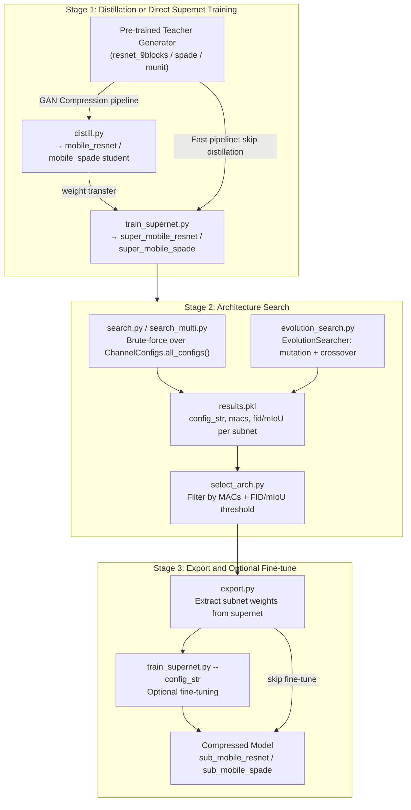
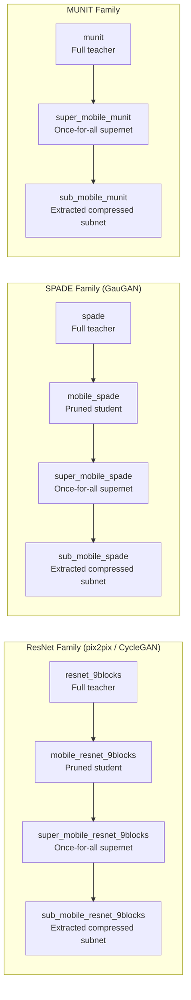
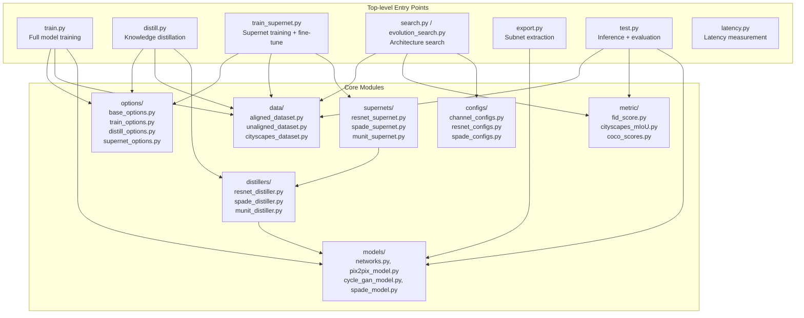

<!-- source: DeepWiki mcp.deepwiki.com · repo mit-han-lab/gan-compression · page 1 GAN Compression Overview · fetched 2026-10-30 -->

# GAN Compression Overview

<details>
<summary>Relevant source files</summary>

The following files were used as context for generating this wiki page:

- [README.md](README.md)
- [docs/overview.md](docs/overview.md)
- [docs/tutorials/fast_gan_compression.md](docs/tutorials/fast_gan_compression.md)
- [docs/tutorials/gan_compression.md](docs/tutorials/gan_compression.md)
- [imgs/overview.png](imgs/overview.png)

</details>


## Purpose and Scope

This page describes the GAN Compression repository: what it does, the compression methodology it implements, which model families it supports, and how the major subsystems relate to one another. It is the primary entry point for understanding the codebase at a high level.

- For environment setup and dataset preparation, see [Getting Started](#2).
- For step-by-step compression pipeline instructions, see [Compression Pipeline](#3).
- For architecture details, see [Model Architectures](#4).
- For the command-line interface, see [Command-line Options Reference](#7).

---

## What GAN Compression Does

GAN Compression is a method for compressing conditional GAN generators. Given a large pre-trained teacher generator, it produces a much smaller compressed generator that preserves visual fidelity. The method is architecture-agnostic and is applied to four generator families:

| Model Family | Learning Objective | Dataset Examples |
|---|---|---|
| pix2pix | Paired image-to-image | edges→shoes, maps→aerial, cityscapes |
| CycleGAN | Unpaired image-to-image | horse→zebra |
| GauGAN (SPADE) | Semantic image synthesis | cityscapes, COCO-Stuff |
| MUNIT | Multimodal unpaired | edges→shoes |

The compression method reduces computation by **9–29×** and model size by **4.6–33×** while keeping FID and mIoU metrics close to the teacher.

Sources: [README.md:1-31]()

---

## The Three-Stage Compression Pipeline

The repository implements two variants of the same three-stage pipeline:

- **GAN Compression** — includes a pre-distillation step using `distill.py` to train a mobile student before supernet training.
- **Fast GAN Compression** — skips pre-distillation and trains the supernet directly from the teacher.

**Three-stage pipeline: Teacher → Supernet → Search → Compressed subnet**



Sources: [README.md:23-26](), [docs/tutorials/gan_compression.md:16-18](), [docs/tutorials/fast_gan_compression.md:13-16]()

---

## Pipeline Comparison: GAN Compression vs. Fast GAN Compression

| Step | GAN Compression | Fast GAN Compression |
|---|---|---|
| Teacher training | `train.py` (full model) | `train.py` (full model) |
| Mobile teacher | `train.py` (mobile model) | — skipped — |
| Pre-distillation | `distill.py` | — skipped — |
| Supernet training | `train_supernet.py` (from distilled student) | `train_supernet.py` (from teacher directly) |
| Search | `search.py` (brute-force) | `evolution_search.py` (evolutionary) |
| Fine-tuning | Optional: `train_supernet.py --config_str` | Optional: `train_supernet.py --config_str` |
| Export | `export.py` | `export.py` |

Sources: [docs/tutorials/gan_compression.md:16-20](), [docs/tutorials/fast_gan_compression.md:13-16]()

---

## Supported Model Architectures

Each model family has four progressively compressed variants. They are all registered and instantiated through `define_G` in `models/networks.py`.

**Network variant hierarchy per model family**



Sources: [docs/overview.md:76-93](), [README.md:8-11]()

---

## Key Subsystems and Code Entry Points

**Subsystem map: scripts, modules, and their relationships**



Sources: [docs/overview.md:1-141](), [README.md:43-57]()

---

## Configuration System

The `configs/` directory defines the search spaces used during supernet training and architecture search. The `ChannelConfigs` class in `configs/channel_configs.py` stores all valid channel width combinations per layer. Named config sets like `channels-48` or `channels-64-cycleGAN` are defined in `configs/resnet_configs.py` and `configs/spade_configs.py` via `get_configs()`.

A `config_str` such as `32_32_48_32_48_48_16_16` encodes the number of output channels for each layer in the compressed generator. This string is the key identifier used throughout `search.py`, `export.py`, and `train_supernet.py --config_str`.

Sources: [docs/overview.md:21-31](), [docs/tutorials/gan_compression.md:70-83]()

---

## Performance of Released Models

| Model | Dataset | Method | Parameters | MACs | FID | mIoU |
|---|---|---|---|---|---|---|
| CycleGAN | horse→zebra | Original | 11.4M | 56.8G | 65.75 | — |
| CycleGAN | horse→zebra | GAN Compression (Paper) | 0.342M | 2.67G | 65.33 | — |
| CycleGAN | horse→zebra | Fast GAN Compression | 0.355M | 2.64G | 65.19 | — |
| Pix2pix | edges→shoes | Original | 11.4M | 56.8G | 24.12 | — |
| Pix2pix | edges→shoes | GAN Compression (Paper) | 0.700M | 4.81G | 26.60 | — |
| Pix2pix | edges→shoes | Fast GAN Compression | 0.703M | 4.83G | 25.76 | — |
| Pix2pix | cityscapes | Original | 11.4M | 56.8G | — | 42.06 |
| Pix2pix | cityscapes | Fast GAN Compression | 0.867M | 5.61G | — | 41.71 |
| GauGAN | cityscapes | Original | 93.0M | 281G | 57.60 | 61.04 |
| GauGAN | cityscapes | GAN Compression (Paper) | 20.4M | 31.7G | 55.19 | 61.22 |
| GauGAN | cityscapes | Fast GAN Compression | 20.2M | 31.3G | 56.25 | 61.17 |
| GauGAN | COCO-Stuff | Original | 97.5M | 191G | 21.38 | 38.78 |
| GauGAN | COCO-Stuff | Fast GAN Compression | 26.0M | 35.5G | 25.06 | 35.05 |
| MUNIT | edges→shoes | Original | 15.0M | 77.3G | 30.13 | — |
| MUNIT | edges→shoes | Fast GAN Compression | 1.10M | 2.63G | 30.53 | — |

Sources: [README.md:283-485]()

---

## Evaluation Metrics

Quality of compressed models is measured using:

- **FID** (Fréchet Inception Distance) — computed via `metric/fid_score.py` using `InceptionV3`. Lower is better. Reference statistics are pre-computed with `get_real_stat.py` and stored as `.npz` files under `real_stat/`.
- **mIoU (Cityscapes)** — computed via `metric/cityscapes_mIoU.py` using a pre-trained `DRNSeg` model (`drn-d-105_ms_cityscapes.pth`).
- **mIoU (COCO-Stuff)** — computed via `metric/coco_scores.py` using a pre-trained `DeepLabV2` model (`deeplabv2_resnet101_msc-cocostuff164k-100000.pth`).

For paired translation (pix2pix, GauGAN), FID is computed against real test images. For unpaired translation (CycleGAN), FID is computed against real training+test images combined.

Sources: [README.md:491-502](), [docs/overview.md:60-70]()

---

## Repository Layout

```
gan-compression/
├── train.py                  # Full teacher model training
├── distill.py                # Knowledge distillation
├── train_supernet.py         # Once-for-all supernet training + fine-tuning
├── search.py                 # Brute-force architecture search
├── evolution_search.py       # Evolutionary architecture search
├── export.py                 # Subnet extraction from supernet
├── test.py                   # Inference and evaluation
├── latency.py                # Latency benchmarking
├── select_arch.py            # Filter search results by MACs/FID/mIoU
├── get_real_stat.py          # Pre-compute FID reference statistics
├── configs/                  # Channel config search spaces
├── data/                     # Dataset loaders
├── datasets/                 # Download scripts and preprocessing
├── distillers/               # Distillation logic per architecture
├── metric/                   # FID, mIoU evaluation
├── models/                   # Network definitions, training models
│   └── modules/              # Generator and discriminator nn.Module classes
├── options/                  # Argument parsing
├── scripts/                  # Shell scripts per model × dataset
├── supernets/                # Once-for-all training logic
├── interactive_demo/         # Jetson Nano TVM demo
└── utils/                    # Logging, image pool, weight transfer
```

Sources: [docs/overview.md:1-141](), [README.md:43-57]()

---

