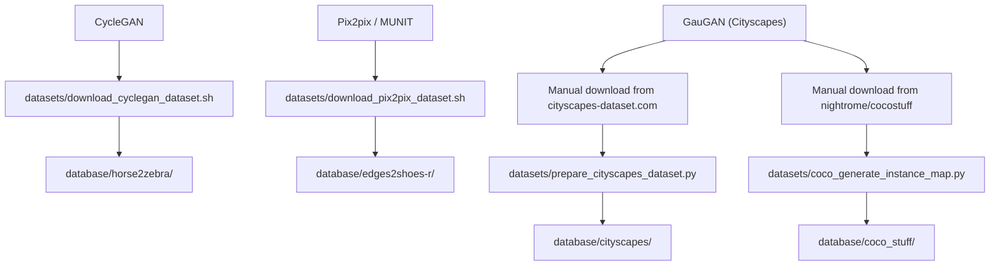
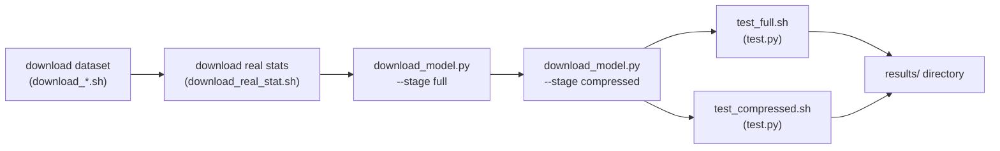

<!-- source: DeepWiki mcp.deepwiki.com · repo mit-han-lab/gan-compression · page 2 Getting Started · fetched 2026-10-30 -->

# Getting Started

<details>
<summary>Relevant source files</summary>

The following files were used as context for generating this wiki page:

- [README.md](README.md)
- [datasets/download_cyclegan_dataset.sh](datasets/download_cyclegan_dataset.sh)
- [datasets/download_pix2pix_dataset.sh](datasets/download_pix2pix_dataset.sh)
- [datasets/download_real_stat.sh](datasets/download_real_stat.sh)
- [imgs/overview.png](imgs/overview.png)
- [scripts/download_model.py](scripts/download_model.py)

</details>


This page covers the end-to-end setup process required to run inference with pre-trained models from this repository: cloning the repo, installing dependencies, downloading datasets, downloading pre-trained weights, and executing test scripts. For a conceptual overview of the compression methodology, see the [GAN Compression Overview](#1). For the full training pipeline, see the [Compression Pipeline](#3).

---

## Prerequisites

| Requirement | Notes |
|---|---|
| OS | Linux |
| Python | 3.x |
| Hardware | CPU or NVIDIA GPU + CUDA CuDNN |
| PyTorch | 1.4 |

---

## Installation

Clone the repository and install Python dependencies.

```shell
git clone git@github.com:mit-han-lab/gan-compression.git
cd gan-compression
```

**pip:**
```shell
pip install -r requirements.txt
```

**Conda (option A — script):**
```shell
bash scripts/conda_deps.sh
```

**Conda (option B — environment file):**
```shell
conda env create -f environment.yml
```

Sources: [README.md:47-57]()

---

## Dataset Preparation

Datasets are downloaded into the `database/` directory. Each model type uses a different download script. The sections below cover every supported dataset.

**Setup flow by model type:**



Sources: [README.md:62-281](), [datasets/download_cyclegan_dataset.sh:1-27](), [datasets/download_pix2pix_dataset.sh:1-40]()

---

### CycleGAN — horse2zebra

```shell
bash datasets/download_cyclegan_dataset.sh horse2zebra
```

Downloads to `database/horse2zebra/`. The script also creates `valA` and `valB` symlinks from `testA` and `testB` if they do not already exist.

[datasets/download_cyclegan_dataset.sh:21-27]()

**FID statistics:**
```shell
bash datasets/download_real_stat.sh horse2zebra A
bash datasets/download_real_stat.sh horse2zebra B
```

Downloaded to `real_stat/horse2zebra_A.npz` and `real_stat/horse2zebra_B.npz`.

Sources: [README.md:63-75](), [datasets/download_cyclegan_dataset.sh:1-27](), [datasets/download_real_stat.sh:1-17]()

---

### Pix2pix — edges2shoes-r

```shell
bash datasets/download_pix2pix_dataset.sh edges2shoes-r
```

Downloads to `database/edges2shoes-r/`. Variants `edges2shoes-r` and `edges2handbags-r` are hosted on HuggingFace; other pix2pix datasets are fetched from Berkeley's servers.

[datasets/download_pix2pix_dataset.sh:19-23]()

**FID statistics:**
```shell
bash datasets/download_real_stat.sh edges2shoes-r B
bash datasets/download_real_stat.sh edges2shoes-r subtrain_B
```

Sources: [README.md:115-128](), [datasets/download_pix2pix_dataset.sh:1-40]()

---

### MUNIT — edges2shoes-r (unaligned)

MUNIT requires the paired dataset to be split into separate `A` and `B` directories:

```shell
bash datasets/download_pix2pix_dataset.sh edges2shoes-r
python datasets/separate_A_and_B.py --input_dir database/edges2shoes-r \
    --output_dir database/edges2shoes-r-unaligned
python datasets/separate_A_and_B.py --input_dir database/edges2shoes-r \
    --output_dir database/edges2shoes-r-unaligned --phase val
```

**FID statistics:**
```shell
bash datasets/download_real_stat.sh edges2shoes-r B
bash datasets/download_real_stat.sh edges2shoes-r-unaligned subtrain_B
```

Sources: [README.md:211-228]()

---

### GauGAN — Cityscapes

Cityscapes cannot be redistributed. Download `gtFine_trainvaltest.zip` and `leftImg8bit_trainvaltest.zip` from `https://cityscapes-dataset.com` and place both in a single folder (e.g. `database/cityscapes-origin`). Then run:

```shell
python datasets/get_trainIds.py database/cityscapes-origin/gtFine/
python datasets/prepare_cityscapes_dataset.py \
    --gtFine_dir database/cityscapes-origin/gtFine \
    --leftImg8bit_dir database/cityscapes-origin/leftImg8bit \
    --output_dir database/cityscapes \
    --train_table_path datasets/train_table.txt \
    --val_table_path datasets/val_table.txt
```

This produces `database/cityscapes/` and `dataset/table.txt` (used for mIoU computation).

**mIoU support:** Download `drn-d-105_ms_cityscapes.pth` and place it in the repo root directory.

**FID statistics:**
```shell
bash datasets/download_real_stat.sh cityscapes A
```

Sources: [README.md:259-275]()

---

### GauGAN — COCO-Stuff

Follow the [NVlabs/SPADE dataset preparation](https://github.com/NVlabs/SPADE). Download `train2017.zip`, `val2017.zip`, `stuffthingmaps_trainval2017.zip`, and `annotations_trainval2017.zip` from `nightrome/cocostuff`. Generate the instance map:

```shell
python datasets/coco_generate_instance_map.py
```

**mIoU support:** Download `deeplabv2_resnet101_msc-cocostuff164k-100000.pth` and place it in the repo root directory.

Sources: [README.md:277-282]()

---

### Supported Datasets Summary

| Model | Dataset | Download Script / Method | Output Directory |
|---|---|---|---|
| CycleGAN | horse2zebra | `download_cyclegan_dataset.sh horse2zebra` | `database/horse2zebra/` |
| Pix2pix | edges2shoes-r | `download_pix2pix_dataset.sh edges2shoes-r` | `database/edges2shoes-r/` |
| Pix2pix | maps | `download_pix2pix_dataset.sh maps` | `database/maps/` |
| Pix2pix / GauGAN | cityscapes | Manual + `prepare_cityscapes_dataset.py` | `database/cityscapes/` |
| GauGAN | COCO-Stuff | Manual + `coco_generate_instance_map.py` | `database/coco_stuff/` |
| MUNIT | edges2shoes-r | `download_pix2pix_dataset.sh` + `separate_A_and_B.py` | `database/edges2shoes-r-unaligned/` |

Sources: [README.md:59-282](), [datasets/download_pix2pix_dataset.sh:4-8](), [datasets/download_cyclegan_dataset.sh:4-7]()

---

## Downloading Pre-trained Models

All pre-trained weights are downloaded with `scripts/download_model.py`. Files are fetched from HuggingFace and placed under `pretrained/`.

[scripts/download_model.py:27-31]()

### Script Interface

```
python scripts/download_model.py --model <MODEL> --task <TASK> --stage <STAGE>
```

| Argument | Choices | Default |
|---|---|---|
| `--model` | `pix2pix`, `cycle_gan`, `gaugan`, `munit` | `pix2pix` |
| `--task` | see table below | `horse2zebra` |
| `--stage` | `full`, `mobile`, `distill`, `supernet`, `finetune`, `compressed`, `legacy` | `compressed` |

[scripts/download_model.py:34-57]()

### Supported Model/Task Combinations

| `--model` | Valid `--task` values |
|---|---|
| `pix2pix` | `edges2shoes-r`, `map2sat`, `cityscapes`, `cityscapes_fast`, `edges2shoes-r_fast`, `map2sat_fast` |
| `cycle_gan` | `horse2zebra`, `horse2zebra_fast` |
| `gaugan` | `cityscapes`, `cityscapes_fast`, `coco_fast` |
| `munit` | `edges2shoes-r_fast` |

[scripts/download_model.py:7-24]()

### What Gets Downloaded

For `--stage compressed` or `--stage legacy`, only `latest_net_G.pth` is downloaded. For all other stages, both `latest_net_G.pth` and `latest_net_D.pth` are downloaded.

[scripts/download_model.py:53-57]()

**Output path pattern:**
```
pretrained/<model>/<task>/<stage>/latest_net_G.pth
pretrained/<model>/<task>/<stage>/latest_net_D.pth  # (non-compressed stages only)
```

### Stage Descriptions

| Stage | Description |
|---|---|
| `full` | Pre-trained teacher generator (e.g. `resnet_9blocks`) |
| `mobile` | Distilled mobile student |
| `distill` | Checkpoint mid-distillation |
| `supernet` | Once-for-all supernet |
| `finetune` | Fine-tuned subnet |
| `compressed` | Final exported compressed model (`sub_mobile_resnet` / `sub_mobile_spade`) |
| `legacy` | Original paper model weights (older format) |

For a description of how these stages relate to the compression pipeline, see [Compression Pipeline](#3).

Sources: [scripts/download_model.py:1-57](), [README.md:79-109]()

---

## Running Your First Test

The general workflow after dataset and model download is:



Sources: [README.md:76-109]()

### CycleGAN — horse2zebra

```shell
python scripts/download_model.py --model cycle_gan --task horse2zebra --stage full
python scripts/download_model.py --model cycle_gan --task horse2zebra --stage compressed

bash scripts/cycle_gan/horse2zebra/test_full.sh
bash scripts/cycle_gan/horse2zebra/test_compressed.sh

# Optional: latency measurement
bash scripts/cycle_gan/horse2zebra/latency_full.sh
bash scripts/cycle_gan/horse2zebra/latency_compressed.sh
```

Sources: [README.md:79-101]()

### Pix2pix — edges2shoes-r

```shell
python scripts/download_model.py --model pix2pix --task edges2shoes-r --stage full
python scripts/download_model.py --model pix2pix --task edges2shoes-r --stage compressed

bash scripts/pix2pix/edges2shoes-r/test_full.sh
bash scripts/pix2pix/edges2shoes-r/test_compressed.sh
```

Sources: [README.md:129-154]()

### GauGAN — Cityscapes

```shell
python scripts/download_model.py --model gaugan --task cityscapes --stage full
python scripts/download_model.py --model gaugan --task cityscapes --stage compressed

bash scripts/gaugan/cityscapes/test_full.sh
bash scripts/gaugan/cityscapes/test_compressed.sh
```

Sources: [README.md:178-201]()

### MUNIT — edges2shoes-r

```shell
python scripts/download_model.py --model munit --task edges2shoes-r_fast --stage full
python scripts/download_model.py --model munit --task edges2shoes-r_fast --stage compressed

bash scripts/munit/edges2shoes-r_fast/test_full.sh
bash scripts/munit/edges2shoes-r_fast/test_compressed.sh
```

Sources: [README.md:231-256]()

---

## Legacy / Paper Models

The released retrained models may differ slightly from paper results. To use the original paper models:

```shell
python scripts/download_model.py --model cycle_gan --task horse2zebra --stage legacy
bash scripts/cycle_gan/horse2zebra/test_legacy.sh
bash scripts/cycle_gan/horse2zebra/latency_legacy.sh
```

The same `--stage legacy` option is available for `pix2pix` and `gaugan` tasks. Legacy models use the `legacy_sub_mobile_resnet_9blocks` network variant rather than `sub_mobile_resnet_9blocks`. See [Model Architectures](#4) for the architectural distinction.

Sources: [README.md:103-109](), [README.md:156-162](), [README.md:203-209]()

---

## FID Reference Statistics

The `real_stat/` directory holds `.npz` files with Inception statistics computed from ground-truth images. These are required for FID evaluation during search and testing. Pre-computed files can be downloaded with `datasets/download_real_stat.sh`.

[datasets/download_real_stat.sh:1-17]()

**Available pre-computed statistics files:**

| File | Use case |
|---|---|
| `cityscapes_A.npz` | GauGAN / Pix2pix Cityscapes |
| `edges2shoes-r_B.npz` | Pix2pix / MUNIT edges→shoes |
| `edges2shoes-r_subtrain_B.npz` | MUNIT supernet training eval |
| `horse2zebra_A.npz` | CycleGAN horse→zebra (A side) |
| `horse2zebra_B.npz` | CycleGAN horse→zebra (B side) |
| `maps_A.npz`, `maps_B.npz` | Pix2pix maps |
| `coco_A.npz` | GauGAN COCO-Stuff |

To compute statistics for a custom dataset, use `get_real_stat.py`:

```shell
python get_real_stat.py \
    --dataroot database/edges2shoes-r \
    --output_path real_stat/edges2shoes-r_B.npz \
    --direction AtoB
```

For more details on how FID is computed and used during search, see [Evaluation Metrics](#6.2).

Sources: [README.md:491-502](), [datasets/download_real_stat.sh:1-17]()

---

