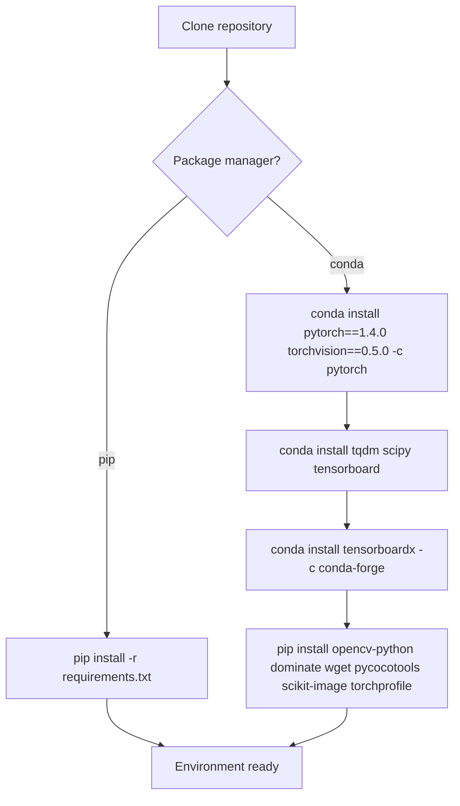
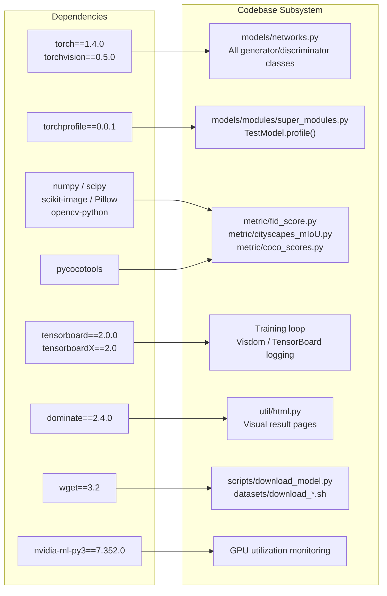

<!-- source: DeepWiki mcp.deepwiki.com · repo mit-han-lab/gan-compression · page 2.1 Installation · fetched 2026-10-30 -->

# Installation

<details>
<summary>Relevant source files</summary>

The following files were used as context for generating this wiki page:

- [requirements.txt](requirements.txt)
- [scripts/conda_deps.sh](scripts/conda_deps.sh)

</details>


This page covers environment setup for the `gan-compression` repository: Python version, package managers, and all required dependencies. For downloading datasets and pre-trained weights after the environment is ready, see [Dataset Preparation](#2.2) and [Downloading Pre-trained Models](#2.3).

---

## Prerequisites

| Requirement | Version |
|---|---|
| Python | 3.6+ |
| PyTorch | 1.4.0 |
| torchvision | 0.5.0 |
| CUDA | Compatible with PyTorch 1.4.0 |

PyTorch 1.4.0 and torchvision 0.5.0 are pinned hard in both installation paths. Using other versions may cause incompatibilities with `torchprofile` (MAC counting) and the supernet modules.

---

## Installation Paths

Two installation methods are supported: pip (via `requirements.txt`) and conda (via `scripts/conda_deps.sh`).

**Dependency installation flow:**



Sources: [requirements.txt:1-25](), [scripts/conda_deps.sh:1-7]()

---

### Option A: pip

```
pip install -r requirements.txt
```

This installs every dependency in one step with pinned versions.

Sources: [requirements.txt:1-25]()

---

### Option B: conda

```
bash scripts/conda_deps.sh
```

The script [scripts/conda_deps.sh:1-7]() runs three steps:

1. Installs `pytorch==1.4.0` and `torchvision==0.5.0` from the `pytorch` conda channel.
2. Installs `tqdm`, `scipy`, and `tensorboard` from the default conda channel, then `tensorboardx` from `conda-forge`.
3. Uses `pip` for packages not available in conda: `opencv-python`, `dominate`, `wget`, `pycocotools`, `scikit-image`, `torchprofile`.

Sources: [scripts/conda_deps.sh:1-7]()

---

## Full Dependency Table

The table below lists every package from `requirements.txt`, grouped by functional role.

| Role | Package | Pinned Version |
|---|---|---|
| **Deep learning** | `torch` | 1.4.0 |
| **Deep learning** | `torchvision` | 0.5.0 |
| **MAC profiling** | `torchprofile` | 0.0.1 |
| **GPU monitoring** | `nvidia-ml-py3` | 7.352.0 |
| **Numerics** | `numpy` | 1.18.1 |
| **Numerics** | `scipy` | 1.4.1 |
| **Image processing** | `opencv-python` | 4.2.0.32 |
| **Image processing** | `Pillow` | 7.0.0 |
| **Image processing** | `scikit-image` | (unpinned) |
| **COCO evaluation** | `pycocotools` | (unpinned) |
| **Logging** | `tensorboard` | 2.0.0 |
| **Logging** | `tensorboardX` | 2.0 |
| **Progress display** | `tqdm` | 4.42.1 |
| **HTML reports** | `dominate` | 2.4.0 |
| **Downloads** | `wget` | 3.2 |
| **Serialization** | `protobuf` | 3.11.3 |
| **System info** | `psutil` | 5.7.0 |
| **Misc** | `absl-py` | 0.9.0 |
| **Misc** | `six` | 1.14.0 |
| **Misc** | `certifi` | 2019.11.28 |
| **Misc** | `Markdown` | 3.1.1 |
| **Misc** | `Werkzeug` | 1.0.0 |
| **Misc** | `grpcio` | 1.16.1 |
| **Misc** | `olefile` | 0.46 |
| **Misc** | `blessings` | 1.7 |

Sources: [requirements.txt:1-25]()

---

## Package Role Map

The diagram below maps each dependency group to the codebase subsystem that requires it.



Sources: [requirements.txt:1-25](), [scripts/conda_deps.sh:1-7]()

---

## Notes

- `torchprofile` is critical for MAC counting in `search.py` and `evolution_search.py`. It must be version 0.0.1; newer versions may have a different API.
- `pycocotools` and `scikit-image` are unpinned in `requirements.txt`. If you encounter compatibility issues, install them explicitly after the main install.
- The conda path (`scripts/conda_deps.sh`) does not pin minor versions for `tqdm`, `scipy`, `tensorboard`, or `tensorboardx` via conda. This may result in slightly different versions than `requirements.txt` specifies. For strict reproducibility, use the pip path.
- The interactive demo on Jetson Nano requires additional TVM dependencies not listed here. See [Interactive Demo](#8) for those setup steps.

---

