<!-- source: DeepWiki mcp.deepwiki.com · repo mit-han-lab/gan-compression · page 2.2 Dataset Preparation · fetched 2026-10-30 -->

# Dataset Preparation

<details>
<summary>Relevant source files</summary>

The following files were used as context for generating this wiki page:

- [README.md](README.md)
- [datasets/download_cyclegan_dataset.sh](datasets/download_cyclegan_dataset.sh)
- [datasets/download_pix2pix_dataset.sh](datasets/download_pix2pix_dataset.sh)
- [datasets/download_real_stat.sh](datasets/download_real_stat.sh)
- [imgs/overview.png](imgs/overview.png)
- [scripts/download_model.py](scripts/download_model.py)

</details>


This page covers how to download and preprocess every dataset used in the `gan-compression` repository. It explains which shell scripts to run, which steps require manual intervention, and what the resulting `database/` directory structure looks like.

For information on downloading pre-trained model weights after your datasets are ready, see [Downloading Pre-trained Models](#2.3). For information on how the datasets are loaded at runtime, see [Data Loading](#6.3). For how FID statistics files are used during search and evaluation, see [Evaluation Metrics](#6.2).

---

## Dataset Overview

The table below maps each supported model and task to the dataset it requires and the acquisition method.

| Model | Task | Dataset | Source | Script |
|---|---|---|---|---|
| CycleGAN | horse→zebra | horse2zebra | Berkeley | `datasets/download_cyclegan_dataset.sh` |
| pix2pix | edges→shoes | edges2shoes-r | HuggingFace | `datasets/download_pix2pix_dataset.sh` |
| pix2pix | map→aerial | maps | Berkeley | `datasets/download_pix2pix_dataset.sh` |
| pix2pix | labels→photo | cityscapes | Manual | `datasets/prepare_cityscapes_dataset.py` |
| GauGAN | labels→photo | cityscapes | Manual | `datasets/prepare_cityscapes_dataset.py` |
| GauGAN | labels→photo | COCO-Stuff | Manual | `datasets/coco_generate_instance_map.py` |
| MUNIT | edges→shoes | edges2shoes-r-unaligned | HuggingFace + `separate_A_and_B.py` | See below |

All datasets are stored under the `database/` subdirectory in the repository root.

Sources: [README.md:59-282]()

---

## Directory Layout

After completing all preparation steps, the `database/` directory has the following structure:

```
database/
├── horse2zebra/
│   ├── trainA/          # Horse images (training)
│   ├── trainB/          # Zebra images (training)
│   ├── testA/           # Horse images (test)
│   ├── testB/           # Zebra images (test)
│   ├── valA -> testA    # Symlink created by script
│   └── valB -> testB    # Symlink created by script
├── edges2shoes-r/
│   ├── train/           # Paired edge-shoe images
│   ├── val/             # Validation set
│   └── test -> val      # Symlink created by script
├── maps/
│   ├── train/
│   └── val/
├── cityscapes/          # Preprocessed by prepare_cityscapes_dataset.py
│   ├── train/
│   └── val/
├── cityscapes-origin/   # Raw download (intermediate)
│   ├── gtFine/
│   └── leftImg8bit/
├── edges2shoes-r-unaligned/   # Created by separate_A_and_B.py
│   ├── trainA/
│   ├── trainB/
│   ├── valA/
│   └── valB/
└── coco_stuff/          # Manually arranged per SPADE convention
```

The `real_stat/` directory (at the repo root, not under `database/`) holds pre-computed FID reference statistics:

```
real_stat/
├── horse2zebra_A.npz
├── horse2zebra_B.npz
├── edges2shoes-r_B.npz
├── cityscapes_A.npz
└── ...
```

Sources: [datasets/download_cyclegan_dataset.sh:1-27](), [datasets/download_pix2pix_dataset.sh:1-40](), [README.md:59-282]()

---

## CycleGAN Datasets

CycleGAN datasets are downloaded from the Berkeley servers using `datasets/download_cyclegan_dataset.sh`.

**Usage:**
```shell
bash datasets/download_cyclegan_dataset.sh horse2zebra
```

The script [datasets/download_cyclegan_dataset.sh:1-27]() performs the following:
1. Validates the dataset name against a list of supported names.
2. Downloads a `.zip` archive from `http://efrosgans.eecs.berkeley.edu/cyclegan/datasets/`.
3. Unpacks it into `database/<dataset>/`.
4. Creates `valA` and `valB` symlinks pointing to `testA` and `testB`.

**Supported names:** `horse2zebra`, `apple2orange`, `summer2winter_yosemite`, `monet2photo`, `cezanne2photo`, `ukiyoe2photo`, `vangogh2photo`, `maps`, `facades`, `iphone2dslr_flower`.

**Then download the FID statistics:**
```shell
bash datasets/download_real_stat.sh horse2zebra A
bash datasets/download_real_stat.sh horse2zebra B
```

Sources: [datasets/download_cyclegan_dataset.sh:1-27](), [README.md:63-75]()

---

## Pix2pix Datasets

Pix2pix datasets are downloaded using `datasets/download_pix2pix_dataset.sh`. The source depends on the dataset name.

**Usage:**
```shell
bash datasets/download_pix2pix_dataset.sh edges2shoes-r
bash datasets/download_pix2pix_dataset.sh maps
```

The script [datasets/download_pix2pix_dataset.sh:1-40]() performs the following:
1. Validates the name.
2. For `edges2shoes-r`, `edges2handbags-r`, and `edges2shoes-v`: downloads from HuggingFace (`https://huggingface.co/mit-han-lab/gan-compression/resolve/main/datasets/`).
3. For all others: downloads from Berkeley (`http://efrosgans.eecs.berkeley.edu/pix2pix/datasets/`).
4. Unpacks the `.tar.gz` into `database/<dataset>/`.
5. Creates a `val` symlink pointing to `test` if `test` exists but `val` does not.

> **Note:** Passing `cityscapes` to this script will print a license warning and exit. See the [Cityscapes Dataset](#cityscapes-section) section below instead.

**Supported names:** `edges2shoes-r`, `edges2handbags-r`, `maps`, `facades`, `night2day`, and standard Berkeley pix2pix datasets.

**Then download FID statistics:**
```shell
bash datasets/download_real_stat.sh edges2shoes-r B
bash datasets/download_real_stat.sh edges2shoes-r subtrain_B
```

Sources: [datasets/download_pix2pix_dataset.sh:1-40](), [README.md:115-127]()

---

## Cityscapes Dataset

The Cityscapes dataset cannot be redistributed. You must download it directly from the official website and preprocess it manually.

### Step 1: Download raw files

Download the following two archives from [https://cityscapes-dataset.com](https://cityscapes-dataset.com):

- `gtFine_trainvaltest.zip`
- `leftImg8bit_trainvaltest.zip`

Unzip both into the same folder, for example `database/cityscapes-origin/`, so the resulting structure is:

```
database/cityscapes-origin/
├── gtFine/
└── leftImg8bit/
```

### Step 2: Generate training IDs

```shell
python datasets/get_trainIds.py database/cityscapes-origin/gtFine/
```

### Step 3: Preprocess into paired format

```shell
python datasets/prepare_cityscapes_dataset.py \
  --gtFine_dir database/cityscapes-origin/gtFine \
  --leftImg8bit_dir database/cityscapes-origin/leftImg8bit \
  --output_dir database/cityscapes \
  --train_table_path datasets/train_table.txt \
  --val_table_path datasets/val_table.txt
```

This writes the final dataset to `database/cityscapes/` and a mapping table to `dataset/table.txt` (used for mIoU computation).

### Step 4: Download FID statistics

```shell
bash datasets/download_real_stat.sh cityscapes A
```

### Step 5: Download DRN model for mIoU

To compute Cityscapes mIoU during search or evaluation, download the pretrained DRN model:

```
drn-d-105_ms_cityscapes.pth
```

from `http://go.yf.io/drn-cityscapes-models` and place it in the **repository root**.

Sources: [README.md:259-275]()

---

## COCO-Stuff Dataset

COCO-Stuff is used for GauGAN on the `coco_fast` task. Preparation follows the [NVlabs/SPADE](https://github.com/NVlabs/SPADE) convention.

### Step 1: Download archives

Download the following from [nightrome/cocostuff](https://github.com/nightrome/cocostuff):

| File | Contents |
|---|---|
| `train2017.zip` | Training images |
| `val2017.zip` | Validation images |
| `stuffthingmaps_trainval2017.zip` | Segmentation maps |
| `annotations_trainval2017.zip` | Annotations |

### Step 2: Arrange files

Arrange images, labels, and instance maps to match the SPADE directory convention under `database/coco_stuff/`.

### Step 3: Generate instance maps

The repository uses a combined instance map that merges "things instance map" boundaries and "stuff label map". Generate it using:

```shell
python datasets/coco_generate_instance_map.py
```

### Step 4: Download the DeepLabV2 model for mIoU

Download [deeplabv2_resnet101_msc-cocostuff164k-100000.pth](https://github.com/kazuto1011/deeplab-pytorch/releases/download/v1.0/deeplabv2_resnet101_msc-cocostuff164k-100000.pth) and place it in the **repository root**.

Sources: [README.md:277-281]()

---

## MUNIT Dataset (Unaligned)

MUNIT requires an **unaligned** version of the dataset, where domain A and domain B images are stored in separate directories (rather than as side-by-side paired images).

### Step 1: Download the base pix2pix dataset

```shell
bash datasets/download_pix2pix_dataset.sh edges2shoes-r
```

### Step 2: Separate A and B

```shell
python datasets/separate_A_and_B.py \
  --input_dir database/edges2shoes-r \
  --output_dir database/edges2shoes-r-unaligned

python datasets/separate_A_and_B.py \
  --input_dir database/edges2shoes-r \
  --output_dir database/edges2shoes-r-unaligned \
  --phase val
```

This produces `database/edges2shoes-r-unaligned/` with `trainA/`, `trainB/`, `valA/`, and `valB/` subdirectories.

### Step 3: Download FID statistics

```shell
bash datasets/download_real_stat.sh edges2shoes-r B
bash datasets/download_real_stat.sh edges2shoes-r-unaligned subtrain_B
```

Sources: [README.md:211-228]()

---

## FID Statistics Files

FID evaluation requires pre-computed statistics (mean and covariance of Inception features) from the ground-truth image set. These are stored as `.npz` files in the `real_stat/` directory.

### Downloading pre-computed statistics

The script `datasets/download_real_stat.sh` fetches these from HuggingFace:

```shell
bash datasets/download_real_stat.sh <dataset> <side>
```

| Argument | Description | Example |
|---|---|---|
| `dataset` | Dataset name | `horse2zebra`, `edges2shoes-r`, `cityscapes` |
| `side` | Image domain | `A`, `B`, `subtrain_B` |

The file is saved to `real_stat/<dataset>_<side>.npz`.

**Available pre-computed files** [datasets/download_real_stat.sh:4-5]():

```
cityscapes_A.npz        edges2shoes_B.npz       edges2shoes-r_B.npz
edges2handbags_B.npz    edges2handbags-r_B.npz  facades_A.npz
horse2zebra_A.npz       horse2zebra_B.npz       maps_A.npz
maps_B.npz              coco_A.npz
```

### Computing custom statistics

If your dataset is not listed, use `get_real_stat.py` to compute and save the statistics:

```shell
python get_real_stat.py \
  --dataroot database/edges2shoes-r \
  --output_path real_stat/edges2shoes-r_B.npz \
  --direction AtoB
```

> **Protocol note:** For paired translation (pix2pix, GauGAN), FID is computed against real **test** images. For unpaired translation (CycleGAN), FID is computed against real **train+test** images combined, giving a more stable estimate due to the larger reference set.

Sources: [datasets/download_real_stat.sh:1-17](), [README.md:491-502]()

---

## Acquisition Flow Diagram

The diagram below shows how each dataset flows from its source through scripts to the final `database/` layout.

**Dataset acquisition and preprocessing flow**

```mermaid
flowchart TD
    subgraph "Auto-download (CycleGAN)"
        CGSH["datasets/download_cyclegan_dataset.sh"]
        BERK_CG["Berkeley CDN\neecs.berkeley.edu/cyclegan/datasets/"]
        BERK_CG --> CGSH
        CGSH --> DB_CG["database/horse2zebra/\n(trainA, trainB, valA, valB)"]
    end

    subgraph "Auto-download (pix2pix)"
        P2PSH["datasets/download_pix2pix_dataset.sh"]
        HF["HuggingFace\nmit-han-lab/gan-compression"]
        BERK_P2P["Berkeley CDN\neecs.berkeley.edu/pix2pix/datasets/"]
        HF -->|"edges2shoes-r\nedges2handbags-r"| P2PSH
        BERK_P2P -->|"maps, facades, etc."| P2PSH
        P2PSH --> DB_P2P["database/edges2shoes-r/\n(train, val)"]
        P2PSH --> DB_MAPS["database/maps/\n(train, val)"]
    end

    subgraph "Manual (Cityscapes)"
        CS_DL["cityscapes-dataset.com\ngtFine + leftImg8bit"]
        CS_DL --> CS_ORIG["database/cityscapes-origin/"]
        CS_ORIG --> GET_IDS["datasets/get_trainIds.py"]
        GET_IDS --> PREP["datasets/prepare_cityscapes_dataset.py"]
        PREP --> DB_CS["database/cityscapes/\n(train, val)"]
    end

    subgraph "Manual (COCO-Stuff)"
        COCO_DL["nightrome/cocostuff\ntrain2017 + val2017 + maps"]
        COCO_DL --> INST["datasets/coco_generate_instance_map.py"]
        INST --> DB_COCO["database/coco_stuff/"]
    end

    subgraph "MUNIT split"
        DB_P2P --> SEP["datasets/separate_A_and_B.py\n--phase train / val"]
        SEP --> DB_MUNIT["database/edges2shoes-r-unaligned/\n(trainA, trainB, valA, valB)"]
    end

    subgraph "FID Statistics"
        STAT_SH["datasets/download_real_stat.sh"]
        HF2["HuggingFace\nreal_stat/*.npz"]
        HF2 --> STAT_SH --> REAL_STAT["real_stat/<dataset>_<side>.npz"]
        GET_REAL["get_real_stat.py\n(custom datasets)"]
        GET_REAL --> REAL_STAT
    end
```



Sources: [datasets/download_cyclegan_dataset.sh:1-27](), [datasets/download_pix2pix_dataset.sh:1-40](), [datasets/download_real_stat.sh:1-17](), [README.md:59-282]()

---

## Quick Reference: All Preparation Commands

**Dataset acquisition and FID script mapping**

```mermaid
flowchart LR
    subgraph "CycleGAN horse2zebra"
        C1["download_cyclegan_dataset.sh horse2zebra"]
        C2["download_real_stat.sh horse2zebra A"]
        C3["download_real_stat.sh horse2zebra B"]
        C1 --> C2 --> C3
    end

    subgraph "pix2pix edges2shoes-r"
        P1["download_pix2pix_dataset.sh edges2shoes-r"]
        P2["download_real_stat.sh edges2shoes-r B"]
        P3["download_real_stat.sh edges2shoes-r subtrain_B"]
        P1 --> P2 --> P3
    end

    subgraph "pix2pix maps"
        M1["download_pix2pix_dataset.sh maps"]
        M2["download_real_stat.sh maps A"]
        M3["download_real_stat.sh maps B"]
        M1 --> M2 --> M3
    end

    subgraph "Cityscapes (pix2pix + GauGAN)"
        CS1["Manual download from cityscapes-dataset.com"]
        CS2["get_trainIds.py"]
        CS3["prepare_cityscapes_dataset.py"]
        CS4["download_real_stat.sh cityscapes A"]
        CS5["Download drn-d-105_ms_cityscapes.pth"]
        CS1 --> CS2 --> CS3 --> CS4 --> CS5
    end

    subgraph "COCO-Stuff (GauGAN)"
        CC1["Manual download from nightrome/cocostuff"]
        CC2["coco_generate_instance_map.py"]
        CC3["Download deeplabv2_resnet101_msc-cocostuff164k-100000.pth"]
        CC1 --> CC2 --> CC3
    end

    subgraph "MUNIT edges2shoes-r"
        MU1["download_pix2pix_dataset.sh edges2shoes-r"]
        MU2["separate_A_and_B.py (train)"]
        MU3["separate_A_and_B.py (val)"]
        MU4["download_real_stat.sh edges2shoes-r B"]
        MU5["download_real_stat.sh edges2shoes-r-unaligned subtrain_B"]
        MU1 --> MU2 --> MU3 --> MU4 --> MU5
    end
```



Sources: [README.md:59-282](), [datasets/download_cyclegan_dataset.sh:1-27](), [datasets/download_pix2pix_dataset.sh:1-40](), [datasets/download_real_stat.sh:1-17]()

---

