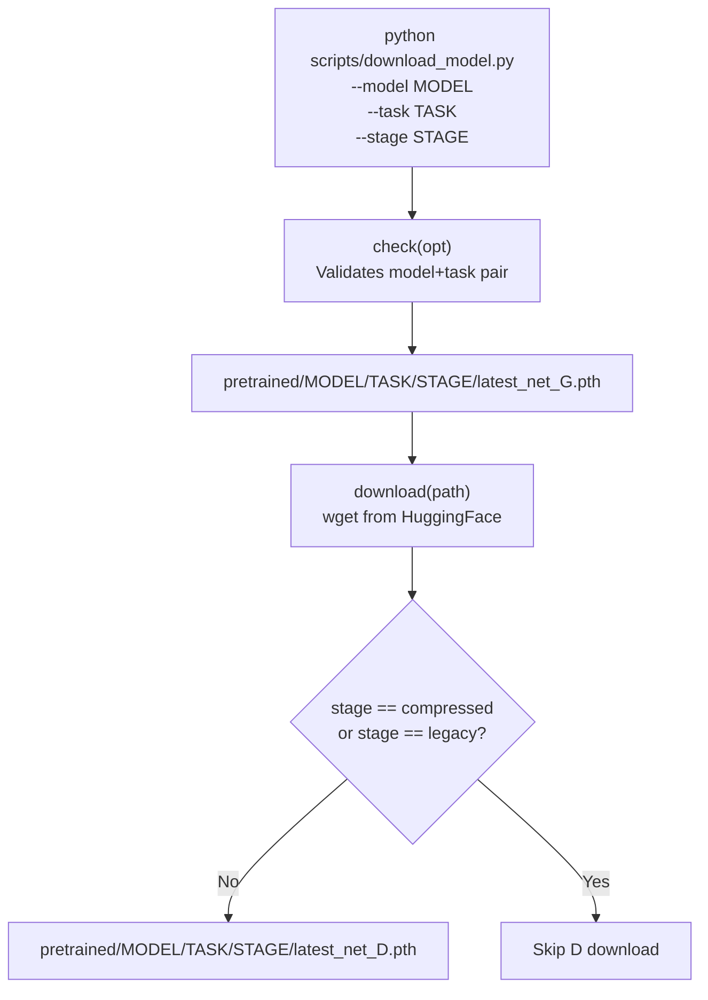
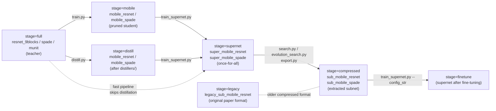

<!-- source: DeepWiki mcp.deepwiki.com · repo mit-han-lab/gan-compression · page 2.3 Downloading Pre-trained Models · fetched 2026-10-30 -->

# Downloading Pre-trained Models

<details>
<summary>Relevant source files</summary>

The following files were used as context for generating this wiki page:

- [README.md](README.md)
- [datasets/download_cyclegan_dataset.sh](datasets/download_cyclegan_dataset.sh)
- [datasets/download_pix2pix_dataset.sh](datasets/download_pix2pix_dataset.sh)
- [datasets/download_real_stat.sh](datasets/download_real_stat.sh)
- [imgs/overview.png](imgs/overview.png)
- [scripts/download_model.py](scripts/download_model.py)

</details>


This page documents how to download pre-trained model checkpoints and FID reference statistics using the provided scripts. It covers the `scripts/download_model.py` interface, all valid argument combinations, and the directory layout that results from running these scripts.

For how to use a downloaded model to run inference, see page [6.1](#6.1). For dataset download and preparation steps that typically precede this, see page [2.2](#2.2).

---

## Overview

Two categories of assets are downloaded separately:

| Asset | Script | Destination |
|---|---|---|
| Generator / discriminator checkpoints | `scripts/download_model.py` | `pretrained/` |
| FID reference statistics (`.npz`) | `datasets/download_real_stat.sh` | `real_stat/` |

Both pull from the HuggingFace repository `mit-han-lab/gan-compression`. The real-stat files are a prerequisite for FID evaluation during testing and search; the model checkpoints are prerequisites for testing, fine-tuning, and architecture search.

Sources: [scripts/download_model.py:1-58](), [datasets/download_real_stat.sh:1-17]()

---

## `scripts/download_model.py`

### Arguments

| Argument | Type | Default | Choices |
|---|---|---|---|
| `--model` | `str` | `pix2pix` | `pix2pix`, `cycle_gan`, `gaugan`, `munit` |
| `--task` | `str` | `horse2zebra` | See table below |
| `--stage` | `str` | `compressed` | `full`, `mobile`, `distill`, `supernet`, `finetune`, `compressed`, `legacy` |

Argument parsing and dispatch are defined in the `if __name__ == "__main__"` block at [scripts/download_model.py:34-57]().

### Stage Semantics

Each stage corresponds to a specific checkpoint produced by the compression pipeline.

| Stage | Description | Downloads D weights? |
|---|---|---|
| `full` | Pre-trained teacher generator | Yes |
| `mobile` | Mobile student after pruning | Yes |
| `distill` | Student after knowledge distillation | Yes |
| `supernet` | Trained once-for-all supernet | Yes |
| `finetune` | Supernet after optional fine-tuning | Yes |
| `compressed` | Final extracted compressed subnet | **No** |
| `legacy` | Original paper model (older format) | **No** |

The `compressed` and `legacy` stages download only `latest_net_G.pth`. All other stages also download `latest_net_D.pth`. This branching is enforced at [scripts/download_model.py:55-57]().

### What Gets Downloaded

The `download()` function constructs a HuggingFace URL and saves the file locally:

```
pretrained/{model}/{task}/{stage}/latest_net_G.pth
pretrained/{model}/{task}/{stage}/latest_net_D.pth   (stages other than compressed / legacy)
```

The URL pattern is `https://huggingface.co/mit-han-lab/gan-compression/resolve/main/{path}`.

Sources: [scripts/download_model.py:27-57]()

---

## Valid `--model` / `--task` Combinations

The `check()` function at [scripts/download_model.py:7-24]() enforces which `(model, task)` pairs are valid.

| `--model` | Valid `--task` values |
|---|---|
| `pix2pix` | `edges2shoes-r`, `map2sat`, `cityscapes`, `cityscapes_fast`, `edges2shoes-r_fast`, `map2sat_fast` |
| `cycle_gan` | `horse2zebra`, `horse2zebra_fast` |
| `gaugan` | `cityscapes`, `cityscapes_fast`, `coco_fast` |
| `munit` | `edges2shoes-r_fast` |

Tasks with a `_fast` suffix correspond to the Fast GAN Compression pipeline, which skips the distillation stage. Tasks without the suffix follow the standard GAN Compression pipeline with distillation. See page [3.1](#3.1) for a full pipeline comparison.

Sources: [scripts/download_model.py:7-24]()

---

## Example Commands

**CycleGAN — horse2zebra:**
```shell
python scripts/download_model.py --model cycle_gan --task horse2zebra --stage full
python scripts/download_model.py --model cycle_gan --task horse2zebra --stage compressed
python scripts/download_model.py --model cycle_gan --task horse2zebra --stage legacy
```

**Pix2pix — edges2shoes-r:**
```shell
python scripts/download_model.py --model pix2pix --task edges2shoes-r --stage full
python scripts/download_model.py --model pix2pix --task edges2shoes-r --stage compressed
```

**GauGAN — cityscapes:**
```shell
python scripts/download_model.py --model gaugan --task cityscapes --stage full
python scripts/download_model.py --model gaugan --task cityscapes --stage compressed
```

**MUNIT — edges2shoes-r (fast pipeline):**
```shell
python scripts/download_model.py --model munit --task edges2shoes-r_fast --stage full
python scripts/download_model.py --model munit --task edges2shoes-r_fast --stage compressed
```

Sources: [README.md:78-109](), [README.md:128-162](), [README.md:178-209](), [README.md:232-256]()

---

## Diagram: Script Arguments to File Paths

**Mapping `download_model.py` arguments to output paths**



Sources: [scripts/download_model.py:34-57]()

---

## Diagram: Stage Mapping to Pipeline Positions

**Where each `--stage` value sits in the three-stage compression pipeline**



Sources: [scripts/download_model.py:38-41](), [README.md:103-109]()

---

## Downloading FID Reference Statistics

The script `datasets/download_real_stat.sh` downloads precomputed `.npz` files containing image statistics (mean and covariance of Inception features) for a dataset split. These are required by `metric/fid_score.py` to compute FID without reprocessing the full dataset on every evaluation.

**Usage:**
```shell
bash datasets/download_real_stat.sh <DATASET> <SIDE>
```

`SIDE` is typically `A` or `B`, corresponding to the source or target domain, and `subtrain_B` is used for pix2pix training-set statistics.

**Supported files:**

| File | Dataset / Split |
|---|---|
| `cityscapes_A.npz` | Cityscapes (source side) |
| `edges2shoes-r_B.npz` | edges2shoes-r (target side) |
| `edges2shoes_B.npz` | edges2shoes (target side) |
| `edges2handbags_B.npz` | edges2handbags (target side) |
| `edges2handbags-r_B.npz` | edges2handbags-r (target side) |
| `facades_A.npz` | facades (source side) |
| `horse2zebra_A.npz` | horse2zebra (source domain) |
| `horse2zebra_B.npz` | horse2zebra (target domain) |
| `maps_A.npz` | maps (source side) |
| `maps_B.npz` | maps (target side) |
| `coco_A.npz` | COCO-Stuff (source side) |

Files are saved to `./real_stat/{DATASET}_{SIDE}.npz`.

**Examples from the README:**
```shell
bash datasets/download_real_stat.sh horse2zebra A
bash datasets/download_real_stat.sh horse2zebra B
bash datasets/download_real_stat.sh edges2shoes-r B
bash datasets/download_real_stat.sh cityscapes A
```

For a description of how these `.npz` files are consumed during evaluation, see page [6.2](#6.2). To generate your own `.npz` files for a custom dataset, see the `get_real_stat.py` script documented in page [6.2](#6.2).

Sources: [datasets/download_real_stat.sh:1-17](), [README.md:69-75](), [README.md:121-127]()

---

## `pretrained/` Directory Layout

After downloading several models, the `pretrained/` directory has this structure:

```
pretrained/
├── cycle_gan/
│   └── horse2zebra/
│       ├── full/
│       │   ├── latest_net_G.pth
│       │   └── latest_net_D.pth
│       ├── compressed/
│       │   └── latest_net_G.pth
│       └── legacy/
│           └── latest_net_G.pth
├── pix2pix/
│   └── edges2shoes-r/
│       ├── full/
│       │   ├── latest_net_G.pth
│       │   └── latest_net_D.pth
│       └── compressed/
│           └── latest_net_G.pth
├── gaugan/
│   └── cityscapes/
│       ├── full/ ...
│       └── compressed/ ...
└── munit/
    └── edges2shoes-r_fast/
        ├── full/ ...
        └── compressed/ ...
```

The test shell scripts under `scripts/{model}/{task}/` reference these paths via `--restore_G_path` and `--restore_D_path` arguments passed to `test.py`.

Sources: [scripts/download_model.py:53-57](), [README.md:85-109]()

---

