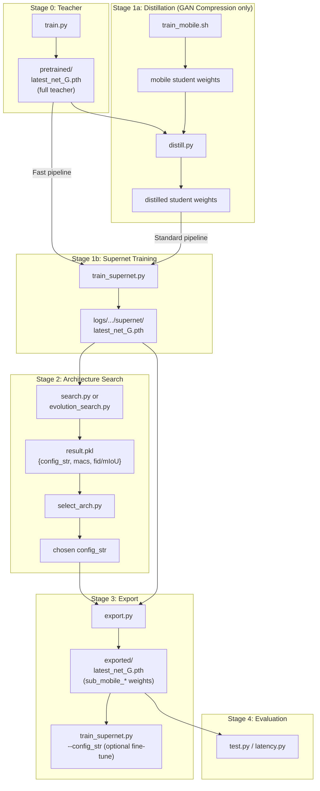
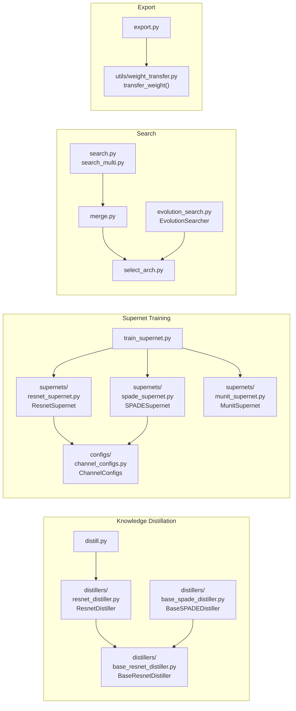

<!-- source: DeepWiki mcp.deepwiki.com · repo mit-han-lab/gan-compression · page 3 Compression Pipeline · fetched 2026-10-30 -->

# Compression Pipeline

<details>
<summary>Relevant source files</summary>

The following files were used as context for generating this wiki page:

- [README.md](README.md)
- [docs/overview.md](docs/overview.md)
- [docs/tutorials/fast_gan_compression.md](docs/tutorials/fast_gan_compression.md)
- [docs/tutorials/gan_compression.md](docs/tutorials/gan_compression.md)
- [imgs/overview.png](imgs/overview.png)
- [imgs/performance.jpeg](imgs/performance.jpeg)

</details>


This section covers the end-to-end workflow for compressing a conditional GAN model — from a pre-trained full teacher generator to a deployable, reduced-computation subnet. It describes the two supported pipelines, the scripts involved at each stage, and how artifacts flow between stages.

Detailed treatment of individual stages lives in child pages:
- Knowledge distillation → [Knowledge Distillation](#3.2)
- Supernet training → [Supernet Training](#3.3)
- Architecture search → [Architecture Search](#3.4)
- Exporting weights → [Exporting Compressed Models](#3.5)

For the network architecture variants that each stage produces, see [Generator Architecture Variants](#4.2). For the channel configuration system that defines the search space, see [Channel Configuration System](#5).

---

## The Two Workflows

The repository supports two compression pipelines. Both end with the same search-and-export steps; they differ in how the supernet is initialized.

| Pipeline | Entry Point | Distillation Step | Supernet Init |
|---|---|---|---|
| **GAN Compression** | `distill.py` → `train_supernet.py` | Yes — train a mobile student first | From distilled student weights |
| **Fast GAN Compression** | `train_supernet.py` (directly) | No | Directly from the full teacher |

The Fast GAN Compression path trades a small quality margin for a significantly simpler pipeline. In practice, results are comparable (see performance table in the repository README).

**GAN Compression pipeline** (standard):

```
train.py (full teacher)
    → train_mobile.sh (mobile student)
        → distill.py (knowledge distillation)
            → train_supernet.py (supernet, from distilled weights)
                → search.py / evolution_search.py
                    → select_arch.py → export.py
```

**Fast GAN Compression pipeline**:

```
train.py (full teacher)
    → train_supernet.py (supernet, directly from full teacher)
        → evolution_search.py
            → export.py
```

Sources: [README.md:487-489](), [docs/tutorials/gan_compression.md:1-30](), [docs/tutorials/fast_gan_compression.md:1-50]()

---

## Stage Overview

### Stage diagram: scripts and artifacts

**Script-to-Artifact Flow**



Sources: [docs/tutorials/gan_compression.md:14-291](), [docs/tutorials/fast_gan_compression.md:14-268](), [docs/overview.md:4-19]()

---

### Stage diagram: code entities per stage

**Code Entities by Stage**



Sources: [docs/overview.md:49-121](), [docs/overview.md:4-19]()

---

## Key Artifacts and Their Formats

| Artifact | Produced By | Consumed By | Format |
|---|---|---|---|
| Full teacher weights | `train.py` | `distill.py`, `train_supernet.py` | `.pth` checkpoint |
| Mobile student weights | `train_mobile.sh` | `distill.py` | `.pth` checkpoint |
| Distilled student weights | `distill.py` | `train_supernet.py` | `.pth` checkpoint |
| Supernet weights | `train_supernet.py` | `search.py`, `evolution_search.py`, `export.py` | `.pth` checkpoint |
| Search results | `search.py` / `evolution_search.py` | `select_arch.py` | `.pkl` — Python `list` of `dict` |
| `config_str` | `select_arch.py` / manual | `export.py`, `train_supernet.py` | Underscore-delimited string, e.g. `32_32_48_32_48_48_16_16` |
| Exported subnet weights | `export.py` | `test.py`, `latency.py`, demo | `.pth` checkpoint |

The `config_str` is the key identifier for a subnet within a supernet. It encodes the number of output channels at each configurable layer as an underscore-separated list of integers. Encoding and decoding utilities live in [configs/\_\_init\_\_.py]().

Sources: [docs/tutorials/gan_compression.md:71-84](), [docs/overview.md:4-19]()

---

## Model Family Support

Each model family supports both pipelines. The table below maps model families to their generator type identifiers and applicable pipelines.

| Model Family | Task Example | Full Teacher `netG` | Supernet `netG` | Subnet `netG` | Supports Fast Pipeline |
|---|---|---|---|---|---|
| ResNet (pix2pix) | edges2shoes-r | `resnet_9blocks` | `super_mobile_resnet_9blocks` | `sub_mobile_resnet_9blocks` | Yes |
| ResNet (CycleGAN) | horse2zebra | `resnet_9blocks` | `super_mobile_resnet_9blocks` | `sub_mobile_resnet_9blocks` | Yes |
| SPADE (GauGAN) | cityscapes | `spade` | `super_mobile_spade` | `sub_mobile_spade` | Yes |
| MUNIT | edges2shoes-r | `munit` | `super_mobile_munit` | `sub_mobile_munit` | Yes (only) |

MUNIT has no distillation path and only supports the Fast GAN Compression pipeline.

Sources: [docs/tutorials/fast_gan_compression.md:213-268](), [docs/tutorials/gan_compression.md:145-291](), [README.md:283-485]()

---

## Shell Script Conventions

Each model-dataset combination has a dedicated folder under `scripts/`, containing one shell script per pipeline stage.

```
scripts/
├── pix2pix/
│   └── edges2shoes-r/
│       ├── train_full.sh         # Stage 0: full teacher
│       ├── train_mobile.sh       # Stage 0 (standard only): mobile teacher
│       ├── distill.sh            # Stage 1a: distillation
│       ├── train_supernet.sh     # Stage 1b: supernet
│       ├── search.sh             # Stage 2: brute-force search
│       ├── finetune.sh           # Stage 3 (optional): fine-tune subnet
│       └── export.sh             # Stage 3: export subnet
├── cycle_gan/horse2zebra/        # same structure
├── gaugan/cityscapes/            # same structure
└── munit/edges2shoes-r_fast/     # fast pipeline only
```

`_fast` suffix variants under each model directory (e.g. `edges2shoes-r_fast/`) use the evolutionary search and skip distillation.

Sources: [docs/tutorials/gan_compression.md:14-291](), [docs/tutorials/fast_gan_compression.md:14-268]()

---

## Child Pages

| Page | Content |
|---|---|
| [Pipeline Overview](#3.1) | Side-by-side comparison of standard and fast pipelines with concrete script invocations |
| [Knowledge Distillation](#3.2) | `distill.py`, distiller class hierarchy, loss components |
| [Supernet Training](#3.3) | `train_supernet.py`, `ResnetSupernet`, dynamic config sampling |
| [Architecture Search](#3.4) | `search.py` brute-force and `evolution_search.py` evolutionary methods |
| [Exporting Compressed Models](#3.5) | `export.py`, `transfer_weight()`, weight copying logic |

---

