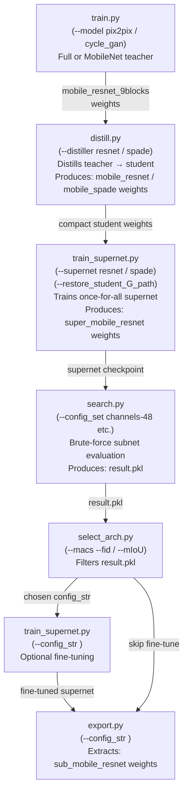
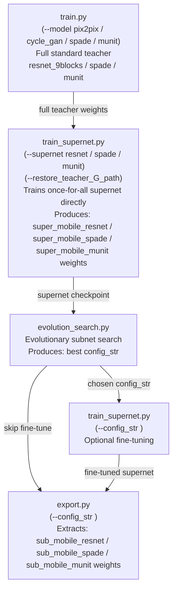
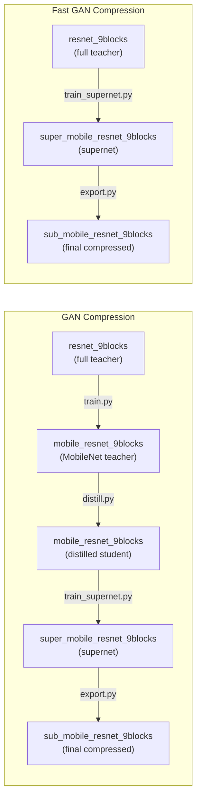
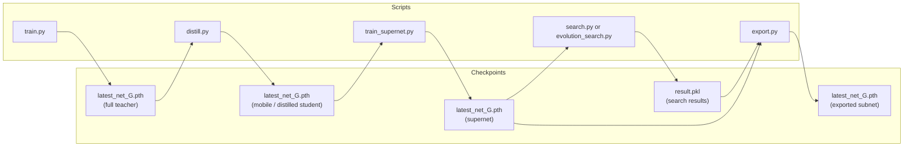

<!-- source: DeepWiki mcp.deepwiki.com · repo mit-han-lab/gan-compression · page 3.1 Pipeline Overview · fetched 2026-10-30 -->

# Pipeline Overview

Relevant source files

The following files were used as context for generating this wiki page:

- [README.md](README.md)
- [docs/overview.md](docs/overview.md)
- [docs/tutorials/fast_gan_compression.md](docs/tutorials/fast_gan_compression.md)
- [docs/tutorials/gan_compression.md](docs/tutorials/gan_compression.md)
- [imgs/overview.png](imgs/overview.png)
- [imgs/performance.jpeg](imgs/performance.jpeg)

This page describes the two end-to-end workflows supported by the repository for compressing a conditional GAN: **GAN Compression** (the original pipeline, which includes a pre-distillation stage) and **Fast GAN Compression** (a simplified pipeline that skips pre-distillation). It covers which scripts are invoked at each stage and how artifacts flow between them.

For details on individual stages, see:
- Knowledge distillation: [3.2](#3.2)
- Supernet training: [3.3](#3.3)
- Architecture search: [3.4](#3.4)
- Exporting compressed models: [3.5](#3.5)

---

## The Two Supported Workflows

Both workflows share the same last two stages—supernet training followed by architecture search and export—but differ in how the supernet is initialized.

| Stage | GAN Compression | Fast GAN Compression |
|---|---|---|
| **①** Train teacher | Train MobileNet-style teacher (`train.py`) | Train full standard teacher (`train.py`) |
| **②** Pre-distill | Distill MobileNet teacher → compact student (`distill.py`) | *(skipped)* |
| **③** Supernet training | Initialize supernet from distilled student (`train_supernet.py`) | Initialize supernet directly from full teacher (`train_supernet.py`) |
| **④** Architecture search | Brute-force (`search.py`) + `select_arch.py` | Evolutionary (`evolution_search.py`) |
| **⑤** Fine-tuning | Optional (`train_supernet.py --config_str`) | Optional (`train_supernet.py --config_str`) |
| **⑥** Export | Extract subnet weights (`export.py`) | Extract subnet weights (`export.py`) |

The primary practical difference: **Fast GAN Compression** reaches the supernet directly from the full teacher, saving the cost of training a MobileNet-style model and running distillation. In practice, the compressed models from both pipelines achieve comparable quality (see the performance table in the README).

Sources: [docs/tutorials/gan_compression.md:1-20](), [docs/tutorials/fast_gan_compression.md:1-20](), [README.md:283-485]()

---

## GAN Compression Pipeline

**GAN Compression Pipeline: Script and Artifact Flow**

Sources: [docs/tutorials/gan_compression.md:24-140](), [docs/overview.md:5-18]()

---

## Fast GAN Compression Pipeline

**Fast GAN Compression Pipeline: Script and Artifact Flow**

Sources: [docs/tutorials/fast_gan_compression.md:18-270](), [docs/overview.md:5-18]()

---

## Script-to-Module Mapping

Each top-level script delegates to a specific model/distiller/supernet class. The table below shows the correspondence.

| Script | Key `--model` / `--distiller` / `--supernet` value | Core class | Module file |
|---|---|---|---|
| `train.py` | `pix2pix` | `Pix2PixModel` | `models/pix2pix_model.py` |
| `train.py` | `cycle_gan` | `CycleGANModel` | `models/cycle_gan_model.py` |
| `train.py` | `spade` | `SPADEModel` | `models/spade_model.py` |
| `train.py` | `munit` | `MunitModel` | `models/munit_model.py` |
| `distill.py` | `resnet` | `ResnetDistiller` | `distillers/resnet_distiller.py` |
| `distill.py` | `spade` | `SPADEDistiller` | `distillers/spade_distiller.py` |
| `train_supernet.py` | `resnet` | `ResnetSupernet` | `supernets/resnet_supernet.py` |
| `train_supernet.py` | `spade` | `SPADESupernet` | `supernets/spade_supernet.py` |
| `train_supernet.py` | `munit` | `MunitSupernet` | `supernets/munit_supernet.py` |
| `search.py` | — | iterates `ChannelConfigs.all_configs()` | `configs/resnet_configs.py`, `configs/spade_configs.py` |
| `evolution_search.py` | — | `EvolutionSearcher` | `evolution_search.py` |
| `select_arch.py` | — | parses `.pkl` | `select_arch.py` |
| `export.py` | — | calls `transfer_weight` | `export.py`, `utils/weight_transfer.py` |

Sources: [docs/overview.md:5-141](), [docs/tutorials/gan_compression.md:1-292](), [docs/tutorials/fast_gan_compression.md:1-270]()

---

## Generator Architecture Progression

At each stage of both pipelines, a different generator variant is active. The four-tier hierarchy is:

**Generator Variants Per Pipeline Stage**

The same pattern applies to `spade` (GauGAN) and `munit` model families. All generator variants are instantiated through `define_G` in `models/networks.py`.

Sources: [docs/overview.md:71-121](), [README.md:23-32]()

---

## Stage-by-Stage Summary

### Stage ①: Teacher Training

Both pipelines begin with `train.py`. The GAN Compression pipeline trains a MobileNet-style teacher (`--netG mobile_resnet_9blocks`) from scratch, while Fast GAN Compression trains a standard full teacher (`--netG resnet_9blocks`). Pre-trained teachers for all supported datasets can be downloaded via `scripts/download_model.py --stage full` or `--stage mobile`.

### Stage ②: Pre-Distillation (GAN Compression only)

`distill.py` is called with `--distiller resnet` or `--distiller spade`. It loads the MobileNet teacher, instantiates a smaller student generator, and trains with a combined GAN + reconstruction + intermediate distillation loss via `ResnetDistiller` or `SPADEDistiller`. The output is a compact student checkpoint.

This stage is absent from Fast GAN Compression—the supernet is initialized directly from the full teacher's weights.

### Stage ③: Supernet Training

`train_supernet.py` trains the "once-for-all" supernet (e.g., `super_mobile_resnet_9blocks`). At each training step, a different channel configuration is sampled from `ChannelConfigs` and applied to the supernet via the `SuperConv2d` / `SuperSeparableConv2d` modules. All sub-networks share weights within the supernet.

- In GAN Compression: `--restore_student_G_path` points to the distilled student.
- In Fast GAN Compression: `--restore_teacher_G_path` points to the full teacher.

The `--config_set` argument (e.g., `channels-48`, `channels-64-cycleGAN`) controls the search space used during training.

### Stage ④: Architecture Search

Two methods are available:

| Method | Script | Output |
|---|---|---|
| **Brute-force** | `search.py` (parallelizable with `--num_splits` / `--split`) | `result.pkl` — list of `{config_str, macs, fid/mIoU}` dicts |
| **Evolutionary** | `evolution_search.py` (`EvolutionSearcher`) | Best `config_str` directly |

Both methods evaluate sub-generators sliced from the supernet without any retraining, using FID (via `metric/fid_score.py`) or mIoU (via `metric/cityscapes_mIoU.py` or `metric/coco_scores.py`) as the quality metric, and `model.profile(config)` for MAC counting.

`select_arch.py` filters the brute-force `result.pkl` by a MAC budget and quality threshold to identify candidates.

### Stage ⑤: Optional Fine-Tuning

`train_supernet.py --config_str <chosen_config>` fine-tunes the supernet locked to a single subnet configuration. This is optional and does not always improve quality (e.g., it increases FID for CycleGAN on horse2zebra).

### Stage ⑥: Export

`export.py` loads the supernet, decodes the `config_str`, builds the corresponding `sub_mobile_resnet_9blocks` / `sub_mobile_spade` / `sub_mobile_munit` network, and calls `transfer_weight` (from `utils/weight_transfer.py`) to copy the relevant sliced weights. The output is a standalone compressed model checkpoint that can be loaded with `test.py`.

Sources: [docs/tutorials/gan_compression.md:20-292](), [docs/tutorials/fast_gan_compression.md:18-270](), [docs/overview.md:5-18](), [README.md:487-489]()

---

## Artifact Flow Summary

**Artifacts Produced at Each Stage**

The `config_str` (e.g., `32_32_48_32_48_48_16_16`) is the primary artifact linking the search stage to export and fine-tuning. It encodes per-layer channel widths and is parsed by `configs/__init__.py`.

Sources: [docs/tutorials/gan_compression.md:65-140](), [docs/tutorials/fast_gan_compression.md:60-142](), [docs/overview.md:5-18]()

---

