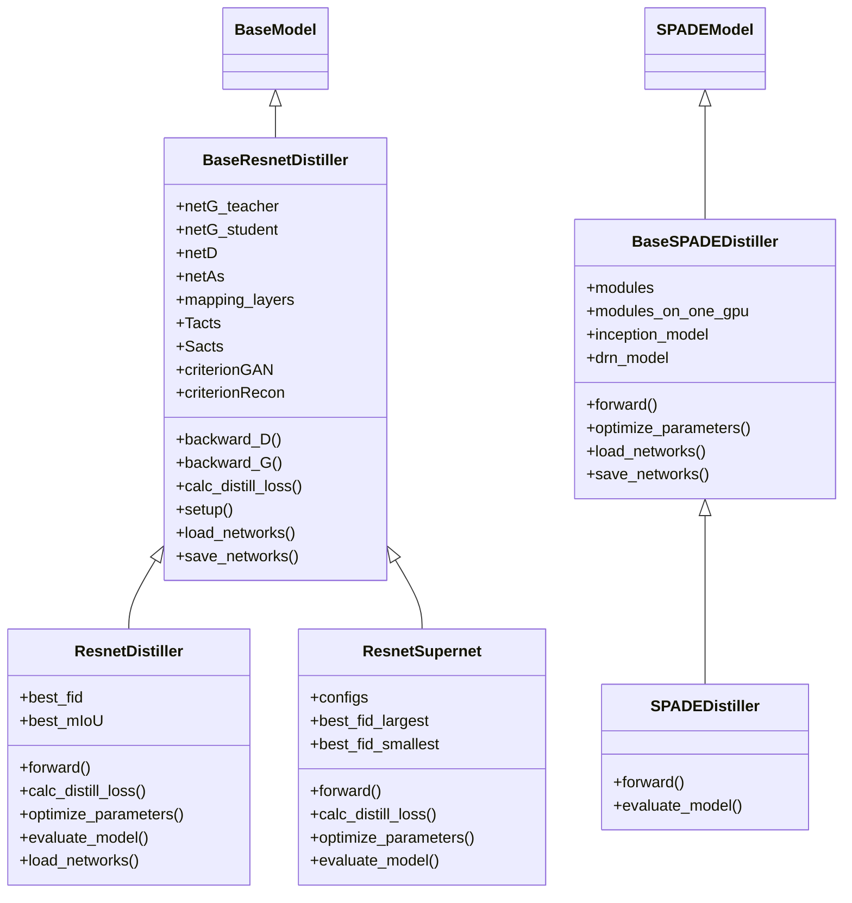
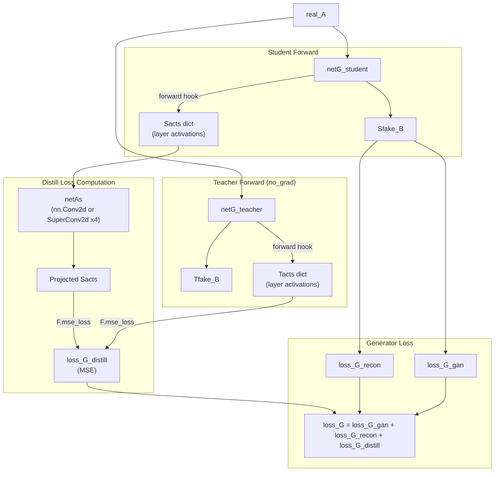

<!-- source: DeepWiki mcp.deepwiki.com · repo mit-han-lab/gan-compression · page 3.2 Knowledge Distillation · fetched 2026-10-30 -->

# Knowledge Distillation

<details>
<summary>Relevant source files</summary>

The following files were used as context for generating this wiki page:

- [distillers/base_resnet_distiller.py](distillers/base_resnet_distiller.py)
- [distillers/base_spade_distiller.py](distillers/base_spade_distiller.py)
- [distillers/resnet_distiller.py](distillers/resnet_distiller.py)
- [distillers/spade_distiller.py](distillers/spade_distiller.py)
- [models/modules/spade_modules/spade_model_modules.py](models/modules/spade_modules/spade_model_modules.py)
- [models/spade_model.py](models/spade_model.py)
- [options/base_options.py](options/base_options.py)
- [options/distill_options.py](options/distill_options.py)
- [scripts/cycle_gan/horse2zebra/distill.sh](scripts/cycle_gan/horse2zebra/distill.sh)
- [scripts/cycle_gan/horse2zebra/search.sh](scripts/cycle_gan/horse2zebra/search.sh)
- [scripts/cycle_gan/horse2zebra/test_distill.sh](scripts/cycle_gan/horse2zebra/test_distill.sh)
- [scripts/cycle_gan/horse2zebra/test_supernet.sh](scripts/cycle_gan/horse2zebra/test_supernet.sh)
- [supernets/resnet_supernet.py](supernets/resnet_supernet.py)

</details>


This page covers the knowledge distillation stage of the GAN compression pipeline — the process by which a pre-trained **teacher generator** guides the training of a smaller **student generator**. This is Stage 1 of the full pipeline described in [Pipeline Overview](#3.1). For supernet training (Stage 2, which reuses the base distiller infrastructure), see [Supernet Training](#3.3). For the architectural details of the generator families referenced here, see [Generator Architecture Variants](#4.2).

---

## Role in the Pipeline

Distillation produces a compressed student generator that mimics both the output and the intermediate activations of a larger teacher generator. The distilled student weights are then transferred into a supernet for architecture search.

The entrypoint is `distill.py`, configured through `DistillOptions` defined in [options/distill_options.py]().

---

## Class Hierarchy

Two parallel distiller hierarchies exist — one for ResNet-based models (pix2pix, CycleGAN) and one for SPADE-based models (GauGAN).

**Distiller: Class Hierarchy**



Sources: [distillers/base_resnet_distiller.py](), [distillers/resnet_distiller.py](), [supernets/resnet_supernet.py](), [distillers/base_spade_distiller.py](), [distillers/spade_distiller.py]()

---

## ResNet Distillation

### Network Setup

`BaseResnetDistiller.__init__` instantiates the following networks:

| Attribute | Description | Default netG | Default ngf |
|---|---|---|---|
| `netG_teacher` | Pre-trained teacher (frozen, `.eval()`) | `mobile_resnet_9blocks` | 64 |
| `netG_student` | Trainable student | `mobile_resnet_9blocks` | 48 |
| `netD` | Discriminator on student output | `n_layers` | 128 |
| `netAs` | Adapter 1×1 convolutions (one per mapping layer) | — | — |

Valid `netG` identifiers for teacher/student: `resnet_9blocks`, `mobile_resnet_9blocks`, `super_mobile_resnet_9blocks`, `sub_mobile_resnet_9blocks`.

[distillers/base_resnet_distiller.py:41-116]()

### Mapping Layers and Forward Hooks

Distillation compares intermediate activations at four points in the ResNet generator. These are identified by the following module names:

```
model.9, model.12, model.15, model.18
```

(Or `module.model.9` etc. when wrapped in `DataParallel`.)

[distillers/base_resnet_distiller.py:91-94]()

During `setup()`, PyTorch forward hooks are registered on both teacher and student at each mapping layer. Activations are stored in dictionaries `Tacts` (teacher) and `Sacts` (student), keyed by layer name and device.

[distillers/base_resnet_distiller.py:123-138]()

### Adapter Networks (`netAs`)

Because the student has fewer channels than the teacher, adapter networks project student activations into the teacher's channel space before computing the distillation loss.

- **In `ResnetDistiller`**: Each `netA` is a plain `nn.Conv2d(in_channels=student_ngf*4, out_channels=teacher_ngf*4, kernel_size=1)`.
- **In `ResnetSupernet`**: Each `netA` is a `SuperConv2d` to handle variable channel widths during supernet training.

The adapters are optimized jointly with the student generator via `optimizer_G`.

[distillers/base_resnet_distiller.py:96-113]()

**Distillation Data Flow**



Sources: [distillers/base_resnet_distiller.py:150-187](), [distillers/resnet_distiller.py:44-57]()

---

## Loss Components

All three loss terms are combined in `backward_G`:

[distillers/base_resnet_distiller.py:173-187]()

| Loss | Symbol | Computation | Weight Argument |
|---|---|---|---|
| Adversarial | `loss_G_gan` | `criterionGAN(netD(Sfake_B), True)` | `--lambda_gan` (default 1) |
| Reconstruction | `loss_G_recon` | `criterionRecon(Sfake_B, real_B)` (aligned) or `criterionRecon(Sfake_B, Tfake_B)` (unaligned) | `--lambda_recon` (default 100) |
| Distillation | `loss_G_distill` | Sum of per-layer `MSE(netA(Sacts), Tacts)` | `--lambda_distill` (default 1) |

**Reconstruction loss variants** (`--recon_loss_type`):

| Value | Class |
|---|---|
| `l1` (default) | `torch.nn.L1Loss` |
| `l2` | `torch.nn.MSELoss` |
| `smooth_l1` | `torch.nn.SmoothL1Loss` |
| `vgg` | `models.modules.loss.VGGLoss` |

[distillers/base_resnet_distiller.py:79-89]()

The **reconstruction target** depends on `--dataset_mode`:
- `aligned` (pix2pix): student output vs. `real_B`
- `unaligned` (CycleGAN): student output vs. teacher output `Tfake_B`

[distillers/base_resnet_distiller.py:173-179]()

---

## SPADE Distillation

`BaseSPADEDistiller` extends `SPADEModel` and follows the same principle, but delegates all module construction to either `SPADEDistillerModules` or `SPADESupernetModules` (selected based on whether `opt.distiller` is set). This wrapper pattern is needed because SPADE uses synchronized batch norm across GPUs.

[distillers/base_spade_distiller.py:45-70]()

Valid SPADE `netG` identifiers: `spade`, `mobile_spade`, `super_mobile_spade`, `sub_mobile_spade`.

The SPADE distiller adds feature-matching and VGG perceptual losses on top of the three base losses:

| Loss | Weight Argument |
|---|---|
| GAN | `--lambda_gan` (default 1) |
| Feature matching | `--lambda_feat` (default 10) |
| VGG perceptual | `--lambda_vgg` (default 10) |
| Distillation | `--lambda_distill` (default 10) |

[distillers/base_spade_distiller.py:32-36]()

The mapping layers for SPADE are defined inside `SPADEDistillerModules` (via `modules_on_one_gpu.mapping_layers`) rather than being hardcoded in the distiller itself.

---

## Pretrained Weight Transfer

`ResnetDistiller.load_networks()` supports initializing the student with weights from a separately pre-trained model of a different architecture. This is controlled by three options:

| Option | Description |
|---|---|
| `--restore_pretrained_G_path` | Path to a pretrained generator checkpoint |
| `--pretrained_netG` | Architecture of the pretrained generator |
| `--pretrained_ngf` | Base filter count of the pretrained generator |

If `--restore_pretrained_G_path` is provided, the pretrained weights are loaded into a temporary `netG_pretrained` and then transferred to `netG_student` via `load_pretrained_weight()` from `utils/weight_transfer.py`. The temporary network is deleted after transfer.

[distillers/resnet_distiller.py:70-77]()

---

## Checkpoint Saving and Restoring

`save_networks` saves:
- `{epoch}_net_G.pth` — student generator
- `{epoch}_net_D.pth` — discriminator
- `{epoch}_net_A-{i}.pth` — each adapter network
- `{epoch}_optim-{i}.pth` — each optimizer state

`load_networks` restores from these paths via the following options:

| Option | Target |
|---|---|
| `--restore_teacher_G_path` | `netG_teacher` (required) |
| `--restore_student_G_path` | `netG_student` (optional) |
| `--restore_D_path` | `netD` (optional) |
| `--restore_A_path` | `netAs` (optional, appends `-{i}.pth`) |
| `--restore_O_path` | Optimizers (optional, appends `-{i}.pth`) |

[distillers/base_resnet_distiller.py:207-220](), [options/distill_options.py:55-65]()

---

## Evaluation During Training

Both `ResnetDistiller.evaluate_model` and `SPADEDistiller.evaluate_model` run inference on an eval dataloader and compute:
- **FID** (always, unless `--no_fid`)
- **Cityscapes mIoU** (when `cityscapes` is in `--dataroot` and `--direction BtoA`)

The best-ever FID/mIoU scores are tracked to set `self.is_best`, which signals the training loop to save a "best" checkpoint.

[distillers/resnet_distiller.py:79-134]()

---

## Command-Line Options Summary

Defined in `DistillOptions` ([options/distill_options.py]()) and augmented by each distiller's `modify_commandline_options`.

| Option | Default | Description |
|---|---|---|
| `--distiller` | `resnet` | Distiller type: `resnet` or `spade` |
| `--teacher_netG` | — | Teacher generator architecture |
| `--student_netG` | — | Student generator architecture |
| `--teacher_ngf` | 64 | Teacher base filter count |
| `--student_ngf` | 48 | Student base filter count |
| `--lambda_distill` | 1 | Weight for intermediate activation loss |
| `--lambda_recon` | 100 | Weight for reconstruction loss |
| `--lambda_gan` | 1 | Weight for GAN loss |
| `--recon_loss_type` | `l1` | Reconstruction loss type |
| `--restore_teacher_G_path` | (required) | Teacher checkpoint path |
| `--real_stat_path` | (required) | `.npz` reference statistics for FID |
| `--nepochs` | 5 | Epochs at initial LR |
| `--nepochs_decay` | 15 | Epochs with LR linear decay |

---

## Example Invocation

The following shell script runs ResNet distillation for CycleGAN horse→zebra:

[scripts/cycle_gan/horse2zebra/distill.sh]()

Key arguments from that script:
- `--distiller resnet`
- `--student_ngf 32` (smaller than default 48, since this is a CycleGAN model)
- `--restore_teacher_G_path` points to a previously trained `mobile_resnet_9blocks` checkpoint
- `--restore_pretrained_G_path` initializes the student from the same teacher checkpoint via weight transfer
- `--lambda_recon 10 --lambda_distill 0.01`

---

