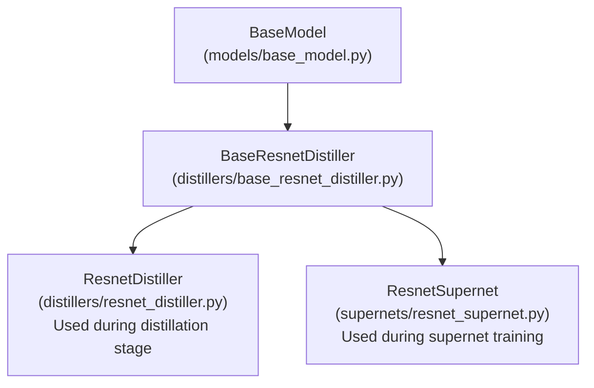
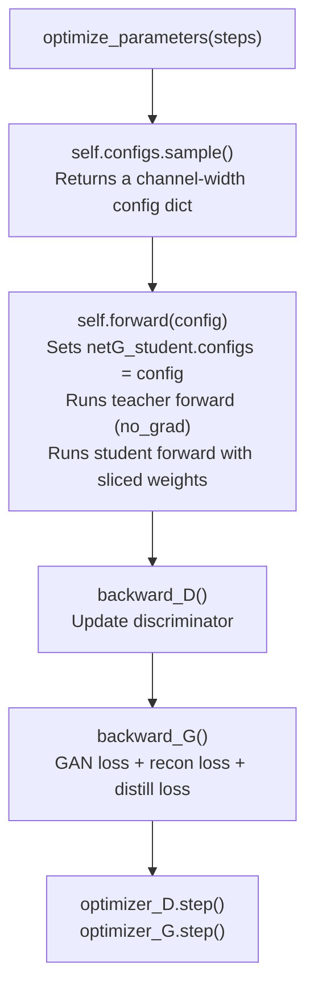
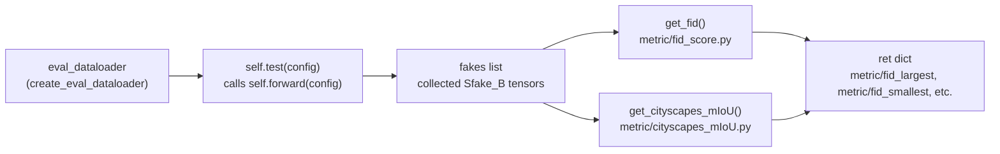
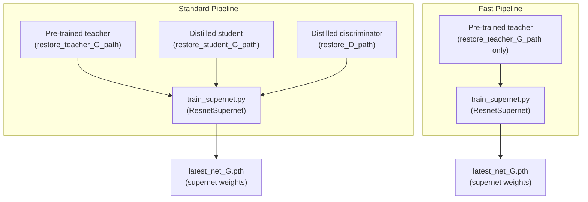

<!-- source: DeepWiki mcp.deepwiki.com · repo mit-han-lab/gan-compression · page 3.3 Supernet Training · fetched 2026-10-30 -->

# Supernet Training

<details>
<summary>Relevant source files</summary>

The following files were used as context for generating this wiki page:

- [data/base_dataset.py](data/base_dataset.py)
- [distillers/base_resnet_distiller.py](distillers/base_resnet_distiller.py)
- [distillers/resnet_distiller.py](distillers/resnet_distiller.py)
- [options/base_options.py](options/base_options.py)
- [scripts/conda_deps.sh](scripts/conda_deps.sh)
- [scripts/cycle_gan/horse2zebra_fast/evolution_search.sh](scripts/cycle_gan/horse2zebra_fast/evolution_search.sh)
- [scripts/gaugan/cityscapes/train_supernet.sh](scripts/gaugan/cityscapes/train_supernet.sh)
- [scripts/gaugan/coco_fast/evolution_search.sh](scripts/gaugan/coco_fast/evolution_search.sh)
- [scripts/gaugan/coco_fast/search.sh](scripts/gaugan/coco_fast/search.sh)
- [scripts/gaugan/coco_fast/train_supernet.sh](scripts/gaugan/coco_fast/train_supernet.sh)
- [scripts/pix2pix/cityscapes/train_supernet.sh](scripts/pix2pix/cityscapes/train_supernet.sh)
- [supernets/resnet_supernet.py](supernets/resnet_supernet.py)

</details>


This page documents the supernet training stage of the GAN compression pipeline: the purpose of a supernet, the class hierarchy that implements it, the `train_supernet.py` entrypoint, and its key command-line arguments. For background on where supernet training fits in the broader compression workflow, see the [Pipeline Overview](#3.1). For the knowledge distillation step that precedes supernet training in the standard workflow, see [Knowledge Distillation](#3.2). For the search step that follows supernet training, see [Architecture Search](#3.4).

---

## What Is a Supernet?

A **supernet** (also called an *once-for-all network*) is a single weight-shared generator that can execute as many different sub-networks (subnets) simultaneously by accepting a channel-width configuration at runtime. During training, a different configuration is sampled on every optimization step. Because all subnets share the same weights, the supernet only needs to be trained once: after training, any subnet can be extracted and evaluated without retraining.

The supernet uses `super_mobile_resnet_9blocks` (or `super_mobile_spade`) as the student generator, where each convolution is replaced by a `SuperConv2d` module that accepts a `config` dict and slices its weight tensors to the requested channel width at every forward pass. See [Configurable Supernet Modules](#4.3) for details on how slicing works.

Sources: [supernets/resnet_supernet.py:1-50](), [distillers/base_resnet_distiller.py:1-50]()

---

## Class Hierarchy

**Class hierarchy for supernet training (ResNet family)**



`ResnetSupernet` inherits all infrastructure from `BaseResnetDistiller`: the teacher generator `netG_teacher`, the student generator `netG_student`, the discriminator `netD`, the adapter networks `netAs`, optimizers, and the distillation loss calculation. It overrides `forward`, `optimize_parameters`, and `evaluate_model` to add per-step config sampling.

Sources: [supernets/resnet_supernet.py:19-44](), [distillers/base_resnet_distiller.py:20-121]()

---

## Initialization and Config Setup

In `ResnetSupernet.__init__`, the student generator is asserted to contain `'super'` in its name (i.e., it must be `super_mobile_resnet_9blocks`). The config space is set up as follows:

| Argument present | Behavior |
|---|---|
| `--config_set` (and no `--config_str`) | Calls `get_configs(opt.config_set)` to load a named channel-width config set. Sets `eval_mode = 'both'`. |
| `--config_str` (and no `--config_set`) | Wraps the single decoded config in `SingleConfigs`. Sets `eval_mode = 'largest'`. |

`get_configs` returns a `ChannelConfigs` object (from `configs/resnet_configs.py` or `configs/spade_configs.py`) that knows how to sample channel widths, return the largest config, and return the smallest config. See [Channel Configuration System](#5) for the full `ChannelConfigs` API.

Sources: [supernets/resnet_supernet.py:28-44]()

---

## Training Loop: `optimize_parameters`

On every training step, `ResnetSupernet.optimize_parameters` samples one config from the config space and runs a full GAN update with that config.

**Per-step training flow inside `ResnetSupernet.optimize_parameters`**



The `forward(config)` method sets the active channel configuration on the student generator before running inference:

```
# supernets/resnet_supernet.py lines 46-53
self.netG_student.module.configs = config   # or .configs for non-DataParallel
self.Tfake_B = self.netG_teacher(self.real_A)   # frozen teacher
self.Sfake_B = self.netG_student(self.real_A)   # sliced student
```

The distillation loss in `calc_distill_loss` uses `SuperConv2d` adapter networks (`netAs`) with `out_channels` fixed to the full teacher width, matching teacher intermediate activations to the adapted student activations.

Sources: [supernets/resnet_supernet.py:46-82](), [distillers/base_resnet_distiller.py:170-188]()

---

## Evaluation During Training

`evaluate_model` is called periodically during training. It evaluates the supernet under two configs when `eval_mode == 'both'`:

| Config name | Meaning |
|---|---|
| `'largest'` | All layers at their maximum channel widths |
| `'smallest'` | All layers at their minimum channel widths |

For each config, it runs inference over the full eval dataset, computes FID (via `get_fid`), and optionally computes Cityscapes mIoU (via `get_cityscapes_mIoU`) when `dataroot` contains `'cityscapes'`.

The supernet tracks `best_fid_largest`, `best_fid_smallest`, `best_mIoU_largest`, and `best_mIoU_smallest` across evaluations. A rolling window of the three most recent FID values is also maintained for each setting (`fids_largest`, `fids_smallest`).

**Evaluation data flow**



Sources: [supernets/resnet_supernet.py:83-155]()

---

## `train_supernet.py`: Entrypoint and Key Arguments

`train_supernet.py` is the main script for supernet training. It accepts all standard training arguments plus the following supernet-specific ones.

### Required Supernet Arguments

| Argument | Type | Description |
|---|---|---|
| `--supernet` | `str` | Supernet type: `resnet` or `spade`. Determines which supernet class and model family to use. |
| `--config_set` | `str` | Named channel-width config set (e.g., `channels-48`, `channels-64`, `channels-64-cycleGAN`). Mutually exclusive with `--config_str`. |
| `--student_ngf` | `int` | Number of filters in the outermost layer of the student generator (e.g., `48` or `64`). |

### Restore Paths

| Argument | Description |
|---|---|
| `--restore_teacher_G_path` | Path to the teacher generator checkpoint (`.pth`). Always required. |
| `--restore_student_G_path` | Path to a pre-trained student generator checkpoint (from the distillation stage). Optional in fast pipeline. |
| `--restore_D_path` | Path to a pre-trained discriminator checkpoint. Optional. |
| `--restore_A_path` | Path prefix for adapter network (`netA`) checkpoints. Optional. |
| `--restore_O_path` | Path prefix for optimizer state checkpoints. Optional. |

### Other Notable Arguments

| Argument | Description |
|---|---|
| `--teacher_ngf` | Number of filters in the teacher generator (e.g., `96` for cityscapes pix2pix). |
| `--real_stat_path` | Path to `.npz` file with pre-computed real image statistics for FID. |
| `--nepochs` | Number of epochs at the initial learning rate. |
| `--nepochs_decay` | Number of additional epochs with linearly decaying LR. |
| `--meta_path` | Path to a dataset metadata file for ordered/reproducible data loading. |
| `--config_str` | Alternative to `--config_set`: train against a single fixed subnet config. |

Sources: [supernets/resnet_supernet.py:20-26](), [distillers/base_resnet_distiller.py:22-39](), [scripts/pix2pix/cityscapes/train_supernet.sh:1-17](), [scripts/gaugan/coco_fast/train_supernet.sh:1-11](), [options/base_options.py:65-68]()

---

## Workflow Variants: Standard vs. Fast Pipeline

The two pipelines differ in whether a pre-distilled student checkpoint is provided to `train_supernet.py`.

**Standard pipeline vs. fast pipeline for supernet training**



In the fast pipeline, the student generator is initialized from scratch (or random init) and trained directly from the teacher supervision without a preceding distillation stage. In the standard pipeline, `--restore_student_G_path` and `--restore_D_path` warm-start the supernet with the weights from [Knowledge Distillation](#3.2).

Sources: [scripts/pix2pix/cityscapes/train_supernet.sh:1-17](), [scripts/gaugan/coco_fast/train_supernet.sh:1-11](), [scripts/gaugan/cityscapes/train_supernet.sh:1-14]()

---

## Example Invocations

### pix2pix — Cityscapes (Standard Pipeline)

```bash
python train_supernet.py \
  --dataroot database/cityscapes \
  --supernet resnet \
  --log_dir logs/pix2pix/cityscapes/supernet \
  --restore_teacher_G_path logs/pix2pix/cityscapes/mobile/checkpoints/latest_net_G.pth \
  --restore_student_G_path logs/pix2pix/cityscapes/distill/checkpoints/latest_net_G.pth \
  --restore_D_path logs/pix2pix/cityscapes/distill/checkpoints/latest_net_D.pth \
  --real_stat_path real_stat/cityscapes_A.npz \
  --teacher_ngf 96 \
  --config_set channels-48 \
  --nepochs 200 --nepochs_decay 300 \
  --direction BtoA \
  --meta_path datasets/metas/cityscapes/train1.meta
```

Sources: [scripts/pix2pix/cityscapes/train_supernet.sh:1-17]()

---

### GauGAN (SPADE) — COCO Fast Pipeline

```bash
python train_supernet.py \
  --dataroot database/coco_stuff \
  --dataset_mode coco \
  --supernet spade \
  --teacher_netG spade \
  --student_ngf 64 \
  --log_dir logs/gaugan/coco_fast/supernet \
  --restore_teacher_G_path pretrained/gaugan/coco_fast/full/latest_net_G.pth \
  --real_stat_path real_stat/coco_A.npz \
  --gpu_ids 0,1,2,3 \
  --nepochs 100 --nepochs_decay 0 \
  --config_set channels-64 \
  --num_upsampling_layers normal \
  --batch_size 32 \
  --meta_path datasets/metas/coco-coco_stuff/train1.meta
```

Sources: [scripts/gaugan/coco_fast/train_supernet.sh:1-11]()

---

### GauGAN (SPADE) — Cityscapes Standard Pipeline

```bash
python train_supernet.py \
  --dataroot database/cityscapes-origin \
  --supernet spade \
  --log_dir logs/gaugan/cityscapes/supernet \
  --restore_teacher_G_path logs/gaugan/cityscapes/mobile/checkpoint/latest_net_G.pth \
  --restore_student_G_path logs/gaugan/cityscapes/distill/checkpoints/latest_net_G.pth \
  --restore_D_path logs/gaugan/cityscapes/distill/checkpoints/latest_net_D.pth \
  --real_stat_path real_stat/cityscapes_A.npz \
  --gpu_ids 0,1,2,3,4,5,6,7 \
  --config_set channels-48 \
  --meta_path datasets/metas/cityscapes-origin/train1.meta
```

Sources: [scripts/gaugan/cityscapes/train_supernet.sh:1-14]()

---

## Outputs

After training, the supernet checkpoint directory (e.g., `logs/pix2pix/cityscapes/supernet/checkpoints/`) contains:

| File | Description |
|---|---|
| `latest_net_G.pth` | Supernet student generator weights |
| `latest_net_D.pth` | Discriminator weights |
| `latest_net_A-{i}.pth` | Adapter network weights (one per mapping layer) |
| `latest_optim-{i}.pth` | Optimizer states |

The `latest_net_G.pth` file is passed to `search.py` or `evolution_search.py` via `--restore_G_path` in the next pipeline stage (see [Architecture Search](#3.4)), and later to `export.py` via `--input_path` (see [Exporting Compressed Models](#3.5)).

Sources: [distillers/base_resnet_distiller.py:222-252](), [scripts/gaugan/coco_fast/evolution_search.sh:4](), [scripts/cycle_gan/horse2zebra_fast/evolution_search.sh:3]()

---

