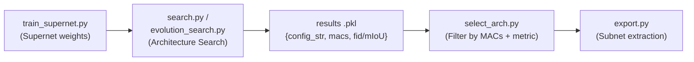
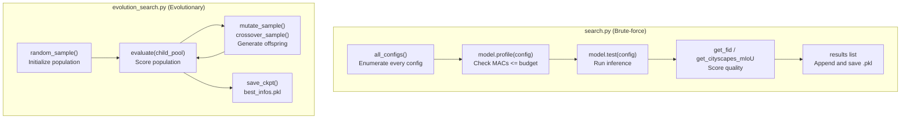
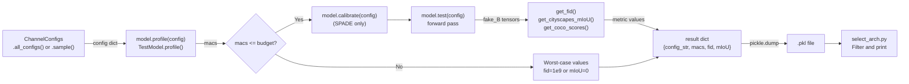

<!-- source: DeepWiki mcp.deepwiki.com · repo mit-han-lab/gan-compression · page 3.4 Architecture Search · fetched 2026-10-30 -->

# Architecture Search

<details>
<summary>Relevant source files</summary>

The following files were used as context for generating this wiki page:

- [datasets/separate_A_and_B.py](datasets/separate_A_and_B.py)
- [evolution_search.py](evolution_search.py)
- [get_real_stat.py](get_real_stat.py)
- [metric/cityscapes_mIoU.py](metric/cityscapes_mIoU.py)
- [metric/coco_scores.py](metric/coco_scores.py)
- [metric/fid_score.py](metric/fid_score.py)
- [options/evolution_options.py](options/evolution_options.py)
- [search.py](search.py)
- [select_arch.py](select_arch.py)

</details>


## Purpose and Scope

This page describes the architecture search stage of the GAN compression pipeline — the second of three stages. After a supernet has been trained (see [Supernet Training](#3.3)), architecture search finds the best-performing subnet configuration within that supernet subject to a compute budget (MACs). Two search strategies are available: brute-force enumeration and evolutionary search. Each is covered in its own sub-page:

- [Brute-force Search](#3.4.1) — `search.py` and `search_multi.py`
- [Evolutionary Search](#3.4.2) — `evolution_search.py` and `EvolutionSearcher`

For information on how to export a selected configuration into a standalone model, see [Exporting Compressed Models](#3.5). For background on the channel configuration space being searched, see [Channel Configuration System](#5).

---

## Role in the Compression Pipeline

Architecture search sits between supernet training and model export. The supernet has weight-shared parameters for all supported channel widths; search selects a specific combination of per-layer channel counts that maximises image quality at or below a MAC budget — **without any retraining**.

**Pipeline position:**



Sources: [search.py:80-154](), [evolution_search.py:272-281](), [select_arch.py:1-34]()

---

## Shared Concepts

Both search methods share the same inputs, output format, and filtering utility. Understanding these shared concepts helps when reading either sub-page.

### Input: Trained Supernet

Both scripts load a trained supernet via `create_model(opt)` and `model.setup(opt)`. The supernet generator type is specified with `--netG`, e.g. `super_mobile_resnet_9blocks` or `super_mobile_spade`. The supernet weights come from a checkpoint set via restore path options.

### Configuration Space

Each candidate architecture is a dict with a `channels` key: a list of per-layer channel counts. The search space is defined by `ChannelConfigs` (see [Channel Configuration System](#5)), selected by `--config_set`.

Both scripts dynamically import the appropriate config module:

| `--netG` contains | Config module imported |
|---|---|
| `resnet` | `configs.resnet_configs.get_configs` |
| `spade` | `configs.spade_configs.get_configs` |
| `munit` | `configs.munit_configs.get_configs` |

Sources: [search.py:67-77](), [evolution_search.py:71-79]()

### MAC Profiling and the Budget

Every candidate config is profiled for MACs using `model.profile(config, verbose=False)` before evaluation. Only configs satisfying `macs <= opt.budget` are passed to full inference and metric scoring. Over-budget configs receive worst-case metric values (`fid=1e9`, `mIoU=0`) in `search.py`, and are simply rejected during sampling in `evolution_search.py`.

Sources: [search.py:109-111](), [evolution_search.py:104-111]()

### Metric Evaluation

Both search scripts compute the same quality metrics on the generated images:

| Metric | Condition | Function called |
|---|---|---|
| FID | `inception_model is not None` | `get_fid(...)` |
| Cityscapes mIoU | `drn_model is not None` | `get_cityscapes_mIoU(...)` |
| COCO mIoU + accu | `deeplabv2_model is not None` | `get_coco_scores(...)` |

Metric models are created once via `create_metric_models(opt, device)` and reused across all evaluated configs. The FID computation requires a reference `.npz` file loaded from `opt.real_stat_path`.

For SPADE supernets, batch norm statistics must be recalibrated for each config before inference: `model.calibrate(config)` is called ahead of the forward passes.

Sources: [search.py:93-94](), [search.py:115-144](), [evolution_search.py:89-92](), [evolution_search.py:148-172]()

### Output Format: `.pkl` Results

Both search methods write results to a pickle file. Each entry in the list is a `dict` with the following fields:

| Key | Type | Description |
|---|---|---|
| `config_str` | `str` | Encoded channel configuration (from `encode_config`) |
| `macs` | `float` | Multiply-accumulate count for this config |
| `fid` | `float` | FID score (lower is better); absent if not computed |
| `mIoU` | `float` | Mean IoU (higher is better); absent if not computed |
| `accu` | `float` | Pixel accuracy (COCO only); absent if not applicable |

Sources: [search.py:110-144](), [evolution_search.py:42-47](), [evolution_search.py:264-269]()

---

## Filtering Results: `select_arch.py`

After search completes, `select_arch.py` reads the `.pkl` file and prints all entries that satisfy user-specified thresholds.

```
python select_arch.py \
    --pkl_path results/search_results.pkl \
    --macs 5.68e9 \
    --fid 60.0 \
    --mIoU 40.0
```

The script sorts results by MACs in ascending order, then applies all three thresholds (any threshold left at its default is ignored). Passing entries are printed to stdout.

| Argument | Default | Description |
|---|---|---|
| `--pkl_path` | required | Path to the input `.pkl` file |
| `--macs` | `5.68e9` | Maximum allowed MACs |
| `--fid` | `-1` | Maximum allowed FID (disabled when ≤ 0 effectively) |
| `--mIoU` | `1e18` | Minimum required mIoU (disabled at default) |

Sources: [select_arch.py:1-34]()

---

## Comparison of the Two Search Methods



Sources: [search.py:80-154](), [evolution_search.py:201-261]()

| Property | Brute-force (`search.py`) | Evolutionary (`evolution_search.py`) |
|---|---|---|
| Config enumeration | Exhaustive: `all_configs()` | Stochastic: `random_sample`, `mutate_sample`, `crossover_sample` |
| Parallelism | `--num_splits` / `--split` + `merge.py` | Single process; caches results |
| Output file | Single `.pkl` per split | `latest_ckpt.pkl`, `<n>_ckpt.pkl`, `best_infos.pkl`, `final_parents.pkl` |
| Resumable | Via `--restore_pkl_path` | Via `--restore_pkl_path` and `--generation_base` |
| Best suited for | Small/medium config spaces | Large config spaces (ResNet, SPADE) |
| Key extra options | `--num_splits`, `--split` | `--population_size`, `--mutation_ratio`, `--mutate_prob`, `--evolution_iters`, `--criterion` |

Sources: [search.py:67-77](), [options/evolution_options.py:39-65]()

---

## Data Flow: Config to `.pkl`

The following diagram maps the code entities involved in producing a single result entry, shared by both search methods.



Sources: [search.py:105-153](), [evolution_search.py:140-173](), [select_arch.py:9-24]()

---

