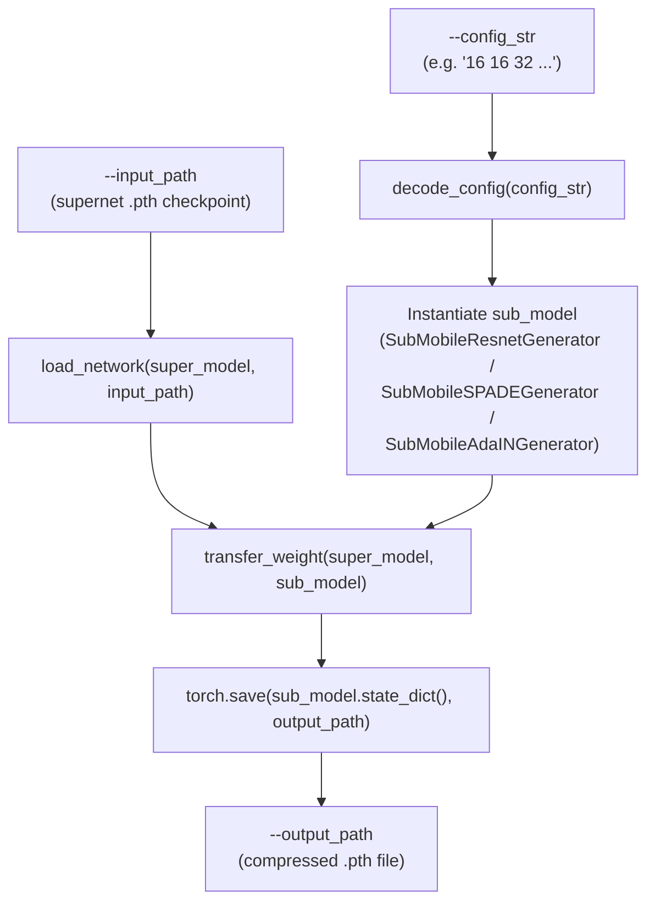
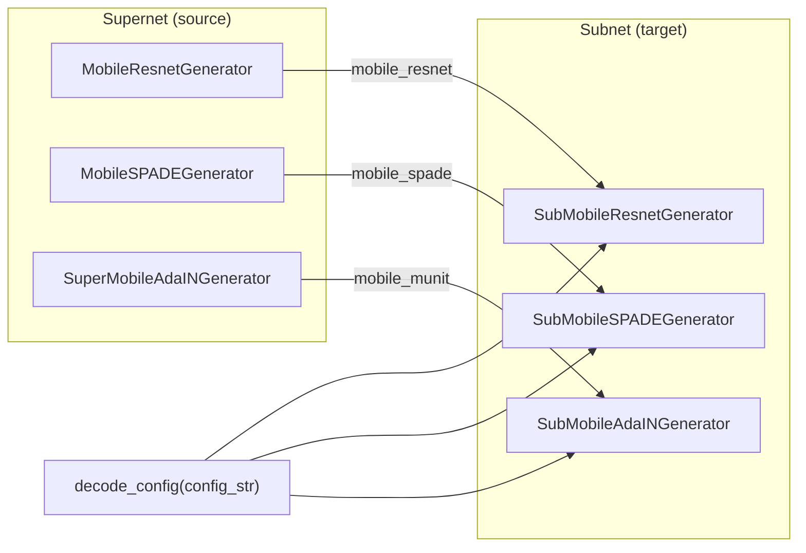
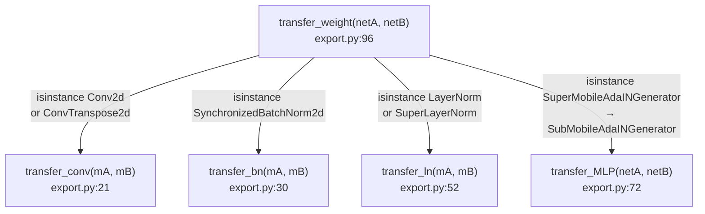

<!-- source: DeepWiki mcp.deepwiki.com · repo mit-han-lab/gan-compression · page 3.5 Exporting Compressed Models · fetched 2026-10-30 -->

# Exporting Compressed Models

<details>
<summary>Relevant source files</summary>

The following files were used as context for generating this wiki page:

- [data/cityscapes_dataset.py](data/cityscapes_dataset.py)
- [export.py](export.py)
- [models/modules/spade_architecture/mobile_spade_generator.py](models/modules/spade_architecture/mobile_spade_generator.py)
- [models/modules/spade_architecture/spade_generator.py](models/modules/spade_architecture/spade_generator.py)
- [models/modules/spade_architecture/super_mobile_spade_generator.py](models/modules/spade_architecture/super_mobile_spade_generator.py)
- [scripts/pix2pix/edges2shoes-r/export.sh](scripts/pix2pix/edges2shoes-r/export.sh)
- [scripts/pix2pix/edges2shoes-r/train_full.sh](scripts/pix2pix/edges2shoes-r/train_full.sh)
- [scripts/pix2pix/edges2shoes-r/train_mobile.sh](scripts/pix2pix/edges2shoes-r/train_mobile.sh)
- [tox.ini](tox.ini)
- [utils/weight_transfer.py](utils/weight_transfer.py)

</details>


## Purpose and Scope

This page documents `export.py`, which performs the final step of extracting a specific compressed subnet from a trained supernet checkpoint. It covers the command-line interface, the weight transfer mechanism, and the per-layer transfer logic for each supported module type.

The export step is preceded by architecture search (see [3.4]()) which produces a `config_str`, and followed by optional fine-tuning and evaluation (see [6.1]()). For the weight transfer utilities used *during* distillation and supernet training (not export), see [3.2]() and [3.3]().

---

## What Export Does

A trained supernet stores weights for all possible channel widths simultaneously. The export step:

1. Loads the trained supernet checkpoint.
2. Instantiates both the supernet model and the target subnet model (with fixed, smaller channel dimensions defined by `config_str`).
3. Copies weights from the supernet into the subnet, layer by layer, by slicing the first `N` channels from each layer tensor.
4. Saves the subnet's `state_dict` to disk.

The result is a standalone `sub_mobile_*` model that can be loaded for inference without the supernet infrastructure.

**Export flow diagram**



Sources: [export.py:114-140]()

---

## Command-Line Interface

`export.py` is invoked directly with `argparse`. All arguments are listed below.

### Required Arguments

| Argument | Type | Description |
|---|---|---|
| `--input_path` | `str` | Path to the supernet checkpoint (`.pth` file). |
| `--output_path` | `str` | Path where the exported subnet will be saved. |
| `--config_str` | `str` | Architecture configuration string encoding per-layer channel counts. |

### Model Selection

| Argument | Default | Choices | Description |
|---|---|---|---|
| `--model` | `mobile_resnet` | `mobile_resnet`, `mobile_spade`, `mobile_munit` | Model family to export. |
| `--ngf` | `48` | — | Base number of filters in the supernet. |

### ResNet / pix2pix / CycleGAN Arguments

| Argument | Default | Description |
|---|---|---|
| `--input_nc` | `3` | Number of input image channels. |
| `--output_nc` | `3` | Number of output image channels. |

### SPADE / GauGAN Arguments

| Argument | Default | Description |
|---|---|---|
| `--no_instance` | flag | Exclude instance map from input. |
| `--contain_dontcare_label` | flag | Label map contains dontcare class (255). |
| `--crop_size` | `512` | Spatial crop size. |
| `--aspect_ratio` | `2.0` | Width/height ratio. |
| `--num_upsampling_layers` | `more` | `normal`, `more`, or `most`. Controls generator depth. |
| `--separable_conv_norm` | `instance` | Norm type for separable conv layers. |

### MUNIT Arguments

| Argument | Default | Description |
|---|---|---|
| `--style_dim` | `8` | Style vector dimension. |
| `--n_downsample` | `2` | Number of downsampling layers in generator. |
| `--n_res` | `4` | Number of ResBlocks. |
| `--activ` | `relu` | Activation function type. |
| `--pad_type` | `reflect` | Padding type. |
| `--mlp_dim` | `256` | MLP hidden dimension for AdaIN. |
| `--no_style_encoder` | flag | Omit style encoder from MUNIT generator. |

Sources: [export.py:143-189]()

---

## Supernet-to-Subnet Model Mapping

The `main()` function instantiates both the supernet and subnet based on `--model`. The supernet is the source of weights; the subnet is the smaller, fixed-architecture target.

**Model class mapping diagram**



> Note: For `mobile_resnet`, the "supernet" loaded is actually a `MobileResnetGenerator` (the mobile student), not a `super_mobile_resnet` supernet. The export uses channel slicing rather than dynamic config routing.

Sources: [export.py:116-135]()

---

## Weight Transfer Logic

The `transfer_weight(netA, netB)` function in `export.py` is the core of the export process. It iterates over all named modules in `netA` (supernet), finds the matching module by name in `netB` (subnet), and calls the appropriate per-type transfer function.

**transfer_weight dispatch diagram**



Sources: [export.py:96-111]()

### Per-Layer Transfer Rules

Each transfer function applies a specific slicing strategy. The key principle is **prefix slicing**: the subnet always takes the first `N` output or input channels from the supernet tensor, where `N` is the subnet's channel count.

#### `transfer_conv` — Conv2d and ConvTranspose2d

Slices the weight tensor `[out_ch, in_ch, kH, kW]` to fit the subnet's declared shape. Bias is sliced along the output channel dimension.

```
mB.weight.data = mA.weight.data[:a, :b, :c, :d]
```

where `a, b, c, d = mB.weight.data.shape`.

Sources: [export.py:21-27]()

#### `transfer_bn` — SynchronizedBatchNorm2d

Performs a **full copy** of all BatchNorm buffers and parameters: `weight`, `bias`, `running_mean`, `running_var`, and `num_batches_tracked`. Both models must have matching shapes (they are set by the subnet's channel count, so this is always the case after correct model instantiation).

Sources: [export.py:30-49]()

#### `transfer_ln` — LayerNorm and SuperLayerNorm

Slices the affine parameters `gamma` and `beta` to the first `c = mB.num_features` elements.

```
mB.gamma.data = mA.gamma.data[:c]
mB.beta.data  = mA.beta.data[:c]
```

Requires `mA.num_features >= mB.num_features`.

Sources: [export.py:52-58]()

#### `transfer_linear` — nn.Linear

Used by `transfer_MLP`. Accepts an optional `indices` list specifying which output features to copy. If `indices` is `None`, copies the first `mB.out_features` rows. Input features are always sliced to `[:ic]`.

Sources: [export.py:61-69]()

#### `transfer_MLP` — AdaIN MLP (MUNIT only)

MUNIT's generator uses a shared MLP that predicts AdaIN scale and shift parameters for all normalization layers. Because the supernet and subnet have different numbers of AdaIN features per layer, `transfer_MLP` builds an `indices` list by walking both networks in tandem, collecting the correct output indices for each AdaIN layer's gamma and beta contribution.

Sources: [export.py:72-93]()

### Comparison: Export Transfer vs. Distillation Transfer

There are two separate weight transfer implementations in the codebase with different purposes.

| Property | `export.py` `transfer_weight` | `utils/weight_transfer.py` `load_pretrained_weight` |
|---|---|---|
| **Used in** | Subnet extraction at export time | Warm-starting supernet from mobile student |
| **Channel selection** | Prefix slice (first N channels) | L1-norm importance ranking (`topk`) |
| **Module matching** | By module name (`named_modules`) | By sequential index in model list |
| **Handles** | Conv2d, ConvTranspose2d, BatchNorm, LayerNorm, Linear | Conv2d, ConvTranspose2d, SeparableConv2d, ResnetBlock, MobileResnetBlock, MobileSPADEResnetBlock |
| **Index propagation** | None (standalone slicing per layer) | Propagates `input_index` through the network graph |

Sources: [export.py:96-111](), [utils/weight_transfer.py:129-145](), [utils/weight_transfer.py:148-193]()

---

## Example Invocations

### pix2pix — edges2shoes-r

```bash
python export.py \
  --input_path logs/pix2pix/edges2shoes-r/finetune/checkpoints/latest_net_G.pth \
  --output_path logs/pix2pix/edges2shoes-r/compressed/latest_net_G.pth \
  --config_str $1
```

Sources: [scripts/pix2pix/edges2shoes-r/export.sh:1-5]()

### GauGAN — Cityscapes (mobile_spade)

```bash
python export.py \
  --model mobile_spade \
  --input_path logs/gaugan/cityscapes/supernet/checkpoints/latest_net_G.pth \
  --output_path logs/gaugan/cityscapes/compressed/latest_net_G.pth \
  --config_str "32 32 32 48 32 24 24 16" \
  --ngf 64 \
  --crop_size 512 \
  --aspect_ratio 2.0
```

### MUNIT

```bash
python export.py \
  --model mobile_munit \
  --input_path logs/munit/horse2zebra/supernet/checkpoints/latest_net_G.pth \
  --output_path logs/munit/horse2zebra/compressed/latest_net_G.pth \
  --config_str "..." \
  --ngf 48
```

---

## Output

After a successful run, `export.py` writes the subnet's `state_dict` (a plain PyTorch `.pth` file) to `--output_path` and prints:

```
Successfully export the subnet at [<output_path>].
```

The resulting file contains only the subnet's parameters and can be loaded with `load_network` in `test.py` or `latency.py` by pairing it with the matching `--config_str` and `--netG sub_mobile_resnet_9blocks` (or equivalent) flag. See [6.1]() for details on loading exported models for evaluation.

Sources: [export.py:137-140]()

---

