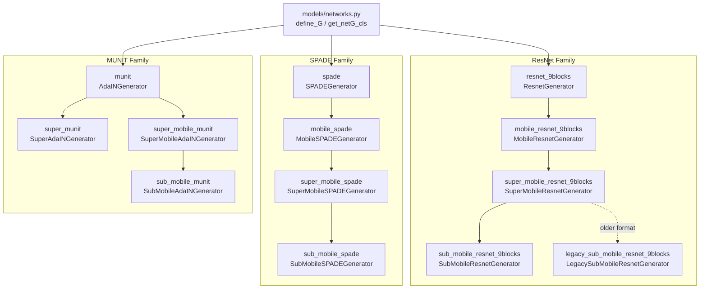
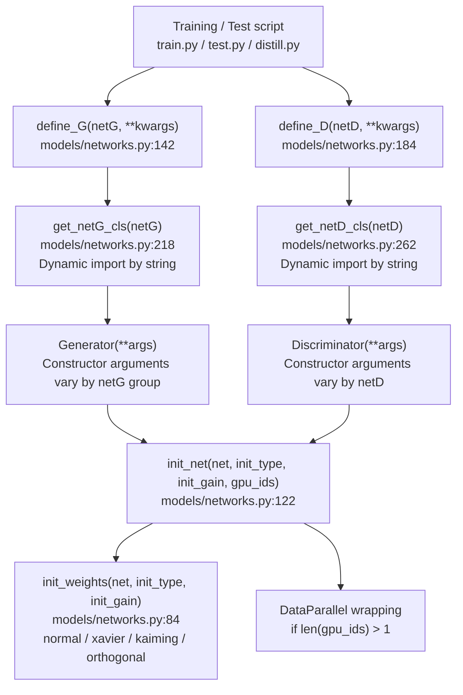

<!-- source: DeepWiki mcp.deepwiki.com · repo mit-han-lab/gan-compression · page 4 Model Architectures · fetched 2026-10-30 -->

# Model Architectures

<details>
<summary>Relevant source files</summary>

The following files were used as context for generating this wiki page:

- [models/modules/resnet_architecture/legacy_sub_mobile_resnet_generator.py](models/modules/resnet_architecture/legacy_sub_mobile_resnet_generator.py)
- [models/networks.py](models/networks.py)
- [scripts/cycle_gan/horse2zebra/latency_legacy.sh](scripts/cycle_gan/horse2zebra/latency_legacy.sh)
- [scripts/cycle_gan/horse2zebra/test_legacy.sh](scripts/cycle_gan/horse2zebra/test_legacy.sh)
- [scripts/gaugan/cityscapes/latency_legacy.sh](scripts/gaugan/cityscapes/latency_legacy.sh)
- [scripts/gaugan/cityscapes/test_legacy.sh](scripts/gaugan/cityscapes/test_legacy.sh)
- [scripts/pix2pix/cityscapes/latency_legacy.sh](scripts/pix2pix/cityscapes/latency_legacy.sh)

</details>


This section documents the neural network architectures defined in the `gan-compression` repository: the generator and discriminator families, the four-tier compression variant pattern applied to each family, and the factory system that instantiates them. 

- For details on the factory functions `define_G` and `define_D`, see [Network Factory](#4.1).
- For the per-tier behavioral differences (full → mobile → super-mobile → sub-mobile), see [Generator Architecture Variants](#4.2).
- For the `SuperConv2d` and related configurable modules used inside supernets, see [Configurable Supernet Modules](#4.3).
- For the SPADE-specific model class and its training logic, see [SPADE Model](#4.4).
- For the `ChannelConfigs` system that parameterizes channel widths across tiers, see [Channel Configuration System](#5).

---

## Overview

The repository supports three generator families, each mapped to up to four compression tiers. All generators are constructed through the `define_G` factory in [models/networks.py](), and all discriminators through `define_D`. The factory performs dynamic class import based on a string identifier (`netG` / `netD`), initializes weights, and moves the network to the requested GPU(s).

---

## Generator Families and Tiers

Each generator family follows the same four-tier progression:

| Tier | Role | Description |
|---|---|---|
| **Full** | Teacher model | Standard architecture, no compression. Used as distillation source. |
| **Mobile** | Student model | Depthwise separable convolutions replace standard convolutions in residual blocks. Width set by `--ngf`. |
| **Super-mobile (Supernet)** | Once-for-all supernet | Weight-shared network with `SuperConv2d` layers; supports any channel configuration at runtime. |
| **Sub-mobile (Subnet)** | Extracted compressed model | A fixed-width subnet extracted from a trained supernet via `export.py`. Channel widths come from `--config_str`. |

### ResNet Family (`pix2pix` / `CycleGAN`)

Used for paired and unpaired image-to-image translation tasks.

| `netG` identifier | Class | Source file |
|---|---|---|
| `resnet_9blocks` | `ResnetGenerator` | `models/modules/resnet_architecture/resnet_generator.py` |
| `mobile_resnet_9blocks` | `MobileResnetGenerator` | `models/modules/resnet_architecture/mobile_resnet_generator.py` |
| `super_mobile_resnet_9blocks` | `SuperMobileResnetGenerator` | `models/modules/resnet_architecture/super_mobile_resnet_generator.py` |
| `sub_mobile_resnet_9blocks` | `SubMobileResnetGenerator` | `models/modules/resnet_architecture/sub_mobile_resnet_generator.py` |
| `legacy_sub_mobile_resnet_9blocks` | `LegacySubMobileResnetGenerator` | `models/modules/resnet_architecture/legacy_sub_mobile_resnet_generator.py` |

The `legacy_sub_mobile_resnet_9blocks` identifier maps to `LegacySubMobileResnetGenerator`, which uses a slightly different channel indexing scheme for config strings. It exists to load older pre-trained compressed checkpoints; see [models/modules/resnet_architecture/legacy_sub_mobile_resnet_generator.py:57-117]().

### SPADE Family (`GauGAN`)

Used for semantic image synthesis from segmentation maps.

| `netG` identifier | Class | Source file |
|---|---|---|
| `spade` | `SPADEGenerator` | `models/modules/spade_architecture/spade_generator.py` |
| `mobile_spade` | `MobileSPADEGenerator` | `models/modules/spade_architecture/mobile_spade_generator.py` |
| `super_mobile_spade` | `SuperMobileSPADEGenerator` | `models/modules/spade_architecture/super_mobile_spade_generator.py` |
| `sub_mobile_spade` | `SubMobileSPADEGenerator` | `models/modules/spade_architecture/sub_mobile_spade_generator.py` |

SPADE generators take an `opt` object rather than explicit `input_nc`/`output_nc`/`ngf` arguments. Sub-mobile SPADE additionally requires `opt.config_str` to be set.

### MUNIT Family

Used for multimodal unsupervised image-to-image translation.

| `netG` identifier | Class | Source file |
|---|---|---|
| `munit` | `AdaINGenerator` | `models/modules/munit_architecture/munit_generator.py` |
| `super_munit` | `SuperAdaINGenerator` | `models/modules/munit_architecture/super_munit_generator.py` |
| `super_mobile_munit` | `SuperMobileAdaINGenerator` | `models/modules/munit_architecture/super_mobile_munit_generator.py` |
| `sub_mobile_munit` | `SubMobileAdaINGenerator` | `models/modules/munit_architecture/sub_mobile_munit_generator.py` |

MUNIT does not have a separate mobile distillation step; compression proceeds directly from a `super_munit` or `super_mobile_munit` supernet.

---

## Discriminator Variants

The discriminator family is smaller and does not follow the compression-tier pattern. All discriminators are defined in `models/modules/discriminators.py`.

| `netD` identifier | Class | Typical use |
|---|---|---|
| `n_layers` | `NLayerDiscriminator` | pix2pix, CycleGAN |
| `pixel` | `PixelDiscriminator` | Pixel-level classification |
| `multi_scale` | `MultiscaleDiscriminator` | SPADE / GauGAN |
| `ms_image` | `MsImageDiscriminator` | MUNIT |

---

## Architecture Family Diagram

**Figure: Generator identifier strings mapped to class names and source files**



Sources: [models/networks.py:218-258]()

---

## Instantiation Flow

**Figure: Control flow through `define_G` and `define_D`**



Sources: [models/networks.py:122-215]()

---

## Constructor Argument Groups

`define_G` dispatches on `netG` to determine which arguments to extract from `**kwargs`. The groupings are:

| Group | `netG` values | Required kwargs |
|---|---|---|
| ResNet (full/mobile/super) | `resnet_9blocks`, `mobile_resnet_9blocks`, `super_mobile_resnet_9blocks` | `input_nc`, `output_nc`, `ngf`, `norm`, `dropout_rate` |
| ResNet (sub/legacy) | `sub_mobile_resnet_9blocks`, `legacy_sub_mobile_resnet_9blocks` | `input_nc`, `output_nc`, `opt` (with `opt.config_str`) |
| SPADE / MUNIT (full/mobile/super) | `spade`, `mobile_spade`, `super_mobile_spade`, `munit`, `super_munit`, `super_mobile_munit` | `opt` |
| SPADE / MUNIT (sub) | `sub_mobile_spade`, `sub_mobile_munit` | `opt` (with `opt.config_str`) |

See [models/networks.py:142-181]() for the full dispatch logic.

---

## Base Classes and Utilities

| Symbol | Location | Role |
|---|---|---|
| `BaseNetwork` | [models/networks.py:15-21]() | Base `nn.Module` subclass; exposes `modify_commandline_options` |
| `Identity` | [models/networks.py:24-26]() | No-op module; used when `norm_type='none'` |
| `get_norm_layer` | [models/networks.py:29-47]() | Returns a partial `BatchNorm2d` or `InstanceNorm2d` constructor |
| `get_scheduler` | [models/networks.py:50-81]() | Returns an LR scheduler; supports `linear`, `step`, `plateau`, `cosine` policies |
| `init_weights` | [models/networks.py:84-119]() | Applies weight initialization to all `Conv`/`Linear`/`BatchNorm2d` submodules |
| `init_net` | [models/networks.py:122-139]() | Moves net to GPU(s), wraps with `DataParallel`, calls `init_weights` |

---

## Directory Layout

All architecture modules live under `models/`:

```
models/
├── networks.py                          # Factory: define_G, define_D
└── modules/
    ├── discriminators.py                # NLayerDiscriminator, PixelDiscriminator,
    │                                    # MultiscaleDiscriminator, MsImageDiscriminator
    ├── mobile_modules.py                # SeparableConv2d
    ├── super_modules.py                 # SuperConv2d, SuperConvTranspose2d, ...
    ├── resnet_architecture/
    │   ├── resnet_generator.py          # ResnetGenerator
    │   ├── mobile_resnet_generator.py   # MobileResnetGenerator
    │   ├── super_mobile_resnet_generator.py  # SuperMobileResnetGenerator
    │   ├── sub_mobile_resnet_generator.py    # SubMobileResnetGenerator
    │   └── legacy_sub_mobile_resnet_generator.py  # LegacySubMobileResnetGenerator
    ├── spade_architecture/
    │   ├── spade_generator.py           # SPADEGenerator
    │   ├── mobile_spade_generator.py    # MobileSPADEGenerator
    │   ├── super_mobile_spade_generator.py  # SuperMobileSPADEGenerator
    │   └── sub_mobile_spade_generator.py    # SubMobileSPADEGenerator
    └── munit_architecture/
        ├── munit_generator.py           # AdaINGenerator
        ├── super_munit_generator.py     # SuperAdaINGenerator
        ├── super_mobile_munit_generator.py  # SuperMobileAdaINGenerator
        └── sub_mobile_munit_generator.py    # SubMobileAdaINGenerator
```

Sources: [models/networks.py:218-276](), [models/modules/resnet_architecture/legacy_sub_mobile_resnet_generator.py:1-10]()

---

