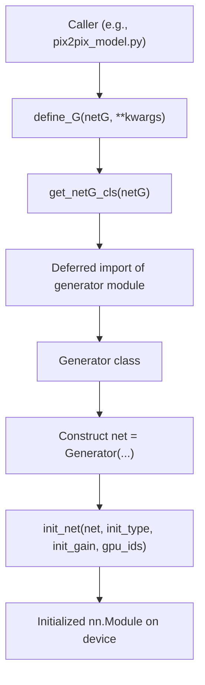
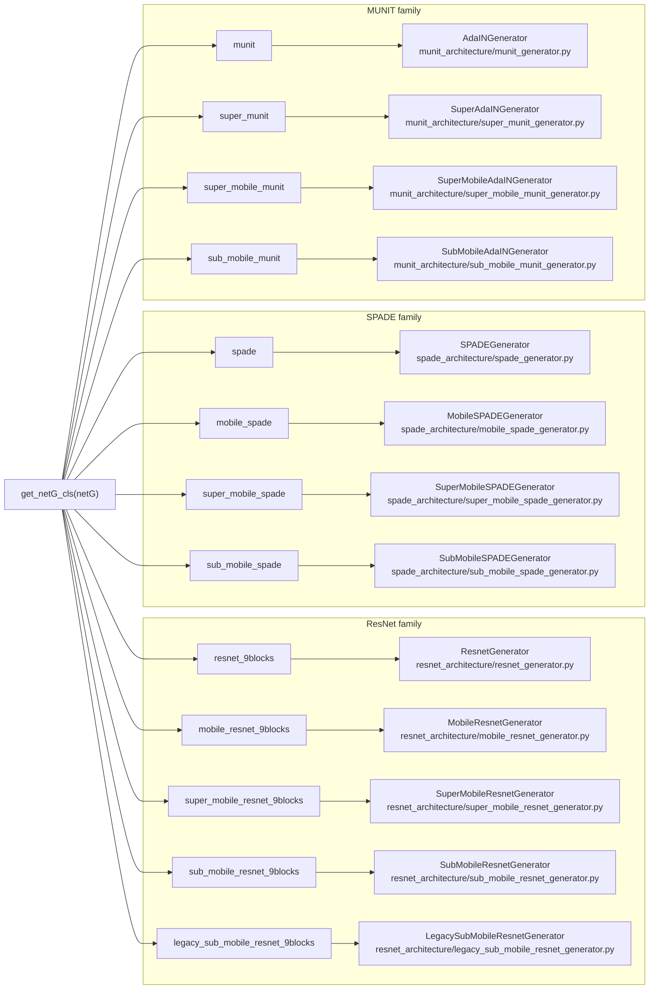
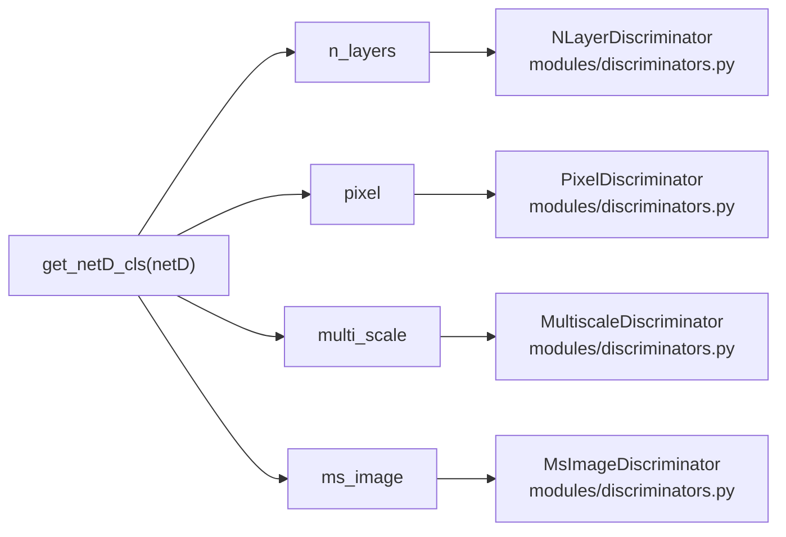

<!-- source: DeepWiki mcp.deepwiki.com · repo mit-han-lab/gan-compression · page 4.1 Network Factory · fetched 2026-10-30 -->

# Network Factory

<details>
<summary>Relevant source files</summary>

The following files were used as context for generating this wiki page:

- [docs/overview.md](docs/overview.md)
- [docs/tutorials/fast_gan_compression.md](docs/tutorials/fast_gan_compression.md)
- [docs/tutorials/gan_compression.md](docs/tutorials/gan_compression.md)
- [models/modules/resnet_architecture/legacy_sub_mobile_resnet_generator.py](models/modules/resnet_architecture/legacy_sub_mobile_resnet_generator.py)
- [models/networks.py](models/networks.py)
- [scripts/cycle_gan/horse2zebra/latency_legacy.sh](scripts/cycle_gan/horse2zebra/latency_legacy.sh)
- [scripts/cycle_gan/horse2zebra/test_legacy.sh](scripts/cycle_gan/horse2zebra/test_legacy.sh)
- [scripts/gaugan/cityscapes/latency_legacy.sh](scripts/gaugan/cityscapes/latency_legacy.sh)
- [scripts/gaugan/cityscapes/test_legacy.sh](scripts/gaugan/cityscapes/test_legacy.sh)
- [scripts/pix2pix/cityscapes/latency_legacy.sh](scripts/pix2pix/cityscapes/latency_legacy.sh)

</details>


This page documents `models/networks.py`, the central factory module responsible for instantiating all generator and discriminator networks used across the entire repository. It covers the two public factory functions (`define_G`, `define_D`), the dynamic class-resolution functions (`get_netG_cls`, `get_netD_cls`), weight initialization utilities (`init_weights`, `init_net`), the normalization layer helper (`get_norm_layer`), and the learning rate scheduler factory (`get_scheduler`).

For information about the internal architecture of each generator variant (full, mobile, super-mobile, sub-mobile), see [Generator Architecture Variants](#4.2). For the supernet-specific modules (`SuperConv2d`, etc.) that the super-mobile generators use internally, see [Configurable Supernet Modules](#4.3). For the channel configuration objects that sub-mobile generators require at construction time, see [Channel Configuration System](#5).

---

## Overview

Every model in the repository—pix2pix, CycleGAN, GauGAN (SPADE), and MUNIT—obtains its generator and discriminator through two factory functions:

- `define_G(netG, **kwargs)` — constructs and initializes a generator
- `define_D(netD, **kwargs)` — constructs and initializes a discriminator

These functions are the sole public interface for network creation. All training scripts, distillers, and supernet trainers go through them rather than importing generator classes directly.

Sources: [models/networks.py:142-215]()

---

## Public Factory Functions

### `define_G`

[models/networks.py:142-181]()

`define_G` accepts a string identifier `netG` and a set of keyword arguments. It delegates class lookup to `get_netG_cls`, applies the appropriate construction signature for that class, then calls `init_net` to handle device placement and weight initialization.

The construction path branches on the value of `netG`:

| `netG` value | Required kwargs | Notes |
|---|---|---|
| `resnet_9blocks` | `input_nc`, `output_nc`, `ngf` | Full ResNet teacher |
| `mobile_resnet_9blocks` | `input_nc`, `output_nc`, `ngf` | MobileNet-style student |
| `super_mobile_resnet_9blocks` | `input_nc`, `output_nc`, `ngf` | Supernet (all widths) |
| `sub_mobile_resnet_9blocks` | `input_nc`, `output_nc`, `opt` | Compressed subnet; requires `opt.config_str` |
| `legacy_sub_mobile_resnet_9blocks` | `input_nc`, `output_nc`, `opt` | Older compressed format; requires `opt.config_str` |
| `spade` | `opt` | Full SPADE teacher |
| `mobile_spade` | `opt` | MobileNet-style SPADE student |
| `super_mobile_spade` | `opt` | SPADE supernet |
| `sub_mobile_spade` | `opt` | Compressed SPADE subnet; requires `opt.config_str` |
| `munit` | `opt` | Full MUNIT teacher |
| `super_munit` | `opt` | MUNIT supernet (original architecture) |
| `super_mobile_munit` | `opt` | Mobile MUNIT supernet |
| `sub_mobile_munit` | `opt` | Compressed MUNIT subnet; requires `opt.config_str` |

For sub-mobile variants, `define_G` calls `decode_config(opt.config_str)` (imported from `configs`) to convert the underscore-delimited channel string (e.g. `"32_32_48_32_48_48_16_16"`) into a `config` dict before passing it to the constructor.

Optional kwargs accepted by all branches:

| kwarg | Default | Purpose |
|---|---|---|
| `init_type` | `'normal'` | Weight initialization method |
| `init_gain` | `0.02` | Scaling factor for initialization |
| `gpu_ids` | `[]` | List of GPU device IDs |
| `dropout_rate` | `0` | Dropout probability (ResNet family) |
| `norm` | `'batch'` | Normalization type (ResNet family) |

Sources: [models/networks.py:142-181]()

---

### `define_D`

[models/networks.py:184-215]()

`define_D` follows the same pattern as `define_G`. It resolves the discriminator class via `get_netD_cls`, constructs it, then calls `init_net`.

| `netD` value | Required kwargs | Class resolved |
|---|---|---|
| `n_layers` | `input_nc`, `ndf` | `NLayerDiscriminator` |
| `pixel` | `input_nc`, `ndf` | `PixelDiscriminator` |
| `multi_scale` | `opt` | `MultiscaleDiscriminator` |
| `ms_image` | `input_nc`, `opt` | `MsImageDiscriminator` |

The `n_layers` discriminator also accepts an optional `n_layers_D` kwarg (default `3`) and `norm` (default `'batch'`).

Sources: [models/networks.py:184-215]()

---

## Dynamic Class Resolution

Because there are many generator and discriminator classes spread across sub-packages, `get_netG_cls` and `get_netD_cls` use **deferred imports**: the relevant module is only imported when the specific `netG`/`netD` identifier is requested.

**`define_G` and `define_D` call flow:**



Sources: [models/networks.py:142-181](), [models/networks.py:218-276]()

---

### `get_netG_cls` — Generator Identifier to Class Map

[models/networks.py:218-259]()



Sources: [models/networks.py:218-259]()

---

### `get_netD_cls` — Discriminator Identifier to Class Map

[models/networks.py:262-276]()



Sources: [models/networks.py:262-276]()

---

## Weight Initialization

### `init_weights`

[models/networks.py:84-119]()

`init_weights(net, init_type, init_gain)` traverses all modules in `net` with `net.apply(init_func)`. The inner `init_func` applies initialization to `Conv` and `Linear` layers, and applies a normal distribution to `BatchNorm2d` weight parameters.

| `init_type` | Method applied |
|---|---|
| `normal` | `init.normal_(weight, 0.0, init_gain)` |
| `xavier` | `init.xavier_normal_(weight, gain=init_gain)` |
| `kaiming` | `init.kaiming_normal_(weight, a=0, mode='fan_in')` |
| `orthogonal` | `init.orthogonal_(weight, gain=init_gain)` |

Biases are always zero-initialized. `BatchNorm2d` weights are initialized with `normal(1.0, init_gain)` and biases with `0.0`.

Sources: [models/networks.py:84-119]()

---

### `init_net`

[models/networks.py:122-139]()

`init_net(net, init_type, init_gain, gpu_ids)` wraps `init_weights` and handles device placement:

1. If `gpu_ids` is non-empty, moves `net` to `gpu_ids[0]`.
2. If more than one GPU is specified, wraps `net` in `torch.nn.DataParallel`.
3. Calls `init_weights(net, init_type, init_gain)`.
4. Returns the initialized network.

Sources: [models/networks.py:122-139]()

---

## Normalization Layer Helper

### `get_norm_layer`

[models/networks.py:29-47]()

Returns a `functools.partial`-wrapped normalization constructor, or a no-op function.

| `norm_type` | Returned layer | Affine | Tracks running stats |
|---|---|---|---|
| `batch` | `nn.BatchNorm2d` | Yes | Yes |
| `instance` | `nn.InstanceNorm2d` | No | No |
| `none` | `Identity` (no-op) | — | — |

The `Identity` class is defined in `models/networks.py` at [models/networks.py:24-25]() and simply passes the input through unchanged.

Sources: [models/networks.py:29-47]()

---

## Learning Rate Scheduler

### `get_scheduler`

[models/networks.py:50-81]()

`get_scheduler(optimizer, opt)` wraps PyTorch's `lr_scheduler` module, keyed on `opt.lr_policy`.

| `opt.lr_policy` | Scheduler | Key options consumed |
|---|---|---|
| `linear` | `LambdaLR` | `opt.nepochs`, `opt.nepochs_decay` |
| `step` | `StepLR` | `opt.lr_decay_steps`, `opt.gamma` |
| `plateau` | `ReduceLROnPlateau` | (hardcoded: factor=0.2, patience=5) |
| `cosine` | `CosineAnnealingLR` | `opt.niter` |

The `last_epoch` seed is derived from `opt.scheduler_counter`:
- If `'epoch'`: `last_epoch = opt.epoch_base - 2`
- Otherwise: `last_epoch = opt.iter_base - 1`

Sources: [models/networks.py:50-81]()

---

## `BaseNetwork`

[models/networks.py:15-21]()

All generator classes in this repository inherit from `BaseNetwork`, which itself inherits from `nn.Module`. It adds one static method:

```
BaseNetwork.modify_commandline_options(parser, is_train) -> parser
```

This hook allows individual generator classes to inject their own command-line options into the argument parser. The top-level `modify_commandline_options` function in `networks.py` [models/networks.py:279-287]() calls `get_netG_cls(opt.netG).modify_commandline_options(parser, is_train)` and, during training, does the same for the discriminator class.

Sources: [models/networks.py:15-21](), [models/networks.py:279-287]()

---

## Full Module Relationship Diagram

The diagram below maps each public function in `models/networks.py` to the code entities it directly depends on or produces.

```mermaid
graph TD
    subgraph "models/networks.py"
        defineG["define_G(netG, **kwargs)"]
        defineD["define_D(netD, **kwargs)"]
        getGcls["get_netG_cls(netG)"]
        getDcls["get_netD_cls(netD)"]
        initNet["init_net(net, init_type, init_gain, gpu_ids)"]
        initWeights["init_weights(net, init_type, init_gain)"]
        getNorm["get_norm_layer(norm_type)"]
        getSched["get_scheduler(optimizer, opt)"]
        modCLI["modify_commandline_options(parser, is_train)"]
        BaseNetwork["BaseNetwork (nn.Module)"]
    end

    defineG --> getGcls
    defineG --> getNorm
    defineG --> initNet
    defineD --> getDcls
    defineD --> getNorm
    defineD --> initNet
    initNet --> initWeights
    modCLI --> getGcls
    modCLI --> getDcls

    getGcls --> ResnetGenerator["ResnetGenerator"]
    getGcls --> MobileResnetGenerator["MobileResnetGenerator"]
    getGcls --> SuperMobileResnetGenerator["SuperMobileResnetGenerator"]
    getGcls --> SubMobileResnetGenerator["SubMobileResnetGenerator"]
    getGcls --> LegacySubMobileResnetGenerator["LegacySubMobileResnetGenerator"]
    getGcls --> SPADEGenerator["SPADEGenerator"]
    getGcls --> MobileSPADEGenerator["MobileSPADEGenerator"]
    getGcls --> SuperMobileSPADEGenerator["SuperMobileSPADEGenerator"]
    getGcls --> SubMobileSPADEGenerator["SubMobileSPADEGenerator"]
    getGcls --> AdaINGenerator["AdaINGenerator"]
    getGcls --> SuperAdaINGenerator["SuperAdaINGenerator"]
    getGcls --> SuperMobileAdaINGenerator["SuperMobileAdaINGenerator"]
    getGcls --> SubMobileAdaINGenerator["SubMobileAdaINGenerator"]

    getDcls --> NLayerDiscriminator["NLayerDiscriminator"]
    getDcls --> PixelDiscriminator["PixelDiscriminator"]
    getDcls --> MultiscaleDiscriminator["MultiscaleDiscriminator"]
    getDcls --> MsImageDiscriminator["MsImageDiscriminator"]

    defineG -- "decode_config(opt.config_str)" --> configs["configs/__init__.py"]
    defineD -- "decode_config(opt.config_str)" --> configs
```



Sources: [models/networks.py:1-288]()

---

