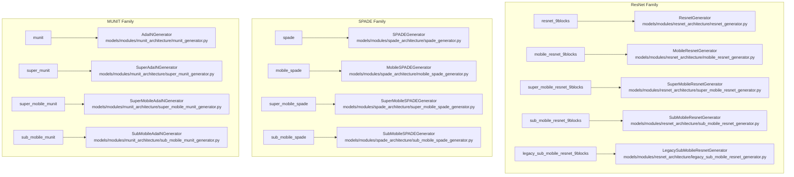
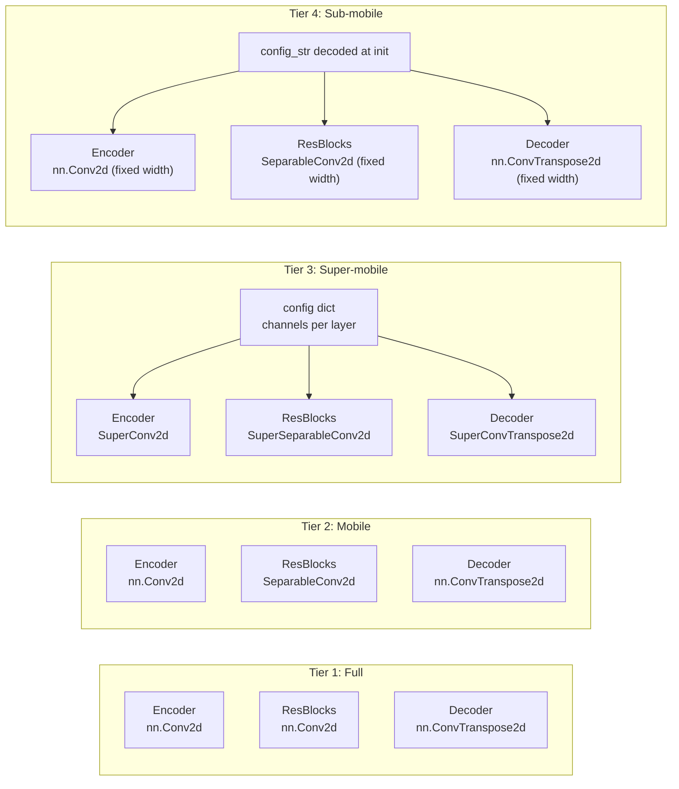
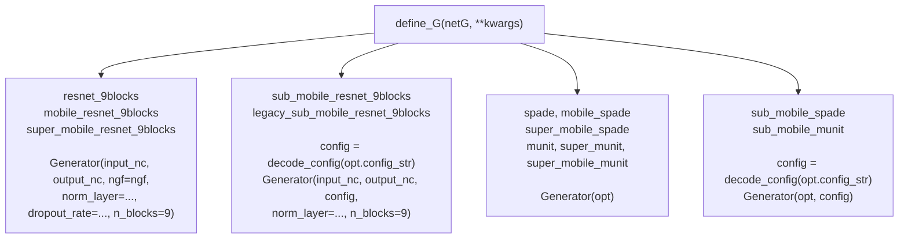

<!-- source: DeepWiki mcp.deepwiki.com · repo mit-han-lab/gan-compression · page 4.2 Generator Architecture Variants · fetched 2026-10-30 -->

# Generator Architecture Variants

<details>
<summary>Relevant source files</summary>

The following files were used as context for generating this wiki page:

- [data/cityscapes_dataset.py](data/cityscapes_dataset.py)
- [distillers/base_spade_distiller.py](distillers/base_spade_distiller.py)
- [distillers/spade_distiller.py](distillers/spade_distiller.py)
- [export.py](export.py)
- [models/modules/resnet_architecture/legacy_sub_mobile_resnet_generator.py](models/modules/resnet_architecture/legacy_sub_mobile_resnet_generator.py)
- [models/modules/spade_architecture/mobile_spade_generator.py](models/modules/spade_architecture/mobile_spade_generator.py)
- [models/modules/spade_architecture/spade_generator.py](models/modules/spade_architecture/spade_generator.py)
- [models/modules/spade_architecture/super_mobile_spade_generator.py](models/modules/spade_architecture/super_mobile_spade_generator.py)
- [models/modules/spade_modules/spade_model_modules.py](models/modules/spade_modules/spade_model_modules.py)
- [models/networks.py](models/networks.py)
- [models/spade_model.py](models/spade_model.py)
- [options/distill_options.py](options/distill_options.py)
- [scripts/cycle_gan/horse2zebra/latency_legacy.sh](scripts/cycle_gan/horse2zebra/latency_legacy.sh)
- [scripts/cycle_gan/horse2zebra/test_legacy.sh](scripts/cycle_gan/horse2zebra/test_legacy.sh)
- [scripts/gaugan/cityscapes/latency_legacy.sh](scripts/gaugan/cityscapes/latency_legacy.sh)
- [scripts/gaugan/cityscapes/test_legacy.sh](scripts/gaugan/cityscapes/test_legacy.sh)
- [scripts/pix2pix/cityscapes/latency_legacy.sh](scripts/pix2pix/cityscapes/latency_legacy.sh)
- [tox.ini](tox.ini)

</details>


This page describes the four-tier generator variant pattern used across all model families in this repository. It covers what distinguishes each tier structurally, which class implements it, and when each is used in the compression pipeline.

For the factory functions that instantiate these generators from string identifiers, see [Network Factory](#4.1). For the `SuperConv2d` and related modules that make the supernet tier work, see [Configurable Supernet Modules](#4.3). For the overall compression pipeline and how the tiers chain together, see [Pipeline Overview](#3.1).

---

## The Four-Tier Pattern

Every model family (ResNet, SPADE, MUNIT) follows the same four-tier progression from a large teacher to a deployable compressed subnet:

| Tier | Role | Channel widths | Config required | Used in |
|---|---|---|---|---|
| **Full** | Teacher / reference | Fixed (`ngf` multiples) | No | Distillation (as teacher) |
| **Mobile** | Pruned student | Fixed (`ngf` multiples) | No | Distillation (as student) |
| **Super-mobile** | Once-for-all supernet | Dynamic (all widths) | Passed per forward | Supernet training, search |
| **Sub-mobile** | Extracted subnet | Fixed (from `config_str`) | Yes, at init time | Export, inference |

An optional **Legacy** variant exists for ResNet only, representing an older compressed format used by some pre-trained checkpoints.

---

## Variant Map: Identifiers and Classes

The `define_G` function in [models/networks.py:142-181]() dispatches on a string identifier (`netG`) to the correct generator class. `get_netG_cls` in [models/networks.py:218-259]() performs the dynamic import.

**Diagram: netG identifier → class → file**



Sources: [models/networks.py:218-259]()

---

## Tier Descriptions

### Tier 1: Full (Teacher)

The full variants — `ResnetGenerator`, `SPADEGenerator`, `AdaINGenerator` — are the uncompressed reference architectures. They use standard `nn.Conv2d` convolutions throughout and serve as teachers during knowledge distillation.

Constructor signatures take `input_nc`, `output_nc`, `ngf`, and other structural hyperparameters. No `config` dict is involved.

**Used in:** `distill.py` (as `--teacher_netG`), and for baseline quality measurement.

Sources: [models/networks.py:142-153](), [models/modules/spade_architecture/spade_generator.py:64-96]()

---

### Tier 2: Mobile (Student)

The mobile variants — `MobileResnetGenerator`, `MobileSPADEGenerator` — replace the standard convolutions inside residual blocks with **depthwise separable convolutions** (`SeparableConv2d`). The encoder/decoder heads and upsampling layers retain standard convolutions. Channel counts are still fixed multiples of `ngf`.

For SPADE, `MobileSPADEGenerator` uses `MobileSPADE` normalization (defined in `models/modules/spade_architecture/normalization.py`), which itself uses separable convolutions in the affine parameter prediction network inside each SPADE layer. See [models/modules/spade_architecture/mobile_spade_generator.py:12-40]() for the `MobileSPADEResnetBlock` definition.

Constructor signatures are the same as the full tier — no config dict.

**Used in:** `distill.py` (as `--student_netG`), and as the starting point for weight transfer into the supernet.

Sources: [models/modules/spade_architecture/mobile_spade_generator.py:70-104]()

---

### Tier 3: Super-Mobile (Supernet)

The super-mobile variants — `SuperMobileResnetGenerator`, `SuperMobileSPADEGenerator`, `SuperMobileAdaINGenerator` — replace all variable-width convolutions with **super modules**: `SuperConv2d`, `SuperConvTranspose2d`, `SuperSeparableConv2d`. These modules accept a `config` dictionary at forward time to slice their weights to a chosen width, enabling a single set of weights to represent all possible sub-architectures simultaneously.

A `config` attribute must be set on the generator object before each `forward` call. For `SuperMobileSPADEGenerator`, the config is threaded through every `SuperMobileSPADEResnetBlock`, which in turn passes it to `SuperMobileSPADE` normalization layers. See [models/modules/spade_architecture/super_mobile_spade_generator.py:110-175]() for how `self.config['channels']` drives the per-block channel selection.

`super_munit` (`SuperAdaINGenerator`) is an intermediate MUNIT variant — a supernet without mobile (separable) convolutions. `super_mobile_munit` adds separable convolutions on top.

**Used in:** `train_supernet.py` (supernet training), `search.py` and `evolution_search.py` (architecture search by evaluating different configs without retraining).

Sources: [models/modules/spade_architecture/super_mobile_spade_generator.py:59-93](), [models/networks.py:166-175]()

---

### Tier 4: Sub-Mobile (Subnet)

The sub-mobile variants — `SubMobileResnetGenerator`, `SubMobileSPADEGenerator`, `SubMobileAdaINGenerator` — are fixed-architecture networks with channel widths baked in at construction time from a decoded `config_str`. Unlike the supernet, no dynamic config dispatch happens during forward; the module dimensions are frozen.

The config string is decoded using `decode_config` from `configs/__init__.py`. In `define_G`, this happens before calling the constructor:

```python
# from models/networks.py:163-165
config = decode_config(opt.config_str)
net = Generator(input_nc, output_nc, config, norm_layer=norm_layer, ...)
```

Weights are populated by `transfer_weight` in `export.py`, which copies sliced weights from the corresponding super-mobile model. See [export.py:96-111]().

**Used in:** `export.py` (weight extraction), `test.py` and `latency.py` (inference and benchmarking), and the interactive demo.

Sources: [models/networks.py:154-165](), [export.py:114-140]()

---

### Legacy Tier (ResNet Only)

`LegacySubMobileResnetGenerator` ([models/modules/resnet_architecture/legacy_sub_mobile_resnet_generator.py:57-117]()) is an older compressed format used by pre-trained checkpoints released before the current export format. It applies a different channel-indexing scheme in its residual blocks compared to `SubMobileResnetGenerator`. It accepts the same `config` dict at construction time.

Invoked via `--netG legacy_sub_mobile_resnet_9blocks`. Example usage is in [scripts/cycle_gan/horse2zebra/latency_legacy.sh]() and [scripts/pix2pix/cityscapes/latency_legacy.sh]().

Sources: [models/modules/resnet_architecture/legacy_sub_mobile_resnet_generator.py:57-117](), [models/networks.py:231-233]()

---

## Structural Differences Across Tiers

**Diagram: Convolution types by tier**



Sources: [models/modules/resnet_architecture/legacy_sub_mobile_resnet_generator.py:9-54](), [models/modules/spade_architecture/mobile_spade_generator.py:12-51](), [models/modules/spade_architecture/super_mobile_spade_generator.py:9-56]()

---

## Constructor Signatures by Tier

The `define_G` factory handles three distinct construction patterns:

**Diagram: Construction paths in define_G**



Sources: [models/networks.py:142-181]()

---

## Pipeline Position of Each Tier

| Stage | Script | Generator used | `--netG` value |
|---|---|---|---|
| Teacher training | `train.py` | Full | `resnet_9blocks` / `spade` / `munit` |
| Student distillation | `distill.py` | Mobile (student) | `mobile_resnet_9blocks` / `mobile_spade` |
| Supernet training | `train_supernet.py` | Super-mobile | `super_mobile_resnet_9blocks` / `super_mobile_spade` / `super_mobile_munit` |
| Architecture search | `search.py` / `evolution_search.py` | Super-mobile (config sampled per eval) | same as supernet |
| Export | `export.py` | Sub-mobile (initialized from config) | set internally |
| Inference / test | `test.py` / `latency.py` | Sub-mobile | `sub_mobile_resnet_9blocks` / `sub_mobile_spade` / `sub_mobile_munit` |
| Legacy inference | `test.py` / `latency.py` | Legacy | `legacy_sub_mobile_resnet_9blocks` |

Sources: [models/networks.py:142-181](), [export.py:114-140](), [models/spade_model.py:23-55]()

---

