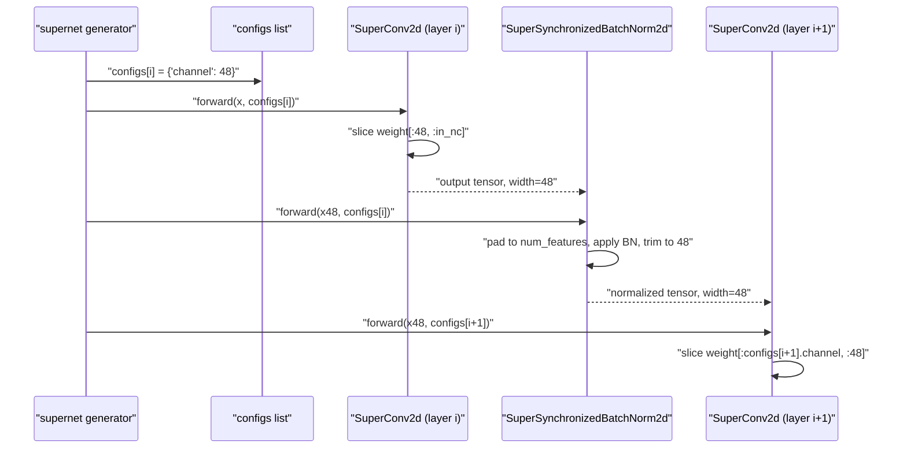
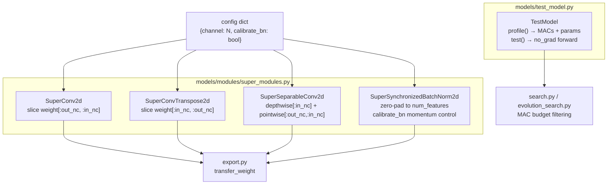

<!-- source: DeepWiki mcp.deepwiki.com · repo mit-han-lab/gan-compression · page 4.3 Configurable Supernet Modules · fetched 2026-10-30 -->

# Configurable Supernet Modules

<details>
<summary>Relevant source files</summary>

The following files were used as context for generating this wiki page:

- [models/modules/mobile_modules.py](models/modules/mobile_modules.py)
- [models/modules/super_modules.py](models/modules/super_modules.py)
- [models/modules/sync_batchnorm/batchnorm_reimpl.py](models/modules/sync_batchnorm/batchnorm_reimpl.py)
- [models/modules/sync_batchnorm/comm.py](models/modules/sync_batchnorm/comm.py)
- [models/modules/sync_batchnorm/replicate.py](models/modules/sync_batchnorm/replicate.py)
- [models/test_model.py](models/test_model.py)
- [scripts/pix2pix/edges2shoes-r/export.sh](scripts/pix2pix/edges2shoes-r/export.sh)
- [utils/weight_transfer.py](utils/weight_transfer.py)

</details>


## Purpose and Scope

This page documents the four "super" module classes defined in [`models/modules/super_modules.py`]() and the `TestModel` class in [`models/test_model.py`](), which together form the low-level building blocks of the once-for-all supernet.

These modules replace their standard PyTorch counterparts inside the supernet generator. Rather than operating at a fixed channel width, they accept a runtime `config` dict that specifies the active channel count, enabling a single set of shared weights to behave as multiple distinct network configurations by slicing the weight tensors at forward time.

For a description of how these modules are assembled into a full supernet generator, see the Generator Architecture Variants page ([4.2](#4.2)). For details on the channel configuration objects that produce the `config` dicts at runtime, see the Channel Configuration System page ([5](#5)).

---

## The `config` Dict Convention

Every super module's `forward()` method accepts an extra `config` argument alongside the input tensor `x`. The `config` is a plain Python dict.

| Key | Type | Used by | Meaning |
|---|---|---|---|
| `'channel'` | `int` | `SuperConv2d`, `SuperConvTranspose2d`, `SuperSeparableConv2d` | Number of output channels to activate |
| `'calibrate_bn'` | `bool` | `SuperSynchronizedBatchNorm2d` | Whether to use momentum=1 for BN running stat accumulation |

The `config` dict is threaded through the entire supernet generator forward pass. The generator stores a list of per-layer configs (typically set via `netG.configs`) and passes the appropriate per-layer dict into each super module.

---

## Module Classes

The following diagram maps each super module to its standard PyTorch base class and indicates which key it reads from `config`.

**Super Module Class Hierarchy**

```mermaid
classDiagram
    direction TB
    class "nn.Conv2d" {
    }
    class "nn.ConvTranspose2d" {
    }
    class "nn.Module" {
    }
    class "SynchronizedBatchNorm2d" {
    }
    class "SuperConv2d" {
        +forward(x, config)
        reads: config["channel"]
    }
    class "SuperConvTranspose2d" {
        +forward(x, config, output_size)
        reads: config["channel"]
    }
    class "SuperSeparableConv2d" {
        +conv: nn.Sequential
        +forward(x, config)
        reads: config["channel"]
    }
    class "SuperSynchronizedBatchNorm2d" {
        +forward(x, config)
        reads: config["calibrate_bn"]
    }
    "nn.Conv2d" <|-- "SuperConv2d"
    "nn.ConvTranspose2d" <|-- "SuperConvTranspose2d"
    "nn.Module" <|-- "SuperSeparableConv2d"
    "SynchronizedBatchNorm2d" <|-- "SuperSynchronizedBatchNorm2d"
```

Sources: [`models/modules/super_modules.py:1-143`]()

---

### `SuperConv2d`

[`models/modules/super_modules.py:9-23`]()

Subclass of `nn.Conv2d`. The full weight tensor is allocated at construction time with the maximum channel count (`out_channels`, `in_channels`). At each forward pass, a slice is taken:

```
weight = self.weight[:out_nc, :in_nc]   # [oc, ic, H, W]
bias   = self.bias[:out_nc]
```

- `in_nc` is read directly from `x.size(1)` — whatever the upstream layer output.
- `out_nc` is `config['channel']`.

This means the module implicitly assumes that the upstream layer has already constrained its output to the correct width. No reallocation occurs; only a tensor view is used.

---

### `SuperConvTranspose2d`

[`models/modules/super_modules.py:26-45`]()

Subclass of `nn.ConvTranspose2d`. The weight tensor layout for transpose convolutions is `[in_channels, out_channels, H, W]`, which is the reverse of `Conv2d`. The slice reflects this:

```
weight = self.weight[:in_nc, :out_nc]   # [ic, oc, H, W]
bias   = self.bias[:out_nc]
```

- `in_nc` comes from `x.size(1)`.
- `out_nc` comes from `config['channel']`.

Output padding calculation is delegated to the inherited `_output_padding()` method before the slice.

---

### `SuperSeparableConv2d`

[`models/modules/super_modules.py:48-85`]()

Implements a width-configurable depthwise-separable convolution. It stores three sub-layers in `self.conv`:

| Index | Type | Role |
|---|---|---|
| `conv[0]` | `nn.Conv2d` (grouped) | Depthwise convolution |
| `conv[1]` | norm layer | Instance norm |
| `conv[2]` | `nn.Conv2d` (1×1) | Pointwise convolution |

The slicing logic handles each stage separately:

1. **Depthwise** (`conv[0]`): weight is `[in_channels, 1, H, W]`, sliced to `[:in_nc]` where `in_nc = x.size(1)`. The `groups` argument is set dynamically to `in_nc` so groups=channels is preserved.
2. **Norm** (`conv[1]`): applied to the full intermediate tensor; the norm layer itself is not sliced.
3. **Pointwise** (`conv[2]`): weight is `[out_channels, in_channels, 1, 1]`, sliced to `[:out_nc, :in_nc]` where `out_nc = config['channel']`.

This is the super-network counterpart to `SeparableConv2d` in [`models/modules/mobile_modules.py`](), which has no `config` argument.

---

### `SuperSynchronizedBatchNorm2d`

[`models/modules/super_modules.py:88-142`]()

Subclass of `SynchronizedBatchNorm2d` from [`models/modules/sync_batchnorm`](). It adds two behaviors:

**1. Variable-width zero-padding**

The full BN layer is allocated for `num_features` channels (the maximum). When the active subnet uses fewer channels (`x.shape[1] < self.num_features`), the input is temporarily padded with zeros to `num_features` before the BN call, and the output is then trimmed back:

```python
padding = torch.zeros([B, num_features - x.shape[1], H, W], device=x.device)
input = torch.cat([input, padding], dim=1)
# ... BN applied to `input` ...
return output[:, :x.shape[1]]
```

This ensures the learned `weight`, `bias`, `running_mean`, and `running_var` buffers (all of length `num_features`) remain consistently indexed regardless of the active channel count.

**2. BN Calibration Mode (`calibrate_bn`)**

When `config['calibrate_bn']` is `True`, the layer uses `momentum = 1` for the batch norm update. This means each forward pass fully replaces `running_mean` and `running_var` with the batch statistics rather than accumulating an exponential moving average. This mode is used during the BN calibration step that follows supernet training, where a fresh set of running statistics must be accumulated for a specific subnet configuration. When `calibrate_bn` is `False` (the default), the standard `self.momentum` value is used.

The default `config` value is `{'calibrate_bn': False}` [line 92]().

---

## How Channel Slicing Works End-to-End

The following diagram shows data flow through a single super-mobile ResNet block during a supernet forward pass.

**Per-Layer Config Flow Through a Super Block**



Sources: [`models/modules/super_modules.py:9-142`]()

---

## Relationship to Standard Mobile Modules

The super modules have direct non-configurable counterparts used in the fixed-width mobile and sub-mobile generators.

| Super Module | Fixed-Width Counterpart | Location |
|---|---|---|
| `SuperConv2d` | `nn.Conv2d` | PyTorch stdlib |
| `SuperConvTranspose2d` | `nn.ConvTranspose2d` | PyTorch stdlib |
| `SuperSeparableConv2d` | `SeparableConv2d` | [`models/modules/mobile_modules.py`]() |
| `SuperSynchronizedBatchNorm2d` | `SynchronizedBatchNorm2d` | [`models/modules/sync_batchnorm/`]() |

When a subnet is exported from the supernet (see page [3.5](#3.5)), the super modules are replaced with their fixed-width counterparts and the weight slices are copied over via the functions in [`utils/weight_transfer.py`]().

---

## `TestModel` and the `profile()` Method

[`models/test_model.py:12-69`]()

`TestModel` is a `BaseModel` subclass intended solely for inference and MAC counting. It is not used during training.

**Key attributes:**

| Member | Purpose |
|---|---|
| `self.netG` | The generator (any variant) loaded from `--restore_G_path` |
| `self.visual_names` | `['real_A', 'fake_B', 'real_B']` |
| `self.model_names` | `['G']` |

**`forward(config=None)`** [lines 35–38]()

Sets `self.netG.configs = config` before calling the generator. This is the mechanism by which a specific subnet configuration is activated inside the supernet.

**`profile(config=None, verbose=True)`** [lines 46–59]()

Measures the computational cost of a specific configuration:

1. Optionally sets `netG.configs = config` to activate a subnet.
2. Calls `torchprofile.profile_macs(netG, (self.real_A[:1],))` on a single-sample batch.
3. Counts total parameters via `p.numel()` over all generator parameters.
4. Returns `(macs, params)` as a tuple of raw integers.

The `profile()` method is called by `search.py` and `evolution_search.py` to filter candidates against a MAC budget before evaluating image quality. See page [3.4](#3.4) for how this fits into the search loop.

**`test(config=None)`** [lines 61–63]()

Wraps `forward()` in `torch.no_grad()`. Used by test scripts to run inference without gradient tracking.

**`TestModel` is read-only.** Both `optimize_parameters()` and `save_networks()` raise `AssertionError` to prevent accidental training use.

---

## Summary: Super Module Responsibilities



Sources: [`models/modules/super_modules.py:1-143`](), [`models/test_model.py:1-69`](), [`utils/weight_transfer.py:1-10`]()

---

