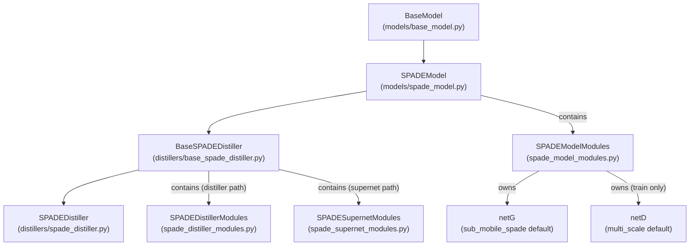
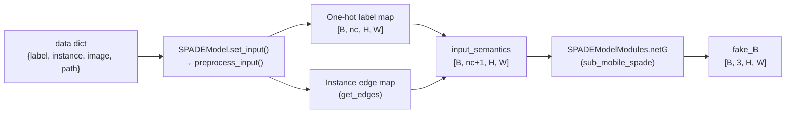
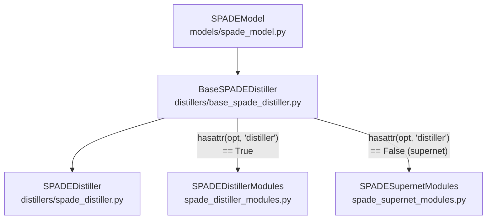

<!-- source: DeepWiki mcp.deepwiki.com · repo mit-han-lab/gan-compression · page 4.4 SPADE Model · fetched 2026-10-30 -->

# SPADE Model

<details>
<summary>Relevant source files</summary>

The following files were used as context for generating this wiki page:

- [distillers/base_resnet_distiller.py](distillers/base_resnet_distiller.py)
- [distillers/base_spade_distiller.py](distillers/base_spade_distiller.py)
- [distillers/resnet_distiller.py](distillers/resnet_distiller.py)
- [distillers/spade_distiller.py](distillers/spade_distiller.py)
- [models/modules/spade_modules/spade_model_modules.py](models/modules/spade_modules/spade_model_modules.py)
- [models/spade_model.py](models/spade_model.py)
- [options/base_options.py](options/base_options.py)
- [options/distill_options.py](options/distill_options.py)
- [supernets/resnet_supernet.py](supernets/resnet_supernet.py)

</details>


This page documents the `SPADEModel` and `SPADEModelModules` classes that implement the GauGAN/SPADE image synthesis pipeline, including the full forward pass, loss computation, optimizer setup, and batch normalization calibration. It also covers `BaseSPADEDistiller` and `SPADEDistiller`, which extend `SPADEModel` for knowledge distillation.

For the four-tier generator architecture variants (full, mobile, super-mobile, sub-mobile), see [Generator Architecture Variants](#4.2). For the supernet-specific training loop that uses the SPADE model family, see [Supernet Training](#3.3). For the distillation loss mechanics in the ResNet family (which share structural patterns with SPADE distillation), see [Knowledge Distillation](#3.2).

---

## Class Hierarchy

**Figure: SPADE model class hierarchy and module relationships**



Sources: [models/spade_model.py:1-90](), [models/modules/spade_modules/spade_model_modules.py:1-37](), [distillers/base_spade_distiller.py:1-70](), [distillers/spade_distiller.py:1-40]()

---

## SPADEModel

`SPADEModel` ([models/spade_model.py:23-281]()) is the top-level training and inference wrapper for the SPADE architecture. It extends `BaseModel` and delegates all network forward/backward operations to a contained `SPADEModelModules` instance.

### Initialization

During `__init__`, `SPADEModel`:

1. Constructs an `SPADEModelModules` instance and moves it to `self.device`.
2. Wraps it in `DataParallelWithCallback` for multi-GPU usage, keeping a direct reference in `self.modules_on_one_gpu` for single-GPU operations that should not be parallelized (such as calibration or profiling).
3. In train mode: calls `modules_on_one_gpu.create_optimizers()` to obtain `optimizer_G` and `optimizer_D`, and conditionally creates `InceptionV3` and `DRNSeg` models for FID and mIoU evaluation.
4. Loads ground-truth statistics from `opt.real_stat_path` into `self.npz` for FID computation.

| Attribute | Type | Purpose |
|---|---|---|
| `self.modules` | `DataParallelWithCallback` | All networks, wrapped for multi-GPU |
| `self.modules_on_one_gpu` | `SPADEModelModules` | Direct reference for single-GPU ops |
| `self.optimizer_G` | `Adam` | Generator optimizer |
| `self.optimizer_D` | `Adam` | Discriminator optimizer |
| `self.inception_model` | `InceptionV3` | For FID evaluation (train mode) |
| `self.drn_model` | `DRNSeg` | For mIoU evaluation on Cityscapes (train mode) |
| `self.npz` | `np.ndarray` | Reference statistics for FID |

Sources: [models/spade_model.py:57-91]()

### Key Options

`SPADEModel.modify_commandline_options` registers the following arguments:

| Argument | Default | Purpose |
|---|---|---|
| `--netG` | `sub_mobile_spade` | Generator architecture |
| `--norm_G` | `spadesyncbatch3x3` | Normalization type for generator |
| `--num_upsampling_layers` | `more` | Controls number of upsampling stages |
| `--separable_conv_norm` | `instance` | Norm for separable convolutions |
| `--lambda_gan` | `1` | Weight for GAN loss |
| `--lambda_feat` | `10` | Weight for feature matching loss |
| `--lambda_vgg` | `10` | Weight for VGG perceptual loss |
| `--no_TTUR` | `False` | Disable Two Time-scale Update Rule |
| `--restore_G_path` | required at test | Path to load generator weights |
| `--restore_D_path` | `None` | Path to load discriminator weights |
| `--real_stat_path` | required at train | Path to `.npz` FID reference stats |

Sources: [models/spade_model.py:24-55]()

---

## SPADEModelModules

`SPADEModelModules` ([models/modules/spade_modules/spade_model_modules.py:13-151]()) is an `nn.Module` that owns all network components and loss functions. It is designed to be data-parallelized as a unit.

### Contents

| Attribute | Created with | Purpose |
|---|---|---|
| `self.netG` | `networks.define_G(opt.netG, ...)` | Generator (default: `sub_mobile_spade`) |
| `self.netD` | `networks.define_D(opt.netD, ...)` | Multi-scale discriminator (train only) |
| `self.criterionGAN` | `GANLoss(opt.gan_mode)` | Adversarial loss (hinge by default) |
| `self.criterionFeat` | `nn.L1Loss()` | Feature matching loss |
| `self.criterionVGG` | `VGGLoss()` | VGG perceptual loss |
| `self.config` | `None` | Optional channel config dict for supernet inference |

Sources: [models/modules/spade_modules/spade_model_modules.py:13-36]()

### Forward Dispatch

The `forward` method acts as a dispatcher based on a `mode` string argument:

**Figure: SPADEModelModules.forward() mode dispatch**

```mermaid
flowchart TD
    call["SPADEModelModules.forward(input_semantics, real_B, mode)"]
    generate["mode == 'generate_fake'\n→ netG(input_semantics)\n→ return fake_B"]
    gloss["mode == 'G_loss'\n→ compute_G_loss(input_semantics, real_B)\n→ return losses dict"]
    dloss["mode == 'D_loss'\n→ compute_D_loss(input_semantics, real_B)\n→ return losses dict"]
    calibrate["mode == 'calibrate'\n→ torch.no_grad()\n→ netG(input_semantics)\n(BN stats accumulate)"]

    call --> generate
    call --> gloss
    call --> dloss
    call --> calibrate
```

Sources: [models/modules/spade_modules/spade_model_modules.py:49-66]()

---

## Full Forward Pass

**Figure: Data flow from semantic map to generated image**



Sources: [models/spade_model.py:92-131]()

### `preprocess_input`

[models/spade_model.py:102-123]() performs two transformations on raw dataset entries:

1. **One-hot encoding**: the integer label map `[B, 1, H, W]` is scattered into a float tensor `[B, nc, H, W]` using `scatter_`.
2. **Instance edge map**: if `--no_instance` is not set, `get_edges` computes a boundary map from the instance map and concatenates it along the channel dimension, producing `input_semantics` with shape `[B, nc+1, H, W]`.

### `forward`

[models/spade_model.py:125-131]() routes the call through `self.modules` (multi-GPU) or `self.modules_on_one_gpu` (single-GPU / test mode). If a `config` dict is supplied, it is written to `modules_on_one_gpu.config` before the call, allowing supernet channel selection.

---

## Loss Computation

### Generator Loss (`compute_G_loss`)

[models/modules/spade_modules/spade_model_modules.py:81-97]() combines three components:

| Loss | Formula | Weight |
|---|---|---|
| `loss_G_gan` | `criterionGAN(pred_fake, True, for_discriminator=False)` | `lambda_gan` (default 1) |
| `loss_G_feat` | L1 distance between intermediate discriminator features of fake vs. real, averaged across scales | `lambda_feat` (default 10) |
| `loss_G_vgg` | VGG perceptual distance between `fake_B` and `real_B` | `lambda_vgg` (default 10) |

Total: `loss_G = loss_G_gan + loss_G_feat + loss_G_vgg`

### Discriminator Loss (`compute_D_loss`)

[models/modules/spade_modules/spade_model_modules.py:99-107]():

- `loss_D_fake = criterionGAN(pred_fake, False, for_discriminator=True)`
- `loss_D_real = criterionGAN(pred_real, True, for_discriminator=True)`
- Total: `loss_D = loss_D_fake + loss_D_real`

### Discriminator Input

[models/modules/spade_modules/spade_model_modules.py:109-131](): The `discriminate` helper concatenates `input_semantics` with `fake_B` and with `real_B` along the batch dimension before passing through `netD`, then splits the output via `divide_pred`. This is the standard concatenated-input multi-scale GAN discriminator pattern.

Sources: [models/modules/spade_modules/spade_model_modules.py:81-131]()

---

## Optimizer Setup

`create_optimizers` ([models/modules/spade_modules/spade_model_modules.py:38-47]()) applies the **Two Time-scale Update Rule (TTUR)** by default:

| Setting | G learning rate | D learning rate | `beta1` | `beta2` |
|---|---|---|---|---|
| TTUR (default) | `lr / 2` | `lr * 2` | `0` | `0.9` |
| `--no_TTUR` | `lr` | `lr` | `opt.beta1` | `opt.beta2` |

Both optimizers use `torch.optim.Adam`.

Sources: [models/modules/spade_modules/spade_model_modules.py:38-47]()

---

## optimize_parameters

[models/spade_model.py:165-174]() runs one training step:

1. Freeze discriminator (`set_requires_grad(netD, False)`)
2. Zero `optimizer_G`, call `backward_G()` (mode `'G_loss'`), step `optimizer_G`
3. Unfreeze discriminator
4. Zero `optimizer_D`, call `backward_D()` (mode `'D_loss'`), step `optimizer_D`

`backward_G` and `backward_D` call `self.modules` with their respective modes and average the loss over data-parallel replicas with `.mean()` before calling `.backward()`.

Sources: [models/spade_model.py:149-174]()

---

## evaluate_model

[models/spade_model.py:176-231]() runs the full evaluation loop:

1. Switches `netG` to eval mode and clears the CUDA cache.
2. Iterates `eval_dataloader`, calling `self.test()` (which runs `forward(on_one_gpu=True)`) on each batch.
3. Saves sample visualizations (input label, real image, fake image) for the first 10 batches.
4. Computes **FID** via `get_fid` if `--no_fid` is not set.
5. Computes **Cityscapes mIoU** via `get_cityscapes_mIoU` if the dataroot contains `cityscapes` and `--no_mIoU` is not set.
6. Updates `self.best_fid`, `self.best_mIoU`, and the rolling history lists `self.fids` / `self.mIoUs` (capped at 3 entries each for a moving average).
7. Returns a dict of metric scalars for logging.

Sources: [models/spade_model.py:176-231]()

---

## calibrate

[models/spade_model.py:271-280]() recalibrates the batch normalization statistics of a compressed subnet by running it over the training dataset in training mode (so BN running stats accumulate), while disabling parameter gradients via `calibrate_bn` flag.

```
calibrate(config)
  → netG.train()
  → for each training batch:
      config['calibrate_bn'] = True  (set on first iteration)
      modules_on_one_gpu.config = config
      modules(input_semantics, mode='calibrate')
  → netG.eval()
```

The `calibrate_bn` flag is consumed by the `SuperSynchronizedBatchNorm2d` layer inside `netG`, which uses it to switch between calibration and inference BN behavior. See [Configurable Supernet Modules](#4.3) for details on how that flag works.

Sources: [models/spade_model.py:271-280](), [models/modules/spade_modules/spade_model_modules.py:62-65]()

---

## profile

[models/spade_model.py:141-147]() delegates MAC counting to `SPADEModelModules.profile`, which uses `torchprofile.profile_macs` on `netG`:

```python
macs, params = self.modules_on_one_gpu.profile(self.input_semantics[:1])
```

A single-image slice is used so the MAC count is per-image. The result is printed as `MACs: X.XXXGFLOPs, Params: X.XXXM` when `verbose=True`.

Sources: [models/spade_model.py:141-147](), [models/modules/spade_modules/spade_model_modules.py:68-79]()

---

## BaseSPADEDistiller and SPADEDistiller

These classes extend `SPADEModel` to add teacher-student distillation for the SPADE family.

**Figure: Distiller class structure and module selection**



Sources: [distillers/base_spade_distiller.py:45-70]()

### BaseSPADEDistiller

[distillers/base_spade_distiller.py:17-123]() changes several behaviors relative to `SPADEModel`:

- **`model_names`**: `['G_student', 'G_teacher', 'D']` instead of `['G']`.
- **`visual_names`**: `['labels', 'Tfake_B', 'Sfake_B', 'real_B']` — shows both teacher and student outputs.
- **`loss_names`**: adds `G_distill` and per-layer `G_distill0`, `G_distill1`, ... entries.
- **Modules**: selects `SPADEDistillerModules` (when `opt.distiller` is set) or `SPADESupernetModules` (for supernet training).
- **Forward**: returns two tensors `(Tfake_B, Sfake_B)` from the teacher and student generators.
- Requires `opt.real_stat_path` for FID and conditionally loads `DRNSeg` for mIoU.

Loss weights introduced at this level:

| Argument | Default | Purpose |
|---|---|---|
| `--lambda_distill` | `10` | Weight for intermediate activation distillation |
| `--lambda_feat` | `10` | Feature matching loss weight |
| `--lambda_vgg` | `10` | VGG perceptual loss weight |

Sources: [distillers/base_spade_distiller.py:17-88]()

### SPADEDistiller

[distillers/spade_distiller.py:14-101]() adds:

- `--restore_pretrained_G_path` and `--pretrained_netG` / `--pretrained_ngf` options for initializing the student from a pretrained checkpoint before distillation begins.
- `--pretrained_norm_G` for specifying the pretrained model's norm type.
- `evaluate_model`: runs the student generator evaluation loop, collecting FID and mIoU, with the same rolling-average and best-tracking logic as `SPADEModel.evaluate_model`.

Sources: [distillers/spade_distiller.py:14-101]()

---

## Summary of Key Methods

| Class | Method | File | Purpose |
|---|---|---|---|
| `SPADEModel` | `set_input` | [spade_model.py:92-96]() | Load and preprocess batch |
| `SPADEModel` | `preprocess_input` | [spade_model.py:102-123]() | One-hot encoding + instance edges |
| `SPADEModel` | `forward` | [spade_model.py:125-131]() | Run generator (single- or multi-GPU) |
| `SPADEModel` | `backward_G` | [spade_model.py:149-155]() | G loss, backward pass |
| `SPADEModel` | `backward_D` | [spade_model.py:157-163]() | D loss, backward pass |
| `SPADEModel` | `optimize_parameters` | [spade_model.py:165-174]() | One G+D training step |
| `SPADEModel` | `evaluate_model` | [spade_model.py:176-231]() | FID + mIoU evaluation loop |
| `SPADEModel` | `calibrate` | [spade_model.py:271-280]() | BN recalibration for compressed subnet |
| `SPADEModel` | `profile` | [spade_model.py:141-147]() | MAC + parameter counting |
| `SPADEModelModules` | `create_optimizers` | [spade_model_modules.py:38-47]() | Adam optimizers, optional TTUR |
| `SPADEModelModules` | `forward` | [spade_model_modules.py:49-66]() | Mode-dispatched forward |
| `SPADEModelModules` | `compute_G_loss` | [spade_model_modules.py:81-97]() | GAN + feature match + VGG |
| `SPADEModelModules` | `compute_D_loss` | [spade_model_modules.py:99-107]() | Real/fake discriminator loss |
| `SPADEModelModules` | `discriminate` | [spade_model_modules.py:109-131]() | Concatenated multi-scale discriminator pass |
| `BaseSPADEDistiller` | `forward` | [base_spade_distiller.py:89-95]() | Returns `(Tfake_B, Sfake_B)` |
| `SPADEDistiller` | `evaluate_model` | [spade_distiller.py:43-101]() | Student eval loop with FID/mIoU |

---

