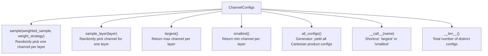
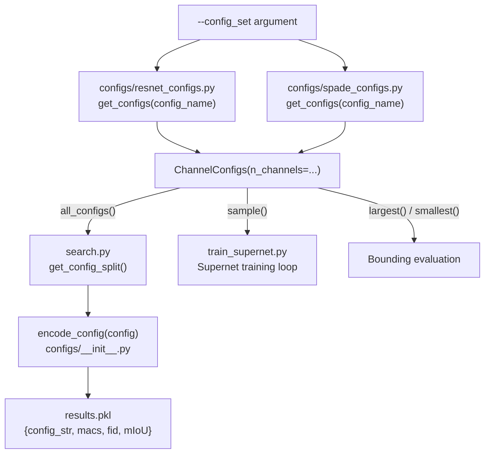
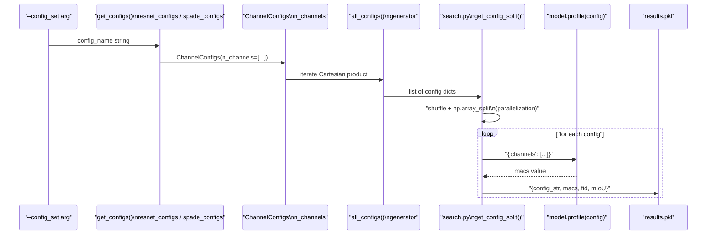

<!-- source: DeepWiki mcp.deepwiki.com · repo mit-han-lab/gan-compression · page 5 Channel Configuration System · fetched 2026-10-30 -->

# Channel Configuration System

<details>
<summary>Relevant source files</summary>

The following files were used as context for generating this wiki page:

- [configs/channel_configs.py](configs/channel_configs.py)
- [configs/resnet_configs.py](configs/resnet_configs.py)
- [configs/spade_configs.py](configs/spade_configs.py)
- [search.py](search.py)
- [select_arch.py](select_arch.py)

</details>


## Purpose and Scope

This page documents the channel configuration system used to define and enumerate the architectural search space for compressed GAN models. Specifically, it covers the `ChannelConfigs` class and the `get_configs()` factory functions in `configs/resnet_configs.py` and `configs/spade_configs.py`.

The channel configuration system sits at the intersection of supernet training and architecture search. It specifies, per layer, the valid set of output channel widths that a supernet may use. During architecture search, these configurations are sampled or enumerated to find the best-performing subnet. For documentation on how supernets are trained using these configs, see the Supernet Training page ([3.3](#3.3)). For how search uses them to find optimal architectures, see Architecture Search ([3.4](#3.4)).

---

## Core Concept: `n_channels`

A `ChannelConfigs` object represents the search space as a list of lists: `n_channels[i]` contains all valid output channel widths for layer `i` of the generator. The full search space is the Cartesian product across all layers.

**Example** (`channels-48` for ResNet):

| Layer Index | Valid Channel Widths |
|-------------|----------------------|
| 0           | `[48, 32]`           |
| 1           | `[48, 32]`           |
| 2           | `[48, 40, 32]`       |
| 3           | `[48, 40, 32]`       |
| 4           | `[48, 40, 32]`       |
| 5           | `[48, 40, 32]`       |
| 6           | `[48, 32, 24, 16]`   |
| 7           | `[48, 32, 24, 16]`   |

The total number of distinct configurations is the product of the number of choices per layer. `__len__` computes this: [configs/channel_configs.py:79-82]()

A single sampled config is a Python dict of the form:

```python
{'channels': [48, 32, 40, 48, 32, 40, 32, 24]}
```

where each element is the selected channel width for the corresponding layer.

Sources: [configs/channel_configs.py:1-82](), [configs/resnet_configs.py:1-27]()

---

## `ChannelConfigs` Class

**File:** `configs/channel_configs.py`

### Constructor

```
ChannelConfigs(n_channels, weights=None)
```

| Parameter    | Type            | Description                                              |
|--------------|-----------------|----------------------------------------------------------|
| `n_channels` | `list[list[int]]` | Per-layer lists of valid channel widths                |
| `weights`    | `optional`      | Reserved field; not currently used by the sampling logic |

Sources: [configs/channel_configs.py:4-8]()

---

### Methods

**Diagram: `ChannelConfigs` Method Map**



Sources: [configs/channel_configs.py:10-80]()

---

#### `sample(weighted_sample=1, weight_strategy='arithmetic')`

Randomly selects one channel width per layer and returns a config dict.

- When `weighted_sample <= 1.0001`: uniform random selection across options.
- When `weighted_sample > 1.0001`: weights are computed to bias sampling. Since `n_channels` lists widths in descending order (largest first), increasing weights favor **smaller** channel counts.

**Weight strategies:**

| Strategy     | Weight Sequence for Layer Options        | Effect                          |
|--------------|------------------------------------------|---------------------------------|
| `arithmetic` | `start, start+1, start+2, …` where `start = (len-1)/(weighted_sample-1)` | Linear bias toward smaller widths |
| `geometric`  | `1, weighted_sample, weighted_sample²,…` | Exponential bias toward smaller widths |

[configs/channel_configs.py:10-31]()

---

#### `largest()` and `smallest()`

Return configs selecting the maximum or minimum channel width at every layer, respectively. Useful for bounding supernet capacity.

[configs/channel_configs.py:36-48]()

---

#### `all_configs()`

A recursive generator that yields every element of the Cartesian product of `n_channels`. This is the primary interface used by brute-force search.

[configs/channel_configs.py:50-61]()

For a config set where each of 8 layers has `k` options, this yields `k^8` configs total.

---

#### `__call__(name)` and `__len__()`

- `__call__('largest')` or `__call__('smallest')` delegates to the corresponding method.
- `__len__()` returns the total number of distinct configurations (product of per-layer option counts).

[configs/channel_configs.py:63-82]()

---

## Factory Functions: `get_configs()`

Both `configs/resnet_configs.py` and `configs/spade_configs.py` expose a `get_configs(config_name)` function that returns a `ChannelConfigs` object for a named configuration set. The `config_name` string is passed via the `--config_set` command-line argument.

**Diagram: Config Factory and Consumer Relationships**



Sources: [configs/resnet_configs.py:1-27](), [configs/spade_configs.py:1-22](), [search.py:67-77]()

---

### ResNet Config Sets (`configs/resnet_configs.py`)

Used with supernets for pix2pix and CycleGAN models.

| Config Name            | Layers | Options per Layer (representative)      | Intended Use              |
|------------------------|--------|-----------------------------------------|---------------------------|
| `channels-48`          | 8      | 2–4 choices, max 48                     | pix2pix / CycleGAN        |
| `channels-32`          | 8      | `[32, 24, 16]` for all layers           | Smaller search space      |
| `channels-64-cycleGAN` | 8      | `[64, 48, 32, 24, 16]` for all layers   | CycleGAN wider supernet   |
| `channels-64-pix2pix`  | 8      | `[64, 56, 48, 40, 32, 24, 16]` per layer | pix2pix wider supernet  |
| `test`                 | 8      | Small values (e.g., `[8]`, `[6, 8]`)   | Unit testing              |

[configs/resnet_configs.py:4-27]()

---

### SPADE Config Sets (`configs/spade_configs.py`)

Used with supernets for GauGAN (SPADE-based) models.

| Config Name       | Layers | Options per Layer (representative)       | Intended Use              |
|-------------------|--------|------------------------------------------|---------------------------|
| `channels-48`     | 8      | `[48, 40, 32]` or `[48, 40, 32, 24]`    | Cityscapes GauGAN         |
| `channels-64`     | 8      | `[64, 48, 40, 32]` or `[64, 48, 40, 32, 24]` | Larger GauGAN supernet |
| `channels-64-coco`| 8      | `[64, 48, 40, 32, 24]` for all layers   | COCO-Stuff GauGAN         |
| `channels-64_2`   | 8      | `[64, 56, 48, 40, 32, 24, 16]` per layer | Widest SPADE search space |

[configs/spade_configs.py:4-22]()

---

## Config Lifecycle: From Definition to Search

The following diagram traces the full path from a named config set to the architecture search results file.

**Diagram: Config Lifecycle**



Sources: [search.py:67-77](), [configs/channel_configs.py:50-61](), [configs/resnet_configs.py:4-27]()

---

## Relationship to `encode_config`

After sampling or iterating, each config dict is serialized to a compact string via `encode_config` (imported from the `configs` package in `search.py`). This string serves as a unique key in the search results pickle file and is also used as the `--config_str` argument when exporting or fine-tuning a specific subnet.

The reverse operation (decoding a `config_str` back to a dict) is used by `export.py` and `test.py` to reconstruct the exact architecture. See the Exporting Compressed Models page ([3.5](#3.5)) for details.

Sources: [search.py:1-14](), [search.py:105-111]()

---

## Summary Reference

| Symbol | File | Role |
|--------|------|------|
| `ChannelConfigs` | `configs/channel_configs.py` | Core class; holds per-layer channel option lists |
| `n_channels` | `configs/channel_configs.py:7` | `list[list[int]]`; the search space definition |
| `sample()` | `configs/channel_configs.py:10` | Draw one random config; supports weighted sampling |
| `largest()` | `configs/channel_configs.py:36` | Config selecting max channels at every layer |
| `smallest()` | `configs/channel_configs.py:43` | Config selecting min channels at every layer |
| `all_configs()` | `configs/channel_configs.py:50` | Generator over full Cartesian product |
| `get_configs()` (ResNet) | `configs/resnet_configs.py:4` | Factory returning `ChannelConfigs` for ResNet supernets |
| `get_configs()` (SPADE) | `configs/spade_configs.py:4` | Factory returning `ChannelConfigs` for SPADE supernets |
| `get_config_split()` | `search.py:67` | Calls `all_configs()`, shuffles, and partitions for parallel search |

---

