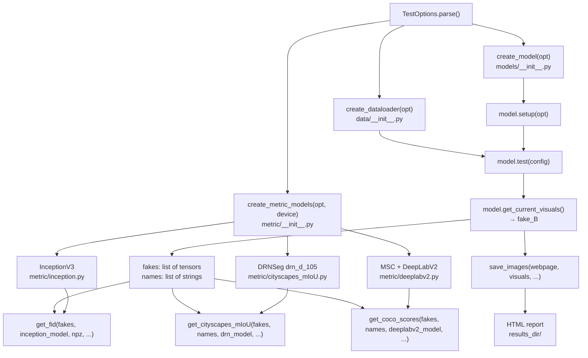
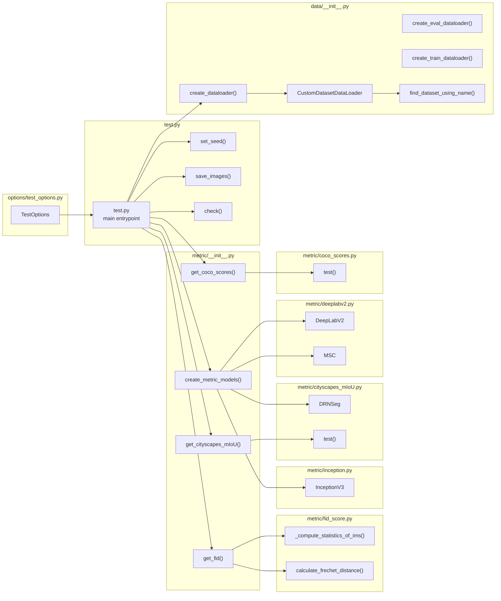

<!-- source: DeepWiki mcp.deepwiki.com · repo mit-han-lab/gan-compression · page 6 Evaluation and Testing · fetched 2026-10-30 -->

# Evaluation and Testing

<details>
<summary>Relevant source files</summary>

The following files were used as context for generating this wiki page:

- [data/__init__.py](data/__init__.py)
- [metric/__init__.py](metric/__init__.py)
- [models/cycle_gan_model.py](models/cycle_gan_model.py)
- [models/pix2pix_model.py](models/pix2pix_model.py)
- [test.py](test.py)

</details>


This section covers the evaluation and testing subsystem of `gan-compression`. It documents how trained or compressed models are run against a dataset to produce output images, and how those outputs are measured using image quality metrics. The scope spans three areas:

- **Inference** (`test.py`): Running a model on a dataset and saving results
- **Metrics** (`metric/`): Computing FID, mIoU, and COCO scores from generated images
- **Data loading** (`data/`): Feeding images to both inference and metric computation

For command-line arguments used during evaluation see [Command-line Options Reference](#7). For the architecture search step that relies on these metrics internally, see [Architecture Search](#3.4). For the interactive Jetson Nano demo, see [Interactive Demo](#8).

---

## System Overview

The evaluation pipeline has three sequential concerns: load data, run inference, compute metrics. These are wired together in `test.py` and also called from within training loops via `evaluate_model` on each model class.

**Diagram: Evaluation Data Flow**



Sources: [test.py:1-136](), [metric/__init__.py:1-71]()

---

## Context in the Compression Pipeline

Evaluation happens at two distinct points in the overall workflow:

| Stage | Where evaluation runs | What triggers it |
|---|---|---|
| During training | `evaluate_model(step)` inside each model class | Called periodically during `train.py` / `distill.py` / `train_supernet.py` |
| During search | `search.py` / `evolution_search.py` | Runs inference on each candidate subnet to obtain FID/mIoU |
| Post-compression | `test.py` (standalone) | User runs manually after `export.py` produces a compressed model |

For the training-internal evaluation path, see `Pix2PixModel.evaluate_model` in [models/pix2pix_model.py:158-211]() and `CycleGANModel.evaluate_model` in [models/cycle_gan_model.py:271-332](). Both follow the same pattern: collect `fake_B` tensors over the eval dataloader, then call `get_fid` and optionally `get_cityscapes_mIoU`.

---

## Component Map

**Diagram: Code Entities in the Evaluation Subsystem**



Sources: [test.py:1-136](), [metric/__init__.py:1-71](), [data/__init__.py:1-124]()

---

## Metric Model Selection Logic

`create_metric_models` in [metric/__init__.py:41-70]() decides which metric models to instantiate based on options:

| Condition | Model instantiated | Metric computed |
|---|---|---|
| `opt.no_fid` is `False` | `InceptionV3` (2048-dim block) | FID via `get_fid` |
| `'cityscapes'` in `opt.dataroot` **and** `direction == 'BtoA'` | `DRNSeg('drn_d_105', 19)` | Cityscapes mIoU via `get_cityscapes_mIoU` |
| `'coco'` in `opt.dataroot` **and** `not opt.no_mIoU` **and** `direction == 'BtoA'` | `MSC(DeepLabV2(n_classes=182, ...))` | COCO pixel accuracy + mIoU via `get_coco_scores` |

All three models are returned as a tuple `(inception_model, drn_model, deeplabv2_model)`. Any model not needed is returned as `None`, and `test.py` checks for `None` before calling the corresponding score function [test.py:117-135]().

---

## Inference Loop

The core loop in `test.py` [test.py:98-112]() iterates over the dataloader and:

1. Calls `model.set_input(data)` to unpack the batch.
2. On the first batch only, calls `model.profile(config)` if `--need_profile` is set.
3. Calls `model.test(config)` to run a forward pass.
4. Appends `visuals['fake_B']` to the `fakes` list.
5. Saves images to HTML for the first `opt.num_test` batches.

The `config` variable is decoded from `opt.config_str` via `decode_config` [test.py:81-86]() when testing a supernet or subnet variant (i.e., when `netG` contains `'super'` or `'sub'`). For full or mobile models, `config` is `None`.

---

## Pre-computed Real Statistics

FID requires a reference distribution from real images. This is stored as a `.npz` file containing `mu` and `sigma` arrays. The path is supplied via `--real_stat_path`. The `.npz` is loaded with `np.load` and passed directly to `get_fid`:

```
npz = np.load(opt.real_stat_path)
fid = get_fid(fakes, inception_model, npz, device, opt.batch_size)
```

[test.py:119-121]()

The `.npz` files are generated separately using `datasets/get_real_stat.py` and can also be downloaded via `datasets/download_real_stat.sh`. See [Downloading Pre-trained Models](#2.3) for the download conventions and [Evaluation Metrics](#6.2) for how `get_real_stat.py` generates these files.

---

## Sub-pages

| Page | Content |
|---|---|
| [Running Tests and Measuring Latency](#6.1) | `test.py` and `latency.py` CLI, loading compressed models, example invocations |
| [Evaluation Metrics](#6.2) | FID, mIoU, COCO scores, `create_metric_models`, `InceptionV3`, `DRNSeg`, `DeepLabV2` |
| [Data Loading](#6.3) | `find_dataset_using_name`, `CustomDatasetDataLoader`, the three dataloader factories |

---

