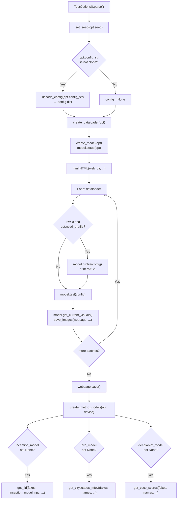
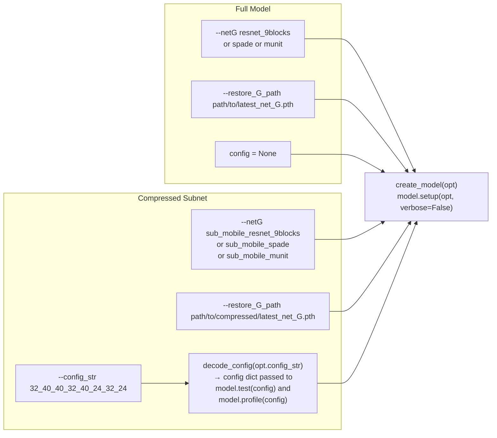
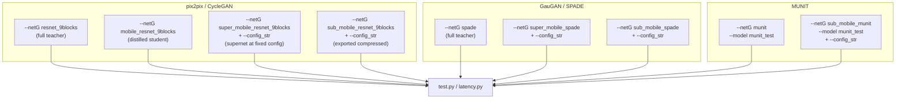

<!-- source: DeepWiki mcp.deepwiki.com · repo mit-han-lab/gan-compression · page 6.1 Running Tests and Measuring Latency · fetched 2026-10-30 -->

# Running Tests and Measuring Latency

<details>
<summary>Relevant source files</summary>

The following files were used as context for generating this wiki page:

- [models/cycle_gan_model.py](models/cycle_gan_model.py)
- [models/pix2pix_model.py](models/pix2pix_model.py)
- [scripts/gaugan/cityscapes/latency_compressed.sh](scripts/gaugan/cityscapes/latency_compressed.sh)
- [scripts/gaugan/cityscapes/test_compressed.sh](scripts/gaugan/cityscapes/test_compressed.sh)
- [scripts/gaugan/coco_fast/test_full.sh](scripts/gaugan/coco_fast/test_full.sh)
- [scripts/munit/edges2shoes-r_fast/test_compressed.sh](scripts/munit/edges2shoes-r_fast/test_compressed.sh)
- [scripts/munit/edges2shoes-r_fast/test_full.sh](scripts/munit/edges2shoes-r_fast/test_full.sh)
- [scripts/pix2pix/cityscapes/test_compressed.sh](scripts/pix2pix/cityscapes/test_compressed.sh)
- [scripts/pix2pix/cityscapes/test_finetune.sh](scripts/pix2pix/cityscapes/test_finetune.sh)
- [scripts/pix2pix/map2sat/latency_compressed.sh](scripts/pix2pix/map2sat/latency_compressed.sh)
- [scripts/pix2pix/map2sat/test_compressed.sh](scripts/pix2pix/map2sat/test_compressed.sh)
- [scripts/pix2pix/map2sat/test_finetune.sh](scripts/pix2pix/map2sat/test_finetune.sh)
- [test.py](test.py)

</details>


This page documents `test.py` and `latency.py`: how to run inference on trained or compressed models, what outputs they produce, how to load a compressed subnet via `--config_str`, and how to trigger MACs profiling via `--need_profile`.

For details on the metric implementations themselves (FID, mIoU, COCO scores), see [Evaluation Metrics](#6.2). For details on downloading pre-trained model weights, see [Downloading Pre-trained Models](#2.3). For details on how compressed models are produced and exported, see [Exporting Compressed Models](#3.5).

---

## Overview

**`test.py`** is the primary inference entrypoint. It:

1. Parses options via `TestOptions`
2. Optionally decodes a `--config_str` for compressed subnet inference
3. Runs the full dataset through the generator
4. Saves generated images to an HTML result page
5. Computes FID, Cityscapes mIoU, and/or COCO mIoU depending on flags

**`latency.py`** shares the same command-line interface as `test.py` but is focused on hardware latency measurement rather than image quality metrics. The shell scripts in `scripts/` show it accepts identical flags.

---

## Execution Flow

**Title: test.py execution flow**



Sources: [test.py:77-135]()

---

## Loading Models: Full vs. Compressed

The key distinction between testing a full model and testing a compressed subnet is the `--config_str` argument together with `--netG`.

**Title: model loading paths in test.py**



The assertion at [test.py:82]() enforces that if `--config_str` is provided, `--netG` must contain `"super"` or `"sub"`. Conversely, if `--config_str` is omitted, the model name must not contain `"super"`.

Sources: [test.py:81-86]()

---

## Command-line Arguments

### Core Arguments

| Argument | Type | Description |
|---|---|---|
| `--dataroot` | `str` | Path to the input dataset directory |
| `--model` | `str` | Model class name (e.g. `spade`, `munit_test`, `pix2pix`) |
| `--netG` | `str` | Generator architecture identifier (see table below) |
| `--ngf` | `int` | Number of base generator filters |
| `--dataset_mode` | `str` | Dataset type (`aligned`, `unaligned`, `single`, `cityscapes`, `coco`) |
| `--direction` | `str` | Translation direction: `AtoB` or `BtoA` |
| `--results_dir` | `str` | Directory where result HTML and images are saved |
| `--num_test` | `int` | Maximum number of images to save (inference still runs on full set for metrics) |
| `--phase` | `str` | Dataset split to use (`test` by default) |

### Model Loading Arguments

| Argument | Type | Description |
|---|---|---|
| `--restore_G_path` | `str` | Path to the generator `.pth` checkpoint |
| `--restore_G_A_path` | `str` | Path to G_A for MUNIT (`--model munit_test`) |
| `--restore_G_B_path` | `str` | Path to G_B for MUNIT style reference |
| `--config_str` | `str` | Underscore-separated channel widths, e.g. `32_40_40_32_40_24_32_24` |

### Metric Arguments

| Argument | Type | Description |
|---|---|---|
| `--real_stat_path` | `str` | Path to `.npz` statistics file for FID computation |
| `--no_fid` | flag | Disable FID computation |
| `--drn_path` | `str` | Path to DRN-D-105 weights for Cityscapes mIoU |
| `--cityscapes_path` | `str` | Path to the Cityscapes dataset for mIoU ground truth |
| `--table_path` | `str` | Path to `val_table.txt` for Cityscapes evaluation |
| `--need_profile` | flag | Print MACs count on the first batch |

Sources: [test.py:64-74](), [scripts/gaugan/cityscapes/test_compressed.sh:1-11](), [scripts/pix2pix/cityscapes/test_compressed.sh:1-11]()

---

## The `--need_profile` Flag

When `--need_profile` is passed, `model.profile(config)` is called once on the first batch [test.py:100-101](). This invokes the `profile()` method on the underlying model (e.g. on a `TestModel`), which counts multiply-accumulate operations (MACs) for the given configuration. See [Configurable Supernet Modules](#4.3) for details on how `profile()` works internally.

This flag is most useful when testing compressed models — it lets you verify the actual MAC count of the selected subnet configuration.

Sources: [test.py:100-101]()

---

## Output Structure

After inference, results are organized as follows:

```
<results_dir>/
  index.html          ← generated by html.HTML, linked visuals
  images/
    fake_B/
      <name>.png
    real_A/
      <name>.png
    real_B/
      <name>.png
```

The HTML is built with `html.HTML` and populated by `save_images()` [test.py:31-61](). Images are converted from tensors using `util.tensor2im()` or `util.tensor2label()` depending on the visual type.

Metric results are printed to stdout:
- `fid score: XX.XX`
- `mIoU: XX.XX`
- `accu: XX.XX    mIoU: XX.XX`

Sources: [test.py:92-135]()

---

## Seed and Determinism

`set_seed()` [test.py:21-27]() sets seeds for `numpy`, `random`, `torch`, `torch.cuda`, and disables `cudnn.benchmark` while enabling `cudnn.deterministic`. The seed is controlled by `--seed` (provided via `TestOptions`). This ensures fully reproducible FID/mIoU results across runs.

Sources: [test.py:21-27]()

---

## Example Invocations

### pix2pix — Compressed (maps → satellite)

```bash
python test.py --dataroot database/maps \
  --results_dir results-pretrained/pix2pix/map2sat/compressed \
  --restore_G_path pretrained/pix2pix/map2sat/compressed/latest_net_G.pth \
  --config_str 32_32_48_32_48_32_16_16 \
  --real_stat_path real_stat/maps_A.npz \
  --direction BtoA \
  --need_profile --num_test 200
```

Sources: [scripts/pix2pix/map2sat/test_compressed.sh:1-9]()

### pix2pix — Fine-tuned Supernet (cityscapes)

```bash
python test.py --dataroot database/cityscapes \
  --results_dir results-pretrained/pix2pix/cityscapes/finetune \
  --ngf 48 --netG super_mobile_resnet_9blocks \
  --config_str 32_32_48_32_32_48_24_24 \
  --restore_G_path logs/pix2pix/cityscapes/finetune/checkpoints/latest_net_G.pth \
  --real_stat_path real_stat/cityscapes_A.npz \
  --drn_path drn-d-105_ms_cityscapes.pth \
  --cityscapes_path database/cityscapes-origin \
  --table_path datasets/val_table.txt \
  --direction BtoA --need_profile
```

Sources: [scripts/pix2pix/cityscapes/test_finetune.sh:1-11]()

### GauGAN (SPADE) — Full model (COCO-Stuff)

```bash
python test.py --dataroot database/coco_stuff \
  --model spade --dataset_mode coco \
  --results_dir results-pretrained/gaugan/coco/full \
  --ngf 64 --netG spade \
  --restore_G_path pretrained/gaugan/coco_fast/full/latest_net_G.pth \
  --real_stat_path real_stat/coco_A.npz --table_path datasets/table.txt \
  --need_profile --num_upsampling_layers normal
```

Sources: [scripts/gaugan/coco_fast/test_full.sh:1-8]()

### GauGAN (SPADE) — Compressed (Cityscapes)

```bash
python test.py --dataroot database/cityscapes-origin \
  --config_str 32_40_40_32_40_24_32_24 \
  --model spade --dataset_mode cityscapes \
  --results_dir results-pretrained/gaugan/cityscapes/compressed \
  --ngf 48 --netG sub_mobile_spade \
  --restore_G_path pretrained/gaugan/cityscapes/compressed/latest_net_G.pth \
  --real_stat_path real_stat/cityscapes_A.npz \
  --drn_path drn-d-105_ms_cityscapes.pth \
  --cityscapes_path database/cityscapes-origin \
  --table_path datasets/val_table.txt --need_profile
```

Sources: [scripts/gaugan/cityscapes/test_compressed.sh:1-11]()

### MUNIT — Full model (edges2shoes-r)

```bash
# Without style reference
python test.py --dataroot database/edges2shoes-r-unaligned/valA \
  --dataset_mode single \
  --results_dir results-pretrained/munit/edges2shoes-r_fast/full/no-style \
  --restore_G_A_path pretrained/munit/edges2shoes-r_fast/full/latest_net_G.pth \
  --need_profile --ngf 64 \
  --real_stat_path real_stat/edges2shoes-r_B.npz \
  --model munit_test --num_test 100 --netG munit
```

Sources: [scripts/munit/edges2shoes-r_fast/test_full.sh:1-9]()

### MUNIT — Compressed (edges2shoes-r)

```bash
python test.py --dataroot database/edges2shoes-r-unaligned/valA \
  --dataset_mode single \
  --results_dir results-pretrained/munit/edges2shoes-r_fast/compressed/no-style \
  --ngf 64 --need_profile \
  --restore_G_A_path pretrained/munit/edges2shoes-r_fast/compressed/latest_net_G.pth \
  --real_stat_path real_stat/edges2shoes-r_B.npz \
  --model munit_test --num_test 100 --netG sub_mobile_munit \
  --config_str 16_16_16_24_56_16_40_40_32_24
```

MUNIT also supports style-reference inference via `--ref_root`, e.g. `--ref_root imgs/edges2shoes/ref1`.

Sources: [scripts/munit/edges2shoes-r_fast/test_compressed.sh:1-10]()

---

## Latency Measurement (`latency.py`)

`latency.py` accepts the same arguments as `test.py`. The shell scripts that invoke it are structurally identical to their `test.py` counterparts.

**Example — pix2pix compressed latency:**

```bash
python latency.py --dataroot database/maps \
  --results_dir results-pretrained/pix2pix/map2sat/compressed \
  --restore_G_path pretrained/pix2pix/map2sat/compressed/latest_net_G.pth \
  --config_str 32_32_48_32_48_32_16_16 \
  --real_stat_path real_stat/maps_A.npz \
  --direction BtoA \
  --need_profile --num_test 200
```

**Example — GauGAN compressed latency:**

```bash
python latency.py --dataroot database/cityscapes-origin \
  --config_str 32_40_40_32_40_24_32_24 \
  --model spade --dataset_mode cityscapes \
  --results_dir results-pretrained/gaugan/cityscapes/compressed \
  --ngf 48 --netG sub_mobile_spade \
  --restore_G_path pretrained/gaugan/cityscapes/compressed/latest_net_G.pth \
  --real_stat_path real_stat/cityscapes_A.npz \
  --drn_path drn-d-105_ms_cityscapes.pth \
  --cityscapes_path database/cityscapes-origin \
  --table_path datasets/val_table.txt --need_profile
```

Sources: [scripts/pix2pix/map2sat/latency_compressed.sh:1-9](), [scripts/gaugan/cityscapes/latency_compressed.sh:1-11]()

---

## Mapping: Model Family → Test Configuration

**Title: netG identifier and model type combinations for test.py**



Sources: [test.py:81-86](), [scripts/pix2pix/map2sat/test_compressed.sh:1-9](), [scripts/pix2pix/map2sat/test_finetune.sh:1-9](), [scripts/gaugan/coco_fast/test_full.sh:1-8](), [scripts/munit/edges2shoes-r_fast/test_full.sh:1-9](), [scripts/munit/edges2shoes-r_fast/test_compressed.sh:1-10]()

---

