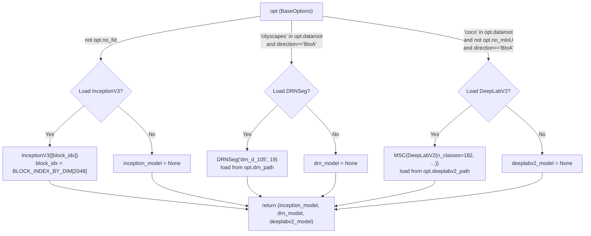
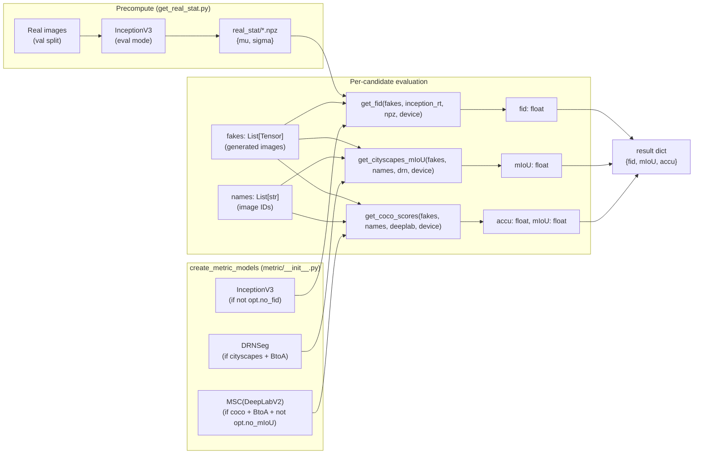
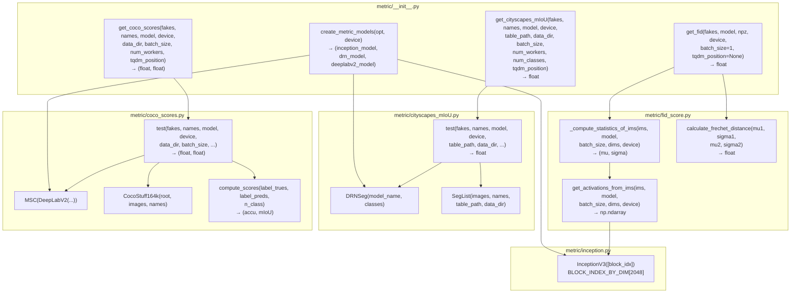

<!-- source: DeepWiki mcp.deepwiki.com · repo mit-han-lab/gan-compression · page 6.2 Evaluation Metrics · fetched 2026-10-30 -->

# Evaluation Metrics

<details>
<summary>Relevant source files</summary>

The following files were used as context for generating this wiki page:

- [data/__init__.py](data/__init__.py)
- [datasets/separate_A_and_B.py](datasets/separate_A_and_B.py)
- [evolution_search.py](evolution_search.py)
- [get_real_stat.py](get_real_stat.py)
- [metric/__init__.py](metric/__init__.py)
- [metric/cityscapes_mIoU.py](metric/cityscapes_mIoU.py)
- [metric/coco_scores.py](metric/coco_scores.py)
- [metric/fid_score.py](metric/fid_score.py)
- [options/evolution_options.py](options/evolution_options.py)

</details>


This page documents the evaluation metrics subsystem used throughout the gan-compression pipeline: how metric models are loaded, how FID, Cityscapes mIoU, and COCO mIoU/accuracy are computed, and how reference statistics files are pre-computed. For documentation on how these metrics integrate with the test runner, see [Running Tests and Measuring Latency](#6.1). For how metrics drive architecture search, see [Brute-force Search](#3.4.1) and [Evolutionary Search](#3.4.2).

---

## Overview

Three quality metrics are supported:

| Metric | Dataset | Model | Output |
|---|---|---|---|
| FID (Fréchet Inception Distance) | All | InceptionV3 | scalar ↓ (lower is better) |
| mIoU | Cityscapes (`BtoA`) | DRN-D-105 (`DRNSeg`) | scalar ↑ |
| Pixel accuracy + mIoU | COCO-Stuff (`BtoA`) | DeepLabV2 + MSC | `(accu, mIoU)` ↑ |

All metric computation is gated by command-line flags and dataset path heuristics. The entry point for loading all models is `create_metric_models` in [metric/__init__.py]().

---

## Metric Model Factory

**`create_metric_models(opt, device)`** is defined in [metric/__init__.py:41-70]() and returns a 3-tuple `(inception_model, drn_model, deeplabv2_model)`. Each element is either a loaded `nn.Module` or `None`.

**Conditional loading logic:**

| Model | Condition | Notes |
|---|---|---|
| `InceptionV3` | `not opt.no_fid` | Always loaded unless `--no_fid` is passed |
| `DRNSeg` | `'cityscapes' in opt.dataroot and opt.direction == 'BtoA'` | Only for Cityscapes label→photo |
| `DeepLabV2` + `MSC` | `'coco' in opt.dataroot and not opt.no_mIoU and opt.direction == 'BtoA'` | Only for COCO label→photo |

Multi-GPU handling: `InceptionV3` and `DeepLabV2` use `nn.DataParallel` when `len(opt.gpu_ids) > 1`. `DRNSeg` uses `nn.DataParallel` when `len(opt.gpu_ids) > 0`.

All models are set to `.eval()` mode after loading.

**Diagram: Metric model factory**



Sources: [metric/__init__.py:41-70]()

---

## FID (Fréchet Inception Distance)

### Concept

FID measures the distributional distance between real and generated images in the feature space of a pre-trained InceptionV3 network. It compares the mean vectors and covariance matrices of the two distributions. Lower FID indicates generated images are closer to real images.

### Pre-computing Real Statistics

Before FID can be computed at search or test time, the statistics (mean `mu` and covariance `sigma`) of the real image distribution must be pre-computed and saved to a `.npz` file. This is done with [get_real_stat.py]().

**Usage:**
```
python get_real_stat.py \
  --dataroot database/horse2zebra \
  --dataset_mode single \
  --direction BtoA \
  --output_path real_stat/horse2zebra_B.npz
```

The script:
1. Loads images via `create_dataloader`
2. Instantiates `InceptionV3([block_idx])` with `block_idx = InceptionV3.BLOCK_INDEX_BY_DIM[2048]`
3. Calls `_compute_statistics_of_ims` from [metric/fid_score.py:325-329]()
4. Saves `mu` and `sigma` as a compressed `.npz` to `--output_path`

The resulting file is later loaded by the search and test scripts via `np.load(opt.real_stat_path)`.

### Runtime FID Computation

**`get_fid(fakes, model, npz, device, batch_size=1, tqdm_position=None)`** defined in [metric/__init__.py:11-17]():

1. Reads `mu` (`m1`) and `sigma` (`s1`) from the pre-loaded `npz` dict.
2. Concatenates `fakes` (a list of CPU tensors) and converts to uint8 numpy via `util.tensor2im`.
3. Calls `_compute_statistics_of_ims` to extract `m2, s2` from the generated images.
4. Returns `calculate_frechet_distance(m1, s1, m2, s2)`.

**`_compute_statistics_of_ims`** ([metric/fid_score.py:325-329]()):
- Calls `get_activations_from_ims` to run images through `InceptionV3` in batches.
- Returns `(np.mean(act, axis=0), np.cov(act, rowvar=False))`.

**`calculate_frechet_distance`** ([metric/fid_score.py:219-284]()):
- Implements: `d² = ||μ₁ - μ₂||² + Tr(Σ₁ + Σ₂ - 2√(Σ₁Σ₂))`
- Uses `scipy.linalg.sqrtm` for the matrix square root.
- Adds numerical stability with iterative epsilon offsets when the result is not finite.

### InceptionV3 Configuration

The `InceptionV3` class (in `metric/inception.py`) supports multiple output blocks. For FID, the 2048-dimensional `pool_3` layer is used:

```python
block_idx = InceptionV3.BLOCK_INDEX_BY_DIM[2048]
inception_model = InceptionV3([block_idx])
```

Sources: [metric/__init__.py:11-17](), [metric/fid_score.py:147-216](), [metric/fid_score.py:219-284](), [metric/fid_score.py:325-329](), [get_real_stat.py]()

---

## Cityscapes mIoU

### Concept

For the Cityscapes `label→photo` (`BtoA`) task, image quality is assessed by running a pre-trained semantic segmentation network on the generated images and comparing predicted segments to ground-truth labels. The metric is mean Intersection over Union (mIoU) across 19 semantic classes.

### Model: DRNSeg

`DRNSeg` is defined in [metric/cityscapes_mIoU.py:124-160](). It wraps a DRN-D-105 backbone with:
- A `nn.Conv2d` segmentation head (`self.seg`) producing 19 class logits.
- A `nn.ConvTranspose2d` upsampling layer (`self.up`) with stride 8 and bilinear-initialized weights.
- `nn.LogSoftmax` output.

The backbone is loaded from `opt.drn_path` via `util.load_network`.

### Data: SegList

`SegList` ([metric/cityscapes_mIoU.py:70-105]()) is a `torch.utils.data.Dataset` that pairs:
- Generated image arrays (passed in-memory)
- Ground-truth label PNGs from the Cityscapes dataset on disk, located via a lookup table at `table_path` (default: `datasets/val_table.txt`)

Preprocessing applies cityscapes-specific normalization:
- Mean: `[0.290, 0.328, 0.287]`
- Std: `[0.183, 0.187, 0.184]`

### Runtime mIoU Computation

**`get_cityscapes_mIoU(fakes, names, model, device, table_path, data_dir, batch_size, num_workers, num_classes, tqdm_position)`** defined in [metric/__init__.py:20-30]():

1. Concatenates `fakes` tensors and converts to uint8 numpy.
2. Delegates to `cityscapes_mIoU.test()`.

**`test()`** ([metric/cityscapes_mIoU.py:196-218]()):
1. Constructs a `SegList` and wraps it in a `DataLoader`.
2. Runs `DRNSeg` on each batch; resizes outputs to `2048×1024` via `resize_4d_tensor`.
3. Accumulates a `(19, 19)` confusion histogram via `fast_hist`.
4. Returns `round(np.nanmean(per_class_iu(hist) * 100), 2)`.

Sources: [metric/__init__.py:20-30](), [metric/cityscapes_mIoU.py:70-218]()

---

## COCO mIoU and Pixel Accuracy

### Concept

For the COCO-Stuff `label→photo` (`BtoA`) task, the metric uses DeepLabV2 with multi-scale context (`MSC`) to run semantic segmentation on generated images and compare against COCO-Stuff 164k ground-truth labels (182 classes). Two values are returned: pixel accuracy and mIoU.

### Model: DeepLabV2 + MSC

Loaded in `create_metric_models` [metric/__init__.py:61-68]():

```python
deeplabv2_model = MSC(
    DeepLabV2(n_classes=182, n_blocks=[3, 4, 23, 3], atrous_rates=[6, 12, 18, 24]),
    scales=[0.5, 0.75]
)
```

Weights are loaded from `opt.deeplabv2_path`.

### Data: CocoStuff164k

`CocoStuff164k` ([metric/coco_scores.py:11-55]()) pairs in-memory generated images with label PNGs read from `{data_dir}/val_label/{name}.png`. Preprocessing applies BGR mean subtraction: `(104.008, 116.669, 122.675)`.

### Runtime Score Computation

**`get_coco_scores(fakes, names, model, device, data_dir, batch_size, num_workers, tqdm_position)`** defined in [metric/__init__.py:33-38]():

1. Concatenates and converts `fakes` to uint8.
2. Delegates to `coco_scores.test()`, returns `(float(accu), float(mIoU))`.

**`test()`** ([metric/coco_scores.py:78-102]()):
1. Builds `CocoStuff164k` and `DataLoader`.
2. Runs `DeepLabV2+MSC`, bilinearly resizes logits to match label size.
3. Applies `F.softmax` + `argmax` to produce predictions.
4. Calls `compute_scores(gts, preds, n_class=182)`.

**`compute_scores()`** ([metric/coco_scores.py:67-75]()):
- Accumulates `(182, 182)` confusion histogram.
- Returns `(accu * 100, mIoU * 100)` where:
  - `accu = np.diag(hist).sum() / hist.sum()`
  - `mIoU = np.nanmean(iu[valid])` (only over classes with support)

Sources: [metric/__init__.py:33-38](), [metric/__init__.py:61-68](), [metric/coco_scores.py]()

---

## How Metrics Integrate with the Pipeline

**Diagram: Metric data flow through the search/test pipeline**



Sources: [metric/__init__.py](), [evolution_search.py:89-173](), [get_real_stat.py]()

---

## Metric Function Signatures Reference

**Diagram: metric module — functions and their dependencies**



Sources: [metric/__init__.py](), [metric/fid_score.py](), [metric/cityscapes_mIoU.py](), [metric/coco_scores.py]()

---

## Option Flags Controlling Metrics

| Flag | Default | Effect |
|---|---|---|
| `--no_fid` | `False` | Skip FID; `inception_model` will be `None` |
| `--no_mIoU` | `False` | Skip COCO mIoU; `deeplabv2_model` will be `None` |
| `--real_stat_path` | `None` | Path to `.npz` file with precomputed `mu`/`sigma` for FID |
| `--drn_path` | — | Path to `DRNSeg` weights |
| `--deeplabv2_path` | — | Path to `DeepLabV2` weights |
| `--cityscapes_path` | — | Root dir for Cityscapes label ground truth |
| `--table_path` | `datasets/val_table.txt` | Lookup table mapping image names to label file paths |

Cityscapes mIoU has no explicit disable flag; it is skipped automatically when `opt.dataroot` does not contain `'cityscapes'` or `opt.direction != 'BtoA'`.

Sources: [metric/__init__.py:41-70](), [options/evolution_options.py:23-26](), [options/evolution_options.py:36-37]()

---

