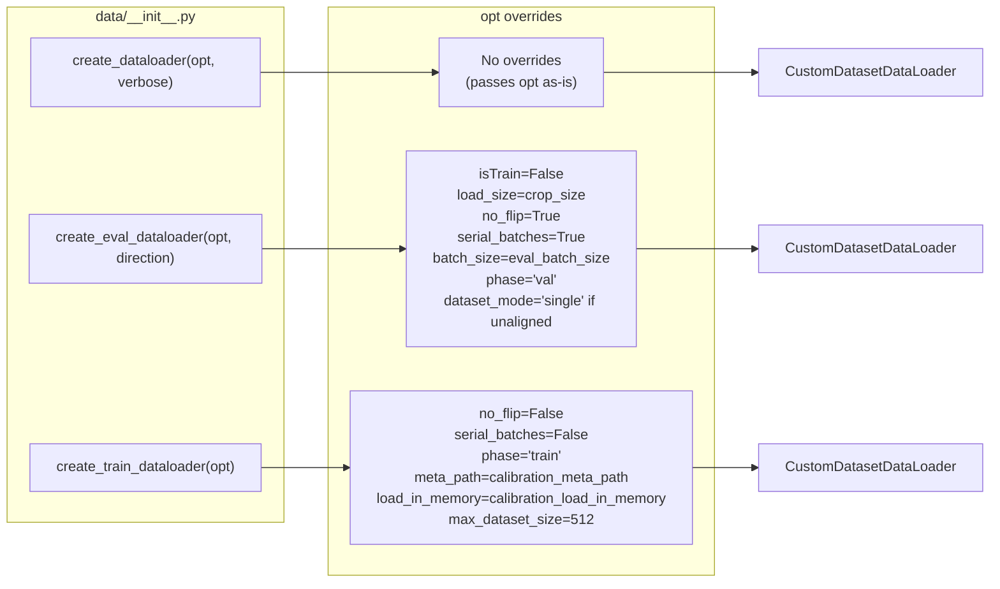
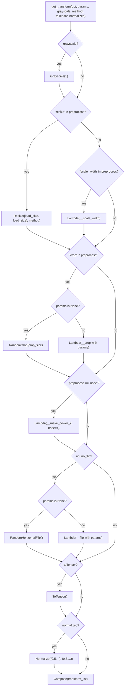
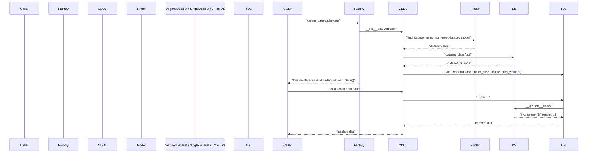

<!-- source: DeepWiki mcp.deepwiki.com · repo mit-han-lab/gan-compression · page 6.3 Data Loading · fetched 2026-10-30 -->

# Data Loading

<details>
<summary>Relevant source files</summary>

The following files were used as context for generating this wiki page:

- [data/__init__.py](data/__init__.py)
- [data/base_dataset.py](data/base_dataset.py)
- [metric/__init__.py](metric/__init__.py)
- [scripts/gaugan/cityscapes/train_supernet.sh](scripts/gaugan/cityscapes/train_supernet.sh)
- [scripts/pix2pix/cityscapes/train_supernet.sh](scripts/pix2pix/cityscapes/train_supernet.sh)

</details>


This page documents the `data` module, which is responsible for dataset discovery, loading, and image preprocessing across all training, evaluation, and calibration workflows. It covers the `find_dataset_using_name` dynamic class resolver, the `CustomDatasetDataLoader` wrapper, the three loader factory functions, and the `BaseDataset` base class together with its transform utilities.

For information about how evaluation metrics consume data, see [Evaluation Metrics](#6.2). For the options that control data loading behavior (`--dataroot`, `--batch_size`, `--num_threads`, `--preprocess`, etc.), see [Command-line Options Reference](#7).

---

## Module Structure

The `data` package is split across two files:

| File | Responsibility |
|---|---|
| `data/__init__.py` | Dataset discovery, loader factories, `CustomDatasetDataLoader` |
| `data/base_dataset.py` | `BaseDataset` ABC, `get_params`, `get_transform` and private image helpers |

---

## Dataset Discovery: `find_dataset_using_name`

**Module map: `find_dataset_using_name`**

```mermaid
flowchart TD
    A["find_dataset_using_name(dataset_name)"]
    B["Construct module path\n\"data.\" + dataset_name + \"_dataset\""]
    C["importlib.import_module(module_path)"]
    D["Scan module __dict__\nfor subclass of BaseDataset\nwhere name.lower() == target_name.lower()"]
    E["Return dataset class"]
    F["Raise NotImplementedError"]

    A --> B --> C --> D
    D -->|"found"| E
    D -->|"not found"| F
```

Sources: [data/__init__.py:11-27]()

`find_dataset_using_name` in `data/__init__.py` resolves a dataset class at runtime without any static registry. Given a `dataset_name` string (e.g., `"aligned"`), it:

1. Constructs the module path `"data.aligned_dataset"`.
2. Imports the module with `importlib.import_module`.
3. Scans all names in the module's `__dict__` looking for a class that:
   - Is a subclass of `BaseDataset`.
   - Has a lowercased name equal to `dataset_name.replace('_', '') + 'dataset'` (e.g., `"aligneddataset"`).
4. Returns the class, or raises `NotImplementedError` if no match is found.

This means adding a new dataset requires only creating `data/<name>_dataset.py` with a class named `<Name>Dataset(BaseDataset)`. No central registry needs to be updated.

---

## `CustomDatasetDataLoader`

`CustomDatasetDataLoader` [data/__init__.py:85-123]() is a thin wrapper that combines a `BaseDataset` instance with a `torch.utils.data.DataLoader`.

**`CustomDatasetDataLoader` internals**

```mermaid
classDiagram
    class CustomDatasetDataLoader {
        +opt
        +dataset : BaseDataset
        +dataloader : torch.utils.data.DataLoader
        +__init__(opt, verbose)
        +load_data() CustomDatasetDataLoader
        +__len__() int
        +__iter__()
        +sample() Tensor
    }

    class BaseDataset {
        <<abstract>>
        +opt
        +root
        +__len__()*
        +__getitem__(index)*
        +modify_commandline_options(parser, is_train)$
    }

    class "torch.utils.data.DataLoader" {
        +batch_size
        +shuffle
        +num_workers
    }

    CustomDatasetDataLoader --> BaseDataset : "dataset"
    CustomDatasetDataLoader --> "torch.utils.data.DataLoader" : "dataloader"
```

Sources: [data/__init__.py:85-123](), [data/base_dataset.py:14-61]()

Key behaviors:

- **Construction** (`__init__`): calls `find_dataset_using_name(opt.dataset_mode)` to get the class, instantiates it, then wraps it in a `DataLoader` with `shuffle=not opt.serial_batches` and `num_workers=opt.num_threads`.
- **`load_data()`**: returns `self`. The factories call this so their callers can use the return value directly as an iterable.
- **`__len__`**: returns the number of *batches* (ceiling division of dataset length by batch size).
- **`__iter__`**: yields batches from the internal `DataLoader`.
- **`sample()`**: picks a random index, returns a single unsqueezed image tensor from key `'A'`. Used during supernet calibration.

---

## Three Loader Factories

Three functions in `data/__init__.py` construct a `CustomDatasetDataLoader` for different use cases. Each performs a `copy.deepcopy(opt)` before modifying options so the caller's `opt` is never mutated.

**Factory comparison**



Sources: [data/__init__.py:36-82]()

| Factory | Primary caller | Notable overrides |
|---|---|---|
| `create_dataloader` | `train.py`, `distill.py`, `test.py` | None — uses raw `opt` |
| `create_eval_dataloader` | Training loops for periodic validation | `phase='val'`, `no_flip=True`, `serial_batches=True`, `load_size=crop_size`; switches `unaligned` → `single` dataset |
| `create_train_dataloader` | Supernet BN calibration | `max_dataset_size=512`, reads `calibration_meta_path`, `calibration_load_in_memory` |

### `create_eval_dataloader` — CycleGAN Special Case

When `opt.dataset_mode == 'unaligned'` (used for CycleGAN), `create_eval_dataloader` switches the dataset mode to `'single'` and sets `opt.dataroot` to a direction-specific subdirectory:

```
opt.dataroot = os.path.join(opt.dataroot, 'val%s' % (direction[0]))
```

For example, with `direction='AtoB'`, this becomes `<dataroot>/valA`. The `direction` argument must be provided for this case. [data/__init__.py:61-64]()

---

## `BaseDataset`

`BaseDataset` [data/base_dataset.py:14-61]() is the abstract base class for all concrete dataset implementations. It inherits from both `torch.utils.data.Dataset` and `abc.ABC`.

**Required interface:**

| Method | Required | Description |
|---|---|---|
| `__init__(self, opt)` | Yes (call super) | Stores `opt` and `opt.dataroot` as `self.root` |
| `__len__` | Yes (abstract) | Total number of samples |
| `__getitem__(index)` | Yes (abstract) | Returns a dict with named tensors |
| `modify_commandline_options(parser, is_train)` | No (static) | Dataset-specific CLI additions |

Concrete dataset files (`data/aligned_dataset.py`, `data/single_dataset.py`, etc.) subclass `BaseDataset` and implement these methods.

---

## Image Preprocessing Utilities

`data/base_dataset.py` provides two utility functions consumed by concrete dataset `__getitem__` implementations.

### `get_params`

[data/base_dataset.py:64-83]()

Computes random spatial transform parameters (crop position and flip decision) for a given image size and `opt`. Called once per image pair so that both the source and target images receive the same random transform.

| `opt.preprocess` value | Effect on `new_h`, `new_w` | Crop dimensions |
|---|---|---|
| `'resize_and_crop'` | Both set to `opt.load_size` (square) | `opt.crop_size` × `opt.crop_size` |
| `'scale_width_and_crop'` | Width set to `opt.load_size`, height scaled proportionally | `opt.crop_size` × scaled height |
| Other | No change | No crop |

Returns a dict: `{'crop_pos': (x, y), 'flip': bool, 'crop_size': (crop_w, crop_h)}`.

### `get_transform`

[data/base_dataset.py:86-116]()

Assembles a `torchvision.transforms.Compose` pipeline from `opt` flags. Can produce either a deterministic transform (when `params` is provided) or a randomized one.

**Transform pipeline construction**



Sources: [data/base_dataset.py:86-116]()

Key parameters:

| Parameter | Type | Default | Description |
|---|---|---|---|
| `opt` | Namespace | — | Provides `preprocess`, `load_size`, `crop_size`, `no_flip` |
| `params` | dict or None | `None` | If provided, uses deterministic crop/flip from `get_params` output |
| `grayscale` | bool | `False` | Prepends a grayscale conversion |
| `method` | PIL resampling | `Image.BICUBIC` | Resampling filter for resize ops |
| `toTensor` | bool | `True` | Appends `ToTensor()` |
| `normalized` | bool | `True` | Appends `Normalize` to `[-1, 1]` range |

The private helpers `__scale_width`, `__crop`, `__flip`, and `__make_power_2` [data/base_dataset.py:119-169]() are used as `Lambda` wrappers within the pipeline and are not part of the public API.

---

## End-to-End Data Flow

**From opt to batch tensor**



Sources: [data/__init__.py:36-124](), [data/base_dataset.py:14-61]()

---

## Summary of Public API

| Symbol | File | Role |
|---|---|---|
| `find_dataset_using_name(dataset_name)` | `data/__init__.py` | Dynamic class resolver via `importlib` |
| `get_option_setter(dataset_name)` | `data/__init__.py` | Returns `modify_commandline_options` static method of dataset class |
| `create_dataloader(opt, verbose)` | `data/__init__.py` | General-purpose loader (used by `train.py`, `test.py`) |
| `create_eval_dataloader(opt, direction)` | `data/__init__.py` | Evaluation loader (deterministic, `phase='val'`) |
| `create_train_dataloader(opt)` | `data/__init__.py` | Calibration loader (max 512 samples, uses `calibration_meta_path`) |
| `CustomDatasetDataLoader` | `data/__init__.py` | Iterable wrapper combining `BaseDataset` + `DataLoader` |
| `BaseDataset` | `data/base_dataset.py` | Abstract base class for all dataset implementations |
| `get_params(opt, size)` | `data/base_dataset.py` | Generates random crop/flip parameters for paired transforms |
| `get_transform(opt, params, ...)` | `data/base_dataset.py` | Builds a `torchvision.transforms.Compose` pipeline |

---

