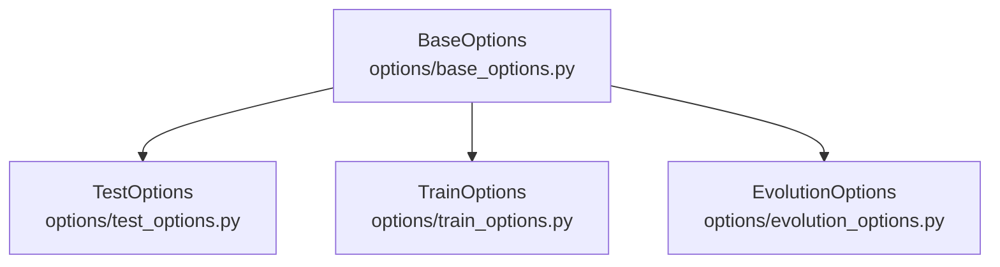
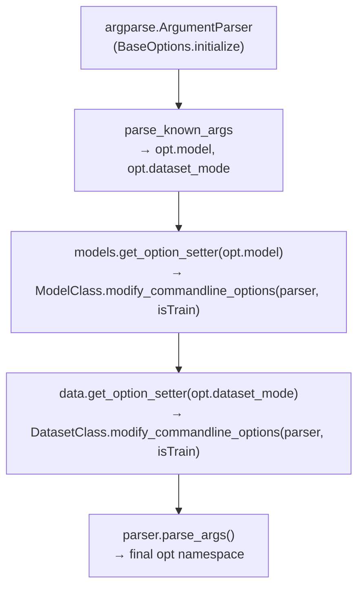
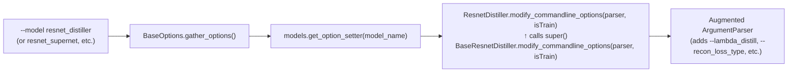

<!-- source: DeepWiki mcp.deepwiki.com · repo mit-han-lab/gan-compression · page 7 Command-line Options Reference · fetched 2026-10-30 -->

# Command-line Options Reference

Relevant source files

The following files were used as context for generating this wiki page:

- [datasets/separate_A_and_B.py](datasets/separate_A_and_B.py)
- [distillers/base_resnet_distiller.py](distillers/base_resnet_distiller.py)
- [distillers/resnet_distiller.py](distillers/resnet_distiller.py)
- [evolution_search.py](evolution_search.py)
- [get_real_stat.py](get_real_stat.py)
- [metric/cityscapes_mIoU.py](metric/cityscapes_mIoU.py)
- [metric/coco_scores.py](metric/coco_scores.py)
- [metric/fid_score.py](metric/fid_score.py)
- [options/base_options.py](options/base_options.py)
- [options/evolution_options.py](options/evolution_options.py)
- [options/test_options.py](options/test_options.py)
- [options/train_options.py](options/train_options.py)
- [supernets/resnet_supernet.py](supernets/resnet_supernet.py)

This page documents every command-line argument accepted by the scripts in this repository, organized by the options class that defines them. It covers `BaseOptions`, `TrainOptions`, `TestOptions`, and `EvolutionOptions`, plus the additional arguments that individual model and distiller classes inject at parse time via `modify_commandline_options`.

For the overall pipeline context in which these arguments are used, see [Pipeline Overview](#3.1). For the architecture search arguments in detail, see [Evolutionary Search](#3.4.2). For information about how models are loaded during testing, see [Running Tests and Measuring Latency](#6.1).

---

## Options Class Hierarchy

All options classes live under `options/` and inherit from `BaseOptions`. Each subclass calls `BaseOptions.initialize()` to register shared arguments before adding its own.

**Options class hierarchy and file locations**

Sources: [options/base_options.py:1-10](), [options/test_options.py:1-10](), [options/train_options.py:1-15](), [options/evolution_options.py:1-15]()

---

## Dynamic Option Injection

`BaseOptions.gather_options` does two rounds of dynamic injection after the initial parse. It calls `models.get_option_setter(model_name)` to retrieve a model class's `modify_commandline_options` static method, then calls `data.get_option_setter(dataset_name)` to do the same for the dataset class. This means the full set of available arguments depends on the value of `--model` and `--dataset_mode`.

**How gather_options builds the final argument namespace**

Sources: [options/base_options.py:87-112]()

---

## BaseOptions

Defined in [options/base_options.py:22-85](). These arguments are available to every script.

### Basic Parameters

| Argument | Type | Default | Description |
|---|---|---|---|
| `--dataroot` | str | *(required)* | Path to image directory (expects subfolders `trainA`, `trainB`, `valA`, `valB`, etc.) |
| `--gpu_ids` | str | `'0'` | Comma-separated GPU IDs. Use `-1` for CPU. |
| `--seed` | int | `233` | Random seed for reproducibility. |

### Model Parameters

| Argument | Type | Default | Description |
|---|---|---|---|
| `--input_nc` | int | `3` | Number of input image channels. |
| `--output_nc` | int | `3` | Number of output image channels. |
| `--norm` | str | `'instance'` | Normalization type: `instance`, `batch`, or `none`. |
| `--init_type` | str | `'normal'` | Weight initialization: `normal`, `xavier`, `kaiming`, `orthogonal`. |
| `--init_gain` | float | `0.02` | Scaling factor for `normal`, `xavier`, and `orthogonal` initializations. |

### Dataset Parameters

| Argument | Type | Default | Description |
|---|---|---|---|
| `--dataset_mode` | str | `'aligned'` | Dataset type: `unaligned`, `aligned`, or `single`. |
| `--direction` | str | `'AtoB'` | Translation direction: `AtoB` or `BtoA`. |
| `--serial_batches` | flag | `False` | Load images in order instead of randomly. |
| `--num_threads` | int | `4` | Worker threads for data loading. |
| `--batch_size` | int | `1` | Input batch size. |
| `--load_size` | int | `286` | Resize images to this size before cropping. |
| `--crop_size` | int | `256` | Crop images to this size. |
| `--aspect_ratio` | float | `1.0` | Width/height ratio. Final height = `crop_size / aspect_ratio`. |
| `--max_dataset_size` | int | `-1` | Maximum number of samples to load. `-1` means unlimited. |
| `--preprocess` | str | `'resize_and_crop'` | Preprocessing pipeline: `resize_and_crop`, `crop`, `scale_width`, `scale_width_and_crop`, `none`. |
| `--no_flip` | flag | `False` | Disable horizontal flip augmentation. |
| `--display_winsize` | int | `256` | Display window size for visdom/HTML. |
| `--load_in_memory` | flag | `False` | Load entire dataset into RAM to skip disk I/O during training. |
| `--phase` | str | `'train'` | Dataset split to use: `train`, `val`, or `test`. |

### Supernet / Config Parameters

| Argument | Type | Default | Description |
|---|---|---|---|
| `--config_set` | str | `None` | Named configuration set used to sample subnet configs during supernet training or search (e.g., `channels-48`). Mutually exclusive with `--config_str`. |
| `--config_str` | str | `None` | Encoded string specifying a single subnet's channel widths. Used during fine-tuning and export. Mutually exclusive with `--config_set`. |

### Evaluation Metric Parameters

| Argument | Type | Default | Description |
|---|---|---|---|
| `--drn_path` | str | `'drn-d-105_ms_cityscapes.pth'` | Path to the pre-trained DRN-D-105 segmentation model for Cityscapes mIoU. |
| `--cityscapes_path` | str | `'database/cityscapes-origin'` | Path to the original Cityscapes dataset (not the pix2pix-preprocessed version). |
| `--table_path` | str | `'datasets/val_table.txt'` | Path to the image-to-label mapping table produced by `datasets/prepare_cityscapes_dataset.py`. |
| `--deeplabv2_path` | str | `'deeplabv2_resnet101_msc-cocostuff164k-100000.pth'` | Path to the pre-trained DeepLabV2 model for COCO-Stuff mIoU/accuracy. |
| `--calibration_load_in_memory` | flag | `False` | Load calibration data into RAM. |
| `--calibration_meta_path` | str | `None` | Path to the SPADE calibration metadata file. |

Sources: [options/base_options.py:22-85]()

---

## TrainOptions

Defined in [options/train_options.py:16-80](). Used by `train.py` and `distill.py`. Inherits all `BaseOptions` arguments.

### Logging Parameters

| Argument | Type | Default | Description |
|---|---|---|---|
| `--log_dir` | str | `'logs'` | Directory where training logs, checkpoints, and `opt.txt` are written. |
| `--tensorboard_dir` | str | `None` | Directory for TensorBoard event files. `None` disables TensorBoard logging. |
| `--print_freq` | int | `100` | Frequency (in iterations) to print training losses to console. |
| `--save_latest_freq` | int | `20000` | Frequency (in iterations) to evaluate and save the latest checkpoint. |
| `--save_epoch_freq` | int | `5` | Frequency (in epochs) to save a numbered checkpoint. |
| `--epoch_base` | int | `1` | Starting epoch number (used when resuming training). |
| `--iter_base` | int | `0` | Starting iteration number (used when resuming training). |

### Model Parameters

| Argument | Type | Default | Description |
|---|---|---|---|
| `--model` | str | `'pix2pix'` | Model class to instantiate (drives `modify_commandline_options` injection). |
| `--netG` | str | `'mobile_resnet_9blocks'` | Generator architecture identifier. |
| `--netD` | str | `'n_layers'` | Discriminator architecture: `n_layers` or `pixel`. |
| `--ngf` | int | `64` | Base number of generator filters. |
| `--ndf` | int | `128` | Base number of discriminator filters. |
| `--n_layers_D` | int | `3` | Number of layers in the discriminator (only for `n_layers` mode). |
| `--dropout_rate` | float | `0` | Generator dropout rate. |
| `--restore_O_path` | str | `None` | Path prefix from which to restore optimizer states (suffixed with `-0.pth`, `-1.pth`, …). |

### Training Hyperparameters

| Argument | Type | Default | Description |
|---|---|---|---|
| `--nepochs` | int | `5` | Number of epochs to train at the initial learning rate. |
| `--nepochs_decay` | int | `15` | Number of additional epochs over which to linearly decay the learning rate to zero. |
| `--niters` | int | `1000000000` | Hard cap on total training iterations regardless of epoch count. |
| `--beta1` | float | `0.5` | β₁ momentum term for Adam optimizers. |
| `--lr` | float | `0.0002` | Initial learning rate. |
| `--gan_mode` | str | `'hinge'` | GAN loss type: `vanilla`, `lsgan`, `wgangp`, or `hinge`. |
| `--pool_size` | int | `50` | Size of the image replay buffer used by the discriminator. |
| `--lr_policy` | str | `'linear'` | Learning rate schedule: `linear`, `step`, `plateau`, or `cosine`. |
| `--lr_decay_steps` | int | `100000` | Decay the LR by `--gamma` every this many iterations (only for `step` policy). |
| `--scheduler_counter` | str | `'epoch'` | Unit used by the LR scheduler: `epoch` or `iter`. |
| `--gamma` | float | `0.5` | Multiplicative LR decay factor for the `step` policy. |

### Evaluation Parameters

| Argument | Type | Default | Description |
|---|---|---|---|
| `--eval_batch_size` | int | `1` | Batch size used during mid-training evaluation. |
| `--no_fid` | flag | `False` | Skip FID computation during training evaluation. |
| `--no_mIoU` | flag | `False` | Skip mIoU computation during training evaluation. |

Sources: [options/train_options.py:16-80]()

---

## TestOptions

Defined in [options/test_options.py:14-33](). Used by `test.py` and `latency.py`. Inherits all `BaseOptions` arguments.

| Argument | Type | Default | Description |
|---|---|---|---|
| `--results_dir` | str | *(required)* | Directory in which to save generated images and metric results. |
| `--need_profile` | flag | `False` | Print MAC and parameter counts for the loaded model. |
| `--num_test` | int | `inf` | Maximum number of test images to process. |
| `--model` | str | `'test'` | Model class to use (`test` invokes the inference-only model). |
| `--netG` | str | `'sub_mobile_resnet_9blocks'` | Generator architecture. Default points to compressed subnet variant. |
| `--ngf` | int | `64` | Base filter count for the generator. |
| `--dropout_rate` | float | `0` | Generator dropout rate. |
| `--no_fid` | flag | `False` | Skip FID computation. |
| `--real_stat_path` | str | `None` | Path to `.npz` file containing pre-computed real image statistics for FID. See [Evaluation Metrics](#6.2). |
| `--no_mIoU` | flag | `False` | Skip mIoU computation. |
| `--times` | int | `100` | Number of forward passes used to average latency (used by `latency.py`). |

**Defaults overridden from `BaseOptions`:**

| Argument | Value |
|---|---|
| `--phase` | `'val'` |
| `--serial_batches` | `True` |
| `--no_flip` | `True` |
| `--load_size` | equals `--crop_size` |
| `--batch_size` | `1` |

Sources: [options/test_options.py:14-33]()

---

## EvolutionOptions

Defined in [options/evolution_options.py:16-71](). Used by `evolution_search.py`. Inherits all `BaseOptions` arguments.

### I/O and Model Parameters

| Argument | Type | Default | Description |
|---|---|---|---|
| `--output_dir` | str | *(required)* | Directory in which to write logs, checkpoints (`.pkl`), and final results. |
| `--model` | str | `'test'` | Model class to instantiate for the supernet. |
| `--netG` | str | `'super_mobile_resnet_9blocks'` | Supernet generator architecture. |
| `--ngf` | int | `48` | Base filter count for the supernet generator. |
| `--dropout_rate` | float | `0` | Generator dropout rate. |
| `--num_test` | int | `inf` | Maximum images to evaluate per candidate. |
| `--real_stat_path` | str | `None` | Path to `.npz` real image statistics for FID. |
| `--budget` | float | `1e18` | MAC budget. Candidate architectures exceeding this are rejected. |

### Metric Flags

| Argument | Type | Default | Description |
|---|---|---|---|
| `--no_fid` | flag | `False` | Disable FID evaluation. |
| `--no_mIoU` | flag | `False` | Disable mIoU evaluation. |
| `--criterion` | str | `'fid'` | Fitness criterion used to rank candidates: `fid`, `mIoU`, or `accu`. |

### Evolution Hyperparameters

| Argument | Type | Default | Description |
|---|---|---|---|
| `--population_size` | int | `100` | Total number of candidates in each generation. |
| `--evolution_iters` | int | `500` | Number of evolution generations to run. |
| `--mutate_prob` | float | `0.2` | Per-layer probability that a channel width is replaced during mutation. |
| `--mutation_ratio` | float | `0.5` | Fraction of the next generation produced by mutation (remainder by crossover). |
| `--parent_ratio` | float | `0.25` | Fraction of the current population retained as parents. |
| `--weighted_sample` | float | `1` | Weight parameter controlling first-generation sampling distribution (see `ChannelConfigs.sample`). |
| `--weight_strategy` | str | `'arithmetic'` | Sampling weight scheme: `arithmetic` or `geometric`. |
| `--max_cache_size` | int | `10000000` | Maximum number of entries in the MAC and result caches. |

### Checkpointing / Resuming

| Argument | Type | Default | Description |
|---|---|---|---|
| `--generation_base` | int | `1` | Starting generation number (for resuming). |
| `--restore_pkl_path` | str | `None` | Path to a `latest_ckpt.pkl` file from which to restore population and caches. |
| `--only_restore_cache` | flag | `False` | When set, restores only the MAC and result caches from the pkl file; re-initializes the population from scratch. |
| `--save_freq` | int | `60` | Minutes between automatic checkpoint saves. |

**Defaults overridden from `BaseOptions`:**

| Argument | Value |
|---|---|
| `--phase` | `'val'` |
| `--serial_batches` | `True` |
| `--no_flip` | `True` |
| `--load_size` | equals `--crop_size` |
| `--load_in_memory` | `True` |

Sources: [options/evolution_options.py:16-71]()

---

## Model-Injected Options

Arguments below are not defined in any `options/` file. They are added to the parser by specific model classes via their `modify_commandline_options` static methods, called automatically by `BaseOptions.gather_options` based on the value of `--model`. See [Knowledge Distillation](#3.2) and [Supernet Training](#3.3) for usage context.

**How model-injected options reach the parser**

Sources: [options/base_options.py:99-102](), [distillers/base_resnet_distiller.py:22-38](), [distillers/resnet_distiller.py:19-29]()

### BaseResnetDistiller Options

Added by `BaseResnetDistiller.modify_commandline_options` in [distillers/base_resnet_distiller.py:22-38](), available whenever `--model` resolves to a ResNet distiller or supernet class.

| Argument | Type | Default | Description |
|---|---|---|---|
| `--recon_loss_type` | str | `'l1'` | Reconstruction loss: `l1`, `l2`, `smooth_l1`, or `vgg`. |
| `--lambda_distill` | float | `1` | Weight applied to the intermediate feature distillation loss. Set to `0` to disable distillation. |
| `--lambda_recon` | float | `100` | Weight applied to the pixel-level reconstruction loss. |
| `--lambda_gan` | float | `1` | Weight applied to the adversarial (GAN) loss. |
| `--teacher_dropout_rate` | float | `0` | Dropout rate for the teacher generator. |
| `--student_dropout_rate` | float | `0` | Dropout rate for the student generator. |

The defaults for `--teacher_netG`, `--teacher_ngf`, `--student_netG`, and `--student_ngf` are also set here:

| Argument | Set Default |
|---|---|
| `--teacher_netG` | `'mobile_resnet_9blocks'` |
| `--teacher_ngf` | `64` |
| `--student_netG` | `'mobile_resnet_9blocks'` |
| `--student_ngf` | `48` |

### ResnetDistiller Options

Added by `ResnetDistiller.modify_commandline_options` in [distillers/resnet_distiller.py:19-29](), layered on top of `BaseResnetDistiller` options:

| Argument | Type | Default | Description |
|---|---|---|---|
| `--restore_pretrained_G_path` | str | `None` | Path to a pre-trained generator whose weights are transferred to the student before distillation begins. |
| `--pretrained_netG` | str | `'mobile_resnet_9blocks'` | Architecture of the pre-trained generator being loaded. Must match the checkpoint. |
| `--pretrained_ngf` | int | `64` | Base filter count of the pre-trained generator. |

### ResnetSupernet Defaults

`ResnetSupernet.modify_commandline_options` in [supernets/resnet_supernet.py:21-26]() does not add new arguments but overrides defaults:

| Argument | Set Default |
|---|---|
| `--norm` | `'instance'` |
| `--student_netG` | `'super_mobile_resnet_9blocks'` |
| `--dataset_mode` | `'aligned'` |
| `--log_dir` | `'logs/supernet'` |

---

## Argument Availability by Script

The following table summarizes which options class each top-level script uses, and which model class injects additional options.

| Script | Options class | Typical `--model` value | Model injects |
|---|---|---|---|
| `train.py` | `TrainOptions` | `pix2pix`, `cycle_gan` | pix2pix / CycleGAN model options |
| `distill.py` | `TrainOptions` | `resnet_distiller` | `BaseResnetDistiller` + `ResnetDistiller` |
| `train_supernet.py` | `TrainOptions` | `resnet_supernet` | `BaseResnetDistiller` + `ResnetSupernet` |
| `test.py` | `TestOptions` | `test` | minimal test model options |
| `latency.py` | `TestOptions` | `test` | minimal test model options |
| `search.py` | `TestOptions` | `test` | minimal test model options |
| `evolution_search.py` | `EvolutionOptions` | `test` | minimal test model options |
| `export.py` | standalone `argparse` | N/A | N/A |
| `select_arch.py` | standalone `argparse` | N/A | N/A |

Sources: [options/base_options.py:87-112](), [options/train_options.py:16-80](), [options/test_options.py:14-33](), [options/evolution_options.py:16-71](), [distillers/base_resnet_distiller.py:22-38](), [distillers/resnet_distiller.py:19-29](), [supernets/resnet_supernet.py:21-26]()

---

