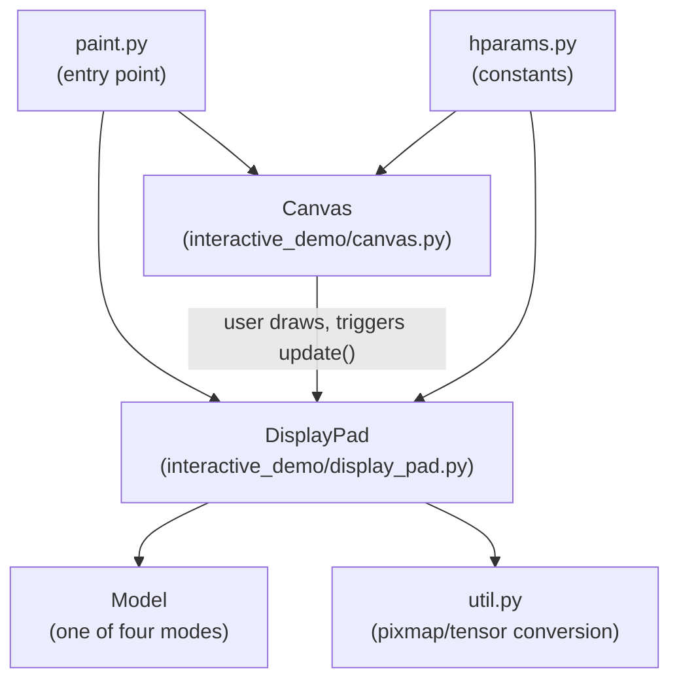
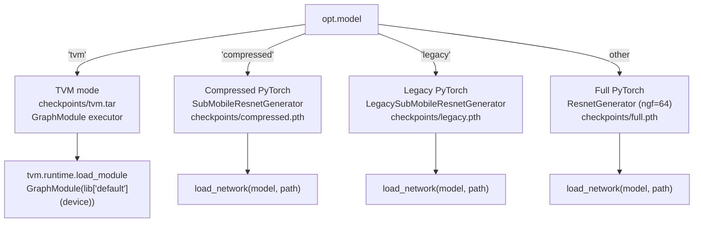
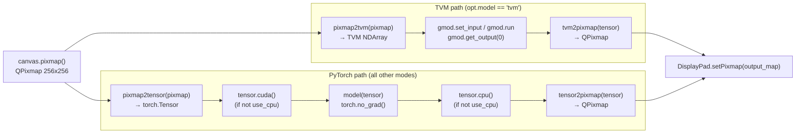

<!-- source: DeepWiki mcp.deepwiki.com · repo mit-han-lab/gan-compression · page 8 Interactive Demo · fetched 2026-10-30 -->

# Interactive Demo

<details>
<summary>Relevant source files</summary>

The following files were used as context for generating this wiki page:

- [interactive_demo/README.md](interactive_demo/README.md)
- [interactive_demo/canvas.py](interactive_demo/canvas.py)
- [interactive_demo/demo.gif](interactive_demo/demo.gif)
- [interactive_demo/display_pad.py](interactive_demo/display_pad.py)
- [interactive_demo/hparams.py](interactive_demo/hparams.py)
- [interactive_demo/images/broom.png](interactive_demo/images/broom.png)

</details>


This page documents the interactive painting demo located in the `interactive_demo/` directory. The demo runs a compressed pix2pix generator in real time on an **NVIDIA Jetson Nano**, allowing a user to draw a semantic sketch on a canvas and immediately see the GAN-generated photo-realistic image beside it. This page covers hardware requirements, TVM compilation, the four supported model modes, the PyQt5 UI components, the per-frame inference data flow, and how to launch the demo.

For information about how the compressed models used by this demo are produced, see the Compression Pipeline ([3]()), Exporting Compressed Models ([3.5]()), and Evaluation and Testing ([6.1]()).

---

## Hardware and Software Requirements

The demo targets the Jetson Nano embedded GPU platform. The following stack is required on the device.

| Component | Version / Notes |
|---|---|
| Hardware | NVIDIA Jetson Nano Developer Kit |
| OS image | Jetson Nano system image (flashed to micro SD) |
| PyTorch | Jetson Nano ARM build (see [devtalk.nvidia.com](https://devtalk.nvidia.com)) |
| torchvision | Matching Jetson Nano build |
| TVM | 0.8 (built from source with CUDA, LLVM, Thrust, CUDA Graph executor) |
| PyQt5 | Pre-installed on most Nano images or via `apt` |
| Python | 3.x |

The demo also requires `wget` (the Python package) to download model checkpoints on first launch.

Sources: [interactive_demo/README.md:1-63]()

---

## TVM Compilation

TVM must be built from source on the Jetson Nano with specific flags set in `config.cmake`. The four required changes from the default are:

| cmake variable | Required value |
|---|---|
| `USE_CUDA` | `ON` |
| `USE_LLVM` | `ON` |
| `USE_THRUST` | `ON` |
| `USE_GRAPH_EXECUTOR_CUDA_GRAPH` | `ON` |

After building, the Python package is installed with `python3 setup.py install --user` from the `tvm/python` directory.

The compiled TVM module for the demo model is distributed as `tvm.tar` and is downloaded automatically from `https://hanlab.mit.edu/files/gan_compression/pretrained/demo/` on first run. The resulting file is cached at `checkpoints/tvm.tar`.

Sources: [interactive_demo/README.md:24-51](), [interactive_demo/display_pad.py:22-38]()

---

## Demo Architecture

**Component overview**



Sources: [interactive_demo/canvas.py:1-10](), [interactive_demo/display_pad.py:1-10](), [interactive_demo/hparams.py:1-46]()

---

## Canvas Component

The `Canvas` class ([interactive_demo/canvas.py:23-653]()) is a `QLabel` subclass that serves as the drawing surface. It implements a paint-style interface with several drawing modes.

**Available drawing modes** (from `hparams.MODES`):

| Mode | Description |
|---|---|
| `eraser` | Erase with a 15-pixel round cap |
| `pen` | Freehand line drawing |
| `line` | Straight-line tool |
| `polyline` | Multi-segment open path |
| `polygon` | Closed polygon |

Mouse events are dispatched dynamically: `mousePressEvent`, `mouseMoveEvent`, and `mouseReleaseEvent` look up a method named `<mode>_<event>` via `getattr` ([interactive_demo/canvas.py:125-144]()).

**Key constants from `hparams.py`:**

| Constant | Value |
|---|---|
| `CANVAS_DIMENSIONS` | `(256, 256)` |
| `MODEL_DIMENSIONS` | `(256, 256)` |
| `BRUSH_MULT` | `3` |

The `Canvas` holds a reference to the `DisplayPad` via `set_display_pad()` ([interactive_demo/canvas.py:645-652]()). Every call to `Canvas.update()` ([interactive_demo/canvas.py:648-652]()) immediately calls `self.display_pad.update()`, which triggers a full forward pass through the generator.

Sources: [interactive_demo/canvas.py:23-653](), [interactive_demo/hparams.py:19-40]()

---

## DisplayPad Component

The `DisplayPad` class ([interactive_demo/display_pad.py:12-80]()) is also a `QLabel`. It loads the appropriate model on construction based on `opt.model`, then re-runs inference on every call to `update()`.

### Model Mode Selection

`DisplayPad.__init__` branches on `opt.model` to load one of four backends. Checkpoints are downloaded automatically from `https://hanlab.mit.edu/files/gan_compression/pretrained/demo/` if not already present in `checkpoints/`.

**Model mode diagram:**



Sources: [interactive_demo/display_pad.py:24-62]()

### Model Mode Details

| `opt.model` | Class | Config | Checkpoint |
|---|---|---|---|
| `tvm` | TVM `GraphModule` (no PyTorch) | n/a | `checkpoints/tvm.tar` |
| `compressed` | `SubMobileResnetGenerator` | `channels: [24,24,40,56,24,56,16,40]` | `checkpoints/compressed.pth` |
| `legacy` | `LegacySubMobileResnetGenerator` | `channels: [32,32,40,48,16,32]` | `checkpoints/legacy.pth` |
| *(any other)* | `ResnetGenerator` | `ngf=64`, `n_blocks=9` | `checkpoints/full.pth` |

All PyTorch models use `norm_layer=nn.InstanceNorm2d` and `n_blocks=9`. GPU transfer is applied unless `opt.use_cpu` is set, and is skipped for the TVM mode (which manages its own CUDA device).

Sources: [interactive_demo/display_pad.py:40-62]()

---

## Per-Frame Inference Data Flow

Every time the user interacts with the canvas, `Canvas.update()` calls `DisplayPad.update()` ([interactive_demo/display_pad.py:64-80]()). The update method converts the current canvas pixmap to the appropriate tensor format, runs the model, and converts the output back to a pixmap for display.

**Inference data flow diagram:**



The utility functions `pixmap2tensor`, `pixmap2tvm`, `tensor2pixmap`, and `tvm2pixmap` are defined in `interactive_demo/util.py` and handle the format conversions between PyQt5 pixmaps and model inputs/outputs.

Sources: [interactive_demo/display_pad.py:64-80]()

---

## Launching the Demo

After completing the hardware setup and dependency installation described above, launch from the `interactive_demo/` directory:

```shell
python3 paint.py
```

No `--model` argument is shown in the README, implying a default is set. To select a specific mode, pass the corresponding value via `opt.model` (the exact CLI flag is defined in `paint.py`). On first launch, the appropriate checkpoint file is downloaded automatically.

The demo achieves approximately **8 FPS** on the Jetson Nano GPU using the TVM-compiled model (`opt.model='tvm'`). PyTorch modes will be slower due to the absence of TVM Auto Scheduler optimization.

Sources: [interactive_demo/README.md:55-63](), [interactive_demo/display_pad.py:22-38]()

---

## File Reference

| File | Role |
|---|---|
| `interactive_demo/paint.py` | Entry point; constructs the Qt application, `Canvas`, and `DisplayPad` |
| `interactive_demo/canvas.py` | `Canvas` QLabel — drawing surface and mouse event handling |
| `interactive_demo/display_pad.py` | `DisplayPad` QLabel — model loading and per-frame inference |
| `interactive_demo/hparams.py` | Global constants: `CANVAS_DIMENSIONS`, `MODES`, colors, brush sizes |
| `interactive_demo/util.py` | Conversion utilities: `pixmap2tensor`, `pixmap2tvm`, `tensor2pixmap`, `tvm2pixmap`, `load_network` |
| `interactive_demo/README.md` | Setup and installation guide |

Sources: [interactive_demo/README.md:1-63](), [interactive_demo/display_pad.py:1-10](), [interactive_demo/canvas.py:1-10](), [interactive_demo/hparams.py:1-46]()