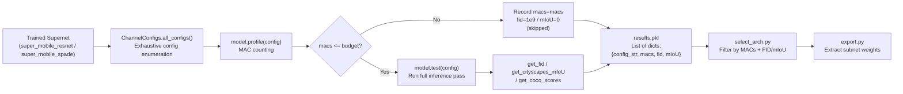
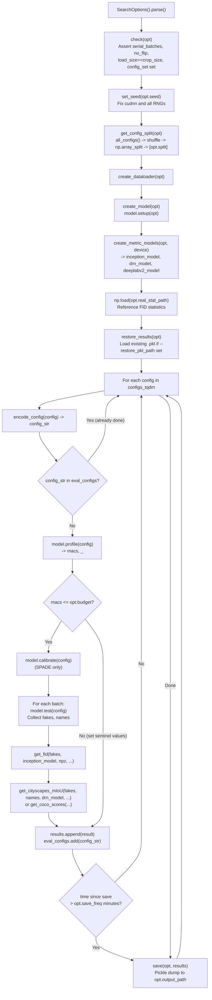
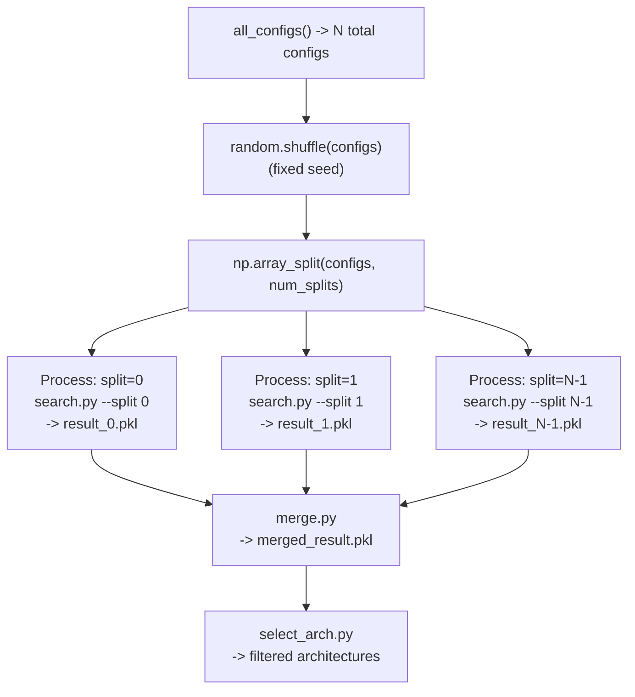

<!-- source: DeepWiki mcp.deepwiki.com · repo mit-han-lab/gan-compression · extra page Brute-force Search · fetched 2026-10-30 -->

# Brute-force Search

<details>
<summary>Relevant source files</summary>

The following files were used as context for generating this wiki page:

- [configs/channel_configs.py](configs/channel_configs.py)
- [configs/resnet_configs.py](configs/resnet_configs.py)
- [configs/spade_configs.py](configs/spade_configs.py)
- [scripts/cycle_gan/horse2zebra/distill.sh](scripts/cycle_gan/horse2zebra/distill.sh)
- [scripts/cycle_gan/horse2zebra/search.sh](scripts/cycle_gan/horse2zebra/search.sh)
- [scripts/cycle_gan/horse2zebra/test_distill.sh](scripts/cycle_gan/horse2zebra/test_distill.sh)
- [scripts/cycle_gan/horse2zebra/test_supernet.sh](scripts/cycle_gan/horse2zebra/test_supernet.sh)
- [search.py](search.py)
- [select_arch.py](select_arch.py)

</details>


This page documents the brute-force neural architecture search (NAS) mechanism in the compression pipeline: specifically `search.py`, its parallelization mechanism, and `select_arch.py`. The brute-force search exhaustively evaluates every possible sub-network configuration within a trained supernet and records quality metrics for each.

For the evolutionary alternative to this exhaustive search, see [Evolutionary Search](#3.4.2). For background on the supernet that produces the checkpoints used here, see [Supernet Training](#3.3). For information on how the search results are used to produce a final compressed model, see [Exporting Compressed Models](#3.5). For documentation on the `ChannelConfigs` class and named config sets, see [Channel Configuration System](#5).

---

## How Brute-force Search Fits into the Pipeline

**Figure: Brute-force Search in the Three-Stage Compression Pipeline**



Sources: [search.py:80-154](), [select_arch.py:1-34]()

---

## Configuration Space Enumeration

The set of candidate architectures is determined by a `ChannelConfigs` object (see [Channel Configuration System](#5)). The `all_configs()` method [configs/channel_configs.py:50-61]() is a recursive generator that yields every Cartesian product of channel widths across all layers. For a supernet with 8 layers each having 5 width choices, this produces 5⁸ = 390,625 candidates.

Named config sets are retrieved by `get_configs()` in either `configs/resnet_configs.py` or `configs/spade_configs.py` depending on the `--netG` flag.

**Table: Named Config Sets and Their Search Spaces**

| Config Set | Architecture | Widths per Layer | Approx. Total Configs |
|---|---|---|---|
| `channels-32` | ResNet (CycleGAN) | `[32, 24, 16]` × 8 layers | 3⁸ = 6,561 |
| `channels-48` | ResNet (pix2pix) | `[48, 32]` or `[48, 40, 32]` or `[48, 32, 24, 16]` | varies |
| `channels-64-cycleGAN` | ResNet (CycleGAN) | `[64, 48, 32, 24, 16]` × 8 layers | 5⁸ = 390,625 |
| `channels-64-pix2pix` | ResNet (pix2pix) | `[64, 56, 48, 40, 32, 24, 16]` × 8 layers | 7⁸ = 5,764,801 |
| `channels-48` | SPADE | `[48, 40, 32]` or `[48, 40, 32, 24]` × 8 layers | varies |
| `channels-64` | SPADE | `[64, 48, 40, 32]` or `[64, 48, 40, 32, 24]` × 8 layers | varies |

Sources: [configs/resnet_configs.py:1-27](), [configs/spade_configs.py:1-22](), [configs/channel_configs.py:50-61]()

---

## The Search Loop

`search.py` is the main entry point. Its `__main__` block [search.py:80-154]() runs the following sequence:

**Figure: search.py Execution Flow**



Sources: [search.py:80-154](), [search.py:23-77]()

### Key Functions in `search.py`

| Function | Location | Purpose |
|---|---|---|
| `set_seed(seed)` | [search.py:23-29]() | Fix all RNG sources for reproducibility |
| `check(opt)` | [search.py:33-42]() | Validate required option combinations |
| `restore_results(opt)` | [search.py:45-58]() | Load partial results from a previous run |
| `save(opt, results)` | [search.py:61-64]() | Pickle-dump results list to disk |
| `get_config_split(opt)` | [search.py:67-77]() | Enumerate, shuffle, and partition the config space |

### Result Dictionary Schema

Each entry in `results` is a Python `dict` with the following keys:

| Key | Type | Description |
|---|---|---|
| `config_str` | `str` | Encoded architecture (e.g., `"16_32_24_32_16_24_32_16"`) |
| `macs` | `float` | Multiply-accumulate operations for this config |
| `fid` | `float` | Fréchet Inception Distance (if `inception_model` loaded) |
| `mIoU` | `float` | Mean IoU (if `drn_model` or `deeplabv2_model` loaded) |
| `accu` | `float` | Pixel accuracy (COCO only, if `deeplabv2_model` loaded) |

When a config exceeds the MAC budget, sentinel values are recorded: `fid=1e9`, `mIoU=0`, `accu=0` — these configs are tracked in `eval_configs` to prevent re-evaluation on resume.

Sources: [search.py:110-145]()

---

## Parallelization via `--num_splits` and `--split`

Because exhaustive search over large config sets (e.g., 5⁸ = 390,625 for `channels-64-cycleGAN`) is time-consuming, the search can be distributed across multiple processes using two options:

- **`--num_splits`**: Total number of partitions to divide the config list into.
- **`--split`**: Index (0-based) of the partition this process handles.

The `get_config_split()` function [search.py:67-77]() implements this by:
1. Calling `all_configs()` and converting to a list.
2. Shuffling the list (using the fixed seed for reproducibility).
3. Calling `np.array_split(configs, opt.num_splits)[opt.split]` to extract the assigned slice.

Each process writes its own `.pkl` output. After all processes complete, `merge.py` (not shown in the provided files but referenced by the pipeline) merges the partial `.pkl` files into a single result file.

**Figure: Parallel Search Coordination**



Sources: [search.py:67-77]()

### Resuming Interrupted Searches

The `--restore_pkl_path` option allows a search run to resume from a partial result file. `restore_results()` [search.py:45-58]() loads the existing results and populates `eval_configs` with all previously evaluated `config_str` values, so the main loop skips them.

---

## Filtering Results with `select_arch.py`

After search produces a `.pkl` file, `select_arch.py` reads and filters it. It accepts thresholds on three dimensions and prints all configs that satisfy all constraints.

```
python select_arch.py \
    --pkl_path logs/cycle_gan/horse2zebra/supernet/result.pkl \
    --macs 5.68e9 \
    --fid 60.0 \
    --mIoU 0.4
```

**`select_arch.py` Logic** [select_arch.py:9-24]():

| Argument | Default | Filter Condition |
|---|---|---|
| `--pkl_path` | *(required)* | Path to input `.pkl` |
| `--macs` | `5.68e9` | `item['macs'] <= macs` |
| `--fid` | `-1` (disabled) | `item['fid'] <= fid` (only if `fid > 0`) |
| `--mIoU` | `1e18` (disabled) | `item['mIoU'] >= mIoU` (only if threshold meaningful) |

Results are sorted by MAC count ascending before filtering. Selected configs are printed to stdout with their full result dicts. The `config_str` value from the printed output is then passed to `export.py` via `--config_str`.

Sources: [select_arch.py:1-34]()

---

## Example Invocation

The following example runs brute-force search on the horse2zebra CycleGAN supernet:

```bash
python search.py \
  --dataroot database/horse2zebra/trainA \
  --dataset_mode single \
  --phase train \
  --restore_G_path logs/cycle_gan/horse2zebra/supernet/checkpoints/latest_net_G.pth \
  --output_path logs/cycle_gan/horse2zebra/supernet/result.pkl \
  --ngf 32 \
  --batch_size 32 \
  --config_set channels-32 \
  --real_stat_path real_stat/horse2zebra_B.npz \
  --meta_path datasets/metas/horse2zebra/train2A.meta
```

This corresponds to the shell script at [scripts/cycle_gan/horse2zebra/search.sh:1-9](). For `channels-32`, the search evaluates 3⁸ = 6,561 configs. Results are saved to `result.pkl`.

To then filter for architectures within a MAC budget:

```bash
python select_arch.py \
  --pkl_path logs/cycle_gan/horse2zebra/supernet/result.pkl \
  --macs 5.68e9
```

Sources: [scripts/cycle_gan/horse2zebra/search.sh:1-9](), [select_arch.py:27-34]()

---

## SPADE-Specific Behavior

When the model is an instance of `SPADEModel`, the search loop calls `model.calibrate(config)` [search.py:115-116]() before running inference. This recalibrates the supernet's batch normalization statistics for the specific channel configuration being evaluated, which is necessary because SPADE uses spatially-adaptive normalization layers that depend on batch statistics. See [SPADE Model](#4.4) for details on the calibration mechanism.

Sources: [search.py:114-116]()

---

