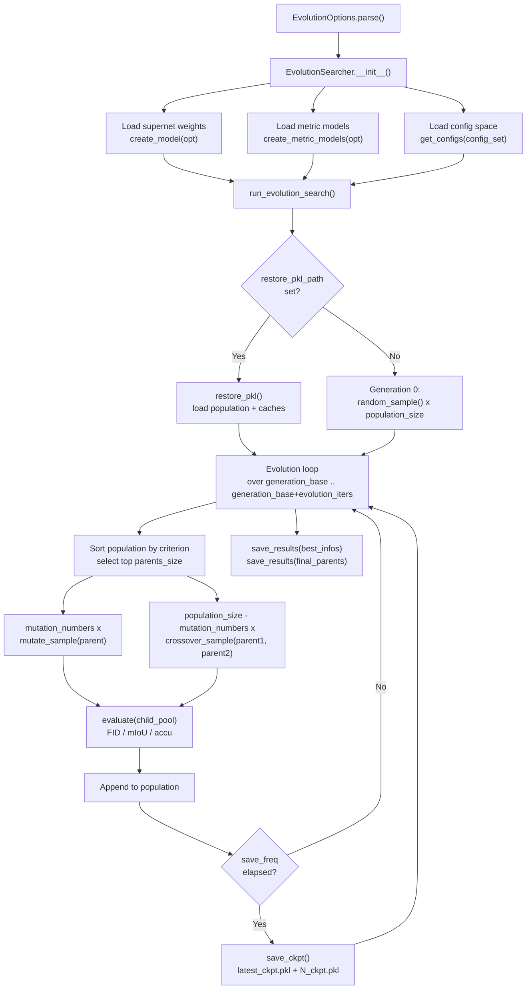
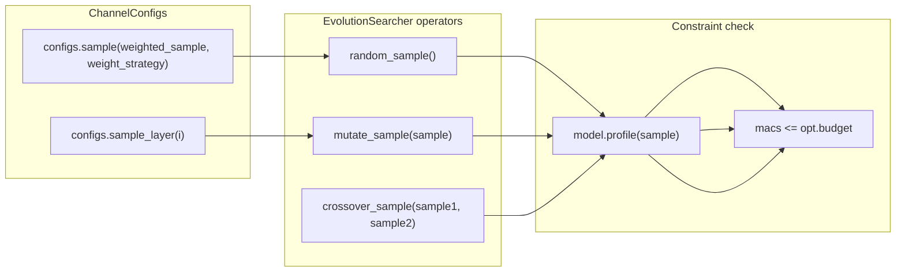
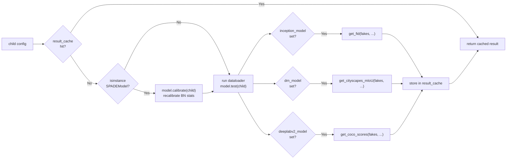

<!-- source: DeepWiki mcp.deepwiki.com · repo mit-han-lab/gan-compression · extra page Evolutionary Search · fetched 2026-10-30 -->

# Evolutionary Search

<details>
<summary>Relevant source files</summary>

The following files were used as context for generating this wiki page:

- [datasets/separate_A_and_B.py](datasets/separate_A_and_B.py)
- [evolution_search.py](evolution_search.py)
- [get_real_stat.py](get_real_stat.py)
- [metric/cityscapes_mIoU.py](metric/cityscapes_mIoU.py)
- [metric/coco_scores.py](metric/coco_scores.py)
- [metric/fid_score.py](metric/fid_score.py)
- [options/evolution_options.py](options/evolution_options.py)
- [scripts/cycle_gan/horse2zebra_fast/evolution_search.sh](scripts/cycle_gan/horse2zebra_fast/evolution_search.sh)
- [scripts/gaugan/coco_fast/evolution_search.sh](scripts/gaugan/coco_fast/evolution_search.sh)
- [scripts/gaugan/coco_fast/search.sh](scripts/gaugan/coco_fast/search.sh)
- [scripts/gaugan/coco_fast/train_supernet.sh](scripts/gaugan/coco_fast/train_supernet.sh)
- [scripts/pix2pix/edges2shoes-r_fast/evolution_search.sh](scripts/pix2pix/edges2shoes-r_fast/evolution_search.sh)

</details>


This page documents the evolutionary neural architecture search (NAS) implementation used to find high-quality subnet configurations within a trained supernet. The search is driven by `evolution_search.py` and the `EvolutionSearcher` class, and is an alternative to the brute-force enumeration described in [Brute-force Search](#3.4.1). Both approaches produce a results file consumable by `select_arch.py`, but evolutionary search scales to larger configuration spaces where exhaustive enumeration is impractical.

For background on what supernets are and how they are trained, see [Supernet Training](#3.3). For the channel configuration system that defines the search space, see [Channel Configuration System](#5).

---

## Overview

The evolutionary search treats subnet selection as a black-box optimization problem. A population of channel configurations is maintained across generations. Each generation applies **mutation** and **crossover** to produce child candidates, evaluates them on FID or mIoU (without retraining), and retains the top-performing parents for the next generation. A MAC budget acts as a hard constraint: any candidate exceeding the budget is rejected before evaluation.

**Algorithm Flow Diagram**



Sources: [evolution_search.py:201-261]()

---

## The `EvolutionSearcher` Class

The `EvolutionSearcher` class ([evolution_search.py:67-261]()) encapsulates all state and logic for the search.

### Initialization

[evolution_search.py:69-98]()

| Attribute | Type | Description |
|---|---|---|
| `self.configs` | `ChannelConfigs` | Config space from `get_configs(opt.config_set)` |
| `self.dataloader` | `DataLoader` | Fixed evaluation dataset |
| `self.model` | supernet model | Loaded from `--restore_G_path` |
| `self.inception_model` | `InceptionV3` or `None` | For FID computation |
| `self.drn_model` | `DRNSeg` or `None` | For Cityscapes mIoU |
| `self.deeplabv2_model` | `DeepLabV2` or `None` | For COCO mIoU/accuracy |
| `self.macs_cache` | `dict` | `config_str → macs`, avoids re-profiling |
| `self.result_cache` | `dict` | `config_str → result_dict`, avoids re-evaluation |
| `self.log_file` | file handle | Appended log at `output_dir/log.txt` |

The `netG` type (`resnet`, `spade`, or `munit`) determines which `get_configs` function is imported.

Sources: [evolution_search.py:67-98]()

---

## Search Space Operators

**Operator Relationship Diagram**



Sources: [evolution_search.py:100-138]()

### `random_sample()`

[evolution_search.py:100-111]()

Calls `configs.sample()` in a loop until a configuration whose MAC count is within `--budget` is found. The MAC count is looked up from `macs_cache` before calling `model.profile()`.

### `mutate_sample(sample)`

[evolution_search.py:113-125]()

Performs per-layer mutation. For each layer index `i` in `sample['channels']`, independently replaces the channel count with a new value from `configs.sample_layer(i)` with probability `--mutate_prob`. Loops until the mutated configuration satisfies the MAC budget.

### `crossover_sample(sample1, sample2)`

[evolution_search.py:127-138]()

Produces a child by independently drawing each layer's channel count from either `sample1` or `sample2` with equal probability (`random.choice`). Loops until the result satisfies the MAC budget.

---

## Fitness Evaluation

The `evaluate(child_pool)` method ([evolution_search.py:140-173]()) runs each candidate configuration against the entire evaluation dataset and computes whichever metrics are enabled.

**Evaluation Steps per Candidate**



Sources: [evolution_search.py:140-173]()

The metric models are loaded conditionally based on `--no_fid` and `--no_mIoU` flags. For SPADE models, `model.calibrate(child)` is called before inference to recalibrate batch normalization statistics for the given channel configuration.

---

## Fitness Criterion and Parent Selection

The `better(a, b)` method ([evolution_search.py:175-179]()) selects the comparison direction:

| `--criterion` | Better means |
|---|---|
| `fid` | lower is better (`a < b`) |
| `mIoU` | higher is better (`a > b`) |
| `accu` | higher is better (`a > b`) |

At each generation, the full population (parents + children) is sorted by `result[opt.criterion]` and the top `parents_size` individuals are retained as parents. `parents_size = round(parent_ratio × population_size)`.

Sources: [evolution_search.py:229-239]()

---

## Population Sizing

The population parameters and how they interact:

| Option | Default | Role |
|---|---|---|
| `--population_size` | 100 | Total candidates per generation |
| `--parent_ratio` | 0.25 | Fraction of population kept as parents |
| `--mutation_ratio` | 0.5 | Fraction of children from mutation |
| `--mutate_prob` | 0.2 | Per-layer mutation probability |
| `--evolution_iters` | 500 | Number of generations |
| `--generation_base` | 1 | Starting generation index (for resume) |

Derived sizes:

```
parents_size       = round(parent_ratio × population_size)
mutation_numbers   = round(mutation_ratio × population_size)
crossover_numbers  = population_size - mutation_numbers
```

Sources: [options/evolution_options.py:41-49](), [evolution_search.py:201-206]()

---

## Checkpointing and Resume

**Checkpoint Structure**

The `save_ckpt()` method ([evolution_search.py:188-199]()) writes two files per checkpoint event:

- `output_dir/latest_ckpt.pkl` — always overwritten with the latest state
- `output_dir/{generation}_ckpt.pkl` — generation-numbered snapshot

Each pickle contains:

| Key | Contents |
|---|---|
| `macs_cache` | `dict[config_str → macs]` |
| `result_cache` | `dict[config_str → result_dict]` |
| `population` | list of `(result, config, macs)` tuples |
| `best_valids` | list of best metric values seen |
| `best_infos` | list of best `(result, config, macs)` tuples |
| `generation` | current generation index |

Checkpoints are written when `save_freq` minutes have elapsed since the last save (`--save_freq` default: 60 minutes).

**Resuming a Search**

Pass `--restore_pkl_path path/to/latest_ckpt.pkl` to resume. If `--only_restore_cache` is also set, only the `macs_cache` and `result_cache` are restored (population is resampled from scratch).

Sources: [evolution_search.py:181-199](), [options/evolution_options.py:59-65]()

---

## Output Files

After `run_evolution_search()` completes, `save_results()` ([evolution_search.py:264-269]()) writes two pickle files:

| File | Contents |
|---|---|
| `output_dir/best_infos.pkl` | History of best configurations found |
| `output_dir/final_parents.pkl` | Final parent population after the last generation |

Each item in the pickle is a `dict` with keys `config_str`, `macs`, and the metric keys (`fid`, `mIoU`, `accu`). This format is compatible with `select_arch.py` (see [Brute-force Search](#3.4.1) for details on filtering).

Sources: [evolution_search.py:264-282]()

---

## CLI Arguments Reference

The `EvolutionOptions` class ([options/evolution_options.py:6-71]()) extends `BaseOptions` with these search-specific arguments:

**Search Space and Budget**

| Argument | Default | Description |
|---|---|---|
| `--config_set` | required | Named config set, e.g. `channels-64-cycleGAN` |
| `--ngf` | 48 | Base number of filters for the supernet |
| `--budget` | 1e18 | Maximum MACs (hard constraint) |
| `--netG` | `super_mobile_resnet_9blocks` | Generator architecture |

**Evolution Hyperparameters**

| Argument | Default | Description |
|---|---|---|
| `--population_size` | 100 | Individuals per generation |
| `--mutation_ratio` | 0.5 | Fraction of children from mutation |
| `--parent_ratio` | 0.25 | Fraction kept as parents |
| `--mutate_prob` | 0.2 | Per-layer mutation probability |
| `--evolution_iters` | 500 | Number of generations |
| `--criterion` | `fid` | Optimization objective: `fid`, `mIoU`, or `accu` |
| `--weighted_sample` | 1 | Sampling weight exponent for generation 0 |
| `--weight_strategy` | `arithmetic` | `arithmetic` or `geometric` weighting |

**Metrics**

| Argument | Default | Description |
|---|---|---|
| `--real_stat_path` | None | Path to `.npz` file for FID reference statistics |
| `--no_fid` | False | Skip FID computation |
| `--no_mIoU` | False | Skip mIoU computation |

**Checkpointing and I/O**

| Argument | Default | Description |
|---|---|---|
| `--output_dir` | required | Directory for logs, checkpoints, and result pickles |
| `--restore_pkl_path` | None | Resume from a previous checkpoint |
| `--only_restore_cache` | False | Only restore caches, resample population |
| `--generation_base` | 1 | Starting generation counter |
| `--save_freq` | 60 | Minutes between checkpoint saves |
| `--max_cache_size` | 10000000 | Maximum entries in each cache |

Sources: [options/evolution_options.py:16-71]()

---

## Example Invocations

### CycleGAN — horse2zebra (fast pipeline)

[scripts/cycle_gan/horse2zebra_fast/evolution_search.sh:1-9]()

```
python evolution_search.py \
  --dataroot database/horse2zebra/trainA \
  --dataset_mode single --phase train \
  --restore_G_path logs/cycle_gan/horse2zebra_fast/supernet/checkpoints/latest_net_G.pth \
  --output_dir logs/cycle_gan/horse2zebra_fast/supernet/evolution \
  --ngf 64 --batch_size 32 \
  --config_set channels-64-cycleGAN --mutate_prob 0.4 \
  --real_stat_path real_stat/horse2zebra_B.npz --budget 3e9 \
  --weighted_sample 2 --meta_path datasets/metas/horse2zebra/train2A.meta
```

### pix2pix — edges2shoes-r (fast pipeline)

[scripts/pix2pix/edges2shoes-r_fast/evolution_search.sh:1-8]()

```
python evolution_search.py \
  --phase train --dataroot database/edges2shoes-r \
  --restore_G_path logs/pix2pix/edges2shoes-r_fast/supernet/checkpoints/latest_net_G.pth \
  --output_dir logs/pix2pix/edges2shoes-r_fast/supernet/evolution \
  --ngf 64 --batch_size 32 \
  --config_set channels-64-pix2pix \
  --real_stat_path real_stat/edges2shoes-r_subtrain_B.npz --load_in_memory \
  --budget 4.9e9 --mutate_prob 0.3 \
  --meta_path datasets/metas/edges2shoes-r/train2.meta
```

### GauGAN — COCO-Stuff (fast pipeline, mIoU criterion)

[scripts/gaugan/coco_fast/evolution_search.sh:1-10]()

```
python evolution_search.py \
  --dataroot database/coco_stuff --dataset_mode coco \
  --model spade --netG super_mobile_spade --phase train \
  --restore_G_path logs/gaugan/coco_fast/supernet/checkpoints/latest_net_G.pth \
  --output_dir logs/gaugan/coco_fast/evolution \
  --batch_size 32 --config_set channels-64 \
  --real_stat_path real_stat/coco_A.npz \
  --direction BtoA --max_dataset_size 500 \
  --budget 36e9 --ngf 64 --num_upsampling_layers normal \
  --no_fid --criterion mIoU \
  --meta_path datasets/metas/coco-coco_stuff/train2.meta
```

The COCO/GauGAN example disables FID (`--no_fid`) and optimizes for `mIoU` instead, using the `deeplabv2_model` path in `evaluate()`.

Sources: [scripts/cycle_gan/horse2zebra_fast/evolution_search.sh:1-9](), [scripts/pix2pix/edges2shoes-r_fast/evolution_search.sh:1-8](), [scripts/gaugan/coco_fast/evolution_search.sh:1-10]()

---

## Code Entity Map

**How CLI arguments map to `EvolutionSearcher` behavior**

```mermaid
graph TD
    subgraph "options/evolution_options.py"
        OPT_budget["--budget"]
        OPT_mutate_prob["--mutate_prob"]
        OPT_mutation_ratio["--mutation_ratio"]
        OPT_parent_ratio["--parent_ratio"]
        OPT_population_size["--population_size"]
        OPT_criterion["--criterion"]
        OPT_config_set["--config_set"]
        OPT_restore_pkl["--restore_pkl_path"]
        OPT_save_freq["--save_freq"]
        OPT_weighted_sample["--weighted_sample"]
    end

    subgraph "evolution_search.py EvolutionSearcher"
        RS["random_sample()\nuse: budget, weighted_sample"]
        MU["mutate_sample(sample)\nuse: budget, mutate_prob"]
        CR["crossover_sample(s1, s2)\nuse: budget"]
        EV["evaluate(child_pool)\nuse: criterion metrics"]
        BE["better(a, b)\nuse: criterion"]
        RP["restore_pkl(path)\nuse: restore_pkl_path"]
        SK["save_ckpt(...)\nuse: save_freq, output_dir"]
        RE["run_evolution_search()\nuse: population_size, mutation_ratio, parent_ratio, evolution_iters"]
    end

    OPT_budget --> RS & MU & CR
    OPT_mutate_prob --> MU
    OPT_mutation_ratio --> RE
    OPT_parent_ratio --> RE
    OPT_population_size --> RE
    OPT_criterion --> EV & BE & RE
    OPT_config_set --> RS
    OPT_restore_pkl --> RP
    OPT_save_freq --> SK
    OPT_weighted_sample --> RS
```



Sources: [evolution_search.py:67-261](), [options/evolution_options.py:16-71]()

---

