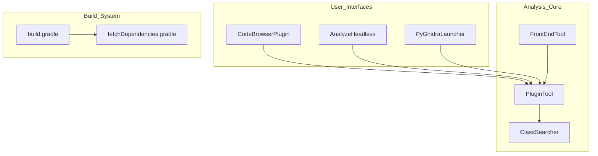
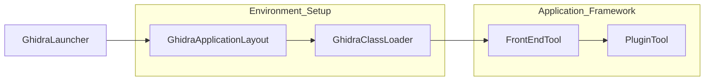

<!-- source: DeepWiki mcp.deepwiki.com · repo NationalSecurityAgency/ghidra · page 1 Overview · fetched 2026-11-09 -->

# Overview

Relevant source files

The following files were used as context for generating this wiki page:

- [.github/ISSUE_TEMPLATE/bug_report.md](.github/ISSUE_TEMPLATE/bug_report.md)
- [.github/ISSUE_TEMPLATE/feature_request.md](.github/ISSUE_TEMPLATE/feature_request.md)
- [.github/ISSUE_TEMPLATE/question.md](.github/ISSUE_TEMPLATE/question.md)
- [CONTRIBUTING.md](CONTRIBUTING.md)
- [DISCLAIMER.md](DISCLAIMER.md)
- [DevGuide.md](DevGuide.md)
- [GPL/DMG/build.gradle](GPL/DMG/build.gradle)
- [GPL/nativeBuildProperties.gradle](GPL/nativeBuildProperties.gradle)
- [GPL/vsconfig.gradle](GPL/vsconfig.gradle)
- [Ghidra/Configurations/Public_Release/build.gradle](Ghidra/Configurations/Public_Release/build.gradle)
- [Ghidra/Configurations/Public_Release/certification.manifest](Ghidra/Configurations/Public_Release/certification.manifest)
- [Ghidra/Configurations/Public_Release/src/global/docs/ChangeHistory.md](Ghidra/Configurations/Public_Release/src/global/docs/ChangeHistory.md)
- [Ghidra/Configurations/Public_Release/src/global/docs/WhatsNew.md](Ghidra/Configurations/Public_Release/src/global/docs/WhatsNew.md)
- [Ghidra/Debug/AnnotationValidator/build.gradle](Ghidra/Debug/AnnotationValidator/build.gradle)
- [Ghidra/Debug/Debugger-agent-dbgeng/Module.manifest](Ghidra/Debug/Debugger-agent-dbgeng/Module.manifest)
- [Ghidra/Debug/Debugger-agent-dbgeng/build.gradle](Ghidra/Debug/Debugger-agent-dbgeng/build.gradle)
- [Ghidra/Debug/Debugger-agent-dbgeng/src/main/help/help/topics/dbgeng/dbgeng.html](Ghidra/Debug/Debugger-agent-dbgeng/src/main/help/help/topics/dbgeng/dbgeng.html)
- [Ghidra/Debug/Debugger-agent-dbgeng/src/main/py/README.md](Ghidra/Debug/Debugger-agent-dbgeng/src/main/py/README.md)
- [Ghidra/Debug/Debugger-agent-gdb/build.gradle](Ghidra/Debug/Debugger-agent-gdb/build.gradle)
- [Ghidra/Debug/Debugger-agent-lldb/build.gradle](Ghidra/Debug/Debugger-agent-lldb/build.gradle)
- [Ghidra/Debug/Debugger-jpda/build.gradle](Ghidra/Debug/Debugger-jpda/build.gradle)
- [Ghidra/Debug/Debugger-jpda/certification.manifest](Ghidra/Debug/Debugger-jpda/certification.manifest)
- [Ghidra/Debug/Debugger-rmi-trace/DEVNOTES.txt](Ghidra/Debug/Debugger-rmi-trace/DEVNOTES.txt)
- [Ghidra/Debug/Debugger-rmi-trace/build.gradle](Ghidra/Debug/Debugger-rmi-trace/build.gradle)
- [Ghidra/Debug/Debugger-rmi-trace/src/main/java/ghidra/app/plugin/core/debug/gui/tracermi/launcher/ScriptPathsPropertyEditor.java](Ghidra/Debug/Debugger-rmi-trace/src/main/java/ghidra/app/plugin/core/debug/gui/tracermi/launcher/ScriptPathsPropertyEditor.java)
- [Ghidra/Debug/Framework-TraceModeling/build.gradle](Ghidra/Debug/Framework-TraceModeling/build.gradle)
- [Ghidra/Debug/ProposedUtils/certification.manifest](Ghidra/Debug/ProposedUtils/certification.manifest)
- [Ghidra/Debug/TaintAnalysis/build.gradle](Ghidra/Debug/TaintAnalysis/build.gradle)
- [Ghidra/Extensions/bundle_examples/build.gradle](Ghidra/Extensions/bundle_examples/build.gradle)
- [Ghidra/Features/Base/.launch/Ghidra Code Coverage.launch](Ghidra/Features/Base/.launch/Ghidra Code Coverage.launch)
- [Ghidra/Features/Base/.launch/Ghidra.launch](Ghidra/Features/Base/.launch/Ghidra.launch)
- [Ghidra/Features/Base/.launch/Headless.launch](Ghidra/Features/Base/.launch/Headless.launch)
- [Ghidra/Features/Base/.launch/JShell.launch](Ghidra/Features/Base/.launch/JShell.launch)
- [Ghidra/Features/Base/data/PEFunctionsThatDoNotReturn](Ghidra/Features/Base/data/PEFunctionsThatDoNotReturn)
- [Ghidra/Features/Base/ghidra_scripts/BuildGhidraJarScript.java](Ghidra/Features/Base/ghidra_scripts/BuildGhidraJarScript.java)
- [Ghidra/Features/Base/src/main/help/help/topics/HeadlessAnalyzer/HeadlessAnalyzer.htm](Ghidra/Features/Base/src/main/help/help/topics/HeadlessAnalyzer/HeadlessAnalyzer.htm)
- [Ghidra/Features/Base/src/main/java/ghidra/GhidraRun.java](Ghidra/Features/Base/src/main/java/ghidra/GhidraRun.java)
- [Ghidra/Features/Base/src/main/java/ghidra/JShellRun.java](Ghidra/Features/Base/src/main/java/ghidra/JShellRun.java)
- [Ghidra/Features/Base/src/main/java/ghidra/app/plugin/runtimeinfo/RuntimeInfoProvider.java](Ghidra/Features/Base/src/main/java/ghidra/app/plugin/runtimeinfo/RuntimeInfoProvider.java)
- [Ghidra/Features/Base/src/main/java/ghidra/app/util/headless/AnalyzeHeadless.java](Ghidra/Features/Base/src/main/java/ghidra/app/util/headless/AnalyzeHeadless.java)
- [Ghidra/Features/Base/src/main/java/ghidra/app/util/opinion/LibraryPathsDialog.java](Ghidra/Features/Base/src/main/java/ghidra/app/util/opinion/LibraryPathsDialog.java)
- [Ghidra/Features/Base/src/main/java/ghidra/app/util/viewer/field/CommentFieldMouseHandler.java](Ghidra/Features/Base/src/main/java/ghidra/app/util/viewer/field/CommentFieldMouseHandler.java)
- [Ghidra/Features/Base/src/main/java/ghidra/util/GhidraJarBuilder.java](Ghidra/Features/Base/src/main/java/ghidra/util/GhidraJarBuilder.java)
- [Ghidra/Features/DebugUtils/src/main/java/db/DbViewer.java](Ghidra/Features/DebugUtils/src/main/java/db/DbViewer.java)
- [Ghidra/Features/FileFormats/build.gradle](Ghidra/Features/FileFormats/build.gradle)
- [Ghidra/Features/GhidraServer/Module.manifest](Ghidra/Features/GhidraServer/Module.manifest)
- [Ghidra/Features/GhidraServer/build.gradle](Ghidra/Features/GhidraServer/build.gradle)
- [Ghidra/Features/GhidraServer/src/main/java/ghidra/server/remote/GhidraServerApplicationLayout.java](Ghidra/Features/GhidraServer/src/main/java/ghidra/server/remote/GhidraServerApplicationLayout.java)
- [Ghidra/Features/PDB/build.gradle](Ghidra/Features/PDB/build.gradle)
- [Ghidra/Features/PDB/buildNatives.gradle](Ghidra/Features/PDB/buildNatives.gradle)
- [Ghidra/Features/PDB/src/pdb/pdb.sln](Ghidra/Features/PDB/src/pdb/pdb.sln)
- [Ghidra/Features/PDB/src/pdb/pdb.vcxproj](Ghidra/Features/PDB/src/pdb/pdb.vcxproj)
- [Ghidra/Features/PyGhidra/build.gradle](Ghidra/Features/PyGhidra/build.gradle)
- [Ghidra/Framework/Docking/src/main/java/docking/widgets/pathmanager/AbstractPathsDialog.java](Ghidra/Framework/Docking/src/main/java/docking/widgets/pathmanager/AbstractPathsDialog.java)
- [Ghidra/Framework/Generic/src/main/java/generic/application/GenericApplicationLayout.java](Ghidra/Framework/Generic/src/main/java/generic/application/GenericApplicationLayout.java)
- [Ghidra/Framework/Generic/src/main/java/generic/jar/ApplicationModule.java](Ghidra/Framework/Generic/src/main/java/generic/jar/ApplicationModule.java)
- [Ghidra/Framework/Generic/src/main/java/ghidra/util/StringUtilities.java](Ghidra/Framework/Generic/src/main/java/ghidra/util/StringUtilities.java)
- [Ghidra/Framework/Generic/src/main/java/ghidra/util/classfinder/ClassDir.java](Ghidra/Framework/Generic/src/main/java/ghidra/util/classfinder/ClassDir.java)
- [Ghidra/Framework/Generic/src/main/java/ghidra/util/classfinder/ClassJar.java](Ghidra/Framework/Generic/src/main/java/ghidra/util/classfinder/ClassJar.java)
- [Ghidra/Framework/Generic/src/main/java/ghidra/util/classfinder/ClassLocation.java](Ghidra/Framework/Generic/src/main/java/ghidra/util/classfinder/ClassLocation.java)
- [Ghidra/Framework/Generic/src/main/java/ghidra/util/classfinder/ClassPackage.java](Ghidra/Framework/Generic/src/main/java/ghidra/util/classfinder/ClassPackage.java)
- [Ghidra/Framework/Generic/src/main/java/ghidra/util/classfinder/ClassSearcher.java](Ghidra/Framework/Generic/src/main/java/ghidra/util/classfinder/ClassSearcher.java)
- [Ghidra/Framework/Generic/src/main/java/ghidra/util/extensions/ExtensionDetails.java](Ghidra/Framework/Generic/src/main/java/ghidra/util/extensions/ExtensionDetails.java)
- [Ghidra/Framework/Generic/src/test/java/ghidra/util/StringUtilitiesTest.java](Ghidra/Framework/Generic/src/test/java/ghidra/util/StringUtilitiesTest.java)
- [Ghidra/Framework/Utility/src/main/java/generic/jar/GClassLoader.java](Ghidra/Framework/Utility/src/main/java/generic/jar/GClassLoader.java)
- [Ghidra/Framework/Utility/src/main/java/ghidra/GhidraApplicationLayout.java](Ghidra/Framework/Utility/src/main/java/ghidra/GhidraApplicationLayout.java)
- [Ghidra/Framework/Utility/src/main/java/ghidra/GhidraClassLoader.java](Ghidra/Framework/Utility/src/main/java/ghidra/GhidraClassLoader.java)
- [Ghidra/Framework/Utility/src/main/java/ghidra/GhidraJarApplicationLayout.java](Ghidra/Framework/Utility/src/main/java/ghidra/GhidraJarApplicationLayout.java)
- [Ghidra/Framework/Utility/src/main/java/ghidra/GhidraLauncher.java](Ghidra/Framework/Utility/src/main/java/ghidra/GhidraLauncher.java)
- [Ghidra/Framework/Utility/src/main/java/ghidra/GhidraTestApplicationLayout.java](Ghidra/Framework/Utility/src/main/java/ghidra/GhidraTestApplicationLayout.java)
- [Ghidra/Framework/Utility/src/main/java/ghidra/framework/ApplicationProperties.java](Ghidra/Framework/Utility/src/main/java/ghidra/framework/ApplicationProperties.java)
- [Ghidra/Framework/Utility/src/main/java/utility/application/ApplicationLayout.java](Ghidra/Framework/Utility/src/main/java/utility/application/ApplicationLayout.java)
- [Ghidra/Framework/Utility/src/main/java/utility/module/ClasspathFilter.java](Ghidra/Framework/Utility/src/main/java/utility/module/ClasspathFilter.java)
- [Ghidra/RuntimeScripts/build.gradle](Ghidra/RuntimeScripts/build.gradle)
- [Ghidra/RuntimeScripts/support/launch.properties](Ghidra/RuntimeScripts/support/launch.properties)
- [Ghidra/Test/DebuggerIntegrationTest/build.gradle](Ghidra/Test/DebuggerIntegrationTest/build.gradle)
- [Ghidra/application.properties](Ghidra/application.properties)
- [GhidraBuild/BuildFiles/Doclets/support/GhidraStubs_README.md](GhidraBuild/BuildFiles/Doclets/support/GhidraStubs_README.md)
- [GhidraBuild/BuildFiles/certification.manifest](GhidraBuild/BuildFiles/certification.manifest)
- [GhidraBuild/BuildFiles/sleighDevBuild.template](GhidraBuild/BuildFiles/sleighDevBuild.template)
- [GhidraBuild/BuildFiles/sleighDistBuild.template](GhidraBuild/BuildFiles/sleighDistBuild.template)
- [GhidraBuild/MarkdownSupport/build.gradle](GhidraBuild/MarkdownSupport/build.gradle)
- [GhidraBuild/MarkdownSupport/src/main/java/ghidra/markdown/MarkdownToHtml.java](GhidraBuild/MarkdownSupport/src/main/java/ghidra/markdown/MarkdownToHtml.java)
- [GhidraBuild/patch/README.txt](GhidraBuild/patch/README.txt)
- [GhidraBuild/patch/certification.local.manifest](GhidraBuild/patch/certification.local.manifest)
- [GhidraDocs/GettingStarted.md](GhidraDocs/GettingStarted.md)
- [GhidraDocs/GhidraClass/Debugger/B1-RemoteTargets.html](GhidraDocs/GhidraClass/Debugger/B1-RemoteTargets.html)
- [GhidraDocs/GhidraClass/Debugger/B1-RemoteTargets.md](GhidraDocs/GhidraClass/Debugger/B1-RemoteTargets.md)
- [GhidraDocs/GhidraClass/Intermediate/HeadlessAnalyzer.html](GhidraDocs/GhidraClass/Intermediate/HeadlessAnalyzer.html)
- [NOTICE](NOTICE)
- [README.md](README.md)
- [SECURITY.md](SECURITY.md)
- [build.gradle](build.gradle)
- [certification.local.manifest](certification.local.manifest)
- [eclipse/GhidraEclipseFormatter.xml](eclipse/GhidraEclipseFormatter.xml)
- [eclipse/GhidraSharedPreferences.epf](eclipse/GhidraSharedPreferences.epf)
- [gradle.properties](gradle.properties)
- [gradle/distributableGPLExtension.gradle](gradle/distributableGPLExtension.gradle)
- [gradle/distributableGPLModule.gradle](gradle/distributableGPLModule.gradle)
- [gradle/distributableGhidraExtension.gradle](gradle/distributableGhidraExtension.gradle)
- [gradle/distributableGhidraModule.gradle](gradle/distributableGhidraModule.gradle)
- [gradle/hasProtobuf.gradle](gradle/hasProtobuf.gradle)
- [gradle/hasPythonPackage.gradle](gradle/hasPythonPackage.gradle)
- [gradle/processorProject.gradle](gradle/processorProject.gradle)
- [gradle/root/distribution.gradle](gradle/root/distribution.gradle)
- [gradle/root/svg.gradle](gradle/root/svg.gradle)
- [gradle/root/venv.gradle](gradle/root/venv.gradle)
- [gradle/support/distributionCommon.gradle](gradle/support/distributionCommon.gradle)
- [gradle/support/extensionCommon.gradle](gradle/support/extensionCommon.gradle)
- [gradle/support/fetchDependencies.gradle](gradle/support/fetchDependencies.gradle)
- [gradle/support/ip.gradle](gradle/support/ip.gradle)
- [gradle/support/loadApplicationProperties.gradle](gradle/support/loadApplicationProperties.gradle)
- [gradlew](gradlew)
- [gradlew.bat](gradlew.bat)

## Purpose and Scope

This page provides a high-level introduction to Ghidra's architecture, major subsystems, and high-level design philosophy. It covers the core components, system architecture, initialization flow, and build infrastructure. For detailed information regarding specific subsystems, refer to the corresponding architectural documentation.

## What is Ghidra?

Ghidra is a software reverse engineering (SRE) framework developed and maintained by the National Security Agency's Research Directorate [README.md:3-5](). It provides a suite of analysis tools that enable users to inspect compiled code across Windows, macOS, and Linux platforms [README.md:6-7](). Core framework capabilities include:

- **Disassembly** - Instruction decoding utilizing Sleigh processor specifications [DevGuide.md:61-64]().
- **Decompilation** - Translation of low-level P-code into high-level C representations [README.md:8]().
- **Static Analysis** - Automated recovery of control flow, data flow, types, and function signatures.
- **Dynamic Analysis** - Native debugging and emulation integration [GhidraDocs/WhatsNew.md:5-6]().
- **Extensibility** - Automation and customization via Java and Python (Python 3.9 to 3.14) [README.md:10-11](), [Ghidra/application.properties:10]().

Ghidra is designed to solve scaling and teaming challenges on complex reverse engineering efforts while providing an extensible research platform [README.md:13-14]().

**Sources:** [README.md:3-17](), [DevGuide.md:1-11](), [Ghidra/application.properties:1-10]()

## High-Level Architecture

The framework is organized around a modular plugin architecture where analysis tools, loaders, and user interfaces are discovered dynamically and managed through core tool containers.

Title: Code Entity Space Mapping

**Key Components by Layer:**

| Layer | Primary Files / Modules | Responsibility |
|-------|----------------|----------------|
| UI Entry Points | `ghidra.GhidraRun`, `ghidra.app.util.headless.AnalyzeHeadless` | Application startup and headless batch execution [README.md:37-38]() |
| Plugin Framework | `FrontEndTool`, `PluginTool` | Lifecycle management for plugins and project window containers |
| Extension Discovery | `ClassSearcher`, `GhidraClassLoader` | Dynamic discovery and loading of extensions and modules [DevGuide.md:7-8]() |
| Build System | `build.gradle`, `gradle/support/fetchDependencies.gradle` | Compilation, native builds, and external dependency retrieval [build.gradle:1-20](), [gradle/support/fetchDependencies.gradle:1-45]() |

**Sources:** [README.md:37-38](), [DevGuide.md:1-11](), [build.gradle:1-20](), [gradle/support/fetchDependencies.gradle:1-45]()

## Core Subsystems

### Decompiler System
The decompiler transforms machine instructions into structured high-level C code via a multi-stage P-code transformation pipeline [README.md:8-9](). Operating primarily as a native C++ engine, it interfaces with the Java framework to construct Static Single Assignment (SSA) forms, perform type inference, and recover control flow structures.

### Processor Architecture Support
Processor definitions are defined using the Sleigh specification language [DevGuide.md:5-6](). The build and runtime environments compile `.sinc` and `.slaspec` definitions into binary `.sla` files used for instruction decoding and P-code generation [DevGuide.md:61-64]().

### Binary Format Support
Executables are parsed via a loader framework that implements format-specific loaders (PE, ELF, Mach-O) to map segments, sections, and symbols into Ghidra's program database model [README.md:6-9]().

### Debugger System
Dynamic analysis is supported through a debugging framework that connects Ghidra to native debuggers (such as GDB, LLDB, and DBG-ENG) using a Protocol Buffer-based Trace RMI protocol to synchronize trace databases [GhidraDocs/WhatsNew.md:5-10]().

### Scripting and Extension System
Ghidra supports automation through `GhidraScript` (Java) and PyGhidra (Python 3.9 through 3.14 bridging via JPype) [README.md:10-11](), [Ghidra/application.properties:10](). Scripts can be executed interactively within the GUI or via headless batch processing [README.md:9-11]().

### Build Infrastructure
The Gradle build system orchestrates multi-language compilation (Java, C++, Sleigh, Python) [DevGuide.md:7-8](). Specialized scripts such as `gradle/support/fetchDependencies.gradle` manage non-Maven Central binary dependencies [gradle/support/fetchDependencies.gradle:16-35]().

**Sources:** [README.md:3-11](), [DevGuide.md:5-8](), [Ghidra/application.properties:1-10](), [gradle/support/fetchDependencies.gradle:16-35]()

## Analysis Pipeline: Environment to Execution

Title: Application Lifecycle and Class Loading

**Pipeline Stages:**

1. **Initialization**: The launcher discovers the installation layout via `GhidraApplicationLayout` and initializes the class loader [GhidraDocs/GettingStarted.md:98-107]().
2. **Tool Startup**: The `FrontEndTool` initializes the project workspace and manages top-level project management windows.
3. **Plugin Management**: `PluginTool` acts as the container orchestrating individual analysis plugins and tool actions.

**Sources:** [GhidraDocs/GettingStarted.md:98-136]()

## Key Data Structures and Properties

### application.properties
Defines core project versioning (version `12.3`), minimum Java requirements (JDK `25`), and supported Python versions (`3.9` to `3.14`) [Ghidra/application.properties:1-10]().

### Launch Configurations
Runtime JVM parameters and property overrides (such as compact object headers and headless execution flags) are specified in configuration files like `Ghidra/Features/Base/.launch/Ghidra.launch` and `support/launch.properties` [Ghidra/Features/Base/.launch/Ghidra.launch:34]().

**Sources:** [Ghidra/application.properties:1-10](), [Ghidra/Features/Base/.launch/Ghidra.launch:1-35]()

## Project Structure

| Path | Description |
|------|-------------|
| `Ghidra/Features/` | Primary feature modules including Base, Decompiler, Debugger, and PyGhidra |
| `Ghidra/Framework/` | Core framework utilities, database layer, and software modeling libraries |
| `GPL/` | GPL-licensed components and native platform build scripts [DevGuide.md:23-24]() |
| `gradle/` | Build system tasks, distribution packaging, and dependency fetch scripts |
| `dependencies/` | External runtime and build dependencies fetched during setup [build.gradle:60-61]() |

**Sources:** [DevGuide.md:17-25](), [build.gradle:55-61]()

## Getting Started

- **Users**: Extract a distribution release zip and run `./ghidraRun` (or `ghidraRun.bat` on Windows). Requires JDK 25 and Python 3.9+ [README.md:28-38](), [GhidraDocs/GettingStarted.md:54-58]().
- **Developers**: Execute `gradle prepdev eclipse buildNatives` after setting up JDK 25, Gradle 9.1.0+, and fetching dependencies via `gradle -I gradle/support/fetchDependencies.gradle` [README.md:49-113](), [DevGuide.md:31-42]().

**Sources:** [README.md:28-125](), [DevGuide.md:31-60](), [GhidraDocs/GettingStarted.md:54-64]()

---

