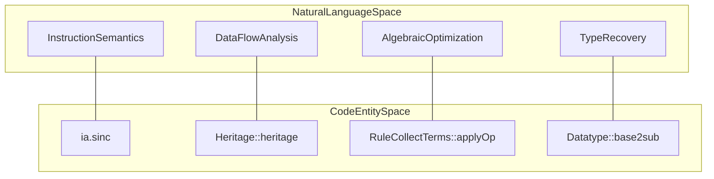
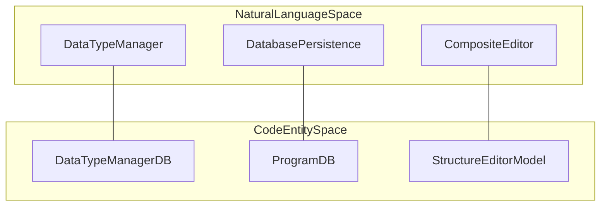
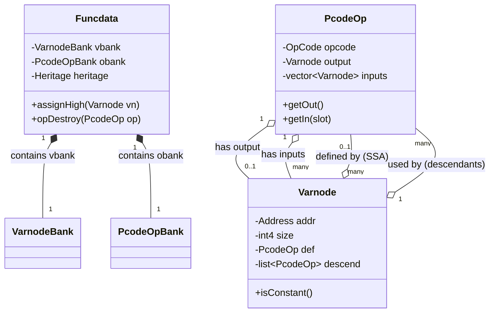

<!-- source: DeepWiki mcp.deepwiki.com · repo NationalSecurityAgency/ghidra · page 10 Glossary · fetched 2026-11-09 -->

# Glossary

Relevant source files

The following files were used as context for generating this wiki page:

- [Ghidra/Configurations/Public_Release/data/DWARF.debuginfod_urls](Ghidra/Configurations/Public_Release/data/DWARF.debuginfod_urls)
- [Ghidra/Debug/Debugger/ghidra_scripts/SearchBytesAcrossTime.java](Ghidra/Debug/Debugger/ghidra_scripts/SearchBytesAcrossTime.java)
- [Ghidra/Debug/Framework-TraceModeling/src/main/java/ghidra/trace/database/DBTraceContentHandler.java](Ghidra/Debug/Framework-TraceModeling/src/main/java/ghidra/trace/database/DBTraceContentHandler.java)
- [Ghidra/Debug/Framework-TraceModeling/src/main/java/ghidra/trace/database/context/DBTraceRegisterContextManager.java](Ghidra/Debug/Framework-TraceModeling/src/main/java/ghidra/trace/database/context/DBTraceRegisterContextManager.java)
- [Ghidra/Debug/Framework-TraceModeling/src/main/java/ghidra/trace/database/listing/DBTraceCodeSpace.java](Ghidra/Debug/Framework-TraceModeling/src/main/java/ghidra/trace/database/listing/DBTraceCodeSpace.java)
- [Ghidra/Debug/Framework-TraceModeling/src/main/java/ghidra/trace/database/listing/DBTraceCommentAdapter.java](Ghidra/Debug/Framework-TraceModeling/src/main/java/ghidra/trace/database/listing/DBTraceCommentAdapter.java)
- [Ghidra/Debug/Framework-TraceModeling/src/main/java/ghidra/trace/database/map/DBTraceAddressSnapRangePropertyMapTree.java](Ghidra/Debug/Framework-TraceModeling/src/main/java/ghidra/trace/database/map/DBTraceAddressSnapRangePropertyMapTree.java)
- [Ghidra/Debug/Framework-TraceModeling/src/main/java/ghidra/trace/database/memory/DBTraceMemoryManager.java](Ghidra/Debug/Framework-TraceModeling/src/main/java/ghidra/trace/database/memory/DBTraceMemoryManager.java)
- [Ghidra/Debug/Framework-TraceModeling/src/main/java/ghidra/trace/database/memory/DBTraceMemorySpace.java](Ghidra/Debug/Framework-TraceModeling/src/main/java/ghidra/trace/database/memory/DBTraceMemorySpace.java)
- [Ghidra/Debug/Framework-TraceModeling/src/main/java/ghidra/trace/database/program/AbstractDBTraceProgramViewListing.java](Ghidra/Debug/Framework-TraceModeling/src/main/java/ghidra/trace/database/program/AbstractDBTraceProgramViewListing.java)
- [Ghidra/Debug/Framework-TraceModeling/src/main/java/ghidra/trace/database/program/DBTraceProgramView.java](Ghidra/Debug/Framework-TraceModeling/src/main/java/ghidra/trace/database/program/DBTraceProgramView.java)
- [Ghidra/Debug/Framework-TraceModeling/src/main/java/ghidra/trace/model/memory/TraceMemoryOperations.java](Ghidra/Debug/Framework-TraceModeling/src/main/java/ghidra/trace/model/memory/TraceMemoryOperations.java)
- [Ghidra/Debug/Framework-TraceModeling/src/main/java/ghidra/trace/util/ByteArrayUtils.java](Ghidra/Debug/Framework-TraceModeling/src/main/java/ghidra/trace/util/ByteArrayUtils.java)
- [Ghidra/Debug/Framework-TraceModeling/src/main/java/ghidra/trace/util/TraceEvents.java](Ghidra/Debug/Framework-TraceModeling/src/main/java/ghidra/trace/util/TraceEvents.java)
- [Ghidra/Debug/Framework-TraceModeling/src/test/java/ghidra/trace/database/memory/AbstractDBTraceMemoryManagerMemoryTest.java](Ghidra/Debug/Framework-TraceModeling/src/test/java/ghidra/trace/database/memory/AbstractDBTraceMemoryManagerMemoryTest.java)
- [Ghidra/Features/Base/certification.manifest](Ghidra/Features/Base/certification.manifest)
- [Ghidra/Features/Base/data/base.icons.theme.properties](Ghidra/Features/Base/data/base.icons.theme.properties)
- [Ghidra/Features/Base/ghidra_scripts/DWARFSetExternalDebugFilesLocationPrescript.java](Ghidra/Features/Base/ghidra_scripts/DWARFSetExternalDebugFilesLocationPrescript.java)
- [Ghidra/Features/Base/src/main/help/help/TOC_Source.xml](Ghidra/Features/Base/src/main/help/help/TOC_Source.xml)
- [Ghidra/Features/Base/src/main/help/help/topics/Accessibility/AccessibilityOverview.html](Ghidra/Features/Base/src/main/help/help/topics/Accessibility/AccessibilityOverview.html)
- [Ghidra/Features/Base/src/main/help/help/topics/DWARFExternalDebugFilesPlugin/DWARFExternalDebugFilesPlugin.html](Ghidra/Features/Base/src/main/help/help/topics/DWARFExternalDebugFilesPlugin/DWARFExternalDebugFilesPlugin.html)
- [Ghidra/Features/Base/src/main/help/help/topics/DWARFExternalDebugFilesPlugin/images/ExternalDebugFilesConfigDialog.png](Ghidra/Features/Base/src/main/help/help/topics/DWARFExternalDebugFilesPlugin/images/ExternalDebugFilesConfigDialog.png)
- [Ghidra/Features/Base/src/main/help/help/topics/DataTypeManagerPlugin/data_type_manager_archives.html](Ghidra/Features/Base/src/main/help/help/topics/DataTypeManagerPlugin/data_type_manager_archives.html)
- [Ghidra/Features/Base/src/main/help/help/topics/GhidraScriptMgrPlugin/GhidraScriptMgrPlugin.htm](Ghidra/Features/Base/src/main/help/help/topics/GhidraScriptMgrPlugin/GhidraScriptMgrPlugin.htm)
- [Ghidra/Features/Base/src/main/help/help/topics/ResourceActionsPlugin/ResourceActions.html](Ghidra/Features/Base/src/main/help/help/topics/ResourceActionsPlugin/ResourceActions.html)
- [Ghidra/Features/Base/src/main/help/help/topics/Tool/ToolOptions_Dialog.htm](Ghidra/Features/Base/src/main/help/help/topics/Tool/ToolOptions_Dialog.htm)
- [Ghidra/Features/Base/src/main/help/help/topics/Tool/Undo_Redo.htm](Ghidra/Features/Base/src/main/help/help/topics/Tool/Undo_Redo.htm)
- [Ghidra/Features/Base/src/main/java/ghidra/app/plugin/core/misc/MyProgramChangesDisplayPlugin.java](Ghidra/Features/Base/src/main/java/ghidra/app/plugin/core/misc/MyProgramChangesDisplayPlugin.java)
- [Ghidra/Features/Base/src/main/java/ghidra/app/plugin/core/navigation/NextHighlightedRangeAction.java](Ghidra/Features/Base/src/main/java/ghidra/app/plugin/core/navigation/NextHighlightedRangeAction.java)
- [Ghidra/Features/Base/src/main/java/ghidra/app/plugin/core/navigation/NextSelectedRangeAction.java](Ghidra/Features/Base/src/main/java/ghidra/app/plugin/core/navigation/NextSelectedRangeAction.java)
- [Ghidra/Features/Base/src/main/java/ghidra/app/plugin/core/navigation/PreviousHighlightedRangeAction.java](Ghidra/Features/Base/src/main/java/ghidra/app/plugin/core/navigation/PreviousHighlightedRangeAction.java)
- [Ghidra/Features/Base/src/main/java/ghidra/app/plugin/core/navigation/PreviousSelectedRangeAction.java](Ghidra/Features/Base/src/main/java/ghidra/app/plugin/core/navigation/PreviousSelectedRangeAction.java)
- [Ghidra/Features/Base/src/main/java/ghidra/app/plugin/core/resources/ResourceActionsPlugin.java](Ghidra/Features/Base/src/main/java/ghidra/app/plugin/core/resources/ResourceActionsPlugin.java)
- [Ghidra/Features/Base/src/main/java/ghidra/app/plugin/core/totd/TipOfTheDayPlugin.java](Ghidra/Features/Base/src/main/java/ghidra/app/plugin/core/totd/TipOfTheDayPlugin.java)
- [Ghidra/Features/Base/src/main/java/ghidra/app/plugin/runtimeinfo/RuntimeInfoPlugin.java](Ghidra/Features/Base/src/main/java/ghidra/app/plugin/runtimeinfo/RuntimeInfoPlugin.java)
- [Ghidra/Features/Base/src/main/java/ghidra/app/util/bin/format/pe/LoadConfigDataDirectory.java](Ghidra/Features/Base/src/main/java/ghidra/app/util/bin/format/pe/LoadConfigDataDirectory.java)
- [Ghidra/Features/Base/src/main/java/ghidra/app/util/bin/format/pe/chpe/ChpeRangeType.java](Ghidra/Features/Base/src/main/java/ghidra/app/util/bin/format/pe/chpe/ChpeRangeType.java)
- [Ghidra/Features/Base/src/main/java/ghidra/app/util/bin/format/pe/chpe/ImageArm64ecCodeRangeEntryPoint.java](Ghidra/Features/Base/src/main/java/ghidra/app/util/bin/format/pe/chpe/ImageArm64ecCodeRangeEntryPoint.java)
- [Ghidra/Features/Base/src/main/java/ghidra/app/util/bin/format/pe/chpe/ImageArm64ecMetadata.java](Ghidra/Features/Base/src/main/java/ghidra/app/util/bin/format/pe/chpe/ImageArm64ecMetadata.java)
- [Ghidra/Features/Base/src/main/java/ghidra/app/util/bin/format/pe/chpe/ImageArm64ecRedirectionEntry.java](Ghidra/Features/Base/src/main/java/ghidra/app/util/bin/format/pe/chpe/ImageArm64ecRedirectionEntry.java)
- [Ghidra/Features/Base/src/main/java/ghidra/app/util/bin/format/pe/chpe/ImageChpeMetadataX86.java](Ghidra/Features/Base/src/main/java/ghidra/app/util/bin/format/pe/chpe/ImageChpeMetadataX86.java)
- [Ghidra/Features/Base/src/main/java/ghidra/app/util/bin/format/pe/chpe/ImageChpeRangeEntry.java](Ghidra/Features/Base/src/main/java/ghidra/app/util/bin/format/pe/chpe/ImageChpeRangeEntry.java)
- [Ghidra/Features/Base/src/main/java/ghidra/app/util/viewer/field/ResourceFieldLocation.java](Ghidra/Features/Base/src/main/java/ghidra/app/util/viewer/field/ResourceFieldLocation.java)
- [Ghidra/Features/Base/src/main/java/ghidra/test/TestProgramManager.java](Ghidra/Features/Base/src/main/java/ghidra/test/TestProgramManager.java)
- [Ghidra/Features/Base/src/test.slow/java/docking/widgets/table/model/DirData.java](Ghidra/Features/Base/src/test.slow/java/docking/widgets/table/model/DirData.java)
- [Ghidra/Features/Base/src/test.slow/java/ghidra/app/plugin/core/datamgr/DataTypeArchiveIDTest.java](Ghidra/Features/Base/src/test.slow/java/ghidra/app/plugin/core/datamgr/DataTypeArchiveIDTest.java)
- [Ghidra/Features/Base/src/test.slow/java/ghidra/framework/data/TransactionLockingTest.java](Ghidra/Features/Base/src/test.slow/java/ghidra/framework/data/TransactionLockingTest.java)
- [Ghidra/Features/Base/src/test.slow/java/ghidra/program/database/ProgramUserDataTest.java](Ghidra/Features/Base/src/test.slow/java/ghidra/program/database/ProgramUserDataTest.java)
- [Ghidra/Features/Base/src/test.slow/java/ghidra/program/database/data/DataManagerTest.java](Ghidra/Features/Base/src/test.slow/java/ghidra/program/database/data/DataManagerTest.java)
- [Ghidra/Features/Decompiler/certification.manifest](Ghidra/Features/Decompiler/certification.manifest)
- [Ghidra/Features/Decompiler/src/decompile/cpp/cast.cc](Ghidra/Features/Decompiler/src/decompile/cpp/cast.cc)
- [Ghidra/Features/Decompiler/src/decompile/cpp/cast.hh](Ghidra/Features/Decompiler/src/decompile/cpp/cast.hh)
- [Ghidra/Features/Decompiler/src/decompile/cpp/coreaction.cc](Ghidra/Features/Decompiler/src/decompile/cpp/coreaction.cc)
- [Ghidra/Features/Decompiler/src/decompile/cpp/coreaction.hh](Ghidra/Features/Decompiler/src/decompile/cpp/coreaction.hh)
- [Ghidra/Features/Decompiler/src/decompile/cpp/cover.cc](Ghidra/Features/Decompiler/src/decompile/cpp/cover.cc)
- [Ghidra/Features/Decompiler/src/decompile/cpp/cover.hh](Ghidra/Features/Decompiler/src/decompile/cpp/cover.hh)
- [Ghidra/Features/Decompiler/src/decompile/cpp/database.cc](Ghidra/Features/Decompiler/src/decompile/cpp/database.cc)
- [Ghidra/Features/Decompiler/src/decompile/cpp/database.hh](Ghidra/Features/Decompiler/src/decompile/cpp/database.hh)
- [Ghidra/Features/Decompiler/src/decompile/cpp/database_ghidra.cc](Ghidra/Features/Decompiler/src/decompile/cpp/database_ghidra.cc)
- [Ghidra/Features/Decompiler/src/decompile/cpp/database_ghidra.hh](Ghidra/Features/Decompiler/src/decompile/cpp/database_ghidra.hh)
- [Ghidra/Features/Decompiler/src/decompile/cpp/double.cc](Ghidra/Features/Decompiler/src/decompile/cpp/double.cc)
- [Ghidra/Features/Decompiler/src/decompile/cpp/double.hh](Ghidra/Features/Decompiler/src/decompile/cpp/double.hh)
- [Ghidra/Features/Decompiler/src/decompile/cpp/fspec.cc](Ghidra/Features/Decompiler/src/decompile/cpp/fspec.cc)
- [Ghidra/Features/Decompiler/src/decompile/cpp/fspec.hh](Ghidra/Features/Decompiler/src/decompile/cpp/fspec.hh)
- [Ghidra/Features/Decompiler/src/decompile/cpp/funcdata.cc](Ghidra/Features/Decompiler/src/decompile/cpp/funcdata.cc)
- [Ghidra/Features/Decompiler/src/decompile/cpp/funcdata.hh](Ghidra/Features/Decompiler/src/decompile/cpp/funcdata.hh)
- [Ghidra/Features/Decompiler/src/decompile/cpp/funcdata_op.cc](Ghidra/Features/Decompiler/src/decompile/cpp/funcdata_op.cc)
- [Ghidra/Features/Decompiler/src/decompile/cpp/funcdata_varnode.cc](Ghidra/Features/Decompiler/src/decompile/cpp/funcdata_varnode.cc)
- [Ghidra/Features/Decompiler/src/decompile/cpp/grammar.cc](Ghidra/Features/Decompiler/src/decompile/cpp/grammar.cc)
- [Ghidra/Features/Decompiler/src/decompile/cpp/grammar.y](Ghidra/Features/Decompiler/src/decompile/cpp/grammar.y)
- [Ghidra/Features/Decompiler/src/decompile/cpp/heritage.cc](Ghidra/Features/Decompiler/src/decompile/cpp/heritage.cc)
- [Ghidra/Features/Decompiler/src/decompile/cpp/heritage.hh](Ghidra/Features/Decompiler/src/decompile/cpp/heritage.hh)
- [Ghidra/Features/Decompiler/src/decompile/cpp/ifacedecomp.cc](Ghidra/Features/Decompiler/src/decompile/cpp/ifacedecomp.cc)
- [Ghidra/Features/Decompiler/src/decompile/cpp/ifacedecomp.hh](Ghidra/Features/Decompiler/src/decompile/cpp/ifacedecomp.hh)
- [Ghidra/Features/Decompiler/src/decompile/cpp/merge.cc](Ghidra/Features/Decompiler/src/decompile/cpp/merge.cc)
- [Ghidra/Features/Decompiler/src/decompile/cpp/merge.hh](Ghidra/Features/Decompiler/src/decompile/cpp/merge.hh)
- [Ghidra/Features/Decompiler/src/decompile/cpp/op.cc](Ghidra/Features/Decompiler/src/decompile/cpp/op.cc)
- [Ghidra/Features/Decompiler/src/decompile/cpp/op.hh](Ghidra/Features/Decompiler/src/decompile/cpp/op.hh)
- [Ghidra/Features/Decompiler/src/decompile/cpp/ruleaction.cc](Ghidra/Features/Decompiler/src/decompile/cpp/ruleaction.cc)
- [Ghidra/Features/Decompiler/src/decompile/cpp/ruleaction.hh](Ghidra/Features/Decompiler/src/decompile/cpp/ruleaction.hh)
- [Ghidra/Features/Decompiler/src/decompile/cpp/subflow.cc](Ghidra/Features/Decompiler/src/decompile/cpp/subflow.cc)
- [Ghidra/Features/Decompiler/src/decompile/cpp/subflow.hh](Ghidra/Features/Decompiler/src/decompile/cpp/subflow.hh)
- [Ghidra/Features/Decompiler/src/decompile/cpp/transform.cc](Ghidra/Features/Decompiler/src/decompile/cpp/transform.cc)
- [Ghidra/Features/Decompiler/src/decompile/cpp/transform.hh](Ghidra/Features/Decompiler/src/decompile/cpp/transform.hh)
- [Ghidra/Features/Decompiler/src/decompile/cpp/type.cc](Ghidra/Features/Decompiler/src/decompile/cpp/type.cc)
- [Ghidra/Features/Decompiler/src/decompile/cpp/type.hh](Ghidra/Features/Decompiler/src/decompile/cpp/type.hh)
- [Ghidra/Features/Decompiler/src/decompile/cpp/typeop.cc](Ghidra/Features/Decompiler/src/decompile/cpp/typeop.cc)
- [Ghidra/Features/Decompiler/src/decompile/cpp/typeop.hh](Ghidra/Features/Decompiler/src/decompile/cpp/typeop.hh)
- [Ghidra/Features/Decompiler/src/decompile/cpp/variable.cc](Ghidra/Features/Decompiler/src/decompile/cpp/variable.cc)
- [Ghidra/Features/Decompiler/src/decompile/cpp/variable.hh](Ghidra/Features/Decompiler/src/decompile/cpp/variable.hh)
- [Ghidra/Features/Decompiler/src/decompile/cpp/varmap.cc](Ghidra/Features/Decompiler/src/decompile/cpp/varmap.cc)
- [Ghidra/Features/Decompiler/src/decompile/cpp/varmap.hh](Ghidra/Features/Decompiler/src/decompile/cpp/varmap.hh)
- [Ghidra/Features/Decompiler/src/decompile/cpp/varnode.cc](Ghidra/Features/Decompiler/src/decompile/cpp/varnode.cc)
- [Ghidra/Features/Decompiler/src/decompile/cpp/varnode.hh](Ghidra/Features/Decompiler/src/decompile/cpp/varnode.hh)
- [Ghidra/Features/Decompiler/src/decompile/datatests/varcross.xml](Ghidra/Features/Decompiler/src/decompile/datatests/varcross.xml)
- [Ghidra/Features/Decompiler/src/main/java/ghidra/app/decompiler/DecompileDebug.java](Ghidra/Features/Decompiler/src/main/java/ghidra/app/decompiler/DecompileDebug.java)
- [Ghidra/Features/Rust/src/test.slow/java/ghidra/app/plugin/core/datamgr/RustDataTypeArchiveIDTest.java](Ghidra/Features/Rust/src/test.slow/java/ghidra/app/plugin/core/datamgr/RustDataTypeArchiveIDTest.java)
- [Ghidra/Features/VersionTracking/src/main/java/ghidra/feature/vt/api/util/EmptyVTSession.java](Ghidra/Features/VersionTracking/src/main/java/ghidra/feature/vt/api/util/EmptyVTSession.java)
- [Ghidra/Framework/Docking/src/main/help/help/topics/KeyboardNavigation/KeyboardNavigation.html](Ghidra/Framework/Docking/src/main/help/help/topics/KeyboardNavigation/KeyboardNavigation.html)
- [Ghidra/Framework/Docking/src/main/java/docking/tool/ToolConstants.java](Ghidra/Framework/Docking/src/main/java/docking/tool/ToolConstants.java)
- [Ghidra/Framework/Generic/src/main/java/ghidra/util/datastruct/Counter.java](Ghidra/Framework/Generic/src/main/java/ghidra/util/datastruct/Counter.java)
- [Ghidra/Framework/Project/src/main/java/ghidra/framework/data/AbstractTransactionManager.java](Ghidra/Framework/Project/src/main/java/ghidra/framework/data/AbstractTransactionManager.java)
- [Ghidra/Framework/Project/src/main/java/ghidra/framework/data/DomainObjectAdapterDB.java](Ghidra/Framework/Project/src/main/java/ghidra/framework/data/DomainObjectAdapterDB.java)
- [Ghidra/Framework/Project/src/main/java/ghidra/framework/data/DomainObjectDBTransaction.java](Ghidra/Framework/Project/src/main/java/ghidra/framework/data/DomainObjectDBTransaction.java)
- [Ghidra/Framework/Project/src/main/java/ghidra/framework/data/DomainObjectTransactionManager.java](Ghidra/Framework/Project/src/main/java/ghidra/framework/data/DomainObjectTransactionManager.java)
- [Ghidra/Framework/Project/src/main/java/ghidra/framework/data/SynchronizedTransactionManager.java](Ghidra/Framework/Project/src/main/java/ghidra/framework/data/SynchronizedTransactionManager.java)
- [Ghidra/Framework/Project/src/main/java/ghidra/framework/main/FrontEndTool.java](Ghidra/Framework/Project/src/main/java/ghidra/framework/main/FrontEndTool.java)
- [Ghidra/Framework/Project/src/main/java/ghidra/framework/model/DomainObject.java](Ghidra/Framework/Project/src/main/java/ghidra/framework/model/DomainObject.java)
- [Ghidra/Framework/Project/src/main/java/ghidra/framework/plugintool/PluginTool.java](Ghidra/Framework/Project/src/main/java/ghidra/framework/plugintool/PluginTool.java)
- [Ghidra/Framework/SoftwareModeling/src/main/java/ghidra/program/database/ProgramContentHandler.java](Ghidra/Framework/SoftwareModeling/src/main/java/ghidra/program/database/ProgramContentHandler.java)
- [Ghidra/Framework/SoftwareModeling/src/main/java/ghidra/program/database/ProgramDB.java](Ghidra/Framework/SoftwareModeling/src/main/java/ghidra/program/database/ProgramDB.java)
- [Ghidra/Framework/SoftwareModeling/src/main/java/ghidra/program/database/ProgramDBChangeSet.java](Ghidra/Framework/SoftwareModeling/src/main/java/ghidra/program/database/ProgramDBChangeSet.java)
- [Ghidra/Framework/SoftwareModeling/src/main/java/ghidra/program/database/ProgramUserDataDB.java](Ghidra/Framework/SoftwareModeling/src/main/java/ghidra/program/database/ProgramUserDataDB.java)
- [Ghidra/Framework/SoftwareModeling/src/main/java/ghidra/program/database/code/CodeManager.java](Ghidra/Framework/SoftwareModeling/src/main/java/ghidra/program/database/code/CodeManager.java)
- [Ghidra/Framework/SoftwareModeling/src/main/java/ghidra/program/database/data/DataTypeDB.java](Ghidra/Framework/SoftwareModeling/src/main/java/ghidra/program/database/data/DataTypeDB.java)
- [Ghidra/Framework/SoftwareModeling/src/main/java/ghidra/program/database/data/DataTypeManagerDB.java](Ghidra/Framework/SoftwareModeling/src/main/java/ghidra/program/database/data/DataTypeManagerDB.java)
- [Ghidra/Framework/SoftwareModeling/src/main/java/ghidra/program/database/data/ProgramDataTypeManager.java](Ghidra/Framework/SoftwareModeling/src/main/java/ghidra/program/database/data/ProgramDataTypeManager.java)
- [Ghidra/Framework/SoftwareModeling/src/main/java/ghidra/program/model/data/BuiltInDataTypeManager.java](Ghidra/Framework/SoftwareModeling/src/main/java/ghidra/program/model/data/BuiltInDataTypeManager.java)
- [Ghidra/Framework/SoftwareModeling/src/main/java/ghidra/program/model/data/DataTypeManager.java](Ghidra/Framework/SoftwareModeling/src/main/java/ghidra/program/model/data/DataTypeManager.java)
- [Ghidra/Framework/SoftwareModeling/src/main/java/ghidra/program/model/data/StandAloneDataTypeManager.java](Ghidra/Framework/SoftwareModeling/src/main/java/ghidra/program/model/data/StandAloneDataTypeManager.java)
- [Ghidra/Framework/SoftwareModeling/src/main/java/ghidra/program/model/listing/ProgramUserData.java](Ghidra/Framework/SoftwareModeling/src/main/java/ghidra/program/model/listing/ProgramUserData.java)
- [Ghidra/Framework/SoftwareModeling/src/main/java/ghidra/program/model/pcode/LocalSymbolMap.java](Ghidra/Framework/SoftwareModeling/src/main/java/ghidra/program/model/pcode/LocalSymbolMap.java)
- [Ghidra/Framework/SoftwareModeling/src/main/java/ghidra/program/model/pcode/PcodeDataTypeManager.java](Ghidra/Framework/SoftwareModeling/src/main/java/ghidra/program/model/pcode/PcodeDataTypeManager.java)
- [Ghidra/Framework/SoftwareModeling/src/main/java/ghidra/program/util/RegisterValueStore.java](Ghidra/Framework/SoftwareModeling/src/main/java/ghidra/program/util/RegisterValueStore.java)
- [Ghidra/Framework/SoftwareModeling/src/test/java/ghidra/program/model/StubProgram.java](Ghidra/Framework/SoftwareModeling/src/test/java/ghidra/program/model/StubProgram.java)
- [Ghidra/Processors/AARCH64/data/languages/AARCH64.dwarf](Ghidra/Processors/AARCH64/data/languages/AARCH64.dwarf)
- [Ghidra/Processors/AARCH64/data/languages/AARCH64_golang.register.info](Ghidra/Processors/AARCH64/data/languages/AARCH64_golang.register.info)
- [Ghidra/Processors/x86/certification.manifest](Ghidra/Processors/x86/certification.manifest)
- [Ghidra/Processors/x86/data/languages/avx.sinc](Ghidra/Processors/x86/data/languages/avx.sinc)
- [Ghidra/Processors/x86/data/languages/avx2.sinc](Ghidra/Processors/x86/data/languages/avx2.sinc)
- [Ghidra/Processors/x86/data/languages/avx2_manual.sinc](Ghidra/Processors/x86/data/languages/avx2_manual.sinc)
- [Ghidra/Processors/x86/data/languages/avx512.sinc](Ghidra/Processors/x86/data/languages/avx512.sinc)
- [Ghidra/Processors/x86/data/languages/avx512_manual.sinc](Ghidra/Processors/x86/data/languages/avx512_manual.sinc)
- [Ghidra/Processors/x86/data/languages/avx_manual.sinc](Ghidra/Processors/x86/data/languages/avx_manual.sinc)
- [Ghidra/Processors/x86/data/languages/cet.sinc](Ghidra/Processors/x86/data/languages/cet.sinc)
- [Ghidra/Processors/x86/data/languages/cmpccxadd.sinc](Ghidra/Processors/x86/data/languages/cmpccxadd.sinc)
- [Ghidra/Processors/x86/data/languages/fma.sinc](Ghidra/Processors/x86/data/languages/fma.sinc)
- [Ghidra/Processors/x86/data/languages/gfni.sinc](Ghidra/Processors/x86/data/languages/gfni.sinc)
- [Ghidra/Processors/x86/data/languages/ia.sinc](Ghidra/Processors/x86/data/languages/ia.sinc)
- [Ghidra/Processors/x86/data/languages/lockable.sinc](Ghidra/Processors/x86/data/languages/lockable.sinc)
- [Ghidra/Processors/x86/data/languages/macros.sinc](Ghidra/Processors/x86/data/languages/macros.sinc)
- [Ghidra/Processors/x86/data/languages/pclmulqdq.sinc](Ghidra/Processors/x86/data/languages/pclmulqdq.sinc)
- [Ghidra/Processors/x86/data/languages/rao.sinc](Ghidra/Processors/x86/data/languages/rao.sinc)
- [Ghidra/Processors/x86/data/languages/rdrand.sinc](Ghidra/Processors/x86/data/languages/rdrand.sinc)
- [Ghidra/Processors/x86/data/languages/sgx.sinc](Ghidra/Processors/x86/data/languages/sgx.sinc)
- [Ghidra/Processors/x86/data/languages/x86-64-golang.register.info](Ghidra/Processors/x86/data/languages/x86-64-golang.register.info)
- [Ghidra/Processors/x86/data/languages/x86-64.slaspec](Ghidra/Processors/x86/data/languages/x86-64.slaspec)
- [Ghidra/Processors/x86/data/languages/x86.ldefs](Ghidra/Processors/x86/data/languages/x86.ldefs)
- [Ghidra/Processors/x86/data/languages/x86.slaspec](Ghidra/Processors/x86/data/languages/x86.slaspec)
- [Ghidra/Test/IntegrationTest/src/test.slow/java/ghidra/framework/main/ProjectInfoFilesystemTest.java](Ghidra/Test/IntegrationTest/src/test.slow/java/ghidra/framework/main/ProjectInfoFilesystemTest.java)

This page defines codebase-specific terms, jargon, and domain concepts used throughout the Ghidra project. It serves as a technical reference for onboarding engineers to bridge the gap between high-level reverse engineering concepts and their specific implementations in the Ghidra source code.

## Core System Terms

### P-code
The Register Transfer Language (RTL) used by Ghidra to represent the semantics of processor instructions in a platform-independent way. 
*   **Implementation**: P-code operations are represented by the `PcodeOp` class [Ghidra/Features/Decompiler/src/decompile/cpp/op.hh:33-145]().
*   **Data Flow**: P-code operates on **Varnodes**.

Sources: [Ghidra/Features/Decompiler/src/decompile/cpp/op.hh:33-145]()

### Varnode
A formal representation of a contiguous range of bytes in a specific address space (`ram`, `register`, or `unique`). It is the fundamental unit of data in P-code.
*   **Implementation**: Defined in the `Varnode` class [Ghidra/Features/Decompiler/src/decompile/cpp/varnode.hh:61-228]().
*   **Properties**: Contains an `Address`, a size, and flags (e.g., `isConstant`, `isInput`, `isAddrForce`) [Ghidra/Features/Decompiler/src/decompile/cpp/subflow.cc:80-128]().

Sources: [Ghidra/Features/Decompiler/src/decompile/cpp/varnode.hh:61-228](), [Ghidra/Features/Decompiler/src/decompile/cpp/subflow.cc:80-128]()

### Sleigh
The domain-specific language used to describe processor instruction encodings and their P-code semantics.
*   **Files**: `.slaspec` (main specification) and `.sinc` (included files) [Ghidra/Processors/x86/data/languages/ia.sinc:1-11]().
*   **Compilation**: Compiled into `.sla` files via the Sleigh compiler subsystem.

Sources: [Ghidra/Processors/x86/data/languages/ia.sinc:1-11]()

### SSA (Static Single Assignment)
A property of the data-flow graph where every Varnode has exactly one defining P-code operation (`PcodeOp`).
*   **Manager**: The `Heritage` class is responsible for placing `CPUI_MULTIEQUAL` (phi-nodes) and transforming the function into SSA form [Ghidra/Features/Decompiler/src/decompile/cpp/heritage.hh:116-167]().

Sources: [Ghidra/Features/Decompiler/src/decompile/cpp/heritage.hh:116-167]()

---

## Decompiler Jargon

### Action / Rule
The decompiler uses a simplified "Action" and "Rule" system to perform incremental transformations on the P-code graph.
*   **Action**: A high-level task (e.g., `ActionStackPtrFlow` to solve stack offsets or `ActionSetCasts`) [Ghidra/Features/Decompiler/src/decompile/cpp/coreaction.hh:28-102]().
*   **Rule**: A fine-grained transformation that matches a specific P-code pattern. Examples include `RuleEarlyRemoval` for dead code elimination [Ghidra/Features/Decompiler/src/decompile/cpp/ruleaction.cc:23-44]() and `RuleCollectTerms` for algebraic simplification [Ghidra/Features/Decompiler/src/decompile/cpp/ruleaction.cc:107-176]().

Sources: [Ghidra/Features/Decompiler/src/decompile/cpp/coreaction.hh:28-102](), [Ghidra/Features/Decompiler/src/decompile/cpp/ruleaction.cc:23-44](), [Ghidra/Features/Decompiler/src/decompile/cpp/ruleaction.cc:107-176]()

### Funcdata
The primary container for all information related to a single function during decompilation, including its P-code bank, Varnode bank, basic blocks, and prototype.
*   **Implementation**: `Funcdata` class [Ghidra/Features/Decompiler/src/decompile/cpp/funcdata.hh:56-258]().

Sources: [Ghidra/Features/Decompiler/src/decompile/cpp/funcdata.hh:56-258]()

### Heritage
The process of moving Varnodes from "Global" or "Local" memory into the SSA data-flow tree.
*   **Source**: Managed by the `Heritage` class [Ghidra/Features/Decompiler/src/decompile/cpp/heritage.cc:1-100]().

Sources: [Ghidra/Features/Decompiler/src/decompile/cpp/heritage.cc:1-100]()

### HighVariable
A high-level representation of a variable (like a C local variable) that may be composed of multiple Varnodes across different points in time or storage locations.
*   **Assignment**: Handled during the final stages of the decompilation pipeline within `Funcdata` via `assignHigh` [Ghidra/Features/Decompiler/src/decompile/cpp/funcdata.hh:105-105]().

Sources: [Ghidra/Features/Decompiler/src/decompile/cpp/funcdata.hh:105-105]()

---

## Technical Concept Mapping

### Natural Language to Code Entity Space: Decompilation Pipeline

The following diagram maps the conceptual stages of decompilation to the specific classes and functions that handle them.

Sources: [Ghidra/Processors/x86/data/languages/ia.sinc:1-32](), [Ghidra/Features/Decompiler/src/decompile/cpp/heritage.hh:116-140](), [Ghidra/Features/Decompiler/src/decompile/cpp/ruleaction.cc:107-110](), [Ghidra/Features/Decompiler/src/decompile/cpp/type.cc:23-27]()

### Natural Language to Code Entity Space: Data Management

This diagram maps data type management and database integration concepts to their corresponding Java classes.

Sources: [Ghidra/Framework/SoftwareModeling/src/main/java/ghidra/program/database/data/DataTypeManagerDB.java:67-150]()

---

## Data Structure Relationships

The relationship between `Funcdata`, `PcodeOp`, and `Varnode` is central to the decompiler's operation.

Sources: [Ghidra/Features/Decompiler/src/decompile/cpp/funcdata.hh:92-120](), [Ghidra/Features/Decompiler/src/decompile/cpp/op.hh:33-100](), [Ghidra/Features/Decompiler/src/decompile/cpp/varnode.hh:61-150]()

---

## Glossary Table

| Term | Definition | Key File/Class |
| :--- | :--- | :--- |
| **Address Space** | A logical grouping of memory (e.g., `ram`, `register`, `unique`) [Ghidra/Processors/x86/data/languages/ia.sinc:13-14]() | `AddrSpace` |
| **Basic Block** | A sequence of P-code operations with one entry and one exit [Ghidra/Features/Decompiler/src/decompile/cpp/funcdata.hh:94-95]() | `BlockBasic` |
| **DTM** | Data Type Manager; handles the hierarchy of types | `DataTypeManagerDB` [Ghidra/Framework/SoftwareModeling/src/main/java/ghidra/program/database/data/DataTypeManagerDB.java:67-80]() |
| **Laned Register** | A SIMD register treated as a vector of smaller elements [Ghidra/Features/Decompiler/src/decompile/cpp/funcdata.hh:100-100]() | `LanedRegister` |
| **ParamEntry** | Describes a potential storage location for a function parameter or return value [Ghidra/Features/Decompiler/src/decompile/cpp/fspec.hh:54-100]() | `ParamEntry` |
| **SLA** | Compiled Sleigh specification file | `.sla` |
| **SubvariableFlow** | Logic for tracing logical values that are smaller than the Varnodes containing them [Ghidra/Features/Decompiler/src/decompile/cpp/subflow.cc:66-80]() | `SubvariableFlow` |
| **Unique Space** | A temporary address space for virtual registers in P-code | `IPTR_INTERNAL` |
| **FIDB** | Function ID Database used for library function identification | `.fidb` |

Sources: [Ghidra/Processors/x86/data/languages/ia.sinc:13-14](), [Ghidra/Features/Decompiler/src/decompile/cpp/funcdata.hh:92-100](), [Ghidra/Framework/SoftwareModeling/src/main/java/ghidra/program/database/data/DataTypeManagerDB.java:67-80](), [Ghidra/Features/Decompiler/src/decompile/cpp/fspec.hh:54-100](), [Ghidra/Features/Decompiler/src/decompile/cpp/subflow.cc:66-80]()