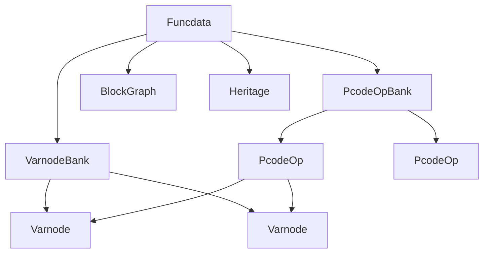
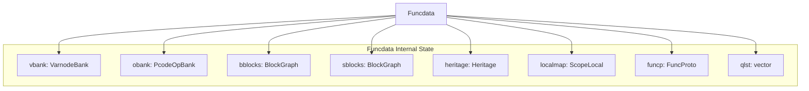
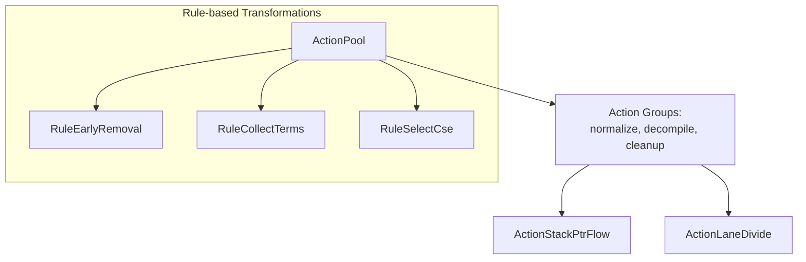

<!-- source: DeepWiki mcp.deepwiki.com · repo NationalSecurityAgency/ghidra · page 2 Decompiler System · fetched 2026-11-09 -->

# Decompiler System

Relevant source files

The following files were used as context for generating this wiki page:

- [Ghidra/Features/Base/src/main/help/help/topics/CodeBrowserPlugin/Browser_Field_Formatter.htm](Ghidra/Features/Base/src/main/help/help/topics/CodeBrowserPlugin/Browser_Field_Formatter.htm)
- [Ghidra/Features/Base/src/main/java/ghidra/app/plugin/core/symtable/NewSymbolFilter.java](Ghidra/Features/Base/src/main/java/ghidra/app/plugin/core/symtable/NewSymbolFilter.java)
- [Ghidra/Features/Decompiler/build.gradle](Ghidra/Features/Decompiler/build.gradle)
- [Ghidra/Features/Decompiler/certification.manifest](Ghidra/Features/Decompiler/certification.manifest)
- [Ghidra/Features/Decompiler/src/decompile/cpp/Makefile](Ghidra/Features/Decompiler/src/decompile/cpp/Makefile)
- [Ghidra/Features/Decompiler/src/decompile/cpp/address.cc](Ghidra/Features/Decompiler/src/decompile/cpp/address.cc)
- [Ghidra/Features/Decompiler/src/decompile/cpp/address.hh](Ghidra/Features/Decompiler/src/decompile/cpp/address.hh)
- [Ghidra/Features/Decompiler/src/decompile/cpp/architecture.cc](Ghidra/Features/Decompiler/src/decompile/cpp/architecture.cc)
- [Ghidra/Features/Decompiler/src/decompile/cpp/architecture.hh](Ghidra/Features/Decompiler/src/decompile/cpp/architecture.hh)
- [Ghidra/Features/Decompiler/src/decompile/cpp/cast.cc](Ghidra/Features/Decompiler/src/decompile/cpp/cast.cc)
- [Ghidra/Features/Decompiler/src/decompile/cpp/cast.hh](Ghidra/Features/Decompiler/src/decompile/cpp/cast.hh)
- [Ghidra/Features/Decompiler/src/decompile/cpp/coreaction.cc](Ghidra/Features/Decompiler/src/decompile/cpp/coreaction.cc)
- [Ghidra/Features/Decompiler/src/decompile/cpp/coreaction.hh](Ghidra/Features/Decompiler/src/decompile/cpp/coreaction.hh)
- [Ghidra/Features/Decompiler/src/decompile/cpp/cover.cc](Ghidra/Features/Decompiler/src/decompile/cpp/cover.cc)
- [Ghidra/Features/Decompiler/src/decompile/cpp/cover.hh](Ghidra/Features/Decompiler/src/decompile/cpp/cover.hh)
- [Ghidra/Features/Decompiler/src/decompile/cpp/database.cc](Ghidra/Features/Decompiler/src/decompile/cpp/database.cc)
- [Ghidra/Features/Decompiler/src/decompile/cpp/database.hh](Ghidra/Features/Decompiler/src/decompile/cpp/database.hh)
- [Ghidra/Features/Decompiler/src/decompile/cpp/database_ghidra.cc](Ghidra/Features/Decompiler/src/decompile/cpp/database_ghidra.cc)
- [Ghidra/Features/Decompiler/src/decompile/cpp/database_ghidra.hh](Ghidra/Features/Decompiler/src/decompile/cpp/database_ghidra.hh)
- [Ghidra/Features/Decompiler/src/decompile/cpp/double.cc](Ghidra/Features/Decompiler/src/decompile/cpp/double.cc)
- [Ghidra/Features/Decompiler/src/decompile/cpp/double.hh](Ghidra/Features/Decompiler/src/decompile/cpp/double.hh)
- [Ghidra/Features/Decompiler/src/decompile/cpp/float.cc](Ghidra/Features/Decompiler/src/decompile/cpp/float.cc)
- [Ghidra/Features/Decompiler/src/decompile/cpp/float.hh](Ghidra/Features/Decompiler/src/decompile/cpp/float.hh)
- [Ghidra/Features/Decompiler/src/decompile/cpp/fspec.cc](Ghidra/Features/Decompiler/src/decompile/cpp/fspec.cc)
- [Ghidra/Features/Decompiler/src/decompile/cpp/fspec.hh](Ghidra/Features/Decompiler/src/decompile/cpp/fspec.hh)
- [Ghidra/Features/Decompiler/src/decompile/cpp/funcdata.cc](Ghidra/Features/Decompiler/src/decompile/cpp/funcdata.cc)
- [Ghidra/Features/Decompiler/src/decompile/cpp/funcdata.hh](Ghidra/Features/Decompiler/src/decompile/cpp/funcdata.hh)
- [Ghidra/Features/Decompiler/src/decompile/cpp/funcdata_op.cc](Ghidra/Features/Decompiler/src/decompile/cpp/funcdata_op.cc)
- [Ghidra/Features/Decompiler/src/decompile/cpp/funcdata_varnode.cc](Ghidra/Features/Decompiler/src/decompile/cpp/funcdata_varnode.cc)
- [Ghidra/Features/Decompiler/src/decompile/cpp/grammar.cc](Ghidra/Features/Decompiler/src/decompile/cpp/grammar.cc)
- [Ghidra/Features/Decompiler/src/decompile/cpp/grammar.y](Ghidra/Features/Decompiler/src/decompile/cpp/grammar.y)
- [Ghidra/Features/Decompiler/src/decompile/cpp/heritage.cc](Ghidra/Features/Decompiler/src/decompile/cpp/heritage.cc)
- [Ghidra/Features/Decompiler/src/decompile/cpp/heritage.hh](Ghidra/Features/Decompiler/src/decompile/cpp/heritage.hh)
- [Ghidra/Features/Decompiler/src/decompile/cpp/ifacedecomp.cc](Ghidra/Features/Decompiler/src/decompile/cpp/ifacedecomp.cc)
- [Ghidra/Features/Decompiler/src/decompile/cpp/ifacedecomp.hh](Ghidra/Features/Decompiler/src/decompile/cpp/ifacedecomp.hh)
- [Ghidra/Features/Decompiler/src/decompile/cpp/merge.cc](Ghidra/Features/Decompiler/src/decompile/cpp/merge.cc)
- [Ghidra/Features/Decompiler/src/decompile/cpp/merge.hh](Ghidra/Features/Decompiler/src/decompile/cpp/merge.hh)
- [Ghidra/Features/Decompiler/src/decompile/cpp/op.cc](Ghidra/Features/Decompiler/src/decompile/cpp/op.cc)
- [Ghidra/Features/Decompiler/src/decompile/cpp/op.hh](Ghidra/Features/Decompiler/src/decompile/cpp/op.hh)
- [Ghidra/Features/Decompiler/src/decompile/cpp/options.cc](Ghidra/Features/Decompiler/src/decompile/cpp/options.cc)
- [Ghidra/Features/Decompiler/src/decompile/cpp/options.hh](Ghidra/Features/Decompiler/src/decompile/cpp/options.hh)
- [Ghidra/Features/Decompiler/src/decompile/cpp/ruleaction.cc](Ghidra/Features/Decompiler/src/decompile/cpp/ruleaction.cc)
- [Ghidra/Features/Decompiler/src/decompile/cpp/ruleaction.hh](Ghidra/Features/Decompiler/src/decompile/cpp/ruleaction.hh)
- [Ghidra/Features/Decompiler/src/decompile/cpp/space.cc](Ghidra/Features/Decompiler/src/decompile/cpp/space.cc)
- [Ghidra/Features/Decompiler/src/decompile/cpp/space.hh](Ghidra/Features/Decompiler/src/decompile/cpp/space.hh)
- [Ghidra/Features/Decompiler/src/decompile/cpp/subflow.cc](Ghidra/Features/Decompiler/src/decompile/cpp/subflow.cc)
- [Ghidra/Features/Decompiler/src/decompile/cpp/subflow.hh](Ghidra/Features/Decompiler/src/decompile/cpp/subflow.hh)
- [Ghidra/Features/Decompiler/src/decompile/cpp/transform.cc](Ghidra/Features/Decompiler/src/decompile/cpp/transform.cc)
- [Ghidra/Features/Decompiler/src/decompile/cpp/transform.hh](Ghidra/Features/Decompiler/src/decompile/cpp/transform.hh)
- [Ghidra/Features/Decompiler/src/decompile/cpp/translate.cc](Ghidra/Features/Decompiler/src/decompile/cpp/translate.cc)
- [Ghidra/Features/Decompiler/src/decompile/cpp/translate.hh](Ghidra/Features/Decompiler/src/decompile/cpp/translate.hh)
- [Ghidra/Features/Decompiler/src/decompile/cpp/type.cc](Ghidra/Features/Decompiler/src/decompile/cpp/type.cc)
- [Ghidra/Features/Decompiler/src/decompile/cpp/type.hh](Ghidra/Features/Decompiler/src/decompile/cpp/type.hh)
- [Ghidra/Features/Decompiler/src/decompile/cpp/typeop.cc](Ghidra/Features/Decompiler/src/decompile/cpp/typeop.cc)
- [Ghidra/Features/Decompiler/src/decompile/cpp/typeop.hh](Ghidra/Features/Decompiler/src/decompile/cpp/typeop.hh)
- [Ghidra/Features/Decompiler/src/decompile/cpp/variable.cc](Ghidra/Features/Decompiler/src/decompile/cpp/variable.cc)
- [Ghidra/Features/Decompiler/src/decompile/cpp/variable.hh](Ghidra/Features/Decompiler/src/decompile/cpp/variable.hh)
- [Ghidra/Features/Decompiler/src/decompile/cpp/varmap.cc](Ghidra/Features/Decompiler/src/decompile/cpp/varmap.cc)
- [Ghidra/Features/Decompiler/src/decompile/cpp/varmap.hh](Ghidra/Features/Decompiler/src/decompile/cpp/varmap.hh)
- [Ghidra/Features/Decompiler/src/decompile/cpp/varnode.cc](Ghidra/Features/Decompiler/src/decompile/cpp/varnode.cc)
- [Ghidra/Features/Decompiler/src/decompile/cpp/varnode.hh](Ghidra/Features/Decompiler/src/decompile/cpp/varnode.hh)
- [Ghidra/Features/Decompiler/src/decompile/datatests/varcross.xml](Ghidra/Features/Decompiler/src/decompile/datatests/varcross.xml)
- [Ghidra/Features/Decompiler/src/main/doc/decompileplugin.xml](Ghidra/Features/Decompiler/src/main/doc/decompileplugin.xml)
- [Ghidra/Features/Decompiler/src/main/doc/decompileplugin_common.xsl](Ghidra/Features/Decompiler/src/main/doc/decompileplugin_common.xsl)
- [Ghidra/Features/Decompiler/src/main/doc/decompileplugin_pdf.xsl](Ghidra/Features/Decompiler/src/main/doc/decompileplugin_pdf.xsl)
- [Ghidra/Features/Decompiler/src/main/help/help/topics/DecompilePlugin/DecompilerAnnotations.html](Ghidra/Features/Decompiler/src/main/help/help/topics/DecompilePlugin/DecompilerAnnotations.html)
- [Ghidra/Features/Decompiler/src/main/help/help/topics/DecompilePlugin/DecompilerConcepts.html](Ghidra/Features/Decompiler/src/main/help/help/topics/DecompilePlugin/DecompilerConcepts.html)
- [Ghidra/Features/Decompiler/src/main/help/help/topics/DecompilePlugin/DecompilerIntro.html](Ghidra/Features/Decompiler/src/main/help/help/topics/DecompilePlugin/DecompilerIntro.html)
- [Ghidra/Features/Decompiler/src/main/help/help/topics/DecompilePlugin/DecompilerOptions.html](Ghidra/Features/Decompiler/src/main/help/help/topics/DecompilePlugin/DecompilerOptions.html)
- [Ghidra/Features/Decompiler/src/main/help/help/topics/DecompilePlugin/DecompilerWindow.html](Ghidra/Features/Decompiler/src/main/help/help/topics/DecompilePlugin/DecompilerWindow.html)
- [Ghidra/Features/Decompiler/src/main/java/ghidra/app/decompiler/DecompileDebug.java](Ghidra/Features/Decompiler/src/main/java/ghidra/app/decompiler/DecompileDebug.java)
- [Ghidra/Features/Decompiler/src/main/java/ghidra/app/decompiler/DecompileOptions.java](Ghidra/Features/Decompiler/src/main/java/ghidra/app/decompiler/DecompileOptions.java)
- [Ghidra/Features/VersionTracking/src/main/java/ghidra/feature/vt/gui/provider/matchtable/SymbolTypeFilter.java](Ghidra/Features/VersionTracking/src/main/java/ghidra/feature/vt/gui/provider/matchtable/SymbolTypeFilter.java)
- [Ghidra/Framework/SoftwareModeling/src/main/java/ghidra/program/database/function/FunctionAdapter.java](Ghidra/Framework/SoftwareModeling/src/main/java/ghidra/program/database/function/FunctionAdapter.java)
- [Ghidra/Framework/SoftwareModeling/src/main/java/ghidra/program/database/references/RefListFlagsV0.java](Ghidra/Framework/SoftwareModeling/src/main/java/ghidra/program/database/references/RefListFlagsV0.java)
- [Ghidra/Framework/SoftwareModeling/src/main/java/ghidra/program/model/pcode/LocalSymbolMap.java](Ghidra/Framework/SoftwareModeling/src/main/java/ghidra/program/model/pcode/LocalSymbolMap.java)
- [Ghidra/Framework/SoftwareModeling/src/main/java/ghidra/program/model/pcode/PcodeDataTypeManager.java](Ghidra/Framework/SoftwareModeling/src/main/java/ghidra/program/model/pcode/PcodeDataTypeManager.java)
- [Ghidra/Framework/SoftwareModeling/src/main/java/ghidra/program/model/symbol/SourceType.java](Ghidra/Framework/SoftwareModeling/src/main/java/ghidra/program/model/symbol/SourceType.java)

## Purpose and Scope

The Decompiler System transforms raw p-code operations into high-level C code by performing SSA construction, data-flow analysis, type propagation, and control-flow recovery. This document describes the overall architecture, core data structures, and transformation pipeline. 

As a parent page, this section provides a high-level overview. For specific subsystems and detailed deep-dives, see the following child pages:
- Core decompilation pipeline and data structures: [Core Decompilation Process](#2.1)
- Rule-based transformation framework: [Actions and Rules System](#2.2)
- Type inference, metatypes, and propagation: [Type System and Propagation](#2.3)
- SSA form construction and def-use chains: [SSA Construction and Data Flow](#2.4)
- Varnode optimization and splitting: [Varnode Management and Optimization](#2.5)
- Function signature and local variable recovery: [Function Prototype and Symbol Recovery](#2.6)
- C++ Class hierarchy and RTTI recovery: [C++ Class Recovery from RTTI](#2.7)
- GUI components, IPC, and Java bridge: [Decompiler UI and Java Bridge](#2.8)
- CFG structuring, jump tables, and C source emission: [Control Flow Structuring and Code Emission](#2.9)

The decompiler operates on a single function at a time, represented by the `Funcdata` class, and progressively refines its internal representation through a series of transformation passes.

Sources: [Ghidra/Features/Decompiler/src/decompile/cpp/funcdata.hh:41-98]()

## Architecture Overview

The decompiler uses a multi-pass architecture where each pass applies a set of transformations to improve the intermediate representation. The system maintains three core data structures throughout the analysis: `Varnode`, `PcodeOp`, and `BlockGraph`, all managed by the central `Funcdata` container.

Sources: [Ghidra/Features/Decompiler/src/decompile/cpp/funcdata.hh:41-98]()

| Class | Purpose | Key Responsibilities |
|-------|---------|---------------------|
| `Funcdata` | Function-level container | Coordinates all analysis, manages Varnodes and PcodeOps, orchestrates transformations. |
| `Varnode` | Storage location value | Represents a value in a specific storage location at a specific point in time. |
| `PcodeOp` | Operation | Represents a single p-code operation with inputs and output. |
| `Heritage` | SSA construction | Builds and maintains Static Single Assignment form. |
| `VarnodeBank` | Varnode storage | Allocates and manages all `Varnode` objects via `vbank`. |
| `PcodeOpBank` | PcodeOp storage | Allocates and manages all `PcodeOp` objects via `obank`. |

Sources: [Ghidra/Features/Decompiler/src/decompile/cpp/funcdata.hh:56-137](), [Ghidra/Features/Decompiler/src/decompile/cpp/varnode.hh:162-206]()

## Core Data Structures

### Funcdata: The Function Container

The `Funcdata` class serves as the central coordinator for all decompilation activities. It holds references to all major subsystems and provides the primary API for querying and manipulating the function's intermediate representation. For details on its lifecycle and the broader decompilation pipeline, see [Core Decompilation Process](#2.1).

Sources: [Ghidra/Features/Decompiler/src/decompile/cpp/funcdata.hh:74-98]()

### Varnode and PcodeOp Representation

A `Varnode` represents a value stored at a specific address with a specific size. Varnodes act as nodes in the data-flow graph. Each `PcodeOp` represents an elementary instruction (such as addition, copy, or memory load/store) connecting input and output Varnodes. 

For comprehensive details on varnode flags, subvariable flows, and optimization, see [Varnode Management and Optimization](#2.5).

Sources: [Ghidra/Features/Decompiler/src/decompile/cpp/varnode.hh:162-206](), [Ghidra/Features/Decompiler/src/decompile/cpp/op.hh:119-201]()

## Transformation Pipeline and Subsystems

The decompiler applies transformations using an `Action` and `Rule` framework, transitioning the function from raw p-code to structured high-level representations.

Sources: [Ghidra/Features/Decompiler/src/decompile/cpp/action.hh](), [Ghidra/Features/Decompiler/src/decompile/cpp/coreaction.cc:34-51](), [Ghidra/Features/Decompiler/src/decompile/cpp/ruleaction.cc:25-44]()

### Summary of Subsystem Child Pages

- **Actions and Rules:** Incremental code simplification via pattern matching and rewriting is managed through the `Action` and `Rule` infrastructure. For details, see [Actions and Rules System](#2.2).
- **Type System:** Data types follow a `type_metatype` and `sub_metatype` hierarchy that governs inference and propagation through data-flow edges. For details, see [Type System and Propagation](#2.3).
- **SSA Construction:** The `Heritage` subsystem converts memory/register writes into SSA form, using `LocationMap` and inserting `CPUI_MULTIEQUAL` (phi) functions. For details, see [SSA Construction and Data Flow](#2.4).
- **Function Prototypes & Symbols:** Calling conventions, parameters, return values, and local variable mapping are handled via symbol management. For details, see [Function Prototype and Symbol Recovery](#2.6).
- **C++ Class Recovery:** Recovering class hierarchies, `vftable` structures, and methods from RTTI metadata is handled by specialized recovery classes. For details, see [C++ Class Recovery from RTTI](#2.7).
- **UI and Bridge:** Interactive UI rendering, token highlighting, and IPC communication are handled via Java-C++ bridges. For details, see [Decompiler UI and Java Bridge](#2.8).
- **Control Flow & Emission:** Control-flow graph structuring, jump table recovery, and final C source emission are handled by language print modules. For details, see [Control Flow Structuring and Code Emission](#2.9).

Sources: [Ghidra/Features/Decompiler/src/decompile/cpp/type.hh:80-100](), [Ghidra/Features/Decompiler/src/decompile/cpp/heritage.cc:33-70]()

---

