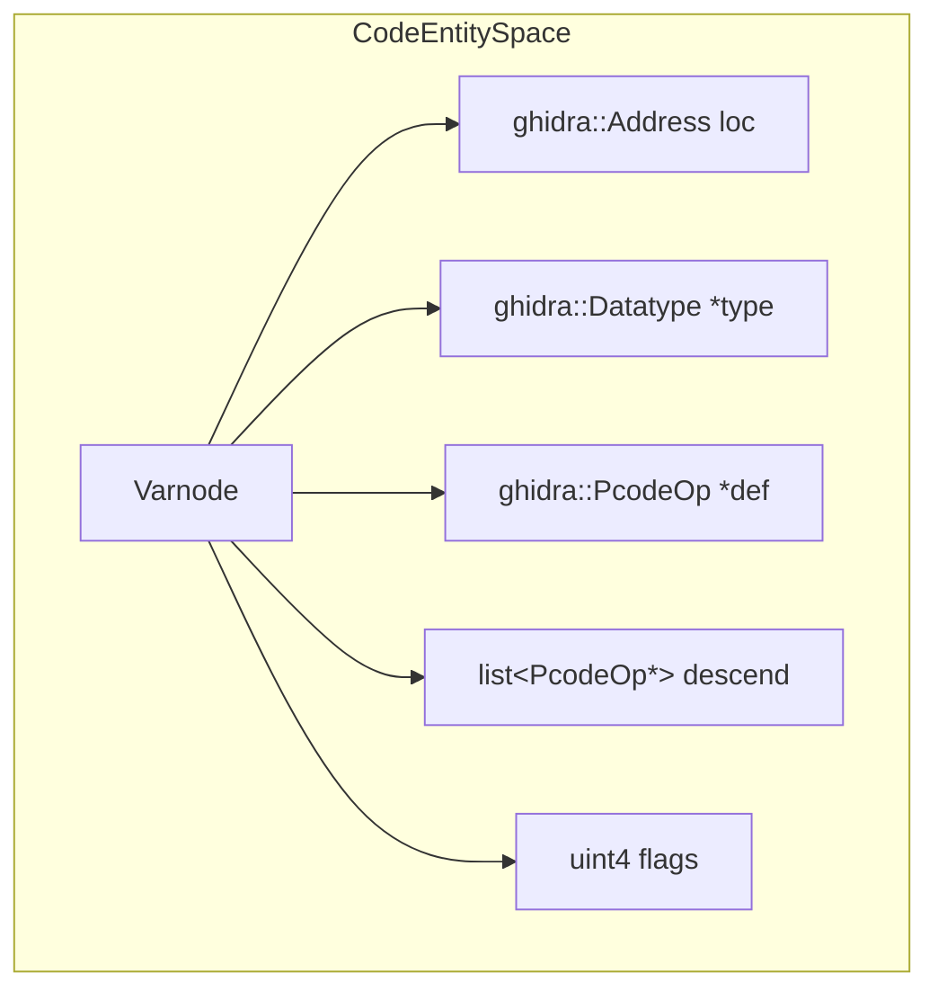
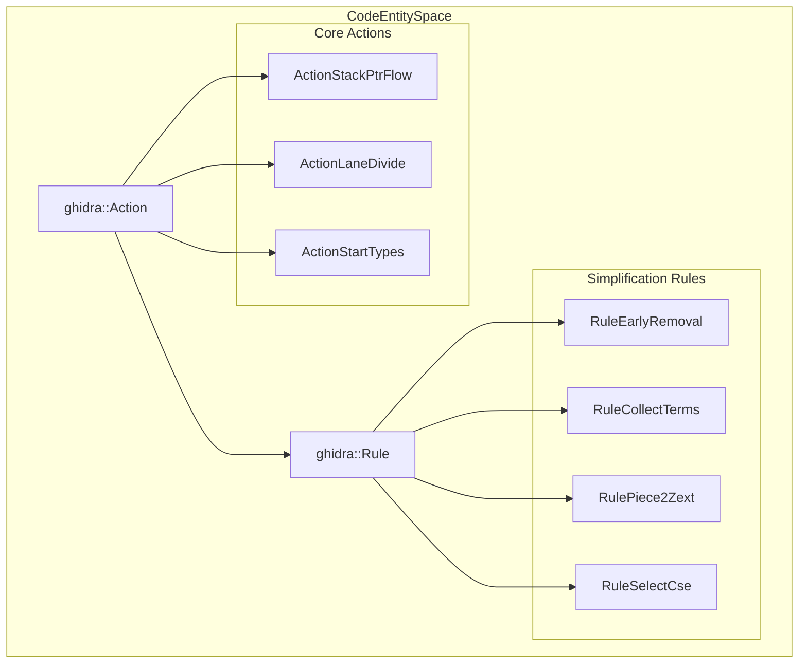

<!-- source: DeepWiki mcp.deepwiki.com · repo NationalSecurityAgency/ghidra · page 2.1 Core Decompilation Process · fetched 2026-11-09 -->

# Core Decompilation Process

Relevant source files

The following files were used as context for generating this wiki page:

- [Ghidra/Features/Base/src/main/help/help/topics/CodeBrowserPlugin/Browser_Field_Formatter.htm](Ghidra/Features/Base/src/main/help/help/topics/CodeBrowserPlugin/Browser_Field_Formatter.htm)
- [Ghidra/Features/Base/src/main/java/ghidra/app/plugin/core/symtable/NewSymbolFilter.java](Ghidra/Features/Base/src/main/java/ghidra/app/plugin/core/symtable/NewSymbolFilter.java)
- [Ghidra/Features/Decompiler/build.gradle](Ghidra/Features/Decompiler/build.gradle)
- [Ghidra/Features/Decompiler/certification.manifest](Ghidra/Features/Decompiler/certification.manifest)
- [Ghidra/Features/Decompiler/src/decompile/cpp/Makefile](Ghidra/Features/Decompiler/src/decompile/cpp/Makefile)
- [Ghidra/Features/Decompiler/src/decompile/cpp/address.cc](Ghidra/Features/Decompiler/src/decompile/cpp/address.cc)
- [Ghidra/Features/Decompiler/src/decompile/cpp/address.hh](Ghidra/Features/Decompiler/src/decompile/cpp/address.hh)
- [Ghidra/Features/Decompiler/src/decompile/cpp/architecture.cc](Ghidra/Features/Decompiler/src/decompile/cpp/architecture.cc)
- [Ghidra/Features/Decompiler/src/decompile/cpp/architecture.hh](Ghidra/Features/Decompiler/src/decompile/cpp/architecture.hh)
- [Ghidra/Features/Decompiler/src/decompile/cpp/cast.cc](Ghidra/Features/Decompiler/src/decompile/cpp/cast.cc)
- [Ghidra/Features/Decompiler/src/decompile/cpp/cast.hh](Ghidra/Features/Decompiler/src/decompile/cpp/cast.hh)
- [Ghidra/Features/Decompiler/src/decompile/cpp/coreaction.cc](Ghidra/Features/Decompiler/src/decompile/cpp/coreaction.cc)
- [Ghidra/Features/Decompiler/src/decompile/cpp/coreaction.hh](Ghidra/Features/Decompiler/src/decompile/cpp/coreaction.hh)
- [Ghidra/Features/Decompiler/src/decompile/cpp/cover.cc](Ghidra/Features/Decompiler/src/decompile/cpp/cover.cc)
- [Ghidra/Features/Decompiler/src/decompile/cpp/cover.hh](Ghidra/Features/Decompiler/src/decompile/cpp/cover.hh)
- [Ghidra/Features/Decompiler/src/decompile/cpp/database.cc](Ghidra/Features/Decompiler/src/decompile/cpp/database.cc)
- [Ghidra/Features/Decompiler/src/decompile/cpp/database.hh](Ghidra/Features/Decompiler/src/decompile/cpp/database.hh)
- [Ghidra/Features/Decompiler/src/decompile/cpp/database_ghidra.cc](Ghidra/Features/Decompiler/src/decompile/cpp/database_ghidra.cc)
- [Ghidra/Features/Decompiler/src/decompile/cpp/database_ghidra.hh](Ghidra/Features/Decompiler/src/decompile/cpp/database_ghidra.hh)
- [Ghidra/Features/Decompiler/src/decompile/cpp/double.cc](Ghidra/Features/Decompiler/src/decompile/cpp/double.cc)
- [Ghidra/Features/Decompiler/src/decompile/cpp/double.hh](Ghidra/Features/Decompiler/src/decompile/cpp/double.hh)
- [Ghidra/Features/Decompiler/src/decompile/cpp/float.cc](Ghidra/Features/Decompiler/src/decompile/cpp/float.cc)
- [Ghidra/Features/Decompiler/src/decompile/cpp/float.hh](Ghidra/Features/Decompiler/src/decompile/cpp/float.hh)
- [Ghidra/Features/Decompiler/src/decompile/cpp/fspec.cc](Ghidra/Features/Decompiler/src/decompile/cpp/fspec.cc)
- [Ghidra/Features/Decompiler/src/decompile/cpp/fspec.hh](Ghidra/Features/Decompiler/src/decompile/cpp/fspec.hh)
- [Ghidra/Features/Decompiler/src/decompile/cpp/funcdata.cc](Ghidra/Features/Decompiler/src/decompile/cpp/funcdata.cc)
- [Ghidra/Features/Decompiler/src/decompile/cpp/funcdata.hh](Ghidra/Features/Decompiler/src/decompile/cpp/funcdata.hh)
- [Ghidra/Features/Decompiler/src/decompile/cpp/funcdata_op.cc](Ghidra/Features/Decompiler/src/decompile/cpp/funcdata_op.cc)
- [Ghidra/Features/Decompiler/src/decompile/cpp/funcdata_varnode.cc](Ghidra/Features/Decompiler/src/decompile/cpp/funcdata_varnode.cc)
- [Ghidra/Features/Decompiler/src/decompile/cpp/grammar.cc](Ghidra/Features/Decompiler/src/decompile/cpp/grammar.cc)
- [Ghidra/Features/Decompiler/src/decompile/cpp/grammar.y](Ghidra/Features/Decompiler/src/decompile/cpp/grammar.y)
- [Ghidra/Features/Decompiler/src/decompile/cpp/heritage.cc](Ghidra/Features/Decompiler/src/decompile/cpp/heritage.cc)
- [Ghidra/Features/Decompiler/src/decompile/cpp/heritage.hh](Ghidra/Features/Decompiler/src/decompile/cpp/heritage.hh)
- [Ghidra/Features/Decompiler/src/decompile/cpp/ifacedecomp.cc](Ghidra/Features/Decompiler/src/decompile/cpp/ifacedecomp.cc)
- [Ghidra/Features/Decompiler/src/decompile/cpp/ifacedecomp.hh](Ghidra/Features/Decompiler/src/decompile/cpp/ifacedecomp.hh)
- [Ghidra/Features/Decompiler/src/decompile/cpp/merge.cc](Ghidra/Features/Decompiler/src/decompile/cpp/merge.cc)
- [Ghidra/Features/Decompiler/src/decompile/cpp/merge.hh](Ghidra/Features/Decompiler/src/decompile/cpp/merge.hh)
- [Ghidra/Features/Decompiler/src/decompile/cpp/op.cc](Ghidra/Features/Decompiler/src/decompile/cpp/op.cc)
- [Ghidra/Features/Decompiler/src/decompile/cpp/op.hh](Ghidra/Features/Decompiler/src/decompile/cpp/op.hh)
- [Ghidra/Features/Decompiler/src/decompile/cpp/options.cc](Ghidra/Features/Decompiler/src/decompile/cpp/options.cc)
- [Ghidra/Features/Decompiler/src/decompile/cpp/options.hh](Ghidra/Features/Decompiler/src/decompile/cpp/options.hh)
- [Ghidra/Features/Decompiler/src/decompile/cpp/ruleaction.cc](Ghidra/Features/Decompiler/src/decompile/cpp/ruleaction.cc)
- [Ghidra/Features/Decompiler/src/decompile/cpp/ruleaction.hh](Ghidra/Features/Decompiler/src/decompile/cpp/ruleaction.hh)
- [Ghidra/Features/Decompiler/src/decompile/cpp/space.cc](Ghidra/Features/Decompiler/src/decompile/cpp/space.cc)
- [Ghidra/Features/Decompiler/src/decompile/cpp/space.hh](Ghidra/Features/Decompiler/src/decompile/cpp/space.hh)
- [Ghidra/Features/Decompiler/src/decompile/cpp/subflow.cc](Ghidra/Features/Decompiler/src/decompile/cpp/subflow.cc)
- [Ghidra/Features/Decompiler/src/decompile/cpp/subflow.hh](Ghidra/Features/Decompiler/src/decompile/cpp/subflow.hh)
- [Ghidra/Features/Decompiler/src/decompile/cpp/transform.cc](Ghidra/Features/Decompiler/src/decompile/cpp/transform.cc)
- [Ghidra/Features/Decompiler/src/decompile/cpp/transform.hh](Ghidra/Features/Decompiler/src/decompile/cpp/transform.hh)
- [Ghidra/Features/Decompiler/src/decompile/cpp/translate.cc](Ghidra/Features/Decompiler/src/decompile/cpp/translate.cc)
- [Ghidra/Features/Decompiler/src/decompile/cpp/translate.hh](Ghidra/Features/Decompiler/src/decompile/cpp/translate.hh)
- [Ghidra/Features/Decompiler/src/decompile/cpp/type.cc](Ghidra/Features/Decompiler/src/decompile/cpp/type.cc)
- [Ghidra/Features/Decompiler/src/decompile/cpp/type.hh](Ghidra/Features/Decompiler/src/decompile/cpp/type.hh)
- [Ghidra/Features/Decompiler/src/decompile/cpp/typeop.cc](Ghidra/Features/Decompiler/src/decompile/cpp/typeop.cc)
- [Ghidra/Features/Decompiler/src/decompile/cpp/typeop.hh](Ghidra/Features/Decompiler/src/decompile/cpp/typeop.hh)
- [Ghidra/Features/Decompiler/src/decompile/cpp/variable.cc](Ghidra/Features/Decompiler/src/decompile/cpp/variable.cc)
- [Ghidra/Features/Decompiler/src/decompile/cpp/variable.hh](Ghidra/Features/Decompiler/src/decompile/cpp/variable.hh)
- [Ghidra/Features/Decompiler/src/decompile/cpp/varmap.cc](Ghidra/Features/Decompiler/src/decompile/cpp/varmap.cc)
- [Ghidra/Features/Decompiler/src/decompile/cpp/varmap.hh](Ghidra/Features/Decompiler/src/decompile/cpp/varmap.hh)
- [Ghidra/Features/Decompiler/src/decompile/cpp/varnode.cc](Ghidra/Features/Decompiler/src/decompile/cpp/varnode.cc)
- [Ghidra/Features/Decompiler/src/decompile/cpp/varnode.hh](Ghidra/Features/Decompiler/src/decompile/cpp/varnode.hh)
- [Ghidra/Features/Decompiler/src/decompile/datatests/varcross.xml](Ghidra/Features/Decompiler/src/decompile/datatests/varcross.xml)
- [Ghidra/Features/Decompiler/src/main/doc/decompileplugin.xml](Ghidra/Features/Decompiler/src/main/doc/decompileplugin.xml)
- [Ghidra/Features/Decompiler/src/main/doc/decompileplugin_common.xsl](Ghidra/Features/Decompiler/src/main/doc/decompileplugin_common.xsl)
- [Ghidra/Features/Decompiler/src/main/doc/decompileplugin_pdf.xsl](Ghidra/Features/Decompiler/src/main/doc/decompileplugin_pdf.xsl)
- [Ghidra/Features/Decompiler/src/main/help/help/topics/DecompilePlugin/DecompilerAnnotations.html](Ghidra/Features/Decompiler/src/main/help/help/topics/DecompilePlugin/DecompilerAnnotations.html)
- [Ghidra/Features/Decompiler/src/main/help/help/topics/DecompilePlugin/DecompilerConcepts.html](Ghidra/Features/Decompiler/src/main/help/help/topics/DecompilePlugin/DecompilerConcepts.html)
- [Ghidra/Features/Decompiler/src/main/help/help/topics/DecompilePlugin/DecompilerIntro.html](Ghidra/Features/Decompiler/src/main/help/help/topics/DecompilePlugin/DecompilerIntro.html)
- [Ghidra/Features/Decompiler/src/main/help/help/topics/DecompilePlugin/DecompilerOptions.html](Ghidra/Features/Decompiler/src/main/help/help/topics/DecompilePlugin/DecompilerOptions.html)
- [Ghidra/Features/Decompiler/src/main/help/help/topics/DecompilePlugin/DecompilerWindow.html](Ghidra/Features/Decompiler/src/main/help/help/topics/DecompilePlugin/DecompilerWindow.html)
- [Ghidra/Features/Decompiler/src/main/java/ghidra/app/decompiler/DecompileDebug.java](Ghidra/Features/Decompiler/src/main/java/ghidra/app/decompiler/DecompileDebug.java)
- [Ghidra/Features/Decompiler/src/main/java/ghidra/app/decompiler/DecompileOptions.java](Ghidra/Features/Decompiler/src/main/java/ghidra/app/decompiler/DecompileOptions.java)
- [Ghidra/Features/VersionTracking/src/main/java/ghidra/feature/vt/gui/provider/matchtable/SymbolTypeFilter.java](Ghidra/Features/VersionTracking/src/main/java/ghidra/feature/vt/gui/provider/matchtable/SymbolTypeFilter.java)
- [Ghidra/Framework/SoftwareModeling/src/main/java/ghidra/program/database/function/FunctionAdapter.java](Ghidra/Framework/SoftwareModeling/src/main/java/ghidra/program/database/function/FunctionAdapter.java)
- [Ghidra/Framework/SoftwareModeling/src/main/java/ghidra/program/database/references/RefListFlagsV0.java](Ghidra/Framework/SoftwareModeling/src/main/java/ghidra/program/database/references/RefListFlagsV0.java)
- [Ghidra/Framework/SoftwareModeling/src/main/java/ghidra/program/model/pcode/LocalSymbolMap.java](Ghidra/Framework/SoftwareModeling/src/main/java/ghidra/program/model/pcode/LocalSymbolMap.java)
- [Ghidra/Framework/SoftwareModeling/src/main/java/ghidra/program/model/pcode/PcodeDataTypeManager.java](Ghidra/Framework/SoftwareModeling/src/main/java/ghidra/program/model/pcode/PcodeDataTypeManager.java)
- [Ghidra/Framework/SoftwareModeling/src/main/java/ghidra/program/model/symbol/SourceType.java](Ghidra/Framework/SoftwareModeling/src/main/java/ghidra/program/model/symbol/SourceType.java)

## Purpose and Scope

This document details the fundamental decompilation pipeline within Ghidra's decompiler subsystem. It covers the lifecycle and internal state management of the `Funcdata` class, the foundational intermediate representation (IR) units (`PcodeOp` and `Varnode`), the action-rule transformation framework that drives iterative code simplification, and the progression from raw low-level P-code instructions to structured high-level code structures.

Sources: [Ghidra/Features/Decompiler/src/decompile/cpp/funcdata.hh:41-56](), [Ghidra/Features/Decompiler/src/decompile/cpp/ruleaction.hh:16-24]()

---

## Funcdata Lifecycle and State Management

The `Funcdata` class [Ghidra/Features/Decompiler/src/decompile/cpp/funcdata.hh:56-608]() serves as the central orchestrator and container during the decompilation of a single function. It manages control-flow graphs, data-flow structures, local symbol mappings, overrides, and the lifecycle of all intermediate objects.

### Core Containers and Data Structures

Function Data Entity Model:

```mermaid
graph TB
    Funcdata["ghidra::Funcdata"]
    
    subgraph "Data Containers"
        VarnodeBank["ghidra::VarnodeBank<br/>vbank"]
        PcodeOpBank["ghidra::PcodeOpBank<br/>obank"]
        BlockGraph_B["ghidra::BlockGraph<br/>bblocks (basic blocks)"]
        BlockGraph_S["ghidra::BlockGraph<br/>sblocks (structured)"]
    end
    
    subgraph "Analysis Managers"
        Heritage["ghidra::Heritage<br/>heritage"]
        Merge["ghidra::Merge<br/>covermerge"]
        FuncProto["ghidra::FuncProto<br/>funcp"]
        ScopeLocal["ghidra::ScopeLocal<br/>localmap"]
    end
    
    subgraph "Call & Flow Info"
        FuncCallSpecs["vector&lt;FuncCallSpecs*&gt;<br/>qlst (call sites)"]
        JumpTable["vector&lt;JumpTable*&gt;<br/>jumpvec"]
        Override["ghidra::Override<br/>localoverride"]
    end
    
    Funcdata --> VarnodeBank
    Funcdata --> PcodeOpBank
    Funcdata --> BlockGraph_B
    Funcdata --> BlockGraph_S
    Funcdata --> Heritage
    Funcdata --> Merge
    Funcdata --> FuncProto
    Funcdata --> ScopeLocal
    Funcdata --> FuncCallSpecs
    Funcdata --> JumpTable
    Funcdata --> Override
```

Sources: [Ghidra/Features/Decompiler/src/decompile/cpp/funcdata.hh:89-101]()

### Processing State Lifecycle

The decompilation pipeline executes across distinct processing states, tracked via bitflags in `Funcdata` [Ghidra/Features/Decompiler/src/decompile/cpp/funcdata.hh:57-73]():

| Flag | Value | Meaning |
| :--- | :--- | :--- |
| `highlevel_on` | `1` | Set when `HighVariable` instances are assigned to `Varnode` objects [Ghidra/Features/Decompiler/src/decompile/cpp/funcdata.hh:58]() |
| `blocks_generated` | `2` | Set once unstructured basic blocks (`bblocks`) are populated [Ghidra/Features/Decompiler/src/decompile/cpp/funcdata.hh:59]() |
| `processing_started` | `8` | Set when analysis and transformation passes begin [Ghidra/Features/Decompiler/src/decompile/cpp/funcdata.hh:61]() |
| `processing_complete` | `0x10` | Set when decompilation passes finish successfully [Ghidra/Features/Decompiler/src/decompile/cpp/funcdata.hh:62]() |
| `typerecovery_start` | `0x40` | Set when data-type inference and propagation passes start [Ghidra/Features/Decompiler/src/decompile/cpp/funcdata.hh:64]() |

Sources: [Ghidra/Features/Decompiler/src/decompile/cpp/funcdata.hh:57-73]()

---

## PcodeOp and Varnode: The Fundamental IR

The decompiler operates on an intermediate representation consisting of `Varnode` (data-flow nodes) and `PcodeOp` (operations).

### Varnode Representation

A `Varnode` represents a typed value residing in a specific address space (e.g., RAM, register, unique temporary space, or constant space).

**Core Properties:**
*   **Address (`Address`)**: Storage location or constant value [Ghidra/Features/Decompiler/src/decompile/cpp/funcdata_varnode.cc:68-183]().
*   **Size (`int4`)**: Extent of the value in bytes [Ghidra/Features/Decompiler/src/decompile/cpp/funcdata_varnode.cc:68-183]().
*   **Data Type (`Datatype*`)**: Inferred or locked C data type [Ghidra/Features/Decompiler/src/decompile/cpp/funcdata_varnode.cc:71]() [Ghidra/Features/Decompiler/src/decompile/cpp/type.cc:128-141]().
*   **Defining Operation (`PcodeOp*`)**: The operation that produces this value (null for inputs and constants) [Ghidra/Features/Decompiler/src/decompile/cpp/funcdata_varnode.cc:112]().

Varnode Relationship Diagram:

Sources: [Ghidra/Features/Decompiler/src/decompile/cpp/funcdata_varnode.cc:25-42](), [Ghidra/Features/Decompiler/src/decompile/cpp/funcdata.hh:92]()

### PcodeOp Representation

A `PcodeOp` represents an atomic operation within the function data-flow graph.

**Core Properties:**
*   **Opcode (`OpCode`)**: The primitive operation type (e.g., `CPUI_INT_ADD`, `CPUI_LOAD`, `CPUI_BRANCH`) [Ghidra/Features/Decompiler/src/decompile/cpp/ruleaction.cc:28-40]().
*   **Inputs (`vector<Varnode*>`)**: Operands consumed by the operation [Ghidra/Features/Decompiler/src/decompile/cpp/ruleaction.cc:137]().
*   **Output (`Varnode*`)**: Value produced by the operation (if any) [Ghidra/Features/Decompiler/src/decompile/cpp/ruleaction.cc:51]().
*   **Parent Block (`BlockBasic*`)**: Basic block containing the operation [Ghidra/Features/Decompiler/src/decompile/cpp/funcdata.hh:121]().

Sources: [Ghidra/Features/Decompiler/src/decompile/cpp/funcdata.hh:93](), [Ghidra/Features/Decompiler/src/decompile/cpp/ruleaction.cc:25-42]()

---

## The Action/Rule Transformation Framework

Incremental code simplification is driven by the `Action` and `Rule` framework. An `Action` manages an entire analysis pass or group of transformations, while a `Rule` implements targeted, localized pattern-matching rewrites on individual `PcodeOp` nodes [Ghidra/Features/Decompiler/src/decompile/cpp/ruleaction.hh:16-24]().

### Transformation Architecture

Natural Language Space to Code Entity Space mapping for the optimization rules:

Sources: [Ghidra/Features/Decompiler/src/decompile/cpp/ruleaction.hh:85-142](), [Ghidra/Features/Decompiler/src/decompile/cpp/coreaction.hh:34-123]()

### Representative Rules and Solvers

*   **`StackSolver` (`coreaction.cc`)**: Solves systems of stack-pointer equations across unknown sub-functions to normalize stack-relative accesses [Ghidra/Features/Decompiler/src/decompile/cpp/coreaction.cc:34-51]().
*   **`RuleEarlyRemoval` (`ruleaction.cc`)**: Eliminates unused `PcodeOp` instructions whose output Varnode has no descendants and is not persistent [Ghidra/Features/Decompiler/src/decompile/cpp/ruleaction.cc:23-63]().
*   **`RuleCollectTerms` (`ruleaction.cc`)**: Combines additive terms in expressions, rewriting patterns such as `V * c + V * d` into `V * (c + d)` [Ghidra/Features/Decompiler/src/decompile/cpp/ruleaction.cc:89-166]().
*   **`SubvariableFlow` (`subflow.hh`)**: Analyzes truncated sub-variable usage (e.g., 8-bit or 16-bit operations within a 32-bit register) to split and optimize data flow [Ghidra/Features/Decompiler/src/decompile/cpp/subflow.cc:26-36]().

Sources: [Ghidra/Features/Decompiler/src/decompile/cpp/coreaction.cc:34-51](), [Ghidra/Features/Decompiler/src/decompile/cpp/ruleaction.cc:23-166](), [Ghidra/Features/Decompiler/src/decompile/cpp/subflow.cc:26-53]()

---

## Progression from Low-Level P-code to High-Level Code Structures

The complete decompilation pipeline executes a structured progression from raw semantics to readable C code:

1.  **Translation & Disassembly**: Raw machine instructions are translated into raw P-code via Sleigh architecture definitions.
2.  **Basic Block Construction**: Control flow graph (`BlockGraph`) generation establishes basic blocks (`BlockBasic`) and branching edges [Ghidra/Features/Decompiler/src/decompile/cpp/funcdata.hh:94-95]().
3.  **SSA Form Construction**: The `Heritage` system inserts `CPUI_MULTIEQUAL` (phi-nodes) and tracks variable definitions across static single assignment form [Ghidra/Features/Decompiler/src/decompile/cpp/heritage.cc:33-70]().
4.  **Simplification and Type Propagation**: Actions and rules iteratively simplify expressions, resolve stack pointers, propagate data types (`Datatype`), and resolve composite structures [Ghidra/Features/Decompiler/src/decompile/cpp/type.cc:128-141]().
5.  **Control Flow Structuring & Emission**: Unstructured control flow is structured into high-level loops (`while`, `for`) and conditionals (`if/else`), followed by pretty-printing and source emission [Ghidra/Features/Decompiler/src/decompile/cpp/funcdata.hh:95]().

Sources: [Ghidra/Features/Decompiler/src/decompile/cpp/funcdata.hh:56-130](), [Ghidra/Features/Decompiler/src/decompile/cpp/heritage.cc:33-98](), [Ghidra/Features/Decompiler/src/decompile/cpp/type.cc:128-141]()

---

