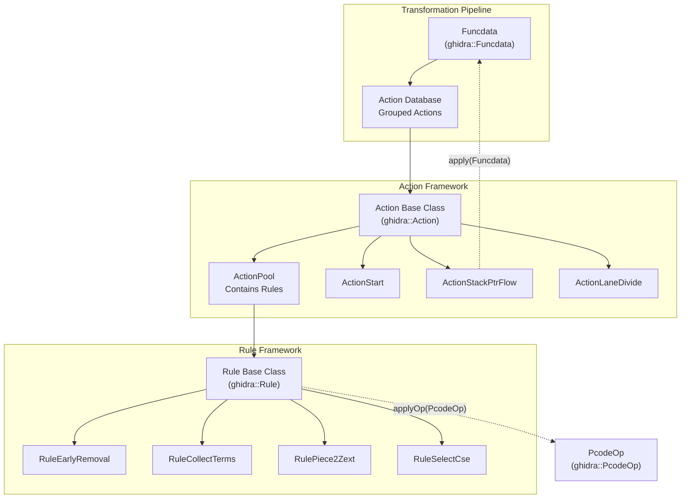
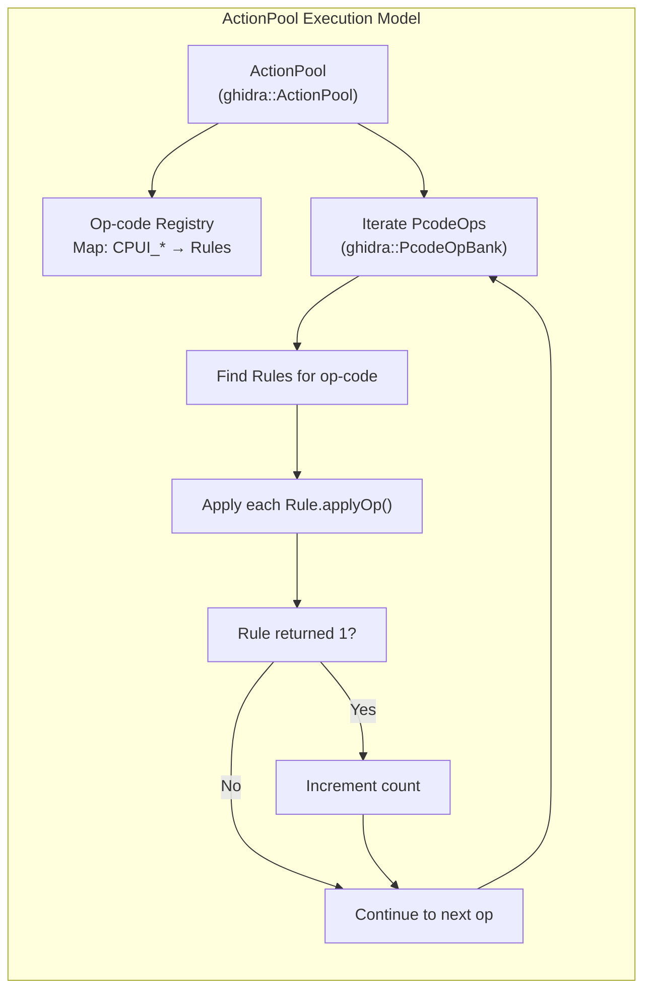
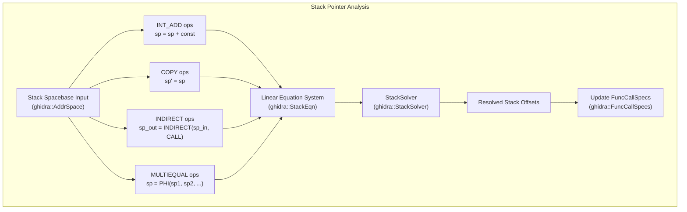
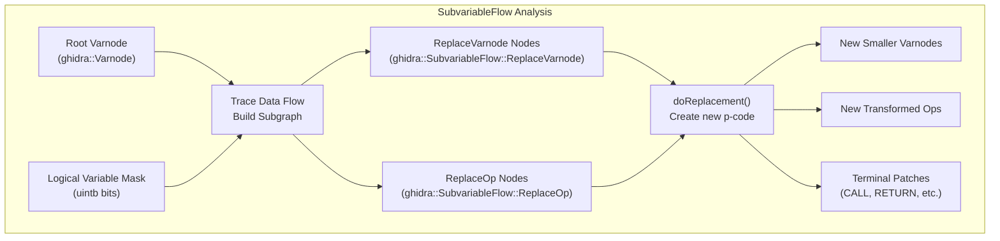

<!-- source: DeepWiki mcp.deepwiki.com · repo NationalSecurityAgency/ghidra · page 2.2 Actions and Rules System · fetched 2026-11-09 -->

# Actions and Rules System

Relevant source files

The following files were used as context for generating this wiki page:

- [Ghidra/Features/Decompiler/certification.manifest](Ghidra/Features/Decompiler/certification.manifest)
- [Ghidra/Features/Decompiler/src/decompile/cpp/cast.cc](Ghidra/Features/Decompiler/src/decompile/cpp/cast.cc)
- [Ghidra/Features/Decompiler/src/decompile/cpp/cast.hh](Ghidra/Features/Decompiler/src/decompile/cpp/cast.hh)
- [Ghidra/Features/Decompiler/src/decompile/cpp/coreaction.cc](Ghidra/Features/Decompiler/src/decompile/cpp/coreaction.cc)
- [Ghidra/Features/Decompiler/src/decompile/cpp/coreaction.hh](Ghidra/Features/Decompiler/src/decompile/cpp/coreaction.hh)
- [Ghidra/Features/Decompiler/src/decompile/cpp/cover.cc](Ghidra/Features/Decompiler/src/decompile/cpp/cover.cc)
- [Ghidra/Features/Decompiler/src/decompile/cpp/cover.hh](Ghidra/Features/Decompiler/src/decompile/cpp/cover.hh)
- [Ghidra/Features/Decompiler/src/decompile/cpp/database.cc](Ghidra/Features/Decompiler/src/decompile/cpp/database.cc)
- [Ghidra/Features/Decompiler/src/decompile/cpp/database.hh](Ghidra/Features/Decompiler/src/decompile/cpp/database.hh)
- [Ghidra/Features/Decompiler/src/decompile/cpp/database_ghidra.cc](Ghidra/Features/Decompiler/src/decompile/cpp/database_ghidra.cc)
- [Ghidra/Features/Decompiler/src/decompile/cpp/database_ghidra.hh](Ghidra/Features/Decompiler/src/decompile/cpp/database_ghidra.hh)
- [Ghidra/Features/Decompiler/src/decompile/cpp/double.cc](Ghidra/Features/Decompiler/src/decompile/cpp/double.cc)
- [Ghidra/Features/Decompiler/src/decompile/cpp/double.hh](Ghidra/Features/Decompiler/src/decompile/cpp/double.hh)
- [Ghidra/Features/Decompiler/src/decompile/cpp/fspec.cc](Ghidra/Features/Decompiler/src/decompile/cpp/fspec.cc)
- [Ghidra/Features/Decompiler/src/decompile/cpp/fspec.hh](Ghidra/Features/Decompiler/src/decompile/cpp/fspec.hh)
- [Ghidra/Features/Decompiler/src/decompile/cpp/funcdata.cc](Ghidra/Features/Decompiler/src/decompile/cpp/funcdata.cc)
- [Ghidra/Features/Decompiler/src/decompile/cpp/funcdata.hh](Ghidra/Features/Decompiler/src/decompile/cpp/funcdata.hh)
- [Ghidra/Features/Decompiler/src/decompile/cpp/funcdata_op.cc](Ghidra/Features/Decompiler/src/decompile/cpp/funcdata_op.cc)
- [Ghidra/Features/Decompiler/src/decompile/cpp/funcdata_varnode.cc](Ghidra/Features/Decompiler/src/decompile/cpp/funcdata_varnode.cc)
- [Ghidra/Features/Decompiler/src/decompile/cpp/grammar.cc](Ghidra/Features/Decompiler/src/decompile/cpp/grammar.cc)
- [Ghidra/Features/Decompiler/src/decompile/cpp/grammar.y](Ghidra/Features/Decompiler/src/decompile/cpp/grammar.y)
- [Ghidra/Features/Decompiler/src/decompile/cpp/heritage.cc](Ghidra/Features/Decompiler/src/decompile/cpp/heritage.cc)
- [Ghidra/Features/Decompiler/src/decompile/cpp/heritage.hh](Ghidra/Features/Decompiler/src/decompile/cpp/heritage.hh)
- [Ghidra/Features/Decompiler/src/decompile/cpp/ifacedecomp.cc](Ghidra/Features/Decompiler/src/decompile/cpp/ifacedecomp.cc)
- [Ghidra/Features/Decompiler/src/decompile/cpp/ifacedecomp.hh](Ghidra/Features/Decompiler/src/decompile/cpp/ifacedecomp.hh)
- [Ghidra/Features/Decompiler/src/decompile/cpp/merge.cc](Ghidra/Features/Decompiler/src/decompile/cpp/merge.cc)
- [Ghidra/Features/Decompiler/src/decompile/cpp/merge.hh](Ghidra/Features/Decompiler/src/decompile/cpp/merge.hh)
- [Ghidra/Features/Decompiler/src/decompile/cpp/op.cc](Ghidra/Features/Decompiler/src/decompile/cpp/op.cc)
- [Ghidra/Features/Decompiler/src/decompile/cpp/op.hh](Ghidra/Features/Decompiler/src/decompile/cpp/op.hh)
- [Ghidra/Features/Decompiler/src/decompile/cpp/ruleaction.cc](Ghidra/Features/Decompiler/src/decompile/cpp/ruleaction.cc)
- [Ghidra/Features/Decompiler/src/decompile/cpp/ruleaction.hh](Ghidra/Features/Decompiler/src/decompile/cpp/ruleaction.hh)
- [Ghidra/Features/Decompiler/src/decompile/cpp/subflow.cc](Ghidra/Features/Decompiler/src/decompile/cpp/subflow.cc)
- [Ghidra/Features/Decompiler/src/decompile/cpp/subflow.hh](Ghidra/Features/Decompiler/src/decompile/cpp/subflow.hh)
- [Ghidra/Features/Decompiler/src/decompile/cpp/transform.cc](Ghidra/Features/Decompiler/src/decompile/cpp/transform.cc)
- [Ghidra/Features/Decompiler/src/decompile/cpp/transform.hh](Ghidra/Features/Decompiler/src/decompile/cpp/transform.hh)
- [Ghidra/Features/Decompiler/src/decompile/cpp/type.cc](Ghidra/Features/Decompiler/src/decompile/cpp/type.cc)
- [Ghidra/Features/Decompiler/src/decompile/cpp/type.hh](Ghidra/Features/Decompiler/src/decompile/cpp/type.hh)
- [Ghidra/Features/Decompiler/src/decompile/cpp/typeop.cc](Ghidra/Features/Decompiler/src/decompile/cpp/typeop.cc)
- [Ghidra/Features/Decompiler/src/decompile/cpp/typeop.hh](Ghidra/Features/Decompiler/src/decompile/cpp/typeop.hh)
- [Ghidra/Features/Decompiler/src/decompile/cpp/variable.cc](Ghidra/Features/Decompiler/src/decompile/cpp/variable.cc)
- [Ghidra/Features/Decompiler/src/decompile/cpp/variable.hh](Ghidra/Features/Decompiler/src/decompile/cpp/variable.hh)
- [Ghidra/Features/Decompiler/src/decompile/cpp/varmap.cc](Ghidra/Features/Decompiler/src/decompile/cpp/varmap.cc)
- [Ghidra/Features/Decompiler/src/decompile/cpp/varmap.hh](Ghidra/Features/Decompiler/src/decompile/cpp/varmap.hh)
- [Ghidra/Features/Decompiler/src/decompile/cpp/varnode.cc](Ghidra/Features/Decompiler/src/decompile/cpp/varnode.cc)
- [Ghidra/Features/Decompiler/src/decompile/cpp/varnode.hh](Ghidra/Features/Decompiler/src/decompile/cpp/varnode.hh)
- [Ghidra/Features/Decompiler/src/decompile/datatests/varcross.xml](Ghidra/Features/Decompiler/src/decompile/datatests/varcross.xml)
- [Ghidra/Features/Decompiler/src/main/java/ghidra/app/decompiler/DecompileDebug.java](Ghidra/Features/Decompiler/src/main/java/ghidra/app/decompiler/DecompileDebug.java)
- [Ghidra/Framework/SoftwareModeling/src/main/java/ghidra/program/model/pcode/LocalSymbolMap.java](Ghidra/Framework/SoftwareModeling/src/main/java/ghidra/program/model/pcode/LocalSymbolMap.java)
- [Ghidra/Framework/SoftwareModeling/src/main/java/ghidra/program/model/pcode/PcodeDataTypeManager.java](Ghidra/Framework/SoftwareModeling/src/main/java/ghidra/program/model/pcode/PcodeDataTypeManager.java)

The Actions and Rules System is the decompiler's core transformation engine that drives incremental code simplification through pattern matching and rewriting. Actions coordinate high-level analysis phases, while Rules perform specific localized transformations on `PcodeOp` and `Varnode` objects. This system applies transformations repeatedly until convergence, progressively simplifying the intermediate representation into high-level code constructs.

For information about the overall decompilation pipeline, see **Core Decompilation Process (2.1)**. For details on SSA form construction that Actions operate on, see **SSA Construction and Data Flow (2.4)**.

Sources: [Ghidra/Features/Decompiler/src/decompile/cpp/coreaction.hh:34-123](), [Ghidra/Features/Decompiler/src/decompile/cpp/ruleaction.hh:86-143]()

## System Architecture

The Actions and Rules System operates on the function's p-code intermediate representation (`ghidra::Funcdata`), applying transformations through two complementary mechanisms:

**Actions** - High-level analysis phases that coordinate complex transformations across the entire function (`ghidra::Action`). Examples include stack pointer flow analysis, dead code elimination, and control flow structuring.

**Rules** - Localized pattern-matching transformations that operate on individual `ghidra::PcodeOp` instances (`ghidra::Rule`). Rules identify specific data-flow patterns and rewrite them into simpler or more canonical forms. Examples include constant folding, algebraic simplification, and operator normalization.

Both Actions and Rules share a common framework that tracks whether changes were made (via a `count` field) and can be grouped into phases that execute repeatedly until no further transformations occur.

Title: Actions and Rules Framework Architecture

Sources: [Ghidra/Features/Decompiler/src/decompile/cpp/coreaction.hh:34-123](), [Ghidra/Features/Decompiler/src/decompile/cpp/ruleaction.hh:86-143]()

## Action Base Class

The `ghidra::Action` class serves as the foundation for all transformations. Each Action has a unique name, belongs to a named group, and tracks how many times it successfully modified the function.

| Property | Type | Purpose |
|----------|------|---------|
| `name` | string | Unique identifier for the Action |
| `group` | string | Group membership for phased execution |
| `count` | int4 | Number of times Action made changes |
| `flags` | uint4 | Behavioral flags (e.g., `rule_onceperfunc`) |

Key methods:

- **`apply(Funcdata &data)`**: Execute the transformation on the function. Returns 0 normally, non-zero to signal restart or other control flow [Ghidra/Features/Decompiler/src/decompile/cpp/coreaction.hh:41-42]().
- **`reset(Funcdata &data)`**: Reset internal state before a new analysis pass [Ghidra/Features/Decompiler/src/decompile/cpp/coreaction.hh:77-77]().
- **`clone(ActionGroupList &grouplist)`**: Create a copy of the Action for a specific group configuration [Ghidra/Features/Decompiler/src/decompile/cpp/coreaction.hh:37-40]().

The `count` field is critical for the convergence model: when an Action successfully transforms something, it increments `count`, signaling that another round of analysis may be needed.

Sources: [Ghidra/Features/Decompiler/src/decompile/cpp/coreaction.hh:34-51](), [Ghidra/Features/Decompiler/src/decompile/cpp/ruleaction.hh:86-95]()

## Rule Base Class

The `ghidra::Rule` class extends `ghidra::Action` to provide pattern-matching transformations on individual `ghidra::PcodeOp` instances. Rules declare which op-codes they operate on via `getOpList()`, and the transformation engine applies them selectively to matching operations.

**Rule Lifecycle:**

1. Rule registers op-codes of interest via `getOpList()` [Ghidra/Features/Decompiler/src/decompile/cpp/ruleaction.cc:101-105]().
2. Engine iterates through PcodeOps matching those op-codes.
3. For each match, `applyOp(PcodeOp *op, Funcdata &data)` is invoked [Ghidra/Features/Decompiler/src/decompile/cpp/ruleaction.cc:25-44]().
4. Rule examines the data-flow pattern and decides whether to transform.
5. If transformed, returns 1 (incrementing `count`), otherwise returns 0.

**Key Rule Methods:**

- `virtual void getOpList(vector<uint4> &oplist) const`: Populates `oplist` with `CPUI_*` op-codes this Rule handles [Ghidra/Features/Decompiler/src/decompile/cpp/ruleaction.hh:110-110]().
- `virtual int4 applyOp(PcodeOp *op, Funcdata &data)`: Attempts to transform the given op. Returns 1 if successful, 0 otherwise [Ghidra/Features/Decompiler/src/decompile/cpp/ruleaction.cc:25-44]().

Sources: [Ghidra/Features/Decompiler/src/decompile/cpp/ruleaction.hh:86-95](), [Ghidra/Features/Decompiler/src/decompile/cpp/ruleaction.cc:23-44]()

## ActionPool and Rule Execution

The `ghidra::ActionPool` class groups multiple Rules together and applies them to matching PcodeOps. This is the primary mechanism for executing Rules.

Title: ActionPool Rule Application Model

When an `ActionPool` executes:

1. Iterates through all PcodeOps in the function via `ghidra::PcodeOpBank` [Ghidra/Features/Decompiler/src/decompile/cpp/funcdata.hh:93-93]().
2. For each op, looks up Rules registered for that op-code.
3. Applies each matching Rule in sequence.
4. If any Rule returns 1, increments the pool's `count`.
5. Continues until all ops are processed.

This model allows hundreds of Rules to be active simultaneously, each watching for its specific pattern. The pool automatically routes ops to relevant Rules without the Rules needing to scan the entire function [Ghidra/Features/Decompiler/src/decompile/cpp/ruleaction.hh:16-23]().

Sources: [Ghidra/Features/Decompiler/src/decompile/cpp/ruleaction.hh:16-23](), [Ghidra/Features/Decompiler/src/decompile/cpp/ruleaction.cc:25-44]()

## Core Action Examples

### ActionStackPtrFlow

Analyzes stack pointer changes across sub-function calls. When the extra pop amount for a function call is unknown, this Action builds a system of linear equations tracking stack pointer flow and solves for the unknown values.

**Key Components:**

- **`ghidra::StackSolver`**: Builds and solves linear equations for stack pointer values [Ghidra/Features/Decompiler/src/decompile/cpp/coreaction.cc:34-51]().
- **`StackEqn`**: Represents one equation: `var1 - var2 = rhs` [Ghidra/Features/Decompiler/src/decompile/cpp/coreaction.cc:26-31]().
- **`propagate()`**: Propagates solutions through the equation system [Ghidra/Features/Decompiler/src/decompile/cpp/coreaction.cc:68-95]().

The algorithm:
1. Collects all stack pointer Varnodes as variables via `StackSolver::build()` [Ghidra/Features/Decompiler/src/decompile/cpp/coreaction.cc:148-210]().
2. Examines their defining ops (`CPUI_INT_ADD`, `CPUI_COPY`, `CPUI_INDIRECT`, `CPUI_MULTIEQUAL`).
3. Builds equations based on these relationships [Ghidra/Features/Decompiler/src/decompile/cpp/coreaction.cc:176-200]().
4. Solves the system to determine stack pointer changes using `StackSolver::solve()` [Ghidra/Features/Decompiler/src/decompile/cpp/coreaction.cc:113-141]().
5. Updates `ghidra::FuncCallSpecs` with resolved extra pop amounts.

Title: ActionStackPtrFlow Analysis Process

Sources: [Ghidra/Features/Decompiler/src/decompile/cpp/coreaction.cc:24-210](), [Ghidra/Features/Decompiler/src/decompile/cpp/coreaction.hh:88-100]()

### ActionLaneDivide

Finds Varnodes with a vectorized lane scheme and attempts to split the lanes into explicit Varnodes. This is used for processors with SIMD registers.

**Algorithm:**

1. Examines Varnodes matching laned register specifications [Ghidra/Features/Decompiler/src/decompile/cpp/coreaction.hh:114-115]().
2. Identifies potential lane widths based on `CPUI_PIECE`/`CPUI_SUBPIECE` ops.
3. Verifies divisibility across the data-flow graph.
4. Transforms the data-flow by splitting ops into parallel lane operations via `ActionLaneDivide::processVarnode()` [Ghidra/Features/Decompiler/src/decompile/cpp/coreaction.hh:115-115]().

Sources: [Ghidra/Features/Decompiler/src/decompile/cpp/coreaction.hh:107-123](), [Ghidra/Features/Decompiler/src/decompile/cpp/funcdata.hh:78-79]()

## Representative Rules

### RuleEarlyRemoval

Removes `ghidra::PcodeOp` objects whose output is unused and has no side effects. This is a fundamental dead code elimination rule.

**Conditions for removal [Ghidra/Features/Decompiler/src/decompile/cpp/ruleaction.cc:25-44]():**

- Op is not a call (`isCall()`).
- Op is not an indirect source (`isIndirectSource()`).
- Op has an output Varnode.
- Output has no descendants (`hasNoDescend()`).
- Output is not marked as auto-live (`isAutoLive()`).
- Output's address space permits dead code removal via `doesDeadcode()` [Ghidra/Features/Decompiler/src/decompile/cpp/ruleaction.cc:38-38]().

Sources: [Ghidra/Features/Decompiler/src/decompile/cpp/ruleaction.cc:23-44](), [Ghidra/Features/Decompiler/src/decompile/cpp/ruleaction.hh:86-95]()

### RuleCollectTerms

Collects terms in additive expressions to combine like terms: `V * c + V * d => V * (c + d)`.

**Algorithm [Ghidra/Features/Decompiler/src/decompile/cpp/ruleaction.cc:107-176]():**

1. Identifies the root of an `INT_ADD` tree.
2. Uses `TermOrder` to collect and sort all additive terms [Ghidra/Features/Decompiler/src/decompile/cpp/ruleaction.cc:114-116]().
3. Scans for adjacent terms with the same base Varnode using `getMultCoeff()` [Ghidra/Features/Decompiler/src/decompile/cpp/ruleaction.cc:82-97]().
4. If found, combines their multiplicative coefficients.
5. Also combines multiple constant terms into one [Ghidra/Features/Decompiler/src/decompile/cpp/ruleaction.cc:156-173]().

Sources: [Ghidra/Features/Decompiler/src/decompile/cpp/ruleaction.cc:82-176](), [Ghidra/Features/Decompiler/src/decompile/cpp/ruleaction.hh:102-112]()

### RuleSelectCse

Look for common sub-expressions (CSE) built out of a restricted set of ops like `CPUI_SUBPIECE`.

**Detection Strategy [Ghidra/Features/Decompiler/src/decompile/cpp/ruleaction.cc:187-209]():**

1. Iterates through descendants of a Varnode via `beginDescend()` [Ghidra/Features/Decompiler/src/decompile/cpp/ruleaction.cc:198-198]().
2. Compares op-codes and calculates a CSE hash via `getCseHash()` [Ghidra/Features/Decompiler/src/decompile/cpp/ruleaction.cc:201-201]().
3. Invokes `Funcdata::cseEliminateList()` to perform removal of redundant ops [Ghidra/Features/Decompiler/src/decompile/cpp/ruleaction.cc:206-206]().

Sources: [Ghidra/Features/Decompiler/src/decompile/cpp/ruleaction.cc:178-209](), [Ghidra/Features/Decompiler/src/decompile/cpp/ruleaction.hh:113-122]()

## Subvariable Flow Transformation

The `ghidra::SubvariableFlow` class implements a sophisticated analysis for extracting logical sub-variables from larger storage locations.

Title: SubvariableFlow Transformation Process

**Algorithm Overview:**

1. **Initialization**: Given a root Varnode and bit mask, identify the logical variable via `setReplacement()` [Ghidra/Features/Decompiler/src/decompile/cpp/subflow.cc:66-151]().
2. **Trace Forward**: Follow data-flow through operations, building a subgraph using `createOp()` [Ghidra/Features/Decompiler/src/decompile/cpp/subflow.cc:159-173]().
3. **Trace Backward**: Follow data-flow to definitions using `createOpDown()` [Ghidra/Features/Decompiler/src/decompile/cpp/subflow.cc:184-197]().
4. **Validation**: Checks if constants are sign-extended correctly if restrictions apply [Ghidra/Features/Decompiler/src/decompile/cpp/subflow.cc:82-89]().
5. **Replacement**: Create new smaller Varnodes and transformed operations via `doReplacement()`.

Sources: [Ghidra/Features/Decompiler/src/decompile/cpp/subflow.cc:16-197](), [Ghidra/Features/Decompiler/src/decompile/cpp/subflow.hh:26-215]()

## Specialized Action Categories

### Pointer and Address Analysis

`ghidra::AddTreeState` analyzes additive expression trees involving pointers to normalize access to structures and arrays.

| Component | Role |
|-----------|------|
| `ptr` | The base pointer Varnode [Ghidra/Features/Decompiler/src/decompile/cpp/ruleaction.hh:47]() |
| `baseType` | The data-type being pointed at [Ghidra/Features/Decompiler/src/decompile/cpp/ruleaction.hh:49]() |
| `multiple` | Terms that are multiples of the base type size [Ghidra/Features/Decompiler/src/decompile/cpp/ruleaction.hh:58]() |
| `offset` | Constant bytes digging into the base type [Ghidra/Features/Decompiler/src/decompile/cpp/ruleaction.hh:56]() |

This transforms low-level pointer arithmetic into high-level `CPUI_PTRADD` and `CPUI_PTRSUB` operations [Ghidra/Features/Decompiler/src/decompile/cpp/ruleaction.hh:41-42]().

Sources: [Ghidra/Features/Decompiler/src/decompile/cpp/ruleaction.hh:32-84]()

## Summary of Key Classes and Their Roles

| Class | Role | Key Method |
|-------|------|------------|
| `ghidra::Action` | Base transformation class | `apply(Funcdata &data)` |
| `ghidra::Rule` | Pattern-matching transformation on ops | `applyOp(PcodeOp *op, Funcdata &data)` |
| `ghidra::StackSolver` | Stack pointer flow analysis | `solve()` |
| `ghidra::SubvariableFlow` | Extract logical sub-variables | `setReplacement()` |
| `ghidra::AddTreeState` | Pointer arithmetic analysis | `apply()` |
| `ghidra::RuleEarlyRemoval` | Dead code elimination | `applyOp()` |
| `ghidra::RuleCollectTerms` | Combine like terms in sums | `applyOp()` |
| `ghidra::RuleSelectCse` | Common subexpression elimination | `applyOp()` |

Sources: [Ghidra/Features/Decompiler/src/decompile/cpp/coreaction.hh:34-168](), [Ghidra/Features/Decompiler/src/decompile/cpp/ruleaction.hh:86-143](), [Ghidra/Features/Decompiler/src/decompile/cpp/subflow.hh:26-215]()

---

