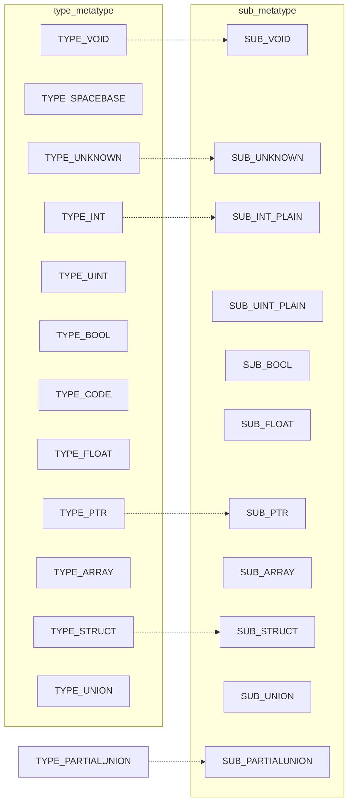
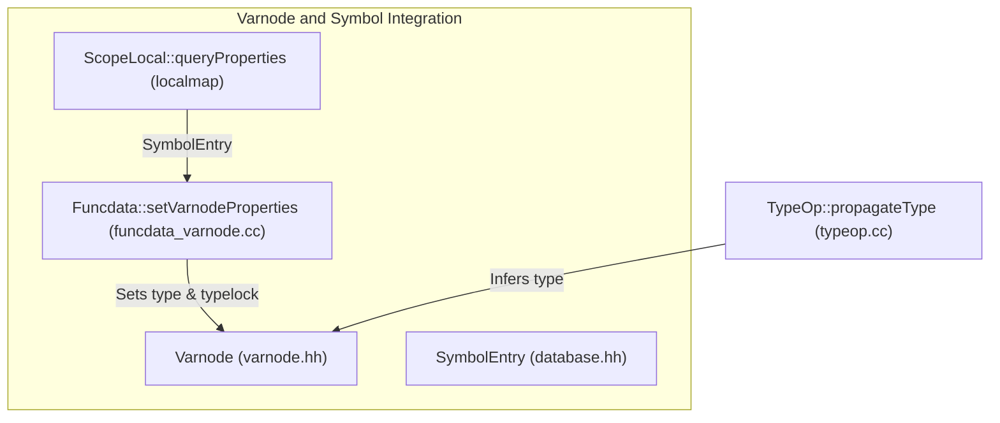
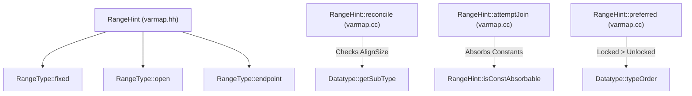

<!-- source: DeepWiki mcp.deepwiki.com · repo NationalSecurityAgency/ghidra · page 2.3 Type System and Propagation · fetched 2026-11-09 -->

# Type System and Propagation

Relevant source files

The following files were used as context for generating this wiki page:

- [Ghidra/Features/Decompiler/certification.manifest](Ghidra/Features/Decompiler/certification.manifest)
- [Ghidra/Features/Decompiler/src/decompile/cpp/cast.cc](Ghidra/Features/Decompiler/src/decompile/cpp/cast.cc)
- [Ghidra/Features/Decompiler/src/decompile/cpp/cast.hh](Ghidra/Features/Decompiler/src/decompile/cpp/cast.hh)
- [Ghidra/Features/Decompiler/src/decompile/cpp/coreaction.cc](Ghidra/Features/Decompiler/src/decompile/cpp/coreaction.cc)
- [Ghidra/Features/Decompiler/src/decompile/cpp/coreaction.hh](Ghidra/Features/Decompiler/src/decompile/cpp/coreaction.hh)
- [Ghidra/Features/Decompiler/src/decompile/cpp/cover.cc](Ghidra/Features/Decompiler/src/decompile/cpp/cover.cc)
- [Ghidra/Features/Decompiler/src/decompile/cpp/cover.hh](Ghidra/Features/Decompiler/src/decompile/cpp/cover.hh)
- [Ghidra/Features/Decompiler/src/decompile/cpp/database.cc](Ghidra/Features/Decompiler/src/decompile/cpp/database.cc)
- [Ghidra/Features/Decompiler/src/decompile/cpp/database.hh](Ghidra/Features/Decompiler/src/decompile/cpp/database.hh)
- [Ghidra/Features/Decompiler/src/decompile/cpp/database_ghidra.cc](Ghidra/Features/Decompiler/src/decompile/cpp/database_ghidra.cc)
- [Ghidra/Features/Decompiler/src/decompile/cpp/database_ghidra.hh](Ghidra/Features/Decompiler/src/decompile/cpp/database_ghidra.hh)
- [Ghidra/Features/Decompiler/src/decompile/cpp/double.cc](Ghidra/Features/Decompiler/src/decompile/cpp/double.cc)
- [Ghidra/Features/Decompiler/src/decompile/cpp/double.hh](Ghidra/Features/Decompiler/src/decompile/cpp/double.hh)
- [Ghidra/Features/Decompiler/src/decompile/cpp/fspec.cc](Ghidra/Features/Decompiler/src/decompile/cpp/fspec.cc)
- [Ghidra/Features/Decompiler/src/decompile/cpp/fspec.hh](Ghidra/Features/Decompiler/src/decompile/cpp/fspec.hh)
- [Ghidra/Features/Decompiler/src/decompile/cpp/funcdata.cc](Ghidra/Features/Decompiler/src/decompile/cpp/funcdata.cc)
- [Ghidra/Features/Decompiler/src/decompile/cpp/funcdata.hh](Ghidra/Features/Decompiler/src/decompile/cpp/funcdata.hh)
- [Ghidra/Features/Decompiler/src/decompile/cpp/funcdata_op.cc](Ghidra/Features/Decompiler/src/decompile/cpp/funcdata_op.cc)
- [Ghidra/Features/Decompiler/src/decompile/cpp/funcdata_varnode.cc](Ghidra/Features/Decompiler/src/decompile/cpp/funcdata_varnode.cc)
- [Ghidra/Features/Decompiler/src/decompile/cpp/grammar.cc](Ghidra/Features/Decompiler/src/decompile/cpp/grammar.cc)
- [Ghidra/Features/Decompiler/src/decompile/cpp/grammar.y](Ghidra/Features/Decompiler/src/decompile/cpp/grammar.y)
- [Ghidra/Features/Decompiler/src/decompile/cpp/heritage.cc](Ghidra/Features/Decompiler/src/decompile/cpp/heritage.cc)
- [Ghidra/Features/Decompiler/src/decompile/cpp/heritage.hh](Ghidra/Features/Decompiler/src/decompile/cpp/heritage.hh)
- [Ghidra/Features/Decompiler/src/decompile/cpp/ifacedecomp.cc](Ghidra/Features/Decompiler/src/decompile/cpp/ifacedecomp.cc)
- [Ghidra/Features/Decompiler/src/decompile/cpp/ifacedecomp.hh](Ghidra/Features/Decompiler/src/decompile/cpp/ifacedecomp.hh)
- [Ghidra/Features/Decompiler/src/decompile/cpp/merge.cc](Ghidra/Features/Decompiler/src/decompile/cpp/merge.cc)
- [Ghidra/Features/Decompiler/src/decompile/cpp/merge.hh](Ghidra/Features/Decompiler/src/decompile/cpp/merge.hh)
- [Ghidra/Features/Decompiler/src/decompile/cpp/op.cc](Ghidra/Features/Decompiler/src/decompile/cpp/op.cc)
- [Ghidra/Features/Decompiler/src/decompile/cpp/op.hh](Ghidra/Features/Decompiler/src/decompile/cpp/op.hh)
- [Ghidra/Features/Decompiler/src/decompile/cpp/ruleaction.cc](Ghidra/Features/Decompiler/src/decompile/cpp/ruleaction.cc)
- [Ghidra/Features/Decompiler/src/decompile/cpp/ruleaction.hh](Ghidra/Features/Decompiler/src/decompile/cpp/ruleaction.hh)
- [Ghidra/Features/Decompiler/src/decompile/cpp/subflow.cc](Ghidra/Features/Decompiler/src/decompile/cpp/subflow.cc)
- [Ghidra/Features/Decompiler/src/decompile/cpp/subflow.hh](Ghidra/Features/Decompiler/src/decompile/cpp/subflow.hh)
- [Ghidra/Features/Decompiler/src/decompile/cpp/transform.cc](Ghidra/Features/Decompiler/src/decompile/cpp/transform.cc)
- [Ghidra/Features/Decompiler/src/decompile/cpp/transform.hh](Ghidra/Features/Decompiler/src/decompile/cpp/transform.hh)
- [Ghidra/Features/Decompiler/src/decompile/cpp/type.cc](Ghidra/Features/Decompiler/src/decompile/cpp/type.cc)
- [Ghidra/Features/Decompiler/src/decompile/cpp/type.hh](Ghidra/Features/Decompiler/src/decompile/cpp/type.hh)
- [Ghidra/Features/Decompiler/src/decompile/cpp/typeop.cc](Ghidra/Features/Decompiler/src/decompile/cpp/typeop.cc)
- [Ghidra/Features/Decompiler/src/decompile/cpp/typeop.hh](Ghidra/Features/Decompiler/src/decompile/cpp/typeop.hh)
- [Ghidra/Features/Decompiler/src/decompile/cpp/variable.cc](Ghidra/Features/Decompiler/src/decompile/cpp/variable.cc)
- [Ghidra/Features/Decompiler/src/decompile/cpp/variable.hh](Ghidra/Features/Decompiler/src/decompile/cpp/variable.hh)
- [Ghidra/Features/Decompiler/src/decompile/cpp/varmap.cc](Ghidra/Features/Decompiler/src/decompile/cpp/varmap.cc)
- [Ghidra/Features/Decompiler/src/decompile/cpp/varmap.hh](Ghidra/Features/Decompiler/src/decompile/cpp/varmap.hh)
- [Ghidra/Features/Decompiler/src/decompile/cpp/varnode.cc](Ghidra/Features/Decompiler/src/decompile/cpp/varnode.cc)
- [Ghidra/Features/Decompiler/src/decompile/cpp/varnode.hh](Ghidra/Features/Decompiler/src/decompile/cpp/varnode.hh)
- [Ghidra/Features/Decompiler/src/decompile/datatests/varcross.xml](Ghidra/Features/Decompiler/src/decompile/datatests/varcross.xml)
- [Ghidra/Features/Decompiler/src/main/java/ghidra/app/decompiler/DecompileDebug.java](Ghidra/Features/Decompiler/src/main/java/ghidra/app/decompiler/DecompileDebug.java)
- [Ghidra/Framework/SoftwareModeling/src/main/java/ghidra/program/model/pcode/LocalSymbolMap.java](Ghidra/Framework/SoftwareModeling/src/main/java/ghidra/program/model/pcode/LocalSymbolMap.java)
- [Ghidra/Framework/SoftwareModeling/src/main/java/ghidra/program/model/pcode/PcodeDataTypeManager.java](Ghidra/Framework/SoftwareModeling/src/main/java/ghidra/program/model/pcode/PcodeDataTypeManager.java)

This document describes the decompiler's type recovery system, including the `Datatype` class hierarchy, type inference mechanisms, and how data-types are propagated through `Varnode` objects during analysis. For information about the overall decompilation process and Actions framework, see [Core Decompilation Process](2.1). For details on SSA construction which enables type propagation, see [SSA Construction and Data Flow](2.4).

## Overview

The decompiler's type system serves two primary functions:
1. **Representation**: The `Datatype` class hierarchy models C-like data-types including primitives, pointers, arrays, structures, and unions [Ghidra/Features/Decompiler/src/decompile/cpp/type.hh:80-100]().
2. **Inference**: Type information is propagated through the data-flow graph to recover high-level variable types from low-level operations [Ghidra/Features/Decompiler/src/decompile/cpp/typeop.cc:20-50]().

Type propagation operates on `Varnode` objects (which represent storage locations and values) and uses the SSA form of the function to trace how types flow through operations. Each `PcodeOp` has an associated `TypeOp` that defines type propagation rules for that operation [Ghidra/Features/Decompiler/src/decompile/cpp/typeop.hh:20-100]().

Sources: [Ghidra/Features/Decompiler/src/decompile/cpp/type.hh:1-100](), [Ghidra/Features/Decompiler/src/decompile/cpp/varnode.hh:1-100]()

## Datatype Class Hierarchy

Title: "Datatype Inheritance and Code Entity Mapping"

```mermaid
graph TD
    Datatype["Datatype (type.hh)"] --> TypeBase["TypeBase (type.hh)"]
    Datatype --> TypePointer["TypePointer (type.hh)"]
    Datatype --> TypeArray["TypeArray (type.hh)"]
    Datatype --> TypeStruct["TypeStruct (type.hh)"]
    Datatype --> TypeUnion["TypeUnion (type.hh)"]
    Datatype --> TypeCode["TypeCode (type.hh)"]
    Datatype --> TypeSpacebase["TypeSpacebase (type.hh)"]
    Datatype --> TypeEnum["TypeEnum (type.hh)"]
    
    TypeBase --> TypeVoid["TypeVoid (type.hh)"]
    TypeBase --> TypeInt["TypeInt (type.hh)"]
    TypeBase --> TypeUint["TypeUint (type.hh)"]
    TypeBase --> TypeBool["TypeBool (type.hh)"]
    TypeBase --> TypeFloat["TypeFloat (type.hh)"]
    TypeBase --> TypeUnknown["TypeUnknown (type.hh)"]
    
    TypePointer --> TypePointerRel["TypePointerRel (type.hh)"]
    TypeStruct --> TypePartialStruct["TypePartialStruct (type.hh)"]
    TypeUnion --> TypePartialUnion["TypePartialUnion (type.hh)"]
    TypeEnum --> TypeEnumInt["TypeEnumInt (type.hh)"]
    TypeEnum --> TypeEnumUint["TypeEnumUint (type.hh)"]
```

The `Datatype` base class provides common functionality for all types:
- **Size and alignment**: `size` field and `alignment` required for the type [Ghidra/Features/Decompiler/src/decompile/cpp/type.cc:128-141]().
- **Type identity**: 64-bit `id` field for hashing and identity [Ghidra/Features/Decompiler/src/decompile/cpp/type.cc:137]().
- **Meta-type**: `type_metatype metatype` enum (`TYPE_INT`, `TYPE_PTR`, etc.) [Ghidra/Features/Decompiler/src/decompile/cpp/type.hh:80-100]().
- **Sub-metatype**: `sub_metatype submeta` for propagation ordering [Ghidra/Features/Decompiler/src/decompile/cpp/type.cc:135]().
- **Flags**: Boolean properties like `typelock`, `coretype`, and `incomplete` [Ghidra/Features/Decompiler/src/decompile/cpp/type.cc:136]().

Each concrete type extends the base with specialized fields:
- `TypePointer`: Holds `ptrto` (pointed-to type) and optional `spaceid` for address space [Ghidra/Features/Decompiler/src/decompile/cpp/type.hh:90]().
- `TypeArray`: Contains `arrayof` (element type) and `arraysize` [Ghidra/Features/Decompiler/src/decompile/cpp/type.hh:92]().
- `TypeStruct` / `TypeUnion`: Maintain component datatypes and offsets [Ghidra/Features/Decompiler/src/decompile/cpp/type.hh:95-96]().
- `TypeEnum`: Maps named constants to integer values [Ghidra/Features/Decompiler/src/decompile/cpp/type.hh:93-94]().

Sources: [Ghidra/Features/Decompiler/src/decompile/cpp/type.hh:80-125](), [Ghidra/Features/Decompiler/src/decompile/cpp/type.cc:23-27](), [Ghidra/Features/Decompiler/src/decompile/cpp/type.cc:128-141]()

## Type Metatypes and Propagation Order

Title: "Metatype to Sub-Metatype Mapping"

The `type_metatype` enum categorizes types at a high level (int, pointer, struct, etc.) [Ghidra/Features/Decompiler/src/decompile/cpp/type.hh:80-100](), while `sub_metatype` defines a propagation ordering used during type inference [Ghidra/Features/Decompiler/src/decompile/cpp/type.hh:104-125](). The array `Datatype::base2sub[]` maps each metatype to its corresponding sub-metatype [Ghidra/Features/Decompiler/src/decompile/cpp/type.cc:23-27]().

**Propagation Priority**: Higher sub-metatype values represent more specific or restrictive types. During propagation, the decompiler attempts to find the "consensus" type that satisfies all constraints, often favoring the more specific type in the hierarchy [Ghidra/Features/Decompiler/src/decompile/cpp/type.cc:23-27]().

Sources: [Ghidra/Features/Decompiler/src/decompile/cpp/type.cc:23-27](), [Ghidra/Features/Decompiler/src/decompile/cpp/type.hh:80-125]()

## Varnode Type Association

Title: "Varnode Type Resolution Code Entities"

Each `Varnode` has a `Datatype *type` field that holds its current data-type [Ghidra/Features/Decompiler/src/decompile/cpp/varnode.hh:70](). Types are associated via:

1. **Symbol Table**: `Funcdata::setVarnodeProperties()` queries `ScopeLocal` for matching symbols at the Varnode's address and size [Ghidra/Features/Decompiler/src/decompile/cpp/funcdata_varnode.cc:25-36]().
2. **Inference**: `TypeOp::propagateType()` infers types based on the P-code operations consuming or producing the Varnode [Ghidra/Features/Decompiler/src/decompile/cpp/typeop.cc:2500-2700]().
3. **Creation**: When new Varnodes are created (e.g., `newConstant`, `newUnique`), they are assigned a base type based on their size [Ghidra/Features/Decompiler/src/decompile/cpp/funcdata_varnode.cc:68-73]().

The `typelock` flag is used to prevent the inference engine from overriding types that have been explicitly set by the user or the symbol table [Ghidra/Features/Decompiler/src/decompile/cpp/funcdata_varnode.cc:35-36]().

Sources: [Ghidra/Features/Decompiler/src/decompile/cpp/funcdata_varnode.cc:25-120](), [Ghidra/Features/Decompiler/src/decompile/cpp/funcdata.hh:104-109]()

## Type Propagation Pipeline

Type propagation occurs as part of the `Action` execution loop. It relies on the SSA form and fixed-point iteration to resolve types across the function.

1. **Initialization**: `ActionStartTypes` (within the core actions) marks the start of type recovery [Ghidra/Features/Decompiler/src/decompile/cpp/funcdata.hh:63-64]().
2. **Inference Loop**: `ActionInferTypes` repeatedly calls `TypeOp::propagateType()` for all ops in the function [Ghidra/Features/Decompiler/src/decompile/cpp/typeop.cc:2500-2700]().
3. **Forward Propagation**: Input types are used to determine the output type of an operation [Ghidra/Features/Decompiler/src/decompile/cpp/typeop.cc:2500-2600]().
4. **Backward Propagation**: Constraints on the output of an operation are pushed back to the inputs [Ghidra/Features/Decompiler/src/decompile/cpp/typeop.cc:2600-2700]().
5. **Completion**: The process stops when no more type changes occur or the pass limit is reached (`typerecovery_exceeded`) [Ghidra/Features/Decompiler/src/decompile/cpp/funcdata.hh:72]().

Sources: [Ghidra/Features/Decompiler/src/decompile/cpp/funcdata.hh:56-75](), [Ghidra/Features/Decompiler/src/decompile/cpp/typeop.cc:2500-2700]()

## TypeOp Classes and Propagation Rules

Each P-code opcode has a corresponding `TypeOp` instance that implements specific propagation logic [Ghidra/Features/Decompiler/src/decompile/cpp/typeop.hh:20-100]():

| TypeOp Class | Opcode | Propagation Behavior |
|--------------|--------|----------------------|
| `TypeOpCopy` | `CPUI_COPY` | Propagates type directly from input to output and vice versa [Ghidra/Features/Decompiler/src/decompile/cpp/typeop.cc:350-380](). |
| `TypeOpIntAdd`| `CPUI_INT_ADD` | Handles pointer arithmetic; if one input is a pointer, the output is a pointer [Ghidra/Features/Decompiler/src/decompile/cpp/typeop.cc:700-750](). |
| `TypeOpLoad` | `CPUI_LOAD` | Output type is the type pointed to by the input pointer [Ghidra/Features/Decompiler/src/decompile/cpp/typeop.cc:450-500](). |
| `TypeOpPtrAdd`| `CPUI_PTRADD` | Specifically for array indexing; propagates pointer type [Ghidra/Features/Decompiler/src/decompile/cpp/typeop.cc:2100-2150](). |
| `TypeOpPtrSub`| `CPUI_PTRSUB` | Specifically for structure field access; calculates field type based on offset [Ghidra/Features/Decompiler/src/decompile/cpp/typeop.cc:2200-2250](). |

Sources: [Ghidra/Features/Decompiler/src/decompile/cpp/typeop.cc:20-2700](), [Ghidra/Features/Decompiler/src/decompile/cpp/typeop.hh:20-100]()

## Type Merging and Variable Recovery

During analysis, the decompiler must merge `Varnode` objects that represent the same high-level variable. This is handled by the `Merge` class [Ghidra/Features/Decompiler/src/decompile/cpp/merge.cc:1-100]().

- **HighVariable**: A collection of merged `Varnode` objects that share a single data-type and name [Ghidra/Features/Decompiler/src/decompile/cpp/funcdata_varnode.cc:48-61]().
- **Cover**: Tracking the "liveness" of a Varnode to ensure merges don't create overlaps [Ghidra/Features/Decompiler/src/decompile/cpp/funcdata_varnode.cc:38-42]().
- **SubvariableFlow**: A specialized transformation that identifies when a large register is being used as multiple smaller logical variables (e.g., splitting a 64-bit register into 32-bit components) [Ghidra/Features/Decompiler/src/decompile/cpp/subflow.cc:66-151]().

Sources: [Ghidra/Features/Decompiler/src/decompile/cpp/funcdata_varnode.cc:38-61](), [Ghidra/Features/Decompiler/src/decompile/cpp/subflow.cc:66-151](), [Ghidra/Features/Decompiler/src/decompile/cpp/merge.hh:1-50]()

## Union and Field Resolution

The decompiler handles `TYPE_UNION` by tracking which field is accessed at specific points in the data-flow [Ghidra/Features/Decompiler/src/decompile/cpp/funcdata.hh:101-102]().

- **unionMap**: Maps a `ResolveEdge` (a specific data-flow connection) to a `ResolvedUnion` field [Ghidra/Features/Decompiler/src/decompile/cpp/funcdata.hh:101-102]().
- **ActionResolveUnion**: An action that analyzes the data-flow to resolve which union member is most appropriate for a given operation [Ghidra/Features/Decompiler/src/decompile/cpp/funcdata.hh:27]().

Sources: [Ghidra/Features/Decompiler/src/decompile/cpp/funcdata.hh:27-102]()

## Data-Flow and Range Hints

The decompiler uses `RangeHint` to reconcile overlapping memory accesses and suggest structure/array boundaries.

Title: "RangeHint Reconciliation and Type Flow"

`RangeHint` objects are used during variable recovery to manage how different accesses to the same address range interact [Ghidra/Features/Decompiler/src/decompile/cpp/varmap.hh:1-50]().
- **Reconciliation**: `RangeHint::reconcile` determines if two intersecting hints can coexist based on alignment and sub-type relationships [Ghidra/Features/Decompiler/src/decompile/cpp/varmap.cc:62-103]().
- **Preference**: Locked types (user-defined) always take priority over inferred types [Ghidra/Features/Decompiler/src/decompile/cpp/varmap.cc:134-139]().
- **Constant Absorption**: Primitive types like `TYPE_INT` can "absorb" constant copies even if sizes differ slightly, provided they represent the same logical value [Ghidra/Features/Decompiler/src/decompile/cpp/varmap.cc:30-53]().

Sources: [Ghidra/Features/Decompiler/src/decompile/cpp/varmap.cc:30-200](), [Ghidra/Features/Decompiler/src/decompile/cpp/varmap.hh:1-100]()

---

