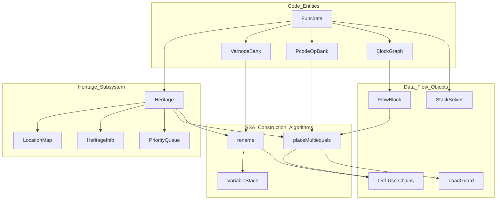
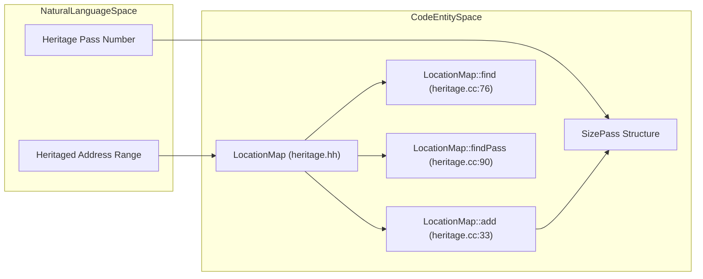
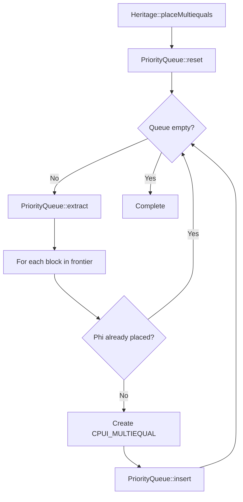
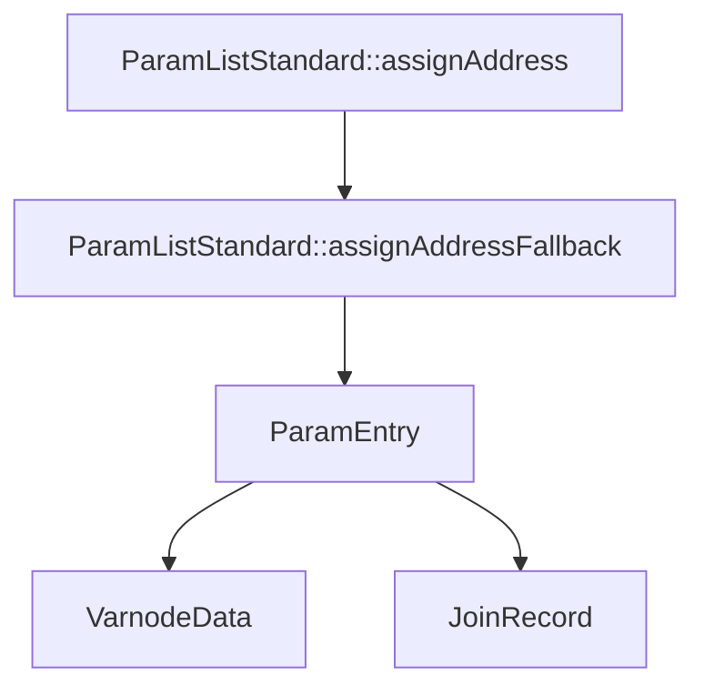

<!-- source: DeepWiki mcp.deepwiki.com · repo NationalSecurityAgency/ghidra · page 2.4 SSA Construction and Data Flow · fetched 2026-11-09 -->

# SSA Construction and Data Flow

Relevant source files

The following files were used as context for generating this wiki page:

- [Ghidra/Features/Decompiler/certification.manifest](Ghidra/Features/Decompiler/certification.manifest)
- [Ghidra/Features/Decompiler/src/decompile/cpp/cast.cc](Ghidra/Features/Decompiler/src/decompile/cpp/cast.cc)
- [Ghidra/Features/Decompiler/src/decompile/cpp/cast.hh](Ghidra/Features/Decompiler/src/decompile/cpp/cast.hh)
- [Ghidra/Features/Decompiler/src/decompile/cpp/coreaction.cc](Ghidra/Features/Decompiler/src/decompile/cpp/coreaction.cc)
- [Ghidra/Features/Decompiler/src/decompile/cpp/coreaction.hh](Ghidra/Features/Decompiler/src/decompile/cpp/coreaction.hh)
- [Ghidra/Features/Decompiler/src/decompile/cpp/cover.cc](Ghidra/Features/Decompiler/src/decompile/cpp/cover.cc)
- [Ghidra/Features/Decompiler/src/decompile/cpp/cover.hh](Ghidra/Features/Decompiler/src/decompile/cpp/cover.hh)
- [Ghidra/Features/Decompiler/src/decompile/cpp/database.cc](Ghidra/Features/Decompiler/src/decompile/cpp/database.cc)
- [Ghidra/Features/Decompiler/src/decompile/cpp/database.hh](Ghidra/Features/Decompiler/src/decompile/cpp/database.hh)
- [Ghidra/Features/Decompiler/src/decompile/cpp/database_ghidra.cc](Ghidra/Features/Decompiler/src/decompile/cpp/database_ghidra.cc)
- [Ghidra/Features/Decompiler/src/decompile/cpp/database_ghidra.hh](Ghidra/Features/Decompiler/src/decompile/cpp/database_ghidra.hh)
- [Ghidra/Features/Decompiler/src/decompile/cpp/double.cc](Ghidra/Features/Decompiler/src/decompile/cpp/double.cc)
- [Ghidra/Features/Decompiler/src/decompile/cpp/double.hh](Ghidra/Features/Decompiler/src/decompile/cpp/double.hh)
- [Ghidra/Features/Decompiler/src/decompile/cpp/fspec.cc](Ghidra/Features/Decompiler/src/decompile/cpp/fspec.cc)
- [Ghidra/Features/Decompiler/src/decompile/cpp/fspec.hh](Ghidra/Features/Decompiler/src/decompile/cpp/fspec.hh)
- [Ghidra/Features/Decompiler/src/decompile/cpp/funcdata.cc](Ghidra/Features/Decompiler/src/decompile/cpp/funcdata.cc)
- [Ghidra/Features/Decompiler/src/decompile/cpp/funcdata.hh](Ghidra/Features/Decompiler/src/decompile/cpp/funcdata.hh)
- [Ghidra/Features/Decompiler/src/decompile/cpp/funcdata_op.cc](Ghidra/Features/Decompiler/src/decompile/cpp/funcdata_op.cc)
- [Ghidra/Features/Decompiler/src/decompile/cpp/funcdata_varnode.cc](Ghidra/Features/Decompiler/src/decompile/cpp/funcdata_varnode.cc)
- [Ghidra/Features/Decompiler/src/decompile/cpp/grammar.cc](Ghidra/Features/Decompiler/src/decompile/cpp/grammar.cc)
- [Ghidra/Features/Decompiler/src/decompile/cpp/grammar.y](Ghidra/Features/Decompiler/src/decompile/cpp/grammar.y)
- [Ghidra/Features/Decompiler/src/decompile/cpp/heritage.cc](Ghidra/Features/Decompiler/src/decompile/cpp/heritage.cc)
- [Ghidra/Features/Decompiler/src/decompile/cpp/heritage.hh](Ghidra/Features/Decompiler/src/decompile/cpp/heritage.hh)
- [Ghidra/Features/Decompiler/src/decompile/cpp/ifacedecomp.cc](Ghidra/Features/Decompiler/src/decompile/cpp/ifacedecomp.cc)
- [Ghidra/Features/Decompiler/src/decompile/cpp/ifacedecomp.hh](Ghidra/Features/Decompiler/src/decompile/cpp/ifacedecomp.hh)
- [Ghidra/Features/Decompiler/src/decompile/cpp/merge.cc](Ghidra/Features/Decompiler/src/decompile/cpp/merge.cc)
- [Ghidra/Features/Decompiler/src/decompile/cpp/merge.hh](Ghidra/Features/Decompiler/src/decompile/cpp/merge.hh)
- [Ghidra/Features/Decompiler/src/decompile/cpp/op.cc](Ghidra/Features/Decompiler/src/decompile/cpp/op.cc)
- [Ghidra/Features/Decompiler/src/decompile/cpp/op.hh](Ghidra/Features/Decompiler/src/decompile/cpp/op.hh)
- [Ghidra/Features/Decompiler/src/decompile/cpp/ruleaction.cc](Ghidra/Features/Decompiler/src/decompile/cpp/ruleaction.cc)
- [Ghidra/Features/Decompiler/src/decompile/cpp/ruleaction.hh](Ghidra/Features/Decompiler/src/decompile/cpp/ruleaction.hh)
- [Ghidra/Features/Decompiler/src/decompile/cpp/subflow.cc](Ghidra/Features/Decompiler/src/decompile/cpp/subflow.cc)
- [Ghidra/Features/Decompiler/src/decompile/cpp/subflow.hh](Ghidra/Features/Decompiler/src/decompile/cpp/subflow.hh)
- [Ghidra/Features/Decompiler/src/decompile/cpp/transform.cc](Ghidra/Features/Decompiler/src/decompile/cpp/transform.cc)
- [Ghidra/Features/Decompiler/src/decompile/cpp/transform.hh](Ghidra/Features/Decompiler/src/decompile/cpp/transform.hh)
- [Ghidra/Features/Decompiler/src/decompile/cpp/type.cc](Ghidra/Features/Decompiler/src/decompile/cpp/type.cc)
- [Ghidra/Features/Decompiler/src/decompile/cpp/type.hh](Ghidra/Features/Decompiler/src/decompile/cpp/type.hh)
- [Ghidra/Features/Decompiler/src/decompile/cpp/typeop.cc](Ghidra/Features/Decompiler/src/decompile/cpp/typeop.cc)
- [Ghidra/Features/Decompiler/src/decompile/cpp/typeop.hh](Ghidra/Features/Decompiler/src/decompile/cpp/typeop.hh)
- [Ghidra/Features/Decompiler/src/decompile/cpp/variable.cc](Ghidra/Features/Decompiler/src/decompile/cpp/variable.cc)
- [Ghidra/Features/Decompiler/src/decompile/cpp/variable.hh](Ghidra/Features/Decompiler/src/decompile/cpp/variable.hh)
- [Ghidra/Features/Decompiler/src/decompile/cpp/varmap.cc](Ghidra/Features/Decompiler/src/decompile/cpp/varmap.cc)
- [Ghidra/Features/Decompiler/src/decompile/cpp/varmap.hh](Ghidra/Features/Decompiler/src/decompile/cpp/varmap.hh)
- [Ghidra/Features/Decompiler/src/decompile/cpp/varnode.cc](Ghidra/Features/Decompiler/src/decompile/cpp/varnode.cc)
- [Ghidra/Features/Decompiler/src/decompile/cpp/varnode.hh](Ghidra/Features/Decompiler/src/decompile/cpp/varnode.hh)
- [Ghidra/Features/Decompiler/src/decompile/datatests/varcross.xml](Ghidra/Features/Decompiler/src/decompile/datatests/varcross.xml)
- [Ghidra/Features/Decompiler/src/main/java/ghidra/app/decompiler/DecompileDebug.java](Ghidra/Features/Decompiler/src/main/java/ghidra/app/decompiler/DecompileDebug.java)
- [Ghidra/Framework/SoftwareModeling/src/main/java/ghidra/program/model/pcode/LocalSymbolMap.java](Ghidra/Framework/SoftwareModeling/src/main/java/ghidra/program/model/pcode/LocalSymbolMap.java)
- [Ghidra/Framework/SoftwareModeling/src/main/java/ghidra/program/model/pcode/PcodeDataTypeManager.java](Ghidra/Framework/SoftwareModeling/src/main/java/ghidra/program/model/pcode/PcodeDataTypeManager.java)

## Purpose and Scope

This document describes Ghidra's Static Single Assignment (SSA) form construction system and data-flow management within the decompiler. SSA form is a fundamental intermediate representation where each variable is assigned exactly once, enabling precise data-flow analysis and optimization. The **Heritage** system manages the transformation of raw P-code into SSA form by inserting phi functions (`CPUI_MULTIEQUAL` operations) and renaming variables. This document covers:

- The `Heritage` class and its role in SSA construction [Ghidra/Features/Decompiler/src/decompile/cpp/heritage.hh:216-224]()
- `LocationMap` for tracking heritaged address ranges [Ghidra/Features/Decompiler/src/decompile/cpp/heritage.cc:33-70]()
- Phi function placement at dominance frontiers [Ghidra/Features/Decompiler/src/decompile/cpp/heritage.cc:699-804]()
- The renaming algorithm using dominance tree traversal [Ghidra/Features/Decompiler/src/decompile/cpp/heritage.cc:806-977]()
- Def-use chain management and `LoadGuard` mechanisms [Ghidra/Features/Decompiler/src/decompile/cpp/heritage.cc:400-630]()
- Data-flow analysis for stack pointer recovery via `StackSolver` [Ghidra/Features/Decompiler/src/decompile/cpp/coreaction.cc:34-51]()

Sources: [Ghidra/Features/Decompiler/src/decompile/cpp/heritage.hh:216-224](), [Ghidra/Features/Decompiler/src/decompile/cpp/heritage.cc:33-70](), [Ghidra/Features/Decompiler/src/decompile/cpp/coreaction.cc:34-51]()

---

## Core Architecture

The SSA construction system is primarily implemented in the `Heritage` class (`heritage.hh`), which orchestrates the transformation of P-code into SSA form. The system operates on address spaces independently, tracking which memory ranges have been processed and building the necessary data structures for data-flow analysis.

### Heritage System Overview

**Sources:** [Ghidra/Features/Decompiler/src/decompile/cpp/heritage.hh:216-224](), [Ghidra/Features/Decompiler/src/decompile/cpp/heritage.cc:216-224](), [Ghidra/Features/Decompiler/src/decompile/cpp/coreaction.cc:34-51]()

### Key Data Structures

| Structure | Purpose | Key Methods / Files |
|-----------|---------|---------------------|
| `Heritage` | Main SSA construction manager | `heritage()`, `placeMultiequals()`, `rename()` [Ghidra/Features/Decompiler/src/decompile/cpp/heritage.hh:216-224]() |
| `LocationMap` | Tracks heritaged address ranges with pass numbers | `add()`, `find()`, `findPass()` [Ghidra/Features/Decompiler/src/decompile/cpp/heritage.cc:33-98]() |
| `HeritageInfo` | Per-address-space heritage state | `reset()`, delay management [Ghidra/Features/Decompiler/src/decompile/cpp/heritage.hh:122-135]() |
| `PriorityQueue` | Prioritizes blocks by dominator depth | `insert()`, `extract()` [Ghidra/Features/Decompiler/src/decompile/cpp/heritage.cc:141-175]() |
| `VariableStack` | Maps addresses to Varnode stacks for renaming | Organized by `Address` [Ghidra/Features/Decompiler/src/decompile/cpp/heritage.hh:29]() |
| `StackSolver` | Solves for stack-pointer changes across calls | `build()`, `solve()`, `propagate()` [Ghidra/Features/Decompiler/src/decompile/cpp/coreaction.cc:34-51]() |

Sources: [Ghidra/Features/Decompiler/src/decompile/cpp/heritage.hh:32-146](), [Ghidra/Features/Decompiler/src/decompile/cpp/heritage.cc:178-224](), [Ghidra/Features/Decompiler/src/decompile/cpp/coreaction.cc:34-51]()

---

## LocationMap: Tracking Heritage Progress

The `LocationMap` maintains a disjoint cover of address ranges that have been heritaged, recording the pass number when each range was processed. This enables incremental SSA construction and prevents redundant processing.

### LocationMap Code-Entity Mapping

### Intersection Handling

When a new range is added via `LocationMap::add()`, `LocationMap` handles three intersection scenarios [Ghidra/Features/Decompiler/src/decompile/cpp/heritage.cc:33-70]():

1.  **No intersection** (code 0): Range from same pass.
2.  **Partial intersection** (code 1): Overlaps with older range.
3.  **Complete containment** (code 2): Fully contained in older range.

The method merges overlapping entries and assigns the minimum pass number from all intersecting ranges, ensuring that re-heritage operations are properly tracked [Ghidra/Features/Decompiler/src/decompile/cpp/heritage.cc:44-65]().

Sources: [Ghidra/Features/Decompiler/src/decompile/cpp/heritage.hh:32-86](), [Ghidra/Features/Decompiler/src/decompile/cpp/heritage.cc:22-99]()

---

## SSA Construction Process

SSA construction follows a two-phase algorithm: phi placement and renaming. The `Heritage` class coordinates these phases, processing address spaces independently based on their heritage requirements.

### Phi Function Placement

Phi functions (`CPUI_MULTIEQUAL` ops) are placed at dominance frontiers. The process identifies blocks where multiple control-flow paths carrying different values for the same address converge.

#### Phi Placement Algorithm

The algorithm uses a `PriorityQueue` that processes blocks in order of dominator tree depth, ensuring that phi functions are placed before processing blocks they dominate [Ghidra/Features/Decompiler/src/decompile/cpp/heritage.cc:153-175]().

**Key Implementation Points:**
- **`PriorityQueue::insert`**: Adds a block at a specific priority depth [Ghidra/Features/Decompiler/src/decompile/cpp/heritage.cc:153-159]().
- **`PriorityQueue::extract`**: Retrieves the highest priority block (shallowest depth) [Ghidra/Features/Decompiler/src/decompile/cpp/heritage.cc:165-175]().
- **Phi insertion**: Phi ops are inserted at the beginning of basic blocks [Ghidra/Features/Decompiler/src/decompile/cpp/heritage.cc:753-761]().

Sources: [Ghidra/Features/Decompiler/src/decompile/cpp/heritage.cc:141-175](), [Ghidra/Features/Decompiler/src/decompile/cpp/heritage.hh:95-110]()

### Variable Renaming

The renaming phase assigns unique `Varnode` instances to each SSA definition using a depth-first traversal of the dominator tree. The algorithm maintains a stack for each address, pushing new definitions and popping when backtracking [Ghidra/Features/Decompiler/src/decompile/cpp/heritage.cc:806-977]().

Sources: [Ghidra/Features/Decompiler/src/decompile/cpp/heritage.hh:29](), [Ghidra/Features/Decompiler/src/decompile/cpp/heritage.cc:806-977]()

---

## Stack Data Flow Analysis

Recovering the stack pointer across function calls is critical for correct SSA heritage of stack-based variables. The `StackSolver` class models stack pointer changes as a system of linear equations [Ghidra/Features/Decompiler/src/decompile/cpp/coreaction.cc:34-51]().

### StackSolver Mechanism
1.  **Build**: Collects all references to the stack pointer `Varnode` and examines their defining `PcodeOp` (e.g., `CPUI_INT_ADD`, `CPUI_COPY`, `CPUI_INDIRECT`) [Ghidra/Features/Decompiler/src/decompile/cpp/coreaction.cc:148-200]().
2.  **Solve**: Uses a propagation algorithm to resolve stack offsets, starting from the function entry where the stack pointer is known (offset 0) [Ghidra/Features/Decompiler/src/decompile/cpp/coreaction.cc:113-141]().
3.  **Propagate**: Given a solution for one `Varnode`, it iteratively solves for connected variables using the collected `StackEqn` [Ghidra/Features/Decompiler/src/decompile/cpp/coreaction.cc:68-95]().

Sources: [Ghidra/Features/Decompiler/src/decompile/cpp/coreaction.cc:25-200]()

---

## LoadGuard and Def-Use Chains

Heritage maintains a list of `CPUI_LOAD` operations that reference the stack dynamically. These can potentially alias stack Varnodes, so Ghidra maintains information about the range of stack addresses that can be referenced [Ghidra/Features/Decompiler/src/decompile/cpp/heritage.cc:400-630]().

| Class | Purpose | Source Reference |
|-------|---------|------------------|
| `LoadGuard` | Tracks dynamic LOAD ops that need protection from optimization | [Ghidra/Features/Decompiler/src/decompile/cpp/heritage.hh:142-160]() |
| `AliasChecker` | Analyzes pointers to detect potential stack aliasing | [Ghidra/Features/Decompiler/src/decompile/cpp/varmap.hh:137-148]() |
| `AddBase` | Helper for tracking base pointers and indices | [Ghidra/Features/Decompiler/src/decompile/cpp/varmap.hh:140-144]() |

Sources: [Ghidra/Features/Decompiler/src/decompile/cpp/heritage.hh:142-160](), [Ghidra/Features/Decompiler/src/decompile/cpp/varmap.hh:137-148]()

---

## Prototype and Parameter Data Flow

SSA construction is heavily influenced by function prototypes. The `ParamEntry` and `ParamListStandard` classes define how parameters are mapped to storage locations, which in turn determines the initial SSA definitions for function inputs [Ghidra/Features/Decompiler/src/decompile/cpp/fspec.cc:60-153]().

### Parameter Storage Assignment

**Key Behaviors:**
- **Overlap Resolution**: `ParamEntry::resolveOverlap` checks if a parameter range intersects with previous entries [Ghidra/Features/Decompiler/src/decompile/cpp/fspec.cc:122-153]().
- **Join Records**: For parameters split across registers, `ParamEntry::resolveJoin` caches `JoinRecord` information [Ghidra/Features/Decompiler/src/decompile/cpp/fspec.cc:94-116]().
- **Storage Classes**: Parameters are filtered by storage class [Ghidra/Features/Decompiler/src/decompile/cpp/fspec.hh:81-84]().

Sources: [Ghidra/Features/Decompiler/src/decompile/cpp/fspec.cc:60-153](), [Ghidra/Features/Decompiler/src/decompile/cpp/fspec.hh:81-126]()

---

## Address Space Heritage State

`HeritageInfo` tracks the progress of SSA construction for specific address spaces, managing delays for dead code removal and heritage passes [Ghidra/Features/Decompiler/src/decompile/cpp/heritage.cc:178-214]().

| Field | Description | Source Reference |
|-------|-------------|------------------|
| `delay` | How many passes to delay heritage of this space | [Ghidra/Features/Decompiler/src/decompile/cpp/heritage.hh:125]() |
| `deadcodedelay` | How many passes to delay deadcode removal | [Ghidra/Features/Decompiler/src/decompile/cpp/heritage.hh:126]() |
| `hasCallPlaceholders` | True for stack space if placeholders not yet removed | [Ghidra/Features/Decompiler/src/decompile/cpp/heritage.hh:130]() |

Sources: [Ghidra/Features/Decompiler/src/decompile/cpp/heritage.hh:122-135](), [Ghidra/Features/Decompiler/src/decompile/cpp/heritage.cc:178-214]()

---

