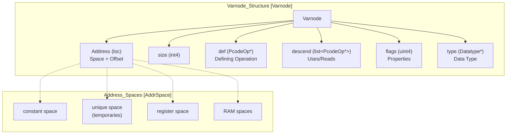
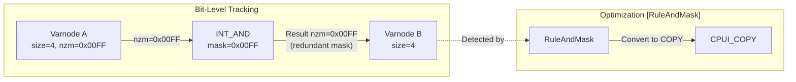
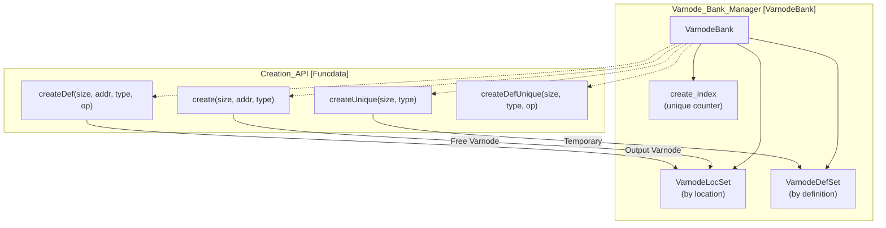
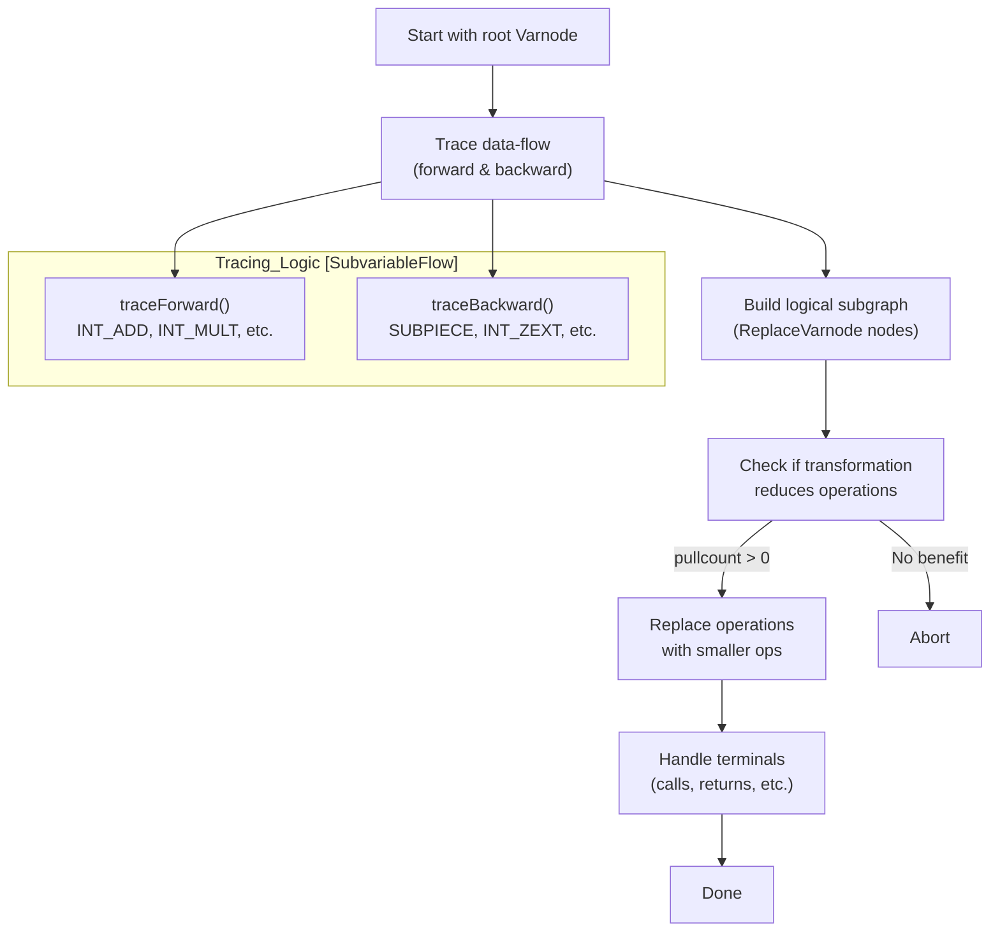
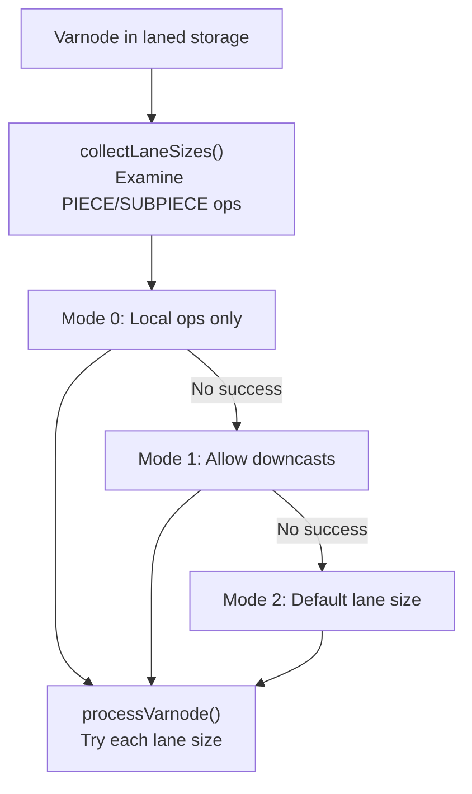
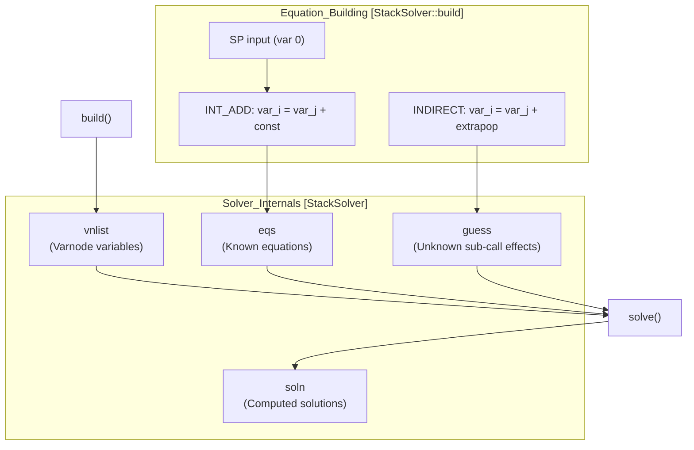

<!-- source: DeepWiki mcp.deepwiki.com · repo NationalSecurityAgency/ghidra · page 2.5 Varnode Management and Optimization · fetched 2026-11-09 -->

# Varnode Management and Optimization

<details>
<summary>Relevant source files</summary>

The following files were used as context for generating this wiki page:

- [Ghidra/Features/Decompiler/certification.manifest](Ghidra/Features/Decompiler/certification.manifest)
- [Ghidra/Features/Decompiler/src/decompile/cpp/cast.cc](Ghidra/Features/Decompiler/src/decompile/cpp/cast.cc)
- [Ghidra/Features/Decompiler/src/decompile/cpp/cast.hh](Ghidra/Features/Decompiler/src/decompile/cpp/cast.hh)
- [Ghidra/Features/Decompiler/src/decompile/cpp/coreaction.cc](Ghidra/Features/Decompiler/src/decompile/cpp/coreaction.cc)
- [Ghidra/Features/Decompiler/src/decompile/cpp/coreaction.hh](Ghidra/Features/Decompiler/src/decompile/cpp/coreaction.hh)
- [Ghidra/Features/Decompiler/src/decompile/cpp/cover.cc](Ghidra/Features/Decompiler/src/decompile/cpp/cover.cc)
- [Ghidra/Features/Decompiler/src/decompile/cpp/cover.hh](Ghidra/Features/Decompiler/src/decompile/cpp/cover.hh)
- [Ghidra/Features/Decompiler/src/decompile/cpp/database.cc](Ghidra/Features/Decompiler/src/decompile/cpp/database.cc)
- [Ghidra/Features/Decompiler/src/decompile/cpp/database.hh](Ghidra/Features/Decompiler/src/decompile/cpp/database.hh)
- [Ghidra/Features/Decompiler/src/decompile/cpp/database_ghidra.cc](Ghidra/Features/Decompiler/src/decompile/cpp/database_ghidra.cc)
- [Ghidra/Features/Decompiler/src/decompile/cpp/database_ghidra.hh](Ghidra/Features/Decompiler/src/decompile/cpp/database_ghidra.hh)
- [Ghidra/Features/Decompiler/src/decompile/cpp/double.cc](Ghidra/Features/Decompiler/src/decompile/cpp/double.cc)
- [Ghidra/Features/Decompiler/src/decompile/cpp/double.hh](Ghidra/Features/Decompiler/src/decompile/cpp/double.hh)
- [Ghidra/Features/Decompiler/src/decompile/cpp/fspec.cc](Ghidra/Features/Decompiler/src/decompile/cpp/fspec.cc)
- [Ghidra/Features/Decompiler/src/decompile/cpp/fspec.hh](Ghidra/Features/Decompiler/src/decompile/cpp/fspec.hh)
- [Ghidra/Features/Decompiler/src/decompile/cpp/funcdata.cc](Ghidra/Features/Decompiler/src/decompile/cpp/funcdata.cc)
- [Ghidra/Features/Decompiler/src/decompile/cpp/funcdata.hh](Ghidra/Features/Decompiler/src/decompile/cpp/funcdata.hh)
- [Ghidra/Features/Decompiler/src/decompile/cpp/funcdata_op.cc](Ghidra/Features/Decompiler/src/decompile/cpp/funcdata_op.cc)
- [Ghidra/Features/Decompiler/src/decompile/cpp/funcdata_varnode.cc](Ghidra/Features/Decompiler/src/decompile/cpp/funcdata_varnode.cc)
- [Ghidra/Features/Decompiler/src/decompile/cpp/grammar.cc](Ghidra/Features/Decompiler/src/decompile/cpp/grammar.cc)
- [Ghidra/Features/Decompiler/src/decompile/cpp/grammar.y](Ghidra/Features/Decompiler/src/decompile/cpp/grammar.y)
- [Ghidra/Features/Decompiler/src/decompile/cpp/heritage.cc](Ghidra/Features/Decompiler/src/decompile/cpp/heritage.cc)
- [Ghidra/Features/Decompiler/src/decompile/cpp/heritage.hh](Ghidra/Features/Decompiler/src/decompile/cpp/heritage.hh)
- [Ghidra/Features/Decompiler/src/decompile/cpp/ifacedecomp.cc](Ghidra/Features/Decompiler/src/decompile/cpp/ifacedecomp.cc)
- [Ghidra/Features/Decompiler/src/decompile/cpp/ifacedecomp.hh](Ghidra/Features/Decompiler/src/decompile/cpp/ifacedecomp.hh)
- [Ghidra/Features/Decompiler/src/decompile/cpp/merge.cc](Ghidra/Features/Decompiler/src/decompile/cpp/merge.cc)
- [Ghidra/Features/Decompiler/src/decompile/cpp/merge.hh](Ghidra/Features/Decompiler/src/decompile/cpp/merge.hh)
- [Ghidra/Features/Decompiler/src/decompile/cpp/op.cc](Ghidra/Features/Decompiler/src/decompile/cpp/op.cc)
- [Ghidra/Features/Decompiler/src/decompile/cpp/op.hh](Ghidra/Features/Decompiler/src/decompile/cpp/op.hh)
- [Ghidra/Features/Decompiler/src/decompile/cpp/ruleaction.cc](Ghidra/Features/Decompiler/src/decompile/cpp/ruleaction.cc)
- [Ghidra/Features/Decompiler/src/decompile/cpp/ruleaction.hh](Ghidra/Features/Decompiler/src/decompile/cpp/ruleaction.hh)
- [Ghidra/Features/Decompiler/src/decompile/cpp/subflow.cc](Ghidra/Features/Decompiler/src/decompile/cpp/subflow.cc)
- [Ghidra/Features/Decompiler/src/decompile/cpp/subflow.hh](Ghidra/Features/Decompiler/src/decompile/cpp/subflow.hh)
- [Ghidra/Features/Decompiler/src/decompile/cpp/transform.cc](Ghidra/Features/Decompiler/src/decompile/cpp/transform.cc)
- [Ghidra/Features/Decompiler/src/decompile/cpp/transform.hh](Ghidra/Features/Decompiler/src/decompile/cpp/transform.hh)
- [Ghidra/Features/Decompiler/src/decompile/cpp/type.cc](Ghidra/Features/Decompiler/src/decompile/cpp/type.cc)
- [Ghidra/Features/Decompiler/src/decompile/cpp/type.hh](Ghidra/Features/Decompiler/src/decompile/cpp/type.hh)
- [Ghidra/Features/Decompiler/src/decompile/cpp/typeop.cc](Ghidra/Features/Decompiler/src/decompile/cpp/typeop.cc)
- [Ghidra/Features/Decompiler/src/decompile/cpp/typeop.hh](Ghidra/Features/Decompiler/src/decompile/cpp/typeop.hh)
- [Ghidra/Features/Decompiler/src/decompile/cpp/variable.cc](Ghidra/Features/Decompiler/src/decompile/cpp/variable.cc)
- [Ghidra/Features/Decompiler/src/decompile/cpp/variable.hh](Ghidra/Features/Decompiler/src/decompile/cpp/variable.hh)
- [Ghidra/Features/Decompiler/src/decompile/cpp/varmap.cc](Ghidra/Features/Decompiler/src/decompile/cpp/varmap.cc)
- [Ghidra/Features/Decompiler/src/decompile/cpp/varmap.hh](Ghidra/Features/Decompiler/src/decompile/cpp/varmap.hh)
- [Ghidra/Features/Decompiler/src/decompile/cpp/varnode.cc](Ghidra/Features/Decompiler/src/decompile/cpp/varnode.cc)
- [Ghidra/Features/Decompiler/src/decompile/cpp/varnode.hh](Ghidra/Features/Decompiler/src/decompile/cpp/varnode.hh)
- [Ghidra/Features/Decompiler/src/decompile/datatests/varcross.xml](Ghidra/Features/Decompiler/src/decompile/datatests/varcross.xml)
- [Ghidra/Features/Decompiler/src/main/java/ghidra/app/decompiler/DecompileDebug.java](Ghidra/Features/Decompiler/src/main/java/ghidra/app/decompiler/DecompileDebug.java)
- [Ghidra/Framework/SoftwareModeling/src/main/java/ghidra/program/model/pcode/LocalSymbolMap.java](Ghidra/Framework/SoftwareModeling/src/main/java/ghidra/program/model/pcode/LocalSymbolMap.java)
- [Ghidra/Framework/SoftwareModeling/src/main/java/ghidra/program/model/pcode/PcodeDataTypeManager.java](Ghidra/Framework/SoftwareModeling/src/main/java/ghidra/program/model/pcode/PcodeDataTypeManager.java)

</details>


## Purpose and Scope

This document describes the representation, management, and optimization of Varnodes within Ghidra's decompiler. A Varnode is the fundamental data-flow element in the decompiler's intermediate representation, representing a value at a specific storage location (register, memory, constant, or temporary) during program execution.

This page covers:
- The Varnode data structure and its properties (address, size, flags)
- Creation and lifecycle management through `VarnodeBank`
- Optimization techniques for splitting large Varnodes (`SubvariableFlow`)
- SIMD register handling via lane division (`ActionLaneDivide`)
- Stack pointer flow analysis for determining calling conventions
- Common optimization patterns and transformations

For information about SSA form construction and data-flow analysis using Varnodes, see [SSA Construction and Data Flow](2.4). For type information propagation through Varnodes, see [Type System and Propagation](2.3).

---

## Varnode Representation

### Core Structure

A Varnode represents a value with four essential components:

| Component | Description |
|-----------|-------------|
| `loc` (Address) | Storage location in an address space |
| `size` | Size in bytes |
| `def` (PcodeOp*) | Defining operation (NULL for free/input Varnodes) |
| `descend` | List of operations that read this value |



Sources: [Ghidra/Features/Decompiler/src/decompile/cpp/varnode.hh:1-432](), [Ghidra/Features/Decompiler/src/decompile/cpp/varnode.cc:1-1500]()

### Varnode Flags

The `flags` field encodes boolean properties that control optimization and code generation:

| Flag | Value | Purpose |
|------|-------|---------|
| `mark` | 0x1 | Temporary marker for algorithms |
| `constant` | 0x2 | Storage in constant address space |
| `annotation` | 0x4 | Special annotation Varnode (e.g., CPUI_INDIRECT effect marker) |
| `input` | 0x8 | Unaffected input to the function |
| `written` | 0x10 | Has a defining PcodeOp (`def != NULL`) |
| `insert` | 0x20 | Artificially created during analysis |
| `implied` | 0x40 | Logically exists but not explicitly in code |
| `explict` | 0x80 | Explicitly present in binary (vs. inferred) |
| `typelock` | 0x100 | Data-type is locked/fixed |
| `namelock` | 0x200 | Variable name is locked |
| `nolocalalias` | 0x400 | Not aliased by other local variables |
| `volatil` | 0x800 | Volatile storage (e.g., memory-mapped I/O) |
| `mapped` | 0x1000 | Has associated SymbolEntry |
| `addrtied` | 0x2000 | High-level variable tied to specific address |
| `addrforce` | 0x4000 | Address forced/overridden by user |
| `auto_live` | 0x8000 | Automatically considered live |
| `incidental_copy` | 0x20000 | Not a true data-flow copy |

Sources: [Ghidra/Features/Decompiler/src/decompile/cpp/varnode.hh:50-100]()

### Non-Zero Mask (NZMask) and Consume Tracking

The decompiler tracks bit-level information to enable precise optimizations:

- **NZMask (`nzm`)**: Bitmask indicating which bits might be non-zero
- **Consume**: Bitmask indicating which bits are actually used by descendants

These enable optimizations like:
- Eliminating unnecessary AND operations when NZMask shows bits are already zero
- Identifying unused portions of large variables for splitting



Sources: [Ghidra/Features/Decompiler/src/decompile/cpp/varnode.hh:200-250](), [Ghidra/Features/Decompiler/src/decompile/cpp/ruleaction.cc:302-342]()

---

## Varnode Creation and Management

### VarnodeBank

The `VarnodeBank` class manages the lifetime of all Varnodes in a function. It maintains two primary indexes:

1. **Location-based index** (`VarnodeLocSet`): Orders Varnodes by address space, offset, size, and definition point
2. **Definition-based index** (`VarnodeDefSet`): Orders Varnodes by their defining operation



Sources: [Ghidra/Features/Decompiler/src/decompile/cpp/varnode.hh:432](), [Ghidra/Features/Decompiler/src/decompile/cpp/funcdata_varnode.cc:1-300]()

### Funcdata Creation Methods

The `Funcdata` class provides high-level Varnode creation methods that automatically handle property assignment:

| Method | Purpose | Address Space |
|--------|---------|---------------|
| `newConstant(size, value)` | Create constant Varnode | `constant` [Ghidra/Features/Decompiler/src/decompile/cpp/funcdata_varnode.cc:68-78]() |
| `newUnique(size, type)` | Create temporary register | `unique` [Ghidra/Features/Decompiler/src/decompile/cpp/funcdata_varnode.cc:85-97]() |
| `newVarnodeOut(size, addr, op)` | Create defined output | Any [Ghidra/Features/Decompiler/src/decompile/cpp/funcdata_varnode.cc:106-131]() |
| `newUniqueOut(size, op)` | Create temporary output | `unique` [Ghidra/Features/Decompiler/src/decompile/cpp/funcdata_varnode.cc:138-149]() |
| `newVarnode(size, addr, type)` | Create free Varnode | Any [Ghidra/Features/Decompiler/src/decompile/cpp/funcdata_varnode.cc:157-183]() |

Each method:
1. Allocates the Varnode through `VarnodeBank` [Ghidra/Features/Decompiler/src/decompile/cpp/funcdata_varnode.cc:73]()
2. Assigns a `HighVariable` if SSA is enabled [Ghidra/Features/Decompiler/src/decompile/cpp/funcdata_varnode.cc:48-61]()
3. Queries symbol properties via `localmap->queryProperties()` [Ghidra/Features/Decompiler/src/decompile/cpp/funcdata_varnode.cc:31-36]()
4. Checks for laned register handling if size ≥ `minLanedSize` [Ghidra/Features/Decompiler/src/decompile/cpp/funcdata_varnode.cc:92-93]()

Sources: [Ghidra/Features/Decompiler/src/decompile/cpp/funcdata_varnode.cc:20-200]()

---

## SubvariableFlow Optimization

### Purpose

`SubvariableFlow` identifies situations where a large Varnode carries a smaller logical value and creates a separate data-flow subgraph for that logical value. This eliminates unnecessary bit manipulations and improves code clarity.

**Example scenario:**
```
Original:    x = large_value & 0xFF       (8-byte value, only using low byte)
             y = x + 1
             z = x * 2
Optimized:   x_small = (byte)large_value  (1-byte value)
             y = x_small + 1
             z = x_small * 2
```

### Algorithm Overview



Sources: [Ghidra/Features/Decompiler/src/decompile/cpp/subflow.hh:25-150](), [Ghidra/Features/Decompiler/src/decompile/cpp/subflow.cc:1-500]()

### ReplaceVarnode and ReplaceOp

The algorithm constructs a shadow graph during tracing:

- **ReplaceVarnode**: Represents a Varnode within the logical subgraph [Ghidra/Features/Decompiler/src/decompile/cpp/subflow.cc:66-151]()
  - `vn`: Original Varnode
  - `replacement`: New smaller Varnode (created during replacement)
  - `mask`: Bitmask indicating which bits carry the logical value
  - `def`: `ReplaceOp` that defines this logical value

- **ReplaceOp**: Represents a PcodeOp within the logical subgraph [Ghidra/Features/Decompiler/src/decompile/cpp/subflow.cc:159-173]()
  - `op`: Original PcodeOp
  - `opc`: Opcode in subgraph (may differ from original)
  - `output`: `ReplaceVarnode` output
  - `input`: Vector of `ReplaceVarnode` inputs

Sources: [Ghidra/Features/Decompiler/src/decompile/cpp/subflow.hh:35-120](), [Ghidra/Features/Decompiler/src/decompile/cpp/subflow.cc:55-200]()

---

## Lane Division (ActionLaneDivide)

### Purpose

`ActionLaneDivide` handles SIMD (vector) registers that are treated as multiple independent "lanes" of smaller values. It splits wide Varnodes into separate lanes when the lanes are independently manipulated.

Sources: [Ghidra/Features/Decompiler/src/decompile/cpp/coreaction.hh:113-123]()

### Lane Size Detection

The architecture specifies which registers can be laned via `LanedRegister` objects. `ActionLaneDivide` iterates through possible lane sizes and modes to find a viable split.



Sources: [Ghidra/Features/Decompiler/src/decompile/cpp/coreaction.cc:501-623]()

---

## Stack Pointer Flow Analysis

### Purpose

`ActionStackPtrFlow` analyzes how the stack pointer changes across the function, particularly through sub-function calls where the "extra pop" amount may be unknown. This is critical for architectures like x86 with caller-cleanup calling conventions.

Sources: [Ghidra/Features/Decompiler/src/decompile/cpp/coreaction.hh:89-105]()

### StackSolver System

The `StackSolver` builds a system of linear equations representing stack pointer relationships.



Sources: [Ghidra/Features/Decompiler/src/decompile/cpp/coreaction.cc:24-252]()

---

## Common Optimization Rules

### Dead Code Removal (RuleEarlyRemoval)

Removes `PcodeOp` objects whose outputs are unused and have no side effects.

**Conditions for removal:**
1. Op is not a call or indirect source [Ghidra/Features/Decompiler/src/decompile/cpp/ruleaction.cc:30-31]()
2. Output has no descendants (`hasNoDescend()`) [Ghidra/Features/Decompiler/src/decompile/cpp/ruleaction.cc:35]()
3. Output is not auto-live [Ghidra/Features/Decompiler/src/decompile/cpp/ruleaction.cc:36]()
4. Address space permits dead-code removal [Ghidra/Features/Decompiler/src/decompile/cpp/ruleaction.cc:38-40]()

Sources: [Ghidra/Features/Decompiler/src/decompile/cpp/ruleaction.cc:23-44]()

### Common Subexpression Elimination (RuleSelectCse)

Identifies and eliminates duplicate computations, specifically targeting `CPUI_SUBPIECE` and `CPUI_INT_SRIGHT` for division optimizations.

Sources: [Ghidra/Features/Decompiler/src/decompile/cpp/ruleaction.cc:180-209]()

### Term Collection (RuleCollectTerms)

Collects terms in an additive expression: `V * c + V * d => V * (c + d)`. This rule uses `TermOrder` to sort and combine constant coefficients.

Sources: [Ghidra/Features/Decompiler/src/decompile/cpp/ruleaction.cc:99-176]()

---

## Register and Stack Variable Handling

### Symbol Mapping and Properties

Varnodes are mapped to symbols through `ScopeLocal`. When a Varnode is created, `setVarnodeProperties` is called to fetch properties from the symbol table.

**Key properties handled:**
- **typelock**: Fixed data type from user or debug info [Ghidra/Features/Decompiler/src/decompile/cpp/funcdata_varnode.cc:35]()
- **namelock**: Fixed variable name [Ghidra/Features/Decompiler/src/decompile/cpp/varnode.hh:61]()
- **volatil**: Prevents optimizations that would eliminate reads/writes [Ghidra/Features/Decompiler/src/decompile/cpp/varnode.hh:63]()

Sources: [Ghidra/Features/Decompiler/src/decompile/cpp/funcdata_varnode.cc:25-42](), [Ghidra/Features/Decompiler/src/decompile/cpp/varnode.hh:50-100]()

### Varnode Lifecycle

1. **Creation**: Via `Funcdata` methods (e.g., `newVarnodeOut`) [Ghidra/Features/Decompiler/src/decompile/cpp/funcdata_varnode.cc:106]()
2. **SSA Phase**: Varnodes are assigned `HighVariable` containers [Ghidra/Features/Decompiler/src/decompile/cpp/funcdata_varnode.cc:48-61]()
3. **Destruction**: Via `destroyVarnode`, which removes the Varnode from `VarnodeBank` indexes [Ghidra/Features/Decompiler/src/decompile/cpp/funcdata.hh:112]()

Sources: [Ghidra/Features/Decompiler/src/decompile/cpp/funcdata_varnode.cc:20-200](), [Ghidra/Features/Decompiler/src/decompile/cpp/funcdata.hh:56-130]()

---

