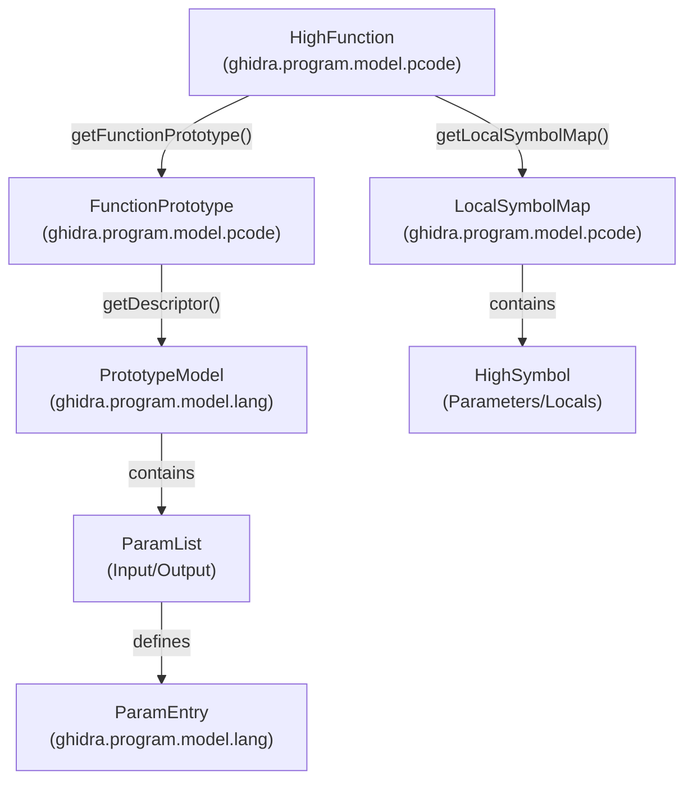
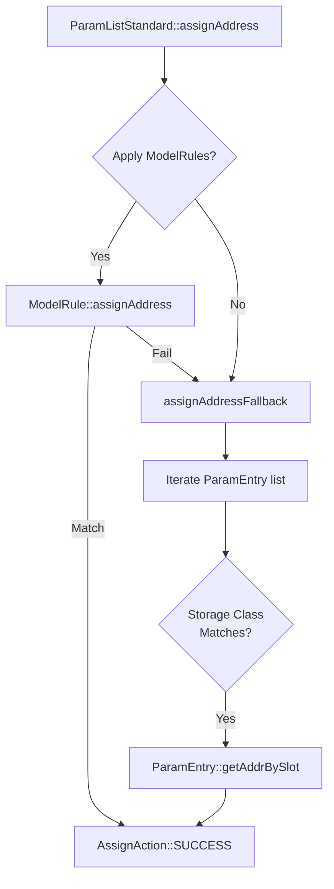
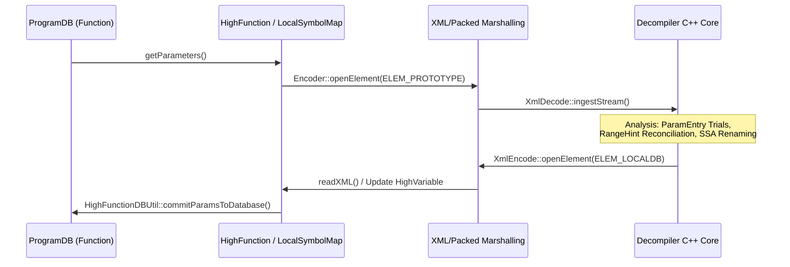

<!-- source: DeepWiki mcp.deepwiki.com · repo NationalSecurityAgency/ghidra · page 2.6 Function Prototype and Symbol Recovery · fetched 2026-11-09 -->

# Function Prototype and Symbol Recovery

Relevant source files

The following files were used as context for generating this wiki page:

- [Ghidra/Features/Decompiler/certification.manifest](Ghidra/Features/Decompiler/certification.manifest)
- [Ghidra/Features/Decompiler/src/decompile/cpp/Doxyfile](Ghidra/Features/Decompiler/src/decompile/cpp/Doxyfile)
- [Ghidra/Features/Decompiler/src/decompile/cpp/cast.cc](Ghidra/Features/Decompiler/src/decompile/cpp/cast.cc)
- [Ghidra/Features/Decompiler/src/decompile/cpp/cast.hh](Ghidra/Features/Decompiler/src/decompile/cpp/cast.hh)
- [Ghidra/Features/Decompiler/src/decompile/cpp/coreaction.cc](Ghidra/Features/Decompiler/src/decompile/cpp/coreaction.cc)
- [Ghidra/Features/Decompiler/src/decompile/cpp/coreaction.hh](Ghidra/Features/Decompiler/src/decompile/cpp/coreaction.hh)
- [Ghidra/Features/Decompiler/src/decompile/cpp/cover.cc](Ghidra/Features/Decompiler/src/decompile/cpp/cover.cc)
- [Ghidra/Features/Decompiler/src/decompile/cpp/cover.hh](Ghidra/Features/Decompiler/src/decompile/cpp/cover.hh)
- [Ghidra/Features/Decompiler/src/decompile/cpp/database.cc](Ghidra/Features/Decompiler/src/decompile/cpp/database.cc)
- [Ghidra/Features/Decompiler/src/decompile/cpp/database.hh](Ghidra/Features/Decompiler/src/decompile/cpp/database.hh)
- [Ghidra/Features/Decompiler/src/decompile/cpp/database_ghidra.cc](Ghidra/Features/Decompiler/src/decompile/cpp/database_ghidra.cc)
- [Ghidra/Features/Decompiler/src/decompile/cpp/database_ghidra.hh](Ghidra/Features/Decompiler/src/decompile/cpp/database_ghidra.hh)
- [Ghidra/Features/Decompiler/src/decompile/cpp/double.cc](Ghidra/Features/Decompiler/src/decompile/cpp/double.cc)
- [Ghidra/Features/Decompiler/src/decompile/cpp/double.hh](Ghidra/Features/Decompiler/src/decompile/cpp/double.hh)
- [Ghidra/Features/Decompiler/src/decompile/cpp/fspec.cc](Ghidra/Features/Decompiler/src/decompile/cpp/fspec.cc)
- [Ghidra/Features/Decompiler/src/decompile/cpp/fspec.hh](Ghidra/Features/Decompiler/src/decompile/cpp/fspec.hh)
- [Ghidra/Features/Decompiler/src/decompile/cpp/funcdata.cc](Ghidra/Features/Decompiler/src/decompile/cpp/funcdata.cc)
- [Ghidra/Features/Decompiler/src/decompile/cpp/funcdata.hh](Ghidra/Features/Decompiler/src/decompile/cpp/funcdata.hh)
- [Ghidra/Features/Decompiler/src/decompile/cpp/funcdata_op.cc](Ghidra/Features/Decompiler/src/decompile/cpp/funcdata_op.cc)
- [Ghidra/Features/Decompiler/src/decompile/cpp/funcdata_varnode.cc](Ghidra/Features/Decompiler/src/decompile/cpp/funcdata_varnode.cc)
- [Ghidra/Features/Decompiler/src/decompile/cpp/grammar.cc](Ghidra/Features/Decompiler/src/decompile/cpp/grammar.cc)
- [Ghidra/Features/Decompiler/src/decompile/cpp/grammar.y](Ghidra/Features/Decompiler/src/decompile/cpp/grammar.y)
- [Ghidra/Features/Decompiler/src/decompile/cpp/heritage.cc](Ghidra/Features/Decompiler/src/decompile/cpp/heritage.cc)
- [Ghidra/Features/Decompiler/src/decompile/cpp/heritage.hh](Ghidra/Features/Decompiler/src/decompile/cpp/heritage.hh)
- [Ghidra/Features/Decompiler/src/decompile/cpp/ifacedecomp.cc](Ghidra/Features/Decompiler/src/decompile/cpp/ifacedecomp.cc)
- [Ghidra/Features/Decompiler/src/decompile/cpp/ifacedecomp.hh](Ghidra/Features/Decompiler/src/decompile/cpp/ifacedecomp.hh)
- [Ghidra/Features/Decompiler/src/decompile/cpp/marshal.cc](Ghidra/Features/Decompiler/src/decompile/cpp/marshal.cc)
- [Ghidra/Features/Decompiler/src/decompile/cpp/marshal.hh](Ghidra/Features/Decompiler/src/decompile/cpp/marshal.hh)
- [Ghidra/Features/Decompiler/src/decompile/cpp/merge.cc](Ghidra/Features/Decompiler/src/decompile/cpp/merge.cc)
- [Ghidra/Features/Decompiler/src/decompile/cpp/merge.hh](Ghidra/Features/Decompiler/src/decompile/cpp/merge.hh)
- [Ghidra/Features/Decompiler/src/decompile/cpp/modelrules.cc](Ghidra/Features/Decompiler/src/decompile/cpp/modelrules.cc)
- [Ghidra/Features/Decompiler/src/decompile/cpp/modelrules.hh](Ghidra/Features/Decompiler/src/decompile/cpp/modelrules.hh)
- [Ghidra/Features/Decompiler/src/decompile/cpp/op.cc](Ghidra/Features/Decompiler/src/decompile/cpp/op.cc)
- [Ghidra/Features/Decompiler/src/decompile/cpp/op.hh](Ghidra/Features/Decompiler/src/decompile/cpp/op.hh)
- [Ghidra/Features/Decompiler/src/decompile/cpp/prefersplit.cc](Ghidra/Features/Decompiler/src/decompile/cpp/prefersplit.cc)
- [Ghidra/Features/Decompiler/src/decompile/cpp/prefersplit.hh](Ghidra/Features/Decompiler/src/decompile/cpp/prefersplit.hh)
- [Ghidra/Features/Decompiler/src/decompile/cpp/ruleaction.cc](Ghidra/Features/Decompiler/src/decompile/cpp/ruleaction.cc)
- [Ghidra/Features/Decompiler/src/decompile/cpp/ruleaction.hh](Ghidra/Features/Decompiler/src/decompile/cpp/ruleaction.hh)
- [Ghidra/Features/Decompiler/src/decompile/cpp/subflow.cc](Ghidra/Features/Decompiler/src/decompile/cpp/subflow.cc)
- [Ghidra/Features/Decompiler/src/decompile/cpp/subflow.hh](Ghidra/Features/Decompiler/src/decompile/cpp/subflow.hh)
- [Ghidra/Features/Decompiler/src/decompile/cpp/transform.cc](Ghidra/Features/Decompiler/src/decompile/cpp/transform.cc)
- [Ghidra/Features/Decompiler/src/decompile/cpp/transform.hh](Ghidra/Features/Decompiler/src/decompile/cpp/transform.hh)
- [Ghidra/Features/Decompiler/src/decompile/cpp/type.cc](Ghidra/Features/Decompiler/src/decompile/cpp/type.cc)
- [Ghidra/Features/Decompiler/src/decompile/cpp/type.hh](Ghidra/Features/Decompiler/src/decompile/cpp/type.hh)
- [Ghidra/Features/Decompiler/src/decompile/cpp/typeop.cc](Ghidra/Features/Decompiler/src/decompile/cpp/typeop.cc)
- [Ghidra/Features/Decompiler/src/decompile/cpp/typeop.hh](Ghidra/Features/Decompiler/src/decompile/cpp/typeop.hh)
- [Ghidra/Features/Decompiler/src/decompile/cpp/variable.cc](Ghidra/Features/Decompiler/src/decompile/cpp/variable.cc)
- [Ghidra/Features/Decompiler/src/decompile/cpp/variable.hh](Ghidra/Features/Decompiler/src/decompile/cpp/variable.hh)
- [Ghidra/Features/Decompiler/src/decompile/cpp/varmap.cc](Ghidra/Features/Decompiler/src/decompile/cpp/varmap.cc)
- [Ghidra/Features/Decompiler/src/decompile/cpp/varmap.hh](Ghidra/Features/Decompiler/src/decompile/cpp/varmap.hh)
- [Ghidra/Features/Decompiler/src/decompile/cpp/varnode.cc](Ghidra/Features/Decompiler/src/decompile/cpp/varnode.cc)
- [Ghidra/Features/Decompiler/src/decompile/cpp/varnode.hh](Ghidra/Features/Decompiler/src/decompile/cpp/varnode.hh)
- [Ghidra/Features/Decompiler/src/decompile/cpp/xml.cc](Ghidra/Features/Decompiler/src/decompile/cpp/xml.cc)
- [Ghidra/Features/Decompiler/src/decompile/cpp/xml.hh](Ghidra/Features/Decompiler/src/decompile/cpp/xml.hh)
- [Ghidra/Features/Decompiler/src/decompile/cpp/xml.y](Ghidra/Features/Decompiler/src/decompile/cpp/xml.y)
- [Ghidra/Features/Decompiler/src/decompile/datatests/varcross.xml](Ghidra/Features/Decompiler/src/decompile/datatests/varcross.xml)
- [Ghidra/Features/Decompiler/src/main/java/ghidra/app/decompiler/DecompileDebug.java](Ghidra/Features/Decompiler/src/main/java/ghidra/app/decompiler/DecompileDebug.java)
- [Ghidra/Features/Decompiler/src/main/java/ghidra/app/plugin/core/decompile/actions/CloneDecompilerAction.java](Ghidra/Features/Decompiler/src/main/java/ghidra/app/plugin/core/decompile/actions/CloneDecompilerAction.java)
- [Ghidra/Features/Decompiler/src/main/java/ghidra/app/plugin/core/decompile/actions/CommitLocalsAction.java](Ghidra/Features/Decompiler/src/main/java/ghidra/app/plugin/core/decompile/actions/CommitLocalsAction.java)
- [Ghidra/Features/Decompiler/src/main/java/ghidra/app/plugin/core/decompile/actions/CommitParamsAction.java](Ghidra/Features/Decompiler/src/main/java/ghidra/app/plugin/core/decompile/actions/CommitParamsAction.java)
- [Ghidra/Features/Decompiler/src/main/java/ghidra/app/plugin/core/decompile/actions/ConvertBinaryAction.java](Ghidra/Features/Decompiler/src/main/java/ghidra/app/plugin/core/decompile/actions/ConvertBinaryAction.java)
- [Ghidra/Features/Decompiler/src/main/java/ghidra/app/plugin/core/decompile/actions/ConvertCharAction.java](Ghidra/Features/Decompiler/src/main/java/ghidra/app/plugin/core/decompile/actions/ConvertCharAction.java)
- [Ghidra/Features/Decompiler/src/main/java/ghidra/app/plugin/core/decompile/actions/ConvertConstantAction.java](Ghidra/Features/Decompiler/src/main/java/ghidra/app/plugin/core/decompile/actions/ConvertConstantAction.java)
- [Ghidra/Features/Decompiler/src/main/java/ghidra/app/plugin/core/decompile/actions/ConvertConstantEquateTask.java](Ghidra/Features/Decompiler/src/main/java/ghidra/app/plugin/core/decompile/actions/ConvertConstantEquateTask.java)
- [Ghidra/Features/Decompiler/src/main/java/ghidra/app/plugin/core/decompile/actions/ConvertDecAction.java](Ghidra/Features/Decompiler/src/main/java/ghidra/app/plugin/core/decompile/actions/ConvertDecAction.java)
- [Ghidra/Features/Decompiler/src/main/java/ghidra/app/plugin/core/decompile/actions/ConvertDoubleAction.java](Ghidra/Features/Decompiler/src/main/java/ghidra/app/plugin/core/decompile/actions/ConvertDoubleAction.java)
- [Ghidra/Features/Decompiler/src/main/java/ghidra/app/plugin/core/decompile/actions/ConvertFloatAction.java](Ghidra/Features/Decompiler/src/main/java/ghidra/app/plugin/core/decompile/actions/ConvertFloatAction.java)
- [Ghidra/Features/Decompiler/src/main/java/ghidra/app/plugin/core/decompile/actions/ConvertHexAction.java](Ghidra/Features/Decompiler/src/main/java/ghidra/app/plugin/core/decompile/actions/ConvertHexAction.java)
- [Ghidra/Features/Decompiler/src/main/java/ghidra/app/plugin/core/decompile/actions/ConvertOctAction.java](Ghidra/Features/Decompiler/src/main/java/ghidra/app/plugin/core/decompile/actions/ConvertOctAction.java)
- [Ghidra/Features/Decompiler/src/main/java/ghidra/app/plugin/core/decompile/actions/CreatePointerRelative.java](Ghidra/Features/Decompiler/src/main/java/ghidra/app/plugin/core/decompile/actions/CreatePointerRelative.java)
- [Ghidra/Features/Decompiler/src/main/java/ghidra/app/plugin/core/decompile/actions/DebugDecompilerAction.java](Ghidra/Features/Decompiler/src/main/java/ghidra/app/plugin/core/decompile/actions/DebugDecompilerAction.java)
- [Ghidra/Features/Decompiler/src/main/java/ghidra/app/plugin/core/decompile/actions/ExportToCAction.java](Ghidra/Features/Decompiler/src/main/java/ghidra/app/plugin/core/decompile/actions/ExportToCAction.java)
- [Ghidra/Features/Decompiler/src/main/java/ghidra/app/plugin/core/decompile/actions/IsolateVariableTask.java](Ghidra/Features/Decompiler/src/main/java/ghidra/app/plugin/core/decompile/actions/IsolateVariableTask.java)
- [Ghidra/Features/Decompiler/src/main/java/ghidra/app/plugin/core/decompile/actions/RemoveEquateAction.java](Ghidra/Features/Decompiler/src/main/java/ghidra/app/plugin/core/decompile/actions/RemoveEquateAction.java)
- [Ghidra/Features/Decompiler/src/main/java/ghidra/app/plugin/core/decompile/actions/RenameVariableTask.java](Ghidra/Features/Decompiler/src/main/java/ghidra/app/plugin/core/decompile/actions/RenameVariableTask.java)
- [Ghidra/Features/Decompiler/src/main/java/ghidra/app/plugin/core/decompile/actions/RetypeGlobalAction.java](Ghidra/Features/Decompiler/src/main/java/ghidra/app/plugin/core/decompile/actions/RetypeGlobalAction.java)
- [Ghidra/Features/Decompiler/src/main/java/ghidra/app/plugin/core/decompile/actions/RetypeLocalAction.java](Ghidra/Features/Decompiler/src/main/java/ghidra/app/plugin/core/decompile/actions/RetypeLocalAction.java)
- [Ghidra/Features/Decompiler/src/main/java/ghidra/app/plugin/core/decompile/actions/RetypeReturnAction.java](Ghidra/Features/Decompiler/src/main/java/ghidra/app/plugin/core/decompile/actions/RetypeReturnAction.java)
- [Ghidra/Features/Decompiler/src/main/java/ghidra/app/plugin/core/decompile/actions/SetEquateAction.java](Ghidra/Features/Decompiler/src/main/java/ghidra/app/plugin/core/decompile/actions/SetEquateAction.java)
- [Ghidra/Features/DecompilerDependent/src/main/java/ghidra/app/plugin/core/decompiler/taint/actions/TaintAbstractDecompilerAction.java](Ghidra/Features/DecompilerDependent/src/main/java/ghidra/app/plugin/core/decompiler/taint/actions/TaintAbstractDecompilerAction.java)
- [Ghidra/Framework/SoftwareModeling/data/languages/compiler_spec.rxg](Ghidra/Framework/SoftwareModeling/data/languages/compiler_spec.rxg)
- [Ghidra/Framework/SoftwareModeling/src/main/java/ghidra/program/model/lang/ParamEntry.java](Ghidra/Framework/SoftwareModeling/src/main/java/ghidra/program/model/lang/ParamEntry.java)
- [Ghidra/Framework/SoftwareModeling/src/main/java/ghidra/program/model/lang/ParamListStandard.java](Ghidra/Framework/SoftwareModeling/src/main/java/ghidra/program/model/lang/ParamListStandard.java)
- [Ghidra/Framework/SoftwareModeling/src/main/java/ghidra/program/model/lang/ParamListStandardOut.java](Ghidra/Framework/SoftwareModeling/src/main/java/ghidra/program/model/lang/ParamListStandardOut.java)
- [Ghidra/Framework/SoftwareModeling/src/main/java/ghidra/program/model/lang/protorules/AssignAction.java](Ghidra/Framework/SoftwareModeling/src/main/java/ghidra/program/model/lang/protorules/AssignAction.java)
- [Ghidra/Framework/SoftwareModeling/src/main/java/ghidra/program/model/lang/protorules/DatatypeFilter.java](Ghidra/Framework/SoftwareModeling/src/main/java/ghidra/program/model/lang/protorules/DatatypeFilter.java)
- [Ghidra/Framework/SoftwareModeling/src/main/java/ghidra/program/model/lang/protorules/HomogeneousAggregate.java](Ghidra/Framework/SoftwareModeling/src/main/java/ghidra/program/model/lang/protorules/HomogeneousAggregate.java)
- [Ghidra/Framework/SoftwareModeling/src/main/java/ghidra/program/model/lang/protorules/MultiMemberAssign.java](Ghidra/Framework/SoftwareModeling/src/main/java/ghidra/program/model/lang/protorules/MultiMemberAssign.java)
- [Ghidra/Framework/SoftwareModeling/src/main/java/ghidra/program/model/lang/protorules/MultiSlotAssign.java](Ghidra/Framework/SoftwareModeling/src/main/java/ghidra/program/model/lang/protorules/MultiSlotAssign.java)
- [Ghidra/Framework/SoftwareModeling/src/main/java/ghidra/program/model/lang/protorules/MultiSlotDualAssign.java](Ghidra/Framework/SoftwareModeling/src/main/java/ghidra/program/model/lang/protorules/MultiSlotDualAssign.java)
- [Ghidra/Framework/SoftwareModeling/src/main/java/ghidra/program/model/pcode/AttributeId.java](Ghidra/Framework/SoftwareModeling/src/main/java/ghidra/program/model/pcode/AttributeId.java)
- [Ghidra/Framework/SoftwareModeling/src/main/java/ghidra/program/model/pcode/DynamicEntry.java](Ghidra/Framework/SoftwareModeling/src/main/java/ghidra/program/model/pcode/DynamicEntry.java)
- [Ghidra/Framework/SoftwareModeling/src/main/java/ghidra/program/model/pcode/ElementId.java](Ghidra/Framework/SoftwareModeling/src/main/java/ghidra/program/model/pcode/ElementId.java)
- [Ghidra/Framework/SoftwareModeling/src/main/java/ghidra/program/model/pcode/EquateSymbol.java](Ghidra/Framework/SoftwareModeling/src/main/java/ghidra/program/model/pcode/EquateSymbol.java)
- [Ghidra/Framework/SoftwareModeling/src/main/java/ghidra/program/model/pcode/GlobalSymbolMap.java](Ghidra/Framework/SoftwareModeling/src/main/java/ghidra/program/model/pcode/GlobalSymbolMap.java)
- [Ghidra/Framework/SoftwareModeling/src/main/java/ghidra/program/model/pcode/HighCodeSymbol.java](Ghidra/Framework/SoftwareModeling/src/main/java/ghidra/program/model/pcode/HighCodeSymbol.java)
- [Ghidra/Framework/SoftwareModeling/src/main/java/ghidra/program/model/pcode/HighConstant.java](Ghidra/Framework/SoftwareModeling/src/main/java/ghidra/program/model/pcode/HighConstant.java)
- [Ghidra/Framework/SoftwareModeling/src/main/java/ghidra/program/model/pcode/HighFunctionDBUtil.java](Ghidra/Framework/SoftwareModeling/src/main/java/ghidra/program/model/pcode/HighFunctionDBUtil.java)
- [Ghidra/Framework/SoftwareModeling/src/main/java/ghidra/program/model/pcode/HighGlobal.java](Ghidra/Framework/SoftwareModeling/src/main/java/ghidra/program/model/pcode/HighGlobal.java)
- [Ghidra/Framework/SoftwareModeling/src/main/java/ghidra/program/model/pcode/HighLocal.java](Ghidra/Framework/SoftwareModeling/src/main/java/ghidra/program/model/pcode/HighLocal.java)
- [Ghidra/Framework/SoftwareModeling/src/main/java/ghidra/program/model/pcode/HighOther.java](Ghidra/Framework/SoftwareModeling/src/main/java/ghidra/program/model/pcode/HighOther.java)
- [Ghidra/Framework/SoftwareModeling/src/main/java/ghidra/program/model/pcode/HighParam.java](Ghidra/Framework/SoftwareModeling/src/main/java/ghidra/program/model/pcode/HighParam.java)
- [Ghidra/Framework/SoftwareModeling/src/main/java/ghidra/program/model/pcode/HighVariable.java](Ghidra/Framework/SoftwareModeling/src/main/java/ghidra/program/model/pcode/HighVariable.java)
- [Ghidra/Framework/SoftwareModeling/src/main/java/ghidra/program/model/pcode/JumpTable.java](Ghidra/Framework/SoftwareModeling/src/main/java/ghidra/program/model/pcode/JumpTable.java)
- [Ghidra/Framework/SoftwareModeling/src/main/java/ghidra/program/model/pcode/LocalSymbolMap.java](Ghidra/Framework/SoftwareModeling/src/main/java/ghidra/program/model/pcode/LocalSymbolMap.java)
- [Ghidra/Framework/SoftwareModeling/src/main/java/ghidra/program/model/pcode/MappedDataEntry.java](Ghidra/Framework/SoftwareModeling/src/main/java/ghidra/program/model/pcode/MappedDataEntry.java)
- [Ghidra/Framework/SoftwareModeling/src/main/java/ghidra/program/model/pcode/MappedEntry.java](Ghidra/Framework/SoftwareModeling/src/main/java/ghidra/program/model/pcode/MappedEntry.java)
- [Ghidra/Framework/SoftwareModeling/src/main/java/ghidra/program/model/pcode/PcodeDataTypeManager.java](Ghidra/Framework/SoftwareModeling/src/main/java/ghidra/program/model/pcode/PcodeDataTypeManager.java)
- [Ghidra/Framework/SoftwareModeling/src/main/java/ghidra/program/model/pcode/SymbolEntry.java](Ghidra/Framework/SoftwareModeling/src/main/java/ghidra/program/model/pcode/SymbolEntry.java)

## Purpose and Scope

This document describes how the Ghidra decompiler recovers function signatures, parameters, return values, and local variables during analysis. This process determines which Varnodes represent function parameters and local stack variables, assigns data-types to them, and reconstructs the function's prototype through calling convention analysis and `varmap` management.

The recovery process bridges the gap between raw P-code operations and high-level C-style function definitions. It relies on the `HighFunction` model, which encapsulates the decompiler's view of a function's symbols and parameters.

---

## Function Prototype Model

The decompiler maintains function signature information through several coordinated data structures centered around the `PrototypeModel` (C++) and `FunctionPrototype` (Java) classes.

### Core Components

**Sources:** [Ghidra/Framework/SoftwareModeling/src/main/java/ghidra/program/model/pcode/HighFunctionDBUtil.java:52-54](), [Ghidra/Features/Decompiler/src/decompile/cpp/fspec.hh:17-27](), [Ghidra/Framework/SoftwareModeling/src/main/java/ghidra/program/model/lang/ParamListStandard.java:40-52]()

### PrototypeModel and ParamEntry

The `PrototypeModel` defines the architecture-specific calling convention. It is typically loaded from a `.cspec` file using the `compiler_spec.rxg` grammar [Ghidra/Framework/SoftwareModeling/data/languages/compiler_spec.rxg:1-13]().

- **ParamEntry:** Represents a contiguous range of memory (register or stack) that can be used to pass parameters. It supports both "exclusion" (single parameter per range) and "non-exclusion" (resource pool for multiple parameters) [Ghidra/Features/Decompiler/src/decompile/cpp/fspec.hh:68-84]().
- **Storage Classes:** Entries are categorized by storage attributes and types [Ghidra/Features/Decompiler/src/decompile/cpp/fspec.hh:81-84]().
- **Overlaps and Joins:** The decompiler handles complex storage like `join` addresses (values split across registers) via `resolveJoin` and `resolveOverlap` [Ghidra/Features/Decompiler/src/decompile/cpp/fspec.cc:94-154]().

**Sources:** [Ghidra/Features/Decompiler/src/decompile/cpp/fspec.hh:84-116](), [Ghidra/Features/Decompiler/src/decompile/cpp/fspec.cc:60-154](), [Ghidra/Framework/SoftwareModeling/data/languages/compiler_spec.rxg:185-202]()

---

## Parameter Recovery Process

### Storage Assignment and Trials

The decompiler uses `ParamListStandard` to assign storage for parameters based on their data-types and the rules defined in the calling convention.

**Sources:** [Ghidra/Framework/SoftwareModeling/src/main/java/ghidra/program/model/lang/ParamListStandard.java:87-152]()

1. **Model Rules:** Specialized rules are checked first to handle complex types like structures passed across multiple registers.
2. **Fallback Assignment:** If no specific rule matches, the system iterates through `ParamEntry` objects, checking for available slots in the appropriate storage class [Ghidra/Framework/SoftwareModeling/src/main/java/ghidra/program/model/lang/ParamListStandard.java:90-117]().

---

## Local Variable and Stack Recovery

### Stack Analysis and Solving
The decompiler must track stack pointer modifications to correctly resolve stack-relative offsets. The `StackSolver` class solves for stack-pointer changes across sub-functions by building a system of linear equations based on `CPUI_INT_ADD` and `CPUI_COPY` operations on the stack pointer [Ghidra/Features/Decompiler/src/decompile/cpp/coreaction.cc:34-51]().

- **StackSolver::build:** Collects references to the stack-pointer as variables and examines their defining PcodeOps to determine equations [Ghidra/Features/Decompiler/src/decompile/cpp/coreaction.cc:148-199]().
- **StackSolver::solve:** Uses a propagation algorithm to resolve stack offsets for variables where the system is underdetermined [Ghidra/Features/Decompiler/src/decompile/cpp/coreaction.cc:113-141]().

**Sources:** [Ghidra/Features/Decompiler/src/decompile/cpp/coreaction.cc:34-199]()

### RangeHint and Varmap Management

For stack variables, the decompiler uses `RangeHint` to track putative data-types mapped to specific byte ranges. This is the core of `varmap` management.

- **Reconciliation:** The `RangeHint::reconcile` method determines if two intersecting data-type hints can coexist (e.g., a small structure field inside a larger array) [Ghidra/Features/Decompiler/src/decompile/cpp/varmap.cc:62-101]().
- **Absorption:** The decompiler can merge adjacent hints into arrays using `attemptJoin` and `absorb` if the element sizes and types are compatible [Ghidra/Features/Decompiler/src/decompile/cpp/varmap.cc:170-199]().
- **Preference:** Locked data-types (user-defined) are preferred over recovered ones, and fixed-size types are preferred over open (variable-sized) types [Ghidra/Features/Decompiler/src/decompile/cpp/varmap.cc:126-157]().

**Sources:** [Ghidra/Features/Decompiler/src/decompile/cpp/varmap.cc:30-157]()

### HighFunctionDBUtil

The `HighFunctionDBUtil` class provides the bridge for committing recovered information back to the Ghidra Program Database (`ProgramDB`).

| Feature | Description |
| :--- | :--- |
| **commitParamsToDatabase** | Updates the function signature, return type, and parameter list in the DB based on the `HighFunction` state [Ghidra/Framework/SoftwareModeling/src/main/java/ghidra/program/model/pcode/HighFunctionDBUtil.java:104-150](). |
| **Return Commitment** | Supports options like `COMMIT_NO_VOID` to avoid overwriting a known return type with `void` if the decompiler is uncertain [Ghidra/Framework/SoftwareModeling/src/main/java/ghidra/program/model/pcode/HighFunctionDBUtil.java:75-91](). |
| **Custom Storage** | If the recovered storage does not match the default calling convention, the utility forces the function into `CUSTOM_STORAGE` mode [Ghidra/Framework/SoftwareModeling/src/main/java/ghidra/program/model/pcode/HighFunctionDBUtil.java:140-146](). |

**Sources:** [Ghidra/Framework/SoftwareModeling/src/main/java/ghidra/program/model/pcode/HighFunctionDBUtil.java:75-178]()

---

## Heritage and SSA Form

The `Heritage` system builds the SSA form which is essential for identifying unique variable instances. Symbol recovery relies on the data-flow provided by SSA.

- **LocationMap:** Tracks which address ranges have been heritaged (converted to SSA) and in which pass [Ghidra/Features/Decompiler/src/decompile/cpp/heritage.cc:33-70]().
- **PriorityQueue:** A work-list for basic blocks used during `CPUI_MULTIEQUAL` (phi-node) placement [Ghidra/Features/Decompiler/src/decompile/cpp/heritage.cc:141-175]().
- **VariableStack:** Maps disjoint address ranges to their respective Varnode stacks during the renaming algorithm.

**Sources:** [Ghidra/Features/Decompiler/src/decompile/cpp/heritage.cc:33-175]()

---

## Summary of Data Flow

**Sources:** [Ghidra/Framework/SoftwareModeling/src/main/java/ghidra/program/model/pcode/HighFunctionDBUtil.java:104-110](), [Ghidra/Features/Decompiler/src/decompile/cpp/varmap.cc:24-25](), [Ghidra/Framework/SoftwareModeling/src/main/java/ghidra/program/model/lang/ParamListStandard.java:30-34]()

---

