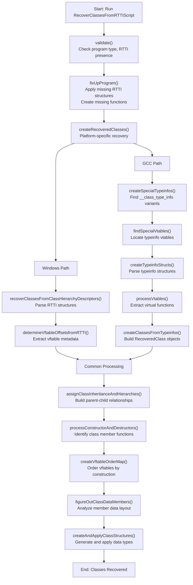
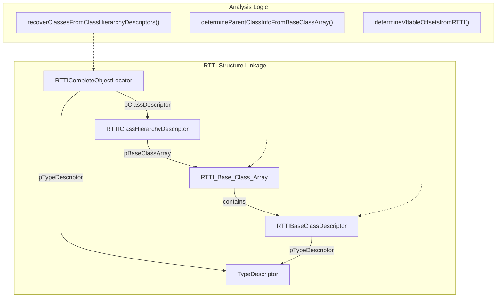

<!-- source: DeepWiki mcp.deepwiki.com · repo NationalSecurityAgency/ghidra · page 2.7 C++ Class Recovery from RTTI · fetched 2026-11-09 -->

# C++ Class Recovery from RTTI

<details>
<summary>Relevant source files</summary>

The following files were used as context for generating this wiki page:

- [Ghidra/Features/Base/ghidra_scripts/GraphClassesScript.java](Ghidra/Features/Base/ghidra_scripts/GraphClassesScript.java)
- [Ghidra/Features/Decompiler/ghidra_scripts/ApplyClassFunctionDefinitionUpdatesScript.java](Ghidra/Features/Decompiler/ghidra_scripts/ApplyClassFunctionDefinitionUpdatesScript.java)
- [Ghidra/Features/Decompiler/ghidra_scripts/ApplyClassFunctionSignatureUpdatesScript.java](Ghidra/Features/Decompiler/ghidra_scripts/ApplyClassFunctionSignatureUpdatesScript.java)
- [Ghidra/Features/Decompiler/ghidra_scripts/RecoverClassesFromRTTIScript.java](Ghidra/Features/Decompiler/ghidra_scripts/RecoverClassesFromRTTIScript.java)
- [Ghidra/Features/Decompiler/ghidra_scripts/classrecovery/BaseTypeinfo.java](Ghidra/Features/Decompiler/ghidra_scripts/classrecovery/BaseTypeinfo.java)
- [Ghidra/Features/Decompiler/ghidra_scripts/classrecovery/DecompilerScriptUtils.java](Ghidra/Features/Decompiler/ghidra_scripts/classrecovery/DecompilerScriptUtils.java)
- [Ghidra/Features/Decompiler/ghidra_scripts/classrecovery/EditStructureUtils.java](Ghidra/Features/Decompiler/ghidra_scripts/classrecovery/EditStructureUtils.java)
- [Ghidra/Features/Decompiler/ghidra_scripts/classrecovery/ExtendedFlatProgramAPI.java](Ghidra/Features/Decompiler/ghidra_scripts/classrecovery/ExtendedFlatProgramAPI.java)
- [Ghidra/Features/Decompiler/ghidra_scripts/classrecovery/GccTypeinfo.java](Ghidra/Features/Decompiler/ghidra_scripts/classrecovery/GccTypeinfo.java)
- [Ghidra/Features/Decompiler/ghidra_scripts/classrecovery/GccTypeinfoRef.java](Ghidra/Features/Decompiler/ghidra_scripts/classrecovery/GccTypeinfoRef.java)
- [Ghidra/Features/Decompiler/ghidra_scripts/classrecovery/RTTIClassRecoverer.java](Ghidra/Features/Decompiler/ghidra_scripts/classrecovery/RTTIClassRecoverer.java)
- [Ghidra/Features/Decompiler/ghidra_scripts/classrecovery/RTTIGccClassRecoverer.java](Ghidra/Features/Decompiler/ghidra_scripts/classrecovery/RTTIGccClassRecoverer.java)
- [Ghidra/Features/Decompiler/ghidra_scripts/classrecovery/RTTIWindowsClassRecoverer.java](Ghidra/Features/Decompiler/ghidra_scripts/classrecovery/RTTIWindowsClassRecoverer.java)
- [Ghidra/Features/Decompiler/ghidra_scripts/classrecovery/RecoveredClass.java](Ghidra/Features/Decompiler/ghidra_scripts/classrecovery/RecoveredClass.java)
- [Ghidra/Features/Decompiler/ghidra_scripts/classrecovery/RecoveredClassHelper.java](Ghidra/Features/Decompiler/ghidra_scripts/classrecovery/RecoveredClassHelper.java)
- [Ghidra/Features/Decompiler/ghidra_scripts/classrecovery/SpecialVtable.java](Ghidra/Features/Decompiler/ghidra_scripts/classrecovery/SpecialVtable.java)
- [Ghidra/Features/Decompiler/ghidra_scripts/classrecovery/Typeinfo.java](Ghidra/Features/Decompiler/ghidra_scripts/classrecovery/Typeinfo.java)
- [Ghidra/Features/Decompiler/ghidra_scripts/classrecovery/Vftable.java](Ghidra/Features/Decompiler/ghidra_scripts/classrecovery/Vftable.java)
- [Ghidra/Features/Decompiler/ghidra_scripts/classrecovery/Vtable.java](Ghidra/Features/Decompiler/ghidra_scripts/classrecovery/Vtable.java)

</details>


## Purpose and Scope

This document describes Ghidra's system for automatically recovering C++ class structures from Run-Time Type Information (RTTI) embedded in compiled binaries. The system analyzes RTTI metadata to reconstruct class hierarchies, virtual function tables, inheritance relationships, constructor/destructor functions, and member data layouts for both MSVC/Clang (Windows PE) and GCC (ELF) compiled programs.

For information about the broader decompiler system that utilizes recovered class information, see [2.1](). For details on type system integration, see [2.3]().

---

## RTTI Overview

RTTI is compiler-generated metadata embedded in binaries to support runtime type identification and dynamic casting in C++. Different compilers use distinct RTTI formats:

- **MSVC/Clang (Windows)**: Uses structures like `RTTICompleteObjectLocator`, `RTTIClassHierarchyDescriptor`, and `RTTIBaseClassDescriptor` that reference type descriptors and base class arrays [Ghidra/Features/Decompiler/ghidra_scripts/classrecovery/RTTIWindowsClassRecoverer.java:44-54]().
- **GCC/Clang (Linux/ELF)**: Uses `std::typeinfo` objects with variants representing no inheritance (`__class_type_info`), single inheritance (`__si_class_type_info`), and multiple/virtual inheritance (`__vmi_class_type_info`) [Ghidra/Features/Decompiler/ghidra_scripts/classrecovery/RTTIGccClassRecoverer.java:47-57]().

Both formats link RTTI structures to virtual function tables (vftables/vtables), providing entry points for class discovery.

Sources: [Ghidra/Features/Decompiler/ghidra_scripts/RecoverClassesFromRTTIScript.java:17-51](), [Ghidra/Features/Decompiler/ghidra_scripts/classrecovery/RTTIWindowsClassRecoverer.java:39-83](), [Ghidra/Features/Decompiler/ghidra_scripts/classrecovery/RTTIGccClassRecoverer.java:46-123]()

---

## System Architecture

The following diagram maps the natural language concepts of class recovery to the specific Java classes and hierarchies implemented in the Ghidra codebase.

### Class Recovery Entity Map
```mermaid
graph TD
    subgraph "Logic & Control Space"
        Script["RecoverClassesFromRTTIScript"]
        BaseRec["RTTIClassRecoverer"]
        WinRec["RTTIWindowsClassRecoverer"]
        GccRec["RTTIGccClassRecoverer"]
        Helper["RecoveredClassHelper"]
    end

    subgraph "Data Model Space"
        RC["RecoveredClass"]
        VT["Vtable"]
        TI["GccTypeinfo"]
        BTI["BaseTypeinfo"]
    end

    subgraph "Ghidra Program Space"
        Prog["ProgramDB"]
        DTM["DataTypeManager"]
        Decomp["DecompInterface"]
    end

    Script -->|instantiates| WinRec
    Script -->|instantiates| GccRec
    WinRec --|> BaseRec
    GccRec --|> BaseRec
    BaseRec --|> Helper
    
    Helper -->|populates| RC
    RC -->|contains| VT
    VT -->|links to| TI
    TI -->|contains| BTI
    
    Helper -->|queries| Decomp
    Helper -->|modifies| DTM
    Helper -->|analyzes| Prog
```
Sources: [Ghidra/Features/Decompiler/ghidra_scripts/RecoverClassesFromRTTIScript.java:92-160](), [Ghidra/Features/Decompiler/ghidra_scripts/classrecovery/RTTIClassRecoverer.java:34-54](), [Ghidra/Features/Decompiler/ghidra_scripts/classrecovery/RecoveredClassHelper.java:50-181](), [Ghidra/Features/Decompiler/ghidra_scripts/classrecovery/RecoveredClass.java:32-106]()

**Architecture Overview**

The system uses a polymorphic design where `RTTIClassRecoverer` defines the recovery interface, with platform-specific implementations handling Windows and GCC RTTI formats. Both implementations delegate to `RecoveredClassHelper` for common operations like function analysis, structure creation, and vftable processing. `RecoveredClassHelper` maintains internal maps such as `vftableToClassMap` and `functionToVftableRefsMap` to track recovered relationships [Ghidra/Features/Decompiler/ghidra_scripts/classrecovery/RecoveredClassHelper.java:78-85]().

Sources: [Ghidra/Features/Decompiler/ghidra_scripts/RecoverClassesFromRTTIScript.java:160-253](), [Ghidra/Features/Decompiler/ghidra_scripts/classrecovery/RTTIClassRecoverer.java:34-54](), [Ghidra/Features/Decompiler/ghidra_scripts/classrecovery/RecoveredClassHelper.java:50-181]()

---

## Recovery Process Flow



**Recovery Workflow**

The process begins by validating the program contains RTTI and is a supported format via `isValidProgramType()` and `containsRTTI()` [Ghidra/Features/Decompiler/ghidra_scripts/classrecovery/RTTIClassRecoverer.java:67-73](). It then applies any missing RTTI structures (for older binaries) and creates undefined functions that reference vftables. Platform-specific parsers extract class information from RTTI structures, creating `RecoveredClass` objects. Common post-processing stages in `RecoveredClassHelper` analyze inheritance, identify constructors/destructors, determine vftable ordering, infer member data from decompiler analysis, and generate final class data type structures.

Sources: [Ghidra/Features/Decompiler/ghidra_scripts/RecoverClassesFromRTTIScript.java:167-346](), [Ghidra/Features/Decompiler/ghidra_scripts/classrecovery/RTTIWindowsClassRecoverer.java:120-194](), [Ghidra/Features/Decompiler/ghidra_scripts/classrecovery/RTTIGccClassRecoverer.java:153-234]()

---

## Windows RTTI Structure Analysis

The Windows implementation in `RTTIWindowsClassRecoverer` identifies and parses MSVC-specific RTTI structures to build the class model.

### Windows RTTI Data Model


**Key Constants and Metadata** ([Ghidra/Features/Decompiler/ghidra_scripts/classrecovery/RTTIWindowsClassRecoverer.java:44-70]()):
- `RTTI_BASE_COMPLETE_OBJECT_LOADER_LABEL`: "RTTI_Complete_Object_Locator"
- `RTTI_CLASS_HIERARCHY_DESCRIPTOR_LABEL`: "RTTI_Class_Hierarchy_Descriptor"
- `RTTI_BASE_CLASS_ARRAY_LABEL`: "RTTI_Base_Class_Array"
- `RTTI_BASE_CLASS_DESCRIPTOR_LABEL`: "RTTI_Base_Class_Descriptor"

**Inheritance Flags** ([Ghidra/Features/Decompiler/ghidra_scripts/classrecovery/RTTIWindowsClassRecoverer.java:61-63]()):
- `CHD_MULTINH` (0x1): Multiple inheritance.
- `CHD_VIRTINH` (0x2): Virtual inheritance.
- `CHD_AMBIGUOUS` (0x4): Multiple inheritance with repeated base classes.

**Class Recovery** ([Ghidra/Features/Decompiler/ghidra_scripts/classrecovery/RTTIWindowsClassRecoverer.java:120-194]()):
- `recoverClassesFromClassHierarchyDescriptors(vftableSymbols)`: Primary loop for class discovery.
- `determineVftableOffsetsfromRTTI(recoveredClasses)`: Extracts subobject offsets.
- `determineParentClassInfoFromBaseClassArray(recoveredClasses)`: Reconstructs the inheritance tree using the base class array [Ghidra/Features/Decompiler/ghidra_scripts/classrecovery/RTTIWindowsClassRecoverer.java:163]().

Sources: [Ghidra/Features/Decompiler/ghidra_scripts/classrecovery/RTTIWindowsClassRecoverer.java:44-70](), [Ghidra/Features/Decompiler/ghidra_scripts/classrecovery/RTTIWindowsClassRecoverer.java:120-194]()

---

## GCC RTTI Structure Analysis

The GCC implementation in `RTTIGccClassRecoverer` focuses on the `vtable` layout and the `__cxxabiv1` typeinfo hierarchy.

**Namespace and Mangling Constants** ([Ghidra/Features/Decompiler/ghidra_scripts/classrecovery/RTTIGccClassRecoverer.java:48-61]()):
- `MANGLED_CLASS_TYPEINFO_NAMESPACE`: `N10__cxxabiv117__class_type_infoE`
- `MANGLED_SI_CLASS_TYPEINFO_NAMESPACE`: `N10__cxxabiv120__si_class_type_infoE`
- `MANGLED_VMI_CLASS_TYPEINFO_NAMESPACE`: `N10__cxxabiv121__vmi_class_type_infoE`
- `MANGLED_VTABLE_PREFIX`: `ZTV`

**Discovery Process** ([Ghidra/Features/Decompiler/ghidra_scripts/classrecovery/RTTIGccClassRecoverer.java:153-234]()):
1. `createSpecialTypeinfos()`: Locates the three special typeinfo objects in the `__cxxabiv1` namespace [Ghidra/Features/Decompiler/ghidra_scripts/classrecovery/RTTIGccClassRecoverer.java:47-50]().
2. `findSpecialVtables(specialTypeinfos)`: Finds vtables for special typeinfo classes.
3. `createTypeinfoStructs()`: Creates `ClassTypeInfoStructure`, `SiClassTypeInfoStructure`, or `VmiClassTypeInfoStructure` [Ghidra/Features/Decompiler/ghidra_scripts/classrecovery/RTTIGccClassRecoverer.java:62-65]().
4. `processVtables(typeinfos)`: Extracts virtual functions from the `vtable` data.

**Typeinfo Classification** ([Ghidra/Features/Decompiler/ghidra_scripts/classrecovery/RTTIGccClassRecoverer.java:73-82]()):
The recoverer maintains maps for `typeinfoToVtableMap` and `typeinfoToStructuretypeMap` to classify classes based on their inheritance complexity.

Sources: [Ghidra/Features/Decompiler/ghidra_scripts/classrecovery/RTTIGccClassRecoverer.java:46-84](), [Ghidra/Features/Decompiler/ghidra_scripts/classrecovery/RTTIGccClassRecoverer.java:153-234]()

---

## Constructor and Destructor Identification

The system identifies constructors and destructors by analyzing vftable reference patterns and using decompiler data flow analysis.

**Classification Logic**:
- **Reference Analysis**: The system maps functions to their vftable references using `functionToVftableRefsMap` [Ghidra/Features/Decompiler/ghidra_scripts/classrecovery/RecoveredClassHelper.java:84-85]().
- **Deleting destructors**: Identified by patterns and labeled as `DELETING_DESTRUCTOR_LABEL` [Ghidra/Features/Decompiler/ghidra_scripts/classrecovery/RecoveredClassHelper.java:65]().
- **Inline Detection**: Bookmarks are created for `INLINED CONSTRUCTOR` and `INLINED DESTRUCTOR` [Ghidra/Features/Decompiler/ghidra_scripts/classrecovery/RecoveredClassHelper.java:69-70]().
- **Thunk Management**: `functionCallMapFollowThunks` is used to trace calls through function thunks to find the underlying constructor/destructor logic [Ghidra/Features/Decompiler/ghidra_scripts/classrecovery/RecoveredClassHelper.java:144-147]().

Sources: [Ghidra/Features/Decompiler/ghidra_scripts/classrecovery/RecoveredClassHelper.java:83-107](), [Ghidra/Features/Decompiler/ghidra_scripts/classrecovery/RTTIWindowsClassRecoverer.java:67-69]()

---

## Class Structure Generation

The system uses decompiler analysis to infer class member data layouts through `RecoveredClassHelper.figureOutClassDataMembers()`.

**Member Data Inference** ([Ghidra/Features/Decompiler/ghidra_scripts/classrecovery/RTTIClassRecoverer.java:209-215]()):
1. **Decompiler Analysis**:
   - `DecompilerScriptUtils` is used to setup the `DecompInterface` and retrieve `HighFunction` objects [Ghidra/Features/Decompiler/ghidra_scripts/classrecovery/DecompilerScriptUtils.java:34-48]().
   - `FillOutStructureHelper` logic (via `OffsetPcodeOpPair`) finds STORE operations on `this` parameter offsets, which are tracked in `functionToStorePcodeOps` [Ghidra/Features/Decompiler/ghidra_scripts/classrecovery/RecoveredClassHelper.java:26, 98-99]().
2. **Structure Assembly**:
   - Class data types are organized in the `ClassDataTypes` folder [Ghidra/Features/Decompiler/ghidra_scripts/classrecovery/RecoveredClassHelper.java:52-53]().
   - Data members are populated into the `computedClassStructure` of the `RecoveredClass` [Ghidra/Features/Decompiler/ghidra_scripts/classrecovery/RecoveredClass.java:90]().
   - Structures are named with a `_data` suffix and vftables with a `_vftable` suffix [Ghidra/Features/Decompiler/ghidra_scripts/classrecovery/RecoveredClassHelper.java:54-57]().

Sources: [Ghidra/Features/Decompiler/ghidra_scripts/classrecovery/RTTIClassRecoverer.java:209-215](), [Ghidra/Features/Decompiler/ghidra_scripts/classrecovery/RecoveredClassHelper.java:52-59](), [Ghidra/Features/Decompiler/ghidra_scripts/classrecovery/DecompilerScriptUtils.java:34-48]()

---

## Integration with Debug Information

The RTTI recovery system integrates with existing debug information (PDB for Windows, DWARF for Linux) when available.

- **PDB Integration** ([Ghidra/Features/Decompiler/ghidra_scripts/classrecovery/RTTIWindowsClassRecoverer.java:143-152]()): Retrieves existing class structures via `retrieveExistingClassStructures()` and uses PDB names to assign constructors/destructors.
- **DWARF Integration** ([Ghidra/Features/Decompiler/ghidra_scripts/classrecovery/RTTIGccClassRecoverer.java:100-115]()): Checks for DWARF-generated class structures and uses the `isDwarfLoaded` flag to toggle recovery depth.
- **Namespace Promotion**: Existing namespaces are promoted to Class namespaces using `promoteToClassNamespace()` to facilitate object-oriented organization [Ghidra/Features/Decompiler/ghidra_scripts/classrecovery/RTTIClassRecoverer.java:108-118]().

Sources: [Ghidra/Features/Decompiler/ghidra_scripts/classrecovery/RTTIWindowsClassRecoverer.java:143-152](), [Ghidra/Features/Decompiler/ghidra_scripts/classrecovery/RTTIGccClassRecoverer.java:100-115](), [Ghidra/Features/Decompiler/ghidra_scripts/classrecovery/RTTIClassRecoverer.java:42-53]()

---

## Script Entry Points

| Script | Purpose |
| :--- | :--- |
| `RecoverClassesFromRTTIScript.java` | Main entry point for complete class recovery, handling validation, fixups, and common post-processing [Ghidra/Features/Decompiler/ghidra_scripts/RecoverClassesFromRTTIScript.java:92-194](). |
| `ApplyClassFunctionSignatureUpdatesScript.java` | Updates signatures when a user edits a virtual function in the listing by mapping the change back to the DTM [Ghidra/Features/Decompiler/ghidra_scripts/ApplyClassFunctionSignatureUpdatesScript.java:40-117](). |
| `ApplyClassFunctionDefinitionUpdatesScript.java` | Updates listing signatures when a user edits a definition in the DTM [Ghidra/Features/Decompiler/ghidra_scripts/ApplyClassFunctionDefinitionUpdatesScript.java:40-119](). |

Sources: [Ghidra/Features/Decompiler/ghidra_scripts/RecoverClassesFromRTTIScript.java:92-194](), [Ghidra/Features/Decompiler/ghidra_scripts/ApplyClassFunctionDefinitionUpdatesScript.java:40-119]()

---

