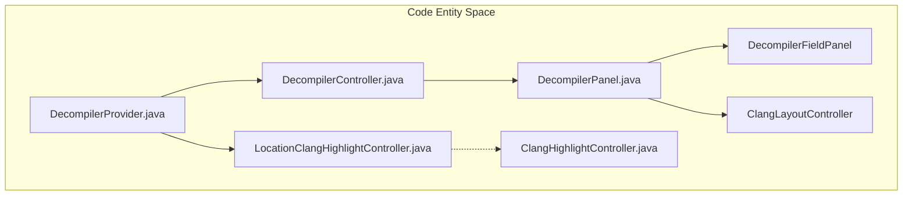
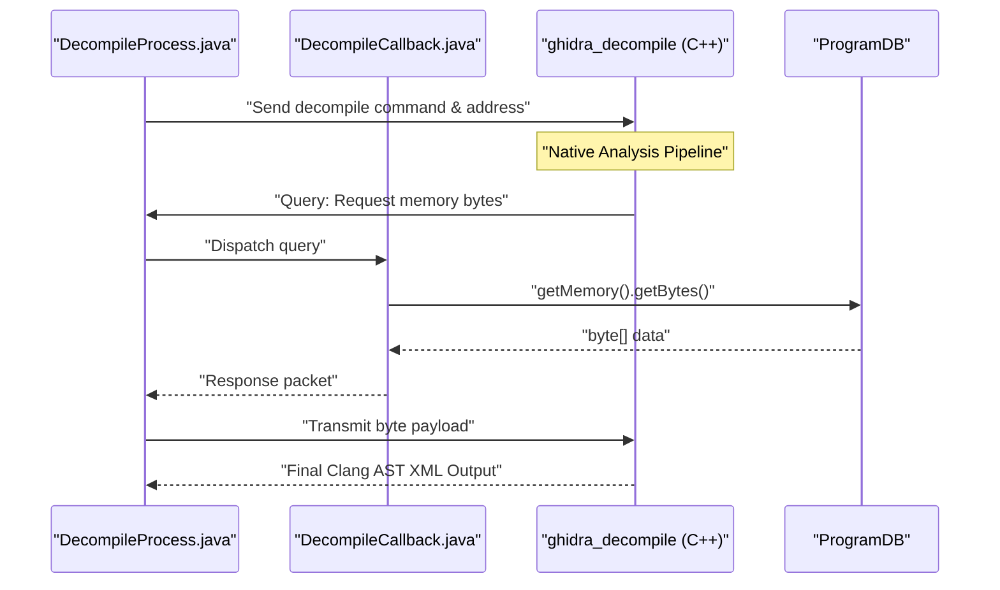
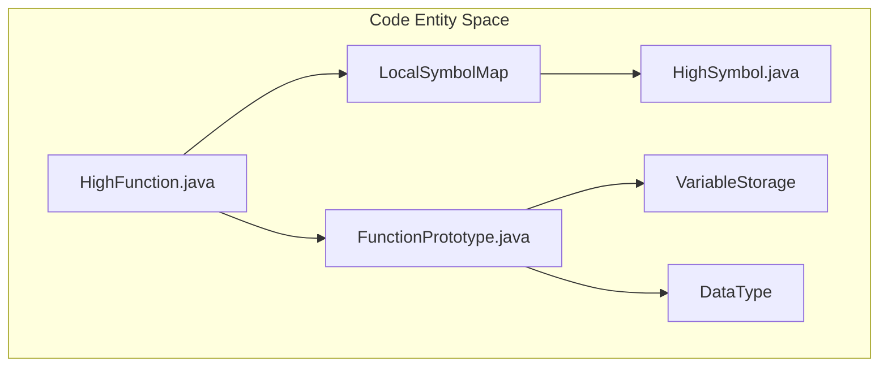

<!-- source: DeepWiki mcp.deepwiki.com · repo NationalSecurityAgency/ghidra · page 2.8 Decompiler UI and Java Bridge · fetched 2026-11-09 -->

# Decompiler UI and Java Bridge

Relevant source files

The following files were used as context for generating this wiki page:

- [Ghidra/Features/Base/ghidra_scripts/DemangleSymbolScript.java](Ghidra/Features/Base/ghidra_scripts/DemangleSymbolScript.java)
- [Ghidra/Features/Base/src/main/java/ghidra/app/cmd/label/DemanglerCmd.java](Ghidra/Features/Base/src/main/java/ghidra/app/cmd/label/DemanglerCmd.java)
- [Ghidra/Features/Base/src/main/java/ghidra/app/plugin/core/analysis/OperandReferenceAnalyzer.java](Ghidra/Features/Base/src/main/java/ghidra/app/plugin/core/analysis/OperandReferenceAnalyzer.java)
- [Ghidra/Features/Base/src/main/java/ghidra/app/plugin/core/gotoquery/GoToHelper.java](Ghidra/Features/Base/src/main/java/ghidra/app/plugin/core/gotoquery/GoToHelper.java)
- [Ghidra/Features/Base/src/main/java/ghidra/app/plugin/core/navigation/FindAppliedDataTypesService.java](Ghidra/Features/Base/src/main/java/ghidra/app/plugin/core/navigation/FindAppliedDataTypesService.java)
- [Ghidra/Features/Base/src/main/java/ghidra/app/plugin/core/navigation/locationreferences/GenericCompositeDataTypeLocationDescriptor.java](Ghidra/Features/Base/src/main/java/ghidra/app/plugin/core/navigation/locationreferences/GenericCompositeDataTypeLocationDescriptor.java)
- [Ghidra/Features/Base/src/main/java/ghidra/app/plugin/core/navigation/locationreferences/GenericCompositeDataTypeProgramLocation.java](Ghidra/Features/Base/src/main/java/ghidra/app/plugin/core/navigation/locationreferences/GenericCompositeDataTypeProgramLocation.java)
- [Ghidra/Features/Base/src/main/java/ghidra/app/script/ScriptMessage.java](Ghidra/Features/Base/src/main/java/ghidra/app/script/ScriptMessage.java)
- [Ghidra/Features/DataGraph/src/main/help/help/topics/DataGraphPlugin/Data_Graph.html](Ghidra/Features/DataGraph/src/main/help/help/topics/DataGraphPlugin/Data_Graph.html)
- [Ghidra/Features/DataGraph/src/main/java/datagraph/DataGraphPlugin.java](Ghidra/Features/DataGraph/src/main/java/datagraph/DataGraphPlugin.java)
- [Ghidra/Features/DataGraph/src/main/java/datagraph/DataGraphProvider.java](Ghidra/Features/DataGraph/src/main/java/datagraph/DataGraphProvider.java)
- [Ghidra/Features/DataGraph/src/main/java/datagraph/DegSharedConfig.java](Ghidra/Features/DataGraph/src/main/java/datagraph/DegSharedConfig.java)
- [Ghidra/Features/DataGraph/src/main/java/datagraph/data/graph/DegController.java](Ghidra/Features/DataGraph/src/main/java/datagraph/data/graph/DegController.java)
- [Ghidra/Features/DataGraph/src/main/java/datagraph/data/graph/panel/DataVertexPanel.java](Ghidra/Features/DataGraph/src/main/java/datagraph/data/graph/panel/DataVertexPanel.java)
- [Ghidra/Features/Decompiler/src/decompile/cpp/ghidra_arch.cc](Ghidra/Features/Decompiler/src/decompile/cpp/ghidra_arch.cc)
- [Ghidra/Features/Decompiler/src/decompile/cpp/ghidra_arch.hh](Ghidra/Features/Decompiler/src/decompile/cpp/ghidra_arch.hh)
- [Ghidra/Features/Decompiler/src/decompile/cpp/prettyprint.cc](Ghidra/Features/Decompiler/src/decompile/cpp/prettyprint.cc)
- [Ghidra/Features/Decompiler/src/decompile/cpp/prettyprint.hh](Ghidra/Features/Decompiler/src/decompile/cpp/prettyprint.hh)
- [Ghidra/Features/Decompiler/src/decompile/cpp/printc.cc](Ghidra/Features/Decompiler/src/decompile/cpp/printc.cc)
- [Ghidra/Features/Decompiler/src/decompile/cpp/printc.hh](Ghidra/Features/Decompiler/src/decompile/cpp/printc.hh)
- [Ghidra/Features/Decompiler/src/decompile/cpp/printjava.cc](Ghidra/Features/Decompiler/src/decompile/cpp/printjava.cc)
- [Ghidra/Features/Decompiler/src/decompile/cpp/printjava.hh](Ghidra/Features/Decompiler/src/decompile/cpp/printjava.hh)
- [Ghidra/Features/Decompiler/src/decompile/cpp/printlanguage.cc](Ghidra/Features/Decompiler/src/decompile/cpp/printlanguage.cc)
- [Ghidra/Features/Decompiler/src/decompile/cpp/printlanguage.hh](Ghidra/Features/Decompiler/src/decompile/cpp/printlanguage.hh)
- [Ghidra/Features/Decompiler/src/decompile/cpp/sleigh_arch.cc](Ghidra/Features/Decompiler/src/decompile/cpp/sleigh_arch.cc)
- [Ghidra/Features/Decompiler/src/decompile/cpp/sleigh_arch.hh](Ghidra/Features/Decompiler/src/decompile/cpp/sleigh_arch.hh)
- [Ghidra/Features/Decompiler/src/decompile/cpp/string_ghidra.cc](Ghidra/Features/Decompiler/src/decompile/cpp/string_ghidra.cc)
- [Ghidra/Features/Decompiler/src/decompile/cpp/string_ghidra.hh](Ghidra/Features/Decompiler/src/decompile/cpp/string_ghidra.hh)
- [Ghidra/Features/Decompiler/src/decompile/cpp/stringmanage.cc](Ghidra/Features/Decompiler/src/decompile/cpp/stringmanage.cc)
- [Ghidra/Features/Decompiler/src/decompile/cpp/stringmanage.hh](Ghidra/Features/Decompiler/src/decompile/cpp/stringmanage.hh)
- [Ghidra/Features/Decompiler/src/main/java/ghidra/app/cmd/function/DecompilerParallelConventionAnalysisCmd.java](Ghidra/Features/Decompiler/src/main/java/ghidra/app/cmd/function/DecompilerParallelConventionAnalysisCmd.java)
- [Ghidra/Features/Decompiler/src/main/java/ghidra/app/decompiler/CTokenHighlightMatcher.java](Ghidra/Features/Decompiler/src/main/java/ghidra/app/decompiler/CTokenHighlightMatcher.java)
- [Ghidra/Features/Decompiler/src/main/java/ghidra/app/decompiler/DecompileCallback.java](Ghidra/Features/Decompiler/src/main/java/ghidra/app/decompiler/DecompileCallback.java)
- [Ghidra/Features/Decompiler/src/main/java/ghidra/app/decompiler/DecompileProcess.java](Ghidra/Features/Decompiler/src/main/java/ghidra/app/decompiler/DecompileProcess.java)
- [Ghidra/Features/Decompiler/src/main/java/ghidra/app/decompiler/DecompileProcessFactory.java](Ghidra/Features/Decompiler/src/main/java/ghidra/app/decompiler/DecompileProcessFactory.java)
- [Ghidra/Features/Decompiler/src/main/java/ghidra/app/decompiler/DecompilerHighlightService.java](Ghidra/Features/Decompiler/src/main/java/ghidra/app/decompiler/DecompilerHighlightService.java)
- [Ghidra/Features/Decompiler/src/main/java/ghidra/app/decompiler/DecompilerHighlighter.java](Ghidra/Features/Decompiler/src/main/java/ghidra/app/decompiler/DecompilerHighlighter.java)
- [Ghidra/Features/Decompiler/src/main/java/ghidra/app/decompiler/DecompilerMarginService.java](Ghidra/Features/Decompiler/src/main/java/ghidra/app/decompiler/DecompilerMarginService.java)
- [Ghidra/Features/Decompiler/src/main/java/ghidra/app/decompiler/component/ClangDecompilerHighlighter.java](Ghidra/Features/Decompiler/src/main/java/ghidra/app/decompiler/component/ClangDecompilerHighlighter.java)
- [Ghidra/Features/Decompiler/src/main/java/ghidra/app/decompiler/component/ClangFieldElement.java](Ghidra/Features/Decompiler/src/main/java/ghidra/app/decompiler/component/ClangFieldElement.java)
- [Ghidra/Features/Decompiler/src/main/java/ghidra/app/decompiler/component/ClangHighlightController.java](Ghidra/Features/Decompiler/src/main/java/ghidra/app/decompiler/component/ClangHighlightController.java)
- [Ghidra/Features/Decompiler/src/main/java/ghidra/app/decompiler/component/ColorProvider.java](Ghidra/Features/Decompiler/src/main/java/ghidra/app/decompiler/component/ColorProvider.java)
- [Ghidra/Features/Decompiler/src/main/java/ghidra/app/decompiler/component/DecompilerCallbackHandler.java](Ghidra/Features/Decompiler/src/main/java/ghidra/app/decompiler/component/DecompilerCallbackHandler.java)
- [Ghidra/Features/Decompiler/src/main/java/ghidra/app/decompiler/component/DecompilerController.java](Ghidra/Features/Decompiler/src/main/java/ghidra/app/decompiler/component/DecompilerController.java)
- [Ghidra/Features/Decompiler/src/main/java/ghidra/app/decompiler/component/DecompilerPanel.java](Ghidra/Features/Decompiler/src/main/java/ghidra/app/decompiler/component/DecompilerPanel.java)
- [Ghidra/Features/Decompiler/src/main/java/ghidra/app/decompiler/component/HighlightToken.java](Ghidra/Features/Decompiler/src/main/java/ghidra/app/decompiler/component/HighlightToken.java)
- [Ghidra/Features/Decompiler/src/main/java/ghidra/app/decompiler/component/LocationClangHighlightController.java](Ghidra/Features/Decompiler/src/main/java/ghidra/app/decompiler/component/LocationClangHighlightController.java)
- [Ghidra/Features/Decompiler/src/main/java/ghidra/app/decompiler/component/NameTokenMatcher.java](Ghidra/Features/Decompiler/src/main/java/ghidra/app/decompiler/component/NameTokenMatcher.java)
- [Ghidra/Features/Decompiler/src/main/java/ghidra/app/decompiler/component/NullClangHighlightController.java](Ghidra/Features/Decompiler/src/main/java/ghidra/app/decompiler/component/NullClangHighlightController.java)
- [Ghidra/Features/Decompiler/src/main/java/ghidra/app/decompiler/component/TokenHighlightColors.java](Ghidra/Features/Decompiler/src/main/java/ghidra/app/decompiler/component/TokenHighlightColors.java)
- [Ghidra/Features/Decompiler/src/main/java/ghidra/app/decompiler/component/TokenHighlights.java](Ghidra/Features/Decompiler/src/main/java/ghidra/app/decompiler/component/TokenHighlights.java)
- [Ghidra/Features/Decompiler/src/main/java/ghidra/app/decompiler/component/TokenKey.java](Ghidra/Features/Decompiler/src/main/java/ghidra/app/decompiler/component/TokenKey.java)
- [Ghidra/Features/Decompiler/src/main/java/ghidra/app/decompiler/component/UserHighlights.java](Ghidra/Features/Decompiler/src/main/java/ghidra/app/decompiler/component/UserHighlights.java)
- [Ghidra/Features/Decompiler/src/main/java/ghidra/app/decompiler/component/margin/DecompilerMarginProvider.java](Ghidra/Features/Decompiler/src/main/java/ghidra/app/decompiler/component/margin/DecompilerMarginProvider.java)
- [Ghidra/Features/Decompiler/src/main/java/ghidra/app/decompiler/component/margin/LineNumberDecompilerMarginProvider.java](Ghidra/Features/Decompiler/src/main/java/ghidra/app/decompiler/component/margin/LineNumberDecompilerMarginProvider.java)
- [Ghidra/Features/Decompiler/src/main/java/ghidra/app/decompiler/component/margin/VerticalLayoutPixelIndexMap.java](Ghidra/Features/Decompiler/src/main/java/ghidra/app/decompiler/component/margin/VerticalLayoutPixelIndexMap.java)
- [Ghidra/Features/Decompiler/src/main/java/ghidra/app/plugin/core/decompile/DecompilePlugin.java](Ghidra/Features/Decompiler/src/main/java/ghidra/app/plugin/core/decompile/DecompilePlugin.java)
- [Ghidra/Features/Decompiler/src/main/java/ghidra/app/plugin/core/decompile/DecompilerClipboardProvider.java](Ghidra/Features/Decompiler/src/main/java/ghidra/app/plugin/core/decompile/DecompilerClipboardProvider.java)
- [Ghidra/Features/Decompiler/src/main/java/ghidra/app/plugin/core/decompile/DecompilerProvider.java](Ghidra/Features/Decompiler/src/main/java/ghidra/app/plugin/core/decompile/DecompilerProvider.java)
- [Ghidra/Features/Decompiler/src/main/java/ghidra/app/plugin/core/decompile/DisplayTypeCastsAction.java](Ghidra/Features/Decompiler/src/main/java/ghidra/app/plugin/core/decompile/DisplayTypeCastsAction.java)
- [Ghidra/Features/Decompiler/src/main/java/ghidra/app/plugin/core/decompile/actions/SliceHighlightColorProvider.java](Ghidra/Features/Decompiler/src/main/java/ghidra/app/plugin/core/decompile/actions/SliceHighlightColorProvider.java)
- [Ghidra/Features/Decompiler/src/test.slow/java/ghidra/app/decompiler/component/DecompilerClangTest.java](Ghidra/Features/Decompiler/src/test.slow/java/ghidra/app/decompiler/component/DecompilerClangTest.java)
- [Ghidra/Features/Decompiler/src/test.slow/java/ghidra/app/plugin/core/decompile/AbstractDecompilerFindReferencesActionTest.java](Ghidra/Features/Decompiler/src/test.slow/java/ghidra/app/plugin/core/decompile/AbstractDecompilerFindReferencesActionTest.java)
- [Ghidra/Features/Decompiler/src/test.slow/java/ghidra/app/plugin/core/decompile/DecompilerNavigationTest.java](Ghidra/Features/Decompiler/src/test.slow/java/ghidra/app/plugin/core/decompile/DecompilerNavigationTest.java)
- [Ghidra/Features/GnuDemangler/src/main/java/ghidra/app/util/demangler/gnu/GnuDemanglerNativeProcess.java](Ghidra/Features/GnuDemangler/src/main/java/ghidra/app/util/demangler/gnu/GnuDemanglerNativeProcess.java)
- [Ghidra/Framework/Docking/src/main/java/docking/options/editor/ColorPropertyEditor.java](Ghidra/Framework/Docking/src/main/java/docking/options/editor/ColorPropertyEditor.java)
- [Ghidra/Framework/Docking/src/main/java/docking/options/editor/GhidraColorChooser.java](Ghidra/Framework/Docking/src/main/java/docking/options/editor/GhidraColorChooser.java)
- [Ghidra/Framework/Docking/src/main/java/docking/theme/gui/ColorValueEditor.java](Ghidra/Framework/Docking/src/main/java/docking/theme/gui/ColorValueEditor.java)
- [Ghidra/Framework/Docking/src/main/java/docking/theme/gui/ThemeValueEditor.java](Ghidra/Framework/Docking/src/main/java/docking/theme/gui/ThemeValueEditor.java)
- [Ghidra/Framework/Docking/src/main/java/docking/widgets/fieldpanel/support/FieldRange.java](Ghidra/Framework/Docking/src/main/java/docking/widgets/fieldpanel/support/FieldRange.java)
- [Ghidra/Framework/Generic/certification.manifest](Ghidra/Framework/Generic/certification.manifest)
- [Ghidra/Framework/Generic/src/main/java/ghidra/framework/LoggingInitialization.java](Ghidra/Framework/Generic/src/main/java/ghidra/framework/LoggingInitialization.java)
- [Ghidra/Framework/Generic/src/main/java/ghidra/framework/OSFileNotFoundException.java](Ghidra/Framework/Generic/src/main/java/ghidra/framework/OSFileNotFoundException.java)
- [Ghidra/Framework/Generic/src/main/java/ghidra/util/datastruct/AlphaNumericComparator.java](Ghidra/Framework/Generic/src/main/java/ghidra/util/datastruct/AlphaNumericComparator.java)
- [Ghidra/Framework/Generic/src/main/resources/generic.log4j.xml](Ghidra/Framework/Generic/src/main/resources/generic.log4j.xml)
- [Ghidra/Framework/Generic/src/main/resources/generic.log4jdev.xml](Ghidra/Framework/Generic/src/main/resources/generic.log4jdev.xml)
- [Ghidra/Framework/Generic/src/main/resources/generic.log4jtest.xml](Ghidra/Framework/Generic/src/main/resources/generic.log4jtest.xml)
- [Ghidra/Framework/Generic/src/main/resources/log4j-appender-rolling-file-default.xml](Ghidra/Framework/Generic/src/main/resources/log4j-appender-rolling-file-default.xml)
- [Ghidra/Framework/Generic/src/main/resources/log4j-appender-rolling-file-scripts-default.xml](Ghidra/Framework/Generic/src/main/resources/log4j-appender-rolling-file-scripts-default.xml)
- [Ghidra/Framework/Generic/src/main/resources/log4j-appender-rolling-file-scripts.xml](Ghidra/Framework/Generic/src/main/resources/log4j-appender-rolling-file-scripts.xml)
- [Ghidra/Framework/Generic/src/main/resources/log4j-appender-rolling-file.xml](Ghidra/Framework/Generic/src/main/resources/log4j-appender-rolling-file.xml)
- [Ghidra/Framework/Generic/src/test/java/ghidra/util/datastruct/AlphaNumericComparatorTest.java](Ghidra/Framework/Generic/src/test/java/ghidra/util/datastruct/AlphaNumericComparatorTest.java)
- [Ghidra/Framework/Project/src/main/java/ghidra/framework/main/ProjectDataPanel.java](Ghidra/Framework/Project/src/main/java/ghidra/framework/main/ProjectDataPanel.java)
- [Ghidra/Framework/Project/src/main/java/ghidra/framework/main/datatable/ProjectDataTableModel.java](Ghidra/Framework/Project/src/main/java/ghidra/framework/main/datatable/ProjectDataTableModel.java)
- [Ghidra/Framework/Project/src/main/java/ghidra/framework/main/datatable/ProjectDataTablePanel.java](Ghidra/Framework/Project/src/main/java/ghidra/framework/main/datatable/ProjectDataTablePanel.java)
- [Ghidra/Framework/Project/src/main/java/ghidra/framework/main/datatree/DataTree.java](Ghidra/Framework/Project/src/main/java/ghidra/framework/main/datatree/DataTree.java)
- [Ghidra/Framework/Project/src/main/java/ghidra/framework/main/datatree/DataTreeNode.java](Ghidra/Framework/Project/src/main/java/ghidra/framework/main/datatree/DataTreeNode.java)
- [Ghidra/Framework/Project/src/main/java/ghidra/framework/main/datatree/DomainFileNode.java](Ghidra/Framework/Project/src/main/java/ghidra/framework/main/datatree/DomainFileNode.java)
- [Ghidra/Framework/Project/src/main/java/ghidra/framework/main/datatree/DomainFolderNode.java](Ghidra/Framework/Project/src/main/java/ghidra/framework/main/datatree/DomainFolderNode.java)
- [Ghidra/Framework/Project/src/main/java/ghidra/framework/main/datatree/ProjectDataTreePanel.java](Ghidra/Framework/Project/src/main/java/ghidra/framework/main/datatree/ProjectDataTreePanel.java)
- [Ghidra/Framework/SoftwareModeling/src/main/java/ghidra/program/model/pcode/FunctionPrototype.java](Ghidra/Framework/SoftwareModeling/src/main/java/ghidra/program/model/pcode/FunctionPrototype.java)
- [Ghidra/Framework/SoftwareModeling/src/main/java/ghidra/program/model/pcode/HighFunction.java](Ghidra/Framework/SoftwareModeling/src/main/java/ghidra/program/model/pcode/HighFunction.java)
- [Ghidra/Framework/SoftwareModeling/src/main/java/ghidra/program/model/pcode/HighFunctionShellSymbol.java](Ghidra/Framework/SoftwareModeling/src/main/java/ghidra/program/model/pcode/HighFunctionShellSymbol.java)
- [Ghidra/Framework/SoftwareModeling/src/main/java/ghidra/program/model/pcode/HighFunctionSymbol.java](Ghidra/Framework/SoftwareModeling/src/main/java/ghidra/program/model/pcode/HighFunctionSymbol.java)
- [Ghidra/Framework/SoftwareModeling/src/main/java/ghidra/program/model/pcode/HighSymbol.java](Ghidra/Framework/SoftwareModeling/src/main/java/ghidra/program/model/pcode/HighSymbol.java)
- [Ghidra/Framework/Utility/src/main/java/generic/concurrent/GThreadPool.java](Ghidra/Framework/Utility/src/main/java/generic/concurrent/GThreadPool.java)
- [Ghidra/Framework/Utility/src/main/java/generic/concurrent/NamedDaemonThreadFactory.java](Ghidra/Framework/Utility/src/main/java/generic/concurrent/NamedDaemonThreadFactory.java)

## Purpose and Scope
This page explains the user interface components of Ghidra's decompiler subsystem (`DecompilerPanel`, `DecompilerProvider`), the Java-to-C++ Inter-Process Communication (IPC) bridge (`DecompileProcess`, `DecompileCallback`), token highlighting controllers (`ClangHighlightController`), and interactive decompiler modification actions (such as renaming, retyping, and prototype overrides).

---

## Decompiler UI Architecture

The Decompiler UI is organized around a provider-controller-panel pattern that integrates directly with Ghidra's Docking window framework.

### DecompilerProvider and DecompilerPanel
The `DecompilerProvider` manages the lifecycle of the decompiler window, tool options, and navigation events within the tool [Ghidra/Features/Decompiler/src/main/java/ghidra/app/plugin/core/decompile/DecompilerProvider.java:136-182](). It acts as a bridge adapter (`NavigatableComponentProviderAdapter`) and implements `DecompilerCallbackHandler` to receive updates from the underlying decompiler tasks [Ghidra/Features/Decompiler/src/main/java/ghidra/app/plugin/core/decompile/DecompilerProvider.java:62-64]().

The `DecompilerPanel` is the specialized `JPanel` responsible for rendering decompiled code [Ghidra/Features/Decompiler/src/main/java/ghidra/app/decompiler/component/DecompilerPanel.java:58-62](). It embeds a `DecompilerFieldPanel` backed by a `ClangLayoutController` to layout and draw lines of high-level C tokens [Ghidra/Features/Decompiler/src/main/java/ghidra/app/decompiler/component/DecompilerPanel.java:114-134]().

### ClangHighlightController
Token highlighting and synchronization across views are coordinated by `ClangHighlightController` and its subclass `LocationClangHighlightController` [Ghidra/Features/Decompiler/src/main/java/ghidra/app/plugin/core/decompile/DecompilerProvider.java:150-152](). When a user clicks a variable or token, the controller identifies all matching instances within the syntax tree and applies visual highlights across the field panel [Ghidra/Features/Decompiler/src/main/java/ghidra/app/decompiler/component/DecompilerPanel.java:83-92]().

**Diagram: Decompiler UI Code Entity Architecture**

Sources: [Ghidra/Features/Decompiler/src/main/java/ghidra/app/plugin/core/decompile/DecompilerProvider.java:136-182](), [Ghidra/Features/Decompiler/src/main/java/ghidra/app/decompiler/component/DecompilerPanel.java:61-168]()

---

## Java-to-C++ Bridge (IPC Mechanism)

Because the decompiler core is written in C++ for performance and algorithmic complexity reasons, Java communicates with it through a dedicated IPC mechanism.

### DecompileProcess
The `DecompileProcess` class manages the native decompiler binary execution [Ghidra/Features/Decompiler/src/main/java/ghidra/app/decompiler/DecompileProcess.java:38-47](). It launches the executable, maintains standard input/output streams (`nativeIn`, `nativeOut`), and frames binary commands using explicit delimiter sequences such as `command_start` (`0, 0, 1, 2`) and `command_end` (`0, 0, 1, 3`) [Ghidra/Features/Decompiler/src/main/java/ghidra/app/decompiler/DecompileProcess.java:54-76]().

### DecompileCallback
When the native process requires database facts (such as memory bytes, symbol names, or instruction p-code) during decompilation, it sends queries back over the IPC stream [Ghidra/Features/Decompiler/src/main/java/ghidra/app/decompiler/DecompileCallback.java:46-50](). `DecompileCallback` intercepts these requests on the Java side, interacting directly with the `Program` and `Listing` databases [Ghidra/Features/Decompiler/src/main/java/ghidra/app/decompiler/DecompileCallback.java:89-126]().

Key callback routines include:
* `getBytes(Address, int)`: Retrieves raw memory bytes from the program database [Ghidra/Features/Decompiler/src/main/java/ghidra/app/decompiler/DecompileCallback.java:152-183]().
* `getComments(Address, int, Encoder)`: Collects function and instruction comments [Ghidra/Features/Decompiler/src/main/java/ghidra/app/decompiler/DecompileCallback.java:194-205]().

**Diagram: IPC Data Flow between Java and Native Decompiler**

Sources: [Ghidra/Features/Decompiler/src/main/java/ghidra/app/decompiler/DecompileProcess.java:49-108](), [Ghidra/Features/Decompiler/src/main/java/ghidra/app/decompiler/DecompileCallback.java:89-205]()

---

## Interactive Decompiler Actions

Users can modify program semantics directly from the decompiler window through context actions.

| Action Category | Implementation Classes | Description |
| :--- | :--- | :--- |
| **Rename** | `RenameFunctionAction`, `RenameGlobalAction`, `RenameLabelAction` | Modifies symbol names across the program database [Ghidra/Features/Decompiler/src/main/java/ghidra/app/plugin/core/decompile/actions/RenameFunctionAction.java:28]() |
| **Retype** | `RetypeFieldAction`, `RetypeVariableAction` | Changes data types of local variables, parameters, or structure fields [Ghidra/Features/Decompiler/src/main/java/ghidra/app/plugin/core/decompile/actions/RetypeFieldAction.java:31]() |
| **Prototype Override** | `OverridePrototypeAction` | Forces a specific function signature or calling convention at a call site [Ghidra/Features/Decompiler/src/main/java/ghidra/app/plugin/core/decompile/actions/OverridePrototypeAction.java:37]() |

### Prototype and Flow Overrides
Function prototype and control flow overrides are stored persistently in the program database inside an `override` namespace (`OVERRIDE_NAMESPACE_NAME = "override"`) [Ghidra/Framework/SoftwareModeling/src/main/java/ghidra/program/model/pcode/HighFunction.java:42-44](). During `grabOverrides()`, the `HighFunction` scans this namespace for prefixed symbols (`prt` for signature overrides, `jmp` for jump table flow overrides) and passes them to the analysis engine [Ghidra/Framework/SoftwareModeling/src/main/java/ghidra/program/model/pcode/HighFunction.java:168-209]().

Sources: [Ghidra/Framework/SoftwareModeling/src/main/java/ghidra/program/model/pcode/HighFunction.java:41-74](), [Ghidra/Framework/SoftwareModeling/src/main/java/ghidra/program/model/pcode/HighFunction.java:168-209]()

---

## High-Level Symbol Mapping

The integration layer between low-level p-code analysis and high-level C presentation relies on symbol mapping models.

### HighFunction and LocalSymbolMap
The `HighFunction` class represents the decompiler's high-level view of a function, extending `PcodeSyntaxTree` [Ghidra/Framework/SoftwareModeling/src/main/java/ghidra/program/model/pcode/HighFunction.java:41-41](). It owns a `LocalSymbolMap` which maps storage varnodes and scopes to high-level `HighSymbol` instances [Ghidra/Framework/SoftwareModeling/src/main/java/ghidra/program/model/pcode/HighFunction.java:49-69](). The `FunctionPrototype` class manages function inputs, return types, storage locations, and calling convention flags [Ghidra/Framework/SoftwareModeling/src/main/java/ghidra/program/model/pcode/FunctionPrototype.java:35-54]().

**Diagram: High-Level Symbol Mapping Code Entities**

Sources: [Ghidra/Framework/SoftwareModeling/src/main/java/ghidra/program/model/pcode/HighFunction.java:41-136](), [Ghidra/Framework/SoftwareModeling/src/main/java/ghidra/program/model/pcode/FunctionPrototype.java:35-54]()

---

