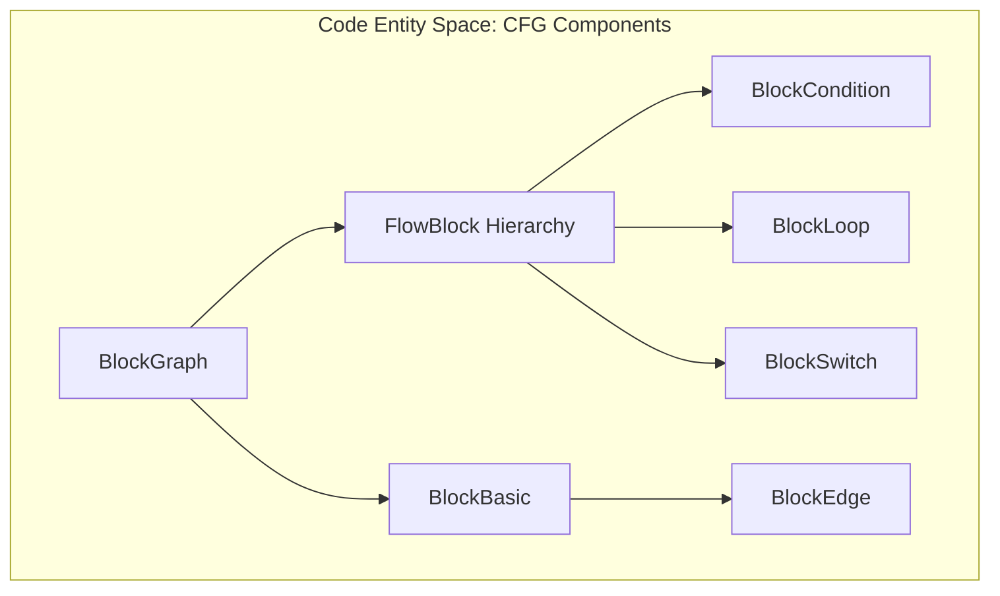
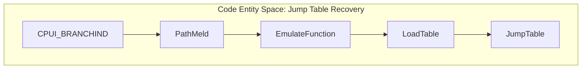
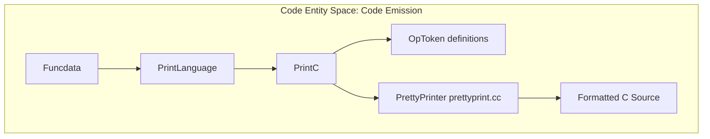

<!-- source: DeepWiki mcp.deepwiki.com · repo NationalSecurityAgency/ghidra · page 2.9 Control Flow Structuring and Code Emission · fetched 2026-11-09 -->

# Control Flow Structuring and Code Emission

Relevant source files

The following files were used as context for generating this wiki page:

- [Ghidra/Features/Base/ghidra_scripts/DemangleSymbolScript.java](Ghidra/Features/Base/ghidra_scripts/DemangleSymbolScript.java)
- [Ghidra/Features/Base/src/main/java/ghidra/app/cmd/label/DemanglerCmd.java](Ghidra/Features/Base/src/main/java/ghidra/app/cmd/label/DemanglerCmd.java)
- [Ghidra/Features/Base/src/main/java/ghidra/app/plugin/core/analysis/OperandReferenceAnalyzer.java](Ghidra/Features/Base/src/main/java/ghidra/app/plugin/core/analysis/OperandReferenceAnalyzer.java)
- [Ghidra/Features/Decompiler/src/decompile/cpp/block.cc](Ghidra/Features/Decompiler/src/decompile/cpp/block.cc)
- [Ghidra/Features/Decompiler/src/decompile/cpp/block.hh](Ghidra/Features/Decompiler/src/decompile/cpp/block.hh)
- [Ghidra/Features/Decompiler/src/decompile/cpp/blockaction.cc](Ghidra/Features/Decompiler/src/decompile/cpp/blockaction.cc)
- [Ghidra/Features/Decompiler/src/decompile/cpp/blockaction.hh](Ghidra/Features/Decompiler/src/decompile/cpp/blockaction.hh)
- [Ghidra/Features/Decompiler/src/decompile/cpp/flow.cc](Ghidra/Features/Decompiler/src/decompile/cpp/flow.cc)
- [Ghidra/Features/Decompiler/src/decompile/cpp/flow.hh](Ghidra/Features/Decompiler/src/decompile/cpp/flow.hh)
- [Ghidra/Features/Decompiler/src/decompile/cpp/funcdata_block.cc](Ghidra/Features/Decompiler/src/decompile/cpp/funcdata_block.cc)
- [Ghidra/Features/Decompiler/src/decompile/cpp/ghidra_arch.cc](Ghidra/Features/Decompiler/src/decompile/cpp/ghidra_arch.cc)
- [Ghidra/Features/Decompiler/src/decompile/cpp/ghidra_arch.hh](Ghidra/Features/Decompiler/src/decompile/cpp/ghidra_arch.hh)
- [Ghidra/Features/Decompiler/src/decompile/cpp/jumptable.cc](Ghidra/Features/Decompiler/src/decompile/cpp/jumptable.cc)
- [Ghidra/Features/Decompiler/src/decompile/cpp/jumptable.hh](Ghidra/Features/Decompiler/src/decompile/cpp/jumptable.hh)
- [Ghidra/Features/Decompiler/src/decompile/cpp/prettyprint.cc](Ghidra/Features/Decompiler/src/decompile/cpp/prettyprint.cc)
- [Ghidra/Features/Decompiler/src/decompile/cpp/prettyprint.hh](Ghidra/Features/Decompiler/src/decompile/cpp/prettyprint.hh)
- [Ghidra/Features/Decompiler/src/decompile/cpp/printc.cc](Ghidra/Features/Decompiler/src/decompile/cpp/printc.cc)
- [Ghidra/Features/Decompiler/src/decompile/cpp/printc.hh](Ghidra/Features/Decompiler/src/decompile/cpp/printc.hh)
- [Ghidra/Features/Decompiler/src/decompile/cpp/printjava.cc](Ghidra/Features/Decompiler/src/decompile/cpp/printjava.cc)
- [Ghidra/Features/Decompiler/src/decompile/cpp/printjava.hh](Ghidra/Features/Decompiler/src/decompile/cpp/printjava.hh)
- [Ghidra/Features/Decompiler/src/decompile/cpp/printlanguage.cc](Ghidra/Features/Decompiler/src/decompile/cpp/printlanguage.cc)
- [Ghidra/Features/Decompiler/src/decompile/cpp/printlanguage.hh](Ghidra/Features/Decompiler/src/decompile/cpp/printlanguage.hh)
- [Ghidra/Features/Decompiler/src/decompile/cpp/rangeutil.cc](Ghidra/Features/Decompiler/src/decompile/cpp/rangeutil.cc)
- [Ghidra/Features/Decompiler/src/decompile/cpp/rangeutil.hh](Ghidra/Features/Decompiler/src/decompile/cpp/rangeutil.hh)
- [Ghidra/Features/Decompiler/src/decompile/cpp/sleigh_arch.cc](Ghidra/Features/Decompiler/src/decompile/cpp/sleigh_arch.cc)
- [Ghidra/Features/Decompiler/src/decompile/cpp/sleigh_arch.hh](Ghidra/Features/Decompiler/src/decompile/cpp/sleigh_arch.hh)
- [Ghidra/Features/Decompiler/src/decompile/cpp/string_ghidra.cc](Ghidra/Features/Decompiler/src/decompile/cpp/string_ghidra.cc)
- [Ghidra/Features/Decompiler/src/decompile/cpp/string_ghidra.hh](Ghidra/Features/Decompiler/src/decompile/cpp/string_ghidra.hh)
- [Ghidra/Features/Decompiler/src/decompile/cpp/stringmanage.cc](Ghidra/Features/Decompiler/src/decompile/cpp/stringmanage.cc)
- [Ghidra/Features/Decompiler/src/decompile/cpp/stringmanage.hh](Ghidra/Features/Decompiler/src/decompile/cpp/stringmanage.hh)
- [Ghidra/Features/Decompiler/src/decompile/datatests/bitfields.xml](Ghidra/Features/Decompiler/src/decompile/datatests/bitfields.xml)
- [Ghidra/Features/Decompiler/src/decompile/datatests/bitfields2.xml](Ghidra/Features/Decompiler/src/decompile/datatests/bitfields2.xml)
- [Ghidra/Features/Decompiler/src/decompile/datatests/ifnoexit.xml](Ghidra/Features/Decompiler/src/decompile/datatests/ifnoexit.xml)
- [Ghidra/Features/Decompiler/src/decompile/datatests/orcompare.xml](Ghidra/Features/Decompiler/src/decompile/datatests/orcompare.xml)
- [Ghidra/Features/Decompiler/src/decompile/datatests/sbyte.xml](Ghidra/Features/Decompiler/src/decompile/datatests/sbyte.xml)
- [Ghidra/Features/Decompiler/src/main/java/ghidra/app/cmd/function/DecompilerParallelConventionAnalysisCmd.java](Ghidra/Features/Decompiler/src/main/java/ghidra/app/cmd/function/DecompilerParallelConventionAnalysisCmd.java)
- [Ghidra/Features/Decompiler/src/main/java/ghidra/app/decompiler/DecompileCallback.java](Ghidra/Features/Decompiler/src/main/java/ghidra/app/decompiler/DecompileCallback.java)
- [Ghidra/Features/Decompiler/src/main/java/ghidra/app/decompiler/DecompileProcess.java](Ghidra/Features/Decompiler/src/main/java/ghidra/app/decompiler/DecompileProcess.java)
- [Ghidra/Features/Decompiler/src/main/java/ghidra/app/decompiler/DecompileProcessFactory.java](Ghidra/Features/Decompiler/src/main/java/ghidra/app/decompiler/DecompileProcessFactory.java)
- [Ghidra/Features/GnuDemangler/src/main/java/ghidra/app/util/demangler/gnu/GnuDemanglerNativeProcess.java](Ghidra/Features/GnuDemangler/src/main/java/ghidra/app/util/demangler/gnu/GnuDemanglerNativeProcess.java)
- [Ghidra/Framework/Generic/src/main/java/ghidra/framework/OSFileNotFoundException.java](Ghidra/Framework/Generic/src/main/java/ghidra/framework/OSFileNotFoundException.java)
- [Ghidra/Framework/SoftwareModeling/src/main/java/ghidra/program/model/pcode/FunctionPrototype.java](Ghidra/Framework/SoftwareModeling/src/main/java/ghidra/program/model/pcode/FunctionPrototype.java)
- [Ghidra/Framework/SoftwareModeling/src/main/java/ghidra/program/model/pcode/HighFunction.java](Ghidra/Framework/SoftwareModeling/src/main/java/ghidra/program/model/pcode/HighFunction.java)
- [Ghidra/Framework/SoftwareModeling/src/main/java/ghidra/program/model/pcode/HighFunctionShellSymbol.java](Ghidra/Framework/SoftwareModeling/src/main/java/ghidra/program/model/pcode/HighFunctionShellSymbol.java)
- [Ghidra/Framework/SoftwareModeling/src/main/java/ghidra/program/model/pcode/HighFunctionSymbol.java](Ghidra/Framework/SoftwareModeling/src/main/java/ghidra/program/model/pcode/HighFunctionSymbol.java)
- [Ghidra/Framework/SoftwareModeling/src/main/java/ghidra/program/model/pcode/HighSymbol.java](Ghidra/Framework/SoftwareModeling/src/main/java/ghidra/program/model/pcode/HighSymbol.java)
- [Ghidra/Framework/Utility/src/main/java/generic/concurrent/GThreadPool.java](Ghidra/Framework/Utility/src/main/java/generic/concurrent/GThreadPool.java)
- [Ghidra/Framework/Utility/src/main/java/generic/concurrent/NamedDaemonThreadFactory.java](Ghidra/Framework/Utility/src/main/java/generic/concurrent/NamedDaemonThreadFactory.java)

This page details Ghidra's decompiler subsystems responsible for recovering high-level control-flow structures from low-level basic block graphs, analyzing indirect branches and jump tables, performing value-range analysis, and emitting final high-level C source code.

---

## Control-Flow Graph and Basic Block Architecture

Ghidra models function control flow hierarchically. At the lowest level, basic blocks are represented by `BlockBasic` classes contained within a `BlockGraph`. Higher-level control flow structures (such as `if-then-else` conditionals, `while` loops, `do-while` loops, and `switch` statements) are represented as composite `FlowBlock` subclasses (`BlockCondition`, `BlockCombo`, `BlockLoop`, `BlockSwitch`, etc.) that form a tree structure.

Edges between blocks are managed via `BlockEdge` objects which link incoming and outgoing edges, maintaining reciprocal indices for consistency checks [Ghidra/Features/Decompiler/src/decompile/cpp/block.cc:33-59](). Dominance frontiers and immediate dominators (`immed_dom`) are computed using algorithms such as the Cooper-Harvey-Kennedy dominance algorithm noted in code comments [Ghidra/Features/Decompiler/src/decompile/cpp/block.cc:1-16]().

Sources: `Ghidra/Features/Decompiler/src/decompile/cpp/block.cc`, `Ghidra/Features/Decompiler/src/decompile/cpp/block.hh`

---

## Control-Flow Structuring Actions

Unstructured control flow graphs containing arbitrary jumps (`goto`) are transformed into structured constructs through a series of action passes defined in `blockaction.cc`. These actions attempt to pattern-match graph topologies and collapse them into structured nodes.

1. **Loop Detection**: Identifies back-edges and constructs `BlockLoop` containers for `while`, `do-while`, and `for` loops.
2. **Condition Structuring**: Detects diamond and half-diamond graph patterns to form `BlockCondition` structures (`if` / `else`).
3. **Switch Structuring**: Groups multi-way conditional branches into `BlockSwitch` nodes.
4. **Goto Minimization**: Inserts explicit `goto`, `break`, and `continue` statements when graph topology cannot be cleanly structured without edge replication or statement reordering.

Sources: `Ghidra/Features/Decompiler/src/decompile/cpp/blockaction.cc`, `Ghidra/Features/Decompiler/src/decompile/cpp/blockaction.hh`

---

## Jump Table Recovery and Indirect Branch Analysis

Indirect branches (`CPUI_BRANCHIND`), commonly generated by switch statements, are resolved by `jumptable.cc`. The decompiler analyzes data-flow backwards from the indirect branch to find the switch variable and table-loading instructions.

Key components include:
* **`LoadTable`**: Encapsulates memory load descriptions, including the table starting address, entry size, and number of entries [Ghidra/Features/Decompiler/src/decompile/cpp/jumptable.cc:36-63](). It provides collapse methods to merge contiguous load patterns [Ghidra/Features/Decompiler/src/decompile/cpp/jumptable.cc:60-111]().
* **`PathMeld`**: A container tracking intersecting data-flow paths from putative switch variables to the `BRANCHIND` instruction across splits and joins [Ghidra/Features/Decompiler/src/decompile/cpp/jumptable.cc:65-103]().
* **`EmulateFunction`**: A lightweight, specialized emulator that executes P-code along paths within `PathMeld` to compute exact target addresses and resolve dynamic table loads from the load image [Ghidra/Features/Decompiler/src/decompile/cpp/jumptable.cc:110-128]().

Sources: `Ghidra/Features/Decompiler/src/decompile/cpp/jumptable.cc`, `Ghidra/Features/Decompiler/src/decompile/cpp/jumptable.hh`

---

## Value-Range Analysis

Value-range analysis (`rangeutil.cc`) tracks the possible integer values that a `Varnode` may hold during execution. The core data structure is `CircleRange`, which represents circular integer intervals modulo $2^n$ with an optional step (stride) [Ghidra/Features/Decompiler/src/decompile/cpp/rangeutil.hh:25-50]().

* **`CircleRange`**: Supports interval arithmetic, set union/intersection, complementation, and pulling back ranges through unary and binary P-code operations [Ghidra/Features/Decompiler/src/decompile/cpp/rangeutil.hh:83-97]().
* **`ValueSet`**: Overlays data-flow graphs to associate range equations with specific `Varnode` instances, enabling constraint propagation and dead-branch elimination [Ghidra/Features/Decompiler/src/decompile/cpp/rangeutil.hh:106-123]().

Sources: `Ghidra/Features/Decompiler/src/decompile/cpp/rangeutil.cc`, `Ghidra/Features/Decompiler/src/decompile/cpp/rangeutil.hh`

---

## C Source Emission and Pretty-Printing

Once control flow is structured and data types are propagated, the decompiler emits high-level source code through language-specific emitters inheriting from `PrintLanguage`. C source emission is handled by `PrintC` in `printc.cc` [Ghidra/Features/Decompiler/src/decompile/cpp/printc.cc:16-119]().

* **`PrintC`**: Defines operator tokens (`OpToken`) with precedence, associativity, and syntax rules for expressions, typecasts, assignments, control flow statements, and declarations [Ghidra/Features/Decompiler/src/decompile/cpp/printc.cc:23-77](). It registers itself via `PrintCCapability` [Ghidra/Features/Decompiler/src/decompile/cpp/printc.cc:105-119]().
* **Pretty-Printer (`prettyprint.cc`)**: Manages token streams, indentation depth, line wrapping, and syntactic whitespace formatting to ensure readable output.

Sources: `Ghidra/Features/Decompiler/src/decompile/cpp/printc.cc`, `Ghidra/Features/Decompiler/src/decompile/cpp/printc.hh`, `Ghidra/Features/Decompiler/src/decompile/cpp/prettyprint.cc`

---

