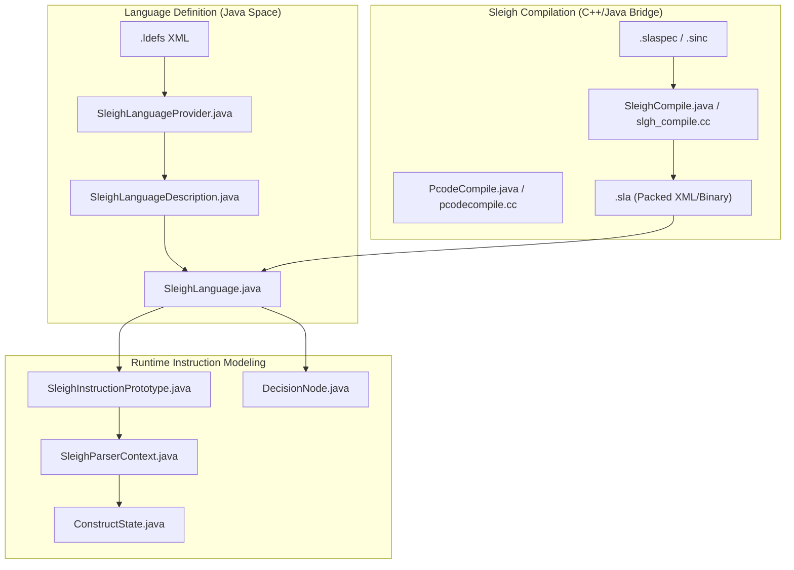
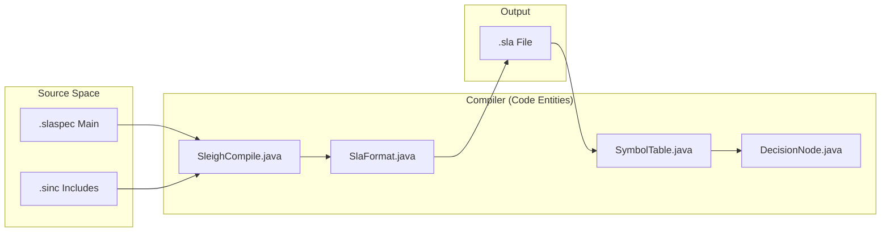

<!-- source: DeepWiki mcp.deepwiki.com · repo NationalSecurityAgency/ghidra · page 3 Processor Architecture Support · fetched 2026-11-09 -->

# Processor Architecture Support

Relevant source files

The following files were used as context for generating this wiki page:

- [Ghidra/Features/Base/src/main/help/help/topics/CodeBrowserPlugin/ListingBackground.html](Ghidra/Features/Base/src/main/help/help/topics/CodeBrowserPlugin/ListingBackground.html)
- [Ghidra/Features/Base/src/main/help/help/topics/ComputeChecksumsPlugin/Generate_Checksum_Help.html](Ghidra/Features/Base/src/main/help/help/topics/ComputeChecksumsPlugin/Generate_Checksum_Help.html)
- [Ghidra/Features/Base/src/main/help/help/topics/ShowInstructionInfoPlugin/ShowInstructionInfo.htm](Ghidra/Features/Base/src/main/help/help/topics/ShowInstructionInfoPlugin/ShowInstructionInfo.htm)
- [Ghidra/Features/Base/src/main/help/help/topics/ShowInstructionInfoPlugin/images/ShowInstructionInfo.png](Ghidra/Features/Base/src/main/help/help/topics/ShowInstructionInfoPlugin/images/ShowInstructionInfo.png)
- [Ghidra/Features/Base/src/main/java/ghidra/app/plugin/core/processors/InstructionInfoProvider.java](Ghidra/Features/Base/src/main/java/ghidra/app/plugin/core/processors/InstructionInfoProvider.java)
- [Ghidra/Features/Base/src/main/java/ghidra/app/plugin/core/processors/ShowInstructionInfoPlugin.java](Ghidra/Features/Base/src/main/java/ghidra/app/plugin/core/processors/ShowInstructionInfoPlugin.java)
- [Ghidra/Features/Base/src/main/java/ghidra/util/BrowserLoader.java](Ghidra/Features/Base/src/main/java/ghidra/util/BrowserLoader.java)
- [Ghidra/Features/Base/src/main/java/ghidra/util/ManualViewerCommandEditor.java](Ghidra/Features/Base/src/main/java/ghidra/util/ManualViewerCommandEditor.java)
- [Ghidra/Features/Base/src/main/java/ghidra/util/ManualViewerCommandWrappedOption.java](Ghidra/Features/Base/src/main/java/ghidra/util/ManualViewerCommandWrappedOption.java)
- [Ghidra/Features/Base/src/test.slow/java/ghidra/app/plugin/core/processors/ShowInstructionInfoPluginTest.java](Ghidra/Features/Base/src/test.slow/java/ghidra/app/plugin/core/processors/ShowInstructionInfoPluginTest.java)
- [Ghidra/Framework/Docking/src/main/help/help/topics/Trees/GhidraTreeFilter.html](Ghidra/Framework/Docking/src/main/help/help/topics/Trees/GhidraTreeFilter.html)
- [Ghidra/Framework/Docking/src/main/java/docking/menu/DockingToolBarUtils.java](Ghidra/Framework/Docking/src/main/java/docking/menu/DockingToolBarUtils.java)
- [Ghidra/Framework/SoftwareModeling/data/languages/processor_spec.rxg](Ghidra/Framework/SoftwareModeling/data/languages/processor_spec.rxg)
- [Ghidra/Framework/SoftwareModeling/src/main/java/ghidra/app/plugin/processors/sleigh/SleighLanguage.java](Ghidra/Framework/SoftwareModeling/src/main/java/ghidra/app/plugin/processors/sleigh/SleighLanguage.java)
- [Ghidra/Framework/SoftwareModeling/src/main/java/ghidra/program/model/lang/AddressLabelInfo.java](Ghidra/Framework/SoftwareModeling/src/main/java/ghidra/program/model/lang/AddressLabelInfo.java)
- [Ghidra/Framework/SoftwareModeling/src/main/java/ghidra/program/model/lang/Language.java](Ghidra/Framework/SoftwareModeling/src/main/java/ghidra/program/model/lang/Language.java)
- [Ghidra/Framework/SoftwareModeling/src/main/java/ghidra/program/util/OldLanguage.java](Ghidra/Framework/SoftwareModeling/src/main/java/ghidra/program/util/OldLanguage.java)
- [Ghidra/Processors/JVM/data/languages/JVM.ldefs](Ghidra/Processors/JVM/data/languages/JVM.ldefs)
- [Ghidra/Processors/JVM/data/languages/JVM.slaspec](Ghidra/Processors/JVM/data/languages/JVM.slaspec)
- [Ghidra/Processors/JVM/src/main/java/ghidra/javaclass/analyzers/JvmSwitchAnalyzer.java](Ghidra/Processors/JVM/src/main/java/ghidra/javaclass/analyzers/JvmSwitchAnalyzer.java)
- [Ghidra/Test/IntegrationTest/src/screen/java/help/screenshot/ShowInstructionInfoPluginScreenShots.java](Ghidra/Test/IntegrationTest/src/screen/java/help/screenshot/ShowInstructionInfoPluginScreenShots.java)

## Purpose and Scope

This document introduces Ghidra's multi-architecture processor support system, which enables reverse engineering of binaries compiled for diverse instruction set architectures (ISAs). Ghidra achieves architecture portability through the **Sleigh** specification language and a modular system of configuration files that define instruction semantics, register sets, memory organization, and calling conventions.

This page provides an architectural overview of the processor support system. For detailed information about specific components:
- **Sleigh Specification Language**: see [Sleigh Specification Language](#3.1)
- **x86/x64 Architecture Support**: see [x86/x64 Architecture Support](#3.2)
- **ARM/AArch64 Architecture Support**: see [ARM/AArch64 Architecture Support](#3.3)
- **Language Definition and Compiler Specs**: see [Language Definition and Compiler Specs](#3.4)
- **Additional Processor Families**: see [Additional Processor Families](#3.5)
- **Disassembly and Instruction Decoding**: see [Disassembly and Instruction Decoding](#3.6)

## Processor Support Architecture

The processor support system bridges the gap between raw binary bytes and high-level P-code operations used by the decompiler. It is centered around the `SleighLanguage` class, which manages the lifecycle of a processor definition from compiled `.sla` files to runtime instruction prototypes [Ghidra/Framework/SoftwareModeling/src/main/java/ghidra/app/plugin/processors/sleigh/SleighLanguage.java:58-114]().

Title: Processor Support Code Entity Map

Sources:
- [Ghidra/Framework/SoftwareModeling/src/main/java/ghidra/app/plugin/processors/sleigh/SleighLanguage.java:58-114]()
- [Ghidra/Framework/SoftwareModeling/src/main/java/ghidra/app/plugin/processors/sleigh/SleighLanguage.java:180-182]()

## Sleigh Language System

Ghidra uses **Sleigh**, a domain-specific language for specifying instruction set architectures. Sleigh provides a unified framework for defining instruction encodings, operand patterns, and semantic transformations into P-code operations. 

### Sleigh Compilation Pipeline
The compilation process transforms human-readable specifications into a highly optimized binary format (`.sla`) used by Ghidra's internal engines. The `SleighLanguage` class handles the runtime initialization of these files, including automatic recompilation if the `.slaspec` is newer than the `.sla` [Ghidra/Framework/SoftwareModeling/src/main/java/ghidra/app/plugin/processors/sleigh/SleighLanguage.java:158-165]().

Title: Sleigh Compilation and Symbol Management

- **SleighCompile**: The core compiler logic that processes the Sleigh grammar and builds the internal representation [Ghidra/Framework/SoftwareModeling/src/main/java/ghidra/pcodeCPort/slgh_compile/SleighCompile.java:96-205]().
- **SymbolTable**: Manages scopes and symbol resolution during compilation and decoding, supporting various symbol types [Ghidra/Features/Decompiler/src/decompile/cpp/slghsymbol.cc:47-58]().

For details, see [Sleigh Specification Language](#3.1).

Sources:
- [Ghidra/Framework/SoftwareModeling/src/main/java/ghidra/app/plugin/processors/sleigh/SleighLanguage.java:123-185]()
- [Ghidra/Framework/SoftwareModeling/src/main/java/ghidra/pcodeCPort/slgh_compile/SleighCompile.java:96-205]()
- [Ghidra/Features/Decompiler/src/decompile/cpp/slgh_compile.cc:34-82]()

## Architecture Implementations

Ghidra supports a vast array of architectures through modular Sleigh definitions and dedicated support packages.

### x86/x64 Architecture
The x86 implementation handles complex instruction encodings, register contexts (`longMode`, `opsize`, `addrsize`), prefix handling (e.g., `LOCK`), and extensions such as AVX, AVX2, AVX512, and FMA. Context management uses `ContextCache` and `ContextSetting` to track processor states [Ghidra/Framework/SoftwareModeling/src/main/java/ghidra/app/plugin/processors/sleigh/SleighLanguage.java:91-102]().

For details, see [x86/x64 Architecture Support](#3.2).

### ARM/AArch64 Architecture
ARM support covers mode switching between ARM and Thumb execution states (`TMode`, `ISA_MODE`), conditional execution via IT blocks, NEON/Advanced SIMD extensions, and AArch64 features like Pointer Authentication (PAC) and Memory Tagging Extensions (AMX).

For details, see [ARM/AArch64 Architecture Support](#3.3).

Sources:
- [Ghidra/Framework/SoftwareModeling/src/main/java/ghidra/app/plugin/processors/sleigh/SleighLanguage.java:91-102]()

## Language Definition and Compiler Specs

The language definition system provides configuration files that allow Ghidra to automatically identify and load the correct processor model and calling conventions for a binary.

| File Type | Extension | Purpose |
|-----------|-----------|---------|
| Language Definition | `.ldefs` | Registers processor variants, endianness, and maps them to `.sla` files. |
| Processor Spec | `.pspec` | Defines default register values, memory spaces, and symbols [Ghidra/Framework/SoftwareModeling/data/languages/processor_spec.rxg:9-20](). |
| Compiler Spec | `.cspec` | Defines calling conventions, parameter passing, and return locations. |

- **Processor Spec (`.pspec`)**: Configures the `programcounter`, `data_space`, and `default_symbols` [Ghidra/Framework/SoftwareModeling/data/languages/processor_spec.rxg:28-41]().
- **Register Data**: Allows renaming or aliasing registers and defining `vector_lane_sizes` [Ghidra/Framework/SoftwareModeling/data/languages/processor_spec.rxg:99-128]().

For details, see [Language Definition and Compiler Specs](#3.4).

Sources:
- [Ghidra/Framework/SoftwareModeling/data/languages/processor_spec.rxg:1-197]()
- [Ghidra/Framework/SoftwareModeling/src/main/java/ghidra/app/plugin/processors/sleigh/SleighLanguage.java:128-140]()

## Additional Processor Families

Beyond x86 and ARM, Ghidra supports numerous other processor architectures, including MIPS (mips16, microMIPS), PowerPC (VLE extensions), SPARC V9, Motorola 68000, SuperH, TriCore, Hexagon, and embedded processors (8051, Z80, PIC, MSP430). These utilize Sleigh definitions coupled with architecture-specific ELF relocation handlers.

For details, see [Additional Processor Families](#3.5).

Sources:
- [Ghidra/Framework/SoftwareModeling/src/main/java/ghidra/app/plugin/processors/sleigh/SleighLanguage.java:71-76]()

## Disassembly and Instruction Decoding

The runtime disassembly pipeline turns raw memory bytes into structured instruction representations. It utilizes `Disassembler` and `DisassemblerQueue` alongside `SleighInstructionPrototype` decoding, register context propagation via `ProgramRegisterContextDB`, and the assembler package (`ghidra.app.plugin.assembler`) for patch and wildcard assembly operations.

For details, see [Disassembly and Instruction Decoding](#3.6).

Sources:
- [Ghidra/Framework/SoftwareModeling/src/main/java/ghidra/app/plugin/processors/sleigh/SleighLanguage.java:95-105]()

---

