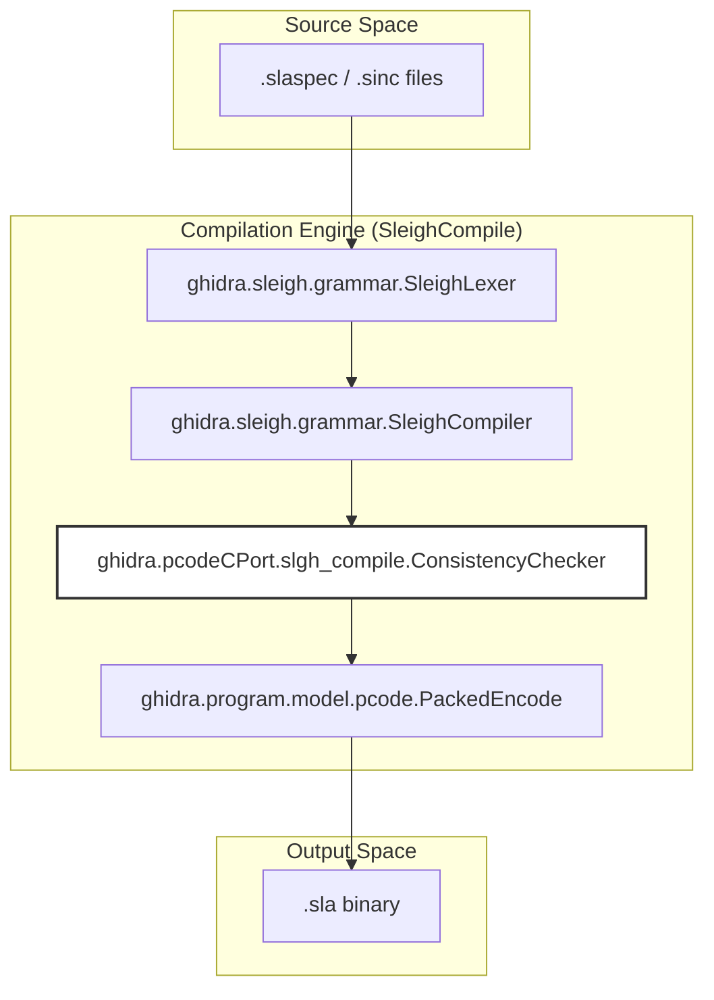
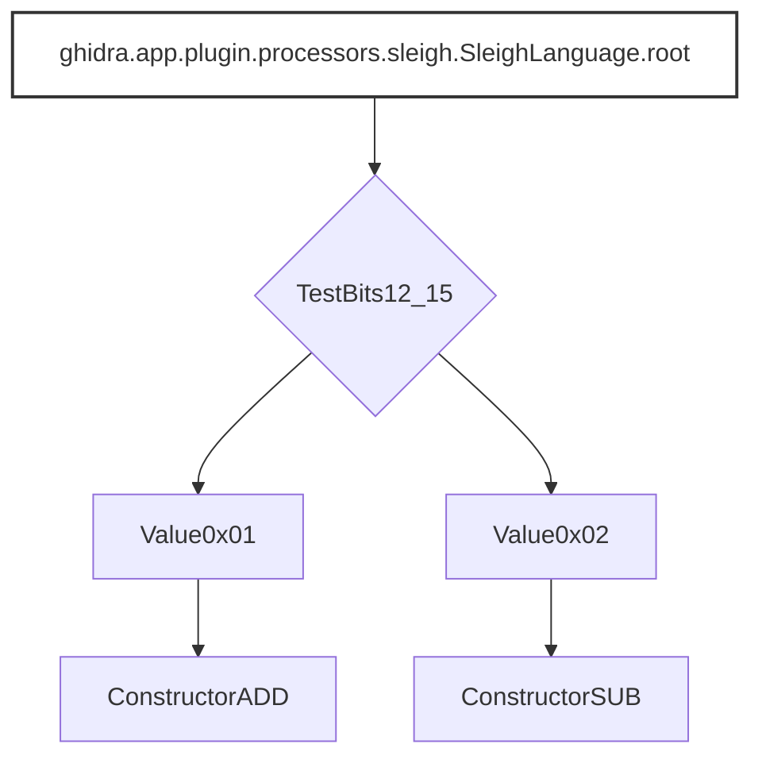
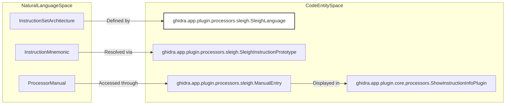
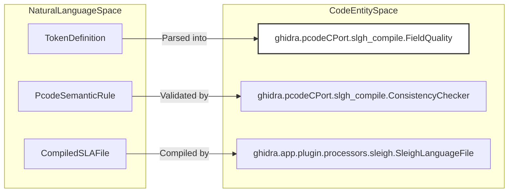

<!-- source: DeepWiki mcp.deepwiki.com · repo NationalSecurityAgency/ghidra · page 3.1 Sleigh Specification Language · fetched 2026-11-09 -->

# Sleigh Specification Language

<details>
<summary>Relevant source files</summary>

The following files were used as context for generating this wiki page:

- [Ghidra/Features/Base/src/main/help/help/topics/CodeBrowserPlugin/ListingBackground.html](Ghidra/Features/Base/src/main/help/help/topics/CodeBrowserPlugin/ListingBackground.html)
- [Ghidra/Features/Base/src/main/help/help/topics/ComputeChecksumsPlugin/Generate_Checksum_Help.html](Ghidra/Features/Base/src/main/help/help/topics/ComputeChecksumsPlugin/Generate_Checksum_Help.html)
- [Ghidra/Features/Base/src/main/help/help/topics/ShowInstructionInfoPlugin/ShowInstructionInfo.htm](Ghidra/Features/Base/src/main/help/help/topics/ShowInstructionInfoPlugin/ShowInstructionInfo.htm)
- [Ghidra/Features/Base/src/main/help/help/topics/ShowInstructionInfoPlugin/images/ShowInstructionInfo.png](Ghidra/Features/Base/src/main/help/help/topics/ShowInstructionInfoPlugin/images/ShowInstructionInfo.png)
- [Ghidra/Features/Base/src/main/java/ghidra/app/plugin/core/processors/InstructionInfoProvider.java](Ghidra/Features/Base/src/main/java/ghidra/app/plugin/core/processors/InstructionInfoProvider.java)
- [Ghidra/Features/Base/src/main/java/ghidra/app/plugin/core/processors/ShowInstructionInfoPlugin.java](Ghidra/Features/Base/src/main/java/ghidra/app/plugin/core/processors/ShowInstructionInfoPlugin.java)
- [Ghidra/Features/Base/src/main/java/ghidra/util/BrowserLoader.java](Ghidra/Features/Base/src/main/java/ghidra/util/BrowserLoader.java)
- [Ghidra/Features/Base/src/main/java/ghidra/util/ManualViewerCommandEditor.java](Ghidra/Features/Base/src/main/java/ghidra/util/ManualViewerCommandEditor.java)
- [Ghidra/Features/Base/src/main/java/ghidra/util/ManualViewerCommandWrappedOption.java](Ghidra/Features/Base/src/main/java/ghidra/util/ManualViewerCommandWrappedOption.java)
- [Ghidra/Features/Base/src/test.slow/java/ghidra/app/plugin/core/processors/ShowInstructionInfoPluginTest.java](Ghidra/Features/Base/src/test.slow/java/ghidra/app/plugin/core/processors/ShowInstructionInfoPluginTest.java)
- [Ghidra/Features/Decompiler/src/decompile/cpp/ghidra_translate.hh](Ghidra/Features/Decompiler/src/decompile/cpp/ghidra_translate.hh)
- [Ghidra/Features/Decompiler/src/decompile/cpp/pcodecompile.cc](Ghidra/Features/Decompiler/src/decompile/cpp/pcodecompile.cc)
- [Ghidra/Features/Decompiler/src/decompile/cpp/pcodecompile.hh](Ghidra/Features/Decompiler/src/decompile/cpp/pcodecompile.hh)
- [Ghidra/Features/Decompiler/src/decompile/cpp/pcodeparse.cc](Ghidra/Features/Decompiler/src/decompile/cpp/pcodeparse.cc)
- [Ghidra/Features/Decompiler/src/decompile/cpp/pcodeparse.y](Ghidra/Features/Decompiler/src/decompile/cpp/pcodeparse.y)
- [Ghidra/Features/Decompiler/src/decompile/cpp/rulecompile.hh](Ghidra/Features/Decompiler/src/decompile/cpp/rulecompile.hh)
- [Ghidra/Features/Decompiler/src/decompile/cpp/semantics.cc](Ghidra/Features/Decompiler/src/decompile/cpp/semantics.cc)
- [Ghidra/Features/Decompiler/src/decompile/cpp/semantics.hh](Ghidra/Features/Decompiler/src/decompile/cpp/semantics.hh)
- [Ghidra/Features/Decompiler/src/decompile/cpp/sleighbase.cc](Ghidra/Features/Decompiler/src/decompile/cpp/sleighbase.cc)
- [Ghidra/Features/Decompiler/src/decompile/cpp/sleighbase.hh](Ghidra/Features/Decompiler/src/decompile/cpp/sleighbase.hh)
- [Ghidra/Features/Decompiler/src/decompile/cpp/slgh_compile.cc](Ghidra/Features/Decompiler/src/decompile/cpp/slgh_compile.cc)
- [Ghidra/Features/Decompiler/src/decompile/cpp/slgh_compile.hh](Ghidra/Features/Decompiler/src/decompile/cpp/slgh_compile.hh)
- [Ghidra/Features/Decompiler/src/decompile/cpp/slghparse.cc](Ghidra/Features/Decompiler/src/decompile/cpp/slghparse.cc)
- [Ghidra/Features/Decompiler/src/decompile/cpp/slghparse.hh](Ghidra/Features/Decompiler/src/decompile/cpp/slghparse.hh)
- [Ghidra/Features/Decompiler/src/decompile/cpp/slghparse.y](Ghidra/Features/Decompiler/src/decompile/cpp/slghparse.y)
- [Ghidra/Features/Decompiler/src/decompile/cpp/slghpatexpress.cc](Ghidra/Features/Decompiler/src/decompile/cpp/slghpatexpress.cc)
- [Ghidra/Features/Decompiler/src/decompile/cpp/slghscan.cc](Ghidra/Features/Decompiler/src/decompile/cpp/slghscan.cc)
- [Ghidra/Features/Decompiler/src/decompile/cpp/slghscan.l](Ghidra/Features/Decompiler/src/decompile/cpp/slghscan.l)
- [Ghidra/Features/Decompiler/src/decompile/cpp/slghsymbol.cc](Ghidra/Features/Decompiler/src/decompile/cpp/slghsymbol.cc)
- [Ghidra/Features/Decompiler/src/decompile/cpp/slghsymbol.hh](Ghidra/Features/Decompiler/src/decompile/cpp/slghsymbol.hh)
- [Ghidra/Framework/Docking/src/main/help/help/topics/Trees/GhidraTreeFilter.html](Ghidra/Framework/Docking/src/main/help/help/topics/Trees/GhidraTreeFilter.html)
- [Ghidra/Framework/Docking/src/main/java/docking/menu/DockingToolBarUtils.java](Ghidra/Framework/Docking/src/main/java/docking/menu/DockingToolBarUtils.java)
- [Ghidra/Framework/Emulation/src/test/java/ghidra/pcode/exec/SleighProgramCompilerTest.java](Ghidra/Framework/Emulation/src/test/java/ghidra/pcode/exec/SleighProgramCompilerTest.java)
- [Ghidra/Framework/SoftwareModeling/data/languages/processor_spec.rxg](Ghidra/Framework/SoftwareModeling/data/languages/processor_spec.rxg)
- [Ghidra/Framework/SoftwareModeling/src/main/antlr/ghidra/sleigh/grammar/SleighCompiler.g](Ghidra/Framework/SoftwareModeling/src/main/antlr/ghidra/sleigh/grammar/SleighCompiler.g)
- [Ghidra/Framework/SoftwareModeling/src/main/java/ghidra/app/plugin/processors/sleigh/SleighLanguage.java](Ghidra/Framework/SoftwareModeling/src/main/java/ghidra/app/plugin/processors/sleigh/SleighLanguage.java)
- [Ghidra/Framework/SoftwareModeling/src/main/java/ghidra/pcode/utils/MessageFormattingUtils.java](Ghidra/Framework/SoftwareModeling/src/main/java/ghidra/pcode/utils/MessageFormattingUtils.java)
- [Ghidra/Framework/SoftwareModeling/src/main/java/ghidra/pcodeCPort/sleighbase/SleighBase.java](Ghidra/Framework/SoftwareModeling/src/main/java/ghidra/pcodeCPort/sleighbase/SleighBase.java)
- [Ghidra/Framework/SoftwareModeling/src/main/java/ghidra/pcodeCPort/slgh_compile/ConsistencyChecker.java](Ghidra/Framework/SoftwareModeling/src/main/java/ghidra/pcodeCPort/slgh_compile/ConsistencyChecker.java)
- [Ghidra/Framework/SoftwareModeling/src/main/java/ghidra/pcodeCPort/slgh_compile/SleighCompile.java](Ghidra/Framework/SoftwareModeling/src/main/java/ghidra/pcodeCPort/slgh_compile/SleighCompile.java)
- [Ghidra/Framework/SoftwareModeling/src/main/java/ghidra/pcodeCPort/slgh_compile/SleighCompileLauncher.java](Ghidra/Framework/SoftwareModeling/src/main/java/ghidra/pcodeCPort/slgh_compile/SleighCompileLauncher.java)
- [Ghidra/Framework/SoftwareModeling/src/main/java/ghidra/pcodeCPort/slghpatexpress/TokenPattern.java](Ghidra/Framework/SoftwareModeling/src/main/java/ghidra/pcodeCPort/slghpatexpress/TokenPattern.java)
- [Ghidra/Framework/SoftwareModeling/src/main/java/ghidra/pcodeCPort/slghsymbol/FlowDestSymbol.java](Ghidra/Framework/SoftwareModeling/src/main/java/ghidra/pcodeCPort/slghsymbol/FlowDestSymbol.java)
- [Ghidra/Framework/SoftwareModeling/src/main/java/ghidra/pcodeCPort/slghsymbol/FlowRefSymbol.java](Ghidra/Framework/SoftwareModeling/src/main/java/ghidra/pcodeCPort/slghsymbol/FlowRefSymbol.java)
- [Ghidra/Framework/SoftwareModeling/src/main/java/ghidra/pcodeCPort/slghsymbol/SymbolTable.java](Ghidra/Framework/SoftwareModeling/src/main/java/ghidra/pcodeCPort/slghsymbol/SymbolTable.java)
- [Ghidra/Framework/SoftwareModeling/src/main/java/ghidra/pcodeCPort/slghsymbol/symbol_type.java](Ghidra/Framework/SoftwareModeling/src/main/java/ghidra/pcodeCPort/slghsymbol/symbol_type.java)
- [Ghidra/Framework/SoftwareModeling/src/main/java/ghidra/pcodeCPort/translate/Translate.java](Ghidra/Framework/SoftwareModeling/src/main/java/ghidra/pcodeCPort/translate/Translate.java)
- [Ghidra/Framework/SoftwareModeling/src/main/java/ghidra/program/model/lang/AddressLabelInfo.java](Ghidra/Framework/SoftwareModeling/src/main/java/ghidra/program/model/lang/AddressLabelInfo.java)
- [Ghidra/Framework/SoftwareModeling/src/main/java/ghidra/program/model/lang/Language.java](Ghidra/Framework/SoftwareModeling/src/main/java/ghidra/program/model/lang/Language.java)
- [Ghidra/Framework/SoftwareModeling/src/main/java/ghidra/program/util/OldLanguage.java](Ghidra/Framework/SoftwareModeling/src/main/java/ghidra/program/util/OldLanguage.java)
- [Ghidra/Framework/SoftwareModeling/src/main/java/ghidra/sleigh/grammar/RadixBigInteger.java](Ghidra/Framework/SoftwareModeling/src/main/java/ghidra/sleigh/grammar/RadixBigInteger.java)
- [Ghidra/Processors/JVM/data/languages/JVM.ldefs](Ghidra/Processors/JVM/data/languages/JVM.ldefs)
- [Ghidra/Processors/JVM/data/languages/JVM.slaspec](Ghidra/Processors/JVM/data/languages/JVM.slaspec)
- [Ghidra/Processors/JVM/src/main/java/ghidra/javaclass/analyzers/JvmSwitchAnalyzer.java](Ghidra/Processors/JVM/src/main/java/ghidra/javaclass/analyzers/JvmSwitchAnalyzer.java)
- [Ghidra/Test/IntegrationTest/src/screen/java/help/screenshot/ShowInstructionInfoPluginScreenShots.java](Ghidra/Test/IntegrationTest/src/screen/java/help/screenshot/ShowInstructionInfoPluginScreenShots.java)
- [Ghidra/Test/IntegrationTest/src/test.slow/java/ghidra/pcodeCPort/slgh_compile/regression/PushbackEntireLine.java](Ghidra/Test/IntegrationTest/src/test.slow/java/ghidra/pcodeCPort/slgh_compile/regression/PushbackEntireLine.java)
- [Ghidra/Test/IntegrationTest/src/test.slow/java/ghidra/pcodeCPort/slgh_compile/regression/SleighCompileRegressionTest.java](Ghidra/Test/IntegrationTest/src/test.slow/java/ghidra/pcodeCPort/slgh_compile/regression/SleighCompileRegressionTest.java)

</details>


## Purpose and Scope

This document describes the Sleigh specification language used in Ghidra to define processor instruction set architectures (ISAs). Sleigh specifications encode instruction patterns, operand structures, and the semantic behavior of instructions as P-code operations. These specifications are compiled from `.slaspec` and modular `.sinc` source files into runtime-usable `.sla` binaries that drive disassembly, decompilation, and emulation.

---

## Overview

Sleigh is a domain-specific language for formally describing processor instruction sets. It serves as the foundation for Ghidra's processor-agnostic architecture support. The language is implemented via a compiler that translates human-readable specifications into a packed binary format (`.sla`) optimized for high-speed pattern matching and P-code generation. Modular specifications utilize `.sinc` files included via preprocessor directives [Ghidra/Features/Decompiler/src/decompile/cpp/slghscan.l:247-248]().

**Key Components:**
- **Symbol Table:** Manages scopes and identifiers for registers, address spaces, tokens, and subtables [Ghidra/Features/Decompiler/src/decompile/cpp/slghsymbol.cc:47-70]().
- **Decision Tree:** A hierarchical structure of `DecisionNode` objects used at runtime to resolve instruction bit patterns to specific constructors [Ghidra/Framework/SoftwareModeling/src/main/java/ghidra/app/plugin/processors/sleigh/SleighLanguage.java:96-96]().
- **P-code Templates:** Encoded semantic actions represented as `ConstructTpl` which are instantiated during translation [Ghidra/Features/Decompiler/src/decompile/cpp/slgh_compile.hh:37-41]().

### Sleigh Compilation Data Flow

The compilation process involves lexing, parsing, consistency checking, and serialization. The process is managed by `SleighCompile`, which coordinates the semantic P-code compiler and the pattern matching engine.

**Sleigh Compiler Architecture**


Sources: [Ghidra/Framework/SoftwareModeling/src/main/antlr/ghidra/sleigh/grammar/SleighCompiler.g:40-52](), [Ghidra/Features/Decompiler/src/decompile/cpp/slgh_compile.cc:25-30](), [Ghidra/Framework/SoftwareModeling/src/main/java/ghidra/pcodeCPort/slgh_compile/SleighCompile.java:52-195]()

---

## Language Elements and Syntax

### Token and Field Definitions
Tokens define the bit-level structure of instruction bytes. Fields are named bit-ranges within a token used for pattern matching and operand extraction. `.sinc` files allow breaking large specifications into manageable components.

```sleigh
define token instr (16)
  op    = (12,15)
  mode  = (3,5)
  regdn = (0,2)
;
```
In the compiler, `FieldQuality` objects store these bit-range properties (low bit, high bit, sign extension, and flow properties) during parsing [Ghidra/Features/Decompiler/src/decompile/cpp/slgh_compile.hh:97-105](), [Ghidra/Framework/SoftwareModeling/src/main/antlr/ghidra/sleigh/grammar/SleighCompiler.g:125-130]().

### Attach Variables and Values
Attach statements bind numeric field values to registers or specific constants.
- `attach variables [ reg1 reg2 ] [ r0 r1 r2 r3 ... ]` maps field values to register symbols [Ghidra/Framework/SoftwareModeling/src/main/antlr/ghidra/sleigh/grammar/SleighCompiler.g:73-73]().
- `attach values [ imm ] [ 1 2 4 8 ]` maps field values to specific integers [Ghidra/Framework/SoftwareModeling/src/main/antlr/ghidra/sleigh/grammar/SleighCompiler.g:71-71]().

### Context Variables
Context variables allow the decoder to track state across instruction boundaries (e.g., ARM/Thumb mode switching).
```sleigh
define context contextreg
  TMode=(0,0)
  lowMode=(1,1) noflow
;
```
The `noflow` attribute indicates the bit should not automatically propagate to the next instruction address [Ghidra/Features/Decompiler/src/decompile/cpp/slgh_compile.hh:102-102](). Context fields are managed via `ContextField` and `PatternValue` expressions [Ghidra/Framework/SoftwareModeling/src/main/java/ghidra/app/plugin/processors/sleigh/SleighLanguage.java:34-35]().

Sources: [Ghidra/Features/Decompiler/src/decompile/cpp/slgh_compile.hh:97-105](), [Ghidra/Framework/SoftwareModeling/src/main/antlr/ghidra/sleigh/grammar/SleighCompiler.g:71-130](), [Ghidra/Framework/SoftwareModeling/src/main/java/ghidra/app/plugin/processors/sleigh/SleighLanguage.java:34-35]()

---

## Constructors and Pattern Matching

Constructors are the primary building blocks of a Sleigh specification. They associate a bit pattern with a mnemonic, operands, and P-code semantics.

### Syntax
`:mnemonic operands is pattern { semantics }`

### Decision Tree Resolution
At runtime, the `SleighLanguage` uses a `DecisionNode` tree to resolve bytes. Each node tests specific bits to narrow down the possible `Constructor` matches. The root of this tree is stored in the `root` field of `SleighLanguage` [Ghidra/Framework/SoftwareModeling/src/main/java/ghidra/app/plugin/processors/sleigh/SleighLanguage.java:96-97]().

**Pattern Matching Decision Flow**


Sources: [Ghidra/Framework/SoftwareModeling/src/main/java/ghidra/app/plugin/processors/sleigh/SleighLanguage.java:95-97](), [Ghidra/Features/Decompiler/src/decompile/cpp/slgh_compile.cc:25-30]()

---

## P-code Semantics and Consistency

The semantic section (enclosed in `{}`) defines the instruction's effect using P-code operations.

### Semantic Validation
The `ConsistencyChecker` class ensures that P-code operations within a constructor are valid. It performs:
1. **Size Checking:** Validates that inputs and outputs of operations (like `CPUI_INT_ADD` or `CPUI_COPY`) have matching sizes [Ghidra/Framework/SoftwareModeling/src/main/java/ghidra/pcodeCPort/slgh_compile/ConsistencyChecker.java:70-146]().
2. **Temporary Management:** Tracks the use of "unique" space (temporaries) to ensure they are written before being read [Ghidra/Framework/SoftwareModeling/src/main/java/ghidra/pcodeCPort/slgh_compile/ConsistencyChecker.java:32-40]().
3. **Truncation/Extension Checks:** Identifies unnecessary or illegal bit manipulations [Ghidra/Framework/SoftwareModeling/src/main/java/ghidra/pcodeCPort/slgh_compile/ConsistencyChecker.java:220-225]().

### P-code Compilation Logic
The `PcodeCompile` class translates the semantic strings into `OpTpl` (Operation Template) and `VarnodeTpl` (Varnode Template) objects [Ghidra/Framework/SoftwareModeling/src/main/java/ghidra/pcodeCPort/slgh_compile/SleighCompile.java:96-195]().

Sources: [Ghidra/Framework/SoftwareModeling/src/main/java/ghidra/pcodeCPort/slgh_compile/ConsistencyChecker.java:32-45](), [Ghidra/Features/Decompiler/src/decompile/cpp/slgh_compile.cc:141-180]()

---

## The Compilation Process: .slaspec to .sla

Ghidra uses the `SleighCompile` class (available in both Java and C++ implementations) to transform specifications.

### Steps in Compilation:
1. **Parsing:** The `SleighCompiler.g` (ANTLR) or `slghparse.y` (Bison) grammar processes the input files [Ghidra/Framework/SoftwareModeling/src/main/antlr/ghidra/sleigh/grammar/SleighCompiler.g:1-10]().
2. **With Blocks:** The compiler handles `with` blocks by prepending patterns and context changes to all nested constructors using `collectAndPrependPattern` and `collectAndPrependContext` [Ghidra/Framework/SoftwareModeling/src/main/java/ghidra/pcodeCPort/slgh_compile/SleighCompile.java:218-236](), [Ghidra/Features/Decompiler/src/decompile/cpp/slgh_compile.cc:152-162]().
3. **Subtable Construction:** Constructors are organized into subtables (the default being the "root" table) [Ghidra/Features/Decompiler/src/decompile/cpp/slgh_compile.hh:112-123]().
4. **Serialization:** The internal structures (`SymbolTable`, `DecisionNodes`, Templates) are serialized into the `.sla` format using `PackedEncode` [Ghidra/Framework/SoftwareModeling/src/main/java/ghidra/pcodeCPort/slgh_compile/SleighCompile.java:41-43]().

### Runtime Loading
The `SleighLanguage` class loads the compiled `.sla` file. If the `.slaspec` or `.sinc` files are newer than the `.sla`, Ghidra triggers an automatic recompilation via `langFile.compileSlaFile(monitor)` [Ghidra/Framework/SoftwareModeling/src/main/java/ghidra/app/plugin/processors/sleigh/SleighLanguage.java:161-163]().

| File Extension | Role |
| :--- | :--- |
| `.slaspec` | Main processor specification file. |
| `.sinc` | Included modular Sleigh definition files. |
| `.sla` | Compiled binary format used by Ghidra at runtime. |

Sources: [Ghidra/Framework/SoftwareModeling/src/main/java/ghidra/app/plugin/processors/sleigh/SleighLanguage.java:161-163](), [Ghidra/Framework/SoftwareModeling/src/main/java/ghidra/pcodeCPort/slgh_compile/SleighCompile.java:41-58](), [Ghidra/Features/Decompiler/src/decompile/cpp/slgh_compile.cc:152-162]()

---

## Instruction Information and UI Integration

Ghidra provides UI components to inspect the results of Sleigh disassembly and P-code generation.

### ShowInstructionInfoPlugin
The `ShowInstructionInfoPlugin` provides a status panel and a dedicated provider to show raw instruction data, including the raw disassembled mnemonic and operands [Ghidra/Features/Base/src/main/java/ghidra/app/plugin/core/processors/ShowInstructionInfoPlugin.java:66-86]().

### Instruction Info Provider
The `InstructionInfoProvider` (invoked by the plugin) displays the disassembly and semantic P-code for the current address [Ghidra/Features/Base/src/main/java/ghidra/app/plugin/core/processors/ShowInstructionInfoPlugin.java:148-163](). It can also open the processor manual if a `ManualEntry` is found in the language metadata [Ghidra/Features/Base/src/main/java/ghidra/app/plugin/core/processors/ShowInstructionInfoPlugin.java:175-190]().

**Natural Language to Code Entity Mapping: Instruction Analysis**


Sources: [Ghidra/Features/Base/src/main/java/ghidra/app/plugin/core/processors/ShowInstructionInfoPlugin.java:66-190](), [Ghidra/Framework/SoftwareModeling/src/main/java/ghidra/app/plugin/processors/sleigh/SleighLanguage.java:95-104]()

**Natural Language to Code Entity Mapping: Semantic Compilation**


Sources: [Ghidra/Features/Decompiler/src/decompile/cpp/slgh_compile.hh:97-105](), [Ghidra/Framework/SoftwareModeling/src/main/java/ghidra/pcodeCPort/slgh_compile/ConsistencyChecker.java:70-146](), [Ghidra/Framework/SoftwareModeling/src/main/java/ghidra/app/plugin/processors/sleigh/SleighLanguage.java:145-165]()

---

