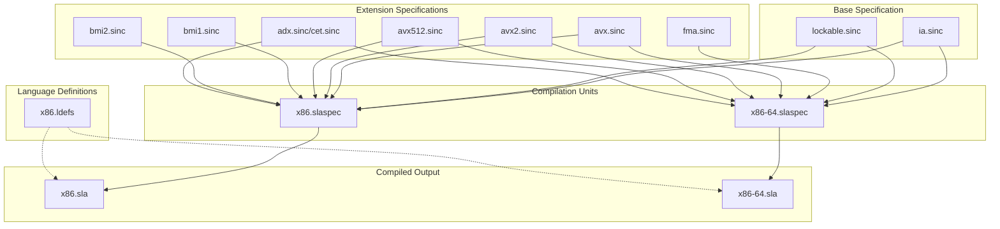
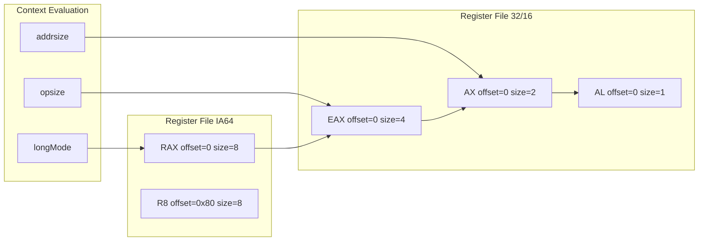
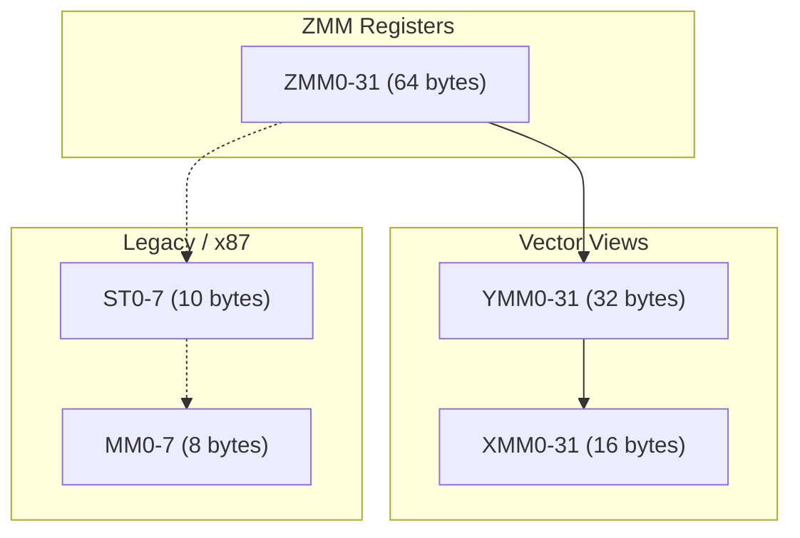
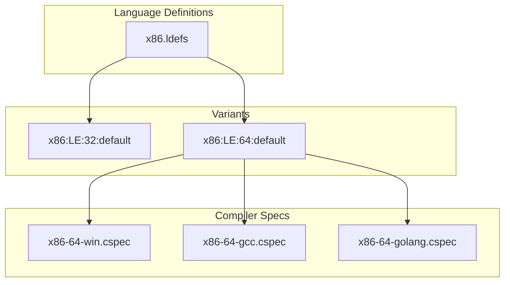

<!-- source: DeepWiki mcp.deepwiki.com · repo NationalSecurityAgency/ghidra · page 3.2 x86/x64 Architecture Support · fetched 2026-11-09 -->

# x86/x64 Architecture Support

<details>
<summary>Relevant source files</summary>

The following files were used as context for generating this wiki page:

- [Ghidra/Features/Base/data/x64_linux_syscall_numbers](Ghidra/Features/Base/data/x64_linux_syscall_numbers)
- [Ghidra/Features/Base/data/x86_linux_syscall_numbers](Ghidra/Features/Base/data/x86_linux_syscall_numbers)
- [Ghidra/Features/Base/src/main/java/ghidra/app/util/datatype/microsoft/ThreadEnvironmentBlock.java](Ghidra/Features/Base/src/main/java/ghidra/app/util/datatype/microsoft/ThreadEnvironmentBlock.java)
- [Ghidra/Features/Decompiler/ghidra_scripts/GraphASTAndFlowScript.java](Ghidra/Features/Decompiler/ghidra_scripts/GraphASTAndFlowScript.java)
- [Ghidra/Features/Decompiler/ghidra_scripts/GraphASTScript.java](Ghidra/Features/Decompiler/ghidra_scripts/GraphASTScript.java)
- [Ghidra/Features/Decompiler/ghidra_scripts/GraphSelectedASTScript.java](Ghidra/Features/Decompiler/ghidra_scripts/GraphSelectedASTScript.java)
- [Ghidra/Features/Decompiler/src/main/java/ghidra/app/plugin/core/decompile/actions/PCodeCfgAction.java](Ghidra/Features/Decompiler/src/main/java/ghidra/app/plugin/core/decompile/actions/PCodeCfgAction.java)
- [Ghidra/Features/Decompiler/src/main/java/ghidra/app/plugin/core/decompile/actions/PCodeCfgDisplayListener.java](Ghidra/Features/Decompiler/src/main/java/ghidra/app/plugin/core/decompile/actions/PCodeCfgDisplayListener.java)
- [Ghidra/Features/Decompiler/src/main/java/ghidra/app/plugin/core/decompile/actions/PCodeCfgGraphType.java](Ghidra/Features/Decompiler/src/main/java/ghidra/app/plugin/core/decompile/actions/PCodeCfgGraphType.java)
- [Ghidra/Features/MicrosoftCodeAnalyzer/src/main/java/ghidra/app/plugin/prototype/MicrosoftCodeAnalyzerPlugin/TEBAnalyzer.java](Ghidra/Features/MicrosoftCodeAnalyzer/src/main/java/ghidra/app/plugin/prototype/MicrosoftCodeAnalyzerPlugin/TEBAnalyzer.java)
- [Ghidra/Processors/x86/certification.manifest](Ghidra/Processors/x86/certification.manifest)
- [Ghidra/Processors/x86/data/languages/avx.sinc](Ghidra/Processors/x86/data/languages/avx.sinc)
- [Ghidra/Processors/x86/data/languages/avx2.sinc](Ghidra/Processors/x86/data/languages/avx2.sinc)
- [Ghidra/Processors/x86/data/languages/avx2_manual.sinc](Ghidra/Processors/x86/data/languages/avx2_manual.sinc)
- [Ghidra/Processors/x86/data/languages/avx512.sinc](Ghidra/Processors/x86/data/languages/avx512.sinc)
- [Ghidra/Processors/x86/data/languages/avx512_manual.sinc](Ghidra/Processors/x86/data/languages/avx512_manual.sinc)
- [Ghidra/Processors/x86/data/languages/avx_manual.sinc](Ghidra/Processors/x86/data/languages/avx_manual.sinc)
- [Ghidra/Processors/x86/data/languages/cet.sinc](Ghidra/Processors/x86/data/languages/cet.sinc)
- [Ghidra/Processors/x86/data/languages/cmpccxadd.sinc](Ghidra/Processors/x86/data/languages/cmpccxadd.sinc)
- [Ghidra/Processors/x86/data/languages/fma.sinc](Ghidra/Processors/x86/data/languages/fma.sinc)
- [Ghidra/Processors/x86/data/languages/gfni.sinc](Ghidra/Processors/x86/data/languages/gfni.sinc)
- [Ghidra/Processors/x86/data/languages/ia.sinc](Ghidra/Processors/x86/data/languages/ia.sinc)
- [Ghidra/Processors/x86/data/languages/lockable.sinc](Ghidra/Processors/x86/data/languages/lockable.sinc)
- [Ghidra/Processors/x86/data/languages/macros.sinc](Ghidra/Processors/x86/data/languages/macros.sinc)
- [Ghidra/Processors/x86/data/languages/pclmulqdq.sinc](Ghidra/Processors/x86/data/languages/pclmulqdq.sinc)
- [Ghidra/Processors/x86/data/languages/rao.sinc](Ghidra/Processors/x86/data/languages/rao.sinc)
- [Ghidra/Processors/x86/data/languages/rdrand.sinc](Ghidra/Processors/x86/data/languages/rdrand.sinc)
- [Ghidra/Processors/x86/data/languages/sgx.sinc](Ghidra/Processors/x86/data/languages/sgx.sinc)
- [Ghidra/Processors/x86/data/languages/x86-64-gcc.cspec](Ghidra/Processors/x86/data/languages/x86-64-gcc.cspec)
- [Ghidra/Processors/x86/data/languages/x86-64-win.cspec](Ghidra/Processors/x86/data/languages/x86-64-win.cspec)
- [Ghidra/Processors/x86/data/languages/x86-64.slaspec](Ghidra/Processors/x86/data/languages/x86-64.slaspec)
- [Ghidra/Processors/x86/data/languages/x86.ldefs](Ghidra/Processors/x86/data/languages/x86.ldefs)
- [Ghidra/Processors/x86/data/languages/x86.slaspec](Ghidra/Processors/x86/data/languages/x86.slaspec)
- [Ghidra/Processors/x86/data/languages/x86gcc.cspec](Ghidra/Processors/x86/data/languages/x86gcc.cspec)
- [Ghidra/Processors/x86/data/languages/x86win.cspec](Ghidra/Processors/x86/data/languages/x86win.cspec)
- [Ghidra/Processors/x86/data/patterns/x86-64gcc_patterns.xml](Ghidra/Processors/x86/data/patterns/x86-64gcc_patterns.xml)
- [Ghidra/Processors/x86/data/patterns/x86-64win_patterns.xml](Ghidra/Processors/x86/data/patterns/x86-64win_patterns.xml)
- [Ghidra/Processors/x86/data/patterns/x86gcc_patterns.xml](Ghidra/Processors/x86/data/patterns/x86gcc_patterns.xml)
- [Ghidra/Processors/x86/data/patterns/x86win_patterns.xml](Ghidra/Processors/x86/data/patterns/x86win_patterns.xml)
- [GhidraDocs/GhidraClass/Advanced/improvingDisassemblyAndDecompilation.pdf](GhidraDocs/GhidraClass/Advanced/improvingDisassemblyAndDecompilation.pdf)
- [GhidraDocs/GhidraClass/ExerciseFiles/Advanced/write](GhidraDocs/GhidraClass/ExerciseFiles/Advanced/write)

</details>


## Purpose and Scope

This document details Ghidra's implementation of x86 and x64 processor architecture support through the Sleigh specification language and associated configuration files. It covers register definitions, context management (`longMode`, `opsize`, `addrsize`), instruction encoding schemes (including VEX/EVEX prefixes), language variants, LOCK prefix handling, and instruction set extensions (AVX, AVX2, AVX512, FMA, etc.). This forms the foundation for disassembly and decompilation of x86/x64 binaries.

For information about the Sleigh specification language syntax and compilation process, see [Sleigh Specification Language](3.1). For compiler-specific calling conventions and ABI details, see [Language Definition and Compiler Specs](3.4).

---

## Architecture Component Structure

The x86/x64 architecture support is organized as a modular system with a base specification (`ia.sinc`) and multiple extension files included conditionally.



**Diagram: x86/x64 Specification File Structure and Code Mapping**

The base specification `ia.sinc` is included by both 32-bit and 64-bit compilation units (`x86.slaspec` and `x86-64.slaspec`). Extensions are conditionally included within a `with : lockprefx=0` block in the main `.slaspec` files to ensure they do not conflict with instructions that allow the LOCK prefix.

Sources: [Ghidra/Processors/x86/data/languages/x86.slaspec:1-23](), [Ghidra/Processors/x86/data/languages/x86-64.slaspec:1-7](), [Ghidra/Processors/x86/certification.manifest:4-21]()

---

## Register Model and Context Management

The x86/x64 register model uses overlapping register definitions at different sizes to represent the architectural register file, alongside context bits (`longMode`, `opsize`, `addrsize`) that dictate decoding rules.

### General Purpose Registers and Context Flow



**Diagram: Register Model and Context Integration (`ia.sinc`)**

The register model defines overlapping storage at different offsets to match the physical CPU architecture:

| Register Set | Offset | Size | Count | Availability |
|--------------|--------|------|-------|--------------|
| `RAX`-`RDI` | 0x0 | 8 bytes | 8 | 64-bit mode only (`IA64`) |
| `R8`-`R15` | 0x80 | 8 bytes | 8 | 64-bit mode only (`IA64`) |
| `EAX`-`EDI` | 0x0 | 4 bytes | 8 | All modes |
| `R8D`-`R15D` | 0x80 | 4 bytes | 8 | 64-bit mode with REX |
| `AX`-`DI` | 0x0 | 2 bytes | 8 | All modes |
| `AL`, `AH`, `CL`, `CH`, `DL`, `DH`, `BL`, `BH` | 0x0 | 1 byte | 8 | All modes |
| `SPL`, `BPL`, `SIL`, `DIL` | 0x0 | 1 byte | 4 | 64-bit with REX only |
| `R8B`-`R15B` | 0x80 | 1 byte | 8 | 64-bit mode with REX |

Sources: [Ghidra/Processors/x86/data/languages/ia.sinc:16-32]()

### Context Register Bit Layout

Context bits determine addressing modes, operand sizes, and instruction interpretation dynamically during decoding:
- `longMode` (bit 0): Controls whether 64-bit decoding is active (`IA64`).
- `opsize` (bits 6-7): Specifies operand size (0=16-bit, 1=32-bit, 2=64-bit).
- `addrsize` (bits 4-5): Specifies address size.
- `vexMode` / `vexL` / `vexVVVV`: Controls VEX/EVEX prefix interpretation and vector lengths (128-bit, 256-bit, 512-bit).

Sources: [Ghidra/Processors/x86/data/languages/ia.sinc:3-9](), [Ghidra/Processors/x86/data/languages/avx.sinc:6-15]()

---

## SIMD and Floating Point Registers

The SIMD registers follow a hierarchical structure where larger vectors encapsulate smaller component registers.



**Diagram: SIMD and x87 Register Hierarchy**

- **MM0-7**: MMX registers overlap with x87 `ST` registers at offset `0x1100`. The upper 16-bits of `ST` registers (`ST0h`..`ST7h`) are unused in MMX mode.
- **ST0-7**: x87 FPU stack, 80-bit (10 byte) extended precision.
- **XMM/YMM/ZMM**: AVX-512 extensions expand the vector width to 512 bits. Ghidra models these as sub-ranges of the `ZMM` registers.

Sources: [Ghidra/Processors/x86/data/languages/ia.sinc:93-137](), [Ghidra/Processors/x86/data/languages/ia.sinc:151-160]()

---

## Language Variants and Compiler Specifications

The `x86.ldefs` file defines multiple language variants for different execution modes (Real Mode, Protected Mode, System Management Mode, 64-bit default, and compatibility mode), mapping each to its respective `.pspec` and compiler specifications (`.cspec`).



**Diagram: Language Definitions and Compiler Specs Bridge (`x86.ldefs`)**

### Data Organization (Windows x64)
The `x86-64-win.cspec` defines machine alignment, pointer sizes, and bitfield packing rules (using Microsoft conventions).

| Type | Size | Alignment |
|------|------|-----------|
| Pointer | 8 | 8 |
| Integer | 4 | 4 |
| Long | 4 | 4 |
| Long Long | 8 | 8 |
| Float | 4 | 4 |
| Double | 8 | 8 |

Sources: [Ghidra/Processors/x86/data/languages/x86.ldefs:1-120](), [Ghidra/Processors/x86/data/languages/x86-64-win.cspec:11-34]()

---

## Instruction Set Extensions (AVX, AVX2, AVX512, FMA)

### AVX and AVX2
AVX introduces VEX-prefixed SIMD instructions operating on 128-bit (`XMM`) and 256-bit (`YMM`) registers. Ghidra uses `zext` to model the architectural requirement that VEX instructions zero the upper bits of the destination `YMM` or `ZMM` register.

Example from `avx.sinc`:
```
:VADDPD XmmReg1, vexVVVV_XmmReg, XmmReg2_m128 is $(VEX_NDS) & $(VEX_L128) & $(VEX_PRE_66) & $(VEX_0F) & $(VEX_WIG) & vexVVVV_XmmReg; byte=0x58; (XmmReg1 & ZmmReg1) ... & XmmReg2_m128
{
	local m:16 = XmmReg2_m128;
	XmmReg1[0,64]  = vexVVVV_XmmReg[0,64]  f+ m[0,64];
    XmmReg1[64,64] = vexVVVV_XmmReg[64,64] f+ m[64,64];
	ZmmReg1 = zext(XmmReg1);
}
```

Sources: [Ghidra/Processors/x86/data/languages/avx.sinc:6-12]()

### AVX-512
AVX-512 introduces 512-bit `ZMM` registers and opmask registers (`K0-K7`) for predicated execution via the EVEX prefix. Instructions utilize `pcodeop` declarations to handle complex vector operations and masking semantics.

Example from `avx512.sinc`:
```
:VADDPD ZmmReg1^ZmmOpMask64, evexV5_ZmmReg, ZmmReg2_m512_m64bcst  is $(EVEX_NONE) & $(EVEX_L512) & $(VEX_PRE_66) & $(VEX_0F) & $(VEX_W1) & evexV5_ZmmReg; byte=0x58; (ZmmReg1 & ZmmOpMask64) ... & ZmmReg2_m512_m64bcst
[ evexD8Type = 0; evexTType = 0; ]
{
	ZmmResult = vaddpd_avx512f( evexV5_ZmmReg, ZmmReg2_m512_m64bcst );
	ZmmMask = ZmmReg1;
	build ZmmOpMask64;
	ZmmReg1 = ZmmResult;
}
```

Sources: [Ghidra/Processors/x86/data/languages/avx512.sinc:29-38]()

---

## LOCK Prefix Handling

The LOCK prefix (`0xF0`) ensures atomic read-modify-write execution on memory operands. Ghidra models lockable instructions explicitly in `lockable.sinc` to separate them from non-lockable counterparts in `ia.sinc`.

Example of a lockable `ADC` instruction:
```
:ADC^lockx m32,imm32	is vexMode=0 & lockx & unlock & opsize=1 & byte=0x81; m32 & reg_opcode=2 ...; imm32 
{    
    build lockx;
    build m32;
    addCarryFlags(m32, imm32:4);
    resultflags(m32);
    build unlock; 
}
```
The `build lockx` and `build unlock` statements delimit the transaction boundary in P-code. Attempting to use the LOCK prefix with non-permitted instructions generates an undefined opcode exception according to Intel architecture rules.

Sources: [Ghidra/Processors/x86/data/languages/lockable.sinc:1-32]()

---

## Summary

Ghidra's x86/x64 architecture support provides comprehensive coverage of:
1. **Base Registers and Context**: Overlapping register files and context state tracking (`longMode`, `opsize`, `addrsize`).
2. **Modular Sleigh Specifications**: Clean separation of base definitions (`ia.sinc`), atomic instructions (`lockable.sinc`), and extensions (`avx.sinc`, `avx2.sinc`, `avx512.sinc`, `fma.sinc`).
3. **Compiler and ABI Specs**: Tailored calling conventions and data organization rules for Windows, Linux (GCC), and Golang.

Sources: [Ghidra/Processors/x86/data/languages/ia.sinc:1-150](), [Ghidra/Processors/x86/data/languages/x86.slaspec:1-23](), [Ghidra/Processors/x86/data/languages/x86.ldefs:1-120]()

---

