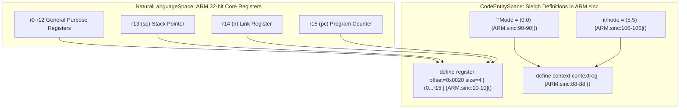
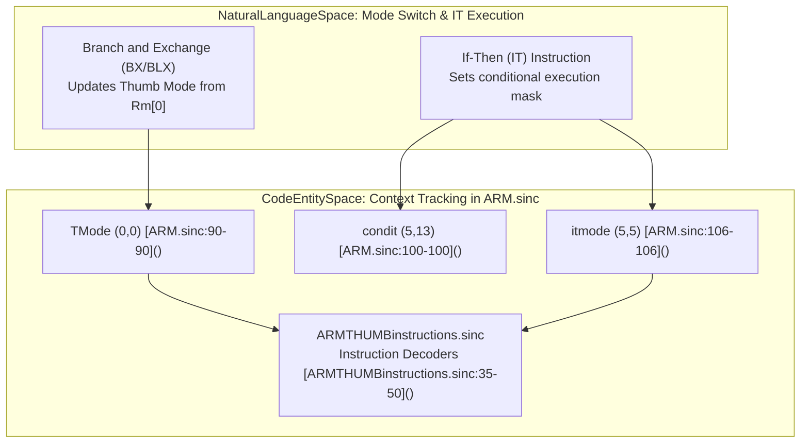

<!-- source: DeepWiki mcp.deepwiki.com · repo NationalSecurityAgency/ghidra · page 3.3 ARM/AArch64 Architecture Support · fetched 2026-11-09 -->

# ARM/AArch64 Architecture Support

<details>
<summary>Relevant source files</summary>

The following files were used as context for generating this wiki page:

- [Ghidra/Features/Base/src/main/java/ghidra/app/util/bin/format/macho/dyld/DyldArchitecture.java](Ghidra/Features/Base/src/main/java/ghidra/app/util/bin/format/macho/dyld/DyldArchitecture.java)
- [Ghidra/Features/Base/src/main/java/ghidra/app/util/opinion/QueryOpinionService.java](Ghidra/Features/Base/src/main/java/ghidra/app/util/opinion/QueryOpinionService.java)
- [Ghidra/Features/Base/src/main/java/ghidra/program/util/ContextEvaluator.java](Ghidra/Features/Base/src/main/java/ghidra/program/util/ContextEvaluator.java)
- [Ghidra/Features/Base/src/main/java/ghidra/program/util/ContextEvaluatorAdapter.java](Ghidra/Features/Base/src/main/java/ghidra/program/util/ContextEvaluatorAdapter.java)
- [Ghidra/Features/Base/src/test.slow/java/ghidra/app/util/PseudoDisassemblerTest.java](Ghidra/Features/Base/src/test.slow/java/ghidra/app/util/PseudoDisassemblerTest.java)
- [Ghidra/Features/Base/src/test/java/ghidra/app/util/opinion/QueryOpinionServiceTest.java](Ghidra/Features/Base/src/test/java/ghidra/app/util/opinion/QueryOpinionServiceTest.java)
- [Ghidra/Features/FileFormats/src/main/java/ghidra/file/formats/ubi/UniversalBinaryFileSystem.java](Ghidra/Features/FileFormats/src/main/java/ghidra/file/formats/ubi/UniversalBinaryFileSystem.java)
- [Ghidra/Framework/Docking/src/main/java/docking/widgets/imagepanel/ImagePanel.java](Ghidra/Framework/Docking/src/main/java/docking/widgets/imagepanel/ImagePanel.java)
- [Ghidra/Framework/Docking/src/test.slow/java/docking/widgets/imagepanel/ImagePanelTest.java](Ghidra/Framework/Docking/src/test.slow/java/docking/widgets/imagepanel/ImagePanelTest.java)
- [Ghidra/Framework/Help/src/test/java/help/validator/model/AnchorDefinitionTest.java](Ghidra/Framework/Help/src/test/java/help/validator/model/AnchorDefinitionTest.java)
- [Ghidra/Framework/Help/src/test/java/help/validator/model/GhidraTOCFileTestDouble.java](Ghidra/Framework/Help/src/test/java/help/validator/model/GhidraTOCFileTestDouble.java)
- [Ghidra/Framework/SoftwareModeling/src/main/java/ghidra/app/plugin/assembler/sleigh/expr/EndInstructionValueSolver.java](Ghidra/Framework/SoftwareModeling/src/main/java/ghidra/app/plugin/assembler/sleigh/expr/EndInstructionValueSolver.java)
- [Ghidra/Framework/SoftwareModeling/src/main/java/ghidra/app/plugin/assembler/sleigh/expr/Next2InstructionValueSolver.java](Ghidra/Framework/SoftwareModeling/src/main/java/ghidra/app/plugin/assembler/sleigh/expr/Next2InstructionValueSolver.java)
- [Ghidra/Framework/SoftwareModeling/src/test/java/ghidra/app/plugin/assembler/sleigh/ARMAssemblyTest.java](Ghidra/Framework/SoftwareModeling/src/test/java/ghidra/app/plugin/assembler/sleigh/ARMAssemblyTest.java)
- [Ghidra/Processors/AARCH64/certification.manifest](Ghidra/Processors/AARCH64/certification.manifest)
- [Ghidra/Processors/AARCH64/data/languages/AARCH64.cspec](Ghidra/Processors/AARCH64/data/languages/AARCH64.cspec)
- [Ghidra/Processors/AARCH64/data/languages/AARCH64.ldefs](Ghidra/Processors/AARCH64/data/languages/AARCH64.ldefs)
- [Ghidra/Processors/AARCH64/data/languages/AARCH64.opinion](Ghidra/Processors/AARCH64/data/languages/AARCH64.opinion)
- [Ghidra/Processors/AARCH64/data/languages/AARCH64.pspec](Ghidra/Processors/AARCH64/data/languages/AARCH64.pspec)
- [Ghidra/Processors/AARCH64/data/languages/AARCH64_AMXext.sinc](Ghidra/Processors/AARCH64/data/languages/AARCH64_AMXext.sinc)
- [Ghidra/Processors/AARCH64/data/languages/AARCH64_AppleSilicon.slaspec](Ghidra/Processors/AARCH64/data/languages/AARCH64_AppleSilicon.slaspec)
- [Ghidra/Processors/AARCH64/data/languages/AARCH64_apple.cspec](Ghidra/Processors/AARCH64/data/languages/AARCH64_apple.cspec)
- [Ghidra/Processors/AARCH64/data/languages/AARCH64_base_PACoptions.sinc](Ghidra/Processors/AARCH64/data/languages/AARCH64_base_PACoptions.sinc)
- [Ghidra/Processors/AARCH64/data/languages/AARCH64_ilp32.cspec](Ghidra/Processors/AARCH64/data/languages/AARCH64_ilp32.cspec)
- [Ghidra/Processors/AARCH64/data/languages/AARCH64_win.cspec](Ghidra/Processors/AARCH64/data/languages/AARCH64_win.cspec)
- [Ghidra/Processors/AARCH64/data/languages/AARCH64base.sinc](Ghidra/Processors/AARCH64/data/languages/AARCH64base.sinc)
- [Ghidra/Processors/AARCH64/data/languages/AARCH64instructions.sinc](Ghidra/Processors/AARCH64/data/languages/AARCH64instructions.sinc)
- [Ghidra/Processors/AARCH64/data/languages/AARCH64ldst.sinc](Ghidra/Processors/AARCH64/data/languages/AARCH64ldst.sinc)
- [Ghidra/Processors/AARCH64/data/languages/AARCH64neon.sinc](Ghidra/Processors/AARCH64/data/languages/AARCH64neon.sinc)
- [Ghidra/Processors/AARCH64/data/languages/AppleSilicon.ldefs](Ghidra/Processors/AARCH64/data/languages/AppleSilicon.ldefs)
- [Ghidra/Processors/AARCH64/data/manuals/AARCH64.idx](Ghidra/Processors/AARCH64/data/manuals/AARCH64.idx)
- [Ghidra/Processors/AARCH64/data/patterns/AARCH64_win_patterns.xml](Ghidra/Processors/AARCH64/data/patterns/AARCH64_win_patterns.xml)
- [Ghidra/Processors/AARCH64/data/patterns/prepatternconstraints.xml](Ghidra/Processors/AARCH64/data/patterns/prepatternconstraints.xml)
- [Ghidra/Processors/ARM/certification.manifest](Ghidra/Processors/ARM/certification.manifest)
- [Ghidra/Processors/ARM/data/languages/ARM.cspec](Ghidra/Processors/ARM/data/languages/ARM.cspec)
- [Ghidra/Processors/ARM/data/languages/ARM.ldefs](Ghidra/Processors/ARM/data/languages/ARM.ldefs)
- [Ghidra/Processors/ARM/data/languages/ARM.opinion](Ghidra/Processors/ARM/data/languages/ARM.opinion)
- [Ghidra/Processors/ARM/data/languages/ARM.sinc](Ghidra/Processors/ARM/data/languages/ARM.sinc)
- [Ghidra/Processors/ARM/data/languages/ARM8m_be.slaspec](Ghidra/Processors/ARM/data/languages/ARM8m_be.slaspec)
- [Ghidra/Processors/ARM/data/languages/ARM8m_le.slaspec](Ghidra/Processors/ARM/data/languages/ARM8m_le.slaspec)
- [Ghidra/Processors/ARM/data/languages/ARMTHUMBinstructions.sinc](Ghidra/Processors/ARM/data/languages/ARMTHUMBinstructions.sinc)
- [Ghidra/Processors/ARM/data/languages/ARM_CDE.sinc](Ghidra/Processors/ARM/data/languages/ARM_CDE.sinc)
- [Ghidra/Processors/ARM/data/languages/ARM_apcs.cspec](Ghidra/Processors/ARM/data/languages/ARM_apcs.cspec)
- [Ghidra/Processors/ARM/data/languages/ARM_v45.cspec](Ghidra/Processors/ARM/data/languages/ARM_v45.cspec)
- [Ghidra/Processors/ARM/data/languages/ARM_win.cspec](Ghidra/Processors/ARM/data/languages/ARM_win.cspec)
- [Ghidra/Processors/ARM/data/languages/ARMinstructions.sinc](Ghidra/Processors/ARM/data/languages/ARMinstructions.sinc)
- [Ghidra/Processors/ARM/data/languages/ARMneon.sinc](Ghidra/Processors/ARM/data/languages/ARMneon.sinc)
- [Ghidra/Processors/ARM/data/languages/ARMv8.sinc](Ghidra/Processors/ARM/data/languages/ARMv8.sinc)
- [Ghidra/Processors/ARM/data/patterns/ARM_BE_patterns.xml](Ghidra/Processors/ARM/data/patterns/ARM_BE_patterns.xml)
- [Ghidra/Processors/ARM/data/patterns/ARM_LE_patterns.xml](Ghidra/Processors/ARM/data/patterns/ARM_LE_patterns.xml)
- [Ghidra/Processors/ARM/src/main/java/ghidra/program/emulation/ARMEmulateInstructionStateModifier.java](Ghidra/Processors/ARM/src/main/java/ghidra/program/emulation/ARMEmulateInstructionStateModifier.java)
- [Ghidra/Processors/ARM/src/test.processors/java/ghidra/test/processors/ARM_v8m_O0_EmulatorTest.java](Ghidra/Processors/ARM/src/test.processors/java/ghidra/test/processors/ARM_v8m_O0_EmulatorTest.java)
- [Ghidra/Processors/ARM/src/test.processors/java/ghidra/test/processors/ARM_v8m_O3_EmulatorTest.java](Ghidra/Processors/ARM/src/test.processors/java/ghidra/test/processors/ARM_v8m_O3_EmulatorTest.java)
- [Ghidra/Processors/ARM/src/test.processors/java/ghidra/test/processors/ARMv5_O0_EmulatorTest.java](Ghidra/Processors/ARM/src/test.processors/java/ghidra/test/processors/ARMv5_O0_EmulatorTest.java)
- [Ghidra/Processors/ARM/src/test.processors/java/ghidra/test/processors/ARMv5_O3_EmulatorTest.java](Ghidra/Processors/ARM/src/test.processors/java/ghidra/test/processors/ARMv5_O3_EmulatorTest.java)
- [Ghidra/Processors/MIPS/data/languages/MIPS.opinion](Ghidra/Processors/MIPS/data/languages/MIPS.opinion)
- [Ghidra/Processors/Xtensa/data/languages/xtensa.ldefs](Ghidra/Processors/Xtensa/data/languages/xtensa.ldefs)
- [Ghidra/Processors/x86/data/languages/x86.opinion](Ghidra/Processors/x86/data/languages/x86.opinion)
- [Ghidra/Processors/x86/data/manuals/x86.idx](Ghidra/Processors/x86/data/manuals/x86.idx)

</details>


## Purpose and Scope

This document details Ghidra's architectural support for ARM and AArch64 processor definitions, focusing on instruction set variants, mode switching mechanisms (`TMode`, `ISA_MODE`), conditional execution via IT blocks, NEON/Advanced SIMD vector extensions, and 64-bit AArch64 features such as zero-extension rules, Pointer Authentication (PAC), and Advanced Matrix Extensions (AMX).

For general information about Sleigh specifications and how processor definitions work in Ghidra, see [Sleigh Specification Language](#3.1). For details on calling conventions and compiler specifications, see [Language Definition and Compiler Specs](#3.4).

---

## ARM Architecture Variants and Language Definitions

Ghidra maps ARM and AArch64 variants through definitions in `ARM.ldefs` and `AARCH64.ldefs`. Each entry associates an architecture version, endianness, processor specification (`.pspec`), and compiler specs (`.cspec`).

### Supported ARM Variants

| Variant | Description | Endianness | Features |
|---------|-------------|------------|----------|
| `ARM:LE:32:v8` | Generic ARM/Thumb v8 | Little | Full ARMv8 instruction set, NEON, VFPv3 |
| `ARM:LE:32:v8T` | ARM/Thumb v8 (Thumb default) | Little | ARMv8 with Thumb as default mode |
| `ARM:LEBE:32:v8LEInstruction` | ARMv8 hybrid endian | LE instructions, BE data | Hybrid endianness mode |
| `ARM:BE:32:v8` | ARMv8 big-endian | Big | Big-endian instructions and data |
| `ARM:LE:32:v7` | Generic ARM/Thumb v7 | Little | ARMv7-A/R instruction set |

### AArch64 Variants

| Variant | Description | Endianness | Data Model |
|---------|-------------|------------|------------|
| `AARCH64:LE:64:v8A` | AArch64 v8.5-A | Little | LP64 |
| `AARCH64:BE:64:v8A` | AArch64 big-endian | LE instructions, BE data | LP64 |
| `AARCH64:LE:32:ilp32` | AArch64 ILP32 | Little | ILP32 (32-bit pointers) |

Sources: [Ghidra/Processors/ARM/data/languages/ARM.ldefs:4-130](), [Ghidra/Processors/AARCH64/data/languages/AARCH64.ldefs:3-77]()

---

## ARM Register Architecture & Context Management

The ARM 32-bit architecture defines 16 core general-purpose registers alongside processor status and context flags managed via Sleigh context registers.


*Figure 1: Bridging ARM Register Concepts to `ARM.sinc` Code Entities.*

Sources: [Ghidra/Processors/ARM/data/languages/ARM.sinc:10-123]()

---

## ARM/Thumb Mode Switching and IT Blocks

Instruction decoding between ARM (32-bit fixed width) and Thumb (16/32-bit variable width) relies on the `TMode` context bit.


*Figure 2: Mode Switching and IT Block Context Flow via Sleigh Entities.*

### Disassembly Flow & Context Propagation
1. The disassembler evaluates `TMode` from `contextreg` [Ghidra/Processors/ARM/data/languages/ARM.sinc:87-94]().
2. When `TMode=0`, instructions are decoded using `ARMinstructions.sinc`.
3. When `TMode=1`, instructions are decoded using `ARMTHUMBinstructions.sinc`.
4. IT blocks modify `itmode` and `condit` transient context variables [Ghidra/Processors/ARM/data/languages/ARM.sinc:98-106]() to condition subsequent instructions in the block.

Sources: [Ghidra/Processors/ARM/data/languages/ARM.sinc:87-123](), [Ghidra/Processors/ARM/data/languages/ARMTHUMBinstructions.sinc:35-53]()

---

## NEON and Advanced SIMD Extensions (ARM & AArch64)

Both ARM32 and AArch64 integrate NEON vector and floating-point registers.

### Register Hierarchies
- **Quad-word (`q0-q15`)**: 128-bit vector registers [Ghidra/Processors/ARM/data/languages/ARM.sinc:70]().
- **Double-word (`d0-d31`)**: 64-bit vector registers [Ghidra/Processors/ARM/data/languages/ARM.sinc:58-59]().
- **Single-word (`s0-s31`)**: 32-bit floating-point registers [Ghidra/Processors/ARM/data/languages/ARM.sinc:36-37]().

### Endianness & Subpiece Handling
As noted in `ARMneon.sinc`, LEBE hybrid configurations require explicit temporary assignments when taking subpieces or truncating registers to prevent endianness mismatches:
```sinc
# WARNING NOTE: Be very careful taking a subpiece or truncating a register with :# or (#)
# The LEBE hybrid language causes endian issues if you do not assign the register to a temp
# variable and then take a subpiece or truncate.
```
Sources: [Ghidra/Processors/ARM/data/languages/ARMneon.sinc:3-10](), [Ghidra/Processors/ARM/data/languages/ARM.sinc:33-75]()

---

## AArch64 Specific Architectural Features

### Zero-Extension Semantics
In AArch64, writing to a 32-bit general-purpose register (`Rd_GPR32` or `wsp`) requires clearing the upper 32 bits of the underlying 64-bit register (`Rd_GPR64`) to prevent decompiler confusion:
```sinc
# When the destination is a 32-bit register, the upper 32 bits of the register must be set to 0.
# Accepted pattern:
# local tmps:SIZE = destination_register;
# big_register = zext(tmps);
# destination_register = big_register;
```
Sources: [Ghidra/Processors/AARCH64/data/languages/AARCH64instructions.sinc:13-34]()

### NEON Lane Operations
AArch64 NEON vector instructions utilize specialized P-code operations such as `MP_INT_ABS` across lane sizes [Ghidra/Processors/AARCH64/data/languages/AARCH64neon.sinc:41-50]().

### PAC and AMX Support
Pointer Authentication (`pacia`, `autia`) and Advanced Matrix Extensions (AMX) instructions are integrated into instruction decoders and documented in `AARCH64.idx` [Ghidra/Processors/AARCH64/data/manuals/AARCH64.idx:1-400]().

Sources: [Ghidra/Processors/AARCH64/data/languages/AARCH64instructions.sinc:1-40](), [Ghidra/Processors/AARCH64/data/languages/AARCH64neon.sinc:22-164](), [Ghidra/Processors/AARCH64/data/languages/AARCH64base.sinc:6-62]()

---

## Calling Conventions and Compiler Specifications

Compiler specifications (`.cspec`) define data organizations, alignment rules, and register parameter passing. For instance, the Windows AArch64 ABI (`AARCH64_win.cspec`) specifies:
- **Data Model:** LLP64 (pointers and `long long` are 8 bytes; `long` and `int` are 4 bytes) [Ghidra/Processors/AARCH64/data/languages/AARCH64_win.cspec:7-20]().
- **Parameter Registers:** Integer arguments use `x0-x7`; floating-point/SIMD arguments use `q0-q7` [Ghidra/Processors/AARCH64/data/languages/AARCH64_win.cspec:81-127]().
- **Hidden Return:** Structures exceeding register return limits use `x8` as a hidden pointer [Ghidra/Processors/AArch64/data/languages/AARCH64_win.cspec:77-79]().

Sources: [Ghidra/Processors/AARCH64/data/languages/AARCH64_win.cspec:7-212]()

---

## Testing and Validation Infrastructure

Ghidra validates ARM and Thumb instruction assembly and Sleigh semantics via automated test frameworks such as `ARMAssemblyTest.java`.

```java
@Test
public void testAssemble_add_r11_sp_0x4() {
    assertOneCompatRestExact("add r11,sp,#0x4", "04:b0:8d:e2");
}

@Test
public void testAssemble_T_iteq() {
    assertOneCompatRestExact("itett eq", "09:BF", THUMB, 0x00400000, "itett eq");
}
```

Sources: [Ghidra/Framework/SoftwareModeling/src/test/java/ghidra/app/plugin/assembler/sleigh/ARMAssemblyTest.java:22-144]()

---

